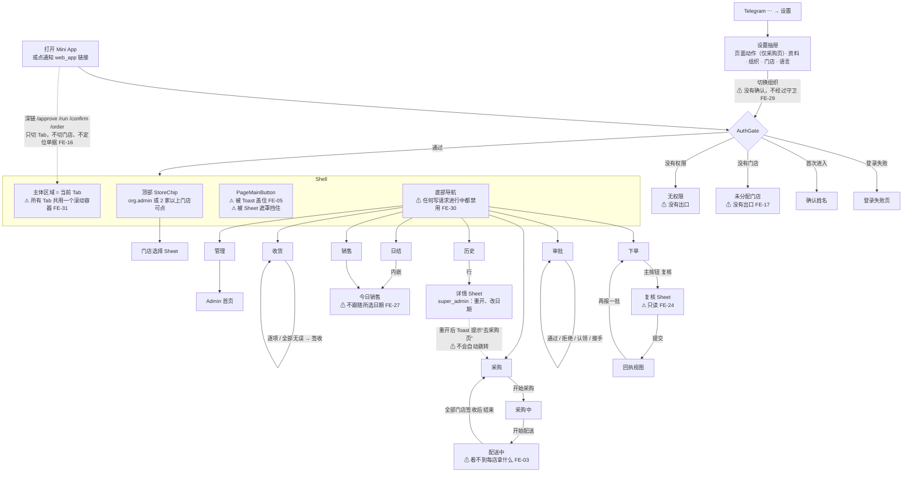
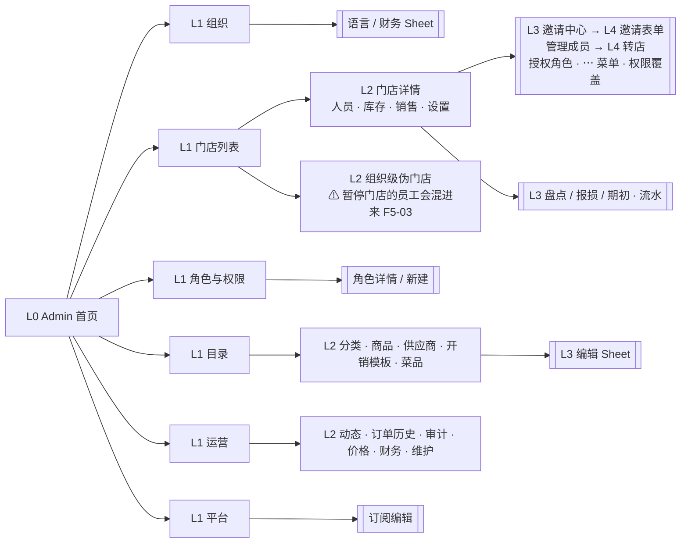

# CompassAlpha 前端页面、交互逻辑与用户操作流程深度审计

> 审计日期：2026-10-21
> 基线：`main` @ `c243771`，即当前线上运行的版本（`/health/version` 返回 `c2437716633c`）
> 方式：以静态代码审计为主，结合今天已经产生的真实运行证据（见 §0.4）
> 边界：只审计、只提建议。本次没有修改任何前端代码、路由或业务行为；只新增了本报告和 `docs/frontend-audit-2026-10-21/` 下的 6 份分轨证据附录。

## 阅读指引

本报告是**汇总版**，负责结论、优先级、目标结构和开发任务。逐页面、逐控件的证据（“控件 → handler(file:line) → 状态变化 → 接口 → 反馈 → 跳转”）放在 6 份附录里。正文引用附录时写作 `[F3 §4.4]` 或问题 ID，例如 `F3-07`。

| 附录 | 文件 | 范围 | 界面数 | 问题数 |
|---|---|---|---:|---:|
| F1 | `docs/frontend-audit-2026-10-21/F1-shell-navigation-global.md` | App 外壳、登录拦截页、底部导航、主按钮、设置、门店切换、深链、返回键、全局状态、`@compass/ui` | 24 | 29 |
| F2 | `docs/frontend-audit-2026-10-21/F2-order-approval.md` | 订货页、审批页、数量控件 | 14 | 26 |
| F3 | `docs/frontend-audit-2026-10-21/F3-run-purchasing.md` | 采购（Run）Tab 全部阶段、视图和 Sheet | 27 | 25 |
| F4 | `docs/frontend-audit-2026-10-21/F4-confirm-settlement-sales-history.md` | 收货确认、日结、销售面板 / 销售 Tab、采购历史 | 24 | 21 |
| F5 | `docs/frontend-audit-2026-10-21/F5-admin-org-stores-people.md` | Admin 首页、组织、门店（人员 / 库存 / 销售 / 设置）、角色权限、平台 | 30 | 23 |
| F6 | `docs/frontend-audit-2026-10-21/F6-admin-catalog-operations.md` | Admin 目录（5 个 CRUD）、运营（动态 / 订单历史 / 审计 / 价格 / 财务 / 维护） | 25 | 26 |
| 合计 | | | **144** | **150** |

结论标注沿用附录的写法：
- **已确认（代码）**：逐行读代码就能推出；
- **高可信度推断**：由代码推出，但依赖运行时时序、浏览器或 Telegram 客户端的行为；
- **待运行验证**：需要真机或真实数据，§12 写明需要什么。

全文没有任何埋点或使用数据。所有“使用频率”的判断都没有数据支撑，点击数都是从代码推出的下限。

---

## 目录

0. [总体结论](#0-总体结论)
1. [审计范围与方法](#1-审计范围与方法)
2. [页面全景清单](#2-页面全景清单)
3. [页面导航地图](#3-页面导航地图)
4. [逐页面审计结果](#4-逐页面审计结果)
5. [用户任务流程审计](#5-用户任务流程审计)
6. [重复页面与重复功能](#6-重复页面与重复功能)
7. [疑似无效页面与功能](#7-疑似无效页面与功能)
8. [交互逻辑问题](#8-交互逻辑问题)
9. [页面结构与导航优化方案](#9-页面结构与导航优化方案)
10. [优化优先级](#10-优化优先级)
11. [建议的开发任务清单](#11-建议的开发任务清单)
12. [待验证事项](#12-待验证事项)

---

## 0. 总体结论

### 0.1 一句话

产品的**单页内交互**打磨得很细：乐观更新、防抖、离线队列、幂等键、返回键栈、主按钮栈都有。最大的问题在**页与页之间、状态与状态之间**：
- 加载失败经常被显示成“没有数据”；
- 一些操作的结果不可见，或者被别的元素挡住；
- 同一业务对象分散在多个入口，规则也不一致；
- 关键阶段缺少“下一步该做什么”的信息，例如配送时不知道每家店该拿什么、签收后不知道是否已签收。

### 0.2 产品的实际形态

- **没有 URL 路由。** 整个应用是 Telegram Mini App 里的一个单页。底部最多 7 个 Tab（共 8 种 Tab，按权限显示），Admin 内部最多 2 层下钻，其余全部是底部 Sheet。导航状态持久化在 `localStorage['compass.nav.v1']`（`navStore.ts:135-278`），没有浏览器历史。
- **界面规模**：约 **35 个整页视图**、**约 110 个 Sheet、确认框和页内模式**，共 144 个独立界面条目（§2.1 有计数方法）。
- **按角色看到的 Tab**（已确认（代码），`Shell.tsx:87-117` 加 `seed-data.ts`）：

| 角色 | 可见 Tab | 数量 |
|---|---|---:|
| super_admin / admin | 下单、审批、采购、历史、日结、收货、管理 | 7 |
| manager | 下单、审批、历史、日结、管理 | 5 |
| purchaser | 采购、历史 | 2 |
| cashier | 日结 | 1 |
| staff | 下单、销售、收货 | 3 |

### 0.3 影响最大的体验障碍（P1，全部附带代码证据）

| # | ID | 问题 | 证据等级 | 关键证据 |
|---|---|---|---|---|
| 1 | FE-01 | **错误状态被显示成“没有数据”**，共 6 处。最危险的两处会诱发重复写入：<br>① 销售列表加载失败时显示“今日 0 份”，收银员可能重新录入，库存被重复扣减；<br>② 订货页 `todaySession` 加载失败时显示空的可编辑目录，员工可能重复下单。 | 已确认（代码） | `StoreSalesPanel.tsx:149,256-264`；`OrderPage.tsx`（全文件没有 `sessionQuery.isError`）；`ConfirmPage.tsx:78,444`；`CatalogSections.tsx:1472-1480`；`OperationsSections.tsx:946-955,1336-1344`；`RunPage.tsx:1996-1999` |
| 2 | FE-02 | **只含“其他物品”的订单，店长展开后看到的是“空”**，看不到要批的是什么。这是今天上线的新功能带来的回归。 | 已确认（代码） | `ApprovalPage.tsx:714-720` 提前 return，extras 渲染在 `:742` |
| 3 | FE-03 | **配送阶段采购员看不到每家店该拿哪些货**。按门店视图和明细列表只在计划、采购阶段显示，送达确认的文案也是通用句。 | 已确认（代码） | `RunPanels.tsx:323-325,423,475-480` |
| 4 | FE-04 | **“合并到原行”会覆盖已购行的供应商、小票和门店单价**，提示文案只说“会按同一单价重新计算”。 | 已确认（客户端）；服务端对空值是否视为“清空”属于高可信度推断 | `RunPage.tsx:2447-2459`；`runStores.ts:40-60` |
| 5 | FE-05 | **Toast 层叠在页面主按钮上**。部署后“新版本”提示一直显示，而且点一下就重载页面，用户想点“提交 / 保存”时很容易点中它。 | 高可信度推断，需真机验证 | `Toast.tsx:142-169`；`Shell.tsx:663-690`；`useVersionCheck.ts:80-84` |
| 6 | FE-06 | **新建门店后，邀请、授权、转店、克隆的门店选择器里看不到新店**，要重新打开小程序才行。这些选择器读的是会话里的门店列表，而建店后没有刷新会话。 | 机制已确认，表现待运行验证 | `StoresSections.tsx:123-128`；`PeopleSections.tsx:1545-1548,1820,2459-2462` |
| 7 | FE-07 | **维护区“重置今天”使用 UTC 日期**。在 UTC+5 的 00:00–04:59 点它，会**不可逆地删掉前一天**的数据。入口只对 super_admin 并且开启了环境变量时可见。 | 已确认（代码） | `OperationsSections.tsx:339-341,1632,1639` |
| 8 | FE-08 | **管理审计回答不了“谁把谁改成了什么角色”**：只显示原始的动作名和 ID 前缀，两段式的 action key 显示为“?”。 | 已确认（代码） | `OperationsSections.tsx:809-845` |

本次**没有 P0**。没有发现会让普通用户越权，或者无声损坏数据且无法察觉的前端问题。会删除数据的路径都要求 super_admin，并且服务端还会再校验一次。

### 0.4 已有的真实运行证据（今天，针对同一版本）

本机没有数据库，起不来完整的前后端，所以**本次审计没有亲手操作页面**。下面两项是今天针对 `c243771`（或功能完全相同的 `87d409b`）真实跑过的结果，可以证明这些路径**能走通**，但证明不了体验好坏：

| 证据 | 覆盖的路径 |
|---|---|
| CI 的 Playwright E2E `main-flow`（PR #56、#57，`main` 合并后）全部通过 | 登录并确认姓名 → 下单 → 认领并审批 → 现金和转账各买一项 → 送达 → 门店收货 → 结束并在历史里找到 → 日结 → 下一单显示估价 → 单价输错单位时弹出确认 |
| 部署后对生产地址的浏览器冒烟测试（13 项渲染 + 31 项深度点击）全部通过，页面没有 JS 报错 | 7 个 Tab 都能渲染；下单 → 复核 → 提交；审批卡片；采购空态；历史筛选；日结的工资选人和离开守卫；收货空态；Admin 的 5 个分区、门店详情的 4 个分段、Telegram 返回键、运营首页、财务入口 |

**没有被任何运行证据覆盖的**：所有 Sheet 叠加和返回键的真机表现、Toast 与主按钮的遮挡、离线回放、多 Run 切换、销售作废、邀请撤销、新建门店后的选择器、维护区。见 §12。

### 0.5 优先优化方向

1. **先修 8 个 P1**（§10、§11 中的 T01–T08）。大多数只需要改动几处、几十行代码。
2. **统一“状态呈现规范”**：错误要能翻译并可以重试；离线待同步要可见；没有写权限时禁用写按钮；每个页面单独包一层错误边界；Toast 不能盖住主按钮。这一组改动面最广，收益也最大（§9.1）。
3. **按角色重组门店侧的入口**：把日结、销售、库存放到一个“门店”工作台，Admin 只保留组织管理（§9.2）。
4. **补齐采购和审批里“下一步”的信息**：配送拣货单、采购中也能发清单、审批端改数量要即时响应、接手审核要原子化（§9.3）。

---

## 1. 审计范围与方法

### 1.1 范围（已确认）

| 区域 | 文件 | 行数（约） |
|---|---|---:|
| 入口与外壳 | `apps/web/src/main.tsx`、`app/**`（App、AuthGate、Shell、ErrorBoundary、PageMenuContext） | 2,400 |
| 全局状态与 hooks | `stores/**`、`hooks/**`、`lib/**` | 2,600 |
| 全局组件 | `components/**`（Settings、StoreSwitcher、LanguageSheet、CreateWorkspace、SubscriptionSummary、sales/**） | 1,400 |
| 业务页 | Order、Approval、Run（加 `runs/**`）、Confirm（加 `confirm/**`）、Settlement、Sales、History | 15,500 |
| Admin | `AdminPage.tsx`、`admin/**`（people、stores、catalog、operations、platform） | 8,400 |
| 设计系统 | `packages/ui/src/**`（含未被使用的 `kit/`） | 4,000 |
| 合计 | | **约 37,400** |

后端只读到理解前端结果所需的程度：order、run、sales、settlement、admin、catalog、report 这几个 router，以及 domain 层的命令。

### 1.2 方法

1. **盘点**：读入口、Shell 的 TABS 定义、`navStore` 的持久化字段、AdminPage 的分区和子分区，确定全部入口。
2. **分 6 轨并行**：每一轨逐行读代码，按统一格式建立“界面清单、导航和状态机、交互链、任务流程、一致性、问题清单”。
3. **交叉检查**：把各轨里引用了外壳或其他页面的行和 F1 对照，跨页面的模式（确认框、Toast、加载 / 空 / 错误状态、主按钮、离线、门店上下文）由 F1 全局 grep 汇总。
4. **主审计复核**：对所有 P1 和定级有争议的结论，主审计亲自读了源码复核：
   - `OperationsSections.tsx:335-345`
   - `StoreSalesPanel.tsx:140-155,250-268`
   - `ApprovalPage.tsx:708-724`
   - `StoresSections.tsx:123-130` 以及 `setSession` 的全部调用点
   - `RunPage.tsx` 合并分支
5. **重新定级与去重**：同一问题出现在多份附录时合并成一个 `FE-xx` 编号，并保留附录 ID 作为证据索引。

### 1.3 与上一轮审计的关系

`docs/audit-2026-10-21/E-*.md`、`B-*.md` 等附录是**修复之前**的审计。今天合并了 12 个修复提交之后，附录 F2、F3、F4 逐条复核了旧问题，下面这些已经修复，本报告不再列出：

| 附录 | 已修复的旧问题 |
|---|---|
| F2 | B-01、02、03、04、05、06、09、11、14、23 |
| F3 | C-05、15、19 |
| F4 | C-01、08、20，D-5、01、03、10、18、21 |
| F5 | A-03、06、10、18 |

仍然存在的旧问题会在本报告里重新编号，例如 B-15 对应 FE-21，C-12 对应 F3-22，C-16 对应 F3-12，D-11 和 D-16 对应 F4-18 和 F4-17。

---

## 2. 页面全景清单

### 2.1 计数方法

- **整页视图**：占据 Shell 主体区域的一个完整页面，包括 Tab 页、Admin 的分区页和子页、拦截页、崩溃页。
- **重要交互界面**：Sheet、原生确认框、页内模式（例如“再报一批”）、页内状态（例如 Run 的各个阶段）。
- 附录里一共记录了 144 个界面条目（F1 24、F2 14、F3 27、F4 24、F5 30、F6 25）。下表按整页视图汇总，Sheet 只列出数量和代表性的几个。
- **遗漏风险**：附录是按“文件 → 组件 → 条件渲染”逐个列出的，Tab 页和 Admin 分区可以保证完整；Sheet 可能漏掉页面内部临时拼出来的极小提示（例如 Toast 内部）。DEV 专用的界面（KitGallery、dev persona 登录）列出来了，但生产环境到达不了。

### 2.2 整页视图清单（35 个）

| # | 页面 | 位置 | 所属模块 | 入口 | 条件 | 职责 | 附录 |
|---|---|---|---|---|---|---|---|
| 1 | 认证加载中 | `AuthGate.tsx:392-407` | 外壳 | 冷启动 | 还在登录中 | 等待 | F1-P01 |
| 2 | 登录 / 登录失败 | `AuthGate.tsx:409-548` | 外壳 | 没有会话或登录失败 | — | 重试登录、重试邀请、复制 Telegram ID、浏览器访问码登录 | F1-P02 |
| 3 | 首次确认姓名 | `AuthGate.tsx:714-782` | 外壳 | `needsOnboarding` | — | 锁定显示名 | F1-P03 |
| 4 | 未分配门店 | `AuthGate.tsx:785-792` | 外壳 | 没有 `users.manage` 且没有门店 | — | 等待分配，**没有出口** | F1-P04 |
| 5 | 无权限 | `AuthGate.tsx:794-804` | 外壳 | 没有任何权限 | — | 等待授权，**没有出口** | F1-P05 |
| 6 | 崩溃页 | `ErrorBoundary.tsx:85-177` | 外壳 | 任意渲染异常 | 全局只有这一层边界 | 重试或重置 | F1-P06 |
| 7 | 下单 | `OrderPage.tsx` | 订货 | 底部 Tab，或通知深链 `/order` | `order.draft` | 4 种模式：首单、草稿、被驳回、再报一批，另有回执视图 | F2-P01…P03 |
| 8 | 审批 | `ApprovalPage.tsx` | 审批 | 底部 Tab，或 `/approve` | `order.approve` | 待审核、已通过、已拒绝 3 个子 Tab | F2-P09/P10 |
| 9 | 采购 | `RunPage.tsx` + `runs/**` | 采购 | 底部 Tab，或 `/run` | `run.purchase` | 无单预览 → 计划 → 采购（4 种视图）→ 配送 → 修改；多张单之间可切换 | F3-P01…P16 |
| 10 | 采购历史 | `HistoryPage.tsx` | 财务 / 查询 | 底部 Tab | `prices.view` | 搜索、筛选、分页，点开看详情 | F4-P22 |
| 11 | 日结 | `SettlementPage.tsx` | 门店经营 | 底部 Tab | `settlement.record` | 当日现金结账；内嵌“今日销售” | F4-P11 |
| 12 | 销售 | `SalesPage.tsx` | 门店经营 | 底部 Tab | 有 `sales.record` 但没有 `settlement.record`（只有 staff） | 录入和作废销售 | F4-P21 |
| 13 | 收货确认 | `ConfirmPage.tsx` | 收货 | 底部 Tab，或 `/confirm` | `delivery.confirm` | 逐项核对、填实收数量、签收；多趟配送之间可切换 | F4-P01…P10 |
| 14 | Admin 首页 | `AdminPage.tsx:232-290` | 管理 | 底部 Tab | `users.manage`，或平台管理员 | 分区入口 | F5-P01 |
| 15 | 组织 | `AdminPage.tsx:462-649` | 管理 | Admin 首页 | `users.manage` | 套餐、组织信息、语言、财务 | F5-P04 |
| 16 | 门店列表 | `StoresSections.tsx:94-327` | 管理 | Admin 首页 | `users.manage`；org.admin 能看到暂停和归档的店 | 门店卡，外加一个“组织级”伪门店 | F5-P07/P10 |
| 17 | 门店详情 | `StoresSections.tsx:343-396` | 管理 | 门店卡 | `users.manage` | 4 个分段：人员、库存、销售、设置 | F5-P09/P11/P16/P18/P19 |
| 18 | 角色与权限 | `PeopleSections.tsx:705-803` | 管理 | Admin 首页 | `users.manage`；新建角色要 org.admin | 角色阶梯 | F5-P20 |
| 19 | 目录首页 | `AdminPage.tsx:655-694` | 目录 | Admin 首页 | `users.manage` | 5 个入口 | F6-P01 |
| 20–24 | 分类 / 商品 / 供应商 / 开销模板 / 菜品 | `CatalogSections.tsx` | 目录 | 目录首页 | 写操作：前 4 个要 org.admin，菜品要 `dishes.manage` | 增删改、归档 | F6-P02…P06 |
| 25 | 运营首页 | `AdminPage.tsx:340-397` | 运营 | Admin 首页 | `users.manage` | 6 个入口 | F6-P10 |
| 26 | 实时动态（内嵌 Debug 控制台） | `OperationsSections.tsx:44-174` | 运营 | 运营首页 | Debug 只给 super_admin | 指标卡片和最近事件 | F6-P11 |
| 27 | 订单历史（Submission history） | `OperationsSections.tsx:185-316` | 运营 | 运营首页 | — | 订单会话的结果 | F6-P12 |
| 28 | 管理审计 | `:727-871` | 运营 | 运营首页 | 店长只能看到自己门店范围 | 谁改了什么 | F6-P13 |
| 29 | 价格报告 | `:892-1011` | 运营 | 运营首页 | — | 每个 SKU 的价格统计 | F6-P14 |
| 30 | 财务 | `:1034-1536` | 运营 | 运营首页 | — | 现金和转账对账、复制 TSV | F6-P15 |
| 31 | 维护（危险区） | `:1538-1828` | 运营 | 运营首页 | super_admin，并且设置了 `VITE_ENABLE_MAINTENANCE` | 定向清除、按日期重置、全部清除 | F6-P16 |
| 32 | 平台 | `PlatformSections.tsx:46-99` | 平台 | Admin 首页 | 平台管理员 | 租户、套餐、状态 | F5-P24 |
| 33 | Admin 无权限空态 | `AdminPage.tsx:164-173` | 管理 | — | 会话中途失去权限时 | — | F5-P02（实际到达不了） |
| 34 | Debug 控制台 | `DebugPage.tsx` | 运维 | 嵌在实时动态里 | super_admin，并且有 `system.logs.view` | 日志、健康状态、登出 | F1-P20 |
| 35 | KitGallery | `pages/KitGallery.tsx` | 开发 | `/?kit` | 仅开发环境 | 新设计系统的展示页 | F1-P21（生产不可达） |

### 2.3 重要交互界面（Sheet、确认框、页内模式），按模块计数

| 模块 | 数量 | 代表 |
|---|---:|---|
| 全局 | 9 | 设置抽屉、门店选择、语言选择、新建工作区、新版本 Toast、Telegram 原生确认框 |
| 订货与审批 | 9 | 复核订单、今日批次、其他物品编辑器和联想、数量快选、拒绝原因、接手确认、明细展开 |
| 采购 | 19 | 选单（SessionPicker）、加单、PurchaseSheet、AddItemSheet、价格核对、缺货、14 种 ConfirmSheet、摊位选择、页菜单、多单切换条 |
| 收货 / 日结 / 销售 / 历史 | 12 | “全部无误”、问题登记、多趟切换、工资选人、版本冲突、作废销售、历史筛选、历史详情（重开、改日期） |
| Admin 组织 / 门店 / 人员 / 平台 | 22 | 邀请中心、邀请表单、待处理邀请、管理成员、转店、授权角色、⋯ 菜单、权限覆盖、角色详情和新建、新建门店、盘点 / 报损 / 期初、库存流水、克隆角色、财务设置、订阅编辑 |
| 目录与运营 | 17 | 5 类新建 / 编辑 Sheet、5 个归档确认、菜品配方编辑器、清除预览、按日期重置、全部清除 |

完整清单见各附录 §2。

### 2.4 前端页面与业务模块的对应关系

```text
认证 / 入驻 ── AuthGate（页 1–5）+ 邀请链接
订货 ───────── 下单（7）
审批 ───────── 审批（8）+ 通知 /approve
采购 ───────── 采购（9）+ 历史详情里的重开和改日期
收货 ───────── 收货确认（13）
门店经营 ───── 日结（11）、销售（12）、Admin→门店→销售 / 库存（17）
财务与查询 ─── 采购历史（10）、运营→财务 / 价格报告（29/30）
组织管理 ───── Admin：组织、门店、人员、角色（14–18）、平台（32）
目录 ───────── Admin→目录（19–24）
运维 ───────── 运营→动态 / 订单历史 / 审计 / 维护（26–28、31）、Debug（34）
```

---

## 3. 页面导航地图

### 3.1 全局导航（核心页面、主要操作和问题标注）



### 3.2 Admin 层级（深度从 Admin 首页算起）



最深是 4 层：Admin 首页 → 门店 → 门店详情 → 管理成员 → 转店。返回顺序是“先关 Sheet，再一层一层退”，由 `telegramBackStack.ts` 保证（已确认（代码），有单测）。

### 3.3 页面关联矩阵（谁能把用户带到哪里）

| 从 ↓ / 到 → | 下单 | 审批 | 采购 | 历史 | 日结 | 销售 | 收货 | Admin |
|---|---|---|---|---|---|---|---|---|
| 底部导航 | ✔ | ✔ | ✔ | ✔ | ✔ | ✔ | ✔ | ✔ |
| 通知深链 | ✔ `/order` | ✔ `/approve` | ✔ `/run` | — | — | — | ✔ `/confirm` | — |
| 页面内按钮 | — | — | — | — | — | — | — | — |
| Toast 提示文字 | — | — | 历史重开后提示“去采购页”（不可点） | — | — | — | — | — |

**已确认（代码）：业务页面之间没有任何程序化跳转**。全仓库的 `setTab` 只由底部导航和深链调用。所有跨页衔接都要用户自己去点底部 Tab，例如“审批完去采购”“重开后去修改”“签收完去日结”。

---

## 4. 逐页面审计结果

每页按四个方面写：**职责是否清晰**、**信息与布局**、**交互问题**、**优化建议**。问题 ID 指向 §8 和 §10，完整的交互链见对应附录。

### 4.1 登录与拦截页（F1）

- **职责**：清晰，各管一种状态。
- **信息与布局**：
  - 登录失败页无论什么原因，都提示“把 ID 发给管理员”（`AuthGate.tsx:419,422`），网络超时也一样（F1-20）。
  - 未分配门店页只有一段文字，不显示 Telegram ID（`:785-792`）。
- **交互问题**：拦截页上**没有任何出口**，不能换语言、切组织或重新检查（FE-17）。只属于多个组织的用户如果切到一个还没有门店的组织，就会被困在“未分配门店”页。管理员分配门店后，对方必须完全退出 Mini App 再进来（FE-13）。
- **建议**：拦截页放一个精简设置区（语言、组织列表、“重新检查”按钮）；只有在 `noMembership` 类错误时才提示“发 ID 给管理员”。

### 4.2 外壳：底部导航、主按钮、设置、门店选择（F1）

- **职责**：外壳本身清晰。但“设置”抽屉同时承担了个人偏好和采购页的低频动作（撤销开始采购、取消采购单）。后者要经过 ⋯ → 设置 → 动作 → 确认，4 次点击（F1-14），很难发现。
- **信息与布局**：
  - Tab 数量两极分化：admin 7 个，375px 宽时每个约 53px，俄语和乌兹别克语会被截断；cashier 只有 1 个，导航占了 64px 却没有任何选择（F1-13）。
  - 审批、收货 Tab 都没有待办数量徽章。
- **交互问题**：
  - FE-05：Toast 盖住主按钮。
  - FE-30：任何写请求都会冻结底部导航和主按钮，包括下单页连点数量。
  - FE-31：切 Tab 不复位滚动。
  - FE-29：切换组织没有确认。
  - 两个语言入口行为不一致（F1-16）。
  - 设置里点“新建工作区”后没有取消按钮（F1-15）。
- **建议**：见 §9.1 的“外壳规范”。

### 4.3 下单（F2）

- **职责**：清晰，就是“今天这家店要买什么”。草稿、被驳回、回执、再报一批，4 种模式共用一个页面，切换由服务端返回的会话状态决定。这个设计合理，但**当前处于哪种模式对用户不够显性**。
- **信息与布局**：
  - 高频的 SKU 列表在最上面，这是对的。
  - “其他物品”编辑器在约 190 行目录的**最底部**（`OrderPage.tsx:1212`）（FE-26）。
  - 复核 Sheet 只读（FE-24）。
  - 今日批次列表不能点（FE-25）。
- **交互问题**：
  - FE-01：`todaySession` 出错时，页面显示成空的可编辑目录。
  - FE-09：离线时界面没有任何标识，“其他物品”只是在排队，却显示“已保存 ✓”。
  - FE-19：长按 + 实际只加一步。
  - F2-08：被驳回横幅上的“撤回”会清掉驳回原因，成功后也没有反馈。
  - F2-20：审批人就是提交人并且已自己认领时，仍然显示“撤回”。
- **建议**：
  - 复核 Sheet 里可以直接改数量，并加一个“已选（N）”筛选；
  - “其他物品”的入口提到顶部，并放进“搜索无结果”的空态里；
  - 顶部常驻显示“第 N 批 / 离线待同步 N”；
  - 批次可以点开。

### 4.4 审批（F2）

- **职责**：清晰。
- **信息与布局**：
  - 卡片上的预估金额没有币种，展开后才有（F2-16）；
  - “其他物品”在卡片上被叫作“备注”（F2-17）；
  - 三个子 Tab 用同一句空态文案（F2-15）。
- **交互问题**：
  - FE-02：只含其他物品的订单，展开后显示“空”。
  - FE-14：改数量的请求还没回来，就能点“通过”。
  - FE-15：审批端改数量没有乐观更新，每点一下都要等一个来回，期间整块控件变灰。
  - FE-18：“接手审核”只是释放，不会认领给自己。
  - FE-21：撤销审批没有确认，也不带原因（`approval.confirm.unapprove.*` 文案已经写好，但没有用上）。
- **建议**：
  - 明细区的空态改成只针对 SKU 段；
  - 把改数量的进行中状态提升到父组件，进行中禁用“通过”；
  - 复用下单页的“乐观更新 + 防抖”编辑模型；
  - 接手做成原子操作；
  - 撤销审批加确认；
  - 加一个带确认的“全部通过”（可选）。

### 4.5 采购（F3）

- **职责**：最复杂的页面，用一个 Tab 承载了 5 个阶段、4 种视图、多张单切换和约 19 种 Sheet。阶段划分本身是合理的。**问题出在阶段之间的信息断层**。
- **信息与布局**：
  - 配送阶段只剩门店行，看不到每家店该拿什么（FE-03）。
  - 开单后无法再发送摊位或门店清单，“发送清单”只在预览阶段有（FE-32）。
  - “还有 N 项”主按钮在按门店视图、加了筛选、或分类折叠时点了没反应（FE-23）。
  - 配送阶段等待门店签收时，主按钮整个隐藏，没有“还差 N 家店签收”之类的进度（F3-19）。
- **交互问题**：
  - FE-04：合并到已购行会覆盖数据。
  - FE-22：新购时没法同时记供应商、小票或分店价，只能先保存，再编辑并编一个修改理由。
  - FE-23：误点展开的价格编辑器收不回去。
  - FE-33：“退回审核”在服务端必然拒绝的情况下仍然显示。
  - FE-09：离线写入在列表上看不到，送达确认离线入队后 Sheet 不关闭，可以重复入队。
  - F3-14：行内保存状态只有一个槽，快速连点两行时，前一行的 ✓ 会重新变成可点。
- **建议**：
  - 配送阶段的门店行可以展开成只读拣货单；
  - 按摊位和按门店视图的组头加“发送清单”；
  - 价格编辑器加“收起”和“更多…”（打开新购模式的完整 Sheet，不要求理由）；
  - “还有 N 项”找不到目标时，自动切回聚合视图、清掉筛选；
  - 配送阶段主按钮显示等待进度。

### 4.6 收货确认（F4）

- **职责**：清晰。
- **信息与布局**：
  - 签收之后页面没有“已签收”状态，看起来和刚开始核对时几乎一样（FE-20）；
  - 等待送达和没有配送单用同一句文案，用户分不清“在路上”和“没有单”。
- **交互问题**：
  - FE-01：配送单列表加载中或加载失败时，都显示成“暂无可确认”。
  - FE-09：离线签收没有乐观状态，可以重复入队；恢复网络后第二条被拒，弹出“同步失败”。
  - F4-10：问题登记的备注其实必填，但界面上没有标识。
- **建议**：签收后显示只读横幅（签收时间、问题项数），状态 Chip 设为禁用；明确区分“在路上”和“没有单”。

### 4.7 日结（F4）

- **职责**：清晰，但页面很长：收入、经营支出明细、工资明细、采购预留和调整、现金、备注，外加内嵌的“今日销售”。
- **信息与布局**：
  - “今日销售”放在日期选择**之上**，而且**不跟随所选日期**（FE-27）；
  - 最近日结列表在页面最底部，也不显示金额（F4-18）；
  - 修订历史看不到。
- **交互问题**：
  - FE-28：日结页会**静默改掉全局门店**（包括 org.admin 的“全部门店”）；所有保存错误都只显示“无法保存，请重试”；后台重新拉取到新版本时，会静默覆盖正在编辑的表单（高可信度推断）。
  - F4-11：主按钮变灰时不说明原因。
- **建议**：
  - 销售块接收日期参数，标题随日期变化；
  - 门店不可用时显示说明，而不是改写全局门店；
  - 改用 `errToast` 显示服务端给出的原因；
  - 表单有改动时，后台拉到新版本改为提示冲突，不直接覆盖。

### 4.8 销售（F4）

- **职责**：同一个 `StoreSalesPanel` 出现在 3 个入口：日结页内嵌、员工的销售 Tab、Admin → 门店 → 销售。组件只有一份，行为一致，这一点做得好。但门店来源有 3 种（见 §6）。
- **交互问题**：
  - FE-01：列表加载失败时显示“今日 0 份”。
  - 只能看到和作废**今天**的销售（F4-14）。
  - 菜品加载中，或者用户没有管理菜品的权限时，提示“去 目录 → 菜品 创建”，而这些人根本进不去那里（F4-12）。
  - 数量输入框声明的是整数，却能提交 0.5 份（F4-13）。

### 4.9 采购历史（F4）

- **职责**：清晰，是这个前端里唯一完整做了“搜索 + 筛选 Sheet + 已生效 Chip + 分页”的列表，可以作为其他列表的范本。
- **交互问题**：
  - 筛选状态切 Tab 后丢失（F4-15）。
  - 详情副标题直接显示 `finished` 这样的原始状态值（F4-16）。
  - 重开 run 没有二次确认，重开后也不会跳到采购页（FE-34）。

### 4.10 Admin：组织、门店、人员、角色、平台（F5）

- **职责**：
  - “组织”分区里一半是个人信息（我的角色、Telegram 用户名、语言），和设置抽屉重复（F5-19）。
  - “门店详情”是一个 4 分段的工作台，人员、库存、销售、设置都放在里面，而库存和销售本质上是**门店日常运营**，不是“管理”（FE-36）。
- **信息与布局**：
  - **没有组织级的人员目录**，找人之前必须先知道他在哪家店（F5-05）；
  - 待处理邀请藏在“邀请”Sheet 里（F5-08）；
  - 暂停门店的员工会被归到“组织级”伪门店，那里标注的是“管理员”（F5-03）；
  - 暂停和归档在列表里显示同一个英文徽章 “paused”（F5-04）。
- **交互问题**：
  - FE-06：新建门店后，选择器里看不到新店。
  - FE-35：“移出门店”有两套语义；改角色要先授予新的、再撤销旧的，分两步；邀请表单的“暂不分配角色”实际会得到门店默认角色。
  - F5-10：店长在自己的卡片上点 ⋯，打开的是空菜单。
  - F5-17：门店设置可能一直停在 “Loading store…”。
- **建议**：见 §9.2：
  - 增加“人员”目录；
  - 授权 Sheet 里提供“替换现有角色”；
  - 取消勾选门店时统一执行“移出本店”；
  - 只管一家店的店长直接进入自己的门店；
  - 新建门店后自动进入新店，并刷新会话。

### 4.11 Admin：目录（F6）

- **职责**：清晰，5 个增删改区块。
- **一致性**：5 个区块各自实现了“只读提示 / 归档开关 / 搜索 / 编辑入口 / Toast / 错误状态”，逐项都有差异（§6.3）。
- **交互问题**：
  - FE-37：没有管理菜品权限的用户也能打开菜品编辑器，保存才报错；配方里的原料只能从全部 SKU 的原生下拉里选，5 种原料大约要 24 次点击；无效的原料行在保存时被静默丢弃。
  - FE-38：名称字段 4 种语言全部标了必填星号，但服务端只要求 1 种；分类 slug 不在前端校验。
  - F6-16：Sheet 草稿关闭时不确认就丢弃。

### 4.12 Admin：运营（F6）

- **职责**：
  - “订单历史”和底部 Tab “历史”名字冲突，内容却是两套完全不同的数据（FE-41）；
  - Debug 控制台嵌在“实时动态”里，并带有破坏性的登出操作（F6-25）。
- **交互问题**：
  - FE-07：维护区按 UTC 日期删除数据。
  - FE-08：审计看不懂。
  - FE-39：财务里已归档的供应商显示为 UUID；复制 TSV 不跟随当前视图。
  - FE-40：定向清除可以删掉真实订单（订单会话没有“是否测试数据”的检查，采购批次有）。
  - F6-12：价格报告没有搜索、日期和走势。
  - F6-14：大量硬编码英文。

---

## 5. 用户任务流程审计

点击数全部从代码推出：一次 tap 算 1 下，键盘输入单独记，滚动不计，都是下限。完整路径见各附录 §5。

| # | 任务 | 当前路径（概要） | 当前 | 问题步骤与原因 | 建议路径 | 目标 | 风险与依赖 |
|---|---|---|---|---|---|---|---|
| 1 | 员工下一张 15 项的订单 | 定位 SKU（搜索或分类）→ 设数量（+ 或快选）→ 复核 → 提交 | ≥47 下 + 输入 | 复核时发现错误，只能关掉 Sheet → 重新搜 → 改 → 再打开（复核 Sheet 只读）；长按 + 只加一步 | 复核 Sheet 里直接改；修好长按；加“已选”筛选 | 改一项从约 4 下降到 1–2 下 | 复核里改数量也要在提交前先发出待发请求（现有逻辑已经这样做） |
| 2 | 员工修改被驳回的订单 | 回到下单页 → 被驳回横幅 → 修改 → 复核 → 提交 | 2 下 + 修改 | 如果当天已经开了新草稿，被驳回的那批被挡住，而且批次列表点不开（F2-10）；“撤回”会清掉原因 | 批次列表可点；被驳回状态下去掉“撤回”，或改名为“放弃此单”并加确认 | 被驳回的单不会再被挡住 | `todaySession` 需要支持按 sessionId 查询 |
| 3 | 员工只报目录外物品 | 滚到约 190 行目录的最底部 → 新增 → 输入 → 等自动保存 → 复核 → 提交 | 4 下 + 长距离滚动 + 输入 | 入口在最底部；店长那边看不到这些物品（FE-02） | 顶部或搜索无结果空态里放“作为其他物品添加「搜索词」” | 省掉滚动 | 两处编辑器要共用状态 |
| 4 | 店长审批 5 张单 | 审批 Tab → 每张“通过” | 6 下（不看明细）/ 11 下（看明细） | 通过后列表会重排，存在误批下一张的风险（待验证）；没有待审数量 | 通过后原位显示“已通过 · 撤销”约 3 秒；Tab 显示待审数量 | 防误触 | 需要真机观察误触率 |
| 5 | 店长改数量后通过 | 认领 → 每行 +/-（每次一个来回，期间控件闪灰）→ 通过 | 2 下 + 修改次数 | 没有乐观更新；改数量和通过之间有竞态 | 复用下单页的编辑模型；有待发修改时禁用“通过” | 编辑速度与员工端一致；所见即所批 | 要处理 CONFLICT |
| 6 | 店长接手别人的认领 | 接手 → 原生确认 → 已释放 → 认领或通过 | 3–4 下 | 接手只是释放，期间第三个人可以抢走 | 做成原子的接手（服务端新增命令，或串行释放 + 认领） | 少 1 下，没有竞态 | 原子命令需要域层支持 |
| 7 | 采购员用今天的订单开单 | 采购 Tab → 开始采购 | 1 下 | 开单后就不能再发摊位清单了 | 采购中的视图也能发清单 | — | 低 |
| 8 | 采购员按参考价买 30 项 | 每行点 ✓ | 30 下 | 快速连点会误报“已采购”（保存状态只有一个槽）；参考价超过 30 天只用颜色标出 | 每行独立的保存状态；陈旧参考价第一次 ✓ 时要求确认一次 | 消除误报 | 陈旧价多一步，需要数据评估影响 |
| 9 | 采购员按新价买一项，并记录供应商和小票 | 点行 → 点价格框 → 输入 → ✓；要带供应商、小票就再点已购行 → 改字段 → **填修改理由** → 保存 | ≥5 下 + 2 输入，外加一条多余的修改事件 | 新购模式的完整 Sheet 只在没有需求数据时才会打开 | 编辑器加“更多…”打开新购模式（不要求理由）；打开时聚焦价格框 | 3 下 + 1 输入；没有伪造的修改理由 | 需要一起清理重复的表单校验（F3-11） |
| 10 | 采购员给 3 家门店送货 | 开始配送 + 确认 → 每家店：点行 + 确认 | 8 下 | **看不到每家店该拿什么**；送达成功没有反馈 | 门店行展开成只读拣货单；确认文案写出件数和金额 | 不增加点击，不用再凭记忆装货 | 低，数据已经在 `run.get` 里 |
| 11 | 门店签收 20 项（1 项短缺） | 收货 Tab → 短缺 Chip → 填实收数量和备注 → 保存 → 全部无误 → 确认 → 签收 | 5–6 下 + 2 输入 | 签收后没有“已签收”状态；离线时可以重复签收 | 签收后显示横幅；离线入队时做乐观更新 | — | 低 |
| 12 | 收银员录完销售再日结 | 日结 Tab → 展开“今日销售” → 选菜品、填份数、记录 × n → 收起 → 填写日结 → 保存 | 每笔销售 3 下 + 日结表单 | 销售块不跟随日期；列表加载失败时显示 0（FE-01） | 销售块跟随日期，并显示错误状态 | 防止重复录入 | 低 |
| 13 | 店长更正昨天的日结 | 日结 → 改日期 → 改金额 → 填更正原因 → 保存 | 3 下 + 输入 | 页面上同时还显示“今日销售”；按钮变灰不说明原因；保存失败只说“请重试” | 见 §4.7 | — | — |
| 14 | 管理员邀请新员工 | Admin → 门店 → 某店 → 邀请 → 分享 → 选角色 → 生成 | 7 下 | “邀请中心”只是一个三选一的中转 Sheet；“暂不分配角色”有误导 | 人员页的“邀请”直接打开表单，底部放“分享 / 复制”；空选项改为“使用门店默认角色（X）” | 6 下，少一层 Sheet | 待处理邀请需要放到新位置 |
| 15 | 店长把员工改成采购员 | 授予新角色 → 点旧角色 Chip → 确认 | 6 下，中间会出现两个角色或没有角色的窗口 | 没有“替换角色”这个操作；Chip 外观像标签，实际点一下就是撤销 | 授权 Sheet 里提供“替换现有角色”，默认勾选 | 4 下，没有中间态 | 服务端最好提供原子的替换接口 |
| 16 | 管理员新建门店并设默认角色 | 门店 → 新门店 → 输入 → 创建 → 找到新店 → 设置 → 默认角色 → 保存 | 8 下 | 创建后不会进入新店；接下来邀请时选择器里看不到它（FE-06） | 新建 Sheet 里直接选默认角色；创建后进入新店并刷新会话 | 4 下，而且后续步骤能用 | 刷新会话会触发全局重渲染 |
| 17 | 管理员新建一个带 5 种原料配方的菜品 | 目录 → 菜品 → 新建 → 名称、售价 → 加原料 × 5（每种用原生下拉在全部 SKU 里选） | 约 24 下 + 输入 | 原料下拉不能搜索；无效行被静默丢弃 | 用可搜索的多选 SKU Sheet；无效行标红并阻止保存 | 约 10 下 | 低 |
| 18 | 查上个月各供应商的支出并复制 | 运营 → 财务 → 上月 → 按供应商 → 复制 | 5 下 | 复制出来的是全部明细，不是汇总；已归档供应商显示为 UUID | 复制内容跟随当前视图；查询时包含已归档供应商 | 一次得到需要的表 | 低 |
| 19 | 查“谁改了某人的角色” | 运营 → 审计 → 翻找 | 无法完成 | 只有原始的动作名和 ID 前缀 | 服务端返回可读的名称；前端渲染成一句话；加按类型筛选 | 能完成 | 服务端需要配合 |

**跨页面衔接的结论（已确认（代码））**：
- 每个任务都在单个 Tab 内结束。凡是需要“下一步去另一个页面”的地方，界面上都**没有入口**：审批后去采购、重开后去采购、签收后去日结、新建门店后去设置。
- 唯一的提示是历史页重开后的一条文字 Toast，而且 Toast 组件不支持放按钮（`RunPage.tsx:289-303` 的注释）。

---

## 6. 重复页面与重复功能

### 6.1 重复页面和入口

| 涉及对象 | 实际差异 | 重复程度 | 用户影响 | 建议 | 风险 |
|---|---|---|---|---|---|
| 语言选择：设置抽屉 vs Admin → 组织 → LanguageSheet（`SettingsSheet.tsx:251-272`、`LanguageSheet.tsx:50-114`） | 一个选完不关，一个选完关闭；`LANGS` 常量定义了两份 | 功能完全重复 | 行为不一致 | 删掉 Admin 里的 LanguageSheet，那一行改为打开设置抽屉 | 无 |
| 门店选择：StoreChip 的 Sheet vs 设置抽屉里的门店区 | 同一个组件 | 入口重复 | 轻微 | 保留 StoreChip，设置里的那一块改成一行文字说明 | 无 |
| 个人信息：设置“关于” vs Admin → 组织 | 都显示组织名、角色（原始 slug）、Telegram 用户名 | 高度重叠 | 职责混淆 | 组织页只放组织级设置，个人信息放到设置抽屉 | 无 |
| **销售录入的 3 个入口**：日结内嵌 / 销售 Tab / Admin → 门店 → 销售 | 同一个 `StoreSalesPanel`；门店来源分别是“日结页内下拉（会强行改写全局门店）”“全局 StoreChip”“Admin 下钻的门店” | 组件复用得很好，入口有重叠 | 店长可能在 A 店的日结页看着 B 店（Admin 下钻）的销售 | **保留**员工和收银员各自的入口（服务不同角色）；Admin 里的销售分段改为只读，或者干脆删掉 | 店长的习惯会改变 |
| “历史”命名：底部 Tab“历史”（采购批次）vs 运营 → “订单历史”（订单会话） | 两套完全不同的数据 | 名字冲突 | 管理员容易以为后者是前者的子集 | 运营里的改名为“订单提交记录”，代码 key 改为 `submissions` | 无 |
| 按时间看钱：历史 Tab vs 运营 → 财务 | 已经共用服务端的金额口径；预设、筛选和分组都不同 | 部分重叠，**目的不同**（逐单明细 vs 对账汇总） | 两套日期预设 | **不合并**；统一日期预设组件（都提供今天、昨天、本月、上月、7/30/90 天） | 低 |
| 人员管理：门店 → 人员（每店一张卡）vs 角色详情里的“持有人”（只读、不能点） | 同一个人在每家店各有一张卡，没有“这个人的全部情况” | 分散 | 找人困难 | 新增“人员”目录（§9.2） | 中 |

**不建议合并的**：
- 下单 / 审批 / 采购 / 收货：角色、状态和任务都不同。
- 采购的 4 种视图：同一批需求在现场的不同组织方式。
- 库存盘点 vs 收货入库：一个是人工校正，一个是采购的副作用。
- 采购开销 vs 日结经营支出：会计口径不同。

### 6.2 同一操作的多条路径

| 操作 | 路径 | 问题 |
|---|---|---|
| 把成员从门店移出 | ① 管理成员里取消勾选（只删分配）；② ⋯ → 移出本店（连角色和权限覆盖一起删） | 两种语义；①之后成员仍然出现在该店，也不提示（F5-02） |
| 给成员一家新门店 | ① 管理成员里勾选（只分配，没有角色）；② 授权角色时勾选门店（绑定角色，本身就算“属于该店”） | ①多余，还会产生“在店里但没有任何权限”的成员（F5 §5 T4） |
| 改成员的角色 | 授权 Sheet 授予 + 成员卡上的 Chip 撤销 | 授予和撤销分在两个地方 |
| 停用门店 | 设置里的启用开关 vs 归档按钮 | 结果几乎一样，列表上无法区分；打开开关会把归档的门店也一起恢复 |
| 确认危险操作 | Telegram 原生确认框 / 自定义 ConfirmSheet / 没有确认 | 规则不统一（§8.4） |

### 6.3 重复的前端实现

| 涉及对象 | 位置 | 差异 | 建议 |
|---|---|---|---|
| 两套设计系统 | `@compass/ui` 根导出 vs `@compass/ui/kit`（约 670 行） | kit 除了只在开发环境存在的 KitGallery，**没有任何业务代码引用** | 定出迁移路线；在那之前冻结或删除 kit |
| ConfirmSheet × 2 | `packages/ui/.../ConfirmSheet.tsx` vs `runs/sheets/RunSheets.tsx:1279` | 理由（软 / 硬）、取消规则、进行中能否关闭都不同 | 合并到 UI 包里一个实现 |
| EmptyState × 2、Sheet × 2 | 旧组件 vs kit | API 不同 | 跟随设计系统一起处理 |
| 目录的 5 个增删改区块 | `CatalogSections.tsx` | 只读提示、归档开关（Switch / Button / 没有）、搜索（只有 SKU 有）、编辑入口、Toast、错误状态逐项不同；`NameFieldsML` 逐字重复了两份（`:294-325` 与 `:627-659`） | 抽出 `CatalogListFrame`、`NameFieldsML`、`ArchiveRestore` |
| 估价计算 × 2 | `OrderPage` 的 `ReviewList` vs `ApprovalPage` 的 `SessionItems` | 逻辑相同 | 抽出 `estimateFromStats` |
| 数量编辑模型 × 2 | 下单页（乐观更新 + 防抖 + 串行 + 离线）vs 审批页（每次一个来回、整块禁用） | 同一个控件，两种手感 | 抽出 `useOrderLineEditor` |
| 支付方式控件 × 4、分段控件 × 3、搜索框 × 3、“K” 金额格式 × 5 处 | 采购页内部 | 视觉和行为细节不一致 | 统一使用 UI 包里已有的 `Segmented`、`SearchInput`，再抽出 `PaymentToggle`、`formatPriceK` |
| 财务的 3 种视图 | `OperationsSections.tsx:1345-1533` | 90% 的 JSX 相同 | 抽出 `<MoneyGroupList>` |
| 清除预览表格 | `CascadePreview` 已经抽出来了，但按日期重置和全部清除又各手写了一遍 | — | 复用 `CascadePreview` |
| 页面标题 × 3 | StickyPageBar / PageHeader / 手写 `<h1>` | — | 统一 |
| 门店筛选 × 3（运营里） | Select / 胶囊按钮 / 没有 | — | 统一 |

---

## 7. 疑似无效页面与功能

可达性分类：
- **A**：当前代码明确不可达；
- **B**：静态扫描没找到入口，但仍可能通过持久化状态、外部链接或运行时配置到达；
- **C**：可以到达，但价值待确认；
- **D**：没有使用数据，判断不了真实使用频率（全部条目都属于 D）；
- **E**：有证据表明已经被替代或重复。

| 对象 | 位置 | 分类 | 依据 | 建议 | 删除影响 |
|---|---|---|---|---|---|
| KitGallery 与整个 `@compass/ui/kit` | `main.tsx:33-40`、`packages/ui/src/kit/**` | A（生产）/ E | 只在 `DEV && ?kit` 时渲染；业务代码零引用 | 冻结或删除 | 无 |
| 下单页目录视图里的 submitted / approved / in_run / claimed 横幅，以及回执里的 archived 分支 | `OrderPage.tsx:1102-1119,1136-1161,963-964` | A | 锁定状态一律先进入回执视图；`todaySession` 不返回 archived | 删除 | 无 |
| 采购面板的 `planned` 分支 | `RunPanels.tsx:323-325,480` | A | RunPage 只在非 planned 时挂载它 | 删除 | 无 |
| 主按钮“接管 Sheet”的分派，以及 `purchaseFormState` 的重复校验 | `RunPage.tsx:1192-1255,1645-1664,1001-1023` | A | Sheet 的遮罩挡住了主按钮，每个 Sheet 都有自己的按钮 | 删除，并更新注释 | 无 |
| 收货页的 `confirmStoreFinal` 文案分支 | `ConfirmPage.tsx:358-359` | A | `visible=false` 时永远不渲染 | 改为签收后的横幅（FE-20） | 无 |
| `PeopleSection` 的“全部门店分组”视图 | `PeopleSections.tsx:479-519` | A | 唯一的调用方总是传 `lockMode` | **复用**它做人员目录（§9.2），不要删 | — |
| `ConfirmSheet` 的 `showPrimaryInSheet` 属性 | UI 包 | A | 已经没有调用方传 false | 删除 | 无 |
| Admin 无权限空态 | `AdminPage.tsx:164-173` | B | Tab 已经被隐藏了，只有会话中途失去权限时才会出现 | 保留（作为防御） | — |
| 维护页，以及非 super_admin 看到的维护横幅 | `OperationsSections.tsx:1538-1828,1596-1604` | B | 入口要求 super_admin 并且设置了环境变量；但持久化的 `opsSub='maintenance'` 可以绕过环境变量检查（F6-17） | 渲染时也检查环境变量 | — |
| 平台分区（失去平台管理员身份之后） | `AdminPage.tsx:227` | B | 只按持久化的 `section==='platform'` 渲染 | 渲染前检查身份 | — |
| 只有一个可见 Tab 也没有的自定义角色 → 下单页 | `navStore.ts:294` | B | 取决于有没有这种角色（待验证） | 显示无权限页（FE-42） | — |
| 采购计划阶段（“回到计划”） | `RunPage.tsx:1996-2063`，菜单 `:1672-1705` | C | 计划阶段能做的事，采购阶段都能做；唯一独有的是发送清单和改摊位 | 先在采购中提供发送清单（FE-32），再根据埋点决定是否去掉“回到计划” | 改变操作习惯 |
| 今日批次 Sheet | `OrderPage.tsx:1252-1266` | C | 只读，不能点进去 | 改成可以点（FE-25） | — |
| Debug 控制台（嵌在实时动态里） | `OperationsSections.tsx:156-171` | C | 运维工具和业务页混在一起；有 `system.logs.view` 的 admin 却看不到入口 | 移到维护区，按权限而不是角色名判断 | — |
| Admin → 门店 → 销售分段 | `StoresSections.tsx:388-390` | E | 和日结内嵌、销售 Tab 是同一个组件 | 改为只读，或删除 | 店长习惯 |
| Admin → 组织 → LanguageSheet | `AdminPage.tsx:523` | E | 当初加它是因为“网页预览里没有齿轮”，现在 Telegram 外已经有顶部的设置入口 | 删除 | 无 |
| `nav.deliver`、`nav.reports`、`nav.debug` 这几个 i18n key | `zh.ts:8,13,14` | A | TABS 不使用 | 删除 | 无 |
| realtime 的 `notification` 事件 | `useRealtime.ts:173-175` | A | 失效的是一个根本不存在的 `notifications` 查询 | 做收件箱，或者服务端停止推送 | — |
| `useOfflineQueue` 返回的 `pendingCount` / `online` | `useOfflineQueue.ts:373` | A（没有被读取） | 没有任何页面使用 | 用来做全局离线指示（FE-09） | — |
| 过时注释 | 各附录 §6 有列表（`Shell.tsx:72-75`、`ConfirmPage.tsx:8-9`、`RunHistory.tsx:39-42`、`StoreSalesPanel.tsx:4-8` 等） | — | 会误导维护者 | 批量清理 | 无 |

---

## 8. 交互逻辑问题

### 8.1 状态没有处理，或者处理错了

| ID | 问题 | 位置 | 等级 |
|---|---|---|---|
| FE-01 | 错误被显示成空数据：销售列表、订货 `todaySession`、收货的配送单列表、菜品、价格报告、财务；另外 run 详情加载中或失败时完全没有状态 | 见 §0.3；`RunPage.tsx:1996-1999`（F3-02） | 已确认 |
| FE-10 | `DataState` 的错误态直接显示 `error.message`（可能就是原始的 i18n key），没有重试按钮；全仓库有 20 处在用 | `DataState.tsx:44-49` | 已确认 |
| FE-20 | 收货签收后没有“已签收”状态，状态 Chip 点了没有反应 | `ConfirmPage.tsx:365,475,551` | 已确认 |
| FE-28 | 日结：静默改写全局门店；保存和加载的错误都用同一句“无法保存”；有改动的表单可能被后台拉取的新版本覆盖 | `SettlementPage.tsx:410-414,629-630,437-447` | 前两项已确认；第三项是高可信度推断 |
| F5-17 | 门店设置可能一直显示 “Loading store…” | `StoresSections.tsx:886-892` | 已确认；触发条件待验证 |
| FE-42 | 权限不对应任何 Tab 时，渲染下单页，底部导航为空 | `navStore.ts:294`、`Shell.tsx:542` | 已确认；是否存在这种角色待验证 |

### 8.2 反馈不足，或者反馈具有误导性

| ID | 问题 | 位置 |
|---|---|---|
| FE-09 | 离线写入对用户不可见：下单页“其他物品”只是在排队，却显示“已保存 ✓”；采购行重新变成可点；收货的签收和送达确认可以重复入队 | `useOfflineQueue.ts:373`（返回值没人读）；`OrderPage.tsx:723-726`；`RunPage.tsx:438`；`ConfirmPage.tsx:232-235` |
| — | 成功后没有任何反馈：撤回订单（`OrderPage.tsx:548-554`）、送达门店（`RunPage.tsx:529-532`）、勾选或取消门店分配和修改权限覆盖（`PeopleSections.tsx:1740-1751,2129-2144`）、取消归档菜品、复制 Telegram ID 或 Debug JSON | 各附录 |
| — | 主按钮变灰时不说明原因：日结（`SettlementPage.tsx:686-693`）、开单日期晚于今天时（`RunPage.tsx:1094`） | F4-11、F3 §4.1 |
| F2-05 | “接手审核”成功后提示“已释放” | `ApprovalPage.tsx:144` |
| F6-19 | 剪贴板写入成功之前就提示“已复制” | `OperationsSections.tsx:1214-1216` |

### 8.3 重复提交与竞态

| ID | 问题 | 位置 | 结果 |
|---|---|---|---|
| FE-14 | 审批端改数量的请求还没回来就可以点“通过” | `ApprovalPage.tsx:482-489,645-651` | 最后一次修改丢失，并弹出“保存失败” |
| F3-14 | 采购行的保存状态只有一个槽，连点两行时前一行重新可点 | `RunPage.tsx:119,2091` | 服务端拒绝，弹出“已采购”错误（不会重复记账） |
| FE-09 | 离线签收和送达确认可以重复入队 | 同上 | 恢复网络后弹出误导性的“同步失败” |
| F5-15 | 权限覆盖在保存进行中仍然可以再点 | `PeopleSections.tsx:2297-2314` | 最终状态不确定（待验证） |
| FE-19 | 长按 + 时定时器读的是按下那一刻的值 | `QtyControl.tsx:113-124` | 长按只加一步（待验证） |

### 8.4 确认框规则不统一（F1 §5）

| 操作类型 | 现状 |
|---|---|
| 不可逆，且影响业务状态 | 收货签收：**没有确认**；撤销审批：**没有确认**；历史页重开 run：**没有确认**；切换组织：**没有确认**；采购开单：没有确认，但计划阶段的“开始采购”**有**确认 |
| 有理由输入 | 采购的各种状态迁移：ConfirmSheet（软或硬理由）；销售作废：Sheet 加必填理由；撤销采购：**不要理由**；恢复缺货项：**必须**填理由 |
| 轻量操作 | 接手审核、归档、移出成员：Telegram 原生确认框（不能写理由，文本会被压成一行，`confirm.ts:19`） |

建议的规则：
- 涉及金额、库存或其他人的工作，并且不可逆 → 用 Sheet 确认，按需要带理由；
- 可撤销的轻量操作 → 不确认，改为 Toast 里提供“撤销”；
- 只有简单的“是 / 否”的危险操作 → 用原生确认框。

### 8.5 跳转与返回

| ID | 问题 | 位置 |
|---|---|---|
| FE-16 | 通知深链只切 Tab，不切门店、不定位单据。管理多家店的店长点开 B 店的通知，看到的可能是 A 店的队列 | `deepLink.ts:31-53`；`ApprovalPage.tsx:60-74` |
| FE-17 | 拦截页没有出口 | `AuthGate.tsx:555-568` |
| FE-31 | 所有 Tab 共用一个滚动容器，切 Tab 和 Admin 下钻时都不复位滚动 | `Shell.tsx:521-543` |
| FE-34 | 历史页重开 run 后不会跳到采购页；修改中（amending）无法放弃 | `RunHistory.tsx:395-406` |
| F1-28 | Telegram 外，Admin 的返回按钮在每一层都写着“管理” | `AdminPage.tsx:443-444` |
| F2-19 / F4-15 / F3-20 | 审批的子 Tab、历史的筛选、当前选中的 run 都是组件内部状态，切 Tab 就丢失；而 Admin 的下钻状态是持久化的，两者不一致 | 各附录 |
| F2-11 | 进入“再报一批”之后没有退出方式 | `OrderPage.tsx:570-575` |

---

## 9. 页面结构与导航优化方案

原则：**不破坏已有的业务能力和权限边界**；先修状态和反馈（风险低、收益广），再调整结构（会改变操作习惯，要灰度）。

### 9.1 外壳与跨页面规范（不改结构，统一行为）

| 规范 | 当前 | 目标 | 涉及 |
|---|---|---|---|
| 查询状态 | 有 20 处 `DataState` 直接显示原始 message、没有重试；另有 6 处把错误当成空数据 | `DataState` 走 `useTranslateError` 并加“重试”；禁止用 `data ?? []` 直接渲染空态，必须先判断 `isError` | `packages/ui/.../DataState.tsx` 以及 §8.1 的各处 |
| 离线 | 只有部分页面在入队时弹 Toast；`pendingCount` 没人读 | Shell 顶部显示“离线 · 待同步 N”；flush 监听提升到 App 级别；已入队的项在本页显示“待同步”；送达或签收入队后关闭 Sheet，并对同一个对象去重 | `useOfflineQueue`、Shell、Order / Run / Confirm |
| 只读订阅 | 只有一条横幅 | `useWriteAccess()`：没有写权限时禁用主按钮和写操作按钮，并说明原因 | 全局 |
| 错误边界 | 全局只有一层 | 每个 `PAGES[tab]` 单独包一层，崩溃时保留底部导航；生产环境把堆栈折叠起来 | `Shell.tsx:542`、`ErrorBoundary` |
| Toast 位置 | 盖住主按钮 | Shell 发布 `--app-main-btn-h`，Toast 层把它算进去；“新版本”改成页内横幅，并提供“稍后” | `Toast.tsx`、`useVersionCheck.ts` |
| 忙碌态 | 任何写请求都冻结导航 | 只有标记为“关键”的写请求才冻结；乐观更新的高频写请求不计入 | `useAppMutating` |
| 滚动 | Tab 之间互相影响 | 切换 Tab 或 Admin 分区时把滚动复位到顶部（或者每个 Tab 记住自己的位置） | Shell |
| 确认 | 三套规则 | 按 §8.4 的规则统一；Run 的 ConfirmSheet 合并到 UI 包里 | 全局 |
| 页内状态 | 有的丢失，有的持久化 | 审批的子 Tab、历史的筛选、当前选中的 run 都放进 navStore（不必写入 localStorage） | navStore |
| 深链 | 只切 Tab | 链接带上 `store` 和 `session` / `run`，前端经过 `requestStoreChange` 切门店，再定位并高亮那张单 | 后端的 deepLink 生成、`deepLink.ts` |
| 跨页衔接 | 没有 | Toast 支持一个动作按钮（例如“去采购页”“查看详情”）；完成某件事后提供“下一步”入口 | `Toast.tsx` |
| 拦截页 | 没有出口 | 精简版设置（语言、组织列表、重新检查） | AuthGate |

### 9.2 按角色重组门店侧入口（结构调整，建议灰度）

**现状的问题**：
- 门店的日常运营（日结、销售、库存）分散在三处：日结 Tab、销售 Tab（只有员工有）、Admin → 门店详情（只有持 `users.manage` 的人进得去）。
- 库存只能从 Admin 进入，所以一个只有 `inventory.adjust` 的库存员根本到不了（F5-12）。
- Admin 同时承担“组织管理”和“门店运营”两种职责。

**目标结构**：

```text
底部 Tab（按权限出现）
├─ 下单            order.draft
├─ 审批            order.approve           徽章 = 待审数量
├─ 采购            run.purchase
├─ 收货            delivery.confirm        徽章 = 待签收趟数
├─ 门店            settlement.record / sales.record / inventory.adjust 任意一个
│   ├─ 日结（有 settlement.record 时）
│   ├─ 销售（有 sales.record 时，跟随所选日期）
│   └─ 库存（有 inventory.adjust 时，含流水、盘点、报损、期初）
├─ 账目            prices.view
│   ├─ 采购历史（现在的历史 Tab）
│   └─ 财务汇总（从运营 → 财务迁过来，复用历史页的筛选组件）
└─ 管理            users.manage / 平台管理员
    ├─ 组织（只放套餐和财务设置；个人信息归设置抽屉）
    ├─ 人员（新增：全组织人员目录 + 待处理邀请；按门店筛选）
    ├─ 门店（门店设置、默认角色、克隆；不再放销售和库存）
    ├─ 角色与权限
    ├─ 目录
    ├─ 运营（动态、订单提交记录、审计、价格；Debug 和维护合并成“运维”，按权限和环境变量显示）
    └─ 平台
```

**任务如何在新结构下完成**：

| 任务 | 新结构下的路径 |
|---|---|
| 收银员 | 打开就在“门店 → 日结”，销售是同一个 Tab 里的分段，日期联动 |
| 员工 | 在“门店 → 销售”录销售（取代现在单独的“销售” Tab，Tab 数量不变） |
| 店长 | 盘点、报损从“管理 → 门店 → 某店 → 库存”（4 层）缩短为“门店 → 库存”（1 层） |
| 管理员找人 | “管理 → 人员 → 搜索”，不需要先知道这个人在哪家店 |

**各角色的 Tab 数量**：

| 角色 | 现在 | 目标 | 变化 |
|---|---:|---:|---|
| admin | 7 | 7 | 历史 → 账目，日结 → 门店，数量不变 |
| manager | 5 | 5 | 同上 |
| cashier | 1 | 1 | 日结 → 门店；只有 1 个 Tab 时建议隐藏导航 |
| staff | 3 | 3 | 销售 → 门店 |

**需要调整的地方**：
- `Shell.tsx` 的 TABS（新增 `store`、`ledger`，下线 `settlement`、`sales`、`history`）；
- `navStore` 的 Tab 联合类型、`merge` 迁移（旧值映射到新值）、`resolveVisibleTab`；
- 深链白名单；
- `StoresSections` 拆出库存和销售；`OperationsSections` 拆出财务；
- `PeopleSection` 复用现在到达不了的“全部门店分组”分支来做人员目录。

**迁移与兼容风险**：
- 已持久化的 `tab='settlement' | 'sales' | 'history'` 要在 `merge` 里映射过去，否则用户会落到默认 Tab；
- 深链 `/order` 等保持不变；
- 店长“去 Admin 盘点”的习惯会改变，建议在旧位置保留一个版本的跳转提示；
- 通知文案里如果提到 Tab 名称，要同步修改。

**如何验证没有破坏原有能力**：
1. 按角色逐一对照 §0.2 和上表，确认每个权限对应的能力在新结构里仍然可达；
2. 扩展 E2E `main-flow`，加入店长盘点、收银员日结加销售、员工销售这几条路径；
3. 为 `resolveVisibleTab` 和 `merge` 的迁移写单测。

### 9.3 页面内的结构优化（不动导航）

| 页面 | 建议 | 对应问题 |
|---|---|---|
| 下单 | 复核 Sheet 里可以改数量；加“已选（N）”Chip；顶部常驻“第 N 批 · 离线待同步”；“其他物品”入口放到顶部和搜索无结果空态；批次可以点开；修好长按 | FE-24、25、26、19、09 |
| 审批 | 明细里只含其他物品时也要显示；乐观编辑；改数量进行中时禁用“通过”；原子接手；撤销审批加确认；Tab 徽章；（可选）带确认的“全部通过” | FE-02、14、15、18、21 |
| 采购 | 配送阶段的拣货单；采购中也能发清单；价格编辑器加“收起”和“更多…”；“还有 N 项”能定位；配送阶段显示“等待 N 家店签收”；修改设置下拉入口改成页内的“更多”按钮（不再藏在设置抽屉里） | FE-03、32、22、23，F3-19，F1-14 |
| 收货 | 签收横幅；区分“在路上”和“没有单”；离线乐观更新；Chip 显示待核件数 | FE-20、09 |
| 日结 | 销售块跟随日期；不改写全局门店；显示具体错误；主按钮说明变灰原因；最近日结显示金额并能查看修订记录 | FE-27、28，F4-11、F4-18 |
| Admin 人员 | 人员目录；授权 Sheet 提供“替换现有角色”；取消勾选门店时统一走“移出本店”；邀请表单直接打开，“使用门店默认角色（X）”；待处理邀请移到人员列表顶部 | FE-35 |
| Admin 门店 | 新建门店时可以选默认角色，创建后进入新店并刷新会话；暂停和归档区分开，或合并成一个操作 | FE-06、FE-35 |
| 目录 | `CatalogListFrame` 统一 5 个区块；名称字段只有当前语言必填；slug 由名称自动生成；配方原料用可搜索的选择器；无效行阻止保存 | FE-37、38 |
| 运营 | 审计改成可读的句子并能筛选；财务复制跟随当前视图、包含已归档供应商；维护区用本地日期；定向清除检查是否测试数据；“订单历史”改名 | FE-07、08、39、40、41 |

---

## 10. 优化优先级

等级标准：
- **P0**：关键页面无法使用，或存在严重的操作、安全、数据风险。**本次没有。**
- **P1**：严重阻碍核心任务，或明显增加日常操作成本，或可能导致数据错误。
- **P2**：页面重复、导航混乱、体验不一致，或维护成本偏高。
- **P3**：视觉细节、低频交互、非关键体验。

修复成本：S < 0.5 天；M 0.5–2 天；L > 2 天（只是估计）。

### P1

| ID | 问题 | 代码证据 | 影响范围 | 成本 | 风险 | 验证方法 | 附录 |
|---|---|---|---|---|---|---|---|
| FE-01 | 错误状态被显示成空数据（6 处，其中 2 处会诱发重复写入） | `StoreSalesPanel.tsx:149,256-264`；OrderPage 中没有 `sessionQuery.isError`；`ConfirmPage.tsx:78,444`；`CatalogSections.tsx:1472-1480`；`OperationsSections.tsx:946-955,1336-1344`；`RunPage.tsx:1996-1999` | 销售、下单、收货、菜品、价格、财务、采购 | M | 低 | 把每个查询 mock 成 500，断言显示错误加重试、隐藏汇总、禁止编辑 | F4-03、F2-24、F4-02、F6-04、F3-02 |
| FE-02 | 只含其他物品的订单，审批明细显示“空” | `ApprovalPage.tsx:714-720` vs `:742` | 审批 | S | 低 | 组件测试；在 E2E 里补一条“只含其他物品 → 审批展开” | F2-01 |
| FE-03 | 配送阶段看不到每店该拿什么 | `RunPanels.tsx:323-325,423,475-480` | 采购配送 | M | 低 | 配送阶段每家店能看到 SKU 和数量，与 `run.splits` 一致 | F3-01 |
| FE-04 | 合并到已购行会覆盖供应商、小票和门店价 | `RunPage.tsx:2447-2459`；`runStores.ts:40-60` | 采购 | M | 中（要定义价格冲突规则） | 单测；合并一次后核对 splits、supplier、receipt | F3-07 |
| FE-05 | Toast 盖住主按钮；“新版本”提示一直显示，点一下就重载 | `Toast.tsx:142-169`；`Shell.tsx:663-690`；`useVersionCheck.ts:80-84` | 全局 | S | 低 | 真机：触发错误 Toast，并模拟版本不一致 | F1-01 |
| FE-06 | 新建门店后，人员相关选择器里看不到新店 | `StoresSections.tsx:123-128`；`PeopleSections.tsx:1545-1548,1820,2459-2462` | Admin | S | 低（刷新会话会触发全局重渲染） | 新建门店后不重开小程序，直接在新店授权 | F5-01 |
| FE-07 | 维护区“重置今天”使用 UTC 日期，可能删掉前一天的数据 | `OperationsSections.tsx:339-341,1632,1639` | 维护（super_admin 并且开启环境变量） | S | 低 | 用 fake timer 模拟本地 02:00，断言预览的日期 | F6-01 |
| FE-08 | 管理审计看不懂 | `OperationsSections.tsx:809-845` | 运营 | M | 低（需要服务端返回可读名称） | 授予角色后，审计里能看到“A 给 B 授予了某角色” | F6-02 |

### P2

| ID | 问题 | 代码证据 | 影响范围 | 成本 | 风险 | 验证方法 | 附录 |
|---|---|---|---|---|---|---|---|
| FE-09 | 离线写入不可见，而且可以重复入队 | `useOfflineQueue.ts:373`；`OrderPage.tsx:723-726`；`RunPage.tsx:438,1516-1520`；`ConfirmPage.tsx:232-235` | 下单、采购、收货 | M | 低 | DevTools 离线操作后恢复网络，观察提示和回放 | F1-07、F2-07、F3-06、F4-04 |
| FE-10 | `DataState` 显示原始错误信息，没有重试 | `DataState.tsx:44-49` | 20 处 | S | 低 | 断开 API 后打开 Admin → 运营 | F1-08、F5-16、F4-20 |
| FE-11 | 订阅只读时写操作照样可以点 | `Shell.tsx:535-541` | 全局 | M | 低 | 把租户设为 suspended，走一遍 | F1-09 |
| FE-12 | 全局只有一个错误边界 | `App.tsx:97`；`ErrorBoundary.tsx:135-137` | 全局 | S | 低 | 注入一个渲染错误 | F1-10 |
| FE-13 | 权限和门店变化不会实时生效 | `useRealtime.ts:167-172`；`AuthGate.tsx:119-125` | 全局 | S | 低 | 两台设备，分配门店后观察多久生效 | F1-04 |
| FE-14 | 改数量进行中就能点“通过” | `ApprovalPage.tsx:482-489,645-651` | 审批 | S | 低 | 弱网下点 + 后立即点“通过” | F2-02 |
| FE-15 | 审批端改数量没有乐观更新，控件整块变灰 | `ApprovalPage.tsx:645-651,815` | 审批 | M | 中（要处理 CONFLICT） | 弱网下连点 3 次 | F2-04 |
| FE-16 | 深链只切 Tab | `deepLink.ts:31-53` | 通知 | M | 低（需要服务端在链接里带参数） | 两店店长的 E2E | F1-02 |
| FE-17 | 拦截页没有出口 | `AuthGate.tsx:555-568,785-792` | 入驻 | M | 低 | 用双组织账号实测 | F1-03 |
| FE-18 | 接手审核只释放、不认领 | `ApprovalPage.tsx:400-406` | 审批 | S（串行释放 + 认领）/ M（原子命令） | 串行有竞态 | E2E：B 接手后卡片直接是“我已认领” | F2-05 |
| FE-19 | 长按 + 只加一步 | `QtyControl.tsx:113-124` | 下单、审批 | S | 低 | 用 fake timer 的组件测试 | F2-03 |
| FE-20 | 签收后没有已签收状态 | `ConfirmPage.tsx:365,475,551` | 收货 | S | 低 | 截图对比 | F4-01 |
| FE-21 | 撤销审批没有确认 | `ApprovalPage.tsx:515-527` | 审批 | S | 低 | 组件测试：确认前不发请求 | F2-06 |
| FE-22 | 新购时没法记供应商、小票或分店价 | `RunViews.tsx:1413-1419` | 采购 | M | 低 | 一次保存只产生一个 `ItemPurchased` 事件，并且带 supplierId | F3-03 |
| FE-23 | 价格编辑器收不回去；“还有 N 项”点了没反应 | `RunViews.tsx:1617,1313-1315`；`RunPage.tsx:1131` | 采购 | S | 低 | 各种视图下点按都能定位 | F3-04、F3-05 |
| FE-24 | 复核 Sheet 只读 | `OrderPage.tsx:1526-1670` | 下单 | M | 低 | 可用性测试 | F2-09 |
| FE-25 | 批次列表不能点，被驳回的批次被挡住；“再报一批”没有标识和退出 | `OrderPage.tsx:1448-1519,570-575` | 下单 | M | 中（需要按 sessionId 取数据） | 提交 → 新草稿 → 被驳回，看员工端 | F2-10、F2-11 |
| FE-26 | “其他物品”入口在最底部 | `OrderPage.tsx:1212-1231` | 下单 | S | 低 | 可用性测试 | F2-12 |
| FE-27 | 日结里的销售块不跟随日期；销售只能看今天 | `SettlementPage.tsx:974-998`；`StoreSalesPanel.tsx:75` | 日结、销售 | M | 低 | 切换日期，观察销售块 | F4-06、F4-14 |
| FE-28 | 日结改写全局门店、错误文案笼统、表单可能被覆盖 | `SettlementPage.tsx:410-414,629-630,437-447` | 日结 | M | 低 | 见 F4 §8 | F4-05、F4-07、F4-08 |
| FE-29 | 切换组织没有确认、不经过守卫 | `SettingsSheet.tsx:230-234` | 全局 | S | 低 | 在日结页改动之后切换组织 | F1-11 |
| FE-30 | 任何写请求都冻结导航 | `useAppMutating.ts:25-27` | 全局 | S | 低 | 3G 限速下在下单页连点 | F1-06 |
| FE-31 | 切 Tab 不复位滚动 | `Shell.tsx:521-543` | 全局 | S | 低 | 浏览器实测 | F1-05 |
| FE-32 | 开单后不能再发清单；“回到计划”的价值不清楚 | `RunPanels.tsx:1294-1356` | 采购 | M | 低 | — | F3-10、F3-09 |
| FE-33 | “退回审核”在必然失败时仍然显示 | `RunPanels.tsx:2078-2086` | 采购 | S | 低 | 只有一份提交时不显示 | F3-08 |
| FE-34 | 历史页重开没有确认、不跳转，修改中无法放弃 | `RunHistory.tsx:724-741,395-406` | 历史、采购 | S（确认 + 跳转）/ L（放弃需要服务端支持） | — | super_admin 实测 | F4-09、F3-21 |
| FE-35 | 人员与门店管理的一组问题：两种“移出”语义、改角色要两步、暂停门店的员工混进组织级、暂停和归档不可区分、没有人员目录、邀请入口埋得深、默认角色有误导 | 见 F5-02…08 | Admin | L（作为一组） | 中（会改变习惯） | 按 F5 §8 逐条验证 | F5-02…F5-08 |
| FE-36 | 库存只能从 Admin 进入；`canAdjust` 不区分门店 | `StoresSections.tsx:427,434-436` | 库存 | M（结构调整见 §9.2） | 中 | 用只有 `inventory.adjust` 的角色登录 | F5-12 |
| FE-37 | 菜品编辑器对没有权限的用户也能打开；配方原料选择难用；无效行被静默丢弃 | `CatalogSections.tsx:1384-1400,1647-1662,1415-1417` | 目录 | M | 低 | 用店长账号点菜品行 | F6-03、09、10 |
| FE-38 | 名称字段 4 种语言都标星号；slug 不在前端校验 | `CatalogSections.tsx:285-325,288` | 目录 | S | 低 | 只填 1 种语言能保存成功 | F6-07、08 |
| FE-39 | 财务里已归档供应商显示为 UUID；复制 TSV 不跟随视图 | `OperationsSections.tsx:1039,1195-1213` | 财务 | S | 低 | 按供应商视图复制后检查剪贴板 | F6-05、06 |
| FE-40 | 定向清除可以删掉真实订单 | `OperationsSections.tsx:504-519`；服务端 `admin.ts:5371-5413` | 维护 | S | 低 | 对真实会话做一次预览（dry-run） | F6-11 |
| FE-41 | “历史”命名冲突 | `zh.ts:10` vs `:416` | 运营 | S | 低 | 文案走查 | F6-13 |
| FE-42 | 权限不对应任何 Tab 时渲染下单页 | `navStore.ts:294` | 全局 | S | 低 | 造一个只有 `reports.view` 的角色登录 | F1-12 |

### P3（按主题汇总，逐条见附录）

| 主题 | 附录 ID |
|---|---|
| 硬编码英文、中文和原始 slug | F1-23、F5-13、F6-14、F6-24，以及 AuthGate 的浏览器登录和 DEV 人设 |
| 过时注释和到达不了的分支 | F2-13、F3-11、F1-18、F4-21、F6-18 |
| 设计系统和组件重复 | F1-17、F3-25、F6-15 |
| 文案与界面不符 | F5-14、F2-14、F2-15、F2-17 |
| 触控区域小于 44pt | F2-18 |
| Tab 过多或过少，没有待办徽章 | F1-13、F2-23 |
| 低频动作藏在设置抽屉里 | F1-14 |
| 设置抽屉的局部状态过期 | F1-15、F1-16 |
| Debug 和登出 | F1-21、F1-27、F6-25 |
| 页内状态不持久 | F2-19、F4-15、F3-20 |
| 金额精度和币种 | F4-17、F2-16、F3-22 |
| 各类小反馈缺失 | F2-25、F3-12、F5-15、F6-19 |
| 平台页 | F5-18 |
| 其余 | F2-20、21、22、26；F3-13…24；F4-10…13、16、18、19；F5-09…11、17、19…23；F6-12、16、17、20…23、26；F1-20、22、24…26、28、29 |

---

## 11. 建议的开发任务清单

只列出**已经确认**、可以直接实施的任务，按建议顺序排列。下面的“回归”指需要重新跑的现有测试或页面。

| # | 任务 | 目标 | 涉及页面 | 预期行为 | 实现方向 | 验收条件 | 回归范围 |
|---|---|---|---|---|---|---|---|
| T01 | 错误状态不能显示成空数据 | 消除错误显示成空数据，以及由此引起的重复写入 | 销售面板、下单、收货、菜品、价格报告、财务、采购详情 | 查询失败时显示可翻译的错误和“重试”；销售面板隐藏汇总并禁止录入；下单页禁止编辑 | 给这几处加上 `isError` 分支，或者改用 DataState | 把每个查询 mock 成 500 时都不再出现空态 | E2E `main-flow`；web 单测 |
| T02 | DataState 统一错误呈现 | 错误能看懂、能重试 | 20 处 | 显示翻译后的文案和“重试” | `DataState` 调用 `useTranslateError` 和 `query.refetch` | 断开 API 后能看到“重试”，点了能恢复 | 各列表页 |
| T03 | 审批明细显示其他物品 | 只含其他物品的订单能看到要批的内容 | 审批 | 空态只针对 SKU 段 | 调整 `SessionItems` 里提前 return 的范围 | 组件测试和 E2E 用例 | 审批明细的各种分支 |
| T04 | 配送阶段的拣货单 | 采购员知道每家店拿什么 | 采购配送 | 门店行可以展开，确认文案带件数和金额 | 复用 `PerStoreView` 的行，数据取自 `run.splits` | 配送阶段的数据与 splits 一致 | 采购配送和结束 |
| T05 | 合并时保留已购行的附加信息 | 不再丢失供应商、小票和门店价 | 采购 AddItemSheet | 合并只追加新门店的分配，保留原有的 supplier、receipt 和 overrides | 修改 `mergeSplitsIntoExistingItem` 和 revise 的参数 | 单测；合并前后对照 | 采购的加项和修改 |
| T06 | Toast 让出主按钮；版本提示不再一点就重载 | 消除误触 | 全局 | Toast 显示在主按钮上方；版本提示改成横幅，并提供“稍后” | CSS 变量；`useVersionCheck` | 真机截图，没有遮挡 | 所有有主按钮的页面 |
| T07 | 门店增删改后刷新会话 | 新门店立刻出现在选择器里 | Admin 门店和人员 | 创建后进入新店，所有选择器里都有它 | 门店操作成功后重新拉取 `auth.me` 并 `setSession` | 新建门店后不重开小程序，直接授权 | Admin 人员 |
| T08 | 维护区使用本地日期 | 不再误删前一天 | 维护 | “今天”按本地日历计算 | 使用 `localDateValue` | 用 fake timer 的单测 | 维护 |
| T09 | 审计可读 | 能回答“谁改了谁” | 运营 → 审计 | 每一行是一句可读的话，可以按类型筛选 | 服务端返回目标名称；前端用 i18n 拼句子；兼容两段式 action key | 授予角色后审计里能看到对应的句子 | 审计 |
| T10 | 全局离线指示，并防止重复入队 | 离线状态如实可见 | Shell、下单、采购、收货 | 顶部显示“待同步 N”；已入队的项显示“待同步”；签收和送达只入队一次 | 提升 `useOfflineQueue`；按对象去重 | 离线和恢复网络的测试 | 离线相关单测 |
| T11 | 审批端编辑模型 | 改数量快速可靠 | 审批 | 乐观更新加防抖；有待发修改时“通过”不可点 | 抽出 `useOrderLineEditor`，下单页和审批页共用 | 弱网下连点，结果一致 | 下单、审批 |
| T12 | 审批操作补全 | 安全、少一步 | 审批 | 接手后直接是“我已认领”；撤销审批前确认，可选填原因 | 串行释放 + 认领，或服务端原子命令；`confirmThen` | E2E | 审批 |
| T13 | 收货签收状态 | 签收结果一目了然 | 收货 | 签收后显示横幅，Chip 不能再点 | 新增状态横幅 | 截图对比 | 收货 |
| T14 | 下单复核可编辑，加“已选”筛选 | 少来回切换 | 下单 | 复核 Sheet 里直接改数量 | 复用 SkuRow 的 onQtyChange | 可用性测试 | 下单提交 |
| T15 | 下单批次与模式提示 | 不迷路 | 下单 | 批次可以点开；显示“第 N 批”并能返回 | 让 `todaySession` 支持按 sessionId 查询；顶部条 | E2E | 下单 |
| T16 | 长按连加 | 长按真的能连加 | 所有用 QtyControl 的页面 | 长按按节奏一直加 | 用 ref 保存最新值 | 用 fake timer 的单测 | QtyControl |
| T17 | 日结与销售联动 | 日期正确，不误改门店 | 日结、销售 | 销售块跟随日期；不改写全局门店；显示具体错误 | Panel 接收 date 参数；去掉 `setCurrentStore` 的副作用；改用 errToast | F4 的验证项 | 日结、销售 |
| T18 | 采购行内编辑器改进 | 新购一次完成；误点能收回 | 采购 | 编辑器提供“收起”和“更多…” | 打开新购模式的 PurchaseSheet | 一次保存只有一个事件 | 采购 |
| T19 | 采购中也能发清单，“还有 N 项”能定位 | 不必为发清单回到计划 | 采购 | 视图组头提供发送；定位前自动切换视图并清掉筛选 | 复用 `shareOrCopyText` | 各视图都能定位 | 采购 |
| T20 | 外壳规范 | 一致 | 全局 | 每页单独的错误边界；滚动复位；只有关键写请求才冻结；`useWriteAccess`；切换组织走守卫和确认 | 见 §9.1 | 各项验证方法 | E2E 全量 |
| T21 | 深链携带上下文 | 通知能直接定位 | 通知、审批、收货、采购 | 先切门店，再高亮那张单 | 后端链接带参数；前端解析 | 两店店长的 E2E | 深链单测 |
| T22 | 人员管理重整 | 找人和改角色都更快 | Admin | 人员目录；“替换角色”；移出语义统一；待处理邀请移到列表顶部；默认角色文案 | 复用 `PeopleSection` 的分组分支；服务端提供原子替换 | F5 的验证项 | Admin 人员 |
| T23 | 目录统一 | 一致、少点击 | 目录 | 共享的列表外框；只有当前语言必填；可搜索的原料选择；无效行阻止保存 | `CatalogListFrame` 等 | 走查 5 个区块 | 目录 |
| T24 | 财务和维护修正 | 对账准确、清除安全 | 财务、维护 | 包含已归档供应商；复制跟随视图；定向清除检查是否测试数据 | 前端参数；服务端判定 | F6 的验证项 | 财务、维护 |
| T25 | 结构调整：门店工作台与账目 | 按角色组织入口 | 全局 | 见 §9.2 | 修改 TABS、navStore 迁移、拆分 Sections | §9.2 的验证方法 | 全量 E2E；新增角色路径 |
| T26 | 文案与清理 | 降低维护成本 | 全局 | 消除硬编码文案；删除到达不了的分支和过时注释；处理 kit | 扩充 `check-untranslated` 的规则 | 静态检查通过 | 构建、lint |

**建议顺序**：
1. T01–T08（P1，大多数是 S 或 M）；
2. T09–T13；
3. T14–T21；
4. T22–T24；
5. T25 结构调整（建议先做灰度，或者按角色逐步放开）；
6. T26 可以穿插进行。

---

## 12. 待验证事项

### 12.1 需要真机（Telegram iOS 和 Android）

1. Toast 和主按钮实际重叠的区域；误触“新版本”提示时，日结页的 `beforeunload` 会不会弹出（FE-05）。
2. Sheet 打开时返回键、Android 实体返回键的表现，以及 Sheet 叠加时的返回顺序（单测只覆盖了栈逻辑本身）。
3. Sheet 的遮罩是否真的挡住了主按钮（F3 和 F1 都推断“是”）。
4. 切 Tab 后滚动位置的表现（FE-31）。
5. 长按 + 的实际效果（FE-19）。
6. 7 个 Tab 在俄语和乌兹别克语下的截断情况；触控区域的误触率。
7. 原生确认框对多行文案和 emoji 的显示。

### 12.2 需要运行环境（本地 API + DB，或测试环境）

1. 离线入队、回放和提示的全过程（FE-09）。
2. 审批端改数量与“通过”之间的竞态（FE-14）。
3. 新建门店后会话多久刷新、access token 的实际有效期（FE-06、FE-13）。
4. 合并到已购行之后服务端的实际结果（FE-04）。
5. 日结在“表单有改动 + 断网重连”时会不会被覆盖（FE-28）。
6. 慢网下采购页是否会短暂先显示“开始采购”（F3-18）。
7. 收货多趟配送时，签收后会不会自动切到下一趟（F4 §8）。
8. DataState 的错误态显示的是翻译后的文案，还是原始 key（FE-10）。

### 12.3 需要生产配置或数据

1. 生产构建有没有设置 `VITE_ENABLE_MAINTENANCE`；生产环境里谁持有 super_admin（决定 FE-07、FE-40 的实际暴露面）。
2. 有没有权限不对应任何 Tab 的自定义角色（FE-42）。
3. **使用数据**（目前完全没有）：下单的 SKU 数量和滚动成本、“回到计划”的使用率、陈旧参考价的占比、销售和库存的实际使用量、各 Tab 的访问分布。**建议先接入页面级和按钮级的埋点**，§9.2 的结构调整应该以这些数据为准。

### 12.4 需要业务确认

1. 被驳回的订单上的“撤回”应该是什么语义（F2-08）。
2. 半份销售是否允许（F4-13）。
3. “归档门店”是否应该可以恢复，和“暂停”是什么关系（F5-04）。
4. 采购修改中（amending）是否需要“放弃修改”（FE-34）。
5. 拣货单和“全部通过”这类批量操作的确认策略。

### 12.5 本次未覆盖的范围

- 视觉和无障碍：读屏、对比度、焦点顺序只是顺带记录了，没有系统审查。
- 性能：长列表渲染、采购页 6 秒轮询的重渲染，都没有测量。
- 多语言：只核对了 zh 的文案，ru、uz、en 只确认了 key 存在。
- 各附录 §9 列出的局部未读部分，例如 `runs/lib/*` 的纯函数实现、`RunHistoryDetailSheet` 的金额计算、`DebugPage` 的逐个控件。
- **本次没有亲手运行页面**。运行证据只有今天的 CI E2E 和生产冒烟测试（§0.4）。
