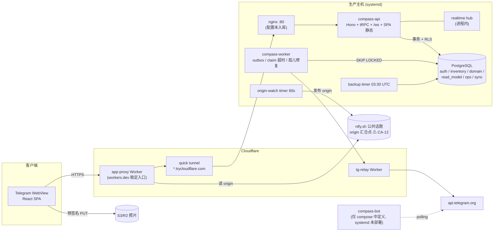
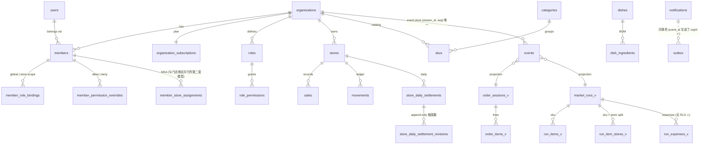
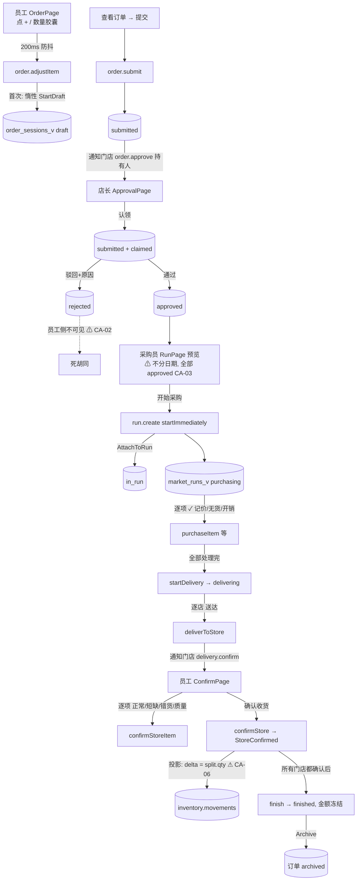
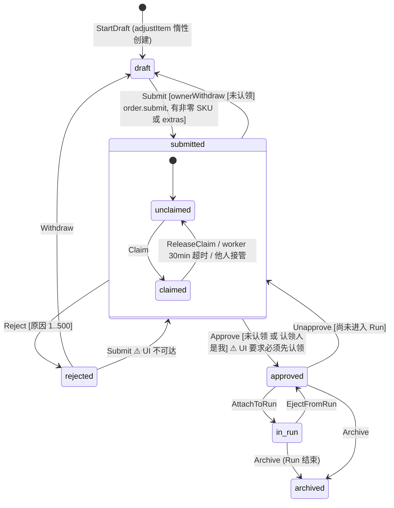
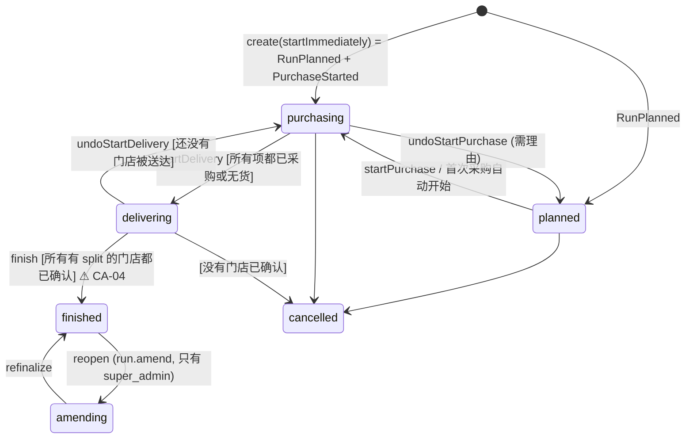
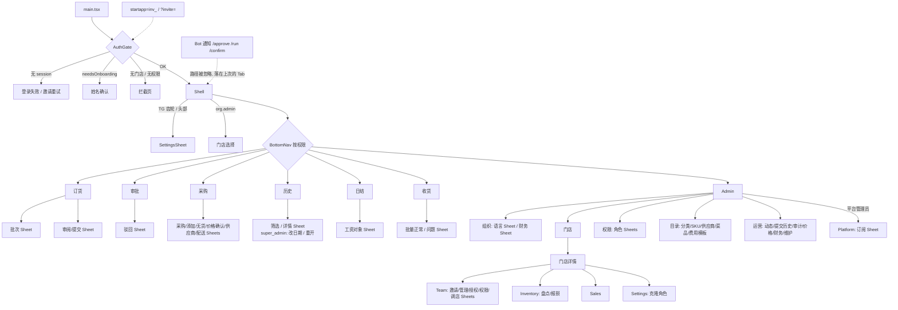
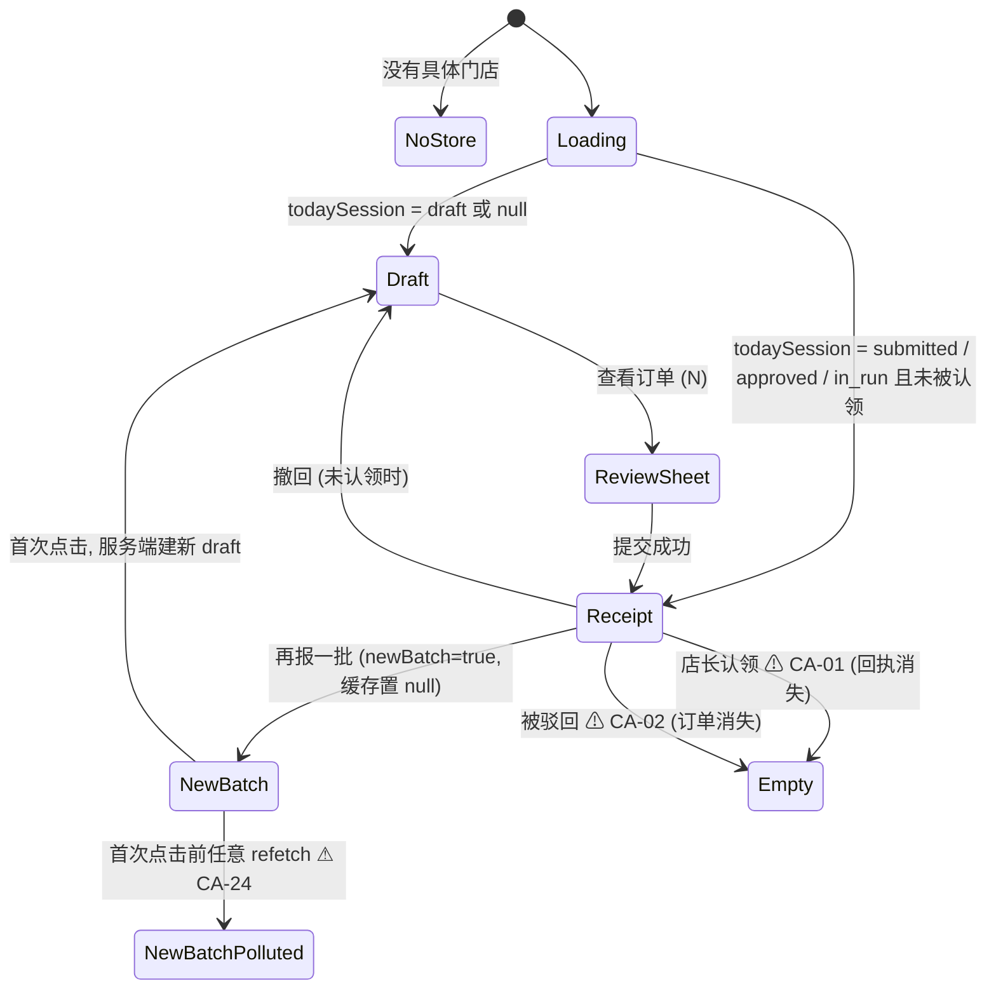

# CompassAlpha 项目全量代码审计、业务流程还原与产品优化评估

> 审计日期：2026-10-21
> 审计基线：`main` @ `c49ba3e`（`chore: rename the default workspace to Eden`）
> 审计方式：只读静态审计 + 本地可运行的类型检查、Lint、单元测试、生产构建
> 结论口径：每条重要结论都标注证据等级，并给出 `文件:行号`
> 任务边界：本次**未修改任何业务代码、配置、数据库或部署环境**，只新增了本报告和 `docs/audit-2026-10-21/` 下的审计辅助文档

---

## 阅读指引

本报告是**面向开发团队的综合版**，负责给出结论、优先级和路线图。逐页面、逐按钮、逐函数的完整证据放在 6 份分轨附录里，正文引用附录时写作 `[附录 B §4.1]`。

| 附录 | 文件 | 覆盖 |
|---|---|---|
| A | `docs/audit-2026-10-21/A-auth-tenancy-rbac.md` | 认证、入驻、组织、订阅/限额、平台超管、门店与成员 RBAC、多租户/RLS |
| B | `docs/audit-2026-10-21/B-order-approval.md` | 订货、审批、离线队列、幂等 |
| C | `docs/audit-2026-10-21/C-run-delivery-confirm.md` | 采购单 Run、配送、门店收货确认、库存投影 |
| D | `docs/audit-2026-10-21/D-inventory-sales-settlement.md` | 库存、菜品配方、销售、日结、历史与财务 |
| E | `docs/audit-2026-10-21/E-navigation-admin-catalog.md` | 前端外壳、导航、全部页面清单、Admin/目录/设置、死代码、i18n |
| F | `docs/audit-2026-10-21/F-infra-notify-tests.md` | 架构、数据模型、部署、通知/实时/后台任务、安全、测试覆盖地图 |
| — | `docs/audit-2026-10-21/00-previous-report-snapshot.md` | 本路径上一版报告（同日、同 commit 生成）的原样快照，供对照 |

**关于上一版报告**：本路径此前已有一份同日生成的审计报告（未纳入 git）。本次没有直接沿用它，而是独立重新审计，并逐条核验了它的关键结论（结果见 §12.1）。上一版的原文已原样保存为快照，没有丢失。

## 目录

0. [执行摘要](#0-执行摘要)
1. [审计范围、方法与实际执行结果](#1-审计范围方法与实际执行结果)
2. [项目结构与架构](#2-项目结构与架构)
3. [业务模块全景](#3-业务模块全景)
4. [完整业务流程](#4-完整业务流程)
5. [页面与交互地图](#5-页面与交互地图)
6. [当前操作流程分析](#6-当前操作流程分析)
7. [重复功能与页面分析](#7-重复功能与页面分析)
8. [疑似无效功能与页面](#8-疑似无效功能与页面)
9. [业务逻辑与质量问题](#9-业务逻辑与质量问题)
10. [产品与架构优化建议](#10-产品与架构优化建议)
11. [优先级与实施路线图](#11-优先级与实施路线图)
12. [需要进一步验证的问题](#12-需要进一步验证的问题)
13. [附录](#13-附录)

---

## 0. 执行摘要

### 0.1 项目是什么

CompassAlpha 是一个运行在 Telegram Mini App 里的**多门店餐饮采购协同系统**，核心闭环如下：

```text
Telegram 身份 → 组织成员（多租户、门店级 RBAC）
  → 门店员工每日订货（按 SKU + 目录外“其他物品”）
  → 店长认领 / 审批
  → 采购员把已审批订单合并成采购单 Run，按摊位/类别去市场采购、记价
  → 逐店配送 → 门店逐项核对收货 → 收货入库（库存流水）
  → 采购员结束 Run，金额冻结，订单归档
旁路模块：菜品配方 + 销售扣减库存、门店每日现金日结、采购历史与财务报表、订阅与平台超管
```

技术上是一个 Bun + Hono + tRPC + PostgreSQL 的事件溯源系统：
- 订单和 Run 用纯函数状态机（`packages/domain`）做决策；
- 事件写入 `domain.events`，同一事务内投影到 `read_model.*`；
- 用 RLS 做租户隔离；
- 前端是 React SPA，没有 URL 路由；
- worker 通过 outbox 发 Telegram 通知。

### 0.2 总体判断

| 维度 | 评价 | 依据 |
|---|---|---|
| 领域建模 | **强** | 订单/采购状态机是纯函数，有 93 个领域测试（本次运行全部通过）；事件、投影、通知在同一事务内 |
| 租户隔离 | **较强，有缺口** | RLS 失败即关闭（fail-closed）+ 应用层 orgId + 门店范围断言，三层防御；但 `run_expenses_v` 没有 RLS，dishes 没有 FORCE，子表策略只校验一端 [附录 F §6.1#8、附录 A A-24] |
| 权限体系 | **模型完整，执行漂移明显** | 前端门控与后端检查有大量不一致；`users.manage` 被当作多个权限的兜底，导致门店级 deny 失效 [§9 CA-10、CA-16] |
| 核心采购闭环 | **主流程可用，边界流程有断点** | 被拒订单、被认领订单对员工“消失”；Run 不分日期合并全部历史订单；每个组织只能有一个活动 Run，叠加“结束前所有门店都要确认”，会互相阻塞 |
| 库存/销售/日结 | **代码齐全，闭环未成立** | 短缺收货按全量入账；收银员和员工进不了销售入口；销售收入与日结收入互不对账；采购金额有 4–6 种算法 |
| 导航与交互 | **细节打磨好，结构性问题多** | 没有 URL 路由，通知深链落不到目标页；Sheet 打开时 Telegram 返回键不出现；多门店成员不能切换门店 |
| 运维与可观测性 | **偏弱** | 无指标、无告警；健康检查指标失真；3 个 PG 集成测试从未在 CI 里跑；灾备脚本在 RLS 下可能读不到数据；全站流量的源站地址由 ntfy 公共话题决定 |

### 0.3 最重要的发现（全部为本次代码核验结果）

本次**没有定 P0**。P0 的标准是“已证实的严重业务错误、安全风险或关键流程阻断”。下面每一项要么影响面有限，要么可利用性取决于生产环境的实际状态。

最该优先处理的 15 项 P1，按建议的处理顺序排列：

| # | ID | 问题 | 证据等级 | 关键证据 |
|---|---|---|---|---|
| 1 | CA-01 | 店长**认领**订单期间，员工的订单回执消失，页面变回空目录，容易诱发重复下单 | 已确认（代码） | `order.ts:139-151`（`isNull(claimedByMemberId)`） |
| 2 | CA-02 | **被拒订单**对员工完全不可见，"改了再提交"的领域流程在 UI 中不可达 | 已确认（代码） | `order.ts:128-151` 不返回 `rejected`；`OrderPage.tsx:927-941` 是死分支 |
| 3 | CA-03 | 开始采购时**不分日期地合并全部历史已审批订单**，记账日期一律记为今天 | 已确认 | `RunPage.tsx:152,986-1002`；`run.ts:222-247,669` |
| 4 | CA-04 | **每个组织只能有一个活动 Run**，结束又要求每家门店确认，一家店不确认就卡住全组织 | 已确认 | 迁移 `0035:46-48`；`commands.ts:724-734,1037-1041` |
| 5 | CA-05 | 纯采购员在 Run 页打开供应商选择器拉不到列表，因为调用的接口要求 `users.manage` | 已确认 | `RunPanels.tsx:1894`；`admin.ts:30-31,3600-3603`；`seed-data.ts:155-167` |
| 6 | CA-06 | 收货标为“短缺/错货/质量问题”时**库存仍按全量入账**；问题记录没有任何下游消费者 | 已确认 | `runProjection.ts:241-298`（注释 261-265 自承） |
| 7 | CA-07 | 店长可以改**任何成员的全局显示名**并锁定，跨组织生效，且无审计 | 已确认 | `admin.ts:1548-1572` |
| 8 | CA-08 | 店长可以**停用门店**，停用后连全局管理员也无法通过 UI/API 恢复 | 已确认 | `admin.ts:3141-3169,422-428`；`StoresSections.tsx:1052-1056` |
| 9 | CA-09 | 收银员和员工有 `sales.record`，但销售入口只在需要 `users.manage` 的 Admin 里 | 已确认 | `seed-data.ts:174,187`；`Shell.tsx:88`；`StoresSections.tsx:357-362` |
| 10 | CA-10 | `users.manage` 被当作 `sales.record` / `inventory.adjust` 的兜底，门店级 deny 对店长无效 | 已确认 | `sales.ts:51-58`；`inventory.ts:53-60` |
| 11 | CA-11 | 采购金额口径有 4–6 套：Finance 报表、历史页、结束确认、冻结的 `actual_total`、通知金额各不相同 | 已确认 | `report.ts:117-146`；`run.ts:1332-1375`；`commands.ts:1254-1282` |
| 12 | CA-12 | 生产反代从 **ntfy.sh 公共话题**读取最新的 tunnel 地址；知道话题名的人就能劫持全站流量 | 机制已确认，可利用性待验证 | `infra/cloudflare/app-proxy/worker.js:36-66` |
| 13 | CA-13 | 邀请、多租户、订阅 3 个 PG 集成测试**从未在 CI 中运行**，最近的订阅/限额提交没有门禁 | 已确认 | `.github/workflows/ci.yml:369-379` |
| 14 | CA-14 | 灾备脚本 `reproject` / `repair` / `diagnose` 没有声明系统上下文，在 fail-closed RLS 下可能读到 0 行 | 代码已确认，实际行为取决于连库角色 | `apps/api/scripts/reproject.ts:105-120` |
| 15 | CA-15 | 通知里的 “Open Compass” 深链（`/approve`、`/confirm` 等）**不会落到目标页面** | 已确认 | `notifyForEvent.ts:52…`；`worker/main.ts:355-360`；前端不读 pathname |

### 0.4 与上一版报告的主要差异

- 上一版的 3 个 P0，本次全部**降为 P1/P2**：
  - 库存短缺入账：属实，但库存模块是否有真实使用需要生产数据确认，按 P1 处理（CA-06）。
  - 销售日期使用 UTC：属实，但上一版对 Run 时区的描述有误，而且销售模块的使用量待验证，按 P2 处理（CA-23）。
  - 通知深链：属实，属于体验问题，按 P1 处理（CA-15）。
- 本次**新发现、上一版未提及**的高优先级问题：
  - CA-01、CA-02：订单在认领时或被拒后对员工消失；
  - CA-04：全组织只能有一个 Run，导致互相阻塞；
  - CA-05：采购员的供应商选择器失效；
  - CA-07、CA-08：改名越权、停用门店后无法恢复；
  - CA-12：ntfy 源站劫持；
  - CA-13：CI 漏跑测试；
  - CA-14：灾备脚本；
  - 以及 purge 与 append-only 触发器冲突、purge 不清库存流水、outbox 重复发送等一批 P2。
- 上一版有 2 处统计数字与本次结果**不符**：
  - 测试文件数：上一版 42，实际 46；
  - API 非 PG 测试的 skip 数：上一版 137，本次实测 124。
- 上一版大量引用了**生产数据库聚合和 Nginx 访问日志**。本次没有访问生产环境（未获授权的凭据），这些数字**未复核**，正文凡引用处都会注明。

### 0.5 建议的改进方向（详见 §11）

1. **第 1 周（低成本、高收益）**：
   - 修 CA-01、CA-02（`todaySession` 的查询条件）；
   - CA-05（换成正确的供应商读接口）；
   - CA-07、CA-08（补权限门）；
   - CA-13（CI 改为跑全部测试）；
   - CA-15（解析深链）。
2. **第 2–4 周**：
   - Run 选单与日期（CA-03）；
   - 收货实收数量入账（CA-06）；
   - 销售入口与权限兜底（CA-09、CA-10）；
   - 统一金额口径（CA-11）；
   - ntfy 汇合点加签名（CA-12）；
   - 灾备脚本（CA-14）。
3. **之后**：
   - 多 Run 并行（CA-04，需要业务确认）；
   - 日结锁定与对账；
   - URL 路由；
   - 拆分巨型文件；
   - 可观测性建设。

---

## 1. 审计范围、方法与实际执行结果

### 1.1 盘点结果（已确认）

| 区域 | 规模 | 内容 |
|---|---|---|
| `apps/api` | 65 个 git 文件 | Hono/Bun 入口、13 个 tRPC router、服务、投影、通知、realtime hub、维护脚本、21 个测试文件 |
| `apps/web` | 95 | React Mini App：7 个底部 Tab 页、Admin 下钻、Sheets、hooks、Zustand stores、离线 outbox |
| `apps/worker` | 5 | outbox 投递、claim 超时、孤儿 session 修复、幂等键清理 |
| `apps/bot` | 3 | grammY long polling：`/start inv_*` 邀请兜底、`/id` |
| `packages/domain` | 16 | 订单/Run 的命令、事件、状态，以及测试 |
| `packages/db` | 80 | Drizzle schema（6 个 PG schema，约 49 张表）、47 个迁移 + 3 个 RLS/前置 SQL、seed、provision、导入 |
| `packages/contracts` | 13 | 前后端共享的 Zod 契约 |
| `packages/ui` | 51 | 设计系统与 kit |
| `packages/i18n` | 9 | zh/en/ru/uz 各 1354 个键 |
| `packages/cli`、`packages/telemetry` | 8 / 5 | CLI（部分为桩代码）、客户端日志 |
| `infra/`、`scripts/`、`.github/` | 约 25 | systemd、Cloudflare Workers、tunnel、备份、compose/Caddy、部署、smoke、CI |
| `tests/e2e` | 9 | Playwright 主流程、session、kit |

- TypeScript/SQL 源码约 **94,000 行**；
- tRPC procedure **154 个**（53 query + 101 mutation）[附录 F §11#6]；
- 测试文件 **46 个**（43 个 `*.test.ts` + 3 个 e2e spec）。

最大的几个文件也是维护风险最高的：

| 文件 | 行数 |
|---|---:|
| `apps/api/src/trpc/routers/admin.ts` | 5,155 |
| `apps/api/src/trpc/routers/run.ts` | 3,659 |
| `apps/web/src/pages/admin/people/PeopleSections.tsx` | 2,592 |
| `apps/web/src/pages/RunPage.tsx` | 2,377 |
| `apps/web/src/pages/runs/views/RunViews.tsx` | 2,140 |
| `apps/web/src/pages/runs/components/RunPanels.tsx` | 2,041 |

### 1.2 方法

1. 盘点目录、技术栈、入口和构建方式。
2. 按业务域拆成 6 条审计轨并行阅读（见附录 A–F）。每条轨都要求读到具体行，给出证据等级，并核验上一版报告在该领域的结论。
3. 主审计对各轨中**新发现的或定为 P1 的结论**做了独立复核，读了以下代码：
   - `order.ts:110-160, 775-795`
   - `state.ts:15-30`
   - `OrderPage.tsx` 中所有 `rejected` 分支
   - `worker/main.ts:612-712`
   - `run.ts:2845-2870`
   - `app-proxy/worker.js:30-70`
   - `900_rls_policies.sql:40-60`
   - `run.ts:1845-1856`
   - `RunPanels.tsx:1888-1898`
   - `admin.ts:30-38, 418-430, 1548-1572, 3600-3606`
   - `seed-data.ts:150-175`
   - `migrations/0035`
4. 运行了本地能安全执行的检查（§1.3）。
5. 汇总去重，统一编号为 `CA-xx`，并重新定级。

### 1.3 本次实际执行的检查

环境：macOS，Node v24.22.0；bun 1.1.38 通过 `npx` 临时获取（与 `.bun-version` 一致）；本机没有 pnpm、PostgreSQL 或 Docker。

| 检查 | 命令（概要） | 结果 |
|---|---|---|
| TypeScript | 12 个 workspace 分别执行 `tsc --noEmit -p .` | **全部通过**（api/web/worker/bot/domain/db/contracts/ui/i18n/telemetry/cli/e2e） |
| ESLint（web） | `eslint . --max-warnings 0` | **通过** |
| 领域测试 | `bun test`（packages/domain） | **93 pass / 0 fail**，206 个 expect |
| Web 单测 | `bun test`（apps/web） | **218 pass / 0 fail**，17 个文件 |
| Worker / i18n / ui | `bun test` | 5 / 14 / 7 pass，0 fail |
| API 测试（非 PG） | `SKIP_PG_TESTS=1`，`DATABASE_URL` 指向不可达的 `127.0.0.1:1`，JWT 使用占位值 | **54 pass / 124 skip / 0 fail**（178 个用例，21 个文件） |
| API PG 集成测试（124 个） | — | **未运行**：本机没有 PostgreSQL 或 Docker |
| Web 生产构建 | `vite build --outDir <scratchpad>`（不覆盖仓库内的 `dist/`） | **通过**；主包 506.78 kB（gzip 153.74 kB）、AdminPage 203.83 kB；出现 >500 kB chunk 警告 |
| Prettier | `prettier --check` | **114 个文件不符合格式**（本次未改写） |
| turbo / pnpm 根脚本 | — | **未运行**：本机没有 pnpm（`packageManager: pnpm@9.12.0`） |
| E2E（Playwright） | — | **未运行**：需要运行中的 API、DB 和 web |
| 生产数据 / 访问日志 | — | **未访问**：无授权凭据；上一版报告中的生产数字未复核 |

### 1.4 证据等级

- **已确认**：由本次读到的代码、配置或测试直接证明。
- **高可信度推断**：多处代码共同支持，但没有运行验证。
- **待验证**：需要运行时、生产数据或业务确认，文中会写明缺什么。

另外请注意：

- “静态搜索不到调用方”**不等于**“没人使用”；
- 本次没有任何真实使用数据，所以**不能**断言某个功能从未被用户使用过。

### 1.5 审计进度清单

| 范围 | 状态 | 说明 |
|---|---|---|
| 目录、技术栈、入口、构建 | 完成 | |
| 认证、入驻、组织、订阅、平台、RBAC、RLS | 完成 | 附录 A；`MemberPermissionsSheet` / `TransferStoreSheet` 的 UI 只读了调用点 |
| 订货、审批、离线、幂等 | 完成 | 附录 B |
| Run、配送、收货、库存投影 | 完成 | 附录 C；`PerStore` / `PerVendor` / `PerCategory` 视图的内部细节只读了交互入口 |
| 库存、菜品、销售、日结、历史、财务 | 完成 | 附录 D；Operations 的 Activity/Audit/PriceReport/Maintenance 只读了大纲 |
| 外壳、导航、全部页面清单、Admin、目录、设置、i18n、死代码 | 完成 | 附录 E |
| 基础设施、通知、实时、worker、bot、CLI、部署、CI、测试地图、安全 | 完成 | 附录 F |
| 可运行的检查 | 部分完成 | PG 测试、E2E、turbo 未运行，原因见上 |
| 真机逐控件回归、线上 WebSocket、生产配置 | 未做 | 需要 Telegram 设备、线上环境和服务器访问权限，见 §12 |

---

## 2. 项目结构与架构

### 2.1 技术栈

| 层 | 选型 | 证据 |
|---|---|---|
| 运行时 | Bun 1.1.38（API、worker、bot 直接运行 TS 源码） | `.bun-version`；`infra/systemd/compass-api.service:19` |
| 后端 | Hono + tRPC + Zod；`postgres-js`；Drizzle ORM | `apps/api/src/app.ts`、`trpc/router.ts` |
| 数据 | PostgreSQL 16；事件存储 + 读模型 + RLS | `packages/db/src/schema/*` |
| 前端 | React + Vite + TanStack Query + Zustand；Telegram WebApp SDK | `apps/web` |
| 包管理 | 根目录用 pnpm + turbo，各 workspace 脚本用 bun | 根 `package.json`；见 CA-37 |
| 部署 | tarball + scp + 服务器上 `pnpm install` / `migrate` / systemd 重启 + 服务器上 `vite build`；cloudflared quick tunnel + workers.dev 反代 | `scripts/deploy.ts`；`infra/` |

### 2.2 目录与模块职责（已按实现核对）

| 模块 | 实际职责 | 关键文件 |
|---|---|---|
| `apps/api/src/trpc/routers/auth.ts` | Telegram initData 登录、refresh 轮换、邀请接受、onboarding、切换/新建组织、语言设置 | 1,853 行 |
| `routers/admin.ts` | 成员、角色、权限覆盖、门店、目录 CRUD、运营查询、审计、测试数据清理 | 5,155 行；**职责过多** |
| `routers/order.ts` | 订货会话、批次、审批、认领、撤回 | |
| `routers/run.ts` | Run 生命周期的全部命令与查询、历史、改日期、重开 | 3,659 行 |
| `routers/inventory / dishes / sales / settlement / report / catalog / platform / system / upload` | 各业务域的 API | |
| `apps/api/src/services` | `eventStore`、`orderProjection`、`runProjection`、`notify`、`notifyForEvent`、`storeScope`、`subscription`、`priceStats`、`s3`、`refreshTokens` | |
| `packages/domain` | `decideOrder` / `applyOrder`、`decideRun` / `applyRun` 纯函数 | |
| `apps/worker` | outbox → tg-relay → Telegram；claim 超时；孤儿修复；幂等键清理 | 822 行 |
| `apps/web/src/app` | `App`（Provider 栈）、`AuthGate`（登录拦截）、`Shell`（底部 Tab、PageMainButton） | |
| `apps/web/src/pages` | Order / Approval / Run / Confirm / History / Settlement / Admin（+ admin 子目录） | |

### 2.3 系统架构图



详细的组件表与通信关系见 [附录 F §2]。

### 2.4 模块依赖与数据流矩阵

| 上游 → 下游 | 依赖内容 | 耦合方式 |
|---|---|---|
| Order → Run | `order_sessions_v.status='approved'` 的会话及其 `order_items_v` 数量 | Run router 读取后，对订单流写 `AttachToRun` / `Archive` / `EjectFromRun` 事件（`run.ts:839,1010,2864,3206`） |
| Run → Inventory | `StoreConfirmed` 投影写入 `inventory.movements`（`delivery_received`） | 投影副作用（`runProjection.ts:266-295`） |
| Run → price_history | `ItemPurchased` / `PurchaseRevised` 投影写入价格观测 | Order 估价、审批估价、价格报表都读它 |
| Dishes → Sales → Inventory | 按配方 BOM 写入负 delta | `sales.ts:177-201`，同一事务 |
| Settlement | **不依赖任何其他模块**（收入、采购预留全部手工填写） | 见 CA-11、CA-20 |
| Order / Run → Notifications | `notifyForEvent` 在同一事务内写 `ops.notifications` 和 `sync.outbox` | worker 异步投递 |
| 所有 router → storeScope | `assertActorAssignedToStore`、`effectivePermissionsForStore` | 横切依赖 |
| Worker → read_model | 手写镜像投影，绕过 domain（claim 释放、孤儿修复） | **重复逻辑，存在漂移风险**（CA-41） |

不存在模块间的循环依赖。Order 与 Run 通过事件互相回写，是一种**双向的语义耦合**：Run 的取消、结束、移出会改变订单状态。这部分的一致性由同事务投影保证 [附录 C §3.1]。

### 2.5 核心数据实体关系



### 2.6 核心对象生命周期（摘要）

| 对象 | 创建 | 修改 | 结束 / 删除 | 证据 |
|---|---|---|---|---|
| 订单会话 | 员工第一次调整数量时惰性创建 draft | 调整数量、填 extras、提交、认领、审批/驳回、撤回、撤销审批 | 进入 Run 后为 in_run，Run 结束时 archived；**没有删除，前一天未提交的 draft 会成为孤儿** | [附录 B §3] |
| Run | `run.create`（一次带上全部预览会话） | 采购、改价、撤销、无货、开销、配送、确认 | finished（冻结，可由超管重开为 amending）或 cancelled | [附录 C §3.2] |
| 库存流水 | 收货确认、销售、盘点、报损 | 不可改 | **purge 时不清理**（CA-28） | [附录 D §3.1] |
| 日结 | 首次保存 v1 | 后续保存要带修订原因（CAS），每次写一份 revision 快照 | 没有锁定；revision 有 append-only 触发器 | [附录 D §3.3] |
| 通知 | 事件触发时同事务写入 | `sent_at` / `read_at` **没有任何写入方** | 没有保留期清理 | [附录 F §3.3] |
| refresh token | 登录 / 轮换 | 撤销族 | 清理函数**未接线** | [附录 A §7] |

### 2.7 状态管理（前端）

| 状态 | 位置 | 持久化 |
|---|---|---|
| 认证与会话（权限、门店、订阅） | `useAuthStore` | `localStorage['compass.auth']` |
| 导航（tab、Admin 下钻层级） | `useNavStore` | `localStorage['compass.nav.v1']`；**切换组织、登出、ErrorBoundary 重置时都不清理**（CA-33） |
| 服务端数据 | TanStack Query：`staleTime` 30s，`refetchOnWindowFocus:false`，靠 WebSocket 失效刷新 | 内存 |
| 离线写操作 | IndexedDB outbox（只记 `ownerUserId`，**不区分组织**） | IndexedDB |
| Telegram 主按钮、返回键 | 模块级单槽位（后写覆盖，没有引用计数） | — |

### 2.8 架构上的优点（保留）

- 领域层是纯函数，可测试性好；事件、投影、通知在同一事务内，`(stream_id, seq)` 唯一约束兜住并发写。
- RLS fail-closed、`app.system_context` 显式声明，多租户设计成熟。
- 移动端交互细节打磨用心：乐观更新、离线 outbox、防抖、确认 Sheet。

### 2.9 架构风险

1. **超大文件、超大 router**：`admin.ts` 一个文件同时承担人员、角色、门店、目录、运营、清理 6 类职责。
2. **同一概念有多份实现**：
   - 采购金额 4–6 套；
   - “今天”的计算 5 套；
   - 估价 3 份；
   - 投影逻辑在 projector 和 worker 里各一份；
   - “谁管哪些店”的计算 3 份。

   详见 §7。
3. **没有 URL 路由**：深链、分享、刷新恢复都依赖持久化的 store。
4. **双套部署拓扑**：
   - (A) Docker + compose + Caddy；
   - (B) tarball + systemd + nginx + quick tunnel + Workers。

   RUNBOOK 按 (A) 写，生产按 (B) 跑。
5. **没有可观测性**：没有指标、追踪和告警；健康检查数据失真。

---

## 3. 业务模块全景

### 3.1 内置角色与权限（已确认，`packages/db/src/seed-data.ts:92-189`）

| 角色（rank，绑定范围） | 关键权限 | 能看到的底部 Tab（`Shell.tsx:68-89`） |
|---|---|---|
| super_admin（100，全局） | 全部，包括 `run.amend` | 7 个 |
| admin（80，全局） | 全部，但不含 `system.impersonate`、`system.test_data.purge`、`run.amend` | 7 个 |
| manager（60，门店） | `order.draft/submit/approve/claim/unapprove`、`users.manage`、`inventory.adjust`、`sales.record`、`settlement.record`、`prices.view`、`reports.view` | 订货、审批、历史、日结、Admin |
| purchaser（40，门店） | `run.create/purchase/eject_session/finish`、`delivery.dispatch`、`prices.view` | 采购、历史 |
| cashier（30，门店） | `sales.record`、`settlement.record` | **只有日结**（销售做不了，见 CA-09） |
| staff（20，门店） | `order.draft/submit`、`delivery.confirm`、`sales.record` | 订货、收货 |

值得注意（已确认）：

- 店长**没有** `delivery.confirm`，所以不能确认收货 [附录 C §2.2]。这是否符合业务意图，**待验证**。
- 后端从不检查 10 个权限 key，角色编辑器却把它们当开关展示：`reports.view`、`reports.export`、`order.claim`、`users.assign_store`、`org.settings.manage`、`inventory.*.manage` 等 [附录 A §7]。
- `users.invite` 被代码当作管理员 key 引用，但它不在权限目录里，**不可能被授予** [附录 A §7]。

完整的“角色 × 动作 × 后端检查 × 前端门控”矩阵见 [附录 A §2.3]。

### 3.2 模块职责矩阵

| 模块 | 解决的问题 | 主要使用者 | 入口 | 前置条件 | 下游依赖 |
|---|---|---|---|---|---|
| 认证、入驻 | 只允许受邀的 Telegram 用户进入；首次进入确认显示名 | 所有人 | 打开 Mini App（initData 自动登录）、邀请链接 `startapp=inv_*` | 必须已是某组织的成员（陌生人会被拒绝，`auth.ts:698-705`） | 一切 |
| 组织与订阅 | 多租户；套餐限制门店数和成员数；只读模式 | 平台管理员、admin | Settings → 工作区；Admin → Platform | 平台管理员身份 | 全局写权限（`trpc.ts:140-152`） |
| 门店、人员、RBAC | 成员邀请、角色授予、门店分配、权限覆盖 | admin、manager | Admin → 门店 → 某门店 → Team；Admin → 权限 | `users.manage` | 所有权限判断 |
| 目录 | 分类、SKU、供应商、费用模板、菜品 | admin（写操作要求 `org.admin`） | Admin → 目录 | — | 订货、采购、销售 |
| 订货 | 员工按门店、按日、按批次报需求 | staff、manager | 订货 Tab | 选中一个具体门店 | 审批 |
| 审批 | 认领、通过、驳回、撤销通过；审批时可改数量 | manager | 审批 Tab；通知 | `order.approve` | 采购 |
| 采购 Run | 合并已审批订单、市场采购、记价、无货、开销、配送 | purchaser | 采购 Tab | `run.purchase`；组织内没有其他活动 Run | 收货、库存、历史、财务、价格 |
| 收货确认 | 逐项核对正常、短缺、错货、质量问题，然后确认收货 | staff | 收货 Tab；通知 | 有处于 delivering 的 Run | 库存、Run 结束 |
| 库存 | 门店 × SKU 数量账本；盘点、报损 | manager、admin | Admin → 门店 → Inventory | `inventory.adjust`，或兜底的 `users.manage` | 销售扣减 |
| 菜品与销售 | 按配方扣减库存，记录销售收入 | （设计上）cashier、staff；（实际上）只有 manager、admin | Admin → 门店 → Sales | 菜品要有配方 | 库存 |
| 日结 | 每日现金结账：收入、经营支出、工资、留存现金 | cashier、manager | 日结 Tab | `settlement.record`，门店是活跃状态 | **无**（不被任何模块读取） |
| 历史与财务 | 已完成 Run 的明细；采购财务报表 | purchaser、manager、admin | 历史 Tab；Admin → 运营 → 财务 | `prices.view` 或 `users.manage` | — |
| 通知 | Telegram bot 消息 + 站内通知 | 所有人 | 被动接收 | 有 tg_user_id | — |
| 平台订阅 | 跨组织维护套餐与状态 | 平台管理员 | Admin → Platform | 平台管理员身份，**并且**当前组织下有 `users.manage`（CA-16） | 写权限 |

各模块逐项回答“谁用、从哪进、怎么流转、失败了怎样”的完整内容，分别在附录 A §2–3、B §2–3、C §2–3、D §2–3。

---

## 4. 完整业务流程

### 4.1 端到端主链路



### 4.2 订单状态机（领域层，已确认，`packages/domain/src/order/commands.ts`）



“领域层允许、但 API 或 UI 不可达”的路径（已确认）[附录 B §3.3]：

1. 被驳回后由 owner 修改再提交：`adjustItem` 只查找 draft，找不到会**另建一张新 draft**（`order.ts:779-788`）。
2. 未认领时直接审批：UI 不显示这个按钮。
3. 只含 extras 的订单：UI 无法提交（CA-27）。
4. 释放原因 `pagehide`：router 永远传 `'manual'`。

### 4.3 Run 状态机（已确认，`packages/domain/src/run/*`）



门店维度：未送达 → 已送达（可撤回）→ 已确认（写入库存）。

收货单项维度：未决 → 正常 / 短缺 / 错货 / 质量问题，四者可互相切换。**这些状态都不影响入账数量**。服务端也**不检查是否已送达、是否已确认**（CA-30）[附录 C §3.4]。

### 4.4 关键调用链（摘要）

| 操作 | 调用链 | 事务与反馈 |
|---|---|---|
| 员工改数量 | `QtyControl.onChange` → `handleQtyChange`（`OrderPage.tsx:338-422`）→ 200ms 防抖、按门店串行 → `order.adjustItem` → `decideOrder(AdjustItem)` → `appendEvents` → `projectOrder` → `hub.publish(order.changed)` | 乐观写缓存。网络错误进入 IndexedDB outbox；CONFLICT 静默刷新；其他错误 toast |
| 提交订单 | Sheet 的“提交” → `handleSubmit`（`:613-647`）：先 flush 未发出的调整 → `order.submit`（idempotentMutation，但**每次请求生成新 key**，CA-26） | 同事务通知审批人 |
| 审批 | 认领（`order.claim`）→ 通过（`order.approve`） | 两次往返；无确认；重复请求会报 PRECONDITION_FAILED |
| 开始采购 | MainButton → `run.create({sessionIds: 预览中全部会话, startImmediately:true})`（`RunPage.tsx:986-1006`）→ 逐个会话 `AttachToRun` → `projectRun` | 已存在活动 Run 时直接返回该 Run（`reused:true`） |
| 记一项采购 | `PurchaseRow` 的 ✓ → `onSavePurchaseInline` → 价格偏离 5× 时先进 `withPriceCheck` → `run.purchaseItem`（稳定的幂等 key）→ `runSimpleCommand` | 投影写 `price_history`；6 秒轮询 + WebSocket 刷新 |
| 确认收货 | `ConfirmPage` 逐项 → `confirmStoreItem`；“全部无误” → `markStoreItemsOk`；MainButton → `confirmStore` | 投影按 split 全量写入库存（CA-06） |
| 记一笔销售 | Admin → 门店 → Sales → `sales.record`（同事务写 sale 和每个配方原料的负 delta） | 每次请求新 key，可能重复（CA-21） |
| 保存日结 | MainButton → `settlement.save`（`expectedVersion` CAS + 修订快照） | 稳健；版本冲突时显示 Banner |

更细的逐步调用表见 [附录 B §3.1–3.2]、[附录 C §3.1]、[附录 D §3.1–3.2]、[附录 A §3.1–3.6]。

### 4.5 异常、取消、重复提交、网络中断

| 场景 | 实际行为 | 评价 |
|---|---|---|
| 双击提交订单 | flush 期间按钮没有禁用，会发出两个 submit；第二个被状态机拒绝，用户看到“成功”又看到“失败” | 数据安全，体验差（CA-26） |
| 审批请求的响应丢失后重试 | 报“审批失败”，实际已经通过 | 同上 |
| 切页或卸载时还有未发出的调整 | 200ms 内的数量修改、700ms 内的 extras 修改**被直接丢弃** | 丢写（CA-25） |
| 离线点击后恢复 | outbox 回放 `adjustItem` 时不带日期和 sessionId，可能写进新的 draft 或第二天；回放遇到 CONFLICT 直接丢弃 | 丢写或写错位置（CA-25） |
| 两个采购员同时操作同一个 Run | 靠 `(stream_id, seq)` 唯一约束返回 CONFLICT，前端只 toast 不重试；`expectedSeq` 从未校验 | 后写的会覆盖（CA-43） |
| 销售请求的响应丢失后重试 | 生成第二笔销售，库存被扣两次 | 重复扣减（CA-21） |
| 日结并发保存 | CAS 版本号 + 自然键唯一 | 稳健 |
| 取消 Run | 会话被移出、退回 approved；**门店不会收到通知** | CA-31 |
| 跨午夜 | 订单用组织时区，日结用门店时区，销售用 UTC，财务预设用设备时间转 UTC，历史预设用设备本地时间 | CA-23 |

---

## 5. 页面与交互地图

### 5.1 路由事实

- **没有 URL 路由**（已确认）。页面由 `useNavStore.tab` 决定（`Shell.tsx:103-127`），并持久化到 `localStorage`。
- 前端唯一读取的 URL 参数是 `?invite=`；Telegram `start_param` 只识别 `inv_` 前缀（`AuthGate.tsx:72-78`）。
- 服务端对任何未匹配的 GET 都返回 `index.html`（`app.ts:297-311`）。注释里说“React router 接管”，与实际不符。
- 页面之间**没有任何程序化跳转**：`setTab` 只由底部导航调用。

### 5.2 全部可达页面与入口清单（摘要；完整版见 [附录 E §3]）

| 层级 | 页面 / 视图 | 源码 | 进入方式 | 条件 |
|---|---|---|---|---|
| 拦截层 | 启动、登录失败、邀请重试、姓名 onboarding、无门店、无权限、致命错误 | `AuthGate.tsx`、`ErrorBoundary.tsx` | 自动 | 按会话状态；**这些页面都没有语言或组织切换入口** |
| Tab | 订货 | `OrderPage.tsx` | 底部导航 | `order.draft` |
| Tab | 审批 | `ApprovalPage.tsx` | 底部导航 | `order.approve` |
| Tab | 采购 | `RunPage.tsx` + `pages/runs/**` | 底部导航 | `run.purchase` |
| Tab | 历史 | `HistoryPage.tsx` / `RunHistory.tsx` | 底部导航 | `prices.view` |
| Tab | 日结 | `SettlementPage.tsx` | 底部导航 | `settlement.record` |
| Tab | 收货 | `ConfirmPage.tsx` | 底部导航 | `delivery.confirm` |
| Tab | Admin | `AdminPage.tsx` | 底部导航 | `users.manage` |
| 全局 | SettingsSheet（页面动作、资料、工作区、门店、语言、关于） | `SettingsSheet.tsx` | Telegram ⋯ → 齿轮；非 Telegram 时点头部组织名 | 所有人 |
| 全局 | StoreChip → 门店选择 | `StoreSwitcher.tsx` | 顶部条 | **只有 `org.admin` 能点**（CA-22） |
| Admin | 组织（订阅、信息、语言、财务） | `AdminPage.tsx:462-640` | Admin → 组织 | 财务行在 UI 上对 `users.manage` 显示，但服务端要求 `org.admin` |
| Admin | 门店列表 → 门店详情：Team / Inventory / Sales / Settings | `StoresSections.tsx` | Admin → 门店 → 某门店 → 分段控件 | 组织级伪门店只有 Team |
| Admin | 权限（角色列表、新建、编辑） | `PeopleSections.tsx:703+` | Admin → 权限 | 编辑和删除在 UI 上只对 super_admin 开放（CA-16） |
| Admin | 目录：分类 / SKU / 供应商 / 菜品 / 费用模板 | `CatalogSections.tsx` | Admin → 目录 → 子项 | 写按钮**不检查 `org.admin`**（CA-16） |
| Admin | 运营：动态（含 super_admin 的 Debug 控制台）/ 提交历史 / 审计 / 价格报表 / 财务 / 维护 | `OperationsSections.tsx` | Admin → 运营 | 维护要求 super_admin **并且** `VITE_ENABLE_MAINTENANCE=1`；可被持久化的导航状态绕过（E-14） |
| Admin | Platform（组织列表、订阅 Sheet） | `PlatformSections.tsx` | Admin → Platform | 平台管理员，**并且**能进 Admin（CA-16） |
| DEV | KitGallery、dev persona、浏览器访问码 | `main.tsx:33`、`AuthGate.tsx` | `?kit`、DEV 构建 | 不进生产包 |

各 Tab 内部的 Sheet（批次、审阅、驳回原因、采购、添加项、无货、价格确认、供应商选择、批量正常、问题上报、筛选、详情、工资对象等）及其逐按钮档案：
- 订货与审批：[附录 B §4]
- 采购与收货：[附录 C §4]
- 日结、历史、库存、销售、财务、菜品：[附录 D §4]
- Admin、目录、设置：[附录 E §5]
- 人员与权限：[附录 A §4]

### 5.3 “声明了但到不了”的入口（已确认）

| 能力 | 声明处 | 为什么到不了 |
|---|---|---|
| cashier、staff 录销售 | 种子数据赋予 `sales.record` | 入口只在 Admin 里，Admin 要求 `users.manage`（CA-09） |
| 多店非 `org.admin` 成员切换门店 | 后端支持一人多店 | StoreChip 只有 `org.admin` 能点（CA-22） |
| 平台管理员进 Platform | `AdminPage` 允许 `isPlatformAdmin` | Admin Tab 只认 `users.manage` |
| 被驳回订单的修改与重提 | 领域层、OrderPage 的 rejected 横幅 | `todaySession` 从不返回 rejected（CA-02） |
| “正在由 X 审核”横幅 | `OrderPage.tsx:718-746,920-926` | 已认领的会话被查询条件过滤掉（CA-01） |
| 库存流水明细 | `inventory.recentMovements`，注释说“点行查看” | 前端零调用 |
| 登出 | `auth.signOut` | 前端零调用；Debug 页的 “Sign out & reset” 只清本地数据，不吊销 refresh token |
| 站内通知 | 每次事件都写 `ops.notifications`（inapp 渠道） | 没有读取 API，也没有 UI（CA-32） |
| 通知深链 `/approve` 等 | `notifyForEvent.ts` | 前端不解析 pathname（CA-15） |
| 分类恢复归档 | `categoryUpdate` 支持 `isArchived` | 没有 UI（CA-40） |

### 5.4 页面导航图



### 5.5 关键页面状态图：订货页



### 5.6 刷新、返回、再次进入

| 行为 | 实际表现 | 证据 |
|---|---|---|
| 刷新、重新打开 | 恢复持久化的 tab 和 Admin 下钻层级；Sheet、表单草稿、审批子 Tab、历史筛选都会丢失 | `navStore.ts:123-257` |
| Telegram 返回键 | 只在 Admin 的分区页显示；**打开任何 Sheet 时都不显示**，在 Admin 里打开 Sheet 还会把返回键藏起来 → Android 实体返回键会直接关掉 Mini App | `Sheet.tsx:65-91`；`useTelegram.ts:212-219`（CA-34） |
| 离开保护 | 只有日结页有：切 Tab、切门店、beforeunload 三处守卫；Admin 目录 Sheet 里的草稿切 Tab 后丢失 | `SettlementPage.tsx:519-552` |
| 切换组织 | `queryClient.clear()`，但 **navStore 不重置**，可能还停在旧组织的门店详情 | CA-33 |
| 同一页面从不同入口进入 | 所有入口（Tab、通知）最终都落在持久化的 tab 上，所以行为一致；但通知不会带上目标对象 | CA-15 |
| 异步过程中连续点击 | Run 和收货大多有 isPending 门控或领域层去重；提交订单在 flush 阶段没有门控；销售有按钮 loading，但没有稳定 key | CA-26、CA-21 |

### 5.7 需要真机或线上验证的交互（完整 14 项见 [附录 E §11]）

1. 在 iOS 和 Android 上打开 Sheet 时，返回键和实体返回键的行为。
2. 纯采购员打开供应商选择器，列表是否为空、是否报 FORBIDDEN。
3. manager 在目录中新建或编辑时，按钮可见但保存失败。
4. 点击通知按钮后落在哪个 Tab；生产环境的 `FRONTEND_URL` 是否已配置。
5. 经 workers.dev 入口时，WebSocket 能否建立握手（CA-35）。
6. Telegram 切到后台超过 1 分钟后，审批页是否会刷新。
7. 7 个 Tab 在 375px 宽设备上的截断情况。
8. 部署窗口期内，旧客户端懒加载 chunk 拿到 `index.html` 后是否触发 ErrorBoundary。

---

## 6. 当前操作流程分析

### 6.1 典型任务的步骤对比

点击数由静态代码推导，属于高可信度推断，实际数字待真机验证。

| 任务 | 当前路径 | 当前点击 | 冗余或摩擦点 | 建议的目标路径 | 目标点击 |
|---|---|---|---|---|---|
| 店长审批 5 张订单 | 审批 Tab → 每单“认领” → “通过” | **11** | 领域层允许未认领直接通过（`commands.ts:414`），UI 强制多一步（`ApprovalPage.tsx:396-417`） | 未被他人认领时直接显示“通过”；保留“他人已认领”时的冲突保护；再加“全部通过（带确认）” | 6，批量时 3 |
| 员工下一张 15 项订单 | 定位 SKU（分类或搜索）+ 设数量 + 审阅 + 提交 | 最好约 17，**典型约 40** | 没有“按上次订单 / 建议量一键填入”；`suggestedQty` 只显示文字，不能采用；审阅 Sheet 内不能改数量 | “复制上一单 / 采用建议量”、置顶“我的常用”、审阅 Sheet 内可直接改数量 | 约 20 |
| 被驳回后修改重提 | **做不到**（订单消失） | — | CA-02 | 回执里显示驳回原因 → 进入编辑 → 重提 | 3 + 修改 |
| 采购员 30 项、3 家门店 | 开始 1 → 30 次 ✓（有参考价时）→ 开始配送 2 → 每店送达 2×3 → 结束 2 | **最好 42；典型 72 + 30 次输入** | 每家店的送达都要确认一次；没有“本摊位按参考价全部买入”；结束前必须等每家店确认 | 批量送达；按摊位批量 ✓（保留价格偏离检查）；最后一家店确认后自动提示结束 | 约 35 |
| 门店确认 20 项、其中 1 项短缺 | 短缺 → 填备注 → 保存 → 全部无误 → 确认 → 确认收货 | **7 次点击 + 1 次输入** | 没有“实收数量”输入；“其余全部正常”和“确认收货”是两步 | 短缺 Sheet 里填实收数量；把“其余正常并确认收货”合成一个带确认的动作 | 5 |
| manager 记 1 笔销售 | Admin → 门店 → 某门店 → Sales → 选菜品 → 改份数 → 记录 | **7–8** | 入口过深；一次只能记一道菜 | 独立的“销售”入口（按 `sales.record` 显示），菜单网格，一次提交多行 | 3–4 |
| 一天 30 道菜的销售 | 每道 3 次 | **约 90** | 没有批量操作 | 网格步进 + 批量提交 | 30–40 |
| cashier 记销售 | **做不到** | — | CA-09 | 同上 | 3–4 |
| 邀请一名成员 | Admin → 门店 → 某门店 → 邀请 → 方式 → 选角色（2）→ 提交 → 选聊天 → 发送 | **10** | 入口过深；不记住上次选的角色 | Admin 首页放“邀请”入口；默认使用门店默认角色 | 约 5 |
| 改成员在某店的角色 | 授予新角色 → 点旧角色 × → 确认 | **7** | 没有“更换角色”这个原子操作 | 一个事务内完成“换角色” | 4–5 |
| 把成员加到另一家店并给角色 | 管理 → 勾选门店（**只写了 MSA，没有角色**）→ 授权 → 勾选 → 选角色 | **9** | MSA 与门店角色绑定是两套模型（CA-56） | 勾选门店时同时选角色 | 5–6 |
| admin 新增 1 个 SKU | Admin → 目录 → SKU → 新建 → 填 4 种语言 → 创建 | **8 次点击 + 4 段输入** | **必须填四种语言**；没有导入界面 | 一种语言必填，其余回退显示；CSV 导入 | 5 + 1 段输入 |
| 改 SKU 的参考价或首选供应商 | 目录里**没有入口**，只能在 Run 预览里改供应商；参考价不能人工设置 | — | 只在 Run 页面上下文中可改 | 在目录里编辑首选供应商 | 4 |
| 多店店员切换门店 | **做不到**（只有日结页自带门店下拉） | — | CA-22 | 门店数 ≥ 2 时 StoreChip 可点 | 2 |
| 切换语言（Telegram 内） | ⋯ → 齿轮 → 往下滑 → 选择 → 关闭 | 3–4 | 入口藏在二级菜单里；Admin 里还有一个重复入口 | 保留 Settings 一处 | 3 |

### 6.2 顺序不合理、容易误操作的地方

- **“开始采购”没有任何选择或确认**，会直接带上所有历史已审批订单（CA-03）。高频、不可逆，而用户看不到订单日期。
- **撤销通过、通过、删除开销都没有确认**（`ApprovalPage.tsx:440-452`、`RunViews.tsx:792-800`）；Run 的“取消采购单”在不可取消的状态下仍然显示（`RunPage.tsx:1556-1560`）。
- **店长可以通过门店设置里的 Active 开关一键停用整家门店**，而且无法恢复（CA-08）。
- **被他人认领时“接管”之后还要再点一次“认领”**（`ApprovalPage.tsx:369`）。
- **日结可以无限期回改**（CA-20）；cashier 可以给自己记“已付工资”，无需二次审批（待业务确认）。

### 6.3 简化时不能牺牲的保护

- 取消“认领”这一步时，必须保留“他人已认领时禁用审批”的冲突保护，以及服务端状态机的检查。
- 批量送达、批量买入必须保留价格偏离检查（`withPriceCheck`）和逐店的审计事件。
- 合并“其余正常并确认收货”时，必须保留确认对话框，并在事件里标注 `autoOk`，以便区分人工核对和自动补全。
- 放宽 SKU 的四语言必填之后，显示层需要统一的回退规则（`useI18n.pickName` 已经支持）。

---

## 7. 重复功能与页面分析

### 7.1 已确认的重复与实际差异

| # | 类型 | 重复项 | 证据 | 差异与风险 | 建议 |
|---|---|---|---|---|---|
| R-01 | 业务逻辑 | **采购金额口径 4–6 套**：①领域 `computeRunTotals`，冻结为 `actual_total`，不含开销；②`run.list`，JS 浮点，不含开销；③`run.history` SQL，含拆分覆盖价和开销；④`run.get`，精确十进制，不含开销；⑤RunPage 结束 Sheet，含开销；⑥refinalize Sheet，减去开销；⑦`report.*` 财务，只用 item 级单价和支付方式，不含开销 | `commands.ts:1246-1282`；`run.ts:1108-1142,1332-1375,2383-2397`；`RunPage.tsx:757-842,1316-1326`；`report.ts:117-146,218-241` | **结果已经不一致**：结束时确认的金额 ≠ 冻结金额 ≠ 通知金额 ≠ 历史页 ≠ 财务页（CA-11） | 服务端定义唯一的“Run 结算金额”（商品 + 开销，分开记录），所有界面引用它 |
| R-02 | 业务逻辑 | **“今天”有 5 种口径**：订单和 Run 用组织时区；日结用门店时区；销售用 UTC；财务预设用设备时间转 UTC；历史预设用设备本地时间 | 附录 D §3.5 | 跨午夜时同一业务日在不同页面的归属不同（CA-23） | 统一由服务端按门店或组织时区返回营业日 |
| R-03 | 业务逻辑 | **收入两套**：`inventory.sales`（份数 × 快照单价）与日结的手工收入，互不读取 | `settlement.ts` 不引用 `s.sales`；`SettlementPage.tsx:4-7` | 两套真相、无法对账 | 日结预填“系统销售收入”作参考，并显示差额 |
| R-04 | 业务概念 | **“费用”三套**：Run 开销（有模板，按门店拆分）、日结经营支出、日结工资；另有日结的采购预留和上次采购调整，都是手填 | 附录 D §6 R2 | 同一笔搬运费可能记两次，系统无法发现 | 口径不同，不建议合并；但要在报表维度上明确区分，并提供关联 |
| R-05 | 业务逻辑 | **估价三份**：后端 `estimateLines` + OrderPage `ReviewList` + ApprovalPage `SessionItems`；注释说 avg-7d，实际用的是 lastPrice | `priceStats.ts:242-274`；`OrderPage.tsx:1360-1378`；`ApprovalPage.tsx:619-634` | 目前结果一致，但注释已经误导 | 前端直接使用服务端算好的值 |
| R-06 | 业务逻辑 | **“谁管哪些店”三份**：后端 `getActorAdminStoreIds`、会话里的 `adminStoreIds`、前端 `isGlobalAdmin` 启发式（复制了 5 次） | `admin.ts:349-431`；`auth.ts:1751-1798`；`PeopleSections.tsx:722…` | 前端算法与后端**不一致**，导致大量“看得见、点了 403”（CA-16） | 前端只用 `session.permissions.includes('org.admin')` 和服务端下发的集合 |
| R-07 | 业务逻辑 | **权限兜底不一致**：inventory、sales 后端用 `users.manage` 兜底；dishes 后端已经去掉兜底，前端仍保留 | `inventory.ts:53-60`；`sales.ts:51-58`；`dishes.ts:100-117`；`CatalogSections.tsx:1237-1239` | 门店级 deny 失效；UI 与后端不一致（CA-10、CA-16） | 统一去掉兜底 |
| R-08 | 数据模型 | **成员归属门店两套**：MSA 与门店级角色绑定。“取消勾选”只删 MSA，“移出门店”三样都删 | `admin.ts:1644-1651,1700-1707,1762-1851` | 可能出现有店无权、或取消了仍有权的情况（CA-56） | 以门店级角色绑定为准，MSA 改成派生 |
| R-09 | 投影逻辑 | worker 手写镜像 `ClaimReleased`、`EjectedFromRun` 的投影 | `worker/main.ts:472-498,682-708` | 改投影时容易漂移 | worker 改为调用共享的 projector |
| R-10 | 查询逻辑 | `previewCreatable` 与 `run.get` 的会话、extras、首选供应商 SQL 是“手工同步”的；`create` 与 `attachSessions` 几乎逐行重复（后者已经漏掉了 `hub.publish`） | `run.ts:446-501` vs `1974-2128`；`711-750` vs `935-971` | **已经产生漂移**（CA-31） | 抽成共享函数 |
| R-11 | 接口 | 目录读接口两套：`catalog.*`（所有成员可用；不排序；供应商不过滤已归档）与 `admin.*List`（要求 `users.manage`；分类不过滤已归档） | `catalog.ts:10-115`；`admin.ts:3383-3629` | 采购时能选到已归档供应商；SKU 表单能挂到已归档分类；采购员拉不到供应商（CA-05） | 共享一个查询服务，按调用方权限决定字段和过滤 |
| R-12 | 页面入口 | 语言选择有两处（SettingsSheet、Admin → 组织 → LanguageSheet），`LANGS` 常量也定义了两份，两处行为不同（一个选完不关、一个选完关闭） | `SettingsSheet.tsx:43-48,246-268`；`LanguageSheet.tsx:38-43`；`AdminPage.tsx:519,555-559` | 保留 Admin 那一处的理由（“给非 Telegram 管理员用”）已经不成立，因为 `Shell.tsx:443-451` 已经有头部设置按钮 | 只保留 Settings 一处 |
| R-13 | 页面信息 | 组织名、角色 slug、TG 用户名在 Settings 和 Admin → 组织里各展示一次 | `SettingsSheet.tsx:320-344`；`AdminPage.tsx:528-549` | 信息重复，而且都显示原始 slug | Settings 负责个人信息，Admin 只做管理动作 |
| R-14 | 页面元素 | OrderPage 回执页的 `BatchStrip` 渲染了两次 | `OrderPage.tsx:734-739` 与 `776-781`，在同一分支内，没有互斥条件 | 当天有 2 批及以上时，同一列表在横幅上下各出现一次 | 删掉一处 |
| R-15 | 页面入口 | 提交订单有两个入口：PageMainButton 和 Sheet footer；ConfirmPage 的问题保存也写了两份 | `OrderPage.tsx:583-590,1093-1111`；`ConfirmPage.tsx:265-283,587-605` | 低风险（Telegram 外的兼容需要） | 抽出共享 handler |
| R-16 | 命名 | 底部的“历史”（Run 历史）与 Admin → 运营 → “历史”（订单提交历史）同名 | `OperationsSections.tsx:184-188` | 用户容易混淆 | 改名为“采购历史”和“订货记录” |
| R-17 | 会话备注 | 旧的 `notes`（setNote、setSessionNote）与结构化的 `extras` 并存；前端不再写旧字段，但审批页徽章**只读旧字段** | `ApprovalPage.tsx:311-315` | 新订单的 extras 在审批卡片上没有任何提示（CA-27） | 徽章同时识别 extras；冻结旧接口的写入 |

### 7.2 看起来重复、但不建议合并

| 对象 | 不合并的理由 |
|---|---|
| 订货、审批、采购、收货四个 Tab | 角色、状态、任务不同；合并会让每个角色看到无关的操作 |
| 采购历史 vs 财务报表 | 一个是逐个 Run 的交易明细，一个是跨 Run 的聚合；应该共享同一金额口径（R-01），但不需要共享页面 |
| Run 的按门店、按摊位、按类别三种视图 | 同一批需求在现场的不同组织方式，属于合理的多视图 |
| 库存盘点 vs 收货入库 | 一个是人工校正，一个是采购的副作用 |
| Run 开销 vs 日结支出 | 会计口径不同（采购成本、跑腿费 vs 门店经营支出），见 R-04 |
| PageMainButton vs Sheet 内的按钮 | 在 Telegram WebView 里处于不同层级，有明确的替代关系 |

---

## 8. 疑似无效功能与页面

### 8.1 证据等级说明

本次**没有任何真实使用数据**：没有访问生产数据库和访问日志，代码里也没有页面和按钮级埋点。所以本节只能给出**代码可达性**结论，**不能**给出“从未被使用”的结论。

上一版报告引用过生产数据（例如菜品、配方、销售、日结、盘点的结果数为 0，`settlement.save` 和 `sales.record` 近 11 天零访问）。这些数字本次**未复核**，只能作为待验证的线索（§12.2）。

### 8.2 已确认：当前代码中不可达，或没有有效调用方

| 项 | 检查范围 | 结论 | 建议 | 删除影响 |
|---|---|---|---|---|
| OrderPage 的 rejected 横幅、claimed 横幅、archived 横幅；`canSubmit` 的 rejected 分支 | `todaySession` 查询条件；OrderPage 全部分支 | **已确认不可达**（被查询条件过滤） | 不要删，修复 CA-01、CA-02 后它们就会变得可达 | — |
| `run.claim` / `run.releaseClaim`；领域层 `assertClaimOwnership`（空函数）；worker 的 Run claim 超时清扫 | web 端 grep 0 次；`RunPage.tsx:584-589` 注释；`commands.ts:1309-1313` | **已确认前端无调用**；清扫依赖 `claimed_by` 非空，实际不会触发 | 确认没有外部客户端后删除 | 历史事件重放需要保留对 `RunClaimed` 事件的 apply |
| `order.setNote` / `order.setSessionNote` | web/api/worker/e2e grep | **前端无调用**；但旧字段仍被读取 | 冻结写入，保留读取 | 旧数据的展示 |
| `RunPlanned`、`RunCancelled` 通知分支 | `run.ts:874-877`（create 刻意不发）；cancel 不调用 dispatch | **已确认不可达**（RunCancelled 是缺陷，CA-31） | RunCancelled 改为接上 | — |
| 所有输入里的 `expectedSeq` 字段 | contracts；服务端不读，前端不发 | **已确认是无效字段** | 实现它（CA-43），或删除 | — |
| `market_runs_v.planned_total` | 投影从不写 | **恒为 NULL** | 删除列或实现 | — |
| `ActorCtx.isClaimer` | `decide()` 从不读 | 死字段 | 删除 | — |
| `LanguageButton`、`useHasPermission`、`GC_TIME`、`useVendorUnitLabel`、`useTranslateError`、`botLink` / `userLink` | 导出 → 导入扫描 | 前两个和 `GC_TIME` 已确认；其余为高可信度推断 | 删除 | 无 |
| `@compass/ui` 中的 `PageHeader`、旧版 `Stepper`、`IconDebug`、`useTheme`、`DEFAULT_UI_LABELS`、`CardFooter` | 同上 | 高可信度推断是死代码 | 删除；`kit` 只给 DEV 用 | 无 |
| `auth.signOut`、`auth.nonTelegramStatus`、`inventory.recentMovements` | web 端 grep | **前端无调用** | signOut 应接入 UI；recentMovements 应接入库存行 | — |
| `purgeExpiredRefreshTokens` | 注释写着 "Not wired today" | 已确认未接线 | 接入 worker | — |
| `ops.audit_log`（@deprecated）、`domain.snapshots`（@deprecated）、`inventory.store_supplier_prefs`、`ops.daily_metrics`、`ops.web_push_subscriptions`、`auth.policy_rules`、`domain.projector_cursors`（只读不写）、`ops.feature_flags`（只写不读）、`ops.log_review_cursor` | schema、迁移、RLS 以外 grep 不到读写 | 静态无有效读写 | 确认没有外部消费者后，分批迁移删除 | RLS 列表、purge 列表、测试夹具需要同步 |
| 站内通知的 `sent_at` / `read_at`；hub 的 `notification` 消息类型；前端失效 `['notifications']` 键 | grep | 没有读取方和发布方 | 实现收件箱，或停止写 inapp 渠道 | — |
| Web Push 渠道 | worker 标记为 "not implemented (M2)"；没有调用方传入 webpush | 当前不可用 | 不对外承诺 | — |
| Redis（compose、systemd Wants、`REDIS_URL`、`ioredis`）、`@hono/node-server`、`@compass/telemetry/server`（文件不存在）、`OTEL_EXPORTER_OTLP_ENDPOINT` | grep | 没有代码使用 | 删除依赖和配置 | 无 |
| CLI `project rebuild`、`test purge`（桩代码），RUNBOOK 引用的 `compass logs tail`（不存在） | 读源码 | 运维文档指向不可用的命令 | 修正 RUNBOOK 或实现命令 | — |
| `StoresHomeSection` 的 “paused” 徽章；AdminPage 中“平台管理员但没有 users.manage”的分支 | 查询参数；Tab 门控 | 已确认不可达 | 随 CA-08、CA-16 一并修复 | — |
| 10 个后端从不检查的权限 key；`users.invite` | grep | 高可信度推断 | 从目录中移除，或给出实际语义 | 角色编辑器 |

### 8.3 声明了权限、UI 有、但目标角色进不去的功能

销售（cashier、staff）、门店切换（多店成员）、Platform（没有 `users.manage` 的平台管理员）、被驳回订单的重提。见 §5.3。

### 8.4 只实现了一部分、没有形成闭环的功能

| 功能 | 缺的环节 | 证据 |
|---|---|---|
| 收货问题上报（短缺、错货、质量、备注、照片） | 不影响库存；不通知任何人；照片从不展示；Run 结束后在 UI 上消失 | `runProjection.ts:261-265`；`notifyForEvent.ts:212-216`；`ConfirmPage.tsx:504-508` |
| 销售 | 没有作废或退款；不能补录（API 支持 `occurredAt`，UI 不传）；不能切换日期；不与日结对账 | `sales.ts:77-255` |
| 日结 | 修订快照只写不读；没有锁定；不读销售或采购数据 | 附录 D §4.1 |
| 库存 | 没有 movement 记录的 SKU 无法建立期初库存；看不到流水；负库存没有提示 | 附录 D §4.3 |
| 站内通知 | 只写不读 | CA-32 |
| 订阅只读模式 | 只显示一条 Banner，写按钮照样能点 | 附录 E E-24 |
| ABAC（`policy_rules`） | 文档里写了，实际没有 | `PERMISSION_MATRIX.md:95-105` |

### 8.5 判断与建议汇总

| 分类 | 项 |
|---|---|
| 已确认不可达或无有效调用 | §8.2 中标为“已确认”的各项 |
| 疑似未使用（不能排除外部调用） | `order.setNote`、`setSessionNote`；`run.claim`；Redis；死表 |
| 缺少使用数据 | 菜品、配方、销售、日结、盘点、报损的真实使用量；改日期、删除开销、重开 Run 的频率；自定义角色和权限覆盖的使用情况 |
| 建议复核（可能有价值，但入口或闭环有问题） | 销售、收货问题上报、站内通知、库存流水、日结修订历史 |

---

## 9. 业务逻辑与质量问题

### 9.1 汇总问题清单

“附录”列指向原始证据和逐条修复说明，“等级”是证据等级。级别定义：
- **P1**：明显影响核心业务、数据正确性、主要任务效率，或者是可利用的安全弱点；
- **P2**：可以改善的缺陷、重复、维护成本或体验问题；
- **P3**：低风险细节，或证据尚不充分。

#### P1

| ID | 问题 | 关键证据 | 影响 | 等级 | 附录 |
|---|---|---|---|---|---|
| CA-01 | 订单被认领期间员工的回执消失（`todaySession` 回退查询要求 `claimedByMemberId IS NULL`） | `order.ts:139-151` | 员工看到空目录或更早的一批，以为订单丢了而重报，导致采购量翻倍；“正在审核”横幅不可达 | 代码已确认；重复下单的频率待验证 | B-02 |
| CA-02 | 被驳回订单员工侧不可见、不可改、不可重提 | `order.ts:128-151`（不含 rejected）；`order.ts:779-788`（只查找 draft） | 只能整单重新录入；rejected 会话不断累积（`pendingList` limit 100） | 已确认 | B-01 |
| CA-03 | 开始或加入采购时，合并全部历史已审批订单，`runDate` 记为今天，预览不显示订单日期 | `RunPage.tsx:152,986-1002,1729-1751`；`run.ts:222-247,669` | 遗留订单被静默重复采购；花费归到错误的日期 | 已确认 | C-02 |
| CA-04 | 每个组织只能有一个活动 Run；结束要求每家门店确认；delivering 期间不能再加订单；门店级采购员打开别人的 Run 会得到 notVisible | 迁移 `0035:46-48`；`run.ts:687-700,3579-3590`；`commands.ts:724-734,1037-1041` | 一家店不确认，全组织都无法开始下一次采购 | 已确认；实际阻塞频率待验证 | C-03 |
| CA-05 | Run 的供应商选择器调用 `admin.supplierList`，它要求 `users.manage`；改供应商本身只要 `run.purchase` | `RunPanels.tsx:1894`；`admin.ts:30-31,3600-3603`；`seed-data.ts:155-167`（主审计已复核） | 纯采购员拉不到列表，组件也没有错误态 | 已确认（代码） | E-01 |
| CA-06 | 收货短缺、错货、质量问题不影响入账（`delta = split.qty`）；amending 期间修正已确认门店的数据不调整库存，并且会重复写入 price_history；问题记录没有消费者 | `runProjection.ts:241-298,415-528`；`commands.ts:895-908,956-969` | 库存虚高、毛利失真；问题反馈不到采购员 | 已确认 | C-01、C-06、D-06 |
| CA-07 | `memberSetDisplayName` 只检查 `users.manage`：没有门店范围、没有 rank 门、没有审计；改的是全局 `auth.users` 并锁定名字 | `admin.ts:1548-1572`（已复核） | 店长可以篡改 admin 或其他门店成员的名字，可用于冒充；跨组织生效 | 已确认 | A-01 |
| CA-08 | 店长可通过 `storeUpdate isActive=false` 停用门店；停用后 `storeList` 和 `getActorAdminStoreIds` 都不再返回它，连 admin 也无法恢复；恢复时也不检查限额 | `admin.ts:3141-3169,3108-3112,422-428`；`StoresSections.tsx:1052-1056` | 一次误触让整家门店从所有界面消失，只能改数据库恢复 | 已确认 | A-03 |
| CA-09 | cashier、staff 有 `sales.record`，但销售 UI 只在 Admin 里 | `seed-data.ts:174,187`；`Shell.tsx:88`；`StoresSections.tsx:357-362` | 销售扣减库存的闭环只有 manager 和 admin 能用 | 已确认 | D-01、A-08、E-13 |
| CA-10 | `users.manage` 兜底 `sales.record` / `inventory.adjust`；门店级 deny 对店长和 admin 无效 | `sales.ts:51-58,101-107`；`inventory.ts:53-60,198-206` | 权限覆盖 UI 里的 deny 形同虚设；与 `PERMISSION_MATRIX.md:93` 的说法矛盾 | 已确认 | D-02、A-02 |
| CA-11 | 采购金额口径不统一（R-01）；`report.runCount` 用 `max()` 计算 | 见 R-01；`report.ts:259` | 历史页、财务页、结束确认、通知、冻结金额对不上 | 已确认 | D-04、C-07 |
| CA-12 | app-proxy 从 ntfy.sh 公共话题读取最新一条 `*.trycloudflare.com` 地址作为反代目标；服务器端无鉴权发布 | `worker.js:36-66`（已复核）；`compass-origin-watch.sh:39-44` | 知道话题名的人可以把全部流量（initData、JWT）导到自己的源站；话题名没有入库，安全性完全依赖话题名保密 | 机制已确认；可利用性待验证 | F-01 |
| CA-13 | 13 个需要 PG 的测试文件中，CI 只跑 10 个；`invite-acceptance`、`multi-tenant`、`subscription` 从未运行 | `ci.yml:369-379` | 最近的订阅、限额、多租户提交没有门禁 | 已确认 | F-02 |
| CA-14 | `reproject`、`repair-duplicate-purchases`、`diagnose-duplicate-purchases` 用普通连接、不带系统上下文；RUNBOOK 指向桩命令 | `apps/api/scripts/reproject.ts:105-120` 等 | 如果用非 BYPASSRLS 角色连库，灾备重放会以“events 为空”退出，修复脚本会误报“无需修复” | 代码已确认；连库角色待验证 | F-03 |
| CA-15 | 通知深链 `/approve` 等不被前端解析；payload 里的 sessionId、runId 也没用上 | `notifyForEvent.ts:52…`；`worker/main.ts:355-360`；`Shell.tsx:185-189` | 通知点进来停在上次的 Tab，需要用户自己找 | 已确认 | E-04、F-06 |

#### P2

| ID | 问题 | 关键证据 | 附录 |
|---|---|---|---|
| CA-16 | 前端权限门控与后端漂移：`isGlobalAdmin` 启发式把单店店长判成全局管理员；目录写按钮、菜品编辑、移出组织、归档门店、财务设置、新建门店都对店长可见，点了 403；admin 能建角色，却不能改、不能删；没有 `users.manage` 的平台管理员进不了 Platform | `PeopleSections.tsx:722-725` 等 5 处；`CatalogSections.tsx`；`Shell.tsx:88` | A-10、A-18、E-02、E-11、E-12、D-13 |
| CA-17 | 店长能看到全组织的成员（含 tgUserId）、领域事件 payload、管理审计、角色持有人 | `admin.ts:908-1025,3855-3900` 等，只检查 `users.manage` | A-04 |
| CA-18 | 套餐限额可绕过：恢复被停用成员、激活邀请、恢复门店时都不检查；先计数后插入，没有锁 | `admin.ts:1067-1070`；`auth.ts:951-958`；`subscription.ts:122-142` | A-05 |
| CA-19 | 邀请链接无法列出或撤销，最长有效 30 天；邀请人被移除后链接仍然有效 | `admin.ts:690`；`auth.ts:893-927` | A-06 |
| CA-20 | 日结：没有锁定，可以无限期回改；修订快照不可查看；不与销售或采购对账；cashier 可以给自己记“已付工资”，无需审批 | `settlement.ts:853-859,970-976,249-317` | D-11、D-12、R-03 |
| CA-21 | 销售：前端每次请求生成新的幂等 key，响应丢失后重试会生成第二笔销售并重复扣库存；没有作废或退款；“唯一索引防重”的注释是错的 | `StoresSections.tsx:818-822`；`sales.ts:31-34,159-196` | D-09、D-10 |
| CA-22 | 多门店的非 `org.admin` 成员不能切换门店，永远在 `stores[0]` 上操作 | `StoreSwitcher.tsx:103-106,279-299` | A-07、E-08 |
| CA-23 | 营业日口径不一致：销售用 UTC；财务的“本月”预设在 UTC+5 地区会包含上月最后一天 | `sales.ts:224-231`；`OperationsSections.tsx:1044-1080` | D-03、D-05 |
| CA-24 | “再报一批”在首次点击前只要发生任何 refetch，就会把上一批的数量带进新批（绝对值写入） | `OrderPage.tsx:472-476,383-404`；`useRealtime.ts:122-124` | B-03 |
| CA-25 | 丢写：卸载时丢弃 200ms 内的数量修改和 700ms 内的 extras 修改；离线回放不带日期和 sessionId；回放遇到 CONFLICT 直接丢弃 | `OrderPage.tsx:246-252,197,409`；`useOfflineQueue.ts:134-144` | B-06、B-07 |
| CA-26 | 提交和审批没有端到端幂等：提交 flush 阶段按钮没有禁用；每次请求新 key；重复通过、驳回会报错 | `OrderPage.tsx:634-637,1100`；`trpc.ts:213-249` | B-04、B-05 |
| CA-27 | 只含 extras 的订单在 UI 中无法提交；无效的 extras 行被静默丢弃；审批卡片的备注徽章看不到 extras | `OrderPage.tsx:1019,614,661,1553-1574`；`ApprovalPage.tsx:311-315` | B-08、B-09、B-14 |
| CA-28 | 清理（purge）问题：①删除 append-only 的日结修订表一定会被触发器拒绝，导致整个清理回滚；②不清理库存流水和销售；③outbox 的 `event_id` 写成了 orgId，清理永远匹配不到 | 迁移 `0037:62-74`；`admin.ts:4228-4232,4445-4452,4166-4169`；`notify.ts:204-205` | D-07、D-08、F-05 |
| CA-29 | 采购可以分配到不属于本 Run 的门店，该店看不到 Run，Run 也就无法结束；“合并到原行”会丢掉其他门店的需求 | `commands.ts:239-306,877-938`；`RunPage.tsx:2191-2239` | C-04、C-05 |
| CA-30 | 收货确认的服务端守卫不足：送达前或确认后仍可逐项确认；`ConfirmStore` 会自动把未决项补成 ok；ConfirmPage 不检查 `deliveredAt` | `commands.ts:613-706`；`ConfirmPage.tsx:209` | C-08 |
| CA-31 | 通知缺口：取消 Run 不通知；`attachSessions` 不广播；outbox 不去重，导致重复的 Telegram 消息；dedupKey 不含 seq，重提后的站内通知被吞掉；被停用或绑定过期的成员仍然收到通知 | `run.ts:3167-3176,1030-1035`；`notify.ts:60-162,195-218`；`notifyForEvent.ts:50…` | C-09、F-04、B-13、F-07 |
| CA-32 | 站内通知只写不读：没有收件箱，没有读取 API | 附录 F §11#1 | F |
| CA-33 | 切换组织、登出、ErrorBoundary 重置都不清理导航持久化；离线 outbox 不区分组织 | `SettingsSheet.tsx:96-108`；`ErrorBoundary.tsx:152-158`；`useOfflineQueue.ts:215-226` | E-07、A-20、A-26 |
| CA-34 | 打开 Sheet 时 Telegram 返回键不显示（Android 实体返回键会直接关闭 Mini App）；主按钮和返回键是单槽位，没有引用计数 | `Sheet.tsx:65-91`；`useTelegram.ts:204-221,286-333` | E-03、E-23 |
| CA-35 | 实时刷新：重连后不补拉；被淘汰的连接成为僵尸；WebSocket 只验签名，不查成员状态，token 过期后连接也不断开；广播在事务提交前发出；worker 产生的状态变化不推送；**经 workers.dev 时 WebSocket 可能根本建立不了**（smoke 测试无法发现） | `useRealtime.ts:111-113`；`hub.ts:68-80`；`api/main.ts:51-73`；`worker.js:134-158` | E-05、E-06、F-08、F-15、F-16、F-17、A-19 |
| CA-36 | RLS 缺口：`run_expenses_v` 没有 RLS；dishes 有 ENABLE 没有 FORCE；子表策略只校验一端 | `900_rls_policies.sql:26-49`（已复核）；`0016:60-94` | F-09、A-24 |
| CA-37 | 部署：先重启 API 再原地构建 web，存在版本错配窗口；没有可行的回滚方案（RUNBOOK 写的是 docker）；迁移前不备份；预检失败只告警不阻断；node 版本要求与 `--experimental-strip-types` 矛盾；`.env.example` 的端口与 dev compose 不一致 | `deploy.ts:251-258,331-334,442-484,507`；`RUNBOOK.md:50-55` | F-10、F-11、F-24、F-26 |
| CA-38 | 可观测性与保留期：没有指标和告警；`projectorLag`、`version` 是假值；outbox、通知、client_logs、refresh_tokens 无保留期清理；匿名的 `system.log` 接受任意大小的 JSON；限流在进程内，IP 可伪造或被代理合并 | `app.ts:237-249`；`system.ts:36-38,101,104,124-193`；`rateLimit.ts:28-55` | F-12、F-13、F-14、F-19 |
| CA-39 | 审计缺口：grantRole、revokeRole、memberRemove、按 TG ID 邀请、门店分配、改名、改订阅、建组织都没有写审计；平台改订阅会清空备注和 `currentPeriodStart` | `admin.ts` 中 auditAdmin 的调用点；`PlatformSections.tsx:129`；`platform.ts:22-24,94-114` | A-09、A-13 |
| CA-40 | 目录：SKU 和分类强制四种语言（菜品只要一种）；没有导入 UI；分类不能恢复归档；选择器里能看到已归档的分类和供应商；slug 重复、格式错时只显示通用错误；目录里不能设置参考价和首选供应商 | `admin.ts:510-517`；`CatalogSections.tsx:188-194,520-526`；`errToast.ts` | E-09、E-10、E-16、E-17 |
| CA-42 | 审批要求先认领（多一次点击），“接管”之后还要再认领 | `ApprovalPage.tsx:369,396-417` | B §5.2 |
| CA-43 | `expectedSeq` 被接收却从未校验，审批和采购都没有“所见即所批”的保护 | contracts；`order.ts:1222-1226` | B-11、C-11 |

#### P3

| ID | 问题 | 附录 |
|---|---|---|
| CA-41 | 重复逻辑带来的维护成本：worker 镜像投影、三份估价、preview 与 run.get 手工同步、5 份 `loadRootEnv` | R-05、R-09、R-10；F §8 |
| CA-44 | OrderPage 回执页的 BatchStrip 重复渲染 | R-14 |
| CA-45 | worker 孤儿修复把“已结束 Run”里的会话也退回 approved，按理应该归档。正常的 finish 会在同一事务内归档会话，所以只有数据漂移时才会触发（主审计已复核 `run.ts:2847-2870`） | C-10 |
| CA-46 | 语言、身份信息、门店选择的入口重复 | R-12、R-13 |
| CA-47 | 死代码、陈旧注释、无效 schema 字段（§8.2） | E §8；B U-*；C §7 |
| CA-48 | i18n：服务端会抛出 3 个语言包里不存在的错误键（界面会显示原始 key）；多处硬编码英文和中文，包括生产环境可见的中文登录超时诊断；`check-untranslated` 规则有漏网 | E §8.4-8.5、E-18、A-15 |
| CA-49 | 精度：金额最多显示 1 位小数；销售扣减浮点运算，BOM 4 位小数但 delta 只有 3 位；按比例分配不考虑步长；契约允许负数和无上限整数；单价契约 3 位小数，DB 只存 2 位 | D-16、D-20、C-12、C-13、B-18 |
| CA-50 | 陌生人登录失败页让用户“把 ID 发给管理员”，但页面上不显示 ID；拦截页没有语言和组织入口 | A-14、E-26 |
| CA-51 | 订阅只读模式下，写按钮仍可点击 | E-24、A-29 |
| CA-52 | 安全加固：S3 预签名不约束大小；tg-relay 放行 setWebhook；SSH 关闭了 host key 校验；README 里有服务器地址；initData 24 小时内可重放；共享密钥用非常量时间比较 | F §7 |
| CA-53 | systemd 拓扑里没有 bot 单元，生产上邀请兜底和 `/id` 很可能不可用 | F-20 |
| CA-54 | 库存：没有期初库存入口；`recentMovements` 没接入；负库存没有提示；盘点并发无锁；报损没有幂等；库存写入不校验 SKU 归属和门店状态 | D-17、D §5 |
| CA-55 | 菜品保存分两次请求，不是原子操作（注释是错的）；归档 SKU 时不检查配方引用 | D-14、D-15 |
| CA-56 | 门店成员有两套模型（MSA 与门店角色绑定）；取消分配门店时没有 rank 门；过期的角色绑定仍会显示 | A-11、A-12、A-22 |
| CA-57 | 新增的内置权限没有迁移回填（seed 只处理 slug=default 的组织）；生产是否已重跑 seed，待验证 | A-16 |
| CA-58 | admin 有 7 个底部 Tab，较拥挤；页面动作（取消、撤销）藏在 Telegram ⋯ 菜单里 | E-20、E-21 |
| CA-59 | 没有截单时间；前一天未提交的 draft 成为孤儿，没有日终清理 | B-22 |
| CA-60 | 并发细节：“最后一个管理员”保护没有加锁；并发创建 draft 返回 500；撤回可能撞上部分唯一索引，报出误导性的 `staleSeq` | A-28、B-12、B-10 |

### 9.2 关键缺陷的调用链示例

**CA-01：认领导致回执消失**

```text
店长 ApprovalPage「认领」→ order.claim → Claimed 事件 → order_sessions_v.claimed_by_member_id = 店长
员工 OrderPage 刷新（order.changed 广播触发）→ order.todaySession
  ① 查 status='draft'：没有
  ② 查 status IN (submitted, approved, in_run) AND claimed_by IS NULL   ← order.ts:139-151
     → 被认领的会话被排除 → 返回 null 或更早的一批
OrderPage：isReadOnly=false → 渲染空的可编辑目录（OrderPage.tsx:716）
员工以为没提交上 → 重新点选 → 惰性创建新 draft → 提交 → 第二批被审批 → Run 合并两批（run.ts:231）
```

**CA-06：短缺入账**

```text
ConfirmPage「数量不足」→ confirmStoreItem{status:'short', note} → StoreItemConfirmed
  事件 payload 只有 status/note/photoUrl，没有实收数量字段（events.ts:75-84；delivery.ts:12-21）
「确认收货」→ confirmStore → StoreConfirmed
  runProjection.ts:266-295：遍历本店 split → INSERT movements(delta = sp.qty, reason='delivery_received')
  261-265 注释：short/wrong 状态不影响 delta
```

### 9.3 测试覆盖缺口（汇总；完整地图见 [附录 F §9]）

- **CI 门禁缺口**：见 CA-13。
- **router 级测试缺失**：
  - `full-lifecycle.test.ts` 直接调用 `decide()`，绕过了 router；
  - `todaySession` 的状态选择、withdraw 与唯一索引的冲突、提交的幂等回放都没有测试。
- **领域测试缺失**：SetSessionExtras、MarkExtraStatus、Unapprove、EjectFromRun 的 no-op 矩阵、未认领直接通过。
- **库存、销售、财务**：
  - 销售扣减的正确性；
  - 盘点和报损；
  - 菜品；
  - 财务报表与历史页金额是否一致；
  - 有日结数据时 purge 的行为；
  - 门店 deny 对 `users.manage` 持有者是否生效。
- **采购与收货**：短缺入账、split 分到 Run 以外的门店、amending 后的库存、收货的状态守卫。
- **权限**：
  - `memberSetDisplayName` 的越权；
  - 店长停用门店；
  - memberList 的范围；
  - 恢复成员时的限额；
  - 前端按权限渲染。
- **基础设施**：
  - worker 的所有任务（outbox 重试、claim 超时、孤儿修复）都没有测试，e2e 也不启动 worker；
  - 通知映射与去重；
  - realtime；
  - 幂等中间件的并发；
  - 部署、灾备脚本。
- **前端**：OrderPage、ApprovalPage、Settlement、StoresSections、Finance、navStore、useStoreContext、Sheet 返回键都没有组件测试；e2e 只覆盖 happy path。

---

## 10. 产品与架构优化建议

每条建议对应 §9 中的问题，按类别列出。

### 10.1 业务逻辑修复

| 建议 | 对应问题 | 改动要点 | 影响范围与副作用 | 回归测试 |
|---|---|---|---|---|
| `todaySession` 去掉 `isNull(claimedBy)` 条件，并返回 rejected；`adjustItem` 的自编辑查找 `status IN ('draft','rejected')` | CA-01、CA-02 | `order.ts:128-151,779-788` | rejected 与新 draft 并存时需要定义优先级；部分唯一索引（B-10）需要同步处理 | router 测试：claim、reject 之后 `todaySession` 返回值；resubmit 写入同一个 stream |
| 收货增加 `receivedQty`，用于计算库存 delta；amending 期间对已确认门店写入补偿 movement | CA-06 | 事件版本 + 契约 + 投影 + ConfirmPage | 历史事件没有该字段，回退为 split.qty | PG：短缺时 delta 等于实收；reopen → revise 后 SUM(delta) 正确 |
| 补齐权限门：改名要求 `org.admin` 或“所有门店都归我管且 rank 更高”；`isActive` 只有 `org.admin` 能改；admin 的门店集合包含停用门店；恢复时检查限额 | CA-07、CA-08 | `admin.ts` | — | 店长改 admin 名字 → 403；admin 能恢复停用的门店 |
| 回填 manager、staff 的权限后，去掉 `users.manage` 兜底（前后端同步） | CA-10、CA-57 | 迁移 + `sales.ts`、`inventory.ts`、`StoresSections.tsx` | 需要先确认生产组织的角色权限已经回填 | 店长在门店被 deny → 403 |
| 服务端统一 Run 金额口径（商品、开销分别记录，再给出合计） | CA-11 | 领域 FinishRun + report + history + 前端 | 历史 `actual_total` 的口径变化需要在报表里注明 | `report.totals` 等于 `run.history` 合计 |
| 在领域层统一 `assertSplitsWithinRunStores`；收货命令要求已送达且未确认 | CA-29、CA-30 | `commands.ts` | 旧客户端可能被拒 | 领域测试 |
| 修 purge：日结修订表要么不允许清理，要么通过 SECURITY DEFINER 函数清理；清理库存流水和销售；outbox 增加 org_id | CA-28 | `admin.ts`、迁移 | super_admin 专用功能 | PG 测试 |
| 实现 `expectedSeq` 校验 | CA-43 | `runSimpleCommand` | 前端需要传 lastSeq | 版本过期时返回 CONFLICT |

### 10.2 业务流程优化

| 建议 | 对应问题 | 收益 | 需要先确认的业务规则 |
|---|---|---|---|
| Run 预览按订单日期分组，可以勾选会话或门店；默认只带今天的订单；开始时可以选择 runDate | CA-03 | 避免重复采购和错误的记账日 | “昨天未采购的订单”应该默认带上还是默认排除？ |
| 允许按采购范围并行多个 Run，或者允许 delivering 期间开新 Run；门店超时未确认时，可以自动确认或由管理员代确认 | CA-04 | 解除全组织阻塞 | 并行 Run 的拆单规则；代确认的责任归属 |
| 审批：未被他人认领时直接显示“通过”；增加“全部通过” | CA-42 | 审批 11 次点击 → 3–6 次 | 多审批人时的冲突策略 |
| 订货：“复制上一单 / 采用建议量”、“我的常用”、审阅 Sheet 内可改数量 | §6.1 | 40 次点击 → 约 20 次 | — |
| 销售入口独立出来（按 `sales.record` 显示），支持批量多行、作废；日结预填系统销售收入并显示差额 | CA-09、CA-20、CA-21 | 让库存闭环真正成立 | 日结收入以手填为准还是以系统为准 |
| 日结锁定（N 天后只有经理可改）；修订历史只读可见；已付工资行需要经理确认 | CA-20 | 防止事后篡改 | 锁定周期；是否允许为本人记录工资 |
| 收货问题自动通知采购员和店长，并在 Run 和历史页展示 | CA-06 | 问题能被处理 | 处理闭环由谁负责 |
| 截单时间与日终清理孤儿 draft | CA-59 | 数据整洁 | 截单时间 |

### 10.3 页面与交互优化

| 建议 | 对应问题 |
|---|---|
| 解析 `startapp` 或 pathname，映射到 tab，并定位到具体对象；中长期引入轻量 URL 路由（hash 或 memory router + 深链表） | CA-15 |
| Sheet 显示 Telegram 返回键；主按钮和返回键改为栈结构 | CA-34 |
| 门店数 ≥ 2 时 StoreChip 可点 | CA-22 |
| 前端统一用 `org.admin`、服务端下发的权限集合做门控，隐藏不可用的写按钮；只读订阅时全局禁用写操作 | CA-16、CA-51 |
| 语言入口只保留 Settings；Admin → 组织只做管理动作 | CA-46 |
| 收货时“其余全部正常并确认收货”合成一步（带确认，事件标注 autoOk） | §6.1 |
| 通过、撤销通过、删除开销加确认，或提供“撤销”toast | §6.2 |
| 采购员的供应商选择改用 `run.purchase` 可读的接口 | CA-05 |

### 10.4 功能整合或删除

- 删除 §8.2 中已确认的死代码和无效字段（LanguageButton、useHasPermission、GC_TIME、expectedSeq（如果不实现）、planned_total、isClaimer、Redis 依赖、telemetry/server 导出）。
- Run claim 机制：确认没有外部客户端后，删除前后端代码和 worker 清扫，保留事件的 apply。
- 旧 notes 接口：冻结写入，保留读取。
- 死表：`store_supplier_prefs`、`daily_metrics`、`web_push_subscriptions`、`snapshots`、`audit_log`、`policy_rules`。先确认没有外部消费者，再分批迁移删除，同步更新 RLS 列表和 purge 列表。
- 站内通知：要么实现收件箱，要么停止写 inapp 渠道（需要决策，§12）。

### 10.5 代码结构重构

- 把 `admin.ts`（5.2k 行）拆成 people、roles、stores、catalog、ops、purge 几个子 router；`run.ts`（3.7k 行）拆成 commands、queries、history。
- 抽取共享服务：金额口径、营业日（`businessDateFor(storeId)`）、目录查询、会话需求聚合（preview 和 run.get 共用）。
- worker 改为调用共享的 projector；`loadRootEnv` 只保留一份。
- 前端：拆分 RunPage、RunViews、RunPanels、PeopleSections；把权限门控收敛为一个 `useCan(key, storeId?)`。

### 10.6 数据模型与接口调整

- 收货事件增加 `receivedQty`；库存流水增加 `run_revision` 类型的来源。
- outbox 增加 `org_id`、`dedup_key`，并加唯一约束和 `(created_at) WHERE sent_at IS NULL` 部分索引。
- `run_expenses_v`、dishes 纳入统一的 RLS（FORCE + system 分支）；子表策略双端校验。
- 新增接口：`memberInviteList`、`memberInviteRevoke`、`sales.void`、`settlement.revisions`、`notification.list`（如果要做收件箱）。
- 显示名改为按组织存储（`members.display_name`），或只允许走平台流程修改。

### 10.7 架构级优化

- **入口稳定化**：用 named tunnel 或固定域名取代 quick tunnel + ntfy；短期内先给 ntfy 消息加 HMAC 签名，或只从鉴权过的 KV 读取（CA-12）。
- **发布**：采用 release 目录 + 软链切换；先构建 web 再原子切换，然后重启 API；迁移前自动 `pg_dump`；预检失败默认阻断；RUNBOOK 与真实拓扑对齐（CA-37）。
- **可观测性**：接入结构化指标（outbox 积压和放弃数、WebSocket 连接数、投影错误、5xx 数）和告警；健康检查去掉假值；增加保留期清理任务（CA-38）。
- **实时刷新**：广播放到事务提交之后；WebSocket 连接时调用 `loadSession`；成员变更时断开连接；重连后统一失效缓存；app-proxy 透传 WebSocket upgrade；smoke 测试加入真实握手（CA-35）。

---

## 11. 优先级与实施路线图

### 11.1 P0

**无。** 本次没有发现“已证实且影响面明确”的严重数据错误、安全漏洞或关键流程阻断。为了不人为制造 P0，以下情况已降级处理：

- CA-12：可利用性取决于话题名是否保密，定为 P1；**如果确认话题名已泄露或容易猜到，应立即升为 P0**。
- CA-01：可能导致重复采购，定为 P1；**如果生产数据证实存在大量重复批次，应升为 P0**。

### 11.2 P1：建议在 1–4 周内完成

| ID | 优先级理由 | 影响范围 | 难度 | 依赖 | 回归验证 |
|---|---|---|---|---|---|
| CA-01、CA-02 | 每天高频的核心流程；会导致重复下单 | order router、OrderPage | **低**（查询条件 + 少量 UI） | 确认 rejected 的期望语义 | router 测试 + e2e：驳回 → 修改 → 重提 |
| CA-05 | 采购员的日常操作失效 | RunPanels | **低** | — | purchaser 账号的组件测试 |
| CA-07、CA-08 | 越权，且误操作后不可恢复 | admin router、StoresSections | **低** | — | 权限测试 |
| CA-13 | 回归保护缺失 | CI | **低** | — | CI 跑通全部 PG 测试 |
| CA-15 | 通知的价值大打折扣 | Shell、worker | 低–中 | URL 方案选型 | e2e：带深链打开时落在目标 Tab |
| CA-03 | 重复采购、记账错日 | RunPage、run router | 中 | 业务规则：默认带哪些订单 | PG + e2e |
| CA-06 | 库存正确性 | 领域、契约、投影、ConfirmPage | 中 | 事件版本策略 | PG 投影测试 |
| CA-09、CA-10 | 销售闭环与权限 | Shell、StoresSections、迁移 | 中 | 先回填生产组织的权限（CA-57） | 角色门控测试 |
| CA-11 | 财务口径 | report、run、前端 | 中 | 财务确认口径 | 金额一致性测试 |
| CA-12 | 全站流量安全 | infra | 中 | 运维 | 线上验证 |
| CA-14 | 灾备可用性 | 运维脚本、RUNBOOK | 低 | 确认生产连库角色 | 在 staging 跑一次 reproject 演练 |
| CA-04 | 全组织阻塞 | 迁移、领域、run router | **高** | 业务确认并行规则 | PG 并发测试 |

### 11.3 P2：1–3 个月

按主题分组实施：

- **权限一致性**：CA-16、CA-17、CA-18、CA-19、CA-39、CA-36。
- **订货与采购的稳健性**：CA-24、CA-25、CA-26、CA-27、CA-29、CA-30、CA-42、CA-43。
- **财务闭环**：CA-20、CA-21、CA-23、CA-28。
- **通知与实时**：CA-31、CA-32、CA-35。
- **交互**：CA-22、CA-33、CA-34、CA-40。
- **运维**：CA-37、CA-38。

### 11.4 P3：随迭代处理

CA-41、CA-44 到 CA-60。其中 CA-44（BatchStrip 重复渲染）、CA-47（死代码）、CA-48（i18n）可以作为新人上手任务。

### 11.5 实施阶段建议

| 阶段 | 内容 | 产出 |
|---|---|---|
| 第 0 周 | 补齐 §12 中会影响定级的验证：生产角色权限、连库角色、ntfy 话题、FRONTEND_URL、WebSocket 是否可用、重复批次数量 | 确认或调整 P0/P1 |
| 第 1 周 | CA-01、CA-02、CA-05、CA-07、CA-08、CA-13、CA-44，以及 CA-15 的最小实现（startapp 映射到 tab） | 低成本、高收益的修复 |
| 第 2–4 周 | CA-03、CA-06、CA-09、CA-10、CA-11、CA-12、CA-14 | 核心数据正确性与安全 |
| 第 2–3 个月 | P2 各主题；CA-04（需要业务方案）；拆分 admin.ts 和 run.ts | 结构与体验 |
| 持续 | 可观测性、URL 路由、组件测试、死代码清理 | 可维护性 |

---

## 12. 需要进一步验证的问题

### 12.1 上一版报告的结论核验（本次重新审计的结果）

| 上一版结论 | 本次结论 | 说明 |
|---|---|---|
| P0：验收异常不改变库存（`runProjection.ts:241-286`） | **CONFIRMED**；定级调为 P1 | 实际行号是 241-298；实收数量根本没有存储位置 |
| P0：销售默认日期使用 UTC，而 Run 和日结使用门店时区 | **PARTLY** | UTC 属实；但 Run 用的是**组织**时区，不是门店时区；定为 P2 |
| P0：通知深链没有落到目标页 | **CONFIRMED**；定级调为 P1 | 另外 sessionId、runId 也没用上 |
| P1：审批要先 Claim 再 Approve | **CONFIRMED** | P2（体验问题） |
| P1：开始采购会合并全部历史已审批订单 | **CONFIRMED** | 补充：“加入”Banner 也是一样 |
| P1：Sales 藏在 Admin 第 4 级，Cashier 进不去 | **CONFIRMED** | staff 同样进不去 |
| P1：生产内置角色权限没有跟上 seed | **迁移层面 CONFIRMED**；生产状态 **CANNOT VERIFY** | 没有迁移回填；seed 只处理 slug=default 的组织 |
| P1：站内通知没有收件箱 | **CONFIRMED** | |
| P1：菜品、销售、结算等在生产中从未形成业务结果 | **CANNOT VERIFY** | 本次没有访问生产环境 |
| P1：Settings 与 Admin 重复提供语言和身份信息 | **CONFIRMED** | |
| P1：SKU 和分类强制四种语言，没有批量导入 | **CONFIRMED** | 补充：有 CLI 导入 |
| BatchStrip 重复（`OrderPage.tsx:734,776`） | **CONFIRMED** | 两处在同一分支，当天有 2 批及以上时可见 |
| `users.manage` 作为库存和销售权限的兜底 | **CONFIRMED** | 并导致门店 deny 失效 |
| 人员 checkbox 取消分配与 detach 的语义不一致 | **CONFIRMED** | 补充：取消分配没有 rank 门 |
| `LanguageButton` 无引用 | **CONFIRMED** | |
| WebSocket 没有兜底 | **PARTLY** | RunPage 有 6 秒轮询；其他页面没有 |
| 无真实 URL 路由；SPA fallback 在 `app.ts:286-310` | **CONFIRMED** | 代码实际在 297-311 |
| Run claim UI 已移除 | **CONFIRMED** | worker 的超时清扫实际不会触发 |
| “Run 改日期全期 0 次、删除开销 0 次” | **CANNOT VERIFY**（生产数据） | 补充：两者都**有 UI 入口**（RunHistory、ExpensesCard），改日期只针对已结束的 Run |
| 死表（audit_log、store_supplier_prefs、daily_metrics、policy_rules） | **CONFIRMED（静态）** | 另外还有 web_push_subscriptions、snapshots、projector_cursors、feature_flags |
| 47 个迁移、约 154 个 procedure | **CONFIRMED** | |
| 42 个测试文件 | **REFUTED** | 实际 46 个 |
| API 非 PG 测试 54 pass / 137 skip | **PARTLY** | 本次实测 54 pass / **124** skip |
| Web build 主包 506.78 KB、Admin 203.83 KB | **CONFIRMED** | 本次构建结果相同 |
| Prettier 114 个文件未格式化 | **CONFIRMED** | |
| 上一版没有提及 | **新发现** | CA-01、CA-02、CA-04、CA-05、CA-07、CA-08、CA-12、CA-13、CA-14、CA-17、CA-18、CA-19、CA-24、CA-25、CA-28、CA-29、CA-30、CA-31（部分）、CA-34、CA-35（部分）、CA-36 等 |

### 12.2 需要业务方确认的规则

1. 被驳回订单的期望语义：退回 draft，还是保留 rejected 可编辑（CA-02）？
2. 开始采购时，是否默认包含前几天的已审批订单（CA-03）？
3. 是否允许多个 Run 并行？门店迟迟不确认时，由谁、在多久后代为确认（CA-04）？
4. 店长不能确认收货，这是有意为之吗（§3.1）？
5. 审批人能否审批自己提交的订单？“通过”和“撤销通过”是否需要确认？
6. 日结是否需要锁定？cashier 能否为本人记录已付工资（CA-20）？
7. 日结收入以手填为准还是以系统销售为准？差额怎么处理？
8. 是否需要截单时间（CA-59）？
9. 站内通知是做收件箱，还是停止写入（CA-32）？
10. SKU 名称是否允许单语言（CA-40）？

### 12.3 需要生产或运行时数据

| 待验证事项 | 影响的结论 | 验证方式 |
|---|---|---|
| ntfy 话题名的强度、是否泄露 | CA-12 是否升为 P0 | 运维自查；改为签名机制 |
| 生产连库角色是否为 BYPASSRLS 或 superuser；表的 owner | CA-14、CA-36 | `\du`、`\dt+` |
| 生产组织的内置角色权限是否已回填（是否重跑过 seed） | CA-10、CA-57 | 查询 `role_permissions` |
| 经 workers.dev 时 WebSocket 能否建立 | CA-35 | 浏览器 devtools、在 smoke 中加入真实握手 |
| `FRONTEND_URL` 是否为 https 绝对地址 | CA-15（按钮是否能发出） | 查看 env |
| 重复批次（同一员工、同一门店、同一天多批且内容相似）的频率 | CA-01 的实际损害 | 查询 `order_sessions_v` |
| 菜品、销售、日结、盘点、报损的真实使用量 | §8 的使用频率分级 | 生产聚合查询；**建议增加页面和按钮级埋点** |
| 生产时区与币种 | CA-23、CA-49 的严重度 | 查询组织和门店配置 |
| 备份是否真的产出过文件，是否能恢复 | 灾备 | 服务器检查 + 恢复演练 |
| nginx 配置（未入库） | smoke 对 `no-store` 的断言 | 服务器检查，并纳入仓库 |
| 源站看到的客户端 IP 是否为同一个 Cloudflare 出口 | 登录限流是否变成全体共享 | 日志 |
| bot 是否在生产运行 | CA-53 | `systemctl` 或进程列表 |

### 12.4 本次未覆盖的范围

- 真实 Telegram 设备上的逐控件回归（需要测试身份和设备）。
- 124 个 PG 集成测试、Playwright E2E、turbo 根脚本（本机没有 PostgreSQL、Docker、pnpm）。
- 生产数据与访问日志（没有授权凭据）。
- 压测与容量（仓库里没有负载测试）。
- 支付渠道（代码中没有实现）。
- 以下细节只读到了入口层：`PerStore`/`PerVendor`/`PerCategory` 视图内部、Operations 的 Activity/Audit/PriceReport/Maintenance 内部、`MemberPermissionsSheet`/`TransferStoreSheet` 的完整 UI、`browser-smoke*.ts` 全文、`UiLabelsBridge`、`useTapGuard`、`reload`、`idb` 的细节。各附录的“未覆盖范围”一节有逐项说明。
- i18n 自写扫描得到的 111 个候选未用键，需要人工复核。

**因此，本报告是“在静态代码、本地可运行检查范围内完成的全量审计”，不是运行时或生产层面的完整验证。**

---

## 13. 附录

### 13.1 关键文件索引

| 主题 | 文件 |
|---|---|
| 入口与 Provider | `apps/web/src/main.tsx`、`app/App.tsx`、`app/AuthGate.tsx`、`app/Shell.tsx` |
| 导航状态 | `apps/web/src/stores/navStore.ts`、`stores/authStore.ts` |
| 订货与审批 | `apps/web/src/pages/OrderPage.tsx`、`ApprovalPage.tsx`；`apps/api/src/trpc/routers/order.ts`；`packages/domain/src/order/*` |
| 采购与收货 | `apps/web/src/pages/RunPage.tsx`、`pages/runs/**`、`ConfirmPage.tsx`；`routers/run.ts`；`services/runProjection.ts`；`packages/domain/src/run/*` |
| 库存、销售、日结 | `routers/inventory.ts`、`sales.ts`、`dishes.ts`、`settlement.ts`、`report.ts`；`pages/SettlementPage.tsx`、`HistoryPage.tsx`、`admin/stores/StoresSections.tsx`、`admin/operations/OperationsSections.tsx` |
| 人员与权限 | `routers/admin.ts`、`auth.ts`、`platform.ts`；`services/storeScope.ts`、`subscription.ts`；`pages/admin/people/PeopleSections.tsx` |
| 目录 | `routers/catalog.ts`；`pages/admin/catalog/CatalogSections.tsx` |
| 通知与实时 | `services/notify.ts`、`notifyForEvent.ts`；`realtime/hub.ts`；`apps/api/src/main.ts`；`apps/web/src/hooks/useRealtime.ts`；`apps/worker/src/main.ts` |
| 离线与幂等 | `apps/web/src/hooks/useOfflineQueue.ts`、`lib/idb.ts`、`lib/trpc.ts`；`apps/api/src/trpc/trpc.ts` |
| RLS 与 schema | `packages/db/src/rls.ts`、`schema/*.ts`、`migrations/sql/900_rls_policies.sql`、`950_rls_fail_closed.sql` |
| 权限种子 | `packages/db/src/seed-data.ts`、`provision-organization.ts` |
| 部署与运维 | `scripts/deploy.ts`、`infra/systemd/*`、`infra/cloudflare/**`、`infra/tunnel/*`、`infra/backup/*`、`docs/RUNBOOK.md` |
| CI 与测试 | `.github/workflows/ci.yml`、`apps/api/src/__tests__/*`、`tests/e2e/**` |

### 13.2 P1 问题的证据行号速查

| ID | 位置 |
|---|---|
| CA-01 | `apps/api/src/trpc/routers/order.ts:139-151` |
| CA-02 | `order.ts:128-151`、`779-788`；`packages/domain/src/order/state.ts:23,245-249`；`apps/web/src/pages/OrderPage.tsx:581,916-930` |
| CA-03 | `apps/web/src/pages/RunPage.tsx:152,986-1002,1729-1751`；`run.ts:222-247,669` |
| CA-04 | `packages/db/migrations/0035_one_active_run_per_org.sql:46-48`；`packages/domain/src/run/commands.ts:724-734,1037-1041` |
| CA-05 | `apps/web/src/pages/runs/components/RunPanels.tsx:1894`；`admin.ts:30-31,3600-3603`；`seed-data.ts:155-167` |
| CA-06 | `apps/api/src/services/runProjection.ts:241-298` |
| CA-07 | `admin.ts:1548-1572` |
| CA-08 | `admin.ts:3141-3169,422-428`；`StoresSections.tsx:1052-1056` |
| CA-09 | `Shell.tsx:88`；`StoresSections.tsx:357-362`；`seed-data.ts:174,187` |
| CA-10 | `sales.ts:51-58`；`inventory.ts:53-60` |
| CA-11 | `report.ts:117-146,259`；`run.ts:1332-1375` |
| CA-12 | `infra/cloudflare/app-proxy/worker.js:36-66`；`infra/tunnel/compass-origin-watch.sh:39-44` |
| CA-13 | `.github/workflows/ci.yml:369-379` |
| CA-14 | `apps/api/scripts/reproject.ts:105-120` |
| CA-15 | `apps/api/src/services/notifyForEvent.ts:52`；`apps/worker/src/main.ts:355-360`；`apps/web/src/app/AuthGate.tsx:72-78` |

### 13.3 本次执行的检查命令（可复现）

```bash
# 类型检查（每个 workspace）
(cd <ws> && ../../node_modules/.bin/tsc --noEmit -p .)
# Lint
(cd apps/web && ../../node_modules/.bin/eslint . --max-warnings 0)
# 单元测试（bun 1.1.38 通过 npx 临时获取）
(cd packages/domain && npx --yes bun@1.1.38 test)
(cd apps/api && SKIP_PG_TESTS=1 DATABASE_URL=postgres://u:p@127.0.0.1:1/none \
   JWT_SECRET=<40 字符占位> JWT_REFRESH_SECRET=<40 字符占位> npx --yes bun@1.1.38 test)
# 构建（输出到仓库外，不覆盖 apps/web/dist）
(cd apps/web && node_modules/.bin/vite build --outDir <tmp> --emptyOutDir)
# 格式检查
node_modules/.bin/prettier --check "**/*.{ts,tsx,json,md,css}"
```

### 13.4 本次新增的文件（未修改其他任何文件）

- `docs/PROJECT_COMPREHENSIVE_AUDIT.md`（本报告，替换了同路径上未纳入 git 的上一版）
- `docs/audit-2026-10-21/A-…F-*.md`（6 份分轨证据附录）
- `docs/audit-2026-10-21/00-previous-report-snapshot.md`（上一版报告的原样快照）

`docs/PROJECT_BUSINESS_FLOW_AUDIT_2026-10-21.md`（此前就存在、未纳入 git）本次未改动。
