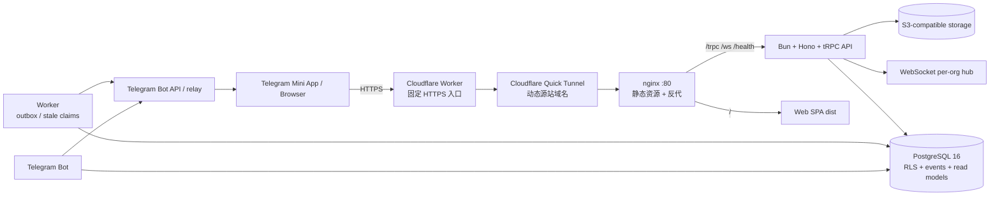
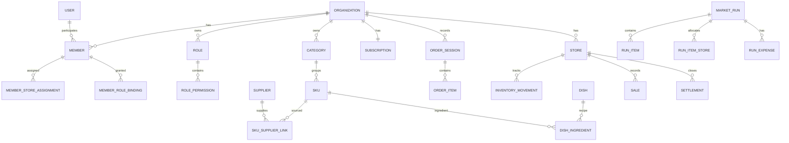
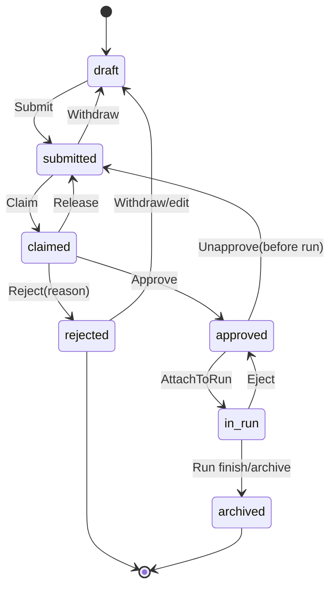
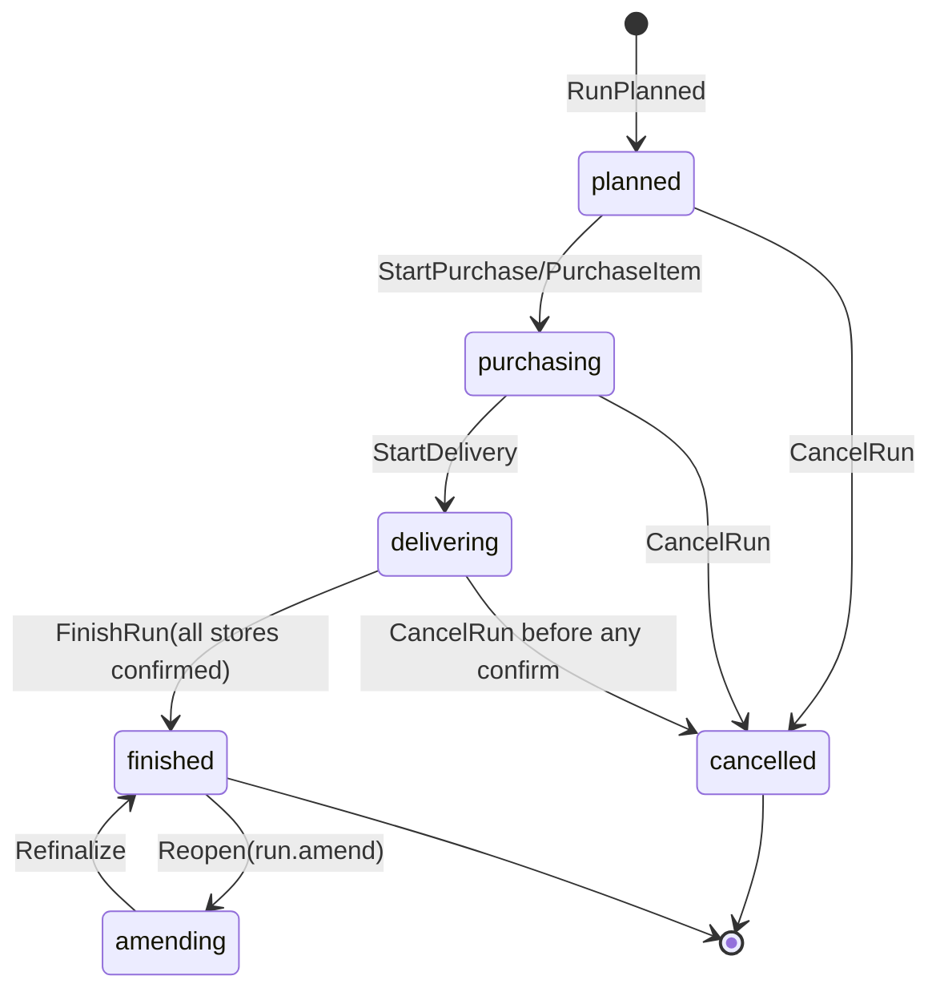
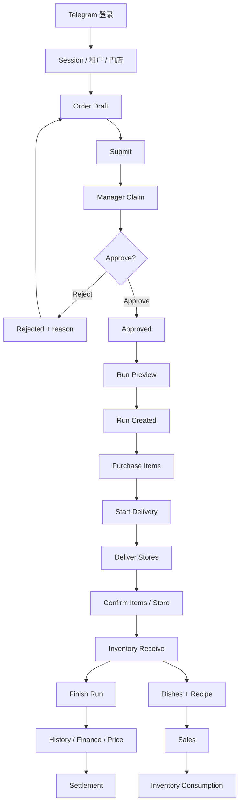
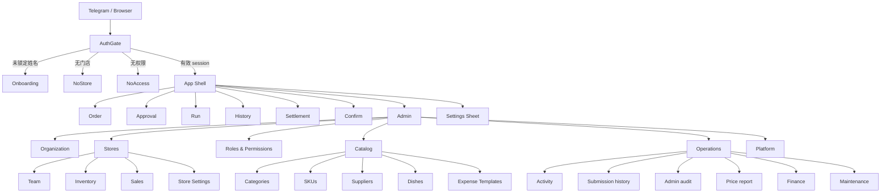

# CompassAlpha 项目全量代码审计、业务流程还原与产品优化评估

> 审计日期：2026-10-21  
> 审计基线：`main` / `c49ba3e`  
> 审计对象：`/Users/sphinx/Desktop/Fine/CompassAlpha`  
> 结论口径：代码、配置、现有测试、生产数据库聚合结果和 Nginx 访问日志交叉验证  
> 任务性质：只读审计。本次未修改业务代码、数据库记录、配置或部署环境。

## 目录

- [执行摘要](#0-执行摘要)
- [审计范围、方法与进度清单](#1-审计范围方法与进度清单)
- [项目结构与系统架构](#2-项目结构与系统架构)
- [业务模块全景](#3-业务模块全景)
- [完整业务流程和数据链路](#4-完整业务流程和数据链路)
- [页面与交互地图](#5-页面与交互地图)
- [当前操作流程分析](#6-当前操作流程分析)
- [重复功能与页面分析](#7-重复功能与页面分析)
- [疑似无效、不可达、低使用功能](#8-疑似无效不可达低使用功能)
- [业务逻辑与质量问题](#9-业务逻辑与质量问题)
- [产品与架构优化建议](#10-产品与架构优化建议)
- [优先级与实施路线图](#11-优先级与实施路线图)
- [需要进一步验证的问题](#12-需要进一步验证的问题)
- [附录](#13-附录)

---

## 0. 执行摘要

### 0.1 总体结论

CompassAlpha 不是单一下单工具，而是一套围绕多门店餐饮采购协同构建的业务系统：

```text
Telegram 身份
  → 多租户成员身份
  → 员工下单
  → 经理审批
  → 采购员合并并执行市场采购
  → 配送员分店送达
  → 门店验收入库
  → 库存 / 菜品配方 / 销售扣减
  → 每日结算与财务查询
```

系统已经具备真实生产流量和真实订单/采购数据，核心链路不是演示代码。当前生产 Eden 组织有
1,045 张订单、158 个采购单、463 次门店确认和 25 名成员。

整体评价：

| 维度         | 评分/10 | 判断                                                   |
| ------------ | ------: | ------------------------------------------------------ |
| 领域建模     |     8.5 | 事件溯源、纯函数状态机、读模型分离扎实                 |
| 租户隔离     |     9.0 | RLS、session 租户绑定、store scope 多层防御            |
| 权限设计     |     7.5 | 模型完整，但既有组织权限回填与 UI 入口存在漂移         |
| 核心采购闭环 |     8.0 | 正常流程成熟；采购开始缺少选择步骤                     |
| 库存与销售   |     6.0 | 代码齐备，但问题验收不入账、销售未真实启用             |
| 财务闭环     |     5.0 | 结算功能完整但未使用，Sales/采购/结算未自动对账        |
| 页面与导航   |     6.5 | 移动交互细节成熟，但业务入口分散、无真实 URL 路由      |
| 可运维性     |     6.0 | 有 CI、smoke、系统服务；缺监控告警、蓝绿发布、持久域名 |
| 商业化底座   |     6.0 | 套餐、限额、只读拦截已做；支付、账单、自动续期未做     |
| 代码可维护性 |     6.0 | 测试较多，但多个 1.6k–5.2k 行文件形成交付风险          |

### 0.2 必须优先修复的问题

#### P0 已确认

1. **验收异常状态不改变库存入账**
   - `StoreItemConfirmed` 可写 `short/wrong/quality`；
   - `StoreConfirmed` 投影仍按 `run_item_stores.qty` 全量增加库存；
   - 证据：`apps/api/src/services/runProjection.ts:241-286`；
   - 影响：短少、错货、质量损坏都会形成错误可用库存。

2. **销售默认日期使用 UTC**
   - `sales.list` 在未传日期时以 UTC 00:00–23:59 取当天；
   - 采购和结算已使用门店时区；
   - 证据：`apps/api/src/trpc/routers/sales.ts:210-233`；
   - 影响：跨午夜时销售列表与日结归属不同业务日。

3. **通知深链没有真正落到目标页面**
   - 服务端生成 `/approve`、`/run`、`/confirm`；
   - 前端没有 URL router，也没有解析这些 pathname；
   - 证据：`apps/api/src/services/notifyForEvent.ts`、`apps/web/src/app/Shell.tsx`；
   - 影响：用户收到“去审批/去验收”通知后可能仍停在原 tab。

#### P1 已确认

- 审批普遍需要先 Claim 再 Approve，每单多一次操作；生产 1,015 次 Claim / 1,120 次提交。
- 开始采购会合并全部 Approved 历史订单，没有日期/门店/批次选择。
- Sales 藏在 Admin 四级入口；Cashier 没有 Admin 入口权限，目标角色无法自然进入。
- Sales 与 Settlement 是两套收入记录，当前不对账。
- 生产内置角色权限没有完全跟上 seed：Manager/Staff 缺 `sales.record`，Manager 缺
  `inventory.adjust`。
- 站内通知写入 9,985 条但无收件箱页面或查询 API。
- 菜品、配方、销售、结算保存、库存调整在生产中从未形成业务结果。
- Settings 与 Admin → Organization 重复提供语言和身份信息。
- SKU/分类新建强制四种语言，且无批量导入 UI。

### 0.3 审计证据等级说明

本报告统一使用：

- **已确认事实**：可由代码、测试、日志或数据库聚合直接验证。
- **高可信度推断**：至少两组独立证据支持，但仍存在少数替代解释。
- **待验证假设**：需要真实业务口径、用户访谈、设备操作或额外监控才能判断。

特别注意：

- “代码无引用”不等于“生产从未使用”；
- “Nginx 无访问”不等于“功能不可达”；
- “数据库为 0”不等于“业务不需要”；
- “低频”不等于“应删除”。

---

## 1. 审计范围、方法与进度清单

### 1.1 盘点结果

仓库中纳入检查的源码、配置、脚本、迁移和测试文件约 397 个：

| 区域                 | 文件数/规模 | 内容                                                    |
| -------------------- | ----------: | ------------------------------------------------------- |
| `apps/web`           |          95 | React Mini App、页面、组件、hooks、状态、离线队列       |
| `apps/api`           |          66 | Hono/Bun、tRPC、认证、投影、通知、S3、WebSocket         |
| `packages/db`        |          81 | Drizzle schema、47 个迁移、seed、组织 provisioning      |
| `packages/ui`        |          52 | 设计系统和共享交互组件                                  |
| `packages/domain`    |          17 | 订单/采购状态机、事件、纯函数命令                       |
| `packages/contracts` |          14 | 前后端共享 Zod 契约                                     |
| `packages/i18n`      |          10 | zh/en/ru/uz 多语言                                      |
| `packages/telemetry` |           6 | 客户端日志、导航/RPC/log 事件                           |
| `apps/worker`        |           6 | outbox 发送、claim 清理、孤儿 session 修复              |
| `apps/bot`           |           4 | Telegram bot 命令和邀请 fallback                        |
| `tests/e2e`          |          10 | Playwright 主流程、session、kit                         |
| `infra` / `scripts`  |          19 | nginx/Caddy 兼容资料、Worker、tunnel、部署、smoke、备份 |

核心规模：

- tRPC procedure：约 154 个；
- 数据库实体：约 40 个主要表/视图；
- 迁移：47 个；
- 测试文件：42 个；
- 直接检索到的 `test/it` 声明约 461 个（包含参数化/多环境条目）；
- 最大高风险文件：

```text
apps/api/src/trpc/routers/admin.ts                    5,155 行
apps/api/src/trpc/routers/run.ts                      3,659 行
apps/web/src/pages/admin/people/PeopleSections.tsx    2,592 行
apps/web/src/pages/RunPage.tsx                         2,377 行
apps/web/src/pages/runs/views/RunViews.tsx             2,140 行
apps/web/src/pages/runs/components/RunPanels.tsx       2,041 行
apps/web/src/pages/OrderPage.tsx                       1,822 行
apps/web/src/pages/admin/operations/OperationsSections.tsx 1,815 行
```

### 1.2 检查完成度

| 检查项             | 状态   | 证据                                        |
| ------------------ | ------ | ------------------------------------------- |
| 目录/技术栈/入口   | 完成   | package manifests、main/app/router          |
| Web 页面与交互     | 完成   | 7 个顶层页面、全部 Admin 子模块、主要 Sheet |
| API procedure      | 完成   | 13 个 router，约 154 procedure              |
| 领域状态机         | 完成   | order/run commands/events/state/tests       |
| 数据库与迁移       | 完成   | 5 个 schema 文件、47 migrations             |
| RLS/权限/多租户    | 完成   | schema、context、storeScope、测试           |
| Worker/Bot/通知    | 完成   | worker、bot、outbox、relay                  |
| 离线/幂等/实时     | 完成   | IDB outbox、tRPC middleware、WebSocket      |
| 构建/类型/静态质量 | 完成   | Web/build/shared packages                   |
| 生产业务结果       | 完成   | 只读聚合查询                                |
| 生产访问频率       | 完成   | Nginx 最近约 11 天                          |
| 真实设备逐按钮回归 | 未完成 | 无可操作 Telegram 测试身份/设备             |
| 支付渠道           | 未完成 | 代码尚无支付实现                            |
| k6/容量压测        | 未完成 | 仓库无负载测试实现                          |
| 生产数据人工抽样   | 仅聚合 | 避免读取与报告无关的个人/财务内容           |

### 1.3 本次实际执行结果

| 检查                                                 | 结果                        | 说明                                                             |
| ---------------------------------------------------- | --------------------------- | ---------------------------------------------------------------- |
| Web TypeScript                                       | 通过                        | `pnpm --filter @compass/web type-check`                          |
| Web ESLint                                           | 通过                        | `pnpm --filter @compass/web lint`                                |
| Web 生产构建                                         | 通过                        | 主 bundle 506.78 KB，Admin 203.83 KB                             |
| contracts/db/domain/i18n/telemetry/ui/cli type-check | 通过                        | 7 个 workspace                                                   |
| API/bot/worker type-check                            | 通过                        | 3 个运行时 workspace                                             |
| E2E TypeScript                                       | 通过                        | Playwright workspace                                             |
| Domain tests                                         | 93 pass / 0 fail            | 206 expect                                                       |
| Web unit/helper tests                                | 218 pass / 0 fail           | 423 expect                                                       |
| Worker relay tests                                   | 5 pass / 0 fail             | 11 expect                                                        |
| API non-PG tests                                     | 54 pass / 137 skip / 0 fail | 本次禁用 PG-gated 测试                                           |
| 全量 API + PG tests                                  | 本次未重跑                  | 本地未启动 PostgreSQL                                            |
| Turbo wrapper                                        | 工具链失败                  | 当前 Node/Corepack 环境找不到 package-manager binary；非源码错误 |
| Prettier 全仓检查                                    | 不通过                      | 114 个既有文件未格式化；本次未批量改写                           |

### 1.4 生产使用证据

只读聚合结果：

| 对象                    |              数据 |
| ----------------------- | ----------------: |
| 组织/门店/人员          |        1 / 5 / 25 |
| 订单/采购单             |       1,045 / 158 |
| 数量调整事件            |            51,292 |
| 审批 Claim / 提交       |     1,015 / 1,120 |
| 采购录入 / 修正         |      10,967 / 868 |
| 门店确认 / SKU 确认事件 |      463 / 14,658 |
| 菜品/配方               |             0 / 0 |
| 销售                    |                 0 |
| 每日结算                |                 0 |
| 手工盘点/损耗           |             0 / 0 |
| 问题备注/问题照片       |             0 / 0 |
| 采购收据照片            | 0 / 10,928 已购行 |
| inapp 通知 / bot 通知   |     9,985 / 9,985 |

最近约 11 天 Nginx 访问：

| Procedure                               |  次数 |
| --------------------------------------- | ----: |
| `run.get`                               | 9,462 |
| `order.adjustItem`                      | 4,587 |
| `run.list`                              | 4,106 |
| `order.todaySession`                    | 4,063 |
| `order.todayBatches`                    | 4,049 |
| `run.previewCreatable`                  | 2,562 |
| `run.confirmStoreItem`                  | 1,652 |
| `run.purchaseItem`                      | 1,233 |
| `order.pendingList`                     | 1,031 |
| `run.markStoreItemsOk`                  |     4 |
| `settlement.save`                       |     0 |
| `sales.record`                          |     0 |
| `inventory.stocktake` / `recordWastage` | 0 / 0 |
| `platform.updateSubscription`           |     0 |

重要限制：

- 当前没有页面浏览和按钮点击埋点；
- Nginx 日志只能证明 HTTP procedure 被请求；
- tRPC 返回 200 仍可能包含业务错误；
- 数据库结果能证明“没有形成业务结果”，但不总能证明“页面从未打开”；
- 生产中有少量 smoke/test 数据，因此趋势判断优先使用长期事件流。

---

## 2. 项目结构与系统架构

### 2.1 技术栈

| 层       | 实际实现                                                       |
| -------- | -------------------------------------------------------------- |
| 前端     | React 18、Vite、Tailwind v3、TanStack Query、Zustand、Radix UI |
| API      | Bun、Hono、tRPC v11、Drizzle ORM、Zod                          |
| 业务领域 | TypeScript 纯函数、append-only events、read model              |
| 数据库   | PostgreSQL 16、RLS、JSONB、事务、SKIP LOCKED outbox            |
| 实时     | Bun WebSocket，per-org hub                                     |
| 离线     | IndexedDB mutation outbox + 幂等键                             |
| 身份     | Telegram initData HMAC、JWT access/refresh、refresh family     |
| 对象存储 | S3 兼容预签名 PUT                                              |
| Bot/异步 | grammY bot、Bun worker outbox polling                          |
| 部署     | Cloudflare Worker → quick tunnel → nginx → Bun API             |
| 测试     | Bun test、Playwright                                           |

### 2.2 目录和职责

| 路径                 | 职责                                         | 边界               |
| -------------------- | -------------------------------------------- | ------------------ |
| `apps/web`           | Telegram Mini App 和浏览器 UI                | 不持有最终业务真相 |
| `apps/api`           | 认证、API、投影、实时、上传、静态 SPA        | 业务写入口         |
| `apps/worker`        | outbox 通知、claim 超时、孤儿 session 修复   | 后台异步           |
| `apps/bot`           | `/start`、`/id`、邀请说明                    | 外部入口           |
| `packages/domain`    | 订单/采购命令、事件、reducer、状态规则       | 无数据库副作用     |
| `packages/db`        | schema、迁移、RLS、seed、provisioning        | 数据定义和隔离     |
| `packages/contracts` | Zod 输入契约                                 | 前后端共享         |
| `packages/ui`        | 设计系统基础组件                             | 与业务相对解耦     |
| `packages/i18n`      | 四语言 catalog 和参数解析                    | UI 文案            |
| `packages/telemetry` | 客户端 ring buffer、日志 batch               | 诊断               |
| `packages/cli`       | 用户/组织/项目管理命令                       | 运维辅助           |
| `infra`              | nginx/Caddy/Cloudflare/tunnel/systemd/backup | 运行环境           |
| `scripts`            | deploy、smoke、browser smoke、origin refresh | 发布验证           |

### 2.3 系统架构图



### 2.4 启动、构建与部署

本地：

```text
pnpm dev
  → Turbo parallel
  → apps/web Vite :5173
  → apps/api Bun :3000
  → bot/worker 进程
```

生产：

```text
GitHub main
  → deploy script 上传
  → pnpm install / migrate
  → 写 systemd unit
  → restart compass-api + compass-worker
  → vite build
  → smoke
```

当前限定条件：

- Worker 公网地址稳定，但其后 quick tunnel 在服务重启后可能变化；
- 使用 `scripts/refresh-app-proxy-origin.sh` 更新 Worker origin；
- 当前没有固定自有 HTTPS 域名；
- 若 tunnel 域名改变而未刷新 Worker origin，用户入口仍在但会代理失败。

### 2.5 状态管理

| 状态                   | 位置                | 持久化       | 说明                              |
| ---------------------- | ------------------- | ------------ | --------------------------------- |
| access/refresh/session | Zustand `authStore` | localStorage | 租户、member、权限、roles、stores |
| tab/Admin drill-down   | Zustand `navStore`  | localStorage | 刷新恢复页面位置                  |
| 服务端实体             | TanStack Query      | 内存 cache   | 读模型数据                        |
| 未提交 mutation        | IndexedDB outbox    | 是           | 网络恢复重放                      |
| 客户端 build session   | sessionStorage      | 是           | telemetry 会话                    |
| Sheet/draft            | 组件 state          | 否           | 刷新关闭                          |
| Run 价格千元偏好       | localStorage        | 是           | 设备级偏好                        |
| Run preview grouping   | localStorage        | 是           | by-store/by-vendor                |

### 2.6 核心数据实体关系



主要实体生命周期：

- `Organization`：平台管理员创建，正常业务不删除；
- `Member`：邀请/直接添加创建，可 suspend/remove，邀请接受可恢复；
- `Store`：org admin 创建，可 archive；
- `OrderSession`：draft → submitted → approved/rejected → in_run → archived；
- `MarketRun`：planned → purchasing → delivering → finished；可 cancelled/amending；
- `InventoryMovement`：append-only，不原地改数量；
- `Sale`：append-only 业务记录（当前没有冲销能力）；
- `Settlement`：每店每日一条逻辑记录，修正追加 revision、version 递增；
- `Notification`：按 recipient × channel 写入，dedup key 去重。

### 2.7 架构优点

- 租户边界在数据库层强制，而不是只靠 API `WHERE org_id`；
- 订单和采购规则集中在纯函数领域层，便于单测与回放；
- 读模型与事件流分离，页面不自行拼业务状态；
- 高风险 mutation 有幂等键；
- 交易、库存、销售、结算使用数据库事务；
- Telegram Mobile 交互不是简单套 Web 页面，MainButton、BackButton、Sheet 和 safe area 都有专门处理。

### 2.8 架构风险

- 前端无真实 URL router，tab 是持久化状态机；
- API/Bot/Worker 进程内状态与单实例假设；
- `run.ts`、`admin.ts` 和多个页面文件过大；
- 通知、Sales、Settlement 尚缺真正的跨模块闭环；
- RLS 是强项，但权限配置回填不是自动治理；
- 当前部署依赖 quick tunnel，运维稳定性弱于自有域名。

### 2.9 配置、开关和兼容机制

关键服务端配置：

| 配置                                   | 作用                            |
| -------------------------------------- | ------------------------------- |
| `DATABASE_URL` / `DATABASE_URL_DIRECT` | 业务连接 / migration 直连       |
| `JWT_SECRET` / `JWT_REFRESH_SECRET`    | access / refresh 签名           |
| `TELEGRAM_BOT_TOKEN`                   | Telegram 校验与 bot 发送        |
| `TG_RELAY_URL` / `COMPASS_RELAY_KEY`   | Telegram API 中转               |
| `FRONTEND_URL`                         | bot 深链和 CORS 基址            |
| `S3_*`                                 | 预签名上传与公开读取            |
| `NON_TELEGRAM_LOGIN_ENABLED/USERS`     | 浏览器非 Telegram 登录 fallback |
| `DB_TENANT_PROBE`                      | 无租户查询 warn/throw/off       |
| `CLAIM_TIMEOUT_MINUTES`                | 审批 claim 超时                 |
| `VITE_BUILD_SHA`                       | 前后端版本检测                  |

构建和功能开关：

- `VITE_DEV_MOCK_INIT_DATA` 仅 DEV 使用，production build 会主动中止；
- `VITE_ENABLE_MAINTENANCE=1` 才显示 super_admin 维护页；
- `VITE_SOURCEMAP=true` 才输出 source map，生产默认关闭；
- `?kit` 只在 Vite DEV 显示组件 gallery；
- `feature_flags` provisioning 写入：
  - `price_alert.threshold_multiplier=1.2`；
  - `price_alert.threshold_uzs=10000`；
  - `order.default_step_for_kg=0.5`；
  - `workflow.skip_approval=false`。

当前代码中除 provisioning/tests 外，业务读取 `ops.feature_flags` 的路径很少。不要把这些
flag 当作已经可动态控制全部产品的成熟 feature system；目前更像预留配置。

---

## 3. 业务模块全景

### 3.1 模块职责矩阵

| 模块              | 主要用户                | 入口                                   | 核心 API/服务                                         | 主要数据                               |
| ----------------- | ----------------------- | -------------------------------------- | ----------------------------------------------------- | -------------------------------------- |
| 登录与 onboarding | 所有成员                | Telegram / AuthGate                    | `auth.telegramLogin`、`auth.me`、`completeOnboarding` | users、members、refresh_tokens         |
| 工作区/租户       | 平台管理员、成员        | Settings → Workspace                   | `auth.createOrganization`、`switchOrganization`       | organizations、subscriptions、members  |
| 门店与人员        | admin/manager           | Admin → Stores                         | `admin.store*`、`member*`、`role*`                    | stores、members、assignments、bindings |
| 权限              | admin/super_admin       | Admin → Roles & Permissions、门店 Team | `role*`、`grantRole`、`memberPermission*`             | roles、permissions、overrides          |
| 目录              | admin                   | Admin → Catalog                        | `catalog.*`、`admin.*List/Create/Update`              | categories、skus、suppliers            |
| 下单              | staff/manager/admin     | Order tab                              | `order.todaySession/todayBatches/adjustItem/submit`   | order events/read models               |
| 审批              | manager/admin           | Approval tab                           | `order.pendingList/claim/approve/reject`              | order state、policy decisions          |
| 采购              | purchaser/admin         | Run tab                                | `run.previewCreatable/create/purchaseItem/...`        | run events/read models、price_history  |
| 配送验收          | purchaser/store staff   | Run/Confirm tab                        | `run.deliverToStore/confirmStoreItem/confirmStore`    | run_item_stores、movements             |
| 库存              | manager/admin           | Admin → Store → Inventory              | `inventory.levels/stocktake/recordWastage`            | inventory.movements                    |
| 菜品与配方        | admin                   | Admin → Catalog → Dishes               | `dishes.*`                                            | dishes、dish_ingredients               |
| 销售              | staff/cashier/manager   | Admin → Store → Sales                  | `sales.record/list`                                   | sales、inventory.movements             |
| 每日结算          | cashier/manager/admin   | Settlement tab                         | `settlement.*`                                        | settlements、settlement revisions      |
| 历史/财务/价格    | manager/admin/purchaser | History、Admin → Operations            | `run.history*`、`report.*`、`catalog.skuPriceStats`   | run read models、price_history         |
| 通知              | 业务接收人              | Telegram、无站内 inbox                 | notify service、worker                                | notifications、outbox                  |
| 订阅控制          | 平台管理员              | Admin → Platform                       | `platform.*`                                          | billing_plans、subscriptions           |
| 维护审计          | super_admin             | Admin → Operations                     | `admin.recentEvents/adminAuditList/purge*`            | policy_decisions、events、client_logs  |

### 3.2 认证与 onboarding

解决什么问题：

- 用 Telegram 身份建立稳定用户；
- 找到用户所属租户；
- 返回当前 member、roles、permissions、stores 和 subscription；
- 处理姓名锁定、无门店和无权限状态。

完整流程：

```text
打开 Mini App
  → 读取 initData
  → API 校验 HMAC / auth_date / user
  → users.tg_user_id 查用户
  → 按 last_org + active membership 恢复租户
  → 签发 15m access + 30d refresh
  → 返回 session
  → 姓名未锁定则确认姓名
  → 无门店/无权限则进入对应空态
```

规则：

- 未邀请的 Telegram 用户不会自动加入组织；
- dev mock self-enrol 只在本地开发开关下允许；
- 姓名首次确认后锁定，防冒充；
- refresh token 绑定 org/member，切换组织后不会串租户；
- 未授权 refresh 会清 session，服务不可用时保留 session 等待重试。

失败分支：

- initData 无效：登录拒绝；
- 没有 membership：NoAccess；
- 有 membership 但无 store：NoStore；
- refresh 被拒：清 session；
- refresh 网络失败：保留 session，将请求视为网络失败。

### 3.3 组织、工作区和订阅

组织是租户，不是门店。一个组织包含门店、人员、角色、目录、订单、采购、库存、销售、结算和订阅。

创建路径：

```text
平台管理员登录
  → Settings → Workspace
  → Create new workspace
  → 输入名称
  → 校验 platform_admins
  → 创建 organization
  → Starter trial 14 天 + grace 7 天
  → 创建权限目录和 6 个内置角色
  → 创建默认 feature flags
  → 把创建者设为该组织 admin
  → 签发新组织 token
  → 清空旧租户 query cache
```

注意：

- 新组织没有自动创建第一家门店；
- 创建者得到组织 `admin`，不是组织 `super_admin`；
- 平台管理员和 org `super_admin` 是不同权限轴；
- 只有平台管理员可以创建组织；
- 订阅状态影响 writeAccess，不阻止读取历史。

### 3.4 门店、人员与 RBAC

核心规则：

```text
role_permissions
  + member allow/deny override
  + global/store scope
  + rank gate
  + organization boundary
```

角色层级：

| 角色        | rank | 主要职责                                |
| ----------- | ---: | --------------------------------------- |
| super_admin |  100 | 组织内最高权限、run amend、测试数据维护 |
| admin       |   80 | 组织、门店、目录、角色、人员、财务      |
| manager     |   60 | 审批、门店人员、库存、日结              |
| purchaser   |   40 | 采购、配送                              |
| cashier     |   30 | 销售、日结                              |
| staff       |   20 | 下单、验收、销售                        |

实际实现不是“命中任一权限即可”：

- role binding 可以 global 或 store scoped；
- per-member override 可以按 global/store allow/deny；
- store-scoped manager 不能跨店授权；
- 不能授予同级或更高 rank；
- super_admin 的 store-scoped malformed grant 不获得跨租户/跨店超级权限；
- 拒绝 override 始终覆盖 allow。

人员门店关系涉及四张概念：

- `members`：组织成员；
- `member_store_assignments`：成员在哪些店；
- `member_role_bindings`：角色作用域；
- `member_permission_overrides`：个人例外。

当前问题：

- checkbox unassign 只移除 assignment；
- Detach 才同时移除 assignment、store role bindings、store overrides；
- UI 两个动作视觉语义接近，但副作用不同；
- 生产 Manager/Staff 的角色权限与 seed 不一致；
- 自定义角色和 per-member override 生产均为 0，但 UI 暴露完整高级编辑能力。

### 3.5 目录

目录对象：

- Category；
- SKU；
- Supplier；
- SKU ↔ Supplier；
- Expense Template；
- Dish + recipe/BOM。

SKU 规则：

- 名称必须 `uz/ru/en/zh` 四语齐全；
- `unit` 和 `step` 使用 canonical enum；
- 归档 SKU 不能新下单；
- SKU 修改写 `policy_decisions` 审计；
- 运营页和管理页分别有 catalog/admin read endpoint。

菜品规则：

- 名称至少一个 locale；
- 售价可空；
- 配方可空，但空配方不能销售；
- 配方是 org-wide，所以不允许 store manager 修改；
- 销售时使用 sale time price snapshot。

当前生产状态：

- 318 SKU、8 分类、13 供应商、3 费用模板；
- 0 菜品、0 配方；
- 四语完整率 100%；
- 供应商关系 288，preferred 259。

### 3.6 下单

业务问题：

- 门店员工按门店、日期、个人/批次请求商品；
- 支持目录 SKU、其他物品和备注；
- 提交后进入经理审批。

进入条件：

- 组织写权限有效；
- 有 `order.draft`；
- 当前门店是具体 store，不能是 ALL；
- 用户在 store scope 内。

完整路径：

```text
Order tab
  → 分类/搜索
  → +/- 或数量 Quick Pick
  → 可选“其他物品”
  → Review
  → Submit
  → server flush pending quantities
  → Submitted event
  → 收据视图
  → Withdraw 或 New batch
```

状态：



规则：

- 同一员工同一门店同一天可有多个 batch；
- qty 必须符合 SKU step；
- submit 至少一个非零 SKU 或 structured extra；
- submitted 在未 claim 时 owner 仍可编辑，UI 以 Withdraw 表达；
- approved 后订单内容锁定；
- in_run 后只能通过采购侧 eject/修正。

实际风险：

- 生产 1,045 单产生 51,292 次 ItemAdjusted，平均约 49.1 次/单；
- 数量操作是核心高频路径，UI 已有 quick-pick 和 hold ramp；
- Order 已提交收据把 BatchStrip 在 banner 前后各渲染一次。

### 3.7 审批

进入条件：

- `order.approve`；
- 当前门店或 ALL 的 store scope；
- 订单 submitted。

流程：

```text
Approval tab
  → Pending/Approved/Rejected
  → Claim
  → View/Hide items
  → 经理可在 claim 状态下调整贡献人数量
  → Approve / Reject / Release
```

规则：

- 他人 claim 时不可直接审批；
- Take over 先释放别人的 claim；
- Reject 原因必填；
- Unapprove 只能 approved 且未 attached；
- 审批 claim 可以 timeout 自动释放；
- claim/release/override 进入审计事件。

UX 问题：

- 服务端 Approve 本身并不要求先 Claim，但 UI 只用 `isClaimedByMe` 展示 Approve/Reject；
- 单人审批被迫多一步；
- Take over 与重新 Claim 分离，形成两次动作；
- 生产 Claim 次数接近提交数，证明这是长期路径，不是偶发。

### 3.8 采购

进入条件：

- `run.purchase`；
- 存在 approved 且未入 run 的订单；
- 同一组织不存在其他活跃 run。

开始采购：

```text
Run tab
  → previewCreatable({})
  → 所有 Approved（不限 orderDate）
  → 计算 SKU、门店分账、预算、供应商分组
  → Start Purchase
  → run.create(sessionIds 全部, startImmediately=true)
```

采购状态：



采购规则：

- purchase actual qty 必须等于 store splits 总和；
- 同一 SKU 每个门店只保留对应 split；
- cash/transfer 可逐 item/store；
- 价格异常先 Price Check；
- 供应商可空；
- receipt photo 当前可选；
- unavailable 必须有 note；
- 全部 pending 处理后才允许 Start Delivery；
- 采购修订原因必填；
- 已送货/已确认后不能随意 revise/undo；
- 所有门店确认后才能 finish；
- finish 后金额冻结。

关键产品问题：

- 当前没有在创建前选择业务日期、门店或部分 session；
- 所有历史 approved 会一次性进入；
- 生产 158 run、10,967 purchase、868 revise，说明“开始后修正”常见；
- Run exclusive claim 的后端仍存在，但 UI 已删除；
- 供应商偏好只能在 Run preview 逐 SKU 修改。

### 3.9 配送与验收

流程：

```text
Start Delivery
  → Deliver to Store
  → store Confirm tab
  → 每个 SKU 选择 ok/short/wrong/quality
  → 非 ok 填写 note，可附照片
  → 可 Bulk OK 未决行
  → Confirm Store
  → inventory delivery_received movement
```

业务规则：

- dispatch 和 confirm 权限分离；
- 配送开始后不能继续采购；
- 门店确认后不能取消 run；
- 所有 relevant stores confirmed 才能 finish；
- store confirm 重复点击是 no-op；
- item confirm 相同 payload 重复点击是 no-op；
- Bulk OK 只处理尚未决定行。

已知严重缺陷：

- `short/wrong/quality` 只改变 confirm status/note/photo；
- inventory projection 不读取 status 和确认数量；
- 当前 UI 甚至没有 receivedQty 输入。

### 3.10 库存

库存是 append-only movement：

```text
delivery_received  +qty
consumption        -recipeQty
stocktake          counted - current
wastage            -qty
run_correction     ±delta
```

规则：

- 库存只记数量，不记成本；
- stocktake 是绝对数量，系统换算 delta；
- wastage 必须写原因；
- movement 不能原地改；
- 库存查询按 store scope；
- current on-hand = SUM(delta)。

生产事实：

- 14,658 delivery_received；
- 2 run_correction；
- 0 stocktake，0 wastage，0 consumption；
- `inventory.levels` 最近 11 天仅访问 5 次。

### 3.11 菜品与销售

菜品：

- Admin 创建名称、售价和 BOM；
- BOM 由 SKU + qtyPerServing 组成；
- 替换式保存 ingredients。

销售：

```text
Admin → Store → Sales
  → 选择菜品
  → 输入 qty
  → sales.record
  → INSERT sale
  → INSERT ingredient consumption movements
  → invalidate sales/list + inventory
```

失败：

- 菜品归档/不存在：拒绝；
- 无 recipe：拒绝；
- qty ≤ 0：拒绝；
- 跨店：拒绝；
- sale 重放：movement unique + idempotency 防止重复扣库存。

当前缺口：

- 菜品/配方生产为 0，因此销售无法形成真实使用；
- Sales 页面藏在 Admin 四级入口；
- Cashier 没有 Admin 底部入口；
- sale 没有 void/refund/correction API；
- Sales 与 Settlement 收入不自动对账；
- `sales.list` 默认 UTC 日界。

### 3.12 每日结算

进入条件：

- `settlement.record`；
- store scope 与 effective permission；
- 日期不晚于门店时区今天。

数据：

- onlineRevenue；
- invoicedCashRevenue；
- operatingExpenseItems；
- wageItems；
- nextPurchaseReserve；
- priorPurchaseAdjustment；
- cashOnHand；
- note；
- correctionReason；
- version。

流程：

```text
Close tab
  → store
  → authoritative businessDate
  → load existing or empty
  → edit revenue/cost/wage/cash
  → validate details and amounts
  → Save/Update
  → version compare-and-swap
  → append revision
```

规则：

- 一店一日一条 settlement；
- 已有记录修改必须有 correction reason；
- 新非零支出必须有明细；
- 历史 total-only 行只读，不能冒名归属；
- 工资接收人服务端从 wage roster 解析；
- cashier 可以收入/工资，不能新增经营支出；
- 冲突版本阻止覆盖。

关键问题：

- 生产 0 条 settlement；
- 没有从 Sales 自动汇总收入；
- 没有从 Run 自动生成采购支出对账；
- `cashOnHand` 是人工实盘值，系统不计算理论现金差异。

### 3.13 历史、价格和财务

History：

- server-side 搜索、日期、门店、付款方式、排序、分页；
- 详情显示 SKU、门店分账、cash/transfer、费用；
- run amend 角色可修改日期、reopen。

Finance：

- `report.purchaseLines` 明细；
- `report.totals` cash/transfer 汇总；
- 按 store scope 过滤；
- 当前实际导出是复制文本，不是 Excel。

Price：

- ItemPurchased/revised 会写 price_history；
- preview 使用 last price/default price；
- stale price 超过阈值会提示。

### 3.14 通知

触发：

- order submitted/approved/rejected/unapproved；
- run planned/delivered/finished；
- 其他业务事件。

收件人：

- 按 permission；
- store-scoped 事件额外过滤 store；
- 默认排除 actor。

写入：

- 每个 recipient × channel 一条 `ops.notifications`；
- 非 inapp channel 写 `sync.outbox`；
- worker 消费并发送 Telegram。

实际问题：

- bot 和 inapp 各写一份；
- inapp 没有 UI/API；
- 深链不转换到 navStore；
- webpush 未实现且 0 subscription。

### 3.15 平台订阅

套餐：

| 套餐    |    stores |   members |
| ------- | --------: | --------: |
| Starter |         1 |        10 |
| Growth  |         3 |        30 |
| Pro     |        10 |       100 |
| Legacy  | unlimited | unlimited |

规则：

- 新组织 Starter trial 14 天；
- grace 7 天；
- writeAccess 由 status + trial/period/grace date 共同得出；
- 只读时业务 mutation 被统一拦截；
- platform mutation 和 auth self-service 请求豁免。

当前状态：

- 一个 legacy active 组织；
- 生产从未调用 `updateSubscription`；
- 无支付、账单、发票、自动续费、退款、dunning。

---

## 4. 完整业务流程和数据链路

### 4.1 端到端主链路



该图表示代码支持的目标链路，不代表当前每个组织都已启用后半段。生产 Eden 已使用到采购、
验收、库存和财务查询，但尚未使用菜品、销售和结算。

### 4.2 下单端到端调用链

关键调用链：

```text
OrderPage
  → order.todaySession / todayBatches / sessionDetail
  → order.adjustItem
    → load order events
    → decide AdjustItem
    → append event
    → project order_items_v
    → realtime order.changed
  → Review Sheet
  → order.submit
    → flush queued qty
    → decide Submit
    → append Submitted
    → project status submitted
    → notifications
    → realtime
```

数据变化：

| 步骤       | 写入                                        | 读取的后续模块         |
| ---------- | ------------------------------------------- | ---------------------- |
| AdjustItem | `domain.events`、`read_model.order_items_v` | Order/Approval         |
| Submit     | `Submitted`、session status                 | Approval、Notification |
| Claim      | `Claimed`、claimed_by                       | Approval、Activity     |
| Approve    | `Approved`                                  | Run preview            |
| Attach     | `AttachedToRun`、run_id                     | Confirm、History       |
| Archive    | `Archived`                                  | History、finance       |

失败与重试：

- adjust 有 250ms debounce、按 store 串行、乐观 cache；
- 断网时 adjust 入 IDB；
- submit 使用 idempotency + pending flush；
- 重复 Claim 返回 no-op；
- 同 qty adjust 返回 no-op；
- 非法 step 在 domain 拒绝。

### 4.3 审批端到端调用链

```text
ApprovalPage
  → order.pendingList(status/store)
  → order.claim
  → [optional order.adjustItem(targetMemberId)]
  → order.approve / order.reject(reason)
  → event stream + read model
  → Notification + WebSocket
```

约束：

- Claim 权与 Approve 权独立；
- Claim 是协作提示锁，不改变订单业务状态语义；
- Approve 服务端允许 unclaimed 单据，但 UI 要求 claimed-by-me；
- 经理编辑他人贡献行必须有 `order.approve`；
- Reject 必填原因；
- Unapprove 要求未进入 run。

### 4.4 采购端到端调用链

```text
RunPage
  → run.previewCreatable({})
  → run.create(sessionIds, startImmediately)
  → order.AttachedToRun × N
  → RunPlanned / PurchaseStarted
  → run.purchaseItem / addPurchaserItem / addExpense
  → price_history + run read model
  → run.startDelivery
  → run.deliverToStore
  → run.confirmStoreItem / markStoreItemsOk / confirmStore
  → run.finish
```

金额规则：

- `actualQty = SUM(storeSplits.qty)`；
- `lineTotal = actualQty × effectiveUnitPrice`；
- split 可以有独立 price/payment；
- expense 可以独立分账和付款方式；
- finish 冻结 totalActual/totalCash/totalTransfer；
- 任何修正必须通过事件保留原因。

批次问题：

- 当前 preview 默认不限定日期；
- create 会取 preview 返回的所有 sessions；
- 这适合“清空所有 approved backlog”，但不符合“先选择今天要采购什么”的场景；
- 若员工延迟审批、门店有补单或多个日期的 pending，采购员无法在开始前做范围选择。

### 4.5 验收与库存调用链

```text
ConfirmPage
  → run.get
  → run.confirmStoreItem(status,note,photo)
  → StoreItemConfirmed
  → 更新 run_item_stores_v confirm_*
  → all decided
  → run.confirmStore
  → StoreConfirmed
  → inventory.movements
  → StoreDelivered/confirmed read models
```

库存现状：

```text
run_item_stores_v.qty ─────────────→ +delta
confirm_status ─────── ignored ────→ no effect
confirm_note ───────── ignored ────→ no effect
confirm_photo ──────── ignored ────→ no effect
```

因此“有问题”当前只是验收备注，不是数量处置。

### 4.6 销售与库存调用链

```text
StoreSalesTab
  → dishes.list
  → sales.record(storeId,dishId,qty,occurredAt?)
  → verify dish/store
  → require recipe
  → INSERT inventory.sales
  → INSERT inventory.movements
       delta = -qty × qtyPerServing
  → invalidate sales.list + inventory.levels
```

规则：

- 菜品售价在 sale time snapshot；
- 无售价仍可消耗库存，但收入显示 “—”；
- BOM 变更没有版本概念，历史 consumption 已写入 movement，不受后续 BOM 改变；
- sale 没有冲销，录错后正常 UI 无法纠正。

### 4.7 结算调用链

```text
SettlementPage
  → settlement.businessDate(store)
  → settlement.get(store,date)
  → settlement.wageRoster (picker)
  → settlement.save
    → validate store/time/date/amount/detail
    → compare expectedVersion
    → normalize cents
    → insert/update settlement
    → insert revision snapshot
  → recent invalidation
```

数据一致性：

- store+date 唯一；
- save 用 version CAS；
- 明细总额必须等于 scalar total；
- correction 必须带原因；
- 历史 only-total 记录不允许被伪造成明细；
- 工资 member 必须属于该门店 roster。

尚未形成的链路：

```text
Sales 明细 ─x→ Settlement onlineRevenue
Run 采购支出 ─x→ Settlement 对账
库存销售消耗 ─x→ 毛利/成本
```

### 4.8 取消、撤销与恢复

| 操作            | 状态边界                        | 是否可恢复                  | 审计 |
| --------------- | ------------------------------- | --------------------------- | ---- |
| Withdraw order  | 未 claim/可编辑阶段             | 可重提                      | 是   |
| Release claim   | submitted                       | 可重 claim                  | 是   |
| Unapprove       | approved 未进 run               | 可重新审批                  | 是   |
| Eject session   | planned/purchasing 且未触达商品 | 不恢复原 run，回到 approved | 是   |
| Undo purchase   | 交付/确认前                     | 恢复 pending                | 是   |
| Undo delivery   | 门店确认前                      | 回到未送达                  | 是   |
| Cancel run      | 无门店确认                      | 不可 reopen                 | 是   |
| Reopen run      | finished + run.amend            | 进入 amending               | 是   |
| Refinalize      | amending                        | 再次 finished               | 是   |
| Change run date | run.amend                       | 可再次修改                  | 是   |

### 4.9 网络中断与重复提交

已有措施：

- `X-Idempotency-Key` 24h；
- client stable key 支持 lost response；
- order adjust 按 store 串行；
- Sales/Settlement/Purchase/Run Finish/Order Submit 幂等；
- `StoreConfirmed` 和 item confirm 重复是 no-op；
- IDB queue 有 max retries/backoff；
- 401 触发单飞 refresh；
- mutation 未完成时底部导航被禁用。

不足：

- IDB replay 在部分逻辑中仍可能生成新 key；
- PWA shell 无 Service Worker，断网刷新无法打开应用；
- WebSocket 无 polling/SSE fallback；
- 通知打开依赖 URL，但无 URL router。

---

## 5. 页面与交互地图

### 5.1 路由事实

本项目没有 URL router。所谓“页面”由：

```text
Zustand tab
  + Admin section
  + catalog/operations substate
  + store focus
  + Sheet state
```

决定。

- `/` 通过 nginx / Hono SPA fallback 返回 `index.html`；
- 刷新恢复 `compass.nav.v1`；
- 分享/通知路径不会自动切换 tab；
- Telegram BackButton 用于 Sheet 和 Admin drill-up，不是浏览器历史。

### 5.2 顶层页面清单

| 页面           | 代码                               | 入口条件                        | 目的                         |
| -------------- | ---------------------------------- | ------------------------------- | ---------------------------- |
| AuthGate       | `apps/web/src/app/AuthGate.tsx:95` | 无 session                      | 登录、错误、dev persona      |
| Onboarding     | `AuthGate.tsx:704`                 | displayName 未锁                | 确认姓名                     |
| NoStore        | `AuthGate.tsx:772`                 | 无 store                        | 解释无门店                   |
| NoAccess       | `AuthGate.tsx:781`                 | 无权限                          | 解释无权限                   |
| Order          | `OrderPage.tsx:55`                 | `order.draft`                   | 下单/批次收据                |
| Approval       | `ApprovalPage.tsx:44`              | `order.approve`                 | 审批                         |
| Run            | `RunPage.tsx:99`                   | `run.purchase`                  | 采购/配送/完成               |
| History        | `HistoryPage.tsx:46`               | `prices.view`                   | 采购历史和 run 修正          |
| Settlement     | `SettlementPage.tsx:350`           | `settlement.record`             | 日结                         |
| Confirm        | `ConfirmPage.tsx:39`               | `delivery.confirm`              | 门店验收                     |
| Admin          | `AdminPage.tsx:123`                | `users.manage` / platform admin | 管理控制台                   |
| Settings Sheet | `SettingsSheet.tsx:63`             | 登录后                          | 自我设置、工作区、语言       |
| Debug          | `DebugPage.tsx:36`                 | super_admin + Activity          | 日志诊断                     |
| KitGallery     | `KitGallery.tsx:44`                | DEV `?kit`                      | 仅开发设计预览，不是生产页面 |

### 5.3 页面导航图



### 5.4 页面跳转关系表

| 来源          | 触发                                             | 目标                                           | 返回/状态                                 |
| ------------- | ------------------------------------------------ | ---------------------------------------------- | ----------------------------------------- |
| AuthGate      | 登录成功                                         | Shell 当前/最近 tab                            | session 恢复                              |
| Shell         | BottomNav tab                                    | Order/Approval/Run/History/Close/Confirm/Admin | navStore 持久化                           |
| Shell         | Settings gear                                    | Settings Sheet                                 | 关闭 Sheet 回原页                         |
| Shell         | PageMainButton                                   | 当前页面主命令或 Sheet 主命令                  | 成功后局部刷新                            |
| Settings      | Workspace                                        | 切换组织                                       | 新 token、清 query cache、重载 Shell 数据 |
| Settings      | Create workspace                                 | 创建表单                                       | 成功后进入新组织                          |
| Admin home    | Organization                                     | 组织/订阅/财务设置                             | SectionFrame Back 回 home                 |
| Admin home    | Stores                                           | 门店列表                                       | 返回 home                                 |
| Stores        | Store row                                        | Store detail Team                              | Back 到门店列表                           |
| Store detail  | Inventory/Sales/Settings                         | Store 子页                                     | Segmented 切换                            |
| Store Team    | Invite/Role/Manage/Transfer/Permissions          | 对应 Sheet                                     | 关闭回 Team                               |
| Admin home    | Roles & Permissions                              | 角色列表                                       | Back 回 home                              |
| Admin home    | Catalog                                          | 目录子菜单                                     | Back 回 home                              |
| Catalog       | Categories/SKUs/Suppliers/Dishes/Templates       | 对应列表                                       | Back 回 Catalog                           |
| Admin home    | Operations                                       | 运营子菜单                                     | Back 回 home                              |
| Operations    | Activity/History/Audit/Price/Finance/Maintenance | 对应子页                                       | Back 回 Operations                        |
| Admin home    | Platform                                         | 平台组织列表                                   | Manage 打开订阅 Sheet                     |
| Order         | Review                                           | Review Sheet                                   | 提交后收据；关闭回 draft                  |
| Order receipt | New batch                                        | 新 draft                                       | 同日第二批次                              |
| Approval      | Claim                                            | 展开当前订单                                   | Approve/Reject/Release                    |
| Approval      | Reject                                           | Reject Sheet                                   | 成功后 Pending 移除                       |
| Run           | pending/purchased row                            | Purchase Sheet                                 | Save/Update 后回运行页                    |
| Run           | + 新增                                           | AddItem Sheet                                  | 商品/费用二分                             |
| Run           | N/A                                              | Unavailable Sheet                              | 回运行页                                  |
| Run           | store row                                        | Delivery confirm Sheet                         | 回运行页                                  |
| Run           | major transition                                 | Confirm Sheet                                  | 完成后状态更新                            |
| History       | run row                                          | History detail Sheet                           | change date/reopen                        |
| Confirm       | Issue chip                                       | Issue Sheet                                    | 保存后回列表                              |
| Confirm       | 全部无误                                         | Bulk Sheet                                     | 批量 ok                                   |
| Settlement    | wage +                                           | Wage Picker                                    | 选择后回表单                              |

### 5.5 Order 页面档案

入口：

- 底部 Order；
- 刷新从 navStore 恢复；
- 员工账户无 store 时显示 Settings 引导。

交互：

| 控件              | 行为                      | API/状态             |
| ----------------- | ------------------------- | -------------------- |
| 搜索框            | 跨 locale/code/alias 过滤 | local filter         |
| 分类 chip         | 过滤；All 清搜索          | local state          |
| +/-               | 按 step 调整；hold ramp   | `order.adjustItem`   |
| 数量数字          | Quick Pick Sheet          | `order.adjustItem`   |
| Batch strip/sheet | 查看同日批次              | `todayBatches`       |
| structured extras | 添加其他物品              | `setSessionExtras`   |
| Review            | 打开 Review Sheet         | local                |
| Submit            | flush + submit            | `order.submit`       |
| Withdraw          | 撤回未 claim 单据         | `order.withdraw`     |
| New batch         | 新 draft                  | `todaySession`/state |

状态：

- loading/DataState；
- no store；
- empty catalog；
- search no match；
- draft；
- submitted receipt；
- approved/in_run receipt；
- rejected banner；
- claimed-by-other banner；
- network offline queue；
- mutation busy disables nav。

已确认 UI 缺陷：

- receipt 分支中 `BatchStrip` 在 `OrderPage.tsx:734` 和 `:776` 重复渲染。

### 5.6 Approval 页面档案

交互：

| 控件                           | 条件                  | 结果                   |
| ------------------------------ | --------------------- | ---------------------- |
| Pending/Approved/Rejected tabs | `order.approve`       | 查询 queue             |
| Claim                          | 未 claim              | 获取协作锁             |
| Take over                      | other claimer         | 先释放 old claim       |
| Approve                        | isClaimedByMe         | 通过                   |
| Reject                         | isClaimedByMe         | Reject Sheet，原因必填 |
| Release                        | isClaimedByMe         | 释放                   |
| View/Hide items                | 任意行                | 展开 SKU/贡献人        |
| contributor +/-                | claimer               | 就地改他人行           |
| Unapprove                      | approved + permission | 回到提交前             |

问题：

- Claim 和 Approve 分离；
- Take over 后仍需 Claim；
- 卡片信息已较多，但展开后才看明细；
- 同一 Claimed 锁承担协作提示和 UI 前置条件，语义被过度使用。

### 5.7 Run 页面档案

无 active run：

- PreviewSummaryCard；
- by-store/by-vendor 视图；
- 供应商分组；
- 复制门店清单/供应商清单；
- 预算/未知价格提示；
- Start Purchase。

active run：

- `run.get`；
- 按 store/vendor/category 分组；
- search + all/pending/unavailable filter；
- pending row inline price；
- PurchaseSheet；
- AddItemSheet；
- Mark N/A；
- ExpensesCard；
- RunSessionsCard；
- DeliverToStore；
- StartDelivery；
- Finish；
- reopen/refinalize；
- Settings page menu 中 undo/cancel。

关键 Sheet：

| Sheet            | 触发                     | 主要输入                                    | API                           |
| ---------------- | ------------------------ | ------------------------------------------- | ----------------------------- |
| PurchaseSheet    | pending/purchased row    | qty、price、split、supplier、payment、photo | `purchaseItem/revisePurchase` |
| AddItemSheet     | `+ 新增`                 | SKU/费用、qty、split、reason                | addPurchaserItem/addExpense   |
| PriceCheck       | 价格异常                 | confirm/fix                                 | local + purchase              |
| Unavailable      | N/A                      | note                                        | markUnavailable               |
| Delivery confirm | store row                | 确认送达                                    | deliverToStore                |
| ConfirmSheet     | start/finish/undo/cancel | reason                                      | run mutations                 |
| VendorPicker     | by-vendor row            | supplier                                    | setSkuPreferredSupplier       |

### 5.8 Confirm 页面档案

交互：

| 控件                | 结果                       |
| ------------------- | -------------------------- |
| OK chip             | 立即提交 `ok`              |
| Short/Wrong/Quality | 打开 Issue Sheet，原因必填 |
| Issue photo         | 可选上传                   |
| Bulk OK             | 批量确认未决 SKU           |
| Confirm Store       | 所有 SKU 已决定后提交      |

状态：

- no store；
- no active run；
- no items；
- all decided；
- store confirmed；
- mutation pending；
- issue sheet；
- 离线批量 outbox。

已确认产品矛盾：

- 生产只有 `ok`，异常能力从未使用；
- 三类异常占主路径，但实际业务率 0；
- 库存投影仍忽略异常。

### 5.9 History 页面档案

控件：

- search；
- Filters Sheet；
- 7/30/90 日 preset；
- from/to date；
- store；
- payment all/cash/transfer/mixed；
- sort newest/oldest；
- active filter chips；
- clear all；
- page previous/next；
- run detail Sheet；
- change date；
- reopen。

行为：

- 所有 search/filter 在服务端执行；
- page size 20；
- 历史 SKU 名称包括 archived；
- 价格/金额按权限 scope 过滤；
- amend 仅 super-admin/run.amend。

### 5.10 Settlement 页面档案

控件：

- store picker；
- business date；
- online revenue；
- invoiced cash；
- - expense / remove；
- - wage / employee picker；
- paid/unpaid；
- next purchase reserve；
- prior purchase adjustment；
- cash on hand；
- note；
- correction reason；
- summary；
- recent filings；
- Save/Update。

保护：

- date future blocked；
- dirty date/store/tab change confirm；
- beforeunload；
- version conflict banner；
- legacy details read-only；
- max detail rows；
- money cents validation；
- wage roster scoped。

### 5.11 Settings 页面档案

分区：

- current page actions；
- Profile；
- Workspace；
- Store picker；
- Language；
- Secondary language；
- About。

交互：

- display name；
- switch workspace；
- platform create workspace；
- select store；
- set locale；
- set secondary locale；
- page action menu；
- close Sheet。

重复：

- language 与 Admin → Organization 重复；
- organization/role 信息与 Organization 重复。

### 5.12 Admin 页面档案

Admin home：

- Organization；
- Stores；
- Roles & Permissions；
- Catalog；
- Operations；
- Platform（平台管理员）。

Stores：

- new store；
- org-level pseudo-store；
- store row；
- Team/Inventory/Sales/Settings。

People：

- search；
- member card；
- Invite hub；
- invite link；
- direct Telegram ID；
- Manage member；
- role grant；
- role revoke；
- permission override；
- transfer；
- detach；
- suspend/remove。

Roles：

- role list；
- role detail；
- assignees；
- create/edit/delete；
- rank/scope；
- permission set。

Catalog：

- Categories；
- SKUs；
- Suppliers；
- Dishes；
- Expense Templates。

Operations：

- Activity + Debug；
- Submission history；
- Admin audit；
- Price report；
- Finance；
- Maintenance（env flag）。

Platform：

- organization list；
- plan/status/usage；
- subscription manage Sheet；
- plan/status/trial/period/grace/note。

### 5.13 状态恢复与离开保护

| 页面             | 恢复                 | 离开保护                     |
| ---------------- | -------------------- | ---------------------------- |
| 全部 tab         | navStore             | tab guard                    |
| Order draft      | server draft + query | adjust/submit 有并发控制     |
| Settlement       | date/store query     | dirty guard + beforeunload   |
| Admin drill-down | navStore             | BackButton 逐层              |
| Sheet            | 不恢复               | 关键 mutation 进行中禁止关闭 |
| 离线队列         | IDB                  | retry/backoff/drop policy    |
| 组织切换         | query cache clear    | token/session 更新           |

### 5.14 需要真实环境验证

- Telegram Android/iOS BackButton 与 Sheet 叠加；
- 通知从 Telegram 点击后实际 tab；
- iOS 键盘与长表单；
- 弱网下 Quick Pick/Sheet 关闭；
- 多设备同时审批/采购；
- 跨午夜门店时区；
- tunnel 重启后 Worker origin 刷新；
- 安装/离线能力（当前代码明确不完整）；
- 真实支付渠道；
- 不同 Android/iOS 字体缩放和触控。

---

## 6. 当前操作流程分析

### 6.1 典型任务步骤对比

| 任务       | 当前路径                                               | 主要摩擦                     | 目标路径                                 | 风险/依赖            |
| ---------- | ------------------------------------------------------ | ---------------------------- | ---------------------------------------- | -------------------- |
| 员工下单   | Order → category/search → qty → review → submit        | 每个 SKU 常需多次调整        | 保持现状，增加“常用组合/上次订单”        | 低风险               |
| 经理审批   | Approval → Claim → View → Approve                      | 多一次 Claim                 | Approve 自动 claim；异常协作再单独 claim | 需保持并发锁         |
| 开始采购   | Run → 全量 preview → Start                             | 无日期/门店/批次选择         | Preview 分组勾选 → 确认 → Start          | 需迁移现有默认行为   |
| 采购商品   | row → PurchaseSheet → qty/price/split/supplier → Save  | 长 Sheet，split/payment 复杂 | 预填、in-row quick commit、默认上次付款  | 不能猜供应商         |
| 门店验收   | Confirm → 每行选择 → Confirm                           | 正常业务仍逐项点             | “全部正常并确认”主按钮；“发现问题”展开   | 不能默认代替确认     |
| 记销售     | Admin → Stores → store → Sales → dish → qty → Save     | 入口深；目标角色无 Admin     | 底部经营入口；Sales 汇总                 | 需修权限             |
| 日结       | Close → 手填收入/支出/现金 → Save                      | 无法从销售/采购对账          | 自动预填 + 人审 + 差异说明               | 需会计规则           |
| 维护供应商 | Run preview → vendor view → SKU → picker               | 一次一个 SKU                 | Catalog 批量维护 + run 内快速改          | 不能污染价格历史     |
| 新增 SKU   | Admin → Catalog → SKU → 4 语言 + unit/step             | 重复劳动                     | 单主语言 + fallback + 批量导入           | 需保证跨语言搜索     |
| 邀请员工   | Admin → Stores → store → Team → Invite → method → form | 7–8 个动作，多个分享方式     | 统一“邀请员工”表单 + 角色/门店 defaults  | 保持 rank/store gate |

### 6.2 操作繁琐的量化证据

| 指标                         |   数值 | 解读                      |
| ---------------------------- | -----: | ------------------------- |
| 订单数                       |  1,045 | 核心业务                  |
| ItemAdjusted                 | 51,292 | 平均约 49.1 次/单         |
| Submitted                    |  1,120 | 多批次/重提               |
| Claimed                      |  1,015 | 大多数审批都有 Claim 操作 |
| Purchase events              | 10,967 | 采购录入规模大            |
| Purchase revisions           |    868 | 约 7.9% 采购行会修正      |
| Store item confirms          | 14,658 | 验收是高频页面            |
| Bulk OK requests（近 11 天） |      4 | 批量路径采用低            |
| Sales records                |      0 | 销售流程未落地            |
| Settlement saves             |      0 | 日结未落地                |

这些不是单纯的 UI 偏好问题：

- 审批多一步影响每日所有单据；
- 采购无批次选择会影响费用归属；
- 验收逐行点选影响门店收货时间；
- Sales/Close 入口和权限不一致会让业务无法闭环；
- SKU 四语输入影响目录持续维护。

### 6.3 不应牺牲安全性的简化

- 不能直接预选所有验收为“正常”并提交；
- 不能在审批时跳过 claim 造成两个经理覆盖；
- 不能自动信任历史供应商，污染价格历史；
- 不能把 settlement 自动提交为财务真相；
- 不能为了减少点击绕过 store scope、rank 或 idempotency；
- 不能把低频但高风险 undo/cancel/reopen 从权限系统中“简化掉”。

---

## 7. 重复功能与页面分析

### 7.1 已确认重复

| 类型                         | 证据                                                 | 差异/风险                                 | 建议                                   |
| ---------------------------- | ---------------------------------------------------- | ----------------------------------------- | -------------------------------------- |
| Order BatchStrip 重复        | `OrderPage.tsx:734` 与 `:776`                        | 同一批次列表出现两次                      | 删除一处                               |
| 语言入口                     | `SettingsSheet.tsx:246` 与 `AdminPage.tsx:519,555`   | 同一个人有两处切换入口                    | Settings 唯一负责个人 locale           |
| 组织身份信息                 | Settings About 与 Admin Organization                 | 组织名/角色/username 重复展示             | 设置负责个人中心，Admin 只负责管理动作 |
| 两类分享邀请                 | InviteHub Share / Copy                               | 同一 invite token 的两个投递方式          | 先创建，再显示两个次级动作             |
| 旧 note 与 structured extras | `order.setNote/setSessionNote` vs `setSessionExtras` | 旧自由文本与结构化其他物品并行            | 保留历史读取，停止旧写入口             |
| Sales/Settlement 收入        | Sales line revenue vs Settlement revenue             | 两套金额、无 reconciliation               | 一条经营收入工作流                     |
| 人员门店移除                 | checkbox unassign vs detach                          | 一个只删 assignment，一个清 role/override | 统一语义或拆为暂停/彻底解除            |
| Catalog read endpoints       | `catalog.*` vs `admin.*List`                         | permission/DTO差异产生重复实现            | 抽共享 query service                   |
| Run Date amend 与普通日期    | normal start date vs Change Date                     | 日期创建后固定，修正只能 super-admin      | 创建时确认 + 财务确认                  |

### 7.2 看起来重复但不应直接合并

| 页面/能力                              | 为什么不合并                                          |
| -------------------------------------- | ----------------------------------------------------- |
| Order / Approval / Run / Confirm       | 不同角色、不同任务、不同状态                          |
| History / Finance                      | 一个交易流水，一个聚合报表                            |
| History / Submission history           | 采购历史和订单提交历史                                |
| Inventory / Purchase receive           | 一个人工盘点，一个验收副作用                          |
| Run by-store / by-vendor / by-category | 同一需求的不同现场视图                                |
| MainButton / Sheet 内提交按钮          | 移动 WebView 中不同高度层，当前设计有明确替代使用策略 |

### 7.3 业务逻辑重复导致的实际不一致

#### 重复 1：审批 claim 规则

- 服务端 domain 允许 unclaimed Approve；
- 前端只展示 Claimed-by-me 的 Approve；
- 结果：API 能力和 UI 流程不一致，用户被迫多一步。

#### 重复 2：库存权限

- `inventory.adjust` 显式权限存在；
- backend 又允许 `users.manage` 作为 fallback；
- seed 又给 Manager `inventory.adjust`；
- 生产 Manager 缺 `inventory.adjust`，但仍可通过 `users.manage` 操作；
- 结果是权限矩阵、实际权限和 UI 文案不完全一致。

#### 重复 3：销售权限

- `sales.record`；
- `users.manage` fallback；
- Sales 藏在 Admin；
- Cashier 只有 `sales.record`；
- 目标角色无法进入，Admin/Manager 反而通过 users.manage 操作。

#### 重复 4：收入计算

- Sales 在前端计算 line total；
- Settlement 由人工输入；
- Finance 又独立计算采购/支出；
- 没有统一服务端经营收入口径。

#### 重复 5：Run 费用

- Run purchase item；
- Run expense template；
- AddItemSheet expense mode；
- Settlement operating expense；
- 多个“费用”概念各自有数据结构和 API。

这些费用的业务口径不同（采购成本、跑腿/停车费用、日结经营支出），不能简单合并，但需要在
页面标题、报表维度和会计字段上明确区分。

---

## 8. 疑似无效、不可达、低使用功能

### 8.1 已确认当前代码不可达或没有有效 UI 调用

| 功能                      | 证据                                                                                             | 判断                           | 建议                           |
| ------------------------- | ------------------------------------------------------------------------------------------------ | ------------------------------ | ------------------------------ |
| Run exclusive claim UI    | `RunPage.tsx:584-590` 明确说 FE claim/release/banner 已删除；生产 `RunClaimed` 最后 2026-07-04   | 当前 UI 不可达，服务端保留兼容 | 后续删除或明确由其他客户端调用 |
| 旧 session free-text note | `run.ts` 仍保留 `setSessionNote`，当前 Order UI 只用 structured extras；生产 4 次均在 2026-05-16 | 当前无有效主 UI 调用           | 冻结写入、保留读取             |
| `LanguageButton`          | `LanguageSheet.tsx:121` 导出后无 import                                                          | 已确认无有效调用               | 删除或明确开发 API             |
| `ops.audit_log`           | schema 注释明确 deprecated，生产 0 行                                                            | 已确认无有效写入               | 计划迁移后删除                 |
| Web Push                  | worker 明确标为 not implemented，生产 0 subscription                                             | 当前不可用                     | 不对外承诺                     |
| `store_supplier_prefs`    | schema 存在，代码无读写路径，生产 0 行                                                           | 疑似死表                       | 先确认外部消费者，再清理       |
| `daily_metrics`           | schema 存在，无生产写入器，0 行                                                                  | 疑似未来功能                   | 不纳入当前产品完成度           |
| `policy_rules`            | 表存在，无 evaluator，0 行                                                                       | 设计预留，不是现有能力         | 文档标未来                     |

### 8.2 代码存在、UI 存在，但生产没有业务结果

这是“产品未闭环/未采用”证据，不是自动删除理由：

- Dishes；
- recipes；
- Sales；
- Settlement save；
- Inventory stocktake/wastage；
- Issue note/photo；
- receipt photo；
- Web Push；
- custom roles；
- permission overrides。

可能原因：

1. 入口不可达或过深；
2. 依赖前置数据（菜品、配方）不存在；
3. 业务没有开始使用该模块；
4. 用户通过外部流程替代；
5. 功能尚未上线到目标用户；
6. 数据已经被清理。

### 8.3 历史使用过但近期停止

| 功能            | 最后证据          | 结论                              |
| --------------- | ----------------- | --------------------------------- |
| Run Claim       | 2026-07-04        | 高可信度停止                      |
| 旧 session note | 2026-05-16，4 次  | 高可信度被 structured extras 替代 |
| Run Cancel      | 2026-07-29，2 次  | 低频但必要                        |
| Attach sessions | 2026-09-08，4 次  | 低频，不等于无用                  |
| Undo purchase   | 2026-07-31，78 次 | 采购修正更常用                    |
| Run date change | 全期 0 次         | 很可能未使用，需业务确认          |
| Remove expense  | 全期 0 次         | 很可能未使用，需业务确认          |

### 8.4 最近 11 天零访问但不可断言从未使用

- `admin.roleCreate/Update/Delete`
- `admin.storeCloneRoles`
- `admin.memberPermissionSet/Revoke`
- `platform.updateSubscription`
- `auth.createOrganization/switchOrganization`
- `run.ejectSession`
- `run.undoPurchase/unmarkUnavailable`

原因：

- 当前只有 Eden 一个组织；
- 这些是低频配置/异常操作；
- 访问日志窗口有限；
- 只读页面未必持久化业务结果。

### 8.5 使用频率分级

- A 级：核心高频，必须保留：Order、Approval、Run、Confirm；
- B 级：有真实用途，中频：History、Purchase history detail；
- C 级：关键但低频：Cancel、Undo、Reopen、Role management、Platform；
- D 级：当前未形成业务结果：Dishes、Sales、Settlement、Inventory adjustment；
- E 级：没有产品或数据消费者：inapp inbox、Web Push、audit_log、store_supplier_prefs。

---

## 9. 业务逻辑与质量问题

### 9.1 已确认问题清单

| ID   | 严重度 | 问题                                | 证据                                                  | 影响                   |
| ---- | ------ | ----------------------------------- | ----------------------------------------------------- | ---------------------- |
| C-01 | P0     | 验收异常不影响库存                  | `runProjection.ts:241-286`                            | 库存错误、毛利错误     |
| C-02 | P0     | 销售日界用 UTC                      | `sales.ts:210-233`                                    | 跨日销售归属错误       |
| C-03 | P0     | 通知深链不导航                      | `notifyForEvent.ts`, `Shell.tsx`                      | 通知不可行动           |
| C-04 | P1     | Approve 被 UI 额外绑定 Claim        | `ApprovalPage.tsx:396-417`                            | 每单多一步             |
| C-05 | P1     | Run 合并所有未入 run 的 approved 单 | `RunPage.tsx:152,988-1002`, `run.ts previewCreatable` | 旧单静默混入           |
| C-06 | P1     | Sales 入口与角色不一致              | `Shell.tsx:88`, `StoresSections.tsx:315-361,663-676`  | Cashier 无法到目标页面 |
| C-07 | P1     | 生产角色权限与 seed 不一致          | `seed-data.ts:92-189` + 生产聚合                      | 新旧组织行为不同       |
| C-08 | P1     | 站内通知不可见                      | `notify.ts`、无 notification router/UI                | 9,985 条无消费者数据   |
| C-09 | P1     | Sales/Settlement 收入不对账         | `sales.ts`、`settlement.ts`                           | 两套经营收入口径       |
| C-10 | P1     | 无 sale void/refund                 | `sales.ts` 仅 record/list                             | 误录无法正常纠错       |
| C-11 | P1     | Order 收据 BatchStrip 重复          | `OrderPage.tsx:734,776`                               | 可见重复               |
| C-12 | P2     | 无真实 URL router                   | `Shell.tsx`, `navStore.ts`                            | 分享/通知/刷新深链损失 |
| C-13 | P2     | WS 无 fallback                      | `useRealtime.ts`, `hub.ts`                            | 实时失效后列表陈旧     |
| C-14 | P2     | PWA/offline shell 未实现            | 无 SW/manifest；仅 IDB outbox                         | 断网刷新不可用         |
| C-15 | P2     | 监控/告警不足                       | system health 仅基本状态                              | 故障发现慢             |
| C-16 | P2     | 巨型文件/路由器                     | admin 5.2k、run 3.7k 等                               | 维护/回归成本高        |

### 9.2 库存验收缺陷的详细调用链

```text
ConfirmPage
  → confirmStoreItem(short, qty 仍为 original split qty)
  → StoreItemConfirmed payload
       status='short'
  → runProjection updates confirm_status
  → Confirm Store
  → StoreConfirmed payload only storeId, actor
  → projection SELECT sku_id, qty
  → INSERT inventory.movements delta=qty
```

缺少：

- `receivedQty`；
- wrong/quality 处置策略；
- 异常状态如何进入 movement；
- 是否需要 approval/stocktake/wastage 二次确认。

推荐方法：

```text
正常：receivedQty = split qty
短少：receivedQty 必填，范围 [0, split qty]
错货：receivedQty=0 或选择替换商品
质量：0 入可用库存；可选 wastage/退货记录
StoreConfirmed 只按 receivedQty 入账
```

### 9.3 角色权限回填问题

生产角色聚合：

| 角色    | 生产权限数 | 关键缺口                              |
| ------- | ---------: | ------------------------------------- |
| admin   |         25 | 无 `sales.record`                     |
| manager |          9 | 无 `sales.record`、`inventory.adjust` |
| staff   |          3 | 无 `sales.record`                     |
| cashier |          2 | 有销售/结算，但没有 active member     |

代码 seed：

- Manager 应含 `sales.record` 和 `inventory.adjust`；
- Staff 应含 `sales.record`；
- Admin 通常应继承大部分权限；
- 生产旧组织只应用了部分迁移，导致矩阵漂移。

根因分类：

- 新权限在 seed 中更新；
- 旧组织依赖零散 backfill migration；
- migration 只加 permission key，不一定给所有 built-in role 补齐；
- UI/后端又保留 `users.manage` fallback，隐藏了真实缺口。

建议：

- 建立完整 built-in role desired state；
- 用幂等 migration 对比并修复每个组织的 role permissions；
- CI 对多个 org 做 permission hash 检查；
- 对 legacy fallback 做显式标注和退出计划；
- 发布后展示 `expected vs actual` 权限差异。

### 9.4 销售功能不完整

代码存在：

- dish setup；
- BOM；
- sale record；
- inventory deduction；
- list + today summary。

代码不存在：

- sale void；
- refund；
- partial refund；
- correction event；
- sale → settlement 汇总；
- sale → cash transfer 分类；
- sale → tax accounting；
- automation from POS。

因此当前销售模块只能做“只追加销售量”，不适合真实经营纠错。

### 9.5 结算与财务

结算规则总体扎实，但产品流程存在两套事实：

```text
事实 A: Sales 明细 + 菜品售价
事实 B: Settlement 手工收入
```

当前没有 reconciliation view，也没有差异原因字段。

建议分三步：

1. 只读并排展示 Sales、Run、Settlement；
2. 允许一键预填，经理确认；
3. 在明确退款/跨日/赊账/税口径后自动记账。

### 9.6 时间与时区

正确使用门店时区的地方：

- order todaySession；
- run recent/preview explicitly when relevant；
- settlement businessDate；
- settlement future-date validation；
- admin submission date defaults。

错误/风险：

- `sales.list` UTC；
- Shell/tab 用户视觉日期来自浏览器；
- 某些 UI dateLabel 使用浏览器本地时间；
- Run date 固定为创建日期；
- 跨日采购只有高权限 Change Date；
- 通知/历史按日期分组可能使用不同显示时区。

需要统一“business date”概念：

```text
businessDate = dateInTz(store.timezone || org.timezone, occurredAt)
```

并明确 UI、API、报表、通知全部使用同一个日期键。

### 9.7 重复提交和并发

已验证保护：

- tRPC idempotency middleware；
- stable key；
- domain no-op；
- ConfirmStore duplicate no-op；
- Confirm item duplicate no-op；
- Claim no-op；
- Projection unique movement；
- Settlement version CAS；
- Run claim old subsystem no longer UI-reachable；
- Bottom nav disabled while app mutation in flight。

剩余风险：

- source operation not in idempotent list；
- 并发审批 claim takeover；
- 多设备缓存 stale；
- 断网 re-login 期间 IDB ownership；
- create run 的 all-selected behavior；
- settlement version conflict UX；
- external bot direct DB paths could bypass newer UI assumptions。

### 9.8 前后端校验重复与漂移

存在多处重复但并非都错误：

- SKU unit/step：contracts + DB + UI；
- qty step：contracts + domain + QtyControl；
- split sum：domain + RunSheet；
- settlement money：UI + API normalization；
- settlement detail validation：UI + server；
- claim/approve gate：domain + UI；
- run progress：domain + frontend helper；
- finance store scope：API + client UI。

这些是必要的 defense-in-depth，但必须有契约测试。当前某些规则在两处实现，例如：

- split float tolerance；
- item status transitions；
- display/date/rounding；
- role rank；
- store member scope。

建议只允许“输入 schema + server/domain authoritative + UI preview”三层，并为每个关键规则建立：

```text
same fixture → UI helper result == domain/API result
```

### 9.9 其他待验证的逻辑问题

- `run.previewCreatable` 是否应默认只取今天；
- Staff/Cashier 是否真的应能进入 Sales；
- Manager 是否应有 inventory adjustment；
- Settlement 是否应该从 Sales 自动预填；
- 采购支出是否进入 Settlement 的哪个字段；
- 异常验收是否应允许 0 入库；
- 大日期范围 finance 客户端聚合是否有性能上限；
- `runDate` 应为创建日还是采购完成日；
- 通知目标用户是否应由角色/门店自定义订阅。

---

## 10. 产品与架构优化建议

### 10.1 业务流程优化

#### 审批

当前：

```text
Claim → View → Approve
```

目标：

```text
Approve → server claims + approves atomically
Claim → only explicit collaboration mode
Take over → atomic claim takeover
```

风险：

- 必须处理两个 approver 同时 approving；
- server 需要 expected claim/version；
- audit 要区分 auto-claim 和 explicit takeover。

#### 采购

目标：

```text
Preview grouped by date/store
  → select sessions
  → confirm budget
  → create run
```

默认：

- today selected；
- backlog visible but unselected；
- old approved sessions have warning；
- quantities/unknown prices summarized before create。

#### 验收

目标：

```text
Store receives
  → "All correct" primary
  → "Found a problem" secondary
  → per-SKU issue only when needed
  → store confirm
```

安全：

- explicit tap, not prechecked；
- no item hidden without ability to inspect；
- receivedQty required for short/quality；
- inventory uses receivedQty。

### 10.2 页面与交互优化

- 把 Sales 放入每日经营工作区；
- 把 Settlement 与 Sales 做 reconciliation；
- Settings 与 Organization 去重；
- Admin 首页按日常/配置分组；
- 低频高级能力默认折叠；
- 提供 SKU/供应商批量管理；
- 用 Mermaid 导航图对应的信息架构创建首页快捷动作。

### 10.3 功能整合/删除

可合并：

- Sales 与 Settlement 的收入入口；
- Settings 与 Organization 的身份/语言；
- 人员门店关系操作；
- catalog/admin read service；
- invite share/copy 结果操作。

可隐藏但不应立即删除：

- custom role；
- permission override；
- Run claim；
- legacy session note；
- Maintenance；
- Debug console。

待验证后删除：

- `ops.audit_log`；
- `store_supplier_prefs`；
- `daily_metrics`；
- `policy_rules`；
- Web Push 声明；
- 无 UI 的旧 write APIs。

### 10.4 业务逻辑修复

优先级：

1. 验收 receivedQty；
2. sales timezone；
3. notification deep link；
4. role reconciliation；
5. sale void/refund；
6. settlement reconciliation；
7. run date confirmation。

### 10.5 代码结构重构

建议不是“大重写”，而是边界抽取：

- `RunPage.tsx`：run query orchestration / item commands / delivery / sheets；
- `RunViews.tsx`：三种 view 和 row presentation；
- `RunSheets.tsx`：Purchase/Add/Confirm 独立模块；
- `OrderPage.tsx`：catalog / qty editor / receipt / extras；
- `PeopleSections.tsx`：member directory / role editor / invite / permissions；
- `OperationsSections.tsx`：feed / reports / audit / maintenance；
- `admin.ts`：members / roles / stores / catalog / ops；
- `run.ts`：query reads / commands / projections。

先抽副作用和 query keys，再拆视觉组件，避免把状态耦合从一个文件转移到多个文件。

### 10.6 接口与数据模型调整

建议新增：

- `StoreItemConfirmed.receivedQty`；
- `SaleVoided` / `SaleRefunded`；
- `NotificationList` API + read state；
- `ReconciliationSnapshot`；
- `RunCreateSelection` input（sessionIds 已有，但 UI 需要候选和拒绝原因）；
- `RunBusinessDate` confirmation；
- `builtinRoleReconciliation` migration。

不建议：

- 直接用 UI 计算作为财务 truth；
- 删除事件流历史；
- 用数据库 trigger 替代领域规则；
- 把 store-supplier preference 写入猜测值；
- 为了减少点击自动绕过验收确认。

### 10.7 架构级优化

中期：

- TanStack Router / URL search state；
- polling/SSE fallback；
- Service Worker + manifest；
- Redis hub/rate limiter；
- OpenTelemetry/error aggregation；
- SLO 和队列 lag 告警；
- 滚动/蓝绿部署；
- 自有固定域名或稳定 Tunnel 方案。

长期：

- 服务端 pagination/aggregation for finance；
- 多副本安全；
- 订阅/账单/支付适配层；
- 权限 desired-state reconciliation；
- 业务 reconciliation 数据仓库。

---

## 11. 优先级与实施路线图

### P0 — 数据正确性/关键闭环

| ID   | 问题             | 影响                 | 难度 | 依赖                      | 回归                      |
| ---- | ---------------- | -------------------- | ---- | ------------------------- | ------------------------- |
| P0-1 | 验收异常不入库存 | 库存、销售、毛利错误 | M    | 设计 receivedQty/处置口径 | 短少/错货/质量/正常全链路 |
| P0-2 | Sales UTC        | 销售日期/日结错日    | S    | timezone helper           | 跨午夜 TZ 测试            |
| P0-3 | 通知深链         | 关键待办找不到       | S    | URL/tab resolver          | Telegram 内点击测试       |

### P1 — 高频操作和数据一致性

| ID   | 问题                    | 影响             | 难度 | 依赖                     | 回归                   |
| ---- | ----------------------- | ---------------- | ---- | ------------------------ | ---------------------- |
| P1-1 | Claim + Approve 两步    | 每日多次操作     | S/M  | atomic command           | 并发 claim/approve     |
| P1-2 | Run 全量合并            | 旧单误入采购     | M    | selection UI/input       | 跨日期预览/创建        |
| P1-3 | Sales 入口/权限         | 目标角色不可用   | M    | IA + role reconciliation | 各角色导航             |
| P1-4 | Role permission drift   | 新旧组织行为不同 | M    | migration                | 多 org permission hash |
| P1-5 | Sales/Settlement 不对账 | 财务口径不一致   | L    | 会计规则                 | 收入/支出/现金差异     |
| P1-6 | 无 sale void            | 误录无法纠正     | M    | event/API/UI             | 重放/部分退款          |
| P1-7 | inapp 无 inbox          | 通知丢失兜底     | M    | query/UI/markRead        | unread/deep link       |
| P1-8 | BatchStrip 重复         | 明确 UI 缺陷     | XS   | 无                       | 视觉回归               |

### P2 — 体验和可维护性

1. Settings/Organization 去重。
2. SKU 单主语言 + fallback + 批量导入。
3. 供应商偏好批量维护。
4. Confirm 异常渐进披露。
5. Admin 低频高级设置折叠。
6. 巨型页面/router 拆分。
7. WS fallback / polling。
8. reconciliation 页面先做只读。
9. URL 路由与深链。
10. 监控、SLO、队列 lag、错误聚合。

### P3 — 低风险细节和证据补全

- `LanguageButton` 清理；
- 旧 API 注释/文档同步；
- 死字段/死表的消费者调查；
- 页面级点击埋点；
- 报表命名一致性；
- 历史邮件/日志中没有使用证据的功能再做业务确认。

### 实施阶段

#### 第 1 阶段：1–2 周

- P0 三项；
- Order BatchStrip；
- Approval 自动 Claim；
- Run date/selection；
- 补跨日、异常库存、通知导航测试。

#### 第 2 阶段：2–4 周

- Sales 入口与角色回填；
- Sales/Settlement 只读对账；
- Confirm 异常渐进披露；
- inapp inbox 或停止 inapp 写；
- SKU 批量导入/单主语言；
- 邀请生命周期管理。

#### 第 3 阶段：4–8 周

- 真实路由/PWA/WS fallback；
- 监控告警/SLO/蓝绿；
- Redis/multi-replica；
- 订阅账单与支付；
- 大文件拆分。

---

## 12. 需要进一步验证的问题

### 12.1 业务口径

- 短少时 `receivedQty` 应由谁确认？
- 错货是否默认 0 库存，还是替换 SKU？
- 质量损毁是否需要 wastage 双记录？
- Sales 的营业额是否等于 Settlement revenue？
- 采购支出应归入结算哪个字段？
- 采购 `runDate` 应按开始日、结束日还是财务确认日？
- 现金结算是否应强制解释理论现金差异？
- 多门店是否允许不同业务时区和不同工作日？
- `sales.record` 应该给 Cashier、Staff 还是仅 Manager？

### 12.2 真实使用与权限

- Cashier 角色是否存在但未分配，还是业务根本不使用独立收银员？
- Staff 的 `sales.record` 是遗漏回填，还是刻意未启用？
- Manager 缺 `inventory.adjust` 是否是在旧组织中的 migration 失败？
- Run Claim 是否仍有外部客户端/API 调用？
- 旧 session note 是否仍有机器人、CLI 或历史工具写入？
- Main/Submerchant 是否需要自定义角色？

### 12.3 运行环境

- Telegram Android/iOS 的通知跳转；
- BackButton 与多层 Sheet 叠加；
- iOS 键盘遮挡；
- 弱网下 IDB replay 是否稳定；
- quick tunnel 切换 origin 的恢复时间；
- Worker/Bot 发送失败后的用户可见反馈；
- API 单实例故障时的用户体验；
- 大日期范围 Finance 查询耗时；
- 10 个以上组织和数万 SKU 的 RLS/索引表现。

### 12.4 未覆盖

- 生产个人数据和非聚合财务明细；
- 支付渠道真实联调；
- k6/压测；
- 完整 Playwright 在真实 Telegram 会话中的回归；
- 浏览器视觉截图对比；
- 多租户大规模容量；
- 外部系统（Telegram Bot API、Cloudflare、S3）SLA；
- 历史版本/已删除功能的使用证明。

---

## 13. 附录

### 13.1 关键代码索引

| 主题             | 文件                                                                                   |
| ---------------- | -------------------------------------------------------------------------------------- |
| App entry        | `apps/web/src/main.tsx`, `apps/web/src/app/App.tsx`                                    |
| Auth             | `apps/web/src/app/AuthGate.tsx`, `apps/api/src/trpc/routers/auth.ts`                   |
| Shell/nav        | `apps/web/src/app/Shell.tsx`, `apps/web/src/stores/navStore.ts`                        |
| Order UI         | `apps/web/src/pages/OrderPage.tsx`                                                     |
| Approval UI      | `apps/web/src/pages/ApprovalPage.tsx`                                                  |
| Run UI           | `apps/web/src/pages/RunPage.tsx`, `apps/web/src/pages/runs/**`                         |
| Confirm UI       | `apps/web/src/pages/ConfirmPage.tsx`                                                   |
| Settlement UI    | `apps/web/src/pages/SettlementPage.tsx`                                                |
| History UI       | `apps/web/src/pages/HistoryPage.tsx`, `apps/web/src/pages/runs/history/RunHistory.tsx` |
| Admin UI         | `apps/web/src/pages/AdminPage.tsx`, `apps/web/src/pages/admin/**`                      |
| Settings         | `apps/web/src/components/SettingsSheet.tsx`                                            |
| Order domain     | `packages/domain/src/order/*`                                                          |
| Run domain       | `packages/domain/src/run/*`                                                            |
| Order projection | `apps/api/src/services/orderProjection.ts`                                             |
| Run projection   | `apps/api/src/services/runProjection.ts`                                               |
| Auth API         | `apps/api/src/trpc/routers/auth.ts`                                                    |
| Order API        | `apps/api/src/trpc/routers/order.ts`                                                   |
| Run API          | `apps/api/src/trpc/routers/run.ts`                                                     |
| Sales API        | `apps/api/src/trpc/routers/sales.ts`                                                   |
| Settlement API   | `apps/api/src/trpc/routers/settlement.ts`                                              |
| Inventory API    | `apps/api/src/trpc/routers/inventory.ts`                                               |
| Admin API        | `apps/api/src/trpc/routers/admin.ts`                                                   |
| Platform API     | `apps/api/src/trpc/routers/platform.ts`                                                |
| Notification     | `apps/api/src/services/notify.ts`, `notifyForEvent.ts`                                 |
| Worker           | `apps/worker/src/main.ts`, `apps/worker/src/relay.ts`                                  |
| Bot              | `apps/bot/src/main.ts`                                                                 |
| RLS              | `packages/db/src/rls.ts`, `packages/db/migrations/sql/900_rls_policies.sql`            |
| Schema           | `packages/db/src/schema/*.ts`                                                          |
| Migrations       | `packages/db/migrations/*.sql`                                                         |
| Deploy           | `scripts/deploy.ts`, `infra/systemd/*`                                                 |
| Smoke/E2E        | `scripts/smoke.ts`, `scripts/browser-smoke*.ts`, `tests/e2e/**`                        |

### 13.2 关键问题行号

| 问题                   | 位置                                                                 |
| ---------------------- | -------------------------------------------------------------------- |
| 底部 tab 权限          | `apps/web/src/app/Shell.tsx:68-88`                                   |
| Order BatchStrip 重复  | `apps/web/src/pages/OrderPage.tsx:734,776`                           |
| Run preview 未带日期   | `apps/web/src/pages/RunPage.tsx:152`                                 |
| Run 提交全部 session   | `apps/web/src/pages/RunPage.tsx:988-1002`                            |
| Approval Claim 前置    | `apps/web/src/pages/ApprovalPage.tsx:396-417`                        |
| Store tabs / Sales     | `apps/web/src/pages/admin/stores/StoresSections.tsx:315-361,663-676` |
| Settings 语言          | `apps/web/src/components/SettingsSheet.tsx:246-267`                  |
| Admin 语言重复         | `apps/web/src/pages/AdminPage.tsx:519,555-559`                       |
| 人员 checkbox unassign | `apps/web/src/pages/admin/people/PeopleSections.tsx:1752-1767`       |
| Seed role permissions  | `packages/db/src/seed-data.ts:92-189`                                |
| 验收库存投影           | `apps/api/src/services/runProjection.ts:241-286`                     |
| Sales UTC              | `apps/api/src/trpc/routers/sales.ts:210-233`                         |
| Run claim UI 移除注释  | `apps/web/src/pages/RunPage.tsx:584-590`                             |
| PWA/offline facts      | `ARCHITECTURE.md`, `apps/web/src/lib/idb.ts`, `useOfflineQueue.ts`   |
| App SPA fallback       | `apps/api/src/app.ts:286-310`                                        |

### 13.3 生产聚合可复现性

本次只读查询包括：

- organization/store/member 数；
- order/run/sale/settlement/dish/movement/event 数；
- event type counts 与 first/last occurrence；
- policy decision actions；
- notification channel/template；
- built-in role permission set；
- Nginx `/trpc/*` procedure 次数；
- production `inventory.movements.reason`；
- production confirmation status；
- receipt/issue photo 数。

详细 SQL 不在报告中输出密码或连接串；可在审计记录中按相同 ORM/schema 查询复现。

### 13.4 当前未修改的文件

本次只新增审计报告：

`docs/PROJECT_COMPREHENSIVE_AUDIT.md`

此前已有：

`docs/PROJECT_BUSINESS_FLOW_AUDIT_2026-10-21.md`

它包含更长的逐页面业务说明，本报告是面向执行团队的独立综合版本。

### 13.5 最终完成声明

本次已完成可以在静态代码、现有测试、生产聚合数据和日志范围内合理完成的审计。

不能宣称完成：

- 真实 Telegram 设备逐控件点击回归；
- 支付渠道端到端；
- 压测和容量验证；
- 业务人员对所有会计/角色口径的确认；
- 未部署环境的灾备演练。

因此本报告把“代码证据充分”和“生产行为待验证”明确分开，不把静态分析包装成运行证明。
