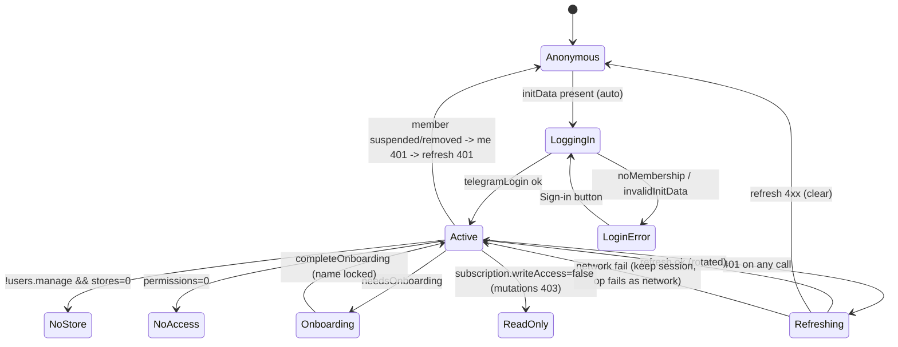
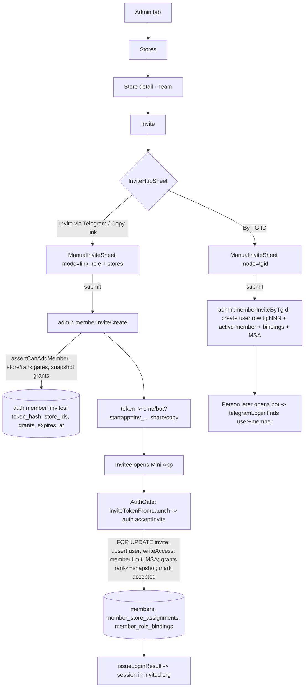
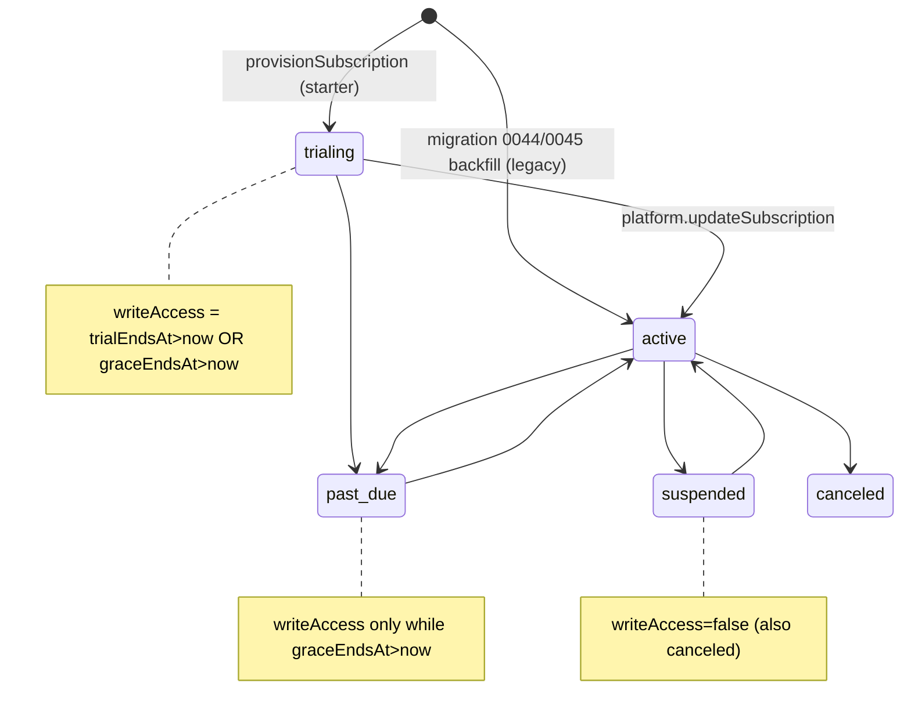

# Track A 审计报告：认证 / 入驻 / 组织与工作区 / 订阅与限额 / 平台超管 / 门店与成员 RBAC / 多租户隔离

- 仓库：`/Users/sphinx/Desktop/Fine/CompassAlpha`，HEAD `c49ba3e`（`chore: rename the default workspace to Eden`）
- 方式：只读静态代码审计。未运行测试、未连接数据库/服务器/网络、未修改仓库文件。
- 证据标注：
  - **已确认事实**：由我实际读到的代码/迁移/测试直接证明。
  - **高可信度推断**：由多处代码推导，但未经运行验证。
  - **待验证**：需要运行时、生产数据或业务确认，文中写明缺什么。
- “搜不到引用”只表示静态 grep 没有命中，不等于“从未使用”；相关结论一律标为推断。

---

## 1 范围与已读文件清单

### 1.1 后端（apps/api）
| 文件 | 阅读程度 |
|---|---|
| `apps/api/src/trpc/trpc.ts`（1-344） | 全文 |
| `apps/api/src/trpc/context.ts`（1-168） | 全文 |
| `apps/api/src/trpc/routers/auth.ts`（1-1853） | 全文 |
| `apps/api/src/trpc/routers/platform.ts`（1-126） | 全文 |
| `apps/api/src/trpc/routers/admin.ts` | 1-3385 全读（成员/角色/权限/门店/克隆）；3855-3975（recentEvents / adminAuditList）；其余 catalog/purge 只读了权限门 |
| `apps/api/src/services/storeScope.ts`（1-355） | 全文 |
| `apps/api/src/services/orgAdmin.ts`、`platformAdmin.ts`、`subscription.ts`、`refreshTokens.ts` | 全文 |
| `apps/api/src/infra/jwt.ts` | 全文 |
| `apps/api/src/main.ts`（40-105，WebSocket 鉴权） | 片段 |
| `apps/api/src/app.ts` | 只 grep 了路由/中间件 |
| `apps/api/src/trpc/routers/sales.ts`（48-130）、`inventory.ts`（50-70、180-230）、`system.ts`（120-260）、`run.ts`（3590-3632 canAmendRun） | 片段 |
| `apps/api/src/__tests__/*` | 列出了 invite-acceptance / login-enrolment / multi-tenant / permission-gates / refresh-token-contract / refreshTokens / rls-isolation / store-scoped-admin / subscription / tenantProbe 的所有用例名；精读了 rls-isolation 495-575 |

### 1.2 数据库（packages/db）
| 文件 | 阅读程度 |
|---|---|
| `packages/db/src/rls.ts`、`schema/auth.ts`、`seed-data.ts`、`provision-organization.ts`、`subscription.ts` | 全文 |
| `packages/db/src/seed.ts` | 50-140 |
| `packages/db/migrations/sql/900_rls_policies.sql`、`950_rls_fail_closed.sql` | 全文 |
| 迁移 `0003`（25-45）、`0021`（全文）、`0037`（80-140）、`0040`、`0041`、`0043`、`0044`、`0045`、`0046`（全文）；对所有含 `role_permissions` 的迁移做了 grep | 如注 |

### 1.3 前端（apps/web）
| 文件 | 阅读程度 |
|---|---|
| `apps/web/src/app/AuthGate.tsx`（1-801） | 全文 |
| `apps/web/src/app/Shell.tsx` | 1-215 + grep |
| `apps/web/src/stores/authStore.ts` | 全文 |
| `apps/web/src/lib/trpc.ts`（1-230） | 全文 |
| `apps/web/src/lib/errToast.ts`（20-66） | 片段 |
| `apps/web/src/components/StoreSwitcher.tsx`、`SettingsSheet.tsx`、`CreateWorkspace.tsx`、`SubscriptionSummary.tsx` | 全文 |
| `apps/web/src/pages/AdminPage.tsx`（1-691） | 全文 |
| `apps/web/src/pages/admin/shared.ts`、`platform/PlatformSections.tsx` | 全文 |
| `apps/web/src/pages/admin/people/PeopleSections.tsx` | 85-1070、1333-1835、2338-2592 精读；MemberPermissionsSheet（2003-2256）、TransferStoreSheet（1843-2000）只读了 grep 片段 |
| `apps/web/src/pages/admin/stores/StoresSections.tsx` | 75-130、315-365、650-720、905-1110 |
| `apps/web/src/hooks/useOfflineQueue.ts`（205-300）、`useRealtime.ts`（grep）、`stores/navStore.ts`（grep）、`pages/SettlementPage.tsx`（690-715）、`pages/OrderPage.tsx`（70-90） | 片段 |

### 1.4 文档
`docs/PERMISSION_MATRIX.md`、`docs/MULTI_TENANCY.md`、`docs/SUBSCRIPTIONS.md` 全文；`docs/RUNBOOK.md` 55-70。

### 1.5 Git 历史
`git show --stat e9a7f3e 0aca1f4 c49ba3e`；`git log -S` 定位 seed 中 `sales.record` / `inventory.adjust` 的引入时间（486c653、10ed9b7，均为 2026-05-13；staff 的 `sales.record` 在 fdee454，2026-08-05）。

---

## 2 模块业务说明与角色矩阵

### 2.1 业务目的
- **认证**：只接受 Telegram Mini App `initData`（HMAC 校验）。另有三种仅限开发的入口：dev mock、dev persona、非 Telegram 白名单访问码。会话 = 15 分钟 access JWT（`sub/org/mid`）+ 30 天可轮换 refresh JWT（落表 `auth.refresh_tokens`，带重放检测）。
- **入驻**：陌生 Telegram 用户一律拒绝（`auth.ts:698-705`）。成员身份只有三个来源：管理员按 TG ID 预建（`admin.memberInviteByTgId`）、一次性邀请链接（`admin.memberInviteCreate` → `auth.acceptInvite`）、CLI。首次进入需要确认显示名，确认后锁定（`auth.completeOnboarding`）。
- **组织 / 工作区**：组织就是租户。一个用户可以属于多个组织，用 `auth.switchOrganization` 切换。只有平台管理员（`auth.platform_admins`）能新建组织（`auth.createOrganization`）。
- **订阅**：`billing_plans` 定义套餐，`organization_subscriptions` 每组织一行，状态决定 `writeAccess`。套餐限制门店数和成员数。平台超管在 Admin → Platform 里手工维护。
- **RBAC**：内置角色有 rank 阶梯（100/80/60/40/30/20）。rank < 80 的角色必须绑定到门店，rank ≥ 80 的必须是全局绑定。还可以对单个成员设置 allow/deny 覆盖（全局或门店级），deny 优先。`org.admin` 是唯一的“组织级旁路”标记；`users.manage` 同时被店长持有，**不**算旁路。
- **租户隔离**：Postgres RLS（`app.current_org_id`；无租户上下文时失败关闭，除非显式 `app.system_context`），加上应用层的 `orgId` 过滤和门店范围断言（`storeScope.ts`）。

### 2.2 内置角色权限（seed，`packages/db/src/seed-data.ts:92-189`）——已确认事实
| 角色（rank, 绑定范围） | 权限要点 |
|---|---|
| super_admin（100, global） | 全部权限 |
| admin（80, global） | 全部，除 `system.impersonate`、`system.test_data.purge`、`run.amend` |
| manager（60, store） | order.draft/submit/approve/claim/unapprove、reports.view、prices.view、**users.manage**、inventory.adjust、sales.record、settlement.record |
| purchaser（40, store） | run.create/purchase/eject_session/finish、delivery.dispatch、prices.view |
| cashier（30, store） | sales.record、settlement.record |
| staff（20, store） | order.draft/submit、delivery.confirm、sales.record |

### 2.3 角色 × 动作矩阵（种子权限 vs 后端检查 vs 前端门控）
说明：SA=super_admin，A=admin，M=manager（门店级），P=purchaser，C=cashier，S=staff，PA=平台管理员（与组织角色正交）。“✔(own)” 表示仅限自己管理的门店，并且要过 rank 门。

| 动作 | 后端检查（证据） | 前端可见性（证据） | SA | A | M | P | C | S |
|---|---|---|---|---|---|---|---|---|
| 看到 Admin 标签 | — | `users.manage`（`Shell.tsx:88,145`） | ✔ | ✔ | ✔ | ✘ | ✘ | ✘ |
| 成员列表（**全组织**，含 tgUserId） | 只查 `users.manage`（`admin.ts:908-909`） | Stores → Team | ✔ | ✔ | ✔(全组织!) | ✘ | ✘ | ✘ |
| 链接邀请 / 按 TG ID 邀请 | `users.manage` + 目标门店 ⊆ adminStoreIds + 每店 rank 门（`admin.ts:1085-1255`、`1267-1541`）+ 成员数限额 | Invite 按钮无条件显示（`PeopleSections.tsx:261`） | ✔ | ✔ | ✔(own，只能给 rank<60 的角色) | ✘ | ✘ | ✘ |
| 授予门店角色 | `users.grant_role` 或 `users.manage`；门店须在 adminStoreIds；rank 门（`admin.ts:2813-2990`） | GrantRoleSheet | ✔ | ✔ | ✔(own, rank<60) | ✘ | ✘ | ✘ |
| 授予全局角色 | 需 `org.admin` + role.rank < actorRank（`admin.ts:2837-2839,2939-2948`） | 由启发式 `canGrantGlobal` 决定（`PeopleSections.tsx:2390-2393`，有误，见 A-10） | ✔(可授 admin) | ✘ 实际无可授角色（80≥80） | ✘ | ✘ | ✘ | ✘ |
| 撤销角色 | `users.revoke_role` 或 `users.manage` + 范围 + rank + 最后一个管理员保护（`admin.ts:2992-3076`） | 点角色徽章 ×（`PeopleSections.tsx:355-371`） | ✔ | ✔ | ✔(own) | ✘ | ✘ | ✘ |
| 停用 / 恢复成员 | `users.manage` + `assertCanSetMemberStatus`（`admin.ts:442-490,1027-1075`） | ⋯ 菜单 | ✔ | ✔ | ✔(目标所在所有门店都要归他管且 rank 更高) | ✘ | ✘ | ✘ |
| 从组织移除 | `org.admin` + rank（`admin.ts:2081-2130`） | ⋯ 菜单对**所有**能进 Admin 的人显示（`PeopleSections.tsx:612-628`） | ✔ | ✔ | ✘（UI 可见但 403） | | | |
| 改成员显示名 | **只查 `users.manage`，无门店范围、无 rank 门**（`admin.ts:1548-1572`） | ManageMemberSheet | ✔ | ✔ | ✔(**任何人**) | | | |
| 分配 / 取消分配门店（MSA） | `users.manage` + 门店在 adminStoreIds；取消分配**没有 rank 门**（`admin.ts:1611-1711`） | 复选框（`PeopleSections.tsx:1752-1767`） | ✔ | ✔ | ✔(own) | | | |
| 从门店移出 / 调店 | + rank 门（`admin.ts:1732-2079`） | ⋯ 菜单 / Transfer（Transfer 受启发式 `isGlobalAdmin` 控制） | ✔ | ✔ | ✔(own) | | | |
| 成员权限覆盖：门店级 | `users.manage` + 门店范围 + rank + 操作者自己在该范围持有该 key（`admin.ts:2562-2734`） | 只对 `org.admin` 显示（`PeopleSections.tsx:104,537`） | ✔ | ✔ | 后端允许 / UI 隐藏 | | | |
| 成员权限覆盖：全局 | `org.admin`（`admin.ts:2594-2596`） | 同上 | ✔ | ✔ | ✘ | | | |
| 创建角色 | `org.admin` + rank<actor（`admin.ts:2278-2339`） | 启发式 `isGlobalAdmin`（`PeopleSections.tsx:722-736`） | ✔ | ✔ | ✘（单店店长 UI 也会显示按钮） | | | |
| 编辑 / 删除角色 | `org.admin` + rank（`admin.ts:2351-2463`） | 只给 `canEdit=isSuperAdmin`（`PeopleSections.tsx:794,1034`） | ✔ | 后端 ✔ / **UI ✘** | ✘ | | | |
| 新建门店 | `org.admin` + 门店数限额（`admin.ts:3119-3139`） | 按钮无条件（`StoresSections.tsx:122-128`） | ✔ | ✔ | ✘（UI 可见） | | | |
| 修改门店（**含 isActive**） | `users.manage` + 门店在 adminStoreIds（`admin.ts:3141-3207`） | 设置页的开关（`StoresSections.tsx:1052-1056`） | ✔ | ✔ | ✔(own，**能停用门店**) | | | |
| 归档门店 | `org.admin`（`admin.ts:3209-3233`） | 只要 `canAdmin`（adminStoreIds）就显示（`StoresSections.tsx:1090-1100`） | ✔ | ✔ | ✘（UI 可见） | | | |
| 克隆门店角色 | `org.admin`（`admin.ts:3258-3263`） | 启发式 + adminStoreIds≥2 | ✔ | ✔ | ✘ | | | |
| 财务设置 | `org.admin`（`admin.ts:864-878`） | `users.manage`（`AdminPage.tsx:484,561`） | ✔ | ✔ | ✘（UI 可见） | | | |
| 门店上下文切到 “ALL” / 切换门店 | 只在客户端 | `org.admin`（`StoreSwitcher.tsx:103-106`） | ✔ | ✔ | ✘ | ✘ | ✘ | ✘（多店成员也不行） |
| sales.record | (`sales.record` 或 `users.manage`) + 门店分配 + 门店有效权限（`sales.ts:51-108`） | 只在 Admin → Store → Sales（`StoresSections.tsx:361,671-673`） | ✔ | ✔ | ✔ | ✘ | 后端 ✔ / **UI 不可达** | 后端 ✔ / **UI 不可达** |
| inventory.adjust | (`inventory.adjust` 或 `users.manage`) + 分配 + 有效权限（`inventory.ts:53-60,180-206`） | Admin → Store → Inventory | ✔ | ✔ | ✔ | | | |
| 新建组织 | 平台管理员（`auth.ts:1099-1104`） | `isPlatformAdmin`（`SettingsSheet.tsx:234-238`） | PA | PA | PA | PA | PA | PA |
| platform.* | 平台管理员（`platform.ts:32-39`） | Admin home 里的 Platform 行（`AdminPage.tsx:274-281`），**但要先有 Admin 标签** | PA∧users.manage | | | | | |

---

## 3 端到端流程

### 3.1 登录与会话生命周期
步骤：`AuthGate` 自动登录 effect（`AuthGate.tsx:357-389`）→ `auth.telegramLogin`（`auth.ts:670-801`）：校验 initData → 按 `tg_user_id` 查 `auth.users`。查不到时：非 dev mock 直接抛 `FORBIDDEN noMembership`（`703-705`），并且不写任何行。查到时更新 `tgUsername/avatar/locale/lastSeenAt`（`731-741`）→ 选成员：先找 `lastOrgId` 对应的 active 成员，再找任一 active 成员（`745-762`）→ 写 `users.last_org_id` → `issueLoginResult`：`buildSessionPayload` + `signAccess` + `issueRefresh`，后者 INSERT `auth.refresh_tokens`（`refreshTokens.ts:87-108`）。前端 `setSession`（`AuthGate.tsx:202-213`），持久化到 localStorage `compass.auth`（`authStore.ts:180-191`）。

每个请求：`createContext` → `verifyAccess` → `loadSession`，在 org RLS 上下文里执行（`context.ts:96-168`）。成员必须 `active`；会话里带上 `writeAccess`（订阅）和扁平化权限集。

刷新：`authFetch` 收到 401 → 单飞（single-flight）调用 `auth.refresh`（`lib/trpc.ts:59-166`）→ 服务端 `consumeRefresh`。60 秒内再次出示刚轮换掉的 token，视为“响应丢失后的重试”，放行（`refreshTokens.ts:110-128,160-168`）；其他情况视为重放，吊销整个 family。成员不再 active → 401 `noMembership` → 客户端清除会话。

### 3.2 邀请链接

关键分支（均为已确认事实，`auth.ts:893-958`）：
- 同一用户重复接受同一邀请：幂等，返回原成员。
- 另一个用户接受已被用过的邀请：`inviteUsed`。
- 邀请过期：`inviteExpired`。
- 邀请对象是该组织里被停用的成员：`inviteMemberSuspended`。
- 被删除的角色或 rank 被调高的角色：跳过该授权，不报错。
- 并发打开同一链接：`SELECT … FOR UPDATE` 串行化。

### 3.3 切换组织
`SettingsSheet` 的工作区列表 → `auth.switchOrganization`（`auth.ts:1059-1089`）：在 system 上下文中确认目标组织里有 active 成员 → 写 `last_org_id` → 签发绑定新租户的 access 和 refresh → 前端 `setSession` + `queryClient.clear()`（`SettingsSheet.tsx:96-108`）。旧 refresh family 不吊销（另一设备可能还在用）。持久化的 `navStore`（`storeFocus` 等）和离线 outbox **不随组织切换重置**（见 A-20、A-26）。

### 3.4 新建组织
Settings → “新建工作区”（只有 `isPlatformAdmin` 才显示）→ `CreateWorkspaceForm` → `auth.createOrganization`（`auth.ts:1096-1152`）→ `provisionOrganization`：插入权限目录、组织、试用订阅（starter，14 天试用 + 7 天宽限，`subscription.ts(db):58-93`）、内置角色及其权限、feature flags、owner 成员 + 全局 admin 绑定、`last_org_id`（`provision-organization.ts:52-135`）→ 签发新会话 → `queryClient.clear()`。

### 3.5 订阅状态与写权限

`computeWriteAccess` 见 `apps/api/src/services/subscription.ts:32-48`。只读模式下的执行点：`trpc.ts:140-152`（拦截所有 mutation，`auth.*`、`system.*`、`platform.*` 除外）；`auth.acceptInvite` 另外再查一次（`auth.ts:928`）。

### 3.6 限额执行位置（前端 vs 后端）
| 限额 | 后端 | 前端 |
|---|---|---|
| 门店数 | `assertCanAddStore`，只在 `storeCreate` 调用（`admin.ts:3124`） | 无预检查，只在 `SubscriptionSummary` 显示用量；“新建门店”按钮始终可点 |
| 成员数 | `assertCanAddMember`：`memberInviteCreate`（`1091`）、`memberInviteByTgId` 新建成员时（`1360`）、`acceptInvite` 新建成员时（`auth.ts:940`） | 无预检查 |
| 遗漏点 | `memberSetStatus → active` 不查（`admin.ts:1067-1070`）；`acceptInvite` 激活非 active 成员时不查（`auth.ts:951-958`）；`storeUpdate isActive:true` 不查（`admin.ts:3169`） | — |
| 并发 | 先 count 再 insert，无锁（`subscription.ts:122-142`） | — |

---

## 4 页面 / 交互档案

> 格式：控件 → 处理器 → procedure → 效果 → 导航 / 反馈。加载 / 空 / 错误状态单独注明。

### 4.1 AuthGate（`apps/web/src/app/AuthGate.tsx`）
| 屏幕 / 控件 | 处理 | 效果与反馈 |
|---|---|---|
| 全屏 Spinner | `!authHydrated` 或任一登录 mutation pending，10 秒超时（`391-406`） | 超时后显示“登录等待时间过长”Banner（**中文硬编码，生产环境也会显示**，`420`） |
| 登录失败屏 | `!activeSession`（`408-537`） | 错误 Banner + “请把 Telegram ID 发给管理员” 文案（`418`），**但页面上不显示 ID**（见 A-14） |
| Sign in 按钮 | `login.mutate({initData})`（`459-477`） | 没有 initData 时提示 `noInitData` |
| Retry invite 按钮 | `acceptInvite.mutate`（`446-458`） | — |
| Dev persona picker | `auth.devPersonas` / `devPersonaLogin` / `devBypassLogin`（`429-445,622-698`） | 仅 dev；文案中文硬编码 |
| 浏览器访问码表单 | `auth.nonTelegramLogin`（`479-535`） | 仅非生产环境 |
| OnboardingScreen | `auth.completeOnboarding`（`704-769`） | 错误直接显示 `err.message`，**未翻译**（`726`） |
| NoStoreScreen | `!users.manage && stores=0`（`551-553`） | 只有说明文字，无操作 |
| NoAccessScreen | `permissions.length===0`（`556-558,781-801`） | 显示 TG ID，可点击复制 |

### 4.2 Shell / 底部导航（`Shell.tsx`）
- 标签按单个权限门控（`68-89,145`）；持久化标签用 `resolveVisibleTab` 兜底（`186-201`）。
- 只读 Banner：`469`（`subscription.writeAccess=false`）。
- Telegram 设置按钮 → `SettingsSheet`（`211`）。

### 4.3 SettingsSheet（`components/SettingsSheet.tsx`）
| 区块 | 控件 → procedure | 备注 |
|---|---|---|
| 页面操作 | 页面注册的 actions | — |
| Profile | 名字未锁时 Save → `auth.completeOnboarding`（`181-195`） | 锁定后只读 |
| 工作区 | PickerRow → `auth.switchOrganization`（`217-233`）；平台超管多一个“新建” → `CreateWorkspaceForm` → `auth.createOrganization` | 成功后 toast + 清空 query 缓存 |
| 门店选择 | `StorePickerSection`，仅 `org.admin`（`244`） | — |
| 语言 | 4 个选项 → `auth.setLocale`（`246-268`） | 与 Admin → Organization 的语言入口重复 |
| 第二语言 | `auth.setSecondaryLocale`（`277-317`） | — |
| About | 组织名、**roleSlugs 原样显示**、build | 与 WorkspaceSection 重复 |

### 4.4 StoreChip / StorePicker（`StoreSwitcher.tsx`）
- 所有人都能看到当前门店名，但只有 `org.admin` 可以点开切换（`192-245`）。
- `useStoreContext` 遇到不合法的上下文时回退到 `stores[0]`（`279-299`）。
- 非 `org.admin` 的多店成员没有切换入口；唯一例外是 Settlement 页自带的门店下拉（`SettlementPage.tsx:697-707`），且仅限有 `settlement.record` 的人。

### 4.5 AdminPage（`pages/AdminPage.tsx`）
- 进入门：`!users.manage && !isPlatformAdmin` → EmptyState（`165-174`）。
- Home 行：Organization / Stores / Permissions / Catalog / Operations / Platform（仅 `isPlatformAdmin`，`274-281`）。所有行对店长都可见。
- WorkspaceSection（`460-645`）：SubscriptionSummary、组织名、角色、Telegram、币种、税率；语言行 → `LanguageSheet`（`519,555-559`）；财务行在 `users.manage` 下显示（`561`）→ Sheet → `admin.orgFinanceUpdate`（后端要求 `org.admin`）。
- 返回：Telegram BackButton 或页内箭头（`399-452`）。

### 4.6 Stores 区（`StoresSections.tsx`）
- StoresHomeSection：`admin.storeList` + `admin.memberList`，统计每店成员数；“新建门店” Sheet → `admin.storeCreate`（`75-130`）。“paused” 徽章（`218`）实际不可达，因为 storeList 默认不返回停用门店（`admin.ts:3086-3112`）。
- StoreDetailScreen：分段控件 Team / Inventory / Sales / Settings（`315-365`）。
  - Team = `PeopleSection lockMode=store`。
  - Inventory：`inventory.levels` / `stocktake` / `recordWastage`。
  - Sales：`sales.list` / `sales.record`，`canRecord` 镜像了 `users.manage` 回退（`671-673`）。
  - Settings：表单 → `admin.storeUpdate`（含 isActive 开关 `1052-1056`、默认角色）；Archive → `admin.storeDelete`；Clone → `admin.storeCloneRoles`。
- 加载态：`Loading store…` / `Loading roles…`，均为英文硬编码（`975-981,1017-1020`）。

### 4.7 PeopleSection（`PeopleSections.tsx:85-695`）
| 控件 | 处理 → procedure | 反馈 |
|---|---|---|
| 搜索框 | 本地过滤 | — |
| Invite（`261`） | 打开 InviteHubSheet | — |
| 成员卡上的角色徽章 ×（`355-371`） | `nativeConfirm`（**英文硬编码文案**）→ `admin.revokeRole` | toast `roleRevoked` |
| Manage（`391-400`） | ManageMemberSheet | — |
| Grant role（`402-417`） | GrantRoleSheet，默认带上当前门店 | — |
| ⋯（`418-433`） | 成员菜单 Sheet | — |
| 菜单 · Permissions（`537-552`，仅 `org.admin`） | MemberPermissionsSheet → `memberPermissionsList/Set/Revoke` | — |
| 菜单 · Suspend / Reactivate（`553-580`） | `admin.memberSetStatus`（停用有确认，恢复无确认） | toast `memberUpdated` |
| 菜单 · Remove from this store（`581-610`） | 确认 → `admin.memberDetachFromStore` | toast 显示撤销的绑定数 / 覆盖数 |
| 菜单 · Remove from org（`612-628`） | 确认 → `admin.memberRemove`（需 `org.admin`） | 店长会收到 403 toast |
| 空态 | `noStoresInThisStore`、`orgLevelEmpty`；ALL 视图的分组标题 “Org-level (n)” 为硬编码（`500`） | — |

### 4.8 邀请相关 Sheet
- InviteHubSheet（`1333-1425`）：三种方式（分享、复制链接、按 TG ID）。没有 bot 用户名时前两种禁用。
- ManualInviteSheet（`1427-1615`）：角色下拉（按启发式 `isGlobalAdmin` 过滤 rank≥80 的角色）、门店多选（限 adminStoreIds）。提交 → `memberInviteCreate` 或 `memberInviteByTgId`。成功后：链接模式打开 Telegram 分享或复制到剪贴板（`210-245`）；TG ID 模式 toast `memberAdded` / `userExists`。
- **没有“查看已发出的邀请 / 撤销邀请”入口**，后端也没有对应 procedure（`admin.ts` 路由清单里找不到）。

### 4.9 ManageMemberSheet（`1620-1830`）
- 改名 → `admin.memberSetDisplayName`。
- 门店复选框 → `memberAssignStore` / `memberUnassignStore`（`1752-1767`）。成功后只 invalidate `memberStoreAssignments`；成员卡上的门店徽章要靠 realtime 的 `people.changed` 刷新（`useRealtime.ts:136-141`）。
- Transfer → TransferStoreSheet → `admin.memberTransferStore`（`1885`）。
- 文案 “Loading…” 和 “read-only” 为英文硬编码（`1732,1792`）。

### 4.10 PermissionsSection / 角色 Sheet（`703-1250`）
- 角色列表 `admin.roleList`，标注“比你高 / 平级”。“+ New role” 由启发式 `isGlobalAdmin` 控制（`734-738`）→ RoleCreateSheet → `admin.roleCreate`（`862`）。
- 点角色 → RolePermissionsSheet：`roleDetail`；编辑 / 删除只有 `isSuperAdmin` 才能进入（`794,1034,1037-1053`）。

### 4.11 GrantRoleSheet（`2338-2592`）
- 范围分段控件：门店（文案 “In specific store(s)” 硬编码）/ 全局（受 `canGrantGlobal` 控制）。
- 点角色**立即授予**，没有二次确认。门店模式下按所选门店逐个顺序调用 `grantRole`，遇到第一个失败即停止，toast 显示部分成功的结果。

### 4.12 Platform（`PlatformSections.tsx`）
- 组织列表：`platform.organizations`。
- Manage → SubscriptionSheet：套餐、状态、试用结束、周期结束、宽限结束、到期取消、备注 → `platform.updateSubscription`。`note` 每次打开都会被重置为空（`129`），见 A-13。

---

## 5 操作繁琐点（点击数按“从任意标签开始”计）

| 任务 | 当前路径与点击数 | 建议 | 建议后点击数 |
|---|---|---|---|
| 邀请成员（链接 → Telegram 分享） | Admin(1) → Stores(2) → 门店(3) → Invite(4) → Invite via Telegram(5) → 角色下拉打开 + 选择(6,7) → 提交(8) → Telegram 选择聊天(9) → 发送(10) | 在 Admin home 或 People 顶层放“邀请”入口；默认带上门店默认角色；记住上次选择的角色 | 约 5（Admin → 邀请 → 提交 → 选聊天 → 发送） |
| 修改成员在某店的角色 | Admin(1) → Stores(2) → 门店(3) → 成员 Grant role(4) → 选新角色(5)（立即生效）→ 点旧角色徽章 ×(6) → 确认(7) | 提供“更换角色”原子操作（同店内 revoke+grant 放在一个事务里） | 4-5 |
| 把成员加到另一家门店（并给角色） | Admin(1) → Stores(2) → 门店A(3) → Manage(4) → 勾选门店B(5) → 关闭(6)；这一步只加了 MSA，**没有角色**。还需 Grant role(7) → 勾选B(8) → 选角色(9) | 勾选门店时一并选择角色（默认用门店默认角色），或者勾选直接走 `memberInviteByTgId` 式的“分配 + 默认角色”逻辑 | 5-6 |
| 多店店员切换当前门店 | **无入口**（只有持 `settlement.record` 的人能通过 Settlement 页下拉切换） | 当 `stores.length>=2` 时让 StoreChip 可点 | 2 |
| 收银员 / 店员录入菜品销量 | **无入口**（Sales 只在 Admin 里） | 增加独立的 Sales 标签（按 `sales.record` 门控），或放进 Settlement 页 | 1-2 |
| 店长误把门店停用后恢复 | UI 无法恢复（见 A-03） | 提供“已归档 / 已暂停”列表 + 恢复操作 | 3 |

---

## 6 重复功能 / 逻辑

1. **语言切换有三处**：`SettingsSheet.tsx:246-268`（内联 4 个选项）、`AdminPage.tsx:519,555-559`（行 → `LanguageSheet`）、`components/LanguageSheet.tsx:57`。三处都调用 `auth.setLocale`。——已确认事实。
2. **身份 / 组织信息重复展示**：`SettingsSheet.tsx:319-338`（组织名 + roleSlugs）与 `AdminPage.tsx:528-543`（组织名 + roleSlugs + Telegram 用户名）。——已确认事实。
3. **“谁管哪些店”计算三份**：后端 `getActorAdminStoreIds`（`admin.ts:349-431`），会话里的 `adminStoreIds`（`auth.ts:1751-1798`，同一算法的拷贝，同样引用了不存在的 `users.invite`），以及前端 `isGlobalAdmin` 启发式（`PeopleSections.tsx:722-725,1456-1459,1652-1655,2390-2393`；`StoresSections.tsx:920-923`），复制了 5 次，而且逻辑与后端不一致（见 A-10）。
4. **“成员所在门店”计算三份**：`storeScope.loadAssignedStoreIds`（`storeScope.ts:188-213`）、`readSessionPayload`（`auth.ts:1680-1737`）、`admin.memberList`（`admin.ts:989-1004`）。其中 memberList 没有过滤过期绑定。
5. **成员身份有两套并行模型**：MSA（`member_store_assignments`）和门店级角色绑定都算“属于这家店”。取消分配只删 MSA（`admin.ts:1700-1707`），detach 三样都删（`1821-1851`），复选框只看 MSA（`PeopleSections.tsx:1682-1685`）。语义不一致，见 A-12 / 旧报告第 3 条。
6. **`users.manage` 回退逻辑前后端各一份**：后端 `sales.ts:52`、`inventory.ts:54`；前端 `StoresSections.tsx:671-673`。
7. **邀请两条路径大量重复**：`memberInviteCreate` 和 `memberInviteByTgId` 的门店校验、rank 门、默认角色兜底几乎逐行重复（`admin.ts:1101-1224` 与 `1297-1537`），`acceptInvite` 又复制了一遍授予逻辑（`auth.ts:961-1022`）。
8. **登录成功后的处理**在 `AuthGate` 里五个 mutation 各写一遍（`202-306`），`SettingsSheet` 和 `CreateWorkspace` 中又各有一份。

---

## 7 疑似无效 / 不可达代码

| 项 | 证据 | 等级 |
|---|---|---|
| 权限 key 在代码里没有任何检查：`system.impersonate`、`prices.alert.configure`、`reports.export`、`reports.view`、`users.assign_store`、`org.settings.manage`、`inventory.stores.manage`、`inventory.skus.manage`、`inventory.suppliers.manage`、`order.claim` | 在 `apps/api/src`、`apps/web/src` 中 grep 带引号的字面量，命中 0 次（目录写操作实际用的是 `org.admin`，如 `admin.ts:3402-3407,3504-3506`）。角色编辑器仍然把它们当开关展示。 | 高可信度推断（可能存在动态拼接 key） |
| `users.invite` 被当作 admin key 引用（`admin.ts:349`、`auth.ts:1751`），但不在权限目录里（`seed-data.ts:7-87`）。`role_permissions` / `member_permission_overrides` 对 `permissions.key` 有外键，这个 key 不可能被授予。 | 已确认事实 | 已确认 |
| `auth.policy_rules`（ABAC）：只有 schema 和 RLS 引用，没有任何读取逻辑；但 `PERMISSION_MATRIX.md:97-105` 说“ABAC overlay / 10% 抽样写 policy_decisions” | grep 只命中 schema 和测试 | 高可信度推断 |
| `auth.signOut`（`auth.ts:1292-1295`）：前端没有任何调用 | `apps/web/src` grep 无命中 | 高可信度推断：UI 没有退出登录入口 |
| `auth.nonTelegramStatus`（`auth.ts:497-499`）：前端未使用（已被 `loginModes` 取代） | grep | 高可信度推断 |
| `purgeExpiredRefreshTokens`（`refreshTokens.ts:235`）：没有调用方（注释自己也写了 “Not wired today”） | grep | 已确认事实 |
| refresh 的 jti-less 旧版分支（`auth.ts:1370-1380`）：M1.9 是 2026-05-07，refresh TTL 30 天，旧 token 早已过期 | 推导 | 高可信度推断 |
| `InviteMemberInputSchema`（`packages/contracts/src/schemas/admin.ts:26-30`）：没有引用 | grep 只命中定义处 | 高可信度推断 |
| Realtime 的 `notification` 消息类型从未 publish（`hub.ts:33` 只有类型定义） | grep | 高可信度推断 |
| `StoresHomeSection` 的 “paused” 徽章（`StoresSections.tsx:218`）：storeList 默认不返回停用门店（`admin.ts:3086-3112`），而调用处 `storeList.useQuery()` 不传 `includeArchived` | 已确认事实 | 已确认 |
| `AdminPage` 中 “平台管理员但没有 users.manage” 的分支（`AdminPage.tsx:165`）：Shell 只对 `users.manage` 显示 Admin 标签（`Shell.tsx:88,145`），这类用户进不来 | 已确认事实 | 已确认 |
| `acceptInvite` 里 “member 存在但非 active 且非 suspended → 重新激活” 分支（`auth.ts:951-958`）：代码只会写入 `active` / `suspended` 两种状态 | `members.status` 注释写 `active|invited|suspended`（`schema/auth.ts:225`），但没找到写 `invited` 的代码 | 高可信度推断 |
| `organizations.deleted_at` / `users.deleted_at`：没有代码会设置 | grep 无写入 | 高可信度推断（可能有运维 SQL，待验证） |
| `CreateWorkspace.tsx:9-12` 注释说“也在无成员身份的登录页使用”，实际只有 SettingsSheet 用 | grep | 已确认事实（注释漂移） |

---

## 8 缺陷与风险

> 严重度是建议值。P0 = 跨租户泄露、资金错误或系统不可用；P1 = 越权或无法恢复的业务损坏；P2 = 功能缺口、权限漂移或审计缺失；P3 = 体验、一致性、维护性问题。

### A-01 店长（乃至任何持 `users.manage` 的人）能改任何成员的**全局**显示名并锁定 —— P1
- 证据（已确认事实）：`admin.ts:1548-1572` 只调用了 `requireAdmin`（`users.manage`）。没有门店范围检查（对比 `memberAssignStore` 的 C2 检查）、没有 rank 门、没有审计。它更新的是 `auth.users`（全局身份表，无 RLS，`900_rls_policies.sql:211-213`），并把 `displayNameLocked` 设为 true。
- 影响：
  - 店长可以把组织 admin 或其他门店的人改成任意名字。审批、审计里显示的名字被篡改，可用于冒充。`completeOnboarding` 注释（`auth.ts:1165-1168`）自称防冒充，这里形同虚设。
  - **跨租户影响**：同一个人在组织 B 也是成员时，组织 A 的店长改的名字会同时出现在组织 B。
  - `memberInviteByTgId` 也会改写全局 `users.displayName`（`admin.ts:1341-1347`，仅对 `tg:` 开头的占位名）。
- 修复：要求 `org.admin`，或者“目标所在的所有门店都由操作者管理且 rank 更高”（复用 `assertCanSetMemberStatus`）；加 `auditAdmin`。长期应把显示名拆成按组织存储（`members.display_name`），或只允许平台流程修改全局名。
- 回归测试：店长改 admin 的名字 → 403；店长改他店员工 → 403；跨组织同一用户改名后另一组织看到的名字不变（拆分后）。

### A-02 `users.manage` 回退让门店级 deny 对 `sales.record` / `inventory.adjust` 失效 —— P2
- 证据（已确认事实）：`sales.ts:51-58` 的 `requireSalesRecord` 接受 `sales.record || users.manage`。第二次检查（`sales.ts:101-107`）对 `effectivePermissionsForStore` 的结果又走同一个函数，所以在门店 X 对店长设置 `deny sales.record` 后，只要他在 X 仍有 `users.manage`，检查照样通过。库存 `inventory.ts:53-60,198-206` 同理。
- 影响：权限覆盖 UI 上的 deny 对店长和 admin 不起作用，`PERMISSION_MATRIX.md:93` 写的 “A store-specific deny override always wins” 不成立。这个回退同时掩盖了旧组织没有回填权限的问题（见第 9 节第 1 条）。
- 修复：先给旧组织回填 manager 的 `sales.record` / `inventory.adjust`，然后删掉 `|| users.manage`，参照 0021 迁移对 `dishes.manage` 的做法。前端 `StoresSections.tsx:671-673` 同步删除。
- 回归测试：店长在门店 X 被 deny `sales.record` → `sales.record` 返回 403；没有 deny 时 → 200。

### A-03 店长可通过 `storeUpdate isActive=false` 停用门店，且之后 UI 和 API 都无法恢复 —— P1
- 证据（已确认事实）：
  - `storeUpdate` 只要求 `users.manage` + 门店在 adminStoreIds，而且接受 `isActive`（`admin.ts:3141-3169`）。`storeDelete` 才要求 `org.admin`（`3209-3212`）。
  - UI 设置页向 `canAdmin`（含店长）开放 “Active” 开关（`StoresSections.tsx:1052-1056`）。
  - 停用后：`storeList` 默认过滤掉 `is_active=false`（`admin.ts:3108-3112`），前端不传 `includeArchived`（`StoresSections.tsx:80`），门店从列表消失；全局 admin 的 `getActorAdminStoreIds` 只返回 active 门店（`admin.ts:422-428`），对这家门店调用 `storeUpdate` 会得到 `notAdminOfStore`，**连 admin 也无法通过 API 恢复**；会话里的 `stores` 也只包含 active 门店（`auth.ts:1678,1702,1719`）。
  - 恢复时也不会检查门店数限额（`3169`）。
- 影响：一次误触就让整家门店从所有界面消失，只能改数据库恢复。同时绕过了 “归档只有 org.admin 可做” 的设计。
- 修复：`isActive` 改为 `org.admin` 才能改；`getActorAdminStoreIds` 的全局分支包含停用门店（或单独提供 restore procedure）；恢复时调用 `assertCanAddStore`；UI 增加 “已暂停 / 归档” 列表。
- 回归测试：店长传 isActive=false → 403；admin 能恢复已停用门店；恢复时超限 → `storeLimit`。

### A-04 组织内跨门店信息暴露给店长 —— P2
- 证据（已确认事实）：以下只用 `requireAdmin`（`users.manage`），没有任何门店过滤：
  - `memberList`（全组织成员，含 `tgUserId`、角色、门店，`admin.ts:908-1025`）
  - `memberStoreAssignments`（`1578-1609`）
  - `memberPermissionsList`（`2482-2543`）
  - `roleList` / `roleDetail`（含全组织每个角色的持有人，`2134-2239`）
  - `storeList`（`3080-3117`）
  - `recentEvents`（全组织领域事件 **payload**，含各门店采购数据，`3855-3900`）
  - `adminAuditList`（全组织管理审计，`3919+`）
  - `overview`（`803-843`）
- 影响：违反“店长只看自己门店”的多门店隔离目标；同仓库的 `M3.7 finance reports filter by actor bindings unless org.admin` 测试表明在财务上这是有意的约束。
- 修复：非 `org.admin` 时按 `getActorAdminStoreIds` 过滤（成员 = 与这些门店有交集的人；事件按门店维度过滤或干脆不开放）；`tgUserId` 只给 `org.admin`。
- 回归测试：店长 A 调用 memberList 只得到门店 A 的成员；recentEvents 返回 403 或只含 A 的事件。

### A-05 套餐限额可以绕过，且有并发窗口 —— P2
- 证据（已确认事实）：
  - `memberSetStatus` 恢复为 active 时不调用 `assertCanAddMember`（`admin.ts:1067-1070`），而 usage 只统计 active 成员（`subscription.ts:70-73`）。于是“停用 1 人 → 再邀请 1 人 → 恢复被停用的人”就能超出上限。
  - `acceptInvite` 激活非 active 成员时不查限额（`auth.ts:951-958`）。
  - `storeUpdate isActive:true` 不查门店限额（见 A-03）。
  - 所有限额检查都是先 count 再 insert，没有锁（`subscription.ts:122-142`）。`acceptInvite` 的 `FOR UPDATE` 只锁住单个邀请（`auth.ts:839-841`）。
- 影响：商业限额失效（待验证：实际客户超额的概率需要业务数据）。
- 修复：恢复和激活路径都调用 `assertCanAddMember` / `assertCanAddStore`；在 `assertCanAdd*` 内加 `pg_advisory_xact_lock(hashtext(orgId||':limits'))`。
- 回归测试：达到上限时恢复被停用成员 → `memberLimit`；两个邀请并发接受，只有一个成功。

### A-06 邀请链接无法列出 / 撤销；邀请人被移除后链接仍有效 —— P2
- 证据（已确认事实）：admin 路由里没有 invite list / revoke procedure（`admin.ts` 路由清单，`801-4997`）；有效期可达 30 天（`admin.ts:690`）；接受时只检查过期和是否用过，不检查邀请人现状（`auth.ts:893-927`）。分享被取消时邀请行已经写入（`PeopleSections.tsx:210-245`，创建发生在分享之前）。
- 影响：链接泄露（群聊转发）后，任何拿到链接的 Telegram 用户都可以凭快照里的角色加入；被开除的店长生前发出的链接仍然有效。
- 修复：增加 `memberInviteList` / `memberInviteRevoke`；接受时校验 `invitedBy` 仍是该组织的 active 成员且仍能授予这些角色；缩短默认有效期。
- 回归测试：撤销后接受 → `inviteNotFound` / `inviteRevoked`；邀请人被移除后接受 → 拒绝。

### A-07 多店非 `org.admin` 成员无法选择当前门店 —— P2
- 证据（已确认事实）：切换门店只对 `org.admin` 开放（`StoreSwitcher.tsx:103-106,192-245`）；`useStoreContext` 回退到 `stores[0]`（`279-299`）；OrderPage 直接使用这个上下文（`OrderPage.tsx:76-77`）。只有 Settlement 页有自己的门店下拉（`SettlementPage.tsx:697-707`）。后端明确支持一人多店（`memberAssignStore`、多店邀请、`storeCloneRoles includeMembers`）。
- 影响：店员如果被分配到两家店，只能给排序第一的店下单。
- 修复：`stores.length >= 2` 时让 StoreChip 可点（选项中不含 ALL）。
- 回归测试：前端单测 / e2e，两家店的 staff 能切换并给第二家下单。

### A-08 Cashier / Staff 后端有 `sales.record`，但 UI 进不去 Sales —— P2
- 见第 9 节第 4 条，已确认。修复：给 Sales 单独一个标签（按 `sales.record` 门控、使用当前门店上下文），或并入 Settlement。

### A-09 关键成员 / 权限变更没有审计 —— P2
- 证据（已确认事实）：`auditAdmin` 只在 `admin.ts` 的 901、1071、1247、1852、2065、2335、2411、2459、2723、2807 以及门店 / 目录相关行被调用。**没有审计**的有：`grantRole`（2813-2990）、`revokeRole`（2992-3076）、`memberInviteByTgId`、`memberSetDisplayName`、`memberAssignStore`、`memberUnassignStore`、`memberRemove`；`platform.updateSubscription` 和 `auth.createOrganization` 也没有。`adminAuditList` 的注释却写着能回答 “Who promoted Ali to manager?”（`admin.ts:3905-3908`）。
- 修复：给上述 mutation 补上 `auditAdmin`；平台操作写到 `ops.audit_log` 或一张平台审计表。
- 回归测试：每个 mutation 执行后 `policy_decisions` 中有对应 action 的行。

### A-10 前端 “全局管理员” 启发式算错，导致大量看得见、点了 403 的入口 —— P2
- 证据（已确认事实）：`isGlobalAdmin = sessionStores.every(s => adminStoreIds.has(s.id))`（`PeopleSections.tsx:722-725` 等 5 处）。对单店店长来说，`session.stores=[A]`，`adminStoreIds=[A]`，结果为 **true**。于是他会看到：
  - “+ New role” 按钮（`734-738`，后端要 `org.admin`）
  - 邀请角色下拉里出现 admin 级角色（`1467`）
  - Transfer 按钮（`1777`）
  - Grant 的 “Globally” 选项（`2390-2393`）
  - 另外，“Remove from org”（`612-628`）、“Archive”（`StoresSections.tsx:1090-1100`）、财务行（`AdminPage.tsx:484,561`）、“新建门店” 也都没有按 `org.admin` 门控。
- 反向漂移：admin 能创建角色，但编辑 / 删除只对 `super_admin` 开放（`PeopleSections.tsx:794,1034`），后端却允许 admin（`admin.ts:2351-2463`）。
- 修复：统一用 `session.permissions.includes('org.admin')`（`PeopleSection` 的 `104` 行已经这么做）；角色编辑门控改为 `org.admin` 加 rank。
- 回归测试：单店店长视图的组件快照中不出现这些按钮。

### A-11 门店取消分配语义不一致、没有 rank 门、两种状态源不同步 —— P3
- 见第 9 节第 3 条。另外：`memberUnassignStore` 缺少 detach / transfer 都有的 rank 门（`admin.ts:1657-1711` 对比 `1762-1778`），所以店长可以取消一个同级或更高级别成员在本店的 MSA。

### A-12 成员身份的双模型导致“有店无权”或“取消了仍有权” —— P3
- 证据（已确认事实）：只勾选门店只写 MSA，不写角色绑定（`admin.ts:1644-1651`）。`effectivePermissionsForStore` 只看全局绑定和本店绑定（`storeScope.ts:225-304`），所以只有 MSA 的门店里有效权限为空。反过来，只有门店级绑定、没有 MSA 的门店，在复选框里显示为未勾选，但成员卡上有徽章，而且可以正常访问（`auth.ts:1688-1736`）。
- 修复：统一为“门店成员 = 门店级角色绑定”，MSA 废弃或只作派生缓存；勾选门店时必须同时选角色。

### A-13 平台改订阅会清空备注和 `currentPeriodStart`，且无审计 —— P2
- 证据（已确认事实）：SubscriptionSheet 每次打开 `setNote('')`（`PlatformSections.tsx:129`），提交 `note: note || null`（`163`）；后端 `onConflictDoUpdate` 直接覆盖 `note`（`platform.ts:98,114`）。UI 不提交 `currentPeriodStart`，`parseDate(undefined)` 返回 null（`platform.ts:22-23,94,110`），覆盖已有值。纯日期统一按 UTC `23:59:59.999Z` 解释（`platform.ts:24`），不考虑组织时区。
- 修复：备注字段回显原值，或改成追加日志；未传的字段不更新（区分 undefined 和 null）；加审计。

### A-14 陌生人登录失败页让用户“把 ID 发给管理员”，但页面上没有 ID —— P3
- 证据（已确认事实）：`AuthGate.tsx:418` 渲染 `auth.shareThisId`（英文文案以冒号结尾，`en.ts:407`），但只有 `NoAccessScreen`（需要已有会话）才显示 ID（`781-801`）。陌生人在 `telegramLogin` 就被拒绝（`auth.ts:703-705`），永远走不到 NoAccessScreen。
- 影响：新员工无法自助把 ID 告诉管理员，只能依赖邀请链接。
- 修复：失败页显示 `initDataUnsafe.user.id` 并支持复制。

### A-15 i18n 缺口 —— P3
- `auth.errors.notAssignedToStore`（`storeScope.ts:31`）在 i18n 目录中不存在（en.ts grep 结果为 0）；`errToast` 判断出这是 key 后调用 `i18n.t`（`errToast.ts:56-61`），高可信度推断会显示原始 key。
- 英文或中文硬编码：`PeopleSections.tsx:364-365,500,1732,1792,2504`；`AuthGate.tsx:420`（中文，生产环境可见）；`StoresSections.tsx` 的 Loading 文案。
- Onboarding 的错误未翻译（`AuthGate.tsx:726`）。

### A-16 迁移未回填新内置权限（旧报告第 1 条）—— P3（被 A-02 的回退部分掩盖）
- 见第 9 节第 1 条。Staff 的 `sales.record` 没有 `users.manage` 回退，所以对旧组织影响是真实的；但它本来就进不去 Sales UI（A-08），实际可感知的影响有限。

### A-17 已在第 7 节列出的无效权限、`users.invite`、`policy_rules` 导致角色编辑器误导，文档也漂移 —— P3
- `PERMISSION_MATRIX.md:95-105` 描述的 ABAC 与 policy_decisions 抽样都不存在。
- `MULTI_TENANCY.md` 的 “Deliberate limits” 里说没有跨租户平台控制台，但 `PlatformSections.tsx` 已经实现。
- `schema/auth.ts:295-299` 注释说 `users.manage` 可以绕过门店检查，而 `storeScope.ts:6-7` 写的是不能。

### A-18 平台管理员在当前组织没有 `users.manage` 时进不了 Platform 控制台 —— P3
- 证据：`Shell.tsx:88,145` 对比 `AdminPage.tsx:165,274-281`。已确认事实。
- 修复：Admin 标签门控改为 `users.manage || isPlatformAdmin`。

### A-19 WebSocket 鉴权只验 JWT，不检查成员状态；token 放在 URL 查询参数里 —— P3
- 证据：`main.ts:52-77` 只做 `verifyAccess`，`hub.subscribe(orgId)`。已建立的连接在成员被停用或移除后不会断开，会继续收到全组织的 `order.changed` / `run.changed` / `people.changed`（只含 id）。token 出现在 `?token=` 中，可能进入代理日志。已确认事实。
- 修复：升级时调用 `loadSession`；停用 / 移除成员时按 userId 断开连接；改用一次性 ws-ticket。

### A-20 离线 outbox 不区分租户 —— P3
- 证据：outbox 条目只记录 `ownerUserId`（`useOfflineQueue.ts:215-226,289`）。切换组织后，旧组织的待发写操作会在新组织会话下重放，服务端返回 `NOT_FOUND` / `FORBIDDEN`，被归类为 `drop`（`249-254`）。
- 影响：高可信度推断为离线写入被静默丢弃（会触发 `onDrop` 回调，具体 UI 提示待验证）；不会写进错误的租户，因为 id 不匹配会被服务端拒绝。
- 修复：outbox 条目带上 `orgId`，只在同一组织下重放。

### A-21 管理员门店集合的计算顺序依赖、过度收缩 —— P3
- 证据：`admin.ts:409-420`、`auth.ts:1774-1784`。只要任何一个 admin key（例如 `users.grant_role`）被全局 deny，就会把 `isGlobalAdmin` 置为 false，即使 `users.manage` 仍然有效；而且 allow 和 deny 的处理按行顺序进行，查询没有 ORDER BY。已确认事实。
- 修复：分别计算每个 key 的有效集合，再取并集。

### A-22 过期绑定仍会显示 —— P3
- `memberList` 的绑定查询没有过滤 `expiresAt`（`admin.ts:937-949`）；`memberPermissionsList` 的 roleKeys 包含过期绑定（`2496-2512`）。已确认事实。

### A-23 `grantRole.expiresAt` 不做校验 —— P3
- 契约里是 `z.string().optional()`（`contracts/schemas/admin.ts:23`），然后直接 `new Date(...)`（`admin.ts:2982`）。非法字符串会变成 Invalid Date，高可信度推断返回 500；过去的时间也能写入。

### A-24 RLS 子表策略只校验一个父表（纵深防御缺口）—— P3
- `member_role_bindings` 只看角色所属组织（`900_rls_policies.sql:84-94`）；`member_store_assignments` 和 `member_permission_overrides` 只看成员所属组织（`162-186`）；`scope_id` 没有外键也不受 RLS 检查。所以“组织 B 的成员 + 组织 A 的角色”或“组织 A 的成员 + 组织 B 的门店”这类混合行，数据库层不会拦。目前应用层都有校验（如 `admin.ts:1619-1634,2888-2905`、`auth.ts:961-1000`）。RLS 测试只覆盖读隔离（`rls-isolation.test.ts:552-583`）。
- 修复：策略 USING / WITH CHECK 同时校验两端（例如 binding：`role.org_id = member.org_id = current_org`，`scope_id` 对应门店也属于本组织），或加触发器。

### A-25 每个请求的会话装载开销 —— P3
- `readSession` 每个请求执行：成员、订阅（含门店和成员两个 `count(*)`）、绑定、权限、全局 org.admin（2 条查询）、时区，大约 9 次查询（`context.ts:105-168`、`subscription.ts:55-111`、`orgAdmin.ts:22-55`）。待验证：需要生产 QPS 和慢查询数据才能判断影响。

### A-26 已登录用户打开邀请链接：失败时静默回落到旧会话；整个挂载周期内 `me` 被禁用 —— P3
- `me` 的 `enabled` 依赖 `!inviteToken`（`AuthGate.tsx:118-124`），而 `inviteToken` 是 useState 初值，挂载期间不会变。接受失败时 `activeSession` 仍是持久化的旧 session，所以直接渲染应用，错误不显示（`408` 分支不会进入）。高可信度推断。另外，切换组织后持久化的 `navStore.storeFocus` 可能还指向旧组织的门店（`navStore.ts:131,151`），也是高可信度推断。

### A-27 `memberInviteByTgId` 对已停用成员静默追加授权 —— P3
- 成员已存在时不检查状态，继续写绑定和 MSA，toast 显示 “userExists”（`admin.ts:1355-1366,1386-1537`；`PeopleSections.tsx:197-206`）。已确认事实。

### A-28 `memberRemove` 的“最后一个管理员”保护没有咨询锁 —— P3
- `memberSetStatus` 有 `pg_advisory_xact_lock`（`admin.ts:1055`），`memberRemove`（`2115-2123`）和 `revokeRole`（`3061-3071`）没有。两个管理员并发互删可能把组织删到零个管理员（`countAdminsInOrg` 统计时包含操作者本人，所以需要“两人互删”的竞态才会触发）。高可信度推断。

### A-29 只读模式下 UI 不降级 —— P3
- 只读时只显示 Banner（`Shell.tsx:469`），按钮照常可点，点了逐个返回 403。离线队列遇到 `FORBIDDEN` 直接丢弃。高可信度推断。

### A-30 Onboarding 可以冒用他人姓名 —— P3（产品决策）
- 首次确认名字时可以填任意值，锁定是之后的事（`auth.ts:1170-1214`），没有重名或相似名检查。待验证：需要产品确认是否接受。

---

## 9 旧报告声明核验

### 声明 1：“seed 中内置角色给 Manager/Staff 加了 sales.record、给 Manager 加了 inventory.adjust，但存量组织没有回填”
**结论：CONFIRMED（迁移层面），部分被缓解。**
- seed：`seed-data.ts:134-135,151`（manager 的 `inventory.adjust`、`sales.record`）、`187`（staff 的 `sales.record`）。引入时间：manager 两项来自 486c653 / 10ed9b7（2026-05-13）；staff 一项来自 fdee454（2026-08-05）。
- 迁移：对所有写 `role_permissions` 的迁移做了 grep，只有 `0004`、`0011`、`0020`、`0021`、`0022`、`0034`、`0037`。
  - `0021:50-54` 只把这两个 **key** 插入 `auth.permissions`，没有给任何角色授予。
  - `0037:127-140` 只把 `settlement.record` 授予 SA / A / manager / cashier，把 `sales.record` 授予 cashier，并从 staff 删除 `settlement.record`。
  - 没有任何迁移给 manager 或 staff 授予 `sales.record`，也没有给 manager 授予 `inventory.adjust`。
- 缓解路径：`pnpm db:seed` 是增量的（`seed.ts` 中 `onConflictDoNothing`），`RUNBOOK.md:65-67` 也要求新增权限后跑一次 seed，但 seed **只处理 slug=`default` 的组织**（`seed.ts:53-71`）。2026-05-13 之后通过 `provisionOrganization` 新建的组织自带完整权限（`provision-organization.ts:75-95`）。
- 实际影响：manager 由于 `users.manage` 回退（声明 2），能力上没有缺失；staff 缺 `sales.record` 是真实的。**待验证**：生产环境有没有重跑 seed；在 2026-05-13 或 2026-08-05 之前创建、且 slug 不是 default 的组织有哪些（多租户功能 cbde365 在 2026-10-20 才上线，之前大概率只有 default 组织）。

### 声明 2：“后端允许 users.manage 作为 inventory.adjust 与 sales.record 的回退”
**结论：CONFIRMED。** `sales.ts:51-58`（`!perms.has('sales.record') && !perms.has('users.manage')`），`inventory.ts:53-60` 相同；两者都在扁平集合和门店有效集合上各用一次（`sales.ts:85,107`；`inventory.ts:183,206`）。由此导致门店级 deny 失效（A-02）。前端 `StoresSections.tsx:671-673` 镜像了同一回退。

### 声明 3：“人员门店复选框取消（PeopleSections.tsx:1752-1767）只删分配，而 detach 会清理角色和覆盖，语义不一致”
**结论：CONFIRMED。**
- 复选框 onChange：勾选调用 `memberAssignStore`，取消调用 `memberUnassignStore`（`PeopleSections.tsx:1752-1767`）。
- 后端 `memberUnassignStore` 只删 MSA（`admin.ts:1700-1707`），也没有 rank 门。
- `memberDetachFromStore` 删除门店级角色绑定、门店级覆盖和 MSA，并带 rank 门（`admin.ts:1762-1851`）。
- 额外发现：复选框的勾选状态只来自 MSA（`PeopleSections.tsx:1682-1685`），而成员卡和会话把门店级绑定也算作“所在门店”。所以取消勾选后，如果仍有门店级绑定，成员依然能进入该店。

### 声明 4：“底部标签按权限门控在 Shell.tsx:68-88；Cashier 没有 Admin 入口所以无法进入 Sales”
**结论：CONFIRMED。**
- `Shell.tsx:68-89` 定义 TABS（`admin` 需要 `users.manage`，在第 88 行），`145` 按权限过滤。
- cashier 种子权限只有 `sales.record` 和 `settlement.record`（`seed-data.ts:169-175`），所以只能看到 Settlement 标签。
- Sales 录入只存在于 Admin → Stores → 门店 → Sales（`StoresSections.tsx:335-344,361`，`StoreSalesTab` 在 `663-720`）。
- 前端没有其他地方使用 `trpc.sales.record`（只有 `StoresSections.tsx:706`）。Staff 同样进不去。

### 声明 5：“Settings（SettingsSheet.tsx:246-267）与 Admin→Organization（AdminPage.tsx:519,555-559）重复了语言切换和身份信息”
**结论：CONFIRMED。**
- 语言：SettingsSheet 的内联选择器在 `246-268`；AdminPage 中 `519` 渲染 `<LanguageSheet>`，`555-559` 是入口行；两处都走 `auth.setLocale`（`SettingsSheet.tsx:81`、`LanguageSheet.tsx:57`）。
- 身份信息：SettingsSheet 的 About（`319-338`，组织名、roleSlugs）对比 AdminPage 的 `528-543`（组织名、roleSlugs、@username）。
- 行号与旧报告一致（Settings 段实际结束于 268）。

### 声明 6：“auth.createOrganization/switchOrganization、admin.roleCreate/Update/Delete、storeCloneRoles、memberPermissionSet/Revoke、platform.updateSubscription 存在”，以及 UI 调用位置
**结论：CONFIRMED（全部存在且都有 UI 调用）。注意部分 UI 门控与后端不一致。**
| Procedure | 后端定义 | UI 调用 | 可见性门控 |
|---|---|---|---|
| `auth.createOrganization` | `auth.ts:1096` | `CreateWorkspace.tsx:21`，经 `SettingsSheet.tsx:214,234-238` 进入 | `isPlatformAdmin` |
| `auth.switchOrganization` | `auth.ts:1059` | `SettingsSheet.tsx:96,228` | 所有有多个成员身份的人 |
| `admin.roleCreate` | `admin.ts:2278` | `PeopleSections.tsx:862`（RoleCreateSheet） | 启发式 isGlobalAdmin（A-10） |
| `admin.roleUpdate` | `admin.ts:2351` | `PeopleSections.tsx:1037` | 只有 `isSuperAdmin`（admin 进不去，A-10） |
| `admin.roleDelete` | `admin.ts:2423` | `PeopleSections.tsx:1046` | 同上 |
| `admin.storeCloneRoles` | `admin.ts:3258` | `StoresSections.tsx:1169` | 启发式 + adminStoreIds ≥ 2（`1082`） |
| `admin.memberPermissionSet` / `Revoke` | `admin.ts:2562` / `2742` | `PeopleSections.tsx:2051` / `2059` | `org.admin`（`104,537`） |
| `platform.updateSubscription` | `platform.ts:71` | `PlatformSections.tsx:132` | Admin home 中 `isPlatformAdmin`（且需要 Admin 标签，A-18） |

---

## 10 未覆盖范围

- **没有运行测试**：PG 相关测试都要求 `DATABASE_URL`（例如 `subscription.test.ts:42`、`store-scoped-admin.test.ts` 的 `test.skipIf(!SHOULD_RUN)`），本次没有数据库。
- **测试覆盖缺口**（按用例名和 grep 推断）：没有找到以下场景的测试：
  - `memberSetDisplayName`（A-01）
  - 店长调用 `storeUpdate isActive`（A-03）
  - 非 org.admin 调用 `memberList` 的范围（A-04）
  - 恢复成员时的限额、并发限额（A-05）
  - 邀请撤销（A-06）
  - 门店 deny 对 users.manage 持有者（A-02）
  - `memberUnassignStore` 的 rank 门
  - `memberRemove` / `revokeRole` 的竞态
  - `platform.updateSubscription` 的字段保留
  - 跨组织混合行在 RLS 层被拒（A-24）
  - 前端 isGlobalAdmin 门控（A-10）
  - 带 `?invite=` 的已登录流程（A-26）
- **没有深读**：`MemberPermissionsSheet` 和 `TransferStoreSheet` 的完整 UI（只读了调用点）；`admin.ts` 3385 之后的 catalog / purge / session / run 列表（归属其他 track，只核对了权限门）；`order.ts`、`run.ts`、`report.ts`、`settlement.ts`、`dishes.ts`、`catalog.ts` 内部的门店范围检查（属于 Track B/C）；`packages/cli` 的平台和组织命令实现；`apps/api/src/app.ts` 的 CORS 和 CSP 细节；`navStore` 的完整合并逻辑。
- **需要生产或业务数据才能确认**：生产有没有重跑 `db:seed`、存量组织列表（第 9 节第 1 条）；实际有多少多店成员（A-07）；有没有组织超出套餐（A-05）；邀请链接泄露风险的实际暴露面（A-06）；请求 QPS 和会话加载耗时（A-25）；`organizations.deleted_at` 是否被运维 SQL 设置过（第 7 节）。
- **没有检查**：Telegram Bot 侧（`/start` 处理、`start_param` 的 64 字符限制下的邀请 token 长度；token 为 `inv_` + 43 字符，高可信度推断在限制内）、限流在多实例部署下的有效性（`checkRate` 是进程内的，`rateLimit.ts` 未读）。
