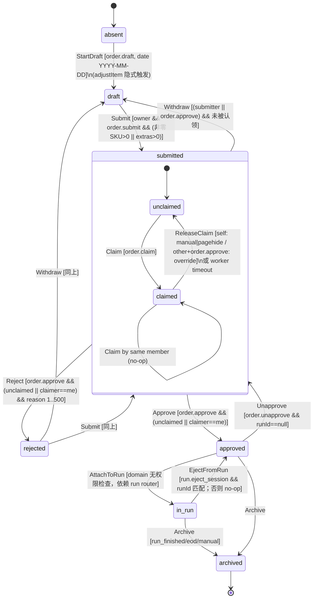

# Track B 审计报告：订货（Ordering）与审批（Approval）+ 离线队列 / 幂等

> 仓库：`/Users/sphinx/Desktop/Fine/CompassAlpha` @ HEAD `c49ba3e`（只读审计，未改任何文件、未访问网络/DB）
> 证据级别：**已确认事实**（代码/测试可直接证明）｜**高可信度推断**（由多处代码推出，未运行验证）｜**待验证**（需运行时数据或业务确认）
> 优先级为建议值（P0 = 数据损坏/资金错误且高频；P1 = 核心流程断裂或可导致重复采购；P2 = 明显缺陷/数据丢失但有绕行；P3 = 体验/一致性/技术债）

---

## 1 范围与已读文件清单

**Domain（纯函数状态机）**
- `packages/domain/src/order/commands.ts`（全文 1–707）
- `packages/domain/src/order/state.ts`（全文 1–304）
- `packages/domain/src/order/events.ts`（全文 1–262）
- `packages/domain/src/order/order.test.ts`（测试名列表 46–609，部分正文）
- `packages/domain/src/shared/clock.ts:46-58`（`todayInTz`）

**API**
- `apps/api/src/trpc/routers/order.ts`（全文 1–1330）
- `apps/api/src/trpc/trpc.ts`（全文 1–344：rate limit / readOnly / idempotency middleware / rethrowDomainError）
- `apps/api/src/trpc/context.ts`（idempotencyKey 头解析 38–86）
- `apps/api/src/services/orderProjection.ts`（全文 1–281）
- `apps/api/src/services/eventStore.ts`（1–89）
- `apps/api/src/services/notifyForEvent.ts`（16–128, 225–302）、`apps/api/src/services/notify.ts:160-240`
- `apps/api/src/services/priceStats.ts:242-274`（`estimateLines`）
- `apps/api/src/realtime/hub.ts:1-80`
- `apps/api/src/trpc/routers/run.ts`（仅下游依赖点：222–245, 839, 1010, 2864, 3206, 3370）
- `apps/worker/src/main.ts:384-512`（claim 超时释放）

**DB / Contracts**
- `packages/db/src/schema/readModel.ts:1-140`、`packages/db/migrations/0026_order_session_partial_unique.sql`
- `packages/db/src/schema/domain.ts:44-47`、`packages/db/src/schema/sync.ts:46-60`、`packages/db/src/rls.ts:29-48`
- `packages/db/src/seed-data.ts:8-12, 116-125, 177-183`（角色权限）
- `packages/contracts/src/schemas/order.ts`（全文 1–190）、`packages/contracts/src/schemas/common.ts:4-44`

**Web**
- `apps/web/src/pages/OrderPage.tsx`（全文 1–1822）
- `apps/web/src/pages/ApprovalPage.tsx`（全文 1–837）
- `apps/web/src/hooks/useOfflineQueue.ts`（全文 1–317）、`apps/web/src/lib/idb.ts`（全文 1–122）
- `apps/web/src/lib/trpc.ts:1-280`（authFetch / IDEMPOTENT_MUTATIONS / genKey）
- `apps/web/src/hooks/useRealtime.ts:1-179`、`apps/web/src/hooks/useTelegram.ts:300-333`
- `apps/web/src/app/Shell.tsx:64-71, 566-640`（Tab 权限 / PageMainButton）、`apps/web/src/app/App.tsx:55-110`（QueryClient 默认）
- `apps/web/src/lib/confirm.ts`、`packages/ui/src/components/QtyControl.tsx`（95–260, 318–448）、`packages/ui/src/components/Button.tsx:68-87`
- `packages/i18n/src/catalogs/zh.ts:592-600`、`apps/web/index.html`（script/link 列表）

**测试**
- `apps/api/src/__tests__/full-lifecycle.test.ts`（结构：直接调用 `decide()`，非 router）
- `apps/api/src/__tests__/approver-self-edit.test.ts`（router `createCaller`，212/267 两个用例）
- `apps/api/src/__tests__/idempotency-middleware.test.ts`（21–46）
- `tests/e2e/tests/main-flow.spec.ts:52-105, 228-250`

---

## 2 模块业务说明与角色

### 2.1 业务目的
门店员工（staff）每天为所在门店提交"要买什么"的订单（按 SKU 数量 + 目录外"其他物品"extras），店长（manager）审批；审批通过的订单被采购员（purchaser）的 market run 汇总采购（下游 Track）。

数据模型（**已确认事实**）：
- 会话 = 事件流（`streamType='order'`），读模型 `read_model.order_sessions_v` / `order_items_v`（`readModel.ts:30-140`）。
- 自 0005 起会话 **按成员私有**：`(org, store, initiatedByMember, orderDate)`；自 0026（M3.32）起**同一天可多批**，部分唯一索引只约束 `status='draft'` 的行（`readModel.ts:94-96`、`0026_...sql`）。
- 行项目按 `(session, sku, contributor)` 存储（`readModel.ts:107-140`）——这是 0002 "多人协作购物单"的遗留结构；0005 后每个会话只有一个 owner，manager 通过 `targetMemberId` 改 owner 的行。

### 2.2 角色与权限（种子：`seed-data.ts:116-125, 177-183`）
| 权限 | manager | staff | 后端校验点 | 前端门控 |
|---|---|---|---|---|
| `order.draft` | ✓ | ✓ | `commands.ts:124, 621, 633` | Shell 订单 Tab `Shell.tsx:70` |
| `order.submit` | ✓ | ✓ | `commands.ts:330` | **无**（OrderPage 不检查，失败才 toast） |
| `order.claim` | ✓ | – | `commands.ts:361` | **无**（Claim 按钮对能看到审批页的人都显示 `ApprovalPage.tsx:396`） |
| `order.approve` | ✓ | – | Approve/Reject/override-release/manager-edit/withdraw `commands.ts:151,391,408,428,457` | 审批 Tab `Shell.tsx:71`、接管按钮 `ApprovalPage.tsx:356` |
| `order.unapprove` | ✓ | – | `commands.ts:478` | `ApprovalPage.tsx:440-441` |

后端额外守卫（**已确认事实**）：
- 跨租户：所有 query/mutation 在 `ctx.withOrg`（RLS 事务 `rls.ts:35-47`）内，并校验 `store.orgId`（`order.ts:104-108, 663-667`）。
- 门店分配：`assertActorAssignedToStore`（`order.ts:111, 254, 337, 680, 924, 975, 1031, 1090, 1258`）。
- 门店级有效权限：`effectivePermissionsForStore`（`order.ts:686, 930, 981, 1037, 1096, 1269`）传入 `decide()`。
- 门店停用：仅 `adjustItem` 检查 `store.isActive`（`order.ts:674-679`）；submit/approve 等未检查（**高可信度推断**：停用门店已提交的订单仍可审批，可能是有意为之 → **待验证**业务意图）。
- 只读订阅：`authedProcedure` 对 `writeAccess === false` 拒绝 mutation（`trpc.ts:140-152`）。
- 限流：每用户每路由 120 mutation/分钟（`trpc.ts:111-128`）。

**前后端权限漂移**（**已确认事实**）：前端 Tab 使用扁平 `session.permissions`（`Shell.tsx:70-71`、`ApprovalPage.tsx:356, 441`），后端使用门店级有效权限；若某成员在某门店被 deny override，则 UI 仍显示操作，点了才 403。审批页的 Approve 按钮依赖"已被我 claim"，而 claim 要 `order.claim`——若自定义角色只有 `order.approve` 无 `order.claim`，UI 上永远无法审批，尽管 domain 允许未 claim 直接 Approve（**高可信度推断**；种子角色总是成对授予，是否存在拆分的自定义角色 **待验证**）。

### 2.3 入口
- 员工：底部 Tab "订货" → `OrderPage`（需选定具体门店，`OrderPage.tsx:76-77, 667-691`）。
- 店长：底部 Tab "审批" → `ApprovalPage`；通知深链 `deepLink: '/approve'`（`notifyForEvent.ts:52`）。
- 员工通知深链 `/order`（approved/rejected/unapproved/withdrawn/attachedToRun，`notifyForEvent.ts:58-118`）。

### 2.4 前置条件
- 必须选中具体门店（`storeCtx.kind==='specific'`）——否则空态（`OrderPage.tsx:667-691`）。
- **无截单时间（cut-off）**：全仓搜索 `cutoff/deadline` 仅命中 extras 建议的 30 天窗口与 refresh token（**已确认事实**）。
- 业务日 = 组织时区当天：`todayInOrgTz` → `todayInTz(orgTimezone)`（`order.ts:64-66`；`clock.ts:46`）。
- 批次规则：同一 (member, store, date) 至多 1 个 draft；submitted/approved/rejected/in_run/archived 不限（`0026`）。

---

## 3 端到端流程与状态机

### 3.1 员工下单（逐步）
| # | UI 控件 | 处理函数 | tRPC | Domain | 事件 | 投影 | 实时/通知 | UI 反馈 |
|---|---|---|---|---|---|---|---|---|
| 1 | SKU 行 `+`/`−` 或数量胶囊 → 快捷选择 Sheet → 预设/自定义 | `QtyControl.onChange` → `SkuRow` → `handleQtyChange`（`OrderPage.tsx:338-422`） | 200 ms 每 SKU 防抖 + 每门店串行（`239-286, 407-419`）→ `order.adjustItem` | 首次无 draft：`StartDraft`（`order.ts:794-827`）；`AdjustItem`（`commands.ts:141-187`） | `DraftStarted`、`ItemAdjusted` | insert session / upsert item + bumpSeq（`orderProjection.ts:18-61`） | `hub.publish(order.changed)`（`order.ts:911-916`）；无通知 | 乐观写缓存（`348-405`），haptic light；失败：网络→入 IDB outbox（`195-199`），CONFLICT→静默 invalidate，其他→toast（`207-217`） |
| 2 | 底部 "其他物品" 编辑器（仅当会话已存在 `1019`） | `SessionExtrasEditor.scheduleSave` 700 ms 防抖（`1576-1603`） | `order.setSessionExtras` | `SetSessionExtras`（`commands.ts:237-280`） | `SessionExtrasSet` | `extrasJson` 覆盖（`orderProjection.ts:103-117`） | order.changed | "保存中/已保存"文字（`1647-1653`） |
| 3 | PageMainButton "查看订单 (N)" | `usePageMainButton` 回调（`649-664`）→ `setReviewOpen(true)` | – | – | – | – | – | 打开审阅 Sheet（`1086-1114`，含估价 `ReviewList`） |
| 4 | Sheet 底部 "提交订单" | `handleSubmit`（`613-647`）：flush 所有待发 adjust → 取 session id（必要时 refetch）→ `submit.mutate` | `order.submit`（`idempotentMutation`，`order.ts:1202-1206`） | `Submit`（`commands.ts:325-357`） | `Submitted` | status=submitted（`137-148`） | 通知本店 `order.approve` 持有人（`notifyForEvent.ts:25-56`）+ order.changed | toast 成功、haptic、关闭 Sheet、切到"回执"视图（`716-818`） |
| 5 | 回执视图 "撤回" | `withdraw.mutate`（`757`） | `order.withdraw` | `Withdraw`（`449-474`） | `Withdrawn` | status=draft（`219-233`） | 通知 owner（自撤跳过 actor） | 无 toast；invalidate |
| 6 | 回执视图 "再报一批" | `startNewBatch`（`472-476`）：`newBatch=true` + 缓存置 null | 无（首次 adjust 时服务端惰性建新 draft） | – | – | – | – | 空目录可编辑 |

### 3.2 店长审批（逐步）
| # | UI | 处理 | tRPC | Domain | 事件 | 投影 | 通知/实时 |
|---|---|---|---|---|---|---|---|
| 1 | 打开审批页 | `pendingList`（status 默认 submitted；按门店上下文过滤，`ApprovalPage.tsx:67-73`） | `order.pendingList`（`order.ts:433-656`，limit 100，含估价/现金转账拆分） | – | – | – | – |
| 2 | "认领" | `claim.mutate` + 展开明细（`400-403`） | `order.claim` | `Claim`（`359-380`，重复认领幂等返回 []） | `Claimed` | claimedBy/At | 无通知；order.changed |
| 3 | 展开明细中 `QtyControl size=sm` | `adjust.mutate({targetMemberId, date})`（`737-749, 805-813`） | `order.adjustItem`（manager-edit 分支 `order.ts:750-778`） | `AdjustItem`（target≠actor 需 `order.approve` 且行已存在） | `ItemAdjusted` | upsert | order.changed |
| 4 | "通过" | `approve.mutate`（`414`） | `order.approve` | `Approve`（`406-424`） | `Approved` | status=approved，清 claim | 通知 owner（`58-66`） |
| 5 | "拒绝" → Sheet 输入原因 → "拒绝" | `reject.mutate`（`512-515`） | `order.reject` | `Reject`（`426-447`，原因 1..500） | `Rejected` | status=rejected | 通知 owner |
| 6 | "释放" / 他人认领时 "接管"（confirm） | `releaseClaim.mutate` | `order.releaseClaim`（reason 恒为 `'manual'`，`order.ts:1214-1220`） | `ReleaseClaim`（非本人需 `order.approve` → reason='override'） | `ClaimReleased` | 清 claim，override 时记 previousClaimer | order.changed |
| 7 | "已通过" Tab → "撤销通过" | `unapprove.mutate`（`448`），**无确认** | `order.unapprove` | `Unapprove`（`476-494`，runId 必须为空） | `Unapproved` | status=submitted，清 claim | 通知 owner |

后台：worker 每轮把 `claimed_at` 超过 `CLAIM_TIMEOUT_MINUTES`（默认 30）的 submitted 会话释放（`worker/main.ts:393, 416-512`），**手工镜像投影逻辑**、不发 realtime。

### 3.3 订单状态机（domain，`commands.ts` + `state.ts`）

**编辑类命令的门禁**（`assertCanEditSession` `commands.ts:612-638`）：
| 状态 | AdjustItem / SetNote / SetSessionNote / SetSessionExtras 允许谁 |
|---|---|
| draft / rejected | 仅 owner 且有 `order.draft` |
| submitted 已认领 | 仅认领人 |
| submitted 未认领 | owner（有 `order.draft`） |
| approved / in_run / archived | 无人（`lockedByStatus`） |

`MarkExtraStatus` 仅 `in_run` 且有 `run.purchase`（`282-323`）。

**禁止的转换（已确认事实）**：draft→approved/rejected（`notApprovable/notRejectable`）；submitted→submitted 二次 Submit（`notSubmittable`）；approved→draft（无 Withdraw，`notWithdrawable`）；approved(已入 run)→Unapprove（`alreadyInRun`）；任何状态→absent；archived 上除 Archive（no-op）外一律 `order.errors.archived`（`assertActiveStream` `589-592`）；Archive 从 draft/submitted/rejected 抛 `cannotArchive`（`567-571`）。

**Domain 允许但 API/UI 不可达的路径（漂移，已确认事实）**：
1. "rejected 状态 owner 继续编辑后重提"：domain 允许（`620-629`），但 `adjustItem` 自编辑只查 `status='draft'`（`order.ts:779-788`），找不到就**惰性新建另一张 draft**；`todaySession` 根本不返回 rejected（`order.ts:128-151`）。
2. "submitted 未认领时 owner 继续编辑"：domain 允许（`633-635`），API 自编辑同样只查 draft → 新建 draft。
3. "未认领直接 Approve/Reject"：domain 允许（`414, 434`），UI 只在 claimed-by-me 显示（`ApprovalPage.tsx:408`）。
4. "仅 extras 的订单提交"（M3.33）：domain 允许（`345-349`），UI 不可达（见 B-08）。
5. `ReleaseClaim reason='pagehide'`：router 恒传 `'manual'`（`order.ts:1218`），且 input schema 用 `.extend({reason}).pick({sessionId})` 把 reason 又剔除（`order.ts:1215`）。

### 3.4 时区 / 业务日
- 服务端"今天"=组织时区（**已确认事实** `order.ts:64-66, 118, 261, 660`）。
- 前端日期标签 `dateFmt.weekdayLong(new Date())`（设备时钟，`OrderPage.tsx:696`）；乐观 draft 的 `orderDate` 用 `new Date().toISOString().slice(0,10)`（UTC，`OrderPage.tsx:365`，仅缓存展示）。
- 跨日：`adjustItem`（员工侧）**不传 date**（`OrderPage.tsx:409` payload 只有 storeId/skuId/qty），服务端用当时的"今天"。午夜前打开、午夜后继续点 → 写入新一天的新 draft；前一天未提交的 draft 不再出现在 `todaySession`（按 date 过滤）→ 孤儿 draft（**高可信度推断**；无 EOD 清理 draft 的逻辑——Archive 只接受 approved/in_run `commands.ts:567`）。
- 审批 `pendingList` 不按日期过滤（`order.ts:474` 仅当传 date），跨日的 submitted 仍可审批；`run.previewCreatable` 可按 date 或全部 approved（`run.ts:231-232`）。

### 3.5 数量/小数精度
- DB：`decimal(12,3)`（`readModel.ts:118`）。Domain：`normalizeDecimal` 保留 3 位（`commands.ts:673-679`），`sameDecimal`/`isMultipleOf` 容差 1e-6（`681-689`）。前端：`QtyControl` `toFixed(3)`（`QtyControl.tsx:105-106`），totals `toFixed(3)`（`OrderPage.tsx:330`；`order.ts:212`）。
- 契约 `DecimalStringSchema = /^-?\d+(\.\d{1,3})?$/`（`common.ts:14-16`）：**允许负数、整数位无上限**；负数由 domain 拒绝（`commands.ts:166`），超过 9 位整数会在 DB 层 numeric overflow → 500（**高可信度推断**）；`QtyControl` 默认 `max = Number.MAX_SAFE_INTEGER`（`QtyControl.tsx:47`）。
- 步长漂移：`QtyControl` `+/-` "离步长的值保持离步长"（`QtyControl.tsx:95-107`），domain 对非步长倍数抛 `qtyNotMultipleOfStep`（`commands.ts:167-170`）；快捷选择 Sheet 则 `roundToStep`（`444-448`）。三处规则不一致。
- 估价：前端 `ReviewList`（`OrderPage.tsx:1360-1378`）、`SessionItems`（`ApprovalPage.tsx:619-634`）与后端 `estimateLines`（`priceStats.ts:242-274`）**三份相同的 lastPrice×qty 实现**；后端 router 注释仍写"avg-7d"（`order.ts:640-646`），`OrderPage.tsx:1413-1417`、`ApprovalPage.tsx:693-696` 注释也写"avg-7d / last 7 days"，与实际 lastPrice 不符（注释陈旧）。

### 3.6 下游依赖
- `run.previewCreatable` 读 `status='approved'` 会话（`run.ts:229-245`）；`AttachToRun`（`run.ts:839, 1010`）、`Archive`（`2864`）、`EjectFromRun`（`3206, 3370`）回写订单流；`markExtraStatus` 由 RunPage 调用（`RunPage.tsx:577, 2005`）。
- admin 统计/运维读 `order_sessions_v`（`admin.ts:825-832, 4053`）。
- 通知（in-app + bot outbox）依赖事件类型与 dedupKey（`notifyForEvent.ts`）。
- 结论：**订单状态与 `order_items_v` 数量是采购计划唯一输入**，任何重复批次（B-02/B-03/B-07）都会直接放大采购量。

---

## 4 页面 / 交互档案

### 4.1 OrderPage（`apps/web/src/pages/OrderPage.tsx`）

**数据加载**：`catalog.categories`、`catalog.skus`、`order.todaySession`、`order.todayBatches`（`107-118`）；审阅时 `catalog.skuPriceStats`（`1349-1352`）；extras 名称聚焦时 `order.extrasSuggestions`（`1720-1723`）。

**视图选择**：`isReadOnly = sessionLocked && !newBatch`（`564-571`）；只读且有数据 → 回执视图（`716-818`）；否则草稿视图（`820-1116`）。

| 控件 | 位置 | 处理 → 过程 | 状态变化 / 导航 | 加载/错误 |
|---|---|---|---|---|
| 搜索框 / 清除 | `853-861` | 本地 `searchQuery` | 过滤（跨语言 `matchesNameLike`） | 无匹配空态 `979-986` |
| "今日 N 批"按钮（>1 批） | `866-874` | `setBatchesOpen(true)` | 打开批次 Sheet `1070-1084`（只读列表，条目不可点） | – |
| 分类 Chip "全部" | `877-893` | 清分类 + 清搜索 | – | `DataState` |
| 分类 Chip | `897-903` | `setActiveCategory` | – | – |
| SKU 行 `−`/`+`（含长按加速） | `SkuRow` → `QtyControl` `1218-1230` | `handleQtyChange` → 防抖 → `order.adjustItem` | 乐观缓存 | 见 §3.1 |
| SKU 行数量胶囊 | `QtyControl.tsx:202-229` | 打开快捷选择 Sheet | 预设 Chip 一点即生效；自定义输入 + "设为 X" | – |
| 草稿视图横幅 "撤回"（submitted 未认领） | `943-957` | `order.withdraw` | – | 仅 `loading`，**无 onError toast**（`459-464`） |
| 草稿视图横幅 "撤回"（rejected） | `927-941` | 同上 | **不可达**（见 B-01） | – |
| extras："添加" | `1681-1689` | `addRow`（不立即保存） | 本地新增空行 | 上限 50 |
| extras：名称/数量/单位/删除 | `ExtraRowEditor 1702-1822` | `updateRow`(700ms) / `removeRow`(立即) → `order.setSessionExtras` | 本地 rows | 失败 toast `extrasSaveFailed`，CONFLICT 静默 refetch（`490-502`） |
| extras：建议下拉 | `1742-1767` | `onMouseDown` 选中 | – | – |
| PageMainButton "查看订单 (N)" / "提交订单" | `usePageMainButton 649-664`（Shell 渲染 `Shell.tsx:576-640`，任意 mutation 进行中即禁用） | 打开 Sheet / `handleSubmit` | – | `visible: canSubmit && selectedCount>0` |
| 审阅 Sheet 底部 "提交订单" | `1097-1110` | `handleSubmit` | 成功关 Sheet → 回执 | `loading=submit.isPending`（flush 期间**不**禁用，见 B-04） |
| 审阅 Sheet 关闭 | `1088` | 提交中禁止关闭 | – | – |
| 回执：BatchStrip ×2 | `734-739` 与 `776-781` | – | 见 §9 声明 1 | – |
| 回执：横幅 撤回 | `747-763` | `order.withdraw` | – | 同上无错误 toast |
| 回执："再报一批" | `811-815` | `startNewBatch` | `newBatch=true` | 见 B-03 |
| 回执：extras 只读 | `794-809` | – | – | 空则不渲染 |

**加载/空/错/成功态**：store 未选空态（`678-688`）；SKU 列表 `DataState` 空态（`972-976`）；审阅空 "order.review.empty"（`1404-1409`）；提交成功 toast（`443`）、网络失败 toast（`448`）、域错误 errToast（`455`）；离线入队失败时 `onDrop` toast `run.toast.syncFailed`（`131`，复用 run 的文案）。**`offline.pendingCount` 从未展示**（全文件仅 `197` 使用 `offline.enqueue`）→ 员工不知道有离线待同步的数量。

**返回/刷新恢复**：分类、搜索、`newBatch`、`reviewOpen` 均为组件本地 state，切 Tab 或刷新即丢失；购物数据已逐次落库因而可恢复——但最后 200 ms 内的点击在卸载时被丢弃（`246-252`，B-06）；extras 最后 700 ms 内的编辑同样（`1605-1610`）。离线刷新：无 Service Worker，WebView 刷新将无法加载应用（见 §9 声明 4）。

### 4.2 ApprovalPage（`apps/web/src/pages/ApprovalPage.tsx`）

| 控件 | 位置 | 处理 → 过程 | 状态变化 | 反馈 |
|---|---|---|---|---|
| Tabs 待审/已通过/已拒绝 | `166-174` | `setTab` → `pendingList({status})` | – | `DataState` 空态 `193-198` |
| "认领"（未被认领） | `396-407` | `order.claim` + 展开 | claimed | toast `approval.toast.claimed`；错误 errToast |
| "通过"（我已认领） | `410-417` | `order.approve` | approved | toast + haptic；**无二次确认** |
| "拒绝"（我已认领） | `418-424` | 打开 Sheet | – | – |
| 拒绝 Sheet 原因输入 + "拒绝" | `480-529` | `order.reject` | rejected | 提交中禁止关闭；成功清空 |
| "释放"（我已认领） | `425-431` | `order.releaseClaim` | unclaimed | toast；无确认 |
| "接管"（他人认领，需 `order.approve`） | `356-375` | `confirmThen` → `order.releaseClaim` | override 释放（**接管后仍需再点"认领"**） | toast |
| "撤销通过"（已通过 Tab，需 `order.unapprove`） | `440-452` | `order.unapprove`（无原因、**无确认**） | submitted | toast |
| "查看明细/收起" | `453-459` | 本地 `activeSessionId` | 展开 `SessionItems` | 加载 Spinner `599-605`、失败文本 `606-612`、空 `635-641` |
| 明细 QtyControl（我已认领） | `730-750, 798-814` | `order.adjustItem`（manager-edit） | 行数量 | `disabled={adjust.isPending}`，每次点击一个往返；数量减为 0 的行被过滤掉、**无法在审批页恢复**（`613, 646`） |

卡片信息：提交人头像/名字、门店、贡献者数、日期、项数、估价、现金/转账拆分、`notes` 徽章（仅 legacy notes，B-14）、被他人认领横幅、已拒绝原因（`208-393`）。

**刷新恢复**：Tab 与展开状态本地；claim 在服务端持久，30 分钟后被 worker 释放（按 `claimed_at`，非最后活动时间，B-16）。

---

## 5 操作繁琐点（当前 vs 建议）

### 5.1 员工下 15 项典型订单（点击数，**高可信度推断**，假设订单 Tab 为落地页、各项需在 ~190 SKU 中定位）
| 步骤 | 当前 | 说明 |
|---|---|---|
| 定位 SKU | 每项 0–1 次（分类 Chip）+ 滚动；或搜索输入若干字符 + 清除（≈1 次） | 无"常用/上次订单"快捷列表；`suggestedQty` 仅文字提示，不能一键采用（`OrderPage.tsx:1200-1202`） |
| 设定数量 | 数量为 1 个步长：1 次 `+`；否则 2 次（胶囊 → 预设）或 N 次 `+` | 预设阶梯固定（`QtyControl.tsx:433-438`） |
| 审阅 | 1 次（PageMainButton） | |
| 提交 | 1 次（Sheet 底部） | MainButton 在 Sheet 后被遮挡 |
| **合计** | 最好 ≈17；典型 ≈ 15×(1 定位 + 1.5 数量) + 2 ≈ **40 次** | |

建议：① "按上次订单/建议量一键填入"（每项可省 1–2 次，典型降至 ≈20）；② "我的常用"分组置顶；③ 审阅 Sheet 内允许直接改数量（目前只读，改错需关闭 Sheet → 找行 → 再开）。

### 5.2 店长审批 5 张订单
| 方案 | 点击 |
|---|---|
| 当前：进审批 Tab 1 + 每单（认领 1 + 通过 1） | **11**（e2e 也是 Claim→Approve 两步，`main-flow.spec.ts:96-103`） |
| 允许未认领直接"通过"（domain 已支持 `commands.ts:414`） | 6 |
| 增加"全部通过（含确认）" | 3 |

其他繁琐点（**已确认事实**）：
- "接管"后仍需再点"认领"（`ApprovalPage.tsx:369` 仅 release）。
- 审批编辑数量每次点击都要等待往返（`disabled={adjust.isPending}` `736, 804`），无防抖；且每次成功都 invalidate `sessionDetail` + `pendingList`（`566-572`）。
- 被拒订单员工侧无法打开/修改/重提（B-01），只能重新录入整单。

---

## 6 重复功能 / 逻辑

| ID | 重复点 | 证据 | 级别 |
|---|---|---|---|
| D-1 | 回执视图 BatchStrip 渲染两次 | `OrderPage.tsx:734-739` 与 `776-781`，同一分支内无互斥条件 | 已确认事实 |
| D-2 | 估价逻辑三份：后端 `estimateLines`、前端 `ReviewList`、前端 `SessionItems`；前两处之外 `pendingList`/`todayBatches` 已在服务端算好但前端仍重算 | `priceStats.ts:242-274`；`OrderPage.tsx:1360-1378`；`ApprovalPage.tsx:619-634` | 已确认事实 |
| D-3 | "按 SKU 汇总非零 qty" 四份：`countNonZero`、`todaySession`、`todayBatches`、`pendingList`、`sessionDetail`、前端 `recomputeTotals` | `commands.ts:652-663`；`order.ts:173-177, 287-294, 526-557, 371-375`；`OrderPage.tsx:320-332` | 已确认事实 |
| D-4 | "load stream → decide → append → project → publish" 样板复制 5 次（setNote/setSessionNote/setSessionExtras/markExtraStatus/runSimpleCommand），且行为不一致：setNote 不发 realtime（`947-956`），这 4 个都不捕获 unique violation（只有 runSimpleCommand 映射 CONFLICT `1314-1316`） | `order.ts:921-1150, 1247-1320` | 已确认事实 |
| D-5 | Worker 手写 ClaimReleased 投影，复制 `orderProjection` 逻辑 | `worker/main.ts:486-498` vs `orderProjection.ts:160-183` | 已确认事实 |
| D-6 | 提交入口双份：PageMainButton（reviewOpen 时文本"提交订单"）+ Sheet footer；前者被 Sheet 遮挡（注释 `OrderPage.tsx:1094-1096`） | `583-590, 649-664, 1093-1111` | 高可信度推断（遮挡依赖 Sheet z-order） |
| D-7 | 会话 notes 双轨：legacy `notes`/`SessionNoteSet` 与 `extras`/`SessionExtrasSet`；审批页同时渲染两块 | `state.ts:68-79`；`ApprovalPage.tsx:663-692` | 已确认事实 |
| D-8 | 回执 / 草稿视图状态横幅两套实现（`740-774` vs `915-970`），后者 claimed 文案硬编码 `who: 'manager'`（`925`） | 同左 | 已确认事实 |
| D-9 | extras 校验三份：zod（`contracts order.ts:137-145`）、domain（`commands.ts:251-267`）、前端 `sanitize`（`OrderPage.tsx:1553-1574`）；zod 限定单位枚举，domain 只校验长度 1..16 | 同左 | 已确认事实 |

---

## 7 疑似无效 / 不可达代码

| ID | 代码 | 证据 | 级别 |
|---|---|---|---|
| U-1 | `order.setNote`、`order.setSessionNote` 过程；`ItemNoteSet` 的 note 在任何页面都不展示 | router 定义 `order.ts:921-1019`；`apps/web/src` 无调用（grep 仅命中注释 `OrderPage.tsx:486` 与无关的 PlatformSections 本地 state）；api/worker/e2e 也无调用 | 已确认事实（"无引用"≠外部客户端从不调用；旧 bundle 可能调用 → 待验证日志） |
| U-2 | 草稿视图 rejected 横幅 + 撤回按钮 | `OrderPage.tsx:927-941`；`todaySession` 从不返回 rejected（`order.ts:128-151`） | 已确认事实 |
| U-3 | 回执视图 claimedByOther 横幅、草稿视图 claimed 横幅 | `OrderPage.tsx:718-746, 920-926`；`todaySession` 回退查询要求 `claimedByMemberId IS NULL`（`order.ts:147`），draft 不可被认领（`commands.ts:364`） | 已确认事实 |
| U-4 | `todaySession` 返回的 `claimedByDisplayName` 恒为 null | 同上 `order.ts:161-168` | 已确认事实 |
| U-5 | 回执视图 archived 横幅 | `OrderPage.tsx:772-774`；`todaySession` 不返回 archived | 已确认事实 |
| U-6 | `canSubmit` 的 `'rejected'` 分支 | `OrderPage.tsx:580-581` | 已确认事实 |
| U-7 | 所有输入的 `expectedSeq`、`AdjustItemInputSchema.sessionId` | contracts `order.ts:67, 75, 84, 96, 156, 163, 175`；router 从不读取（grep `expectedSeq` 在 router 只出现于 `1215` 的 schema 拼接） | 已确认事实 |
| U-8 | `ActorCtx.isClaimer` | 定义 `commands.ts:80`，`decide()` 从不读取；router 仍计算（`order.ts:84`） | 已确认事实 |
| U-9 | `ReleaseClaim` 的 `'pagehide'` 原因（订单） | `order.ts:1215-1218` 恒 `'manual'` | 已确认事实 |
| U-10 | 审批明细 ">1 贡献者" 分支及 `admin.memberList` 查询 | `ApprovalPage.tsx:574-584, 787-823`；0005 后每会话单 owner，manager 编辑也写 owner 行（`commands.ts:149-161`）→ 只有遗留数据才会出现多贡献者 | 高可信度推断 |
| U-11 | PageMainButton 的 reviewOpen "提交订单"分支 | `OrderPage.tsx:586-587, 653-655` | 高可信度推断 |
| U-12 | `OrderSessionViewSchema` / `OrderItemViewSchema` | 仅在 `contracts/src/schemas/order.ts:41-64` 定义，`apps/*` 无引用 | 已确认事实（可能经 index 导出给外部，待验证） |
| U-13 | domain "rejected/submitted-未认领 owner 编辑" 分支对 adjustItem 不可达（setSessionExtras 可达） | 见 §3.3 | 已确认事实 |

---

## 8 缺陷与风险

### B-01 被拒订单对员工"消失"，无法修改/重提/撤回 — 建议 **P1**
- **证据（已确认事实）**：`todaySession` 先找 draft，再找 `status IN ('submitted','approved','in_run')`（`order.ts:128-151`），不含 rejected；草稿视图 rejected 横幅不可达（`OrderPage.tsx:927-941`）；`BatchStrip` 少于 2 批不渲染且条目不可点（`1268, 1280-1312`）；`adjustItem` 自编辑只查 draft（`order.ts:779-788`），对 rejected 会新建 draft；全 web 仅 OrderPage/ApprovalPage/RunPage 调 `trpc.order.*`，没有其他入口。
- **影响**：店长"拒绝并要求修改"后，员工只能看到通知，订单无法在 UI 中查看或重提，只能从零重新录入；rejected 会话永久滞留（审批页"已拒绝"Tab 无限累积，`pendingList` limit 100 `order.ts:478` 最终会挤掉新数据）。domain 精心设计的 rejected→编辑→Submit 流程完全不可达。
- **修复**：`todaySession` 优先返回 rejected（或在回执视图列出）；`adjustItem` 自编辑查找 `status IN ('draft','rejected')`（并处理 rejected 与新 draft 并存）；BatchStrip 条目可点并切换查看；或改为"拒绝即退回 draft"语义（需同步部分唯一索引）。
- **回归测试**：router 级：reject → todaySession 返回该会话；owner adjustItem 写入同一 streamId；resubmit 成功；e2e：拒绝 → 员工看到原因 → 改 → 重提。

### B-02 订单被认领期间员工回执消失，易诱发重复下单 — 建议 **P1**
- **证据（已确认事实）**：`todaySession` 回退查询要求 `isNull(claimedByMemberId)`（`order.ts:147`）。认领后：若当日无 draft 也无其它未认领批次 → 返回 null → 页面显示空的可编辑目录（`OrderPage.tsx:716` 条件为假）；若有更早的已通过批次 → 显示那个旧批次。"正在由 X 审核"横幅因此不可达（U-3）。
- **影响（高可信度推断）**：员工以为订单丢了重新录入并提交 → 第二批同样被审批 → 采购量翻倍（下游 run 汇总 approved，`run.ts:231`）。
- **修复**：去掉 `isNull(claimedBy)` 过滤，按 `submittedAt desc` 返回最近一批；回执视图已有 claimedByOther 横幅可直接复用。
- **回归测试**：claim 后 todaySession 仍返回该会话且含 `claimedByDisplayName`；UI 测试显示"审核中"横幅且无撤回按钮。

### B-03 "再报一批"模式下首次点击前的任何 refetch 会把上一批数量带入新批 — 建议 **P2**
- **证据**：`startNewBatch` 只把缓存置 null（`OrderPage.tsx:472-476`）；任何 `order.changed`（组织内任意订单事件）都会 invalidate 全部 `['order']` 查询（`useRealtime.ts:122-124`）；staleTime 30 s 后切页回来也会 refetch（`App.tsx:65`）；refetch 返回上一批 submitted 会话（`order.ts:139-151`），`newBatch=true` 使其可编辑（`571`）；`handleQtyChange` 在已有缓存上做绝对值写入（`383-404`），`myQtyBySku` 取自上一批 items（`540-546`）；服务端为新 draft 写入该绝对值（`order.ts:779-788, 811-827`）。
- **影响**：新批数量 = 上一批数量 + 本次增量（例如上一批 2 kg，新批点一次 + → 3 kg 写入新批）；审阅 Sheet 列表混入上一批行。高峰期组织内 order.changed 频繁，触发概率不低（**高可信度推断**）。
- **修复**：`newBatch` 时用 `select`/独立 query key 屏蔽 submitted 会话；或服务端提供显式 `startBatch` 并让 `todaySession` 接受 `mode:'draftOnly'`。
- **回归测试**：startNewBatch → 模拟 invalidate → 点击 + → 断言 adjustItem payload qty = 1 个步长。

### B-04 提交的重复请求保护只覆盖 401 重放；双击/响应丢失时出现"成功后又报失败" — 建议 **P2**
- **证据（已确认事实）**：`submit` 是 `idempotentMutation`（`order.ts:1202`），前端在 `IDEMPOTENT_MUTATIONS` 内（`trpc.ts:191-198`），但 `submit.mutate` 未传 `context.idempotencyKey`（`OrderPage.tsx:634-637`），故每次请求 `genKey()` 新键（`trpc.ts:263-266`）；`handleSubmit` 在 `await flushAllPendingAdjusts()` 与 `todaySession.fetch` 期间 `submit.isPending=false`，Sheet 按钮 `loading={submit.isPending}` 未禁用（`1100`）→ 双击会发两个 submit；第二个被 domain 拒绝 `notSubmittable`（`commands.ts:336-338`）→ errToast "提交失败"。中间件对同键并发也是先查后写（`trpc.ts:213-249`），两请求同时 miss 都会执行。
- **影响**：数据层安全（domain 状态机挡住了重复提交），但用户看到成功+失败两个 toast；响应丢失后重试必然报错，员工可能误以为没提交而"再报一批"（与 B-02 叠加放大重复采购风险）。
- **修复**：每次逻辑提交生成稳定 key 经 `context.idempotencyKey` 传入；`handleSubmit` 入口加 in-flight ref 锁；domain 对"已 submitted 且 submittedBy==me"的 Submit 返回 `[]`（幂等成功）。
- **回归测试**：同 key 两次 submit 返回同一响应；双击仅产生 1 个网络请求；重复 Submit 不报错。

### B-05 审批类命令无传输层幂等，重复请求报错 — 建议 **P3**
- **证据**：`claim/releaseClaim/approve/reject/withdraw/unapprove` 均为 `authedProcedure`（`order.ts:1208-1244`）。domain：Claim 自身幂等（`372`），ReleaseClaim 无 claim 时幂等（`384`），**Approve/Reject/Withdraw/Unapprove 重复会抛 PRECONDITION_FAILED**（`412, 432, 462, 482`）。
- **影响**：响应丢失后重试 → "审批失败"toast，但实际已通过；数据不重复（事件 seq 唯一索引 + 状态机）。
- **修复**：Approve 在 `status==='approved' && decidedBy===me` 时返回 `[]`；前端对 PRECONDITION_FAILED 先 refetch 再决定是否提示。

### B-06 卸载时丢弃未发出的数量/extras 修改 — 建议 **P2**
- **证据（已确认事实）**：卸载清理只 `clearTimeout` 不 flush（`OrderPage.tsx:246-252`）；extras 同样（`1605-1610`）。
- **影响**：点 + 后 200 ms 内切 Tab（或 extras 输入后 700 ms 内离开），界面曾显示的数量未落库；回来后数量"回退"。
- **修复**：卸载时调用 `flushAllPendingAdjusts()`（fire-and-forget）；extras 卸载时立即 `fire()`；`pagehide` 时也 flush。
- **回归测试**：点击后立即 unmount，断言 adjustItem 被调用。

### B-07 离线回放 adjustItem 不带日期、按"我的 draft"定位，可能写入错误批次/日期 — 建议 **P2**
- **证据**：入队的 `vars` 只有 `{storeId, skuId, qty}`（`OrderPage.tsx:197, 409`）；回放调用同一 `adjustItem`（`125-131`），服务端用"现在的今天"且只找 draft，找不到就惰性新建（`order.ts:660, 779-788, 794-827`）。`handleSubmit` 只等内存中的 in-flight，不等 IDB outbox（`294-314`）。CONFLICT 在回放中被当作终态丢弃（`useOfflineQueue.ts:134-144`），但对 adjustItem 而言 `staleSeq` 是瞬态。
- **影响（高可信度推断）**：离线点击 → 恢复后先提交（缺少离线行）→ outbox 回放时新建一张只含这些行的 draft；跨午夜回放写入次日；CONFLICT 时离线修改被静默丢弃（仅 toast "同步失败"）。
- **修复**：入队时冻结 `date` 与 `sessionId`，服务端按 sessionId 校验状态；提交前检查 outbox 中同店条目并先回放；adjustItem 的 CONFLICT 视为 retry。
- **回归测试**：outbox 有条目时提交被阻止或先回放；回放携带原日期。

### B-08 仅含"其他物品"的订单在 UI 中无法提交（domain 已支持） — 建议 **P2**
- **证据（已确认事实）**：extras 编辑器仅在会话存在时渲染（`OrderPage.tsx:1019`），会话只能由 SKU 点击惰性创建；提交按钮 `visible: canSubmit && selectedCount>0`、`handleSubmit` 首行要求 `selectedCount>0`（`614, 661`）；domain 测试 `order.test.ts:212` 证明后端允许。
- **影响**：员工必须假装加一个 SKU 才能请求目录外物品——正是 M3.33 想消除的问题。
- **修复**：extras 编辑器始终显示（首次保存时惰性建会话，可新增 `ensureDraft`）；`selectedCount` 计入 extras。

### B-09 extras 无效行被静默丢弃 — 建议 **P2**
- **证据**：`sanitize` 丢弃空名、数量非法或 ≤0 的行（`OrderPage.tsx:1553-1574`），编辑器仍显示该行；保存成功后显示"已保存"（`1586-1588`）。
- **影响**：例如数量清空/填 0 的行只存在本地，刷新/切页后消失。
- **修复**：行内校验提示并阻止"已保存"状态；或保存时提示被忽略的行数。

### B-10 Withdraw / rejected→draft 可能撞部分唯一索引，返回误导性 `staleSeq` — 建议 **P2**（当前 UI 路径受 B-01 遮蔽，**高可信度推断**）
- **证据**：投影 Withdrawn 把 status 改回 draft（`orderProjection.ts:219-233`）；唯一索引 `(org, store, member, date) WHERE status='draft'`（`readModel.ts:94-96`）；runSimpleCommand 把任何 unique violation 映射为 `CONFLICT order.errors.staleSeq`（`order.ts:1314-1316`）。domain 状态机并不知道"已有另一张 draft"。
- **影响**：员工已开新批 draft 时，manager（有 `order.approve`）或员工本人撤回旧批会失败且提示"数据已变更请重试"，重试永远失败。
- **修复**：在 router 中预检冲突并返回专门错误，或撤回时合并到现有 draft；domain 增加约束说明。

### B-11 `expectedSeq` 被接受却从未校验，审批无"所见即所批"保护 — 建议 **P2**
- **证据**：见 U-7；approve 只按当前流状态决策（`order.ts:1222-1226`）。
- **影响**：店长看到的明细与实际批准的版本可能不一致（例如未认领直接调用 approve 时员工刚撤回重提、或 owner 通过 setSessionExtras 修改了未认领的 submitted 会话 `commands.ts:633-635`）。UI 要求先认领（认领后 owner 不能再编辑）部分缓解。
- **修复**：runSimpleCommand 若传入 `expectedSeq` 且 `state.seq !== expectedSeq` 抛 CONFLICT；前端 approve 传 `row.lastSeq`。

### B-12 并发惰性建 draft 时返回 500 而非 CONFLICT — 建议 **P3**
- **证据**：DraftStarted 投影 `onConflictDoNothing()`（`orderProjection.ts:18-30`），第二个事务的会话行被跳过，随后 `order_items_v` 外键/或部分唯一冲突；`projectOrder` 在 `appendEvents` 的 try/catch 之外（`order.ts:857-903`），错误以 INTERNAL_SERVER_ERROR 抛出。
- **影响**：同一员工两台设备同时首次下单时一方报"调整失败"；数据一致（事务回滚）。
- **修复**：投影错误同样走 `isUniqueViolation`/FK 判定并映射 CONFLICT；或用 advisory lock 串行化惰性创建。

### B-13 通知 dedupKey 不含 seq：重提/再通过/再拒绝的站内通知被永久吞掉，bot 消息却照发 — 建议 **P3**
- **证据**：`order:${id}:submitted|approved|rejected|unapproved`（`notifyForEvent.ts:50, 63, 73, 88`），只有 withdrawn 带 seq（`103`）；`notifications` 插入 `onConflictDoNothing`，而 outbox（bot）行不去重（`notify.ts:194-216`）。
- **影响**：撤回后重提，店长站内通知不再出现；worker 是否按 dedupKey 去重 bot 发送 **待验证**（未读 worker 发送代码）。
- **修复**：dedupKey 加 `e.seq`。

### B-14 审批卡片的"有备注"徽章只看 legacy `notes`，看不到 extras — 建议 **P3**
- **证据**：`ApprovalPage.tsx:311-315` 读 `row.notes`；新订单只写 `extrasJson`（`orderProjection.ts:103-117`）；`pendingList` 通过 `...sess` 已返回 `extrasJson`（`order.ts:617-618`）。
- **修复**：徽章条件改为 `row.notes || row.extrasJson.length>0`，并显示 extras 数。

### B-15 "撤销通过"无确认、无原因；"通过"无确认 — 建议 **P3**
- **证据**：`ApprovalPage.tsx:440-452, 410-417`；domain/通知都支持 reason（`commands.ts:62, 491`；`notifyForEvent.ts:84-87`）。
- **影响**：误触即把已通过订单退回待审（若采购员正在规划会掉出 preview）。是否需要确认属产品决策（**待验证**）。

### B-16 Claim 超时按认领时间而非最后活动；worker 释放不发 realtime — 建议 **P3**
- **证据**：`claimed_at < NOW() - 30min`（`worker/main.ts:426, 463`），审批中的数量编辑不刷新 `claimed_at`（`orderProjection.ts:32-61`）；worker 无 `hub.publish`（独立进程）。
- **影响**：长单审核超过 30 分钟时被静默释放，审批人随后编辑报 `notEditor`，UI 仍显示自己已认领直到下次刷新。

### B-17 Realtime 在事务提交前发布 — 建议 **P3**
- **证据**：`hub.publish` 在 `ctx.withOrg` 回调内（`order.ts:911-916, 1293-1298`），事务在回调返回后提交（`rls.ts:35-47`）。前端 400 ms 防抖（`useRealtime.ts:24`）大幅缓解。
- **修复**：返回后（事务外）发布，或收集到 after-commit 钩子。

### B-18 契约允许负数与超长整数 — 建议 **P3**
- **证据**：`common.ts:14-16`；DB `decimal(12,3)`（`readModel.ts:118`）；`QtyControl` max 默认 MAX_SAFE_INTEGER。
- **修复**：订单 qty 用非负且 ≤ 9 位整数的 schema，并在 domain 加上限。

### B-19 组织级 order.changed 广播导致所有客户端重拉重查询 — 建议 **P3**
- **证据**：`useRealtime.ts:122-124` 对任何 order.changed 失效全部 `['order']`；`pendingList`/`todayBatches` 每次都做价格统计扫描（`order.ts:300-303, 574-581`）。
- **影响（高可信度推断）**：多门店高峰期 N 客户端 × 每次点击 → 大量重复查询；也是 B-03 的触发源。
- **修复**：消息带 storeId/memberId，前端按需失效。

### B-20 步长规则三处不一致 — 建议 **P3**
- 见 §3.5（`QtyControl.tsx:95-107` vs `444-448` vs `commands.ts:167-170`）。SKU 步长被管理员修改后，旧的离步长数量点 + 会被服务端拒绝（**高可信度推断**）。

### B-21 UI 权限门控与服务端门店级权限不一致 — 建议 **P3**
- 见 §2.2（`Shell.tsx:70-71`、`ApprovalPage.tsx:356, 396, 441`）。

### B-22 跨日：孤儿 draft 与设备时钟日期 — 建议 **P3**
- 见 §3.4。前一天未提交 draft 永不再显示，也无 EOD 归档（`commands.ts:567`）。

### B-23 OrderPage 撤回失败无提示 — 建议 **P3**
- **证据**：`withdraw` mutation 无 `onError`（`OrderPage.tsx:459-464`），全局 mutations `retry:false`（`App.tsx:87-89`）。点击失败（例如已被认领 `cannotWithdrawWhileClaimed`）只是 spinner 结束，无反馈。

### B-24 审批人可以审批自己提交的订单（职责分离） — **待验证**（业务）
- domain 未禁止 owner==approver（`commands.ts:406-424`），且有专门测试覆盖"审批人==提交人"的编辑路径（`approver-self-edit.test.ts:212`），说明是被接受的场景；是否需要限制请业务确认。

### 缺失测试（汇总）
- domain：`SetSessionExtras` 校验/幂等（仅 `order.test.ts:221` 作为 Submit 前置）、`MarkExtraStatus`、`Unapprove`（含 alreadyInRun）、`EjectFromRun` no-op 矩阵、未认领直接 Approve、他人认领时 Approve/Reject 冲突、rejected→Submit、Withdraw while claimed、`apply()` seq gap。
- router（`createCaller`）：todaySession 的状态选择（draft/rejected/claimed）、todayBatches、withdraw 与部分唯一索引冲突、submit 幂等键回放、reject→resubmit、setSessionExtras 门禁。`full-lifecycle.test.ts` 直接调 `decide()`（`:5, 162-227`），不覆盖 router。
- web：OrderPage/ApprovalPage 无任何单元/组件测试（`apps/web/src` 下测试仅 hooks/lib/runs）；e2e 只覆盖 happy path（`main-flow.spec.ts:61-104`）。

---

## 9 旧报告声明核验

| # | 声明 | 结论 | 证据 |
|---|---|---|---|
| 1 | "OrderPage BatchStrip 渲染两次 — :734 和 :776 — 回执上同一批次列表出现两次" | **CONFIRMED** | 两处都在 `if (isReadOnly && sessionQuery.data)` 同一回执分支内（`OrderPage.tsx:716-818`），彼此之间只隔着状态横幅三元表达式（`740-774`），**没有互斥条件**；参数完全相同（`batches/currentId/i18n/currency`）。`BatchStrip` 在 `batches.length < 2` 时返回 null（`1268`），所以只有当天 ≥2 批时可见——此时列表在横幅上方和下方各出现一次。第三处用法（`1076-1082`）在草稿视图的 Sheet 里，与回执分支互斥，不算重复。 |
| 2 | "Domain 允许对未认领订单 Approve，但 ApprovalPage(:396-417) 只在 claimed-by-me 时显示 Approve，强制多一次 Claim" | **CONFIRMED** | domain：`claimedByMemberId && claimedByMemberId !== me` 才冲突，未认领直接通过（`commands.ts:406-424`；Reject 同 `426-447`）。UI：未认领只显示"认领"（`ApprovalPage.tsx:396-407`），通过/拒绝/释放仅 `isClaimedByMe`（`408-433`）。e2e 也是先 Claim 后 Approve（`main-flow.spec.ts:96-103`）。补充：认领在多审批人场景下有防撞价值，若改为直接通过建议保留"他人已认领时禁用"。 |
| 3 | "order.setNote/setSessionNote 遗留自由文本备注与结构化 setSessionExtras 并存；当前 UI 只用 extras" | **CONFIRMED（附细节）** | 三个过程均存在（`order.ts:921-961, 970-1019, 1026-1072`）；`apps/web/src` 无 setNote/setSessionNote 调用；OrderPage 只调 `setSessionExtras`（`490, 1037`）。但 UI 仍**读取** legacy `notes`：审批卡徽章（`ApprovalPage.tsx:311`）、明细区（`652, 683-692`）、RunPanels（`RunPanels.tsx:1837` 用 `order.notes.label`）。另：行级 `ItemNoteSet`（setNote）在所有页面都不显示。 |
| 4 | "离线：只有 IDB outbox，无 service worker / manifest；离线刷新不可用" | **CONFIRMED（刷新部分为高可信度推断）** | `apps/web/src` 无 `serviceWorker` 引用（唯一命中是 `Shell.tsx:463` 的英文单词 "manifested"）；`index.html` 只有 boot.css、Telegram SDK、boot-guard.js、main.tsx（`index.html:32-58`），无 manifest link；`public/` 只有 `boot-guard.js`、`boot.css`；`vite.config.ts`/`package.json` 无 PWA 插件。IDB 只有 `outbox` 与 `keyval` 两个 store（`idb.ts:22-30`），无读缓存。因此离线冷启动/刷新无法加载 JS bundle（未实际运行验证）。另外：OrderPage 只把 `order.adjustItem` 放进 outbox；submit/extras/withdraw 离线时直接失败。 |
| 5 | "审批/提交是幂等的 / 有重复请求保护" | **PARTLY** | **提交**：服务端 `idempotentMutation`（`order.ts:1202`），前端发送头（`trpc.ts:197`），但键每请求新生成（未传 context key `OrderPage.tsx:634`）→ 只保护 authFetch 的 401 刷新重放；双击/响应丢失重试不被去重，第二次被 domain 拒绝并 toast 失败（B-04）；中间件对并发同键有竞态（`trpc.ts:213-249`）。**审批**：`approve/reject/withdraw/unapprove` 无幂等中间件，重复请求被状态机以 PRECONDITION_FAILED 拒绝——**数据不会重复，但用户看到错误**（B-05）。**Claim/ReleaseClaim** domain 级幂等。**AdjustItem** 用绝对数量 + 同值 no-op（`commands.ts:171-173`），天然幂等；**SetSessionExtras** 整表替换 + 相等 no-op（`269`）。所有事件写入受 `(stream_id, seq)` 唯一索引保护（`domain.ts:47`），并发写一方得到 CONFLICT。结论：**"不会产生重复状态迁移"成立；"重复请求被透明去重"不成立。** |

---

## 10 未覆盖范围

- 未运行任何测试、未启动应用、未查询数据库；所有"高可信度推断"均未经运行验证。
- 未读：`storeScope.ts`（assertActorAssignedToStore / effectivePermissionsForStore 的具体规则）、`errToast.ts` 的错误码→文案映射、`catalog.skus` 的 `suggestedQty` 来源、`priceStats.loadSkuPriceStats/loadSkuUsualPayment` 内部、worker 的通知发送是否按 dedupKey 去重、`run.ts` 中 AttachToRun/Archive/Eject 的完整调用上下文（属 Track 采购）。
- 未读 `admin.ts` 中对 order_sessions_v 的运维操作（`4217` 删除等）与审计查看器。
- e2e 仅读 `main-flow.spec.ts` 相关段落，`session.spec.ts`/`kit.spec.ts` 未细读。
- 业务待确认：是否需要截单时间；审批人能否审批自己的订单；停用门店的已提交订单是否仍可审批；"通过/撤销通过"是否需要确认；rejected 的期望语义（退回 draft 还是保留 rejected 可编辑）。
