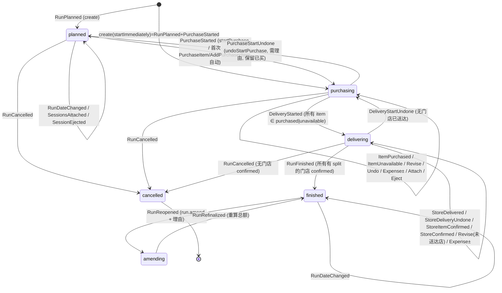
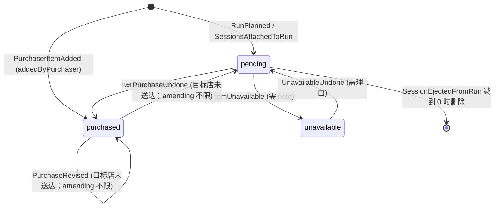
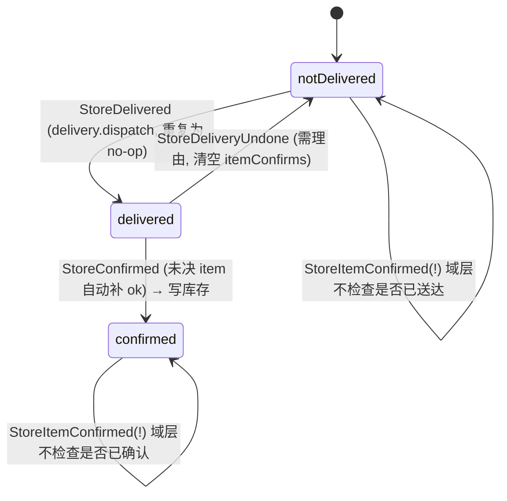
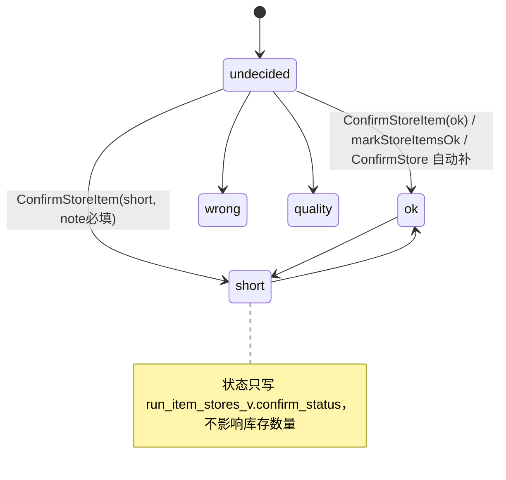

# Track C 审计报告：采购单 Run → 配送 → 门店收货确认 → 库存投影

审计对象：CompassAlpha monorepo，HEAD `c49ba3e`。只读审计，未修改仓库、未访问网络/数据库。
证据标注：**已确认事实**（读到代码）/ **高可信度推断**（多处代码合推，未运行验证）/ **待验证**（说明缺什么）。
行号均为本次实际读取的文件行号。

---

## 1 范围与已读文件清单

完整阅读：
- `packages/domain/src/run/state.ts`（1-528）、`events.ts`（1-360）、`commands.ts`（1-1328）
- `apps/api/src/trpc/routers/run.ts`（1-3659，全文分段读）
- `apps/api/src/services/runProjection.ts`（1-723）
- `apps/api/scripts/reproject.ts`（1-298）
- `apps/web/src/pages/RunPage.tsx`（1-2377）
- `apps/web/src/pages/ConfirmPage.tsx`（1-629）
- `packages/contracts/src/schemas/run.ts`（1-281）、`delivery.ts`（1-44）
- `apps/api/src/services/eventStore.ts`（1-89）
- `apps/web/src/hooks/usePhotoUploader.ts`（1-37）
- `apps/web/src/pages/runs/lib/splitQty.ts`、`runProgress.ts`

部分阅读（按需定位）：
- `apps/web/src/pages/runs/components/RunPanels.tsx`（104-826 ActiveRunPanel 全段；1487-1530 预览卡；1973-2030 SessionsCard）
- `apps/web/src/pages/runs/views/RunViews.tsx`（PurchaseRow 1080-1600 + 交互 grep；ExpensesCard 780-805）
- `apps/web/src/pages/runs/sheets/RunSheets.tsx`（AddItemSheet 505-760、845-1020；PurchaseSheet 124-150、355-376）
- `apps/web/src/pages/runs/history/RunHistory.tsx`（reopen/changeDate 354-420、640-690）
- `apps/api/src/services/notifyForEvent.ts`（130-330）、`notify.ts`（169-200）
- `apps/api/src/trpc/trpc.ts`（idempotency 175-298）
- `apps/worker/src/main.ts`（540-720 claim 超时 + orphan 修复）
- `apps/web/src/hooks/useRealtime.ts`（15-150）、`apps/api/src/realtime/hub.ts`（1-105）
- `packages/db/src/seed-data.ts`（90-200 内置角色）、`packages/db/src/schema/readModel.ts`（140-300 列精度）
- `packages/db/migrations/0015_inventory_movements.sql`（60-64）、`0030_run_expenses.sql`、`0035_one_active_run_per_org.sql`（46-48）
- `packages/i18n/src/catalogs/zh.ts`（部分 key）
- 测试：`packages/domain/src/run/run.test.ts`（用例清单）、`apps/api/src/__tests__/{cancel-run-cascade,full-lifecycle,duplicate-purchases,run-input-schemas}.test.ts`（用例清单/片段）、`tests/e2e/tests/main-flow.spec.ts`（95-200）

未读：`RunViews.tsx` 中 PerStoreView/PerVendorView/PerCategoryView 内部实现细节、`RunHistory.tsx` 列表部分、`HistoryPage.tsx`、`order` 域命令（AttachToRun/EjectFromRun/Archive 的前置条件）、`report.ts`。

---

## 2 模块业务说明与角色

### 2.1 业务目的
采购员（purchaser）把各门店已审批（`approved`）的订货单（order session）合并成一张“采购单 Run”，去市场按摊位/类别采购，逐项记录实际数量、单价、付款方式（现金/转账）、无货、额外开销与小票照片；随后进入配送阶段逐店“送达”，门店员工在 ConfirmPage 逐项核对（正常/数量不足/物品错误/质量问题）并“确认收货”，确认时投影写入库存流水（`inventory.movements`，reason=`delivery_received`）；全部门店确认后采购员“结束采购”，冻结金额、归档订单。超级管理员可对已结束的 Run 重开（amending）修正后再冻结，并可改记账日期。

### 2.2 角色与权限（后端 vs UI）
内置角色（`packages/db/src/seed-data.ts:92-200`，已确认）：
| 角色 | 与本模块相关权限 |
|---|---|
| super_admin | 全部（含 `run.amend`） |
| admin | 全部除 `run.amend`/impersonate/purge（105-113） |
| manager | **无** `delivery.confirm`、无 `run.*`（119-147） |
| purchaser | `run.create, run.purchase, run.eject_session, run.finish, delivery.dispatch, prices.view`（154-161） |
| staff | `delivery.confirm` 等（176-184） |

命令级后端校验（已确认，均在 `commands.ts` 的 decideRun）：
| 操作 | 域权限 | 路由层附加校验 |
|---|---|---|
| PlanRun / create | `run.create`（199） | `resolveRunCreateStoreScope` + `assertStoreIdsWithinRunCreateScope`（run.ts 731-735） |
| StartPurchase / PurchaseItem / AddPurchaserItem / MarkUnavailable / Revise / Undo / Unmark / AddExpense / RemoveExpense / StartDelivery | `run.purchase` | `runSimpleCommand` → `assertRunPermissionForAllStores(…,'run.purchase')`（run.ts 3440-3449） |
| DeliverToStore / UndeliverStore | `delivery.dispatch`（594、1001） | 按目标店计算 effectivePerms，`skipRunPermissionScope`（2607-2635、3060-3083） |
| ConfirmStoreItem / markStoreItemsOk / ConfirmStore | `delivery.confirm`（615、662） | `assertActorAssignedToStore` + effectivePerms（2637-2765） |
| FinishRun | `run.finish`（717） | `assertRunPermissionForAllStores(…,'run.finish')`（2816） |
| CancelRun | `run.create`（760） | `assertRunPermissionForAllStores(…,'run.create')`（3153） |
| AttachSessions | `run.create` 或 `run.create.org`（1031-1036） | `assertRunCreateScopeForRun`（919） |
| EjectSession | `run.eject_session`（1070） | `assertActorAssignedToStore` + effectivePerms（3280-3298） |
| Reopen / ChangeDate | `run.amend` | `requireGlobalAmend`（必须是持久化 GLOBAL 授权，3013-3047、3599-3618） |
| Refinalize | `run.amend` | 状态 amending 时 `assertCanAmendRun`（3440-3441） |
| claim / releaseClaim | `run.purchase` | 无 UI 调用（见 §7） |

UI 侧门控（已确认）：Run 标签需 `run.purchase`（`Shell.tsx:72`）；Confirm 标签需 `delivery.confirm`（`Shell.tsx:87`）；`canAmend` 用会话扁平权限 `run.amend`（RunPage 637）。
- 注意：store manager 没有 `delivery.confirm`，因此**店长不能确认收货**，只有 staff/admin/super_admin 能（**已确认**；是否为产品意图 **待验证**）。

### 2.3 入口
- RunPage（`/run`）：无活动 Run 时显示预览 + MainButton「开始采购」；有活动 Run 时显示对应阶段工作台。
- ConfirmPage（`/confirm`）：找出 `run.list` 中第一个 `delivering` 的 Run（ConfirmPage 94-97），显示当前门店的 split。
- RunHistory（历史标签）：已结束 Run 的明细，super_admin 可 reopen / changeDate（RunHistory 354-420、640-690）。
- 通知深链：StoreDelivered → `/confirm`（notifyForEvent 150-163）。

---

## 3 端到端流程与状态机

### 3.1 端到端调用链（以“记录一项采购”为例，已确认）
UI `PurchaseRow` ✓（RunViews 1705-1714 → `handleSave('collapsed')` 1402-1432）
→ RunPage `onSavePurchaseInline`（1859-1898，先 `withPriceCheck` 865-877）
→ `trpc.run.purchaseItem`（idempotentMutation，X-Idempotency-Key 来自 `purchaseIdemCtx` 384-409）
→ run.ts `purchaseItem`（2486-2500）→ `runSimpleCommand`（3425-3477）：`loadRun` → `readStream` → fold `applyRun` → 权限范围 → `decideRun(PurchaseItem)`（commands 239-306，planned 时连带 `PurchaseStarted`）
→ `appendEvents`（eventStore 68-89，`(stream_id, seq)` 唯一冲突 → CONFLICT `run.errors.staleSeq`，run.ts 3471-3473）
→ `projectRun`（runProjection 51-109：更新 `run_items_v`、删/插 `run_item_stores_v`、插 `price_history`）
→ `dispatchRunEventNotifications`（写 notifications + outbox，同事务，notify.ts 169-200）
→ `hub.publish('run.changed')`（**在事务提交前**，run.ts 3462）
→ 前端 `useRealtime` 400ms 防抖失效 `['run']`（useRealtime 24、125-127）+ RunPage 6s 轮询（RunPage 655-658）+ 成功 toast/haptic + 650ms 延迟失效（167-175）。
网络错误 → 进入离线队列，重放复用同一幂等键（RunPage 176-187、398-404）。

事务边界：`ctx.withOrg` 一个事务内完成 读流→决策→追加事件→投影→通知写 outbox（**已确认**）。事件与投影同事务，故一致；但 `hub.publish` 在提交前发出（**高可信度推断**存在读到旧数据的竞态，见 C-14）。

### 3.2 Run 状态机（域层，已确认，state.ts / commands.ts）

注：RunDateChanged 允许除 cancelled 外任何状态（commands 808-849）；RunClaimed/RunClaimReleased 在 planned/purchasing/delivering 内自环（但无 UI 调用）。

### 3.3 Item 状态机（已确认）

### 3.4 门店（per-store）与门店内 item 确认状态（已确认）

### 3.5 previewCreatable / create 如何选单（已确认）
- `previewCreatable`：前端调用 `useQuery({})`（RunPage 152），`input.date` 缺省 → **不按日期过滤**，返回该 org 所有 `status='approved'` 会话（run.ts 222-247），仅按权限范围过滤门店（org 级 `run.create.org` 全部门店；否则按 `run.create` 生效的门店，228、3549-3564）。
- `create`：前端提交 `previewQuery.data.sessions` 的**全部** id（RunPage 988、1002），`startImmediately:true`；服务端 `runDate = input.date ?? todayStr(ctx)`（run.ts 669），即**组织时区下的今天**（75-77），与会话 `orderDate` 无关。
- 若已有 planned/purchasing/delivering 的 Run，create 直接返回该 Run（`reused:true`，687-701），不附加任何会话；附加走 RunPage 顶部 Banner「加入」→ `attachSessions` 同样提交**全部**预览会话（RunPage 1729-1751）。
- 预览卡只显示会话数量 Badge 和“锁定”警告（RunPanels 1487、1498-1504），**不显示每个会话的 orderDate**。

### 3.6 时区 / 业务日期
`runDate` = 创建 Run 时组织时区的日期（run.ts 669、75-77）；跨天采购仍记在创建日；修正只能 super_admin 在历史页对 finished Run 调 `changeDate`（RunHistory 647-661；`historyDetail` 只接受 finished，run.ts 1610）。RunPage 的“已过 N 天”徽章用设备日期计算（RunPage 1580-1587）。

### 3.7 并发
- 同一 Run 两位采购员：域层 `assertClaimOwnership` 为空函数（commands 1309-1313），协作模式；写冲突仅靠 `(stream_id, seq)` 唯一键 → `CONFLICT run.errors.staleSeq`（run.ts 3471-3473），前端按普通错误 toast，不自动重试（RunPage 405-406）。
- `PurchaseItem` 拒绝已 purchased 的 item（commands 275-277），所以“两人同时买同一项”第二个人会得到 `itemAlreadyPurchased`。
- `expectedSeq` 字段在 contract 中存在，但服务端从不读取（`grep expectedSeq apps/api/src` 仅命中 order.ts 一处无关代码），前端也从不发送 → 无“基于客户端所见版本”的乐观并发（C-11）。
- 组织级：partial unique index `mrv_one_active_per_org_unique`（migration 0035:46-48），每个 org 同时只能有一个 planned/purchasing/delivering 的 Run（C-03）。

### 3.8 重复点击
- 域层去重：`DeliverToStore` 已送达 → `[]`（603）；`ConfirmStoreItem` 同状态同 note/photo → `[]`（637-644）；`ConfirmStore` 已确认 → `[]`（682）；`AddRunExpense` 同 expenseId → `[]`（426-428）；`ClaimRun` 已是自己 → `[]`。
- 幂等键：create / attachSessions / purchaseItem / addPurchaserItem / addExpense / finish / revisePurchase 走 `idempotentMutation`；markUnavailable / deliverToStore / confirm* / cancel 等不是（run.ts 2586、2607、2637、3141），依赖域层去重或前端 isPending。
- 前端：`create.isPending` 门控（RunPage 1001）；ConfirmPage 同 chip 二次点击直接 return（ConfirmPage 457）。

### 3.9 金额精度与币种
- DB：qty `decimal(12,3)`，unit_price `decimal(14,2)`，totals `decimal(14,2)`（readModel 列定义，已确认）。
- Contract：`PositiveDecimalStringSchema` 允许 3 位小数（common.ts 30-32），单价存入 DB 时被四舍五入到 2 位，但事件保留 3 位 → FinishRun 用事件状态算的总额与读模型逐行之和可能有分差（C-13，低风险）。
- 域层 FinishRun/计算均用 JS `Number` 浮点（commands 1254-1282），`toFixed(2)`；create/preview 聚合 qty 也用 Number 累加后 `toString()`（run.ts 741-750）。run.get 对 store-scoped 读者用 BigInt 精确十进制（89-130），口径不统一。
- 币种：会话 `member.currency`（RunPage 103）；但 zh 文案 `run.confirm.finish.summary` 写死 “UZS”（zh.ts 959 附近，已确认）。

### 3.10 收货确认写入的库存流水（已确认）
`StoreConfirmed` 投影（runProjection 241-298）：
1. 给该店所有 `run_item_stores_v` 行写 `confirmed_at/by`；
2. 读取该店所有 split（`sku_id, qty`），每行插入一条 `inventory.movements`：`delta = run_item_stores_v.qty`、`reason='delivery_received'`、`source_type='run'`、`source_id=runId`，`ON CONFLICT DO NOTHING`（唯一索引 `(source_type, source_id, store_id, sku_id)`，0015:62-64）。
3. 代码注释自承：short/wrong 状态**不**影响 delta（261-265）。
- 事件 `StoreItemConfirmed` 负载只有 `status/note/photoUrl`，**无实收数量字段**（events.ts 75-84；contract delivery.ts 12-21）。
- `confirm_status/confirm_note/confirm_photo_url` 除 ConfirmPage 本身外**无任何消费者**（grep api/web/worker 仅命中 runProjection.ts 与 ConfirmPage.tsx）。

---

## 4 页面/交互档案

### 4.1 RunPage（`apps/web/src/pages/RunPage.tsx`）
全局：sticky 条（#序号 · 日期 · 阶段 + 过期天数徽章，1634-1708）；Telegram 齿轮菜单 `usePageMenu`（1535-1564）：「回到计划」(purchasing)、「回到采购」(delivering 且无门店已送达)、「取消采购单」(总是显示)；统一 MainButton 调度（1493-1527）：ConfirmSheet > 表单 Sheet > 页面级按钮。

| 状态 | 区块 / 控件 | 动作 → 过程 |
|---|---|---|
| 无活动 Run | PreviewSummaryCard：搜索框、按门店/按摊位切换、复制清单、改首选供应商、锁定警告 Banner | `setSkuPreferredSupplier`；MainButton「开始采购」→ `run.create({sessionIds: 全部, startImmediately:true})`（986-1006，离线时禁用） |
| planned | 「有 N 个新审批订单」Banner +「加入」（1729-1755） | `attachSessions`（全部预览会话） |
| planned/purchasing | RunSessionsCard（每个会话 × 移出） | ConfirmSheet（可选理由）→ `ejectSession` |
| planned | PreviewSummaryCard（适配 run.get，1811-1846） | MainButton「开始采购」→ ConfirmSheet → `startPurchase` |
| purchasing/amending | sticky「+ 新增」→ AddItemSheet（SKU 模式/开销模式、模板、门店选择、合并/独立成本、理由、小票照片） | `addPurchaserItem` / `purchaseItem` / `revisePurchase` / `addExpense`（2163-2286） |
| purchasing/amending | 视图切换 chip：按门店/按摊位/按类别（RunPanels 380-474） | 纯前端 |
| purchasing/amending | ≥8 项时搜索 + 过滤 chip（全部/待处理/无货）（509-549） | 纯前端 |
| purchasing/amending | PurchaseRow 折叠态：有参考价 → 单击 ✓ 一键保存（现金）；整行点击展开编辑器（qty、price、K·UZS/UZS 切换、现金/转账、✓）；「无货」链接 | `purchaseItem`（按需求比例自动分配 split）；价格偏离 5× → PriceCheckSheet；无货 → Sheet 填理由 → `markUnavailable` |
| purchasing/amending | 已买行：点行 → PurchaseSheet（编辑需理由，按店 split / 按店单价与付款、供应商、小票、撤销）；付款方式按钮 | `revisePurchase`（理由用固定文案）/ ConfirmSheet → `undoPurchase` |
| purchasing/amending | 无货行「恢复」 | ConfirmSheet（必填理由）→ `unmarkUnavailable` |
| purchasing/amending | RunExtrasCard：员工“其他物品”状态循环、记为开销 | `order.markExtraStatus` / AddItemSheet(开销) |
| purchasing/amending（+ 其他阶段有开销时只读） | ExpensesCard：✗ 删除（**无确认**）、添加开销 | `removeExpense({reason:''})`（2029-2035）/ AddItemSheet |
| purchasing | MainButton：未处理完 →「剩 N 项」(滚动到下一个待处理)；处理完 →「开始配送」→ ConfirmSheet | `startDelivery` |
| delivering | 门店列表：未送达点行 → ConfirmSheet → `deliverToStore`；已送达点行 → ConfirmSheet(必填理由) → `undeliverStore`；已确认只读（RunPanels 659-728） | |
| delivering | 不显示 item 列表（`plannedOrEditing` 为 false，RunPanels 324、480） | |
| delivering | MainButton「结束采购」仅在所有门店确认后显示 → ConfirmSheet（总额含开销、现金/转账、追加项、开销、沿用旧价计数、各店小计） | `finish` |
| amending | 警告 Banner；编辑面同 purchasing；MainButton「重新冻结」→ ConfirmSheet（显示不含开销的总额） | `refinalize` |
| 任意活动态 | 齿轮「取消采购单」→ ConfirmSheet（可选理由） | `cancel`（若有孤儿会话 toast 提示） |

### 4.2 ConfirmPage（`apps/web/src/pages/ConfirmPage.tsx`）
| 元素 | 行为 |
|---|---|
| 未选具体门店 | EmptyState 提示去设置里选店（311-337） |
| 无 delivering Run | EmptyState（355-359） |
| sticky 条 | 显示 Run 日期（344-353） |
| 进度行「已核对 x/y」+「全部无误」按钮 | 打开 bulk Sheet → 「标记 n 项为正常」→ `markStoreItemsOk`（只改未决项，242-252、530-553） |
| 每项 ChipBar（正常/数量不足/物品错误/质量问题） | 正常：乐观写缓存 + `confirmStoreItem(ok)`；其他：打开 issue Sheet（备注必填、照片可选），保存（footer 按钮或 MainButton）→ `confirmStoreItem` |
| 每项下方 | 显示已存备注（不显示照片，504-508） |
| MainButton | 未全部决定：「还有 n 项待核对」（禁用）；全部决定：「确认收货」→ `confirmStore`；已确认后隐藏（290-309） |
| 离线 | 三个 mutation 均入离线队列重放（70-92） |
注意：列表 `myItems` 只按 storeId 过滤（209），**不看 deliveredAt**，采购员进入 delivering 后、尚未“送达”本店前，门店即可看到并逐项核对（C-08）。

---

## 5 操作繁琐点（当前 vs 建议，含点击数）

### 5.1 场景 A：采购员开始一张 Run 并采购 30 项（假设 3 家门店）
当前（已确认，基于 RunPage/RunViews/RunPanels 交互）：
| 步骤 | 点击 |
|---|---|
| 打开 Run 标签 | 1 |
| MainButton「开始采购」（无确认） | 1 |
| 30 项（有参考价且不变）：每项点 ✓ | 30 |
| 或 30 项（需改价/无参考价）：点行展开 + 输价格 + Enter/✓ | 2×30=60 + 30 次输入 |
| 若转账：每项 +1；若价格异常：+1 确认 | +0~60 |
| 「开始配送」+ 确认 | 2 |
| 每店「送达」+ 确认（3 店） | 6 |
| 等待各店确认后「结束采购」+ 确认 | 2 |
| **合计** | **最好 42；典型（全部改价）72 + 30 次输入** |

建议：
1. 配送阶段提供「全部门店已送达」批量动作（一次确认）：6 → 2。
2. 结束采购不必强依赖每店人工确认：允许“到时自动确认/管理员代确认”或“最后一店确认后自动结束”：−2 且避免阻塞（与 C-03 一起解决）。
3. 按摊位视图提供「本摊位全部按参考价买入」批量 ✓（带价格偏离检查）：N 项 → 1+异常项。
4. 小票照片按摊位/按 Run 拍一次，而不是只能在“编辑已买项（需理由）”里加（见 C-17）。

### 5.2 场景 B：门店确认 20 项送货，其中 1 项数量不足
当前（已确认）：
| 步骤 | 点击 |
|---|---|
| 打开 Confirm 标签（已选门店） | 1 |
| 短缺项点「数量不足」 | 1 |
| 点备注框 + 输入原因 | 1 + 输入 |
| 保存 | 1 |
| 「全部无误」 | 1 |
| Sheet「标记 19 项为正常」 | 1 |
| MainButton「确认收货」 | 1 |
| **合计** | **7 次点击 + 1 次输入**（若逐项点正常则 1+19+3+1=24） |

问题：没有“实收数量”输入，短缺只是一个标签 + 文字，库存仍按全量入账（C-01）。
建议：
1. 「数量不足」Sheet 增加实收数量（默认送货量，数字键盘），写入事件并用于库存 delta。
2. 「其余全部正常并确认收货」合并为一个带确认的动作：7 → 5。
3. 问题项自动通知采购员/店长，并在 RunPage 配送列表与历史中可见（当前无消费者）。

### 5.3 其他繁琐点
| 现状 | 证据 | 建议 |
|---|---|---|
| 给目录商品加小票只能“编辑已买项”且必须填理由 | RunPage 927、1893（内联保存永远 `receiptPhotoUrl:null`） | 已买行提供“附小票”轻操作，不走 revise 理由 |
| 多店员工每次需在设置中切换门店才能确认 | ConfirmPage 50-51、311-337 | Confirm 页内显示“待我确认的门店”列表 |
| 删除开销一击即删，无撤销 | RunViews 792-800 | 确认或 toast 撤销 |
| 取消菜单在不可取消时仍显示（已有确认门店/amending） | RunPage 1556-1560 vs commands 757-768 | 按状态隐藏或禁用并说明 |

---

## 6 重复功能 / 逻辑

| ID | 重复内容 | 证据 | 风险 |
|---|---|---|---|
| D-1 | 会话 notes/extras/perStoreDemand/首选供应商 SQL 在 previewCreatable 与 run.get 两处手工同步（注释自承 “kept in sync manually”） | run.ts 446-501 vs 1974-2128；392-404 vs 2210-2221 | 漂移 |
| D-2 | store-scoped 脱敏（splits 解析、plannedQty/purchasedQty 改写、supplier/receipt 隐藏）在 run.get 与 historyDetail 各一份 | run.ts 1722-1777 vs 2143-2185 | 漂移导致泄漏 |
| D-3 | create 与 attachSessions：会话校验 + item 聚合 + 逐会话 AttachToRun 循环几乎逐行重复 | run.ts 711-750/832-861 vs 935-971/1004-1028 | 一处修复另一处遗漏（attach 已缺少 hub.publish，C-09） |
| D-4 | “总额”有 6 种算法/口径：域 computeRunTotals（仅商品）、run.list JS 浮点（仅商品）、run.history SQL（商品+开销）、run.get 精确十进制（仅商品）、RunPage finishSummary（商品+开销）、refinalize Sheet（商品，减开销） | commands 1254-1282；run.ts 1108-1142、1332-1375、2383-2397；RunPage 757-842、1316-1326 | 用户看到的结束总额 ≠ 冻结的 actual_total（C-07） |
| D-5 | ConfirmPage issue 保存的 mutate 代码在 MainButton 与 Sheet footer 各写一遍 | ConfirmPage 265-283 vs 587-605 | 低 |
| D-6 | RunPage 的 DeliverToStore/markUnavailable 等 Sheet 主按钮与 MainButton 双实现（为 Telegram 外兼容） | RunPage 1126-1140 vs 2325-2343 | 低 |
| D-7 | split 计算：前端 proportional/even split（splitQty.ts）与 AddItemSheet combinedQty 自行累加（RunPage 2223-2225） | | 低 |

---

## 7 疑似无效 / 不可达代码

| 项 | 证据 | 结论 |
|---|---|---|
| `run.claim` / `run.releaseClaim` 过程 | run.ts 2445-2474；`grep "run\.claim\b\|run\.releaseClaim"` apps/web 0 命中；RunPage 584-589 注释说明前端已删 | **已确认**无前端调用方（外部客户端是否调用 **待验证**） |
| 域层 claim 强制 | `assertClaimOwnership` 空函数（commands 1309-1313），所有调用点为 no-op | **已确认** |
| worker 超时释放 claim（`RunClaimReleased timeout`） | worker main.ts ~540-610，候选需 `claimed_by_member_id` 非空，而唯一写入方是无调用方的 `claim` | **高可信度推断**实际永不触发 |
| run.get 返回 `claimedByDisplayName/previousClaimerDisplayName/claimedAt` | run.ts 2316-2342、2431-2433；web 无引用 | **已确认**前端未使用 |
| `RunPlanned` 通知分支 | notifyForEvent 139-149；create 刻意不 dispatch（run.ts 874-877） | **已确认**不可达 |
| `RunCancelled` 通知分支 | notifyForEvent 196-210；cancel 过程不调用 dispatch（run.ts 3141-3263 无调用） | **已确认**不可达（属缺陷，C-09） |
| contract `expectedSeq` 字段（所有 run/delivery 输入） | contracts run.ts 108/128/154/161/168/173/185，delivery.ts 9/20/26/38；服务端不读、前端不发 | **已确认**无效字段 |
| `RunViewSchema` / `RunItemViewSchema` / `DeliveryViewInputSchema` | 仅定义文件自身引用 | **已确认**未被使用 |
| `market_runs_v.planned_total` | 投影从不写入；只在脱敏时置 null（run.ts 1173、2403） | **已确认**恒为 NULL |
| PurchaseRow 文档“qty 不同则显示 more options 链接” | RunViews 1115-1121；实际只在无需求数据时 fallback 打开 sheet（1413-1419） | **已确认**注释过时 |
| AddExpense 注释/contract 称 >200k 必须小票 | run.ts 2547、contracts run.ts 138-141、RunSheets 560-561；域层已删除该门槛（commands 462-466） | **已确认**注释过时 |
| `runInvolvedStoreIds` 注释称被移出会话仍保留在 JSON | run.ts 3490-3495；投影实际移除（runProjection 632-640） | **已确认**注释过时；后果：移出后该店失去对该 Run 的读可见性 |
| ConfirmPage 头注释 “photo capture stub is a text URL” | ConfirmPage 8-9；实际已用 PhotoCapture + presign | **已确认**过时 |
| ConfirmPage 449-452 注释 “API will reject confirmStoreItem after StoreConfirmed” | 域层无此检查（commands 613-658） | **已确认**注释错误（C-08） |
| `previousClaimerMemberId` 投影/状态维护 | 只在 claim 流程中有意义 | **高可信度推断**无效 |

---

## 8 缺陷与风险

> 优先级为建议值：P0 数据损坏/资金错误且高发；P1 业务结果错误或阻塞主流程；P2 可能导致错误数据但需特定操作；P3 一致性/体验/维护性。

### C-01（P1）收货“数量不足/错误/质量”不影响库存，且问题无人可见
- 证据（已确认）：runProjection 241-298（delta=split.qty；261-265 注释承认未实现）；events.ts 75-84 与 delivery.ts 12-21 无实收数量；confirm_status/note/photo 无消费者（grep）；notifyForEvent 212-216 注明 StoreItemConfirmed/StoreConfirmed 无通知；ConfirmPage 504-508 只显示备注不显示照片。
- 影响：短缺/错货/坏货按全量入库，库存虚高；问题反馈不到采购员/店长，Run 结束后（ConfirmPage 只看 delivering）问题记录在 UI 上完全消失。
- 修复：`ConfirmStoreItem` 增加 `receivedQty`（short 必填，wrong/quality 可选 0），新事件版本；`StoreConfirmed` 投影用 receivedQty（或额外写一条负向 `delivery_shortfall` movement 以保留审计）；StoreItemConfirmed(非 ok) 通知采购员与店长；RunPage 配送列表与历史明细显示问题项。
- 回归测试：PG 测试“短缺项确认后 movements.delta=实收”；domain 测试 receivedQty 校验；投影重放幂等；e2e 一项短缺。

### C-02（P1）开始采购/加入时无差别合并所有历史已审批订单，日期记为今天
- 证据（已确认）：RunPage 152（`previewCreatable.useQuery({})`）、986-1002（提交全部 session）、1729-1751（attach 全部）；run.ts 222-247（无 date 则不过滤日期）、669（runDate=今天）；RunPanels 1487-1504 只显示数量与警告，不显示订单日期。
- 影响：前几天遗留的已审批订单（如审批后未采购、Run 取消后退回的订单）被静默并入今天的采购，导致重复采购或过期需求；花费记到今天。
- 修复：预览按 orderDate 分组并高亮非今日订单；允许勾选会话/门店；create 默认只包含今天（或可配置窗口），旧单需显式选择；runDate 可在开始时选择。
- 回归测试：PG：存在昨日已审批会话时 preview 标注、create 默认排除；e2e 勾选流程。

### C-03（P1）每 org 只能有一个活动 Run，叠加“结束需所有门店确认”，造成跨门店/跨采购员阻塞
- 证据（已确认）：migration 0035:46-48；run.ts 687-700（返回已存在 Run）；3579-3590（store-scoped 采购员对别人 Run 抛 notVisible）；commands 724-734（Finish 需所有门店确认）；commands 1037-1041（delivering 不能 attach）。
- 影响：(a) 只绑定门店 B 的采购员在门店 A 的 Run 未结束时无法开始任何采购（预览可见，点击即报错）；(b) Run 进入 delivering 后，新审批订单既不能加入也不能开新 Run，必须等每个门店员工确认收货并结束；某店迟迟不确认会卡住全组织采购。
- 修复：唯一约束改为按“采购范围/采购员”或仅约束 planned/purchasing；或允许 delivering 期间开新 Run；为“未确认门店”提供超时自动确认或管理员代确认后结束。
- 回归测试：PG：A 店 Run 在 delivering 时 B 店采购员可创建；store-scoped 并行创建。

### C-04（P2）PurchaseItem/RevisePurchase 不校验 split 门店是否属于本 Run
- 证据（已确认）：commands 239-306、877-938 无门店范围检查（对比 AddPurchaserItem 359-383、AddRunExpense 446-461 有）；PurchaseSheet 候选门店为所有 `run.purchase` 门店（RunSheets 144、376；RunPage 156）；fallback 用 `storesQuery.data[0]`（RunPage 1977-1980）；DeliverToStore 也不校验门店（commands 592-611）。
- 影响：货物可分配给未下单的门店；该店员工通过 run.list 看不到该 Run（run.list 按会话门店过滤，run.ts 1068-1074），无法确认 → FinishRun 永远被该店阻塞（只能 org 管理员代确认）；库存记到错误门店。
- 修复：在域层统一 `assertSplitsWithinRunStores`；PurchaseSheet 只列 Run 涉及门店。
- 回归测试：domain：PurchaseItem/Revise 对非本 Run 门店抛 storeNotInRun。

### C-05（P2）AddItemSheet“合并到原行”对待处理项会丢弃其他门店需求（高可信度推断）
- 证据：RunPage 2191-2239：`existingSplits` 取自 `run.splits`，待处理项尚无 split → `combinedSplits` 只有新门店；随后 `purchaseItem` 把整行标为 purchased。RunSheets 961-965 允许对“无需求的门店”选择“合并”；1012-1014 仅在门店已有需求时强制独立成本。
- 影响：例：SKU H 由 A 店订 5kg（待买），采购员用“+新增”为 C 店合并 2kg → H 变为 purchased（仅 C 2kg），A 的 5kg 需求无提示地消失，StartDelivery 也不会拦截。
- 修复：待处理项合并时以 `perStoreDemand` 作为基础 split，或改为打开 PurchaseSheet 预填全部门店；domain 可选校验 “purchased qty 覆盖了哪些需求店”。
- 回归测试：前端单测 onSubmit 路由；e2e。

### C-06（P2）amending 修正已确认门店的数据不会调整库存，并重复写 price_history
- 证据（已确认）：amending 时 Revise/Undo 跳过送达检查（commands 899-908、960-969），PurchaseItem 允许（251-265）；库存只在 StoreConfirmed 写入且 ON CONFLICT DO NOTHING（runProjection 266-295；0015:62-64）；PurchaseUndone 删除 split 行（517-524），PurchaseRevised 每次插 price_history（490）。
- 影响：超级管理员修正数量后，采购记录与库存不再一致；amending 中新补录的项对已确认门店永远不入库；price_history 产生修正噪声，影响下次参考价。
- 修复：amending 期间对已确认门店的数量变化写 `adjustment` movement（delta = new − old）；price_history 对 revise 替换而非追加或标记 superseded。
- 回归测试：PG：reopen→revise qty→refinalize 后 SUM(delta) 等于新 qty。

### C-07（P2）“总额”口径不一致：结束确认看到的总额 ≠ 冻结的 actual_total
- 证据（已确认）：computeRunTotals 不含开销（commands 1246-1282）；RunPage finishSummary 含开销（786-800、1299-1303）；refinalize Sheet 显式减开销（1316-1326）；run.history SQL 含开销（run.ts 1346-1365），run.list 不含（1108-1142）；RunFinished 通知用不含开销的 totalActual（notifyForEvent 174）；文案写死 UZS。
- 影响：采购员在结束 Sheet 确认的金额、通知里的金额、历史页金额、报表 actual_total 各不相同；对账困难。
- 修复：定义单一“Run 结算总额”（商品+开销）并在域事件中分别记录 itemsTotal/expensesTotal；所有界面引用同一字段。
- 回归测试：domain FinishRun 含开销；e2e 结束 Sheet 与历史金额一致。

### C-08（P2）收货确认服务端缺少状态守卫；前端“必须逐项核对”可被绕过
- 证据（已确认）：ConfirmStoreItem 不检查 deliveredAt / confirmedAt / sku 是否属于该店（commands 613-658）；ConfirmStore 自动为未决项补 ok（692-706，run.test 1603 有测试固化）；ConfirmPage 列表不看 deliveredAt（209），449-452 注释错误。
- 影响：门店可在货未送达前就核对；已确认后仍可通过 API 改项目状态（不影响库存，造成记录与库存不一致）；离线队列重放或旧客户端直接调用 confirmStore 会把未看过的项记为“正常”。
- 修复：ConfirmStoreItem 要求已送达且未确认、sku 在该店 split 中；ConfirmStore 要求所有项已决（或保留自动 ok 但事件标注 `autoOk`）；ConfirmPage 只显示已送达门店的项。
- 回归测试：domain 三个守卫；markStoreItemsOk 未送达时报错。

### C-09（P2）取消 Run 不通知门店；attachSessions 不广播
- 证据（已确认）：cancel 过程无 dispatchRunEventNotifications（run.ts 3167-3176），而 notifyForEvent 196-210 专为此写了分支；attachSessions 返回前无 hub.publish（run.ts 1030-1035），与 863-866 注释描述相悖。
- 影响：已收到“货已送达”的门店不知道 Run 被取消；被并入 Run 的订单在其他客户端（订单/审批页）不刷新，仍显示可操作。
- 修复：cancel 内追加 dispatch；attach 后 publish run.changed + order.changed。
- 回归测试：PG：cancel 后 notifications 有 run.cancelled 行。

### C-10（P2）worker 孤儿修复会把“已结束 Run”的会话退回 approved（高可信度推断）
- 证据：worker main.ts 615-714：条件 `run.status IN ('cancelled','finished')`，统一写 `EjectedFromRun` 并置 `status='approved'`。
- 影响：若某 finished Run 存在 in_run 会话（历史数据或未来回归），这些已采购、已入库的订单会回到 approved，并被 C-02 的“全部历史”预览并入下一次采购 → 重复采购。finish 本身是原子的（run.ts 2910-2923），触发概率低。
- 修复：finished 的孤儿应 Archive 而非 Eject。
- 回归测试：worker 单测两种 run 状态分别得到 archived/approved。

### C-11（P3）无客户端版本并发控制
- 证据：expectedSeq 未使用（§7）；revise/undo 仅受 item 状态约束。
- 影响：两名采购员先后编辑同一已买项，后者用陈旧表单覆盖前者，无冲突提示。
- 修复：服务端在提供 expectedSeq 时比较 `state.seq`；前端发送 run.get 的 lastSeq。

### C-12（P3）按比例分配忽略 SKU 步长
- 证据：splitQty.ts 83-110 统一 3 位小数；RunViews 1365-1366、1413。
- 影响：按个/把计的商品被分成 0.667 个送往门店，库存出现小数。
- 修复：按 sku.step 取整，余数给最大需求店。

### C-13（P3）精度
- 证据：contract 单价 3 位小数 vs DB 2 位；JS 浮点聚合（run.ts 741-750，commands 1254-1282）。
- 修复：单价 schema 限 2 位（或按币种）；统一 decimal 库。

### C-14（P3）实时广播在事务提交前发出
- 证据：run.ts 3462（withOrg 回调内）；客户端 400ms 防抖（useRealtime 24）。
- 影响：慢提交时客户端可能取到旧数据，需等 6s 轮询。修复：提交后发布（afterCommit hook）。

### C-15（P3）删除开销无确认/撤销 —— RunViews 792-800、RunPage 2029-2035。

### C-16（P3）deliverToStore 成功无 toast/haptic（RunPage 490-493），与其他动作不一致。

### C-17（P3）小票照片：可选、难以附加、S3 未配置时以 data: URI 存入事件
- 证据：contracts run.ts 104-105（≤300KB 字符串，接受 data:）；usePhotoUploader 24-25（未启用 S3 则 undefined → data URI）；内联保存固定 null（RunPage 1893）；照片通过 publicUrl 存储（s3.ts 142-148，桶是否公开 **待验证**）。
- 影响：审计证据缺失；事件表膨胀。修复：强制 S3 / 后端只接受本桶 URL；提供轻量附小票入口。

### C-18（P3）reproject 未覆盖库存流水
- 证据：reproject.ts 160-178 截断 run 读模型与 price_history，但 movements 不截断；依赖 ON CONFLICT DO NOTHING。replay 时 `actorMemberId:null`（275）。
- 影响：若库存流水被误删/损坏，reproject 会补回，但已有错误行（如 duplicate-purchases 测试提到的 phantom receipt）不会被修正。属运维风险。

### C-19（P3）取消入口不按状态隐藏（RunPage 1556-1560），amending/已有确认门店时点击才报错。

### C-20（P3）ConfirmPage issue Sheet 取消后备注残留到下一次（565-566 只清 issueOpen；60-61 状态仅在成功时重置）。

---

## 9 旧报告声明核验

| # | 声明 | 结论 | 证据 |
|---|---|---|---|
| 1 | StoreConfirmed 投影按 `run_item_stores.qty` 全量入库，即使短缺/错误/质量 | **CONFIRMED** | runProjection 241-298（行号略大于声称的 241-286，insert 在 278-295）；delta=`sp.qty`（286）；注释 261-265 明确未处理；实收数量**没有任何存储位置**：事件 payload（events.ts 75-84）、contract（delivery.ts 12-21）、读模型列（confirm_status/note/photo，projection 224-238）均无 qty 字段 |
| 2 | RunPage 预览不带日期调用 previewCreatable；create 提交所有未入 Run 的已审批会话，无日期/门店/批次选择，旧单静默合并 | **CONFIRMED** | RunPage 152、986-1002；run.ts 222-247、669；补充：attach Banner 同样提交全部（RunPage 1729-1751）；门店范围仍按权限过滤（run.ts 228），但用户无法选择 |
| 3 | RunPage.tsx:584-590 注释称前端 claim/release/banner 已删，服务端 claim 过程保留 | **CONFIRMED** | RunPage 584-589；run.ts 2445-2474；web grep 0 调用；域层 assertClaimOwnership 已是 no-op（commands 1309-1313）；worker 超时释放仍存在 |
| 4 | Run 日期修改仅超级管理员；删除开销/改日期从未使用 | **PARTLY** | “仅超级管理员”成立：`run.amend` 只授予 super_admin（seed-data 105-113），且要求持久化全局授权（run.ts 3035-3046、3599-3618）。“从未使用”**不成立**：changeDate 在 RunHistory 647-661 有 UI；removeExpense 在 ExpensesCard ✗ 按钮（RunViews 792-800 → RunPage 2029-2035）。补充：改日期仅对 finished Run 可见（historyDetail 只接受 finished，run.ts 1610），活动 Run 无 UI 修改入口 |
| 5 | 小票照片上传存在但可选 | **CONFIRMED** | 商品：contract `receiptPhotoUrl` nullable（run.ts 105），内联保存永远 null（RunPage 1893），仅 PurchaseSheet/AddItemSheet 可附（RunSheets 355-359、1249-1261）；开销：>200k 门槛已删（commands 462-466），UI 标“可选”（RunSheets 1252）；收货问题照片也可选（ConfirmPage 619）且从不显示 |

---

## 10 未覆盖范围

- order 域 `AttachToRun / EjectFromRun / Archive` 前置条件未读；create 中未包 try/catch 的 decideOrder（run.ts 838-847）若抛错的表现 **待验证**。
- `PerStoreView / PerVendorView / PerCategoryView` 内部（例如按摊位视图传入 supplierId 的细节）与 RunHistory 列表、HistoryPage 未全读。
- `report.ts` 等对 `actual_total` 的下游使用未读，C-07 对报表的影响 **待验证**。
- idempotency 中间件在错误（如 CONFLICT）时是否缓存结果未读完（trpc.ts 213-297）。
- `assertActorAssignedToStore` / `getActorStoreIdsForPermission` 的具体实现（org 管理员是否能代任意门店确认）未读，C-03/C-04 中“管理员代确认”的可行性 **待验证**。
- S3 桶 ACL、publicUrl 是否公开可读 **待验证**。
- 未运行任何测试或应用；所有结论为静态阅读所得。
