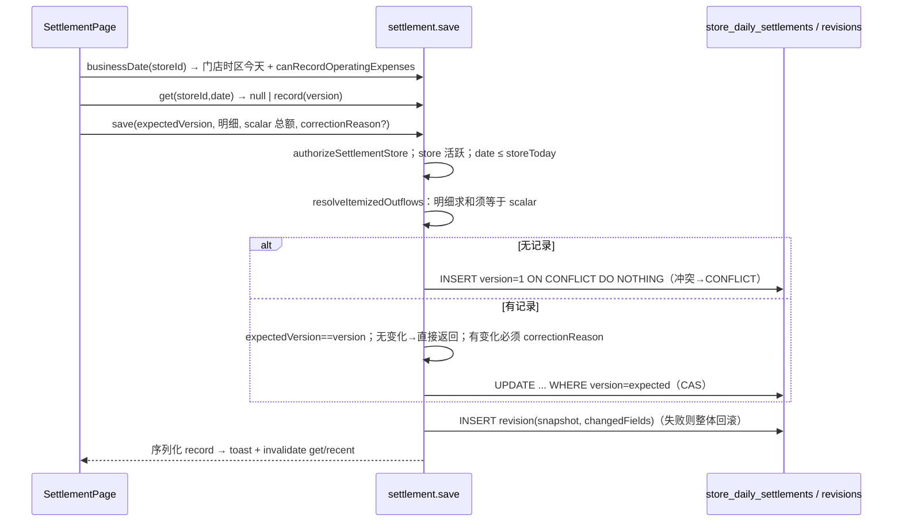
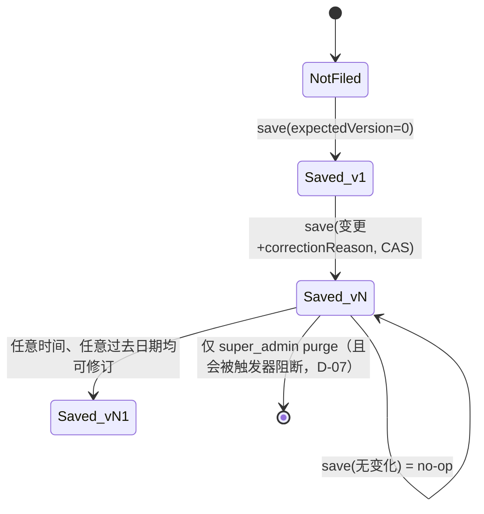

# Track D 审计报告 — 库存 / 菜品配方 / 销售 / 日结 / 历史与财务

仓库：`/Users/sphinx/Desktop/Fine/CompassAlpha`，HEAD `c49ba3e`。只读审计，未修改任何仓库文件，未访问网络/数据库。
证据等级：**已确认事实**（读到代码直接成立）、**高可信度推断**（代码路径清楚，但未运行验证）、**待验证**（缺少运行时/数据/产品意图信息）。

---

## 1 范围与已读文件清单

| 文件 | 读取范围 | 用途 |
|---|---|---|
| `packages/db/src/schema/inventory.ts` | 1–205, 338–372, 405–657 | stores、daily settlements(+revisions)、dishes、dish_ingredients、sales、movements、price_history、expense_templates |
| `packages/db/src/schema/readModel.ts` | grep 列定义 | run_items_v / run_item_stores_v / run_expenses_v 的价格与支付方式列 |
| `packages/db/migrations/0037_store_daily_settlements.sql` | 1–90 | CHECK 约束、revisions append-only 触发器、RLS |
| `packages/db/src/seed-data.ts` | 40–190 | 权限键与内置角色权限包 |
| `packages/contracts/src/schemas/settlement.ts` | 全文 | 日结 zod 合约 |
| `packages/contracts/src/schemas/common.ts` | 1–45 | Decimal/Date schema |
| `packages/domain/src/shared/clock.ts` | 46–58 | `todayInTz` |
| `packages/domain/src/run/commands.ts` | 752–792, 880–975 | CancelRun、RevisePurchase/UndoPurchase 在 `amending` 下的守卫 |
| `apps/api/src/trpc/routers/inventory.ts` | 全文 (304) | levels / recentMovements / stocktake / recordWastage |
| `apps/api/src/trpc/routers/dishes.ts` | 全文 (357) | 菜品与配方 CRUD |
| `apps/api/src/trpc/routers/sales.ts` | 全文 (255) | record / list |
| `apps/api/src/trpc/routers/settlement.ts` | 全文 (1025) | businessDate / wageRoster / get / recent / save |
| `apps/api/src/trpc/routers/report.ts` | 全文 (263) | Finance：purchaseLines / totals |
| `apps/api/src/trpc/routers/run.ts` | 67–76, 1185–1584 | `todayStr`、`run.history` |
| `apps/api/src/trpc/routers/catalog.ts` | 40–164 | stores 选择器、skuPriceStats |
| `apps/api/src/trpc/routers/admin.ts` | 3574–3598, 3985–4010, 4060–4110, 4200–4464, 5050–5160(grep) | skuDelete、purgeAllTestData、purgeByDate、purgeRun |
| `apps/api/src/services/runProjection.ts` | 230–375, 415–565, 680–723 | StoreConfirmed→库存入账、Reopen/Revise、price_history 写入 |
| `apps/api/src/services/storeScope.ts` | 21–57, 200–327 | 门店分配断言、门店有效权限 |
| `apps/api/src/services/priceStats.ts` | 40–140 | 价格统计 |
| `apps/web/src/app/Shell.tsx` | 1–200 | 底部 Tab 与权限门 |
| `apps/web/src/pages/AdminPage.tsx` | 85–420, 651–720 | Admin 导航层级 |
| `apps/web/src/pages/admin/stores/StoresSections.tsx` | 1–60, 300–896 | StoreDetailScreen、Inventory Tab、Sales Tab |
| `apps/web/src/pages/admin/catalog/CatalogSections.tsx` | 1200–1400 | DishesSection |
| `apps/web/src/pages/admin/operations/OperationsSections.tsx` | 大纲 + 1000–1260 | FinanceSection（及其它小节名） |
| `apps/web/src/pages/SettlementPage.tsx` | 全文 (1583) | 日结页面 |
| `apps/web/src/pages/HistoryPage.tsx` | 全文 (384) | 历史 Tab |
| `apps/web/src/pages/runs/history/RunHistory.tsx` | 1–100, 325–460, grep | 历史列表与详情 |
| `apps/web/src/pages/runs/lib/settlement.ts` | 全文 (177) | 前端采购结算金额计算 |
| `apps/web/src/lib/trpc.ts` | 170–260 | 幂等键策略 |
| `apps/web/src/lib/format.ts` | 34–127 | formatMoney / formatQty / currencyOf |
| `apps/api/src/__tests__/settlement.test.ts` | 测试名清单 | 日结测试覆盖 |
| `apps/api/src/__tests__/store-scoped-admin.test.ts` | grep 941–1240 | sales/stocktake/report 门店隔离测试 |
| `apps/api/src/__tests__/cancel-run-cascade.test.ts` | 470–500 | 取消后无库存入账 |
| `apps/api/src/__tests__/rls-isolation.test.ts` | 205–250, 433–436 | revisions 夹具与 teardown |
| `tests/e2e/tests/main-flow.spec.ts` | 200–228 | E2E 日结 |

未读：`OperationsSections.tsx` 的 Activity/History/Audit/PriceReport/Maintenance 渲染细节（仅读大纲）；`RunHistory.tsx` 460–904 的渲染部分；`admin.ts` submissionHistory 主体；i18n 文案全文。

---

## 2 模块业务说明与角色

### 2.1 角色 × 权限（内置种子，`packages/db/src/seed-data.ts:92-190`）

| 角色 (rank) | inventory.adjust | dishes.manage | sales.record | settlement.record | users.manage | prices.view |
|---|---|---|---|---|---|---|
| super_admin (100) | ✓ | ✓ | ✓ | ✓ | ✓ | ✓ |
| admin (80) | ✓ | ✓ | ✓ | ✓ | ✓ | ✓ |
| manager (60) | ✓ (`:135`) | ✗（M3.2 移除，`:136-148`） | ✓ (`:151`) | ✓ (`:152`) | ✓ (`:133`) | ✓ |
| purchaser (40) | ✗ | ✗ | ✗ | ✗ | ✗ | ✓ |
| cashier (30) | ✗ | ✗ | ✓ | ✓ (`:174`) | ✗ | ✗ |
| staff (20) | ✗ | ✗ | ✓ (`:187`) | ✗ | ✗ | ✗ |

### 2.2 模块说明 + 后端检查 vs 前端门控

| 模块 | 业务目的 | 后端检查（已确认） | 前端门控（已确认） | 备注 |
|---|---|---|---|---|
| 库存 Inventory | 按门店×SKU 的数量账本（只记数量不记成本，`inventory.ts:579-583` 注释）；on-hand = SUM(delta) | `levels`/`recentMovements`：仅 `assertActorAssignedToStore`（`inventory.ts:98-103,143-148`），无权限键；`stocktake`/`recordWastage`：`inventory.adjust` **或 `users.manage`**（`:53-60`），先 flat 集再门店有效集（`:183-209,264-282`） | 入口在 Admin（需 `users.manage`，`Shell.tsx:88`）；按钮**不**按 `inventory.adjust` 门控（`StoresSections.tsx:504-525`） | 自动入账来源：`StoreConfirmed`（`runProjection.ts:241-297`）、销售扣减（`sales.ts:177-201`） |
| 菜品/配方 Dishes | 组织级菜单 + BOM（`dish_ingredients`，qty 精度 12,4） | 写操作仅 `dishes.manage`，`users.manage` 回退已删除（`dishes.ts:100-117`）；`list` 任何登录成员 | `canManage = dishes.manage || users.manage`（`CatalogSections.tsx:1237-1239`）——**与后端不一致** | Admin → Catalog → Dishes |
| 销售 Sales | 记录"门店卖出 N 份菜品 X"，同事务按 BOM 扣减库存（`sales.ts:1-35`） | `sales.record` **或 `users.manage`**（`sales.ts:51-58`），flat + 门店有效集（`:84-110`）；`list` 仅门店分配（`:218-223`） | Sales Tab 在 Admin 内（需 `users.manage`）；`canRecord = sales.record || users.manage`（`StoresSections.tsx:671-673`） | 只有 record/list；无撤销 |
| 日结 Settlement | 门店每日现金结账：线上收入、开票现金收入、逐项经营支出、逐人工资（已付/未付）、下次采购预留、上次采购调整、留存现金；版本化 + 只追加修订快照 | 每个路由 `authorizeSettlementStore`：门店属于组织 + 分配 + 门店有效 `settlement.record`（无回退）（`settlement.ts:415-440`）；经营支出需门店最高 rank ≥ 60 或全局 org.admin（`:745-754, 873-909`） | 底部 Tab，`settlement.record`（`Shell.tsx:81-86`）；店铺选择器只列有效门店（`catalog.ts:79-101`） | 工资行**无**经理门槛（见 D-12） |
| 历史 History | 已完成采购 run 的分页历史（含拆分覆盖价与 run 费用） | `prices.view` 门店集合（`run.ts:1201-1213`） | 底部 Tab `prices.view`（`Shell.tsx:80`） | 只显示 `status='finished'`（`run.ts:1326`） |
| 财务 Finance | 按日期/供应商/门店的采购行对账 | `users.manage` + 门店范围（`report.ts:72-112`） | Admin → Operations → Finance | 计算口径与 History 不同（见 D-04） |
| 价格历史 | 每次购买写入观测值，供订单预估/审批/价格报表 | `skuPriceStats` 无权限键（`catalog.ts:139-163`） | 多处使用 | 见 D-19 |

---

## 3 端到端流程与状态机

### 3.1 采购 → 收货 → 库存 → 销售扣减（数量链路）

```mermaid
flowchart LR
  A[run.purchaseItem<br/>ItemPurchased] -->|runProjection| PH[(price_history)]
  A --> RIS[(run_item_stores_v.qty)]
  B[run.confirmStore<br/>StoreConfirmed] -->|runProjection.ts:266-295<br/>ON CONFLICT DO NOTHING| M[(inventory.movements<br/>reason=delivery_received<br/>source=run)]
  RIS -.读取 split qty.-> B
  S[StoreSalesTab 选择菜品+份数] -->|sales.record idempotentMutation| SR[sales.ts:112-207 单事务]
  SR --> SALES[(inventory.sales<br/>unit_price 快照)]
  SR -->|每个 BOM 行 delta=-(qty×qtyPerServing)| M
  ST[StoreInventoryTab 盘点/报损] -->|inventory.stocktake / recordWastage| M
  M -->|SUM delta GROUP BY sku| L[inventory.levels → Inventory Tab]
```

关键缺口（已确认）：`StoreItemConfirmed status='short'` 不影响入账量（`runProjection.ts:261-265`）；`RunReopened → PurchaseRevised/PurchaseUndone` 不调整已入账 movement（`commands.ts:895-908, 956-969` + 唯一索引 `inventory.ts:625-627`）；purge 不删 movements/sales（D-08）。

### 3.2 日结保存（金额链路）



### 3.3 日结状态机（已确认：**没有** draft/locked/reopen）



证据：表只有 `version` 字段，无 status/locked 列（`inventory.ts:93-160`）；save 只拒绝未来日期（`settlement.ts:853-859`）和归档门店（`:847-852`）。"锁定/重开"不存在——**已确认事实**。

### 3.4 销售状态

只有"已记录"一个状态；无 void/refund/edit/delete（`sales.ts:77-255`；schema 注释 `inventory.ts:499-504` 明确"更正只能靠盘点"）。

### 3.5 时区 / 营业日边界对比（重点：不一致）

| 位置 | "今天"/日期边界 | 证据 | 等级 |
|---|---|---|---|
| Run/Order 创建日期 | **组织**时区 `todayInTz(orgTimezone)` | `run.ts:75-76`, `order.ts:64-65` | 已确认 |
| Settlement | **门店**时区，回退组织时区 | `settlement.ts:767,798,845` | 已确认 |
| sales.list 默认 & 显式 from/to | **UTC** 00:00–23:59:59 | `sales.ts:224-231`（注释自承"UTC is correct-enough"），与 schema 注释 `:71`"Defaults to today (org timezone)" 矛盾 | 已确认 |
| Sales Tab "今日" 汇总 | 依赖 sales.list 默认 → UTC | `StoresSections.tsx:676,721-731` | 已确认 |
| Finance 预设（今天/昨天/本月/上月） | 设备本地时间构造后 `toISOString()` → **UTC 日期** | `OperationsSections.tsx:1044-1080` | 已确认（D-05） |
| History 预设 7/30/90 天 | **设备本地**日期 | `HistoryPage.tsx:32-44` | 已确认 |
| run.history / report 过滤 | 按 `run_date`（组织时区写入的日期字符串） | `run.ts:1255-1258`, `report.ts:134-135` | 已确认 |

结论：同一"营业日"在 5 种口径下定义不同（UTC、设备本地、设备→UTC、组织时区、门店时区）。对 UTC+5（UZS 默认币种暗示乌兹别克斯坦，`format.ts:116`，**待验证**实际部署时区）而言，本地 00:00–05:00 的销售会落入前一天的 Sales"今日"。

### 3.6 金额精度与币种

| 位置 | 方式 | 证据 |
|---|---|---|
| Settlement 服务端 | 字符串→BigInt 分，精确（`settlement.ts:94-132`），DB numeric(14,2) + CHECK ≥0（迁移 0037:17-24） | 已确认 |
| Settlement 前端摘要 | `Number()` 浮点相加（`SettlementPage.tsx:589-603`），仅展示 | 已确认 |
| formatMoney 显示 | **最多 1 位小数**（`format.ts:95-127`）→ 10.25 显示为 10.3 | 已确认（D-16） |
| sales.record 扣减量 | `Number(qtyPerServing)*Number(qty)` 浮点后 `toFixed(3)`（`sales.ts:178-184`） | 已确认；BOM 精度 4 位而 delta 3 位，小份量（如 0.0005kg×1）会被舍入为 0.001 或 0.000 |
| Sales 行合计与今日收入 | 前端 `Number` 相乘相加（`StoresSections.tsx:722-731,857-860`） | 已确认 |
| report.purchaseLines | `Number(unit_price)*Number(qty)).toFixed(2)`（`report.ts:173`） | 已确认 |
| run.history | SQL numeric 精确（`run.ts:1337,1351`） | 已确认 |
| 币种 | 仅组织级 `member.currency`，无多币种；Sales 用 `session?.member.currency ?? 'UZS'`（`StoresSections.tsx:764`），Settlement 用 `currencyOf`（`SettlementPage.tsx:366`） | 已确认 |

### 3.7 负库存

无任何防负检查：销售扣减（`sales.ts:177-201`）、报损（`inventory.ts:284-299`）都直接写负 delta；仅盘点目标要求 ≥0（`:70-72,211-217`）。UI 把 `<= 0` 一律视为"缺货"淡化（`StoresSections.tsx:483`），**不区分负数**。——已确认事实。

### 3.8 并发 / 重复提交

| 操作 | 机制 | 风险 |
|---|---|---|
| settlement.save | idempotentMutation + 客户端每次新 key（`trpc.ts:192-198`）+ CAS version + 自然键唯一 + 无变化 no-op | 稳健（已确认） |
| sales.record | idempotentMutation，但 Sales Tab **未传稳定 key**（`StoresSections.tsx:818-822`），每次请求新 key（`trpc.ts:186-190` 注释自述）；`sourceId=新 saleId`，唯一索引对重放无效 | 丢响应后用户重点 → 重复销售+重复扣减（D-09，高可信度） |
| inventory.recordWastage | 普通 `authedProcedure`，无幂等 | 重试会重复报损（高可信度） |
| inventory.stocktake | 读 SUM→插入差值，无锁 | 顺序重试天然幂等（第二次 delta=0 跳过）；但两个并发盘点会叠加（高可信度，D-17） |
| dishes 编辑 | `update` 与 `setIngredients` 是两次 HTTP、两个事务（`CatalogSections.tsx:1356-1374`），注释称"同一事务"是错误的 | 部分保存（已确认，D-14） |

---

## 4 页面 / 交互档案

### 4.1 SettlementPage（`apps/web/src/pages/SettlementPage.tsx`）

- **入口深度**：底部 Tab「日结」，`settlement.record`（`Shell.tsx:81-86`）。cashier 只有这一个 Tab → 打开 App 即在此页（0 次点击）；manager 1 次点击。
- **前置条件**：至少一个"已分配 + 门店有效 settlement.record + 活跃"门店（`catalog.ts:79-101`），否则空状态（`:747-757`）。
- **数据加载**：`catalog.stores` → `settlement.businessDate`（服务端决定"今天"与 `canRecordOperatingExpenses`）→ `settlement.get(date)` → `settlement.recent(limit 7)`；工资名册按需加载（`:377-400`）。
- **控件**：门店选择（多店时，`:698-717`）；日期（`max=businessDate`，切换时脏数据确认，`:969-985`）；收入 2 个金额；经营支出明细（仅经理，`:1066-1166`）；工资明细（员工选择 Sheet + 状态 + 金额 + 原因，`:1170-1324`）；采购预留 / 上次采购调整（带符号）（`:1329-1352`）；留存现金（`:1354-1365`）；备注；修订原因（仅已有记录且有变化时，`:1379-1394`）；汇总卡（`:1407-1433`）；最近 7 条（点击切换日期，`:1435-1485`）。
- **提交**：Telegram MainButton（`:676-688`），`canSave` 条件见 `:557-567`。
- **反馈**：成功 haptic + toast + 重新 hydrate（`:605-617`）；版本冲突 Banner + 刷新（`:1005-1017`）；其它错误统一 toast `settlement.errors.save`（`:624-625`）——不区分 manager-only / 校验错误。
- **离开保护**：店铺切换、Tab 切换、beforeunload 三处守卫（`:519-552`）。
- **缺失**：无修订历史查看（revisions 只写不读，见 D-11）；无"应有现金 vs 实际现金"差异计算；与销售、采购零关联；`recent` 只 7 条，`beforeDate` 分页 UI 未使用（`:390-393`）。

### 4.2 HistoryPage / RunHistory

- **入口**：底部 Tab「历史」，`prices.view`（1 次点击）。
- **HistoryPage**（`HistoryPage.tsx`）：搜索（300ms debounce）+ 筛选 Sheet（门店、日期、7/30/90 天预设、支付方式 cash/transfer/mixed、排序）+ 筛选 chip + 服务端分页 20/页（`:66-78`）。
- **RunHistoryPage / RunHistoryDetailSheet**：列表行显示每店合计（服务端 `storeTotals`），点击打开详情（`run.historyDetail`），详情内用前端 `settleItemLine/settlePerStore` 重新计算（`RunHistory.tsx:413-460`）。super_admin（`canAmend`）可改日期（`changeDate`）或 reopen（`:361-399, 661, 684`）。
- **问题**：reopen 成功只 invalidate `run.list`，不 invalidate `run.history`（`:361-366`），而 reopen 后 run 变 `amending`，会从 history 消失（`run.ts:1326`）——列表短时显示陈旧行；头部注释（`:39-42`）仍描述旧的 `run.list/run.get` 与"finished+cancelled"，已与实现不符。

### 4.3 Admin → Stores → <门店> → Inventory / Sales（`StoresSections.tsx`）

- **入口深度**：Admin Tab(1) → Stores(2) → 选择门店(3) → Inventory/Sales 分段(4)。navStore 持久化，二次进入可恢复（`AdminPage.tsx:125-128`）。
- **可达性**：Admin Tab 需 `users.manage`（`Shell.tsx:88`，`AdminPage.tsx:165-174`）。**cashier、staff 虽有 `sales.record` 但永远到不了 Sales UI**——已确认事实（D-01）。
- **Inventory Tab**（`:385-644`）：列出"有过 movement 的 SKU"；每行「盘点」「报损」按钮 → Sheet → 保存。无权限门控（按钮对无 `inventory.adjust` 的人也显示）；**无法为从未有 movement 的 SKU 建立期初库存**（列表来源 `inventory.levels` 只返回有 movement 的 SKU，`inventory.ts:85-90`）；注释声称"点行打开最近 50 条流水"（`:382-383`）但行无 onClick，`inventory.recentMovements` 前端零调用（grep 已确认）。
- **Sales Tab**（`:663-894`）：今日汇总（份数、收入，前端计算）；记录表单（原生 `<select>` 选菜品，无配方的禁用；份数；记录按钮）；今日列表（时间、菜品、qty×单价=行合计）。一次只能录一道菜；不支持 `occurredAt` 补录（API 支持，`sales.ts:64-66`）；无日期切换；无撤销；200 行上限会静默截断汇总（`sales.ts:251`）。

### 4.4 Admin → Operations → Finance（`OperationsSections.tsx:1033-…`）

- 入口：Admin(1) → Operations(2) → Finance(3)。
- 预设日期 + 自定义；三视图（按日、按供应商、按门店）由同一 `report.purchaseLines` 前端分组；`report.totals` 头部汇总；TSV 复制导出（`:1185-1216`）。
- 问题：日期预设 UTC 偏移（D-05）；口径不含 run 费用与拆分覆盖价（D-04）；与"历史"Tab 数字不一致。

### 4.5 Admin → Catalog → Dishes（`CatalogSections.tsx:1230-…`）

- 入口：Admin(1) → Catalog(2) → Dishes(3)。
- 列表 + 编辑 Sheet（名称多语言、code、售价、配料行）；归档/取消归档。
- 问题：manager 看到可编辑但保存 FORBIDDEN（D-13）；更新分两次请求（D-14）；注释 `:1206-1207` 仍说 manager 拥有 `dishes.manage`。

---

## 5 操作繁琐点（当前 vs 建议，含计数）

| # | 场景 | 当前步数 | 建议 | 建议后步数 |
|---|---|---|---|---|
| T1 | manager 记录 1 笔销售 | Admin→Stores→门店→Sales(4) + 选菜品(1-2) + 改份数(1) + 记录(1) ≈ 7–8 次 | 销售入口提升为底部 Tab 或日结页内子区块，记住门店 | 3–4 次 |
| T2 | 一天 30 道不同菜品的销售 | 每道 3 次（选择/份数/记录）≈ 90 次 + 无批量 | 菜单网格 + 份数步进 + 一次提交多行（批量 API） | ≈ 30–40 次 |
| T3 | cashier/staff 记录销售 | **不可能**（无 Admin 入口） | 按 `sales.record` 开放入口 | — |
| T4 | 日结录入收入 | 手工输入线上、现金收入，与已记录销售无关 | 预填"系统销售收入"作为参考值并显示差异 | 同步数 + 自动对账提示 |
| T5 | 新 SKU 建立期初库存 | 无法通过 UI（只能等一次收货） | Inventory Tab 增加"添加 SKU 盘点"入口 | +2 次 |
| T6 | 查看"为什么库存是 X" | 不可用（recentMovements 未接入） | 行点击打开流水 Sheet（API 已有） | 1 次 |
| T7 | 查看日结修订历史 | 不可用（只能看 version/最后修改人） | revisions 只读列表 | 1–2 次 |
| T8 | 查看 7 天前的日结 | 只能用日期选择器逐日找 | 使用已存在的 `recent.beforeDate` 做"加载更多" | 1 次/页 |
| T9 | 修改一笔录错的销售 | 只能用盘点逐 SKU 校正（每个配料 SKU 进 Sheet 输入目标值）：配方有 5 种原料 ≈ 5×4=20 次，且收入记录无法修正 | `sales.void`（写反向 movement） | 2 次 |
| T10 | 财务对账"今日" | 在 UTC+N 地区，00:00–N:00 打开显示前一天 | 服务端返回门店/组织营业日 | 0 额外 |

---

## 6 重复功能 / 逻辑

| ID | 重复点 | 证据 | 影响 |
|---|---|---|---|
| R1 | **采购成本口径 4 份**：①领域 `RunFinished.totalActual` 冻结值（`runProjection.ts:299-315`）；② `run.history` SQL（含拆分覆盖、含费用，`run.ts:1332-1375`）；③ 前端 `settlePerStore/settleItemLine`（含覆盖、含费用，`runs/lib/settlement.ts:54-176`）；④ `report.purchaseLines/totals`（**仅 item 级价/支付方式、不含费用**，`report.ts:117-146,218-241`） | 已确认 | 历史 Tab 与 Finance 数字对不上（D-04） |
| R2 | **"费用"概念 3 套**：run 费用（`run_expenses_v`，有模板 `expense_templates`，按门店拆分，进 history 但不进 finance）；日结经营支出（`operatingExpenseItems` JSONB，仅经理，无模板）；日结工资（`wageItems`）。另有日结 `nextPurchaseReserve` / `priorPurchaseAdjustment` 手工填写，与 run 实际成本无链接 | 已确认 | 同一笔"搬运费"可能在 run 费用和日结支出各记一次，系统无法发现 |
| R3 | **收入 2 份**：`inventory.sales`（qty×快照单价）与日结 `onlineRevenue + invoicedCashRevenue`，互不读取 | `settlement.ts` 全文无 `s.sales` 引用；`SettlementPage.tsx:4-7` 注释明确"never infers cash from other modules" | 双源真相，见 §9-3 |
| R4 | "History" 命名重复：底部 Tab 历史（run.history）与 Admin→Operations→History（`admin.submissionHistory`，订单提交历史，`OperationsSections.tsx:184-188`） | 已确认 | 用户易混淆 |
| R5 | 权限回退逻辑分散且不一致：inventory/sales 后端保留 `users.manage` 回退；dishes 后端已删；前端 dishes 仍保留 | `inventory.ts:53-60`, `sales.ts:51-58`, `dishes.ts:100-117`, `CatalogSections.tsx:1237-1239` | 见 D-02、D-13 |
| R6 | 日期"今天"计算 5 种实现 | §3.5 | 见 D-03、D-05 |
| R7 | 金额校验正则前后端各写一份（`SettlementPage.tsx:128-131,217-227` vs `contracts/settlement.ts:5-18` + `settlement.ts:94-115`） | 已确认 | 可接受（前端即时校验），但上限常量重复，属维护成本，非缺陷 |

---

## 7 疑似无效 / 不可达代码

| 项 | 证据 | 等级 |
|---|---|---|
| `inventory.recentMovements` 无前端调用 | grep `apps/web/src` 仅见 levels/stocktake/recordWastage（`StoresSections.tsx:393,432,440`）；注释 `:382-383` 声称已接入 | 高可信度（"无引用"≠"永不使用"，可能被外部脚本调用——待验证） |
| `void DecimalStringSchema;`（`inventory.ts:304`）仅为压制未用导入 | 已确认 | 无害 |
| `store_daily_settlement_revisions` 无读取 API | 仅 `settlement.ts:1005` 写入、`admin.ts` purge 计数/删除；无 query 路由 | 已确认（数据存在但对用户不可见） |
| `sales.list` 的 `fromDate/toDate` 参数前端从未传 | `StoresSections.tsx:676` 仅 `{ storeId }` | 已确认（API 能力闲置） |
| `sales.record.occurredAt` 前端从未传 | `StoresSections.tsx:818-822` | 已确认 |
| `settlement.recent.beforeDate` 前端从未传 | `SettlementPage.tsx:390-393` | 已确认 |
| cashier/staff 的 `sales.record` 在 UI 中不可达 | §4.3 | 已确认（对内置角色而言；自定义角色若带 users.manage 可达） |
| `admin.purgeByDate/purgeAllTestData` 中删除 revisions 的分支在有修订数据时必然抛错 | 见 D-07 | 高可信度 |
| `RunHistory.tsx:39-42` 注释描述的旧流程 | 已确认（陈旧注释） | — |

---

## 8 缺陷与风险

> 级别为建议值：P0 = 数据错误/安全且易触发；P1 = 主流程功能不可用或财务数据显著错误；P2 = 明确缺陷，影响有限；P3 = 小问题/加固。

### D-01 cashier/staff 无法进入销售界面（权限包与导航矛盾）— **P1**
- 证据：cashier 权限仅 `sales.record, settlement.record`（`seed-data.ts:174`），staff 含 `sales.record`（`:187`）；Sales Tab 仅在 Admin 内（`StoresSections.tsx:357-362`），Admin Tab 需 `users.manage`（`Shell.tsx:88`，`AdminPage.tsx:165-174`）。cashier 角色描述本身就是"Records store sales"（`seed-data.ts:172`）。
- 等级：已确认事实。
- 影响：销售→库存扣减链路实际只能由 manager/admin 使用；若不录销售，库存账本只增不减，整个 ERP 闭环失效。
- 修复：新增按 `sales.record` 门控的独立入口（底部 Tab 或日结页子区块），复用 `StoreSalesTab`，门店来自 StoreSwitcher。
- 回归测试：Shell 可见 Tab 单测（cashier 看到 Sales）；E2E cashier 录入一笔销售并见库存减少。

### D-02 `users.manage` 回退使门店级 deny 覆盖失效 — **P1**
- 证据：`requireInventoryAdjust`/`requireSalesRecord` 接受 `users.manage`（`inventory.ts:53-60`, `sales.ts:51-58`）；`effectivePermissionsForStore` 只删除被 deny 的那个键（`storeScope.ts:292-301`）。manager 默认持有 `users.manage`（`seed-data.ts:133`）。
- 等级：已确认事实（代码路径）；未运行测试。
- 影响：管理员对某 manager 在某店 deny `inventory.adjust` 或 `sales.record` 无效；`users.manage` 本是"人员管理"权限，却隐式授予库存与销售写权限。与 dishes 的 M3.2 修复理由（`dishes.ts:101-110`）完全相同但未同步。
- 修复：删除两处回退；迁移为 admin/super_admin（已含全部键）无需补发；同步移除前端 `StoresSections.tsx:671-673` 回退。
- 回归测试：manager + store deny `inventory.adjust` → stocktake FORBIDDEN；manager + deny `sales.record` → record FORBIDDEN；仅 `users.manage` 自定义角色 → FORBIDDEN。

### D-03 销售"今天"用 UTC，与日结（门店时区）和 run（组织时区）不一致 — **P2**
- 证据：`sales.ts:224-231`；schema 注释 `:71` 宣称组织时区；settlement `settlement.ts:767,798,845`；run `run.ts:75-76`。
- 等级：已确认事实。
- 影响：UTC+5 门店 00:00–05:00 的销售显示在"昨天"；显式日期也按 UTC 切分；任何未来按日对账 sales vs settlement 都会错一天。
- 修复：用 `store.timezone || orgTimezone` 计算 `[from,to)`，可复用 `dateInTz`；或在 SQL 中 `occurred_at AT TIME ZONE tz`。
- 回归测试：固定 now=UTC 20:00、tz=Asia/Tashkent，断言 list 默认返回本地当日记录；边界 23:59/00:00。

### D-04 Finance 报表与历史 Tab 的采购金额口径不同 — **P1**
- 证据：`report.ts:117-146,218-241` 使用 `ri.unit_price`、`ri.payment_method`，不读 `ris.unit_price/ris.payment_method`，也不含 `run_expenses_v`；`run.history` 使用 `COALESCE(ris.unit_price, ri.unit_price)` 并 UNION 费用（`run.ts:1332-1365`）；前端 `settlePerStore` 同样含覆盖与费用（`settlement.ts:153-174`）。另 `runCount = max(cash.run_count, transfer.run_count)`（`report.ts:259`）不是去重后的总数。
- 等级：已确认事实。
- 影响：存在门店拆分覆盖价或 run 费用（交通、搬运）时，Finance 的"按门店/按日"合计与历史 Tab、与给门店的结算单不一致；混合支付 run 的 runCount 偏低。
- 修复：抽取一个服务端 money_lines CTE（与 run.history 共用），report 基于它；runCount 用 `COUNT(DISTINCT run_id)` 单独查询。
- 回归测试：构造含拆分覆盖价 + 费用的 run，断言 `report.totals.total == run.history.summary.total`；混合支付 run 的 runCount=1。

### D-05 Finance 日期预设使用 `toISOString()` 导致 UTC+ 地区区间错位 — **P2**
- 证据：`OperationsSections.tsx:1044-1080`：`new Date(y, m, 1).toISOString().slice(0,10)` 在 UTC+5 得到上月最后一天；`today` 在本地 00:00–05:00 得到昨天；"上月"终点同理少一天。
- 等级：已确认事实（JS 语义确定）；实际影响取决于设备时区（待验证部署地区）。
- 影响："本月"多算上月最后一天，"上月"漏掉最后一天，财务对账偏差。
- 修复：与 `HistoryPage.tsx:32-37` 的 `localDateValue` 一样用本地年月日拼接；或服务端返回组织营业日。
- 回归测试：在 TZ=Asia/Tashkent 下单测预设函数输出。

### D-06 amending 修订与收货短缺不回写库存 — **P2**
- 证据：`amending` 下允许对已送达/已确认门店 Revise/Undo（`commands.ts:895-908,956-969`）；入账仅在 `StoreConfirmed` 一次写入，唯一索引阻止再写（`runProjection.ts:266-295`, `inventory.ts:625-627`）；`PurchaseRevised`/`PurchaseUndone` 投影不触碰 movements（`runProjection.ts:415-528`）；短缺不计入（`:261-265`）。
- 等级：高可信度推断。
- 影响：super_admin 把 5kg 更正为 3kg 后，库存仍 +5；Undo 后库存仍保留；短缺收货按全量入账。
- 修复：在 Revise/Undo（amending）与 StoreItemConfirmed(short) 投影中写入 `reason='adjustment'` 的补偿 movement（sourceType 可用 `run_revision` + 事件 id 保证幂等）。
- 回归测试：reopen→revise 数量→refinalize，断言 SUM(delta) 等于新拆分量；short 确认按实收入账。

### D-07 purge 删除 append-only 修订表必然被触发器拒绝 — **P2**
- 证据：触发器 `BEFORE UPDATE OR DELETE ... RAISE EXCEPTION`（`0037_store_daily_settlements.sql:62-74`，无后续迁移修改，grep 已确认）；`purgeAllTestData` 删除 revisions（`admin.ts:4228-4232`）、`purgeByDate`（`:4445-4452`）、`purge-fake-data.ts:145-147` 同样 DELETE；全仓未见 `session_replication_role`/`DISABLE TRIGGER`。
- 等级：高可信度推断（未运行；无测试覆盖）。
- 影响：只要存在任一日结修订，super_admin 的测试数据清理整体失败回滚。
- 修复：要么在 purge 事务中 `SET LOCAL session_replication_role = replica`（需权限）/专用 SECURITY DEFINER 函数，要么明确规定日结不可清除并从 purge 列表移除。
- 回归测试：创建日结后执行 purgeByDate(dryRun=false) 断言成功或得到明确业务错误。

### D-08 purge 不清理库存流水与销售，导致孤儿库存 — **P2**
- 证据：`purgeAllTestData`（`admin.ts:4200-4258`）、`purgeByDate`（`:4396-4460`）、`purgeRun`（`:5050-5160` grep）均未删除 `inventory.movements` / `inventory.sales`；`loadRunFindings.ts:73-80` 也在找 `source_type='run'` 的 movement。
- 等级：已确认事实。
- 影响：删除 run 后其 `delivery_received` 入账仍在，库存虚高，且 sourceId 指向不存在的 run。
- 修复：按 run id 删除对应 movements（或写反向 movement 以保留审计）；org 级清理同时清 sales。
- 回归测试：purgeRun 后 `inventory.levels` 不含该 run 入账。

### D-09 sales.record 丢响应重试会重复扣减；"唯一索引防重"注释误导 — **P2**
- 证据：注释称唯一索引保证不会 double-deduct（`sales.ts:31-34`, `inventory.ts:494-497`），但每次调用生成新 `saleId` 作为 `sourceId`（`sales.ts:159-175,196`）；前端无稳定幂等 key（`StoresSections.tsx:818-822`；`trpc.ts:186-190` 说明无 context key 时每次新 key）。按钮 `loading` 只防双击（`:814`）。
- 等级：高可信度推断。
- 影响：iOS "Load failed" 类丢响应后重点，生成两笔销售与两倍扣减；且无撤销手段（D-10）。
- 修复：表单打开时 `newIdempotencyKey()` 并通过 `trpc.context.idempotencyKey` 传入，成功后再换新 key；修正注释。
- 回归测试：同 key 调两次 → 一条 sales、一组 movements。

### D-10 无销售作废/退款/修改 — **P2**
- 证据：路由仅 `record`、`list`（`sales.ts:77-255`）；schema 注释承认（`inventory.ts:499-504`）。
- 等级：已确认事实。
- 影响：录错只能逐配料盘点（T9），且 `sales` 收入记录永久错误。
- 修复：`sales.void(saleId, reason)`：软标记 + 写 `consumption_reversed` 正 delta；list 排除/标注已作废。
- 回归测试：void 后 levels 恢复；重复 void 幂等；跨店 void FORBIDDEN。

### D-11 日结无锁定、可无限期回改，修订历史不可见 — **P2（业务风险）**
- 证据：save 仅拒绝未来日期（`settlement.ts:853-859`），任何 `settlement.record` 持有者可修改任意过去日期（只需修订原因，`:970-976`）；无 status 列（`inventory.ts:93-160`）；revisions 无读取路由（§7）。
- 等级：已确认事实（是否需要锁定属产品决策，**待验证**）。
- 影响：cashier 可在月底后改动早已对账的日结；审计快照存在但管理者看不到。
- 修复：增加 `lockedAt` 或"N 天后仅经理可改"；提供 `settlement.revisions(storeId,date)` 只读查询与 UI。
- 回归测试：锁定后 cashier 保存 → FORBIDDEN；manager 可解锁并留痕。

### D-12 工资明细无经理门槛：cashier 可给任意门店员工（含自己）记"已付工资" — **P2（待产品确认）**
- 证据：经营支出有经理门槛（`settlement.ts:873-909`），工资行仅校验员工在门店名册（`:249-317`）；测试名明确 cashier 可录工资（`settlement.test.ts:513`）。
- 等级：已确认事实（设计意图）；是否构成风险 **待验证**。
- 影响：现金流出可由最低权限的收银员自行填报给自己，无二次审批。
- 修复建议：已付工资行需经理确认，或禁止为本人记录。
- 回归测试：cashier 给本人记 paid 工资 → 拒绝或进入待审批。

### D-13 Dishes 前端仍用 `users.manage` 回退，manager 看到可编辑但保存失败 — **P3**
- 证据：`CatalogSections.tsx:1237-1239` 与注释 `:1206-1207`；后端 `dishes.ts:100-117`。
- 等级：已确认事实。
- 修复：前端只看 `dishes.manage`。测试：manager 渲染 DishesSection 不显示编辑按钮。

### D-14 菜品编辑分两次请求，非原子；注释错误 — **P3**
- 证据：`CatalogSections.tsx:1356-1374`（注释"Acceptable since both are inside one transaction"不成立：两次 `useMutation`）。重复 SKU 行会在 `setIngredients` 中二次 insert 触发 PK 冲突（`dishes.ts:285-316`，`incomingBySku` 去重但循环遍历原数组）。
- 等级：已确认事实（重复 SKU 的冲突为高可信度推断）。
- 修复：合并为一个 `dishes.save` 事务；服务端拒绝重复 skuId。测试：第二步失败时第一步回滚。

### D-15 归档 SKU 不检查配方引用；schema 注释声称"router enforces" — **P3**
- 证据：`inventory.ts:456-460` 注释；`admin.ts:3574-3597` skuDelete 无配方检查。
- 等级：已确认事实。影响：配方继续扣减已归档 SKU，Inventory Tab 名称回退为 UUID 前 8 位（`StoresSections.tsx:394,453` 只加载未归档 SKU）。
- 修复：归档时提示/阻断；Inventory Tab 加载 `includeArchived: true`。

### D-16 金额显示最多 1 位小数 — **P3**
- 证据：`format.ts:120-127`；日结/销售/财务均用 `formatMoney`。
- 影响：2 位小数币种显示与输入不一致（UZS 影响小，**待验证**是否有非 UZS 组织）。
- 修复：按币种小数位（`Intl.NumberFormat` currency）。

### D-17 盘点并发无锁、报损无幂等、库存写入不校验 SKU 归属/门店状态 — **P3**
- 证据：`inventory.ts:218-252`（读后写无锁）；`:261-301`（非 idempotentMutation）；两者都不查 `skus`（仅 FK），也不查门店 `isActive`（对比 settlement `:847-852`）；`sales.record` 同样不查门店归档（`sales.ts:131-137`）。
- 等级：高可信度推断。
- 修复：`SELECT ... FOR UPDATE` 或 advisory lock(store,sku)；wastage 改 idempotentMutation；校验 SKU 属于 org 且门店活跃。

### D-18 RunHistory reopen 后不刷新 history 列表 — **P3**
- 证据：`RunHistory.tsx:361-366` 仅 invalidate `run.list`；`run.history` 只显示 finished（`run.ts:1326`）。另：reopen 期间该 run 从历史 Tab 消失，但 Finance 仍计入 amending（`report.ts:142`）——口径再次不一致。
- 修复：同时 invalidate `run.history`/`run.historyDetail`；history 是否应展示 amending（带标记）需产品决策。

### D-19 `catalog.skuPriceStats` 无 `prices.view` 检查 — **P3（待验证意图）**
- 证据：`catalog.ts:139-163`；注释说明 staff 下单需要预估（`:120-127`），而底部历史 Tab 用 `prices.view` 作为"金钱可见性"门（`Shell.tsx:73-80`）。另 `sales.list` 返回 `unitPrice` 也无价格权限检查（`sales.ts:233-241`）。
- 影响：价格可见性策略不统一；任何组织成员可调用获取全量 SKU 最近价格。

### D-20 销售扣减精度：BOM 4 位、delta 3 位、浮点乘法 — **P3**
- 证据：`inventory.ts:471`（12,4），`:599`（12,3），`sales.ts:178-184`。
- 影响：小剂量原料（盐 0.0004 kg/份）单笔扣减舍入为 0；累计误差。
- 修复：用 decimal 库或 SQL 计算，delta 提升至 4 位或按批次累计。

### D-21 Sales 汇总 200 行截断且无提示 — **P3**
- 证据：`sales.ts:251` limit 200；汇总在前端对返回行求和（`StoresSections.tsx:722-731`）。
- 修复：服务端返回当日聚合（count/revenue）；列表分页。

### 缺失测试清单（已确认：grep 无对应用例）
- sales.record 扣减正确性（多配料、精度、无配方拒绝、归档菜品拒绝、幂等 key 重放）。
- inventory.levels / stocktake 计算 / wastage / 负库存表现。
- dishes.create/setIngredients（重复 SKU、跨组织 SKU）。
- report.purchaseLines/totals 与 run.history 一致性（含拆分覆盖、费用）。
- purgeByDate / purgeAllTestData 在存在日结修订时的行为。
- users.manage 回退 + 门店 deny（D-02）。
- 前端：SettlementPage、StoresSections、FinanceSection 无组件测试；Finance 日期预设无单测。
- 现有覆盖：日结约 20 个 API 用例（`settlement.test.ts:39-1185`）、sales/stocktake/report 门店隔离（`store-scoped-admin.test.ts:953-1240`）、取消后无入账（`cancel-run-cascade.test.ts:495-499`）、E2E 新建日结（`main-flow.spec.ts:212-227`）。

---

## 9 旧报告声明核验

| # | 声明 | 结论 | 证据与说明 |
|---|---|---|---|
| 1 | sales.list 无日期时用 UTC 00:00–23:59（`sales.ts:210-233`），而 run 与 settlement 使用门店时区 | **PARTLY** | UTC 部分**确认**：`sales.ts:224-231`（行号范围 210-233 覆盖正确）；显式日期同样按 UTC（`:230-231`）。但"run 使用门店时区"**不成立**：run 用**组织**时区 `todayInTz(ctx.session.orgTimezone)`（`run.ts:75-76`）；settlement 才是门店时区回退组织时区（`settlement.ts:767,798,845`）。实际是三种口径。 |
| 2 | Sales 藏在 Admin 4 层深处（`StoresSections.tsx:315-361,663-676`） | **CONFIRMED（且更严重）** | Admin Tab → Stores → 门店 → Sales 分段 = 4 次点击（`AdminPage.tsx:246-251,197-207`；`StoresSections.tsx:335-345,360-362`）；行号正确。更严重的是 Admin 需 `users.manage`（`Shell.tsx:88`），cashier/staff 完全不可达（D-01）。 |
| 3 | Sales 与 Settlement 是两套独立收入记录，无对账 | **CONFIRMED** | `settlement.ts` 全文不引用 `s.sales`；日结收入为手工输入（`SettlementPage.tsx:1031-1040`）；页面注释明确不从其它模块推断（`:4-7`）；全仓无其它读取 `store_daily_settlements` 的报表（grep 仅 settlement/admin purge/purge-fake-data）。 |
| 4 | 无销售作废/退款——sales.ts 只有 record/list | **CONFIRMED** | `sales.ts:77-255` 仅两个过程；`inventory.ts:499-504` 注释确认。 |
| 5 | 销售行合计在客户端计算 | **CONFIRMED** | 服务端只返回 qty、unitPrice（`sales.ts:233-241`）；行合计 `StoresSections.tsx:857-860`、今日收入 `:722-731` 均为前端 `Number` 运算。 |
| 6 | 库存权限：存在 `inventory.adjust`，但后端也接受 `users.manage` 回退 | **CONFIRMED（并扩展）** | `inventory.ts:53-60`。同样回退存在于 `sales.ts:51-58`；dishes 后端已移除（`dishes.ts:100-117`）但前端仍保留（`CatalogSections.tsx:1237-1239`）。后果：门店级 deny 被绕过（D-02）。 |

---

## 10 未覆盖范围

- 未运行任何测试或应用；所有"高可信度推断"（D-06、D-07、D-09、D-17）需用集成测试验证。
- 未读 `RunHistory.tsx` 460–904 的渲染细节、`OperationsSections.tsx` 中 Activity/Audit/PriceReport/Maintenance 的完整实现、`admin.submissionHistory` 主体。
- 未核实生产部署的组织/门店时区与币种（影响 D-03、D-05、D-16 的实际严重度）。
- 未检查 RLS 迁移 `0019_align_inventory_rls.sql` 对 sales/movements/dishes 的策略细节；跨组织 SKU UUID 写入（D-17）的实际可利用性待验证。
- 未覆盖离线队列（`useOfflineQueue`）对 sales/settlement 的处理（未见 Sales/Settlement 接入，未深入确认）。
- `loadRunFindings.ts` / `duplicatePurchases.ts` 维护脚本对库存的修复逻辑仅 grep 到，未审阅。
- i18n 文案（如 `settlement.costs.autoTotalHint`、`inventory.empty.description`）未逐条核对与行为是否一致。
