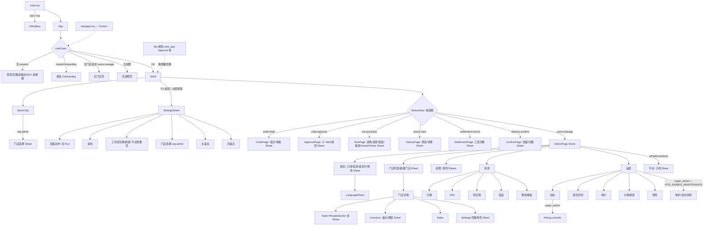

# Track E 审计报告：Web 外壳与导航 + Admin / Catalog / Settings

- 仓库：`/Users/sphinx/Desktop/Fine/CompassAlpha`，HEAD `c49ba3e`
- 方式：只读代码审计。未改动仓库文件；未访问网络、服务器或数据库；**未运行**项目脚本（`scripts/*.ts`）、构建或测试。i18n 键和导出/导入的统计，是用放在 scratchpad 里的只读 Python 脚本（`i18n_scan.py`、`ui_scan.py`、`web_exports.py`）读源码得到的。
- 证据等级：**已确认事实**（读过的代码直接证明）／**高可信度推断**（代码路径清楚，但效果需要运行时确认）／**待验证**（会写明缺什么）。
- 严重度（建议）：P0 阻断/数据风险，P1 主流程错误，P2 明显缺陷/体验问题，P3 小问题。

---

## 1 范围与已读文件清单

**完整读过**
- `apps/web/src/main.tsx`、`apps/web/src/app/App.tsx`、`apps/web/src/app/Shell.tsx`、`apps/web/src/app/PageMenuContext.tsx`
- `apps/web/src/stores/navStore.ts`
- `apps/web/src/pages/AdminPage.tsx`（1–691）
- `apps/web/src/components/SettingsSheet.tsx`、`LanguageSheet.tsx`、`StoreSwitcher.tsx`
- `apps/web/src/hooks/useRealtime.ts`
- `apps/web/src/lib/confirm.ts`、`apps/web/src/lib/errToast.ts`、`apps/web/src/pages/admin/shared.ts`、`apps/web/src/config/timings.ts`
- `apps/api/src/trpc/routers/catalog.ts`
- `apps/bot/src/main.ts`
- `packages/ui/src/index.ts`、`packages/ui/src/kit/index.ts`
- `packages/i18n/src/catalogs/index.ts`、`scripts/find-unused-i18n-keys.ts`

**部分读过（行号以正文引用为准）**
- `apps/web/src/app/AuthGate.tsx`（1–260、335–560、770–801）
- `apps/web/src/app/ErrorBoundary.tsx`（grep + 140–165）
- `apps/web/src/stores/authStore.ts`（代码部分）
- `apps/web/src/hooks/useTelegram.ts`（60–333）、`useI18n.ts`（1–200）、`useVersionCheck.ts`（grep）
- `apps/web/src/pages/admin/catalog/CatalogSections.tsx`（1–675、700–830、876–1100 片段、1230–1345、1495–1530）
- `apps/web/src/pages/admin/stores/StoresSections.tsx`（75–110、315–384，以及 grep 大纲）
- `apps/web/src/pages/admin/operations/OperationsSections.tsx`（140–182，以及 grep 大纲）
- `apps/web/src/pages/admin/people/PeopleSections.tsx`、`apps/web/src/pages/admin/platform/PlatformSections.tsx`（grep 大纲）
- `apps/web/src/pages/DebugPage.tsx`（1–240）
- `apps/web/src/pages/runs/components/RunPanels.tsx`（1370–1392、1860–1960）、`apps/web/src/pages/RunPage.tsx`（150–160、650–660、2078–2090）
- `apps/api/src/app.ts`（83–200 grep、270–330）
- `apps/api/src/trpc/routers/admin.ts`（30–80、500–680、3380–3715）
- `apps/api/src/trpc/routers/auth.ts`（700–900、1228–1275）
- `apps/api/src/trpc/routers/dishes.ts`（50–62、101–111）、`apps/api/src/trpc/trpc.ts`（errorFormatter）
- `apps/api/src/services/notifyForEvent.ts`（1–60，以及所有 `deepLink` 的 grep）、`apps/worker/src/main.ts`（225–360）
- `apps/api/src/realtime/hub.ts`（36–146）
- `packages/ui/src/components/Sheet.tsx`（1–140）
- `packages/contracts/src/schemas/catalog.ts`（1–60）
- `packages/db/src/schema/inventory.ts`（245–320）、`packages/db/src/seed-data.ts`（100–195）
- `packages/i18n/src/index.ts`（24–75）、`scripts/check-untranslated.ts`（1–300）
- `tests/e2e/tests/*`（grep）

**本轨未深入**：订单、审批、采购（Run）、收货（Confirm）、结算（Settlement）、历史各页内部业务逻辑；People RBAC 细节；Inventory/Sales 业务逻辑。由其他轨覆盖，本报告只记录它们的入口和导航。

---

## 2 前端架构与状态管理

### 2.1 启动链
- `main.tsx:25-28` 先按 Telegram `language_code` 或 `navigator.language` 预加载语言包；`main.tsx:33-40` 只在 DEV 且带 `?kit` 时渲染 `KitGallery`，否则渲染 `<App/>`。
- `App.tsx:96-120` 的 Provider 嵌套顺序：`ErrorBoundary > ThemeProvider > UiLabelsBridge > ToastProvider > trpc.Provider > QueryClientProvider > QueryConsumers(useRealtime, useVersionCheck) > AuthGate > Shell`。
- QueryClient 配置（`App.tsx:60-91`）：`staleTime 30s`、`gcTime 5min`，遇到 UNAUTHORIZED/FORBIDDEN 不重试，`refetchOnWindowFocus:false`，mutation 不重试。
- 依赖 `refetchOnWindowFocus:false` 的前提是 WebSocket 会负责失效刷新（`App.tsx:72-83` 的注释）。

### 2.2 有没有 URL 路由 —— **已确认事实：没有**
- 全仓库搜过 `location.pathname`、`history.pushState`、`popstate`、`location.hash`，命中为零。只有两处读了 `location.search`：
  - `AuthGate.tsx:35`：DEV 的 `devLogin`；
  - `AuthGate.tsx:76`：`?invite=`。
- 页面切换完全靠 Zustand 的 `useNavStore`（`navStore.ts:123-257`），持久化在 `localStorage['compass.nav.v1']`。持久化的字段有 `tab / adminSection / catalogSub / opsSub / storeFocus / storeSub`（`navStore.ts:146-153`）。
- `Shell.tsx:103-127` 用 `PAGES[tab]()` 直接选组件。

### 2.3 全局状态
| Store | 持久化 key | 内容 | 证据 |
|---|---|---|---|
| `useAuthStore` | `compass.auth` | accessToken、refreshToken、session（含权限、门店、订阅）、currentStoreId | `authStore.ts` partialize 段 |
| `useNavStore` | `compass.nav.v1` | 底部 tab 与 Admin 下钻层级 | `navStore.ts:143-153` |
| 模块级单例 | 无 | Sheet 计数（`Sheet.tsx:30-58`）、PageMainButton（`useTelegram.ts:286-333`）、tab/store 切换守卫（`navStore.ts:40-61`、`StoreSwitcher.tsx:70-89`） | |
| React Context | 无 | PageMenu（`PageMenuContext.tsx`），页面把动作注册进设置抽屉 | |
| 页面局部 localStorage | `compass.run.viewMode`、`compass.run.priceInThousands`、PREVIEW_VIEW_STORAGE_KEY | Run 页偏好 | `RunPanels.tsx:269/279/881/986`、`RunPage.tsx:127` |

**已确认事实**：以下几个地方都**不会**清掉 `compass.nav.v1`：
- `authStore.clear()`；
- 切换组织（`SettingsSheet.tsx:96-108`，只做 `queryClient.clear()`）；
- 创建工作区（`CreateWorkspace.tsx`，grep 到 `queryClient.clear`）；
- DebugPage 的 “Sign out & reset”（`DebugPage.tsx:222-235`，只删 `compass.auth`）；
- ErrorBoundary 的重置（`ErrorBoundary.tsx:152-158`，只删 `compass.auth`）。

### 2.4 Telegram 集成
- `useTelegramInit`（`useTelegram.ts:153-187`）：调用 `ready()`、`expand()`，并写入 `--app-viewport-h`。
- `isInTelegram()` 以 `initData` 非空作为判断依据（`useTelegram.ts:121-124`）。
- **BackButton**：只有 `useTelegramBackButton`（`useTelegram.ts:204-221`）会 `show()`/`hide()`，全仓库只在 `AdminPage.tsx:421`（SectionFrame）里用到。`Sheet` 只注册 `onClick`，从不调用 `show()`（`Sheet.tsx:65-91`）。
- **SettingsButton**：`Shell.tsx:211` 把齿轮按钮接到 `SettingsSheet`。
- **MainButton**：原生按钮一直隐藏（`Shell.tsx:588-592`），改用 DOM 内的 `PageMainButton`（`Shell.tsx:577-627`）。它的状态是模块级的单槽位（`useTelegram.ts:286-333`）。

### 2.5 实时刷新
- `useRealtime.ts`：连接 `/ws?token=`，断线后指数退避重连，最长 30s（`useRealtime.ts:155-160`）。
- 收到消息后只做 queryKey 级失效（`useRealtime.ts:118-140`）：`order` → `[['order']]`，`run` → `[['run']]`，`catalog` → `admin` + `catalog`，`people` → `admin`。
- 重连成功后**不会**统一失效（open 回调只把重试计数清零，`useRealtime.ts:111-113`）。

---

## 3 全部页面与交互入口清单

符号说明：**R** = 用户实际能到达；**D** = 只是声明了，实际到不了，或只在 DEV 环境出现。

### 3.1 外壳级（AuthGate 拦截页）
| 视图 | 源码 | 到达条件 | 状态 |
|---|---|---|---|
| 启动 Spinner | `AuthGate.tsx:389-405` | 认证进行中 | R |
| 登录页（Sign in、错误 Banner、DEV 人设选择器、浏览器测试登录表单） | `AuthGate.tsx:407-535` | 没有 session | R。浏览器表单只在 `loginModes.nonTelegram.available` 且非 Telegram 时出现 |
| 邀请重试按钮 | `AuthGate.tsx:446-458` | 有 inviteToken 且 accept 失败 | R |
| 姓名 Onboarding | `AuthGate.tsx:546`、`730-766` | `needsOnboarding` | R |
| 无门店页 | `AuthGate.tsx:552-554`、`773-779` | 非 `users.manage` 且 `stores=[]` | R |
| 无权限页（可复制 TG ID） | `AuthGate.tsx:556-558`、`781-801` | `permissions=[]` | R |
| 致命错误页（重试 / 重置） | `ErrorBoundary.tsx:84-171` | 渲染出现异常 | R |
| KitGallery | `pages/KitGallery.tsx`，入口 `main.tsx:33` | 只在 DEV 且带 `?kit` | D（生产包里没有） |

**已确认事实**：上面这些拦截页都没有设置入口，也就是说切不了语言、切不了组织。例外是 Telegram 的齿轮：它只在 `Shell` 里注册（`Shell.tsx:211`），而 `Shell` 在这些页面里根本不渲染。

### 3.2 底部 Tab（`Shell.tsx:68-89`）
| Tab | 权限 | 组件 | 加载方式 |
|---|---|---|---|
| order | `order.draft` | `OrderPage` | 立即加载 |
| approve | `order.approve` | `ApprovalPage` | 立即加载 |
| run | `run.purchase` | `RunPage` | lazy + 预取 |
| history | `prices.view` | `HistoryPage` | lazy |
| settlement | `settlement.record` | `SettlementPage` | lazy |
| confirm | `delivery.confirm` | `ConfirmPage` | 立即加载 |
| admin | `users.manage` | `AdminPage` | lazy + 预取 |

按种子角色（`seed-data.ts`）推出各角色看到的 tab 数：
- admin / super_admin：7 个；
- manager：order、approve、history、settlement、admin，共 5 个；
- purchaser：run、history，共 2 个；
- cashier：只有 settlement，1 个；
- staff：order、confirm，共 2 个。

（高可信度推断：以种子数据为准，自定义角色会不同。）

### 3.3 全局抽屉与外壳控件
| 元素 | 源码 | 入口 | 条件 |
|---|---|---|---|
| SettingsSheet | `SettingsSheet.tsx` | ① Telegram ⋯ 菜单里的齿轮（`Shell.tsx:211`）；② 非 Telegram 环境下头部的组织名按钮（`Shell.tsx:443-451`） | 所有已登录用户 |
| ├ 页面动作区 | `SettingsSheet.tsx:135-162` | 页面通过 `usePageMenu` 注册；全仓库只有 `RunPage.tsx:1535` 注册了 | Run 页 |
| ├ 资料（改名） | `:165-206` | — | 名字未锁定时可编辑 |
| ├ 工作区切换 / 新建 | `:209-241` | — | 新建只对 `isPlatformAdmin` 开放（`:234`） |
| ├ 门店选择 | `:244` | — | `org.admin` |
| ├ 主语言 | `:247-268` | — | 所有人 |
| ├ 次语言 | `:277-317` | — | 所有人 |
| └ 关于 | `:320-344` | — | 所有人 |
| StoreChip + 门店选择 Sheet | `StoreSwitcher.tsx:192-262` | Telegram 顶部条或浏览器头部（`Shell.tsx:420/439`） | 所有人可见；只有 `org.admin` 可点 |
| PageMainButton | `Shell.tsx:577-627` | 由页面注册（Order `OrderPage.tsx:649`、Run `RunPage.tsx:1524`、Confirm `ConfirmPage.tsx:306`、Settlement `SettlementPage.tsx:681`） | 页面决定 |
| 只读订阅 Banner | `Shell.tsx:469-475` | — | `subscription.writeAccess=false` |
| 新版本 Toast | `useVersionCheck.ts:79-83` | 轮询发现有新版本 | 所有人 |

### 3.4 业务 Tab 内的 Sheet（只盘点入口，细节归其他轨）
| 页面 | Sheet / 子视图 | 源码 |
|---|---|---|
| Order | 今日批次 Sheet；审核/提交 Sheet | `OrderPage.tsx:1070`、`:1086` |
| Approval | 子 Tabs（pending 等，`useState`，不持久化）；驳回原因 Sheet | `ApprovalPage.tsx:48`、`:166`、`:480` |
| Confirm | 批量确认 Sheet；问题上报 Sheet | `ConfirmPage.tsx:530`、`:555` |
| History | 筛选 Sheet；RunHistoryDetailSheet | `HistoryPage.tsx:205`、`runs/history/RunHistory.tsx:583` |
| Settlement | 工资对象选择 Sheet | `SettlementPage.tsx:1488` |
| Run | 标记缺货 Sheet、ConfirmSheet、PurchaseSheet、AddItemSheet、配送确认 Sheet、VendorPickerSheet、经Settings页面菜单进入的“撤销/取消”动作 | `RunPage.tsx:2320/2357`、`RunSheets.tsx:204/731/1350`、`RunPanels.tsx:1915` |

### 3.5 Admin 下钻（`AdminPage.tsx`）
AdminPage 内部还会再检查一次（`AdminPage.tsx:162-171`）：非 `users.manage` 且非平台管理员时显示空态。实际到达还要先过 Tab 的 `users.manage` 门槛。

| 层级 | 视图 | 源码 | 条件 | 状态 |
|---|---|---|---|---|
| Home | 分区列表：组织 / 门店 / 权限 / 目录 / 运营 /（平台） | `AdminPage.tsx:231-289` | 平台分区要求 `isPlatformAdmin`（`:280`） | R |
| organization | WorkspaceSection：订阅摘要、信息卡、**语言行**、财务行 | `:462-640` | 财务行要求 `users.manage`（`:561`） | R |
| ├ LanguageSheet | `LanguageSheet.tsx`，挂载于 `AdminPage.tsx:519` | 语言行 `:555-559` | — | R |
| └ 财务设置 Sheet（币种、税率、是否含税） | `:577-638` | — | 服务端还要求 `org.admin`（待验证 `orgFinanceUpdate` 的守卫，本轨未读） | R |
| stores | StoresHomeSection（门店列表 + 组织级伪门店）；新建门店 Sheet | `StoresSections.tsx:75`、`:227` | — | R |
| stores → 某门店 | StoreDetailScreen，用 Segmented 切 Team / Inventory / Sales / Settings | `StoresSections.tsx:315-384` | 组织级伪门店只有 Team | R |
| ├ Team | `PeopleSection`（成员菜单、邀请中心、手动邀请、成员管理、转店、成员权限、授予角色等 Sheet） | `PeopleSections.tsx:530/1353/1484/1697/1900/2125/2489` | 细节由 RBAC 轨覆盖 | R |
| ├ Inventory | 盘点 / 报损 Sheet | `StoresSections.tsx:385`、`:533` | — | R |
| ├ Sales | 销售记录 | `StoresSections.tsx:663` | `sales.record ‖ users.manage`（`:672-673`） | R（仅限能进 Admin 的人） |
| └ Settings | 门店设置；克隆角色 Sheet | `StoresSections.tsx:905`、`:1189` | — | R |
| permissions | 角色列表；新建角色、角色权限 Sheet | `PeopleSections.tsx:703`、`:888`、`:1081` | 编辑要求 super_admin（`:794`） | R |
| catalog | CatalogHome：分类 / SKU / 供应商 / 菜品 / 费用模板 | `AdminPage.tsx:645-690` | — | R |
| ├ categories | 列表；新建/编辑 Sheet；归档（`confirm`） | `CatalogSections.tsx:54-302` | UI 不判断 `org.admin` | R |
| ├ skus | 列表、搜索、显示已归档；新建/编辑 Sheet；归档 / 恢复 | `:328-674` | 同上 | R |
| ├ suppliers | 列表、显示已归档；新建/编辑 Sheet；归档 / 恢复 | `:676-888` | 同上 | R |
| ├ expenseTemplates | 列表；新建/编辑 Sheet；归档 | `:890-1228` | 同上 | R |
| └ dishes | 列表；编辑 Sheet（含配方 BOM）；归档 / 恢复 | `:1230-1647` | UI 用 `dishes.manage ‖ users.manage`（`:1237-1239`） | R |
| operations | OperationsHome：动态 / 历史 / 审计 / 价格报表 / 财务 /（维护） | `AdminPage.tsx:334-388` | 维护要求 super_admin **且** `VITE_ENABLE_MAINTENANCE=1`（`:380`） | R（维护在默认构建里是 D） |
| ├ activity | 动态；**Debug console 折叠区（嵌入 DebugPage）** | `OperationsSections.tsx:43`、`:155-169` | 角色 slug 为 super_admin；DebugPage 内部还要 `system.logs.view`（`DebugPage.tsx:92`） | R |
| ├ history | 提交历史；TargetedPurgeBrowser（删除会话 / 删除 run 的 Sheet）在 Maintenance 内 | `:184`、`:347`、`:590`、`:632`、`:1604` | super_admin | R / D（随维护开关） |
| ├ adminAudit、priceReport、finance | 只读视图 | `:726`、`:891`、`:1033` | — | R |
| └ maintenance | 按日期重置 / 清空全部 | `:1523`、`:1697`、`:1751` | super_admin | 入口是 D；**但持久化的 opsSub 可以直接进入，见 E-14** |
| platform | 组织列表；订阅 Sheet | `PlatformSections.tsx:45`、`:142` | `isPlatformAdmin`，但 Tab 仍要求 `users.manage` | 部分可达（E-12） |

### 3.6 声明了但用户到不了的入口
- **Sales 录入**：`staff` 和 `cashier` 都有 `sales.record`（`seed-data.ts:174`、`:181-188`），但销售录入界面只存在于 Admin → 门店 → Sales（全仓库 web 端只有 `StoresSections.tsx:676/706` 调用 `trpc.sales.*`），而 Admin Tab 要求 `users.manage`。**已确认事实**：这两个角色在 UI 上做不了销售录入。
- **`reports.view`**：没有对应的 Tab；`nav.reports` 这个 i18n 键也没人引用（第 8 节）。
- **Debug 独立 Tab**：已经移除。`Shell.tsx:60-63` 的注释写着 “Admins reach Debug via Admin → Debug”，与实际不符，真实路径是 Admin → 运营 → 动态 → Debug console，而且只看角色 slug 是否为 super_admin。
- **`inventory.recentMovements`**：服务端有这个过程（`inventory.ts:136`），`StoresSections.tsx` 的注释（约 380 行）也说“点行看最近流水”，但 web 端没有任何调用（grep 结果为零）。

### 3.7 Telegram start_param 与 URL 参数
- 只处理 `inv_` 前缀的邀请 token（`AuthGate.tsx:72-78`）。其他 `start_param` 一律忽略。
- `?invite=` 被接受后会用 `replaceState` 去掉（`AuthGate.tsx:234-243`）。
- `?kit`（DEV）、`?devLogin=choose`（DEV）。
- **路径（pathname）完全不解析。**

---

## 4 页面跳转关系表 + Mermaid 导航图

### 4.1 跳转关系表
| 起点 | 动作 | 终点 | 实现 | 返回方式 |
|---|---|---|---|---|
| 任意 Tab | 点底部导航 | 目标 Tab | `requestTabChange` → `setTab`（`Shell.tsx:190-195`）；有 mutation 进行中时禁用（`Shell.tsx:526-528`） | 再点原 Tab |
| Settlement（表单有修改） | 切换 Tab 或门店 | 先经守卫确认 | `SettlementPage.tsx:524-535` | — |
| 任意页 | Telegram 齿轮，或非 Telegram 下的头部按钮 | SettingsSheet | `Shell.tsx:211/443` | 点遮罩或 Telegram Back（Back 键不会显示，见 E-03） |
| 任意页（`org.admin`） | 点 StoreChip | 门店选择 Sheet | `StoreSwitcher.tsx:239-259` | 同上 |
| Admin Home | 点分区 | 对应分区 | `setAdminSection`（`AdminPage.tsx:235-286`） | Telegram BackButton 或非 Telegram 下的 ‹（`AdminPage.tsx:421/430-446`） |
| Admin 分区 | 点子项 | catalogSub、opsSub 或 storeFocus | `AdminPage.tsx:195-226` | 每次退一级（`AdminPage.tsx:177-192`） |
| 门店详情 | Segmented | Team / Inventory / Sales / Settings | `StoresSections.tsx:335-346` | 不进栈，Back 直接回门店列表 |
| Run 页 | 设置抽屉里的页面动作 | Run 内的确认 Sheet 等 | `usePageMenu`（`RunPage.tsx:1535`） | — |
| Bot 通知按钮 | `web_app` 打开 `FRONTEND_URL + /approve|/order|/run|/confirm` | **持久化的上一个 Tab**（不是目标 Tab） | worker `main.ts:239-247`、`355-360` | — |
| Bot `/start inv_…` | `web_app` 打开 `/?invite=` | AuthGate 接受邀请后进入 Shell | `bot/main.ts:21-42` | — |
| 业务页之间 | 例如提交后跳到审批 | **不存在任何程序化跳转**，全仓库 `setTab` 只由 BottomNav 调用 | grep `setTab(` 的结果 | — |

### 4.2 Mermaid 导航图

### 4.3 刷新、返回与再次进入
- **刷新或重新打开（已确认事实）**：恢复持久化的 `tab` 和 Admin 下钻层级（`navStore.ts:123-257`）。
  - 如果 tab 已经没有权限，回退到第一个可见 tab（`navStore.ts:264-267`、`Shell.tsx:188-201`）。
  - 打开的 Sheet、表单草稿、Approval 子 Tab（`ApprovalPage.tsx:48`）、History 筛选、Debug 子 Tab 都不持久化，刷新后回到默认值。
  - Run 页的视图偏好走单独的 localStorage，会保留。
- **持久化的 `storeFocus.storeName`** 会直接当作标题（`AdminPage.tsx:298-301`），门店改名后标题仍是旧名。**已确认事实**。
- **Telegram BackButton**：只在 Admin 的分区页显示（`AdminPage.tsx:421`）。其他 Tab 以及所有 Sheet 打开时都不显示，Sheet 打开时还会把 Admin 的 Back 键藏起来（见 E-03）。
- **服务端通知深链**：见 10.1。结论是**落不到目标 Tab**。

---

## 5 Admin / Catalog / Settings 交互档案

### 5.1 Catalog：分类（`CatalogSections.tsx:54-302`）
| 按钮 | 处理 | 过程 | 效果与校验 |
|---|---|---|---|
| “+ 新分类” | `setDraft` 空草稿（`:89-103`） | — | 打开 Sheet |
| 编辑 | 用现有数据填草稿（`:144-160`） | — | 打开 Sheet |
| 归档 | `nativeConfirm`，确认文案是**英文硬编码** `Archive category "…"?`（`:166-167`） | `admin.categoryDelete` → `requireOrgAdmin` → 软删除（`admin.ts:3449-3471`） | 失效 `admin.categoryList`，提示 Toast |
| 创建/保存 | 前端在 slug 或四种语言任一为空时禁用按钮（`:188-194`） | `categoryCreate` / `categoryUpdate`（`admin.ts:3402-3447`）；后端要求 slug 匹配 `^[a-z0-9-]+$`（`admin.ts:638-645`），四语言 `NamesSchema` 都要 `min(1)` 且 `.strict()`（`admin.ts:510-517`） | 前端只做了小写（`:229`），**没检查 slug 格式**。格式错或 slug 重复（唯一索引 `inventory.ts:266-268`）时，用户只会看到通用的 “common.error”，原因见 E-09 |
| 恢复已归档 | **没有这个 UI**。`categoryUpdate` 支持 `isArchived`（`admin.ts:3440`），但列表只显示一个英文 `archived` 徽章（`:141`） | — | 已确认事实 |
| 加载 / 空 / 错误 | `DataState` + `EmptyState`（`:105-114`） | — | 有 |

### 5.2 Catalog：SKU（`CatalogSections.tsx:328-674`）
| 按钮 | 处理 | 过程 | 效果与校验 |
|---|---|---|---|
| “+ 新 SKU” | 空草稿，unit 默认 `pcs`，step 默认 `1`（`:378-392`） | — | Sheet 打开，第一个输入框 autoFocus（`:574`） |
| 显示已归档 | Switch（`:396-401`） | `admin.skuList({includeArchived})` | 重新查询 |
| 搜索 | `matchesNameLike` 前端过滤（`:418-425`） | — | 有“无匹配”空态 |
| 编辑 | 草稿里把旧的 unit/step 值吸附到合法值（`:466-483`） | — | — |
| 归档 / 恢复 | `nativeConfirm(i18n …)` → `skuDelete`；恢复走 `skuUpdate({isArchived:false})`（`:485-507`） | 服务端要求 `requireOrgAdmin`（`admin.ts:3574-3597`） | — |
| 创建/保存 | 四种语言任一为空就禁用（`:520-526`）；unit 和 step 用 Select，选项来自契约枚举（`:614-641`） | `skuCreate` / `skuUpdate`（`admin.ts:3504-3572`），校验分类是否属于本组织 | 失效 `admin.skuList`。`catalog.skus` 的缓存靠 WebSocket 的 `catalog.changed` 刷新（`useRealtime.ts:124-127`） |
| 可编辑字段 | 四语名称、分类、单位、步长、编码、排序 | — | **不能编辑**：价格、默认/首选供应商、别名（`aliases`）、描述、图片、税率覆盖，以及服务端自动维护的 `suggestedQty`（`inventory.ts:281-307` 有这些列） |
| 批量导入 | **没有 UI**。只有运维 CLI `packages/db/src/import-catalog.ts`（`--apply`，数据来自 `catalog-uzbek.ts`） | — | 已确认事实 |

### 5.3 Catalog：供应商、费用模板、菜品
- **供应商**（`:676-888`）：名称必填（`:816`），电话、TG、地址、备注可选。归档和恢复都有；归档徽章是英文 `archived`（`:758`）。服务端写操作要求 `org.admin`（`admin.ts:3631-3711`）。
- **费用模板**（`:890-1228`）：前端校验 `Number(qty)>0`、`Number(price)>0`（`:1066-1073`）。后端价格要求正则 `^(?!0+(\.0+)?$)\d+(\.\d+)?$`（`admin.ts:617-627`）。所以 `1e3`、`1,5` 这类输入能过前端、被后端拒绝，用户只看到通用错误。高可信度推断。
- **菜品**（`:1230-1647`）：名称至少填一种语言（前端 `:1335-1343`，后端 `dishes.ts:53-58`）。这和 SKU/分类必须四语都填**不一致**；`dishes.ts:51` 的注释写着 “Same validator as catalog SKUs”，与事实不符。
  - UI 的 `canManage` 包含 `users.manage`（`:1237-1239`），但服务端已经去掉了这个兜底（`dishes.ts:101-111` 只认 `dishes.manage`）。见 E-02。

### 5.4 Admin → 组织（`AdminPage.tsx:462-640`）
- **语言行**（`:555-559`）打开 LanguageSheet，调用 `auth.setLocale`，成功后 `patchSession` 并关闭（`LanguageSheet.tsx:57-66`）。
- **财务行**（只对 `users.manage`，`:561-570`）打开财务 Sheet，调用 `admin.orgFinanceUpdate`，成功后 `patchSession`（`:488-506`）。
  - 税率只有 HTML `min/max` 约束（`:621-629`），没有 JS 校验。
  - 币种 option 文案是英文硬编码（`:608-611`）。
- 角色以原始 slug 显示（`:538`），例如 `super_admin`。

### 5.5 SettingsSheet（`SettingsSheet.tsx`）
| 控件 | 过程 | 备注 |
|---|---|---|
| 改名保存 | `auth.completeOnboarding`（`:114-120`、`:187-194`） | `draftName` 只在挂载时初始化（`:122`），而 Sheet 在 `Shell` 里常驻，所以切换组织或从别处改名后草稿会是旧值。高可信度推断 |
| 工作区行 | `auth.switchOrganization`（`:96-108`）→ `setSession` + `queryClient.clear()` | **不重置 navStore**（E-07） |
| 新建工作区 | `CreateWorkspaceForm`，只对平台管理员 | — |
| 门店选择 | 和 StoreChip 是同一个 `StorePickerSection` | 重复入口 |
| 主语言 | `auth.setLocale`（`:81-86`、`:252-266`） | 选完不关闭；与 Admin → 组织 → 语言重复 |
| 次语言 | `auth.setSecondaryLocale`（`:90-95`、`:287-315`） | 主语言改成与次语言相同时，服务端不清理次语言（`auth.ts:1230-1245`），列表会出现“一行都没选中”（`:301` 过滤掉了当前主语言） |
| 关于 | 只读 | 显示原始角色 slug（`:335`）；注释说会显示“server commit”，实际只显示客户端 build（`:78-79`、`:341`） |

---

## 6 操作繁琐点（点击次数）

按 Telegram 内、从任意非 Admin Tab 出发、不计键盘输入来数。

| 任务 | 路径 | 点击数 | 备注 |
|---|---|---|---|
| Admin 新增一个 SKU（最简：无分类，单位用默认 pcs） | Admin Tab(1) → 目录(1) → SKU(1) → +新 SKU(1) → 填 4 种语言名称（首个自动聚焦，另 3 个各点 1 次 = 3）→ 创建(1) | **8 次点击 + 4 段输入** | 如果上次停在 SKU 列表（navStore 会恢复），可省 3 次 |
| 同上，再选分类和单位 | 另加分类 Select(2) + 单位 Select(2) | **约 12 次** | 四种语言必填，一个只会一种语言的管理员没法独立完成（E-10） |
| 改 SKU 价格 | **目录里没有这个入口**。价格来自采购时录入的 `price_history`（`catalog.ts:117-163`） | 不适用 | 已确认事实：管理员不能设置参考价 |
| 改 SKU 供应商（首选供应商） | **目录里没有这个入口**。只能在 Run Tab 的预览里点 SKU 名称（`RunPanels.tsx:1380-1388`）→ VendorPickerSheet → 选择（`RunPanels.tsx:1899-1960`） | 约 4–5 次（Run Tab、切到“按供应商”视图、展开组、点名称、选择） | 只有当天预览里有该 SKU 时才能改；纯 purchaser 拉不到供应商列表（E-01） |
| 切换门店（`org.admin`） | 点 StoreChip(1) → 选门店(1) | **2 次** | 或 ⋯(1) → 设置(1) → 滑动 → 选(1) = 3 次 |
| 切换门店（manager 管多店） | **做不到**（`StoreSwitcher.tsx:103-106` 只认 `org.admin`；`useStoreContext` 固定取 `stores[0]`，`:292`） | 不适用 | E-08 |
| 改语言（Telegram 内） | ⋯(1) → 设置(1) → 滑过资料、工作区、门店 → 点语言(1) → 关闭(1) | **3–4 次** | 入口藏在 Telegram ⋯ 二级菜单里，不好发现 |
| 改语言（Admin 路径） | Admin Tab(1) → 组织(1) → 语言行(1) → 选(1) | **4 次** | 选完自动关闭 |
| 改语言（非 Telegram） | 头部组织名(1) → 选(1) | 2 次 | — |

---

## 7 重复页面、功能与逻辑

| ID | 重复项 | 证据 | 判断 |
|---|---|---|---|
| D-1 | 语言选择有两处：SettingsSheet 内嵌列表，以及 Admin → 组织 → LanguageSheet | `SettingsSheet.tsx:43-48`、`246-268`；`LanguageSheet.tsx:38-43`、`50-114`；`AdminPage.tsx:519`、`555-559` | 已确认事实。`LANGS` 常量重复定义两次；行为也不同，一个选完不关、一个选完关闭。`Shell.tsx:204-206` 的注释说明 Admin 那一行是给“非 Telegram 管理员”用的，可现在 `Shell.tsx:443-451` 已经给非 Telegram 加了头部设置按钮，这个理由不成立了 |
| D-2 | 语言名称映射重复 | `AdminPage.tsx:475-480` 的 `localeLabels` 与两份 `LANGS` | 已确认事实 |
| D-3 | 门店选择有两处：StoreChip 的 Sheet 和 SettingsSheet 的分区 | `StoreSwitcher.tsx:250-259`、`SettingsSheet.tsx:244` | 已确认事实。复用同一个组件，代码层面不算重复，但入口重复 |
| D-4 | 组织名、角色、TG 用户名展示两次：SettingsSheet“关于/资料”与 Admin → 组织信息卡 | `SettingsSheet.tsx:320-344`、`AdminPage.tsx:528-549` | 已确认事实 |
| D-5 | SKU 读接口两套：`catalog.skus`（任意已登录用户，**不排序**，可按分类过滤）与 `admin.skuList`（要求 `users.manage`，按 `sortIndex` 排序） | `catalog.ts:20-50`、`admin.ts:3474-3502` | 已确认事实。返回列相同。Admin 的 SKU 区用 `admin.skuList`，同一文件里的菜品区却用 `catalog.skus`（`CatalogSections.tsx:1243`） |
| D-6 | 分类读接口两套：`catalog.categories`（排除已归档）与 `admin.categoryList`（包含已归档，没有参数） | `catalog.ts:10-18`、`admin.ts:3383-3399` | 已确认事实。SKU 表单的分类下拉用 `admin.categoryList`（`CatalogSections.tsx:331`、`589-597`），**会列出已归档分类**，可以把 SKU 挂到一个已归档、订货页看不到的分类上（订货页的实际表现待验证） |
| D-7 | 供应商读接口两套：`catalog.suppliers`（任意已登录用户，**不过滤已归档**，返回整行）与 `admin.supplierList`（要求 `users.manage`，可过滤已归档） | `catalog.ts:108-115`、`admin.ts:3600-3629` | 已确认事实。`RunPage.tsx:157` 用前者，PurchaseSheet 会列出已归档供应商（`RunSheets.tsx:347`）；`RunPanels.tsx:1894` 用后者，导致权限问题（E-01） |
| D-8 | `GC_TIME` 常量与 `App.tsx:66` 的硬编码值重复 | `timings.ts:31`（没人引用） | 已确认事实 |
| D-9 | 页面级权限判断散落各处：`isSuperAdmin` 按角色 slug 判断（`AdminPage.tsx:147`、`OperationsSections.tsx:56/740/1530`），`isGlobalAdmin` 在多处重复 `useMemo`（`PeopleSections.tsx:722/1456/1652`、`StoresSections.tsx:920`） | 见左 | 已确认事实（重复逻辑）。按 slug 判断会让自定义角色失效 |
| D-10 | 两套 UI 组件：`@compass/ui` 根导出和 `@compass/ui/kit`。kit 只被 DEV 的 `KitGallery` 使用 | 第 8 节扫描结果 | 已确认事实：生产代码不使用 kit |

---

## 8 疑似无效或不可达代码

方法：用正则扫描 `apps/web/src` 每个 `export function|const|class` 是否在其他文件被引用，以及 `@compass/ui` 每个导出是否被 `apps/`、`packages/`、`tests/` 下的 `import {…} from '@compass/ui'` 引用（支持多行 import）。**没有引用不等于没人用**，动态引用和字符串引用扫不到。

### 8.1 apps/web 没有外部引用的导出
| 符号 | 位置 | 文件内引用 | 结论 |
|---|---|---|---|
| `LanguageButton` | `components/LanguageSheet.tsx:121` | 0 | **已确认事实：死代码** |
| `useHasPermission` | `stores/authStore.ts:195` | 0 | 已确认事实：死代码 |
| `useVendorUnitLabel` | `hooks/useI18n.ts:275` | 0 | 高可信度推断：死代码 |
| `useTranslateError` | `lib/errToast.ts:71` | 0 | 高可信度推断：死代码 |
| `botLink`、`userLink` | `lib/telegramLinks.ts:13`、`:41` | 0 | 高可信度推断：死代码 |
| `GC_TIME` | `config/timings.ts:31` | 0 | 已确认事实：死代码（见 D-8） |
| `requestStoreChange`、`keyval`、`measureTextScale`、`RunHistoryDetailSheet`、`compareItems` | 各文件 | ≥1 | 只在本文件内使用，`export` 多余，不算死代码 |

### 8.2 `@compass/ui` 根导出没有被 web 引用的
- **只在包内使用**（导出多余，不是死代码）：`CardFooter`（只有定义）、`surfaceClass`、`pillButtonClass`、`SheetHeader`、`SheetBody`、`SheetFooter`（`QtyControl` 内部用到）、`subscribeSheetCount`、`FieldLabel`、`useUiLabels`。
- **高可信度推断：死代码**：`PageHeader`（只在 AdminPage/RunPage 注释里提到）、旧版 `components/Stepper`（kit 里另有一个 Stepper）、`IconDebug`、`useTheme`（所以没有主题切换 UI，`app.theme.*` 键也没人用）、`DEFAULT_UI_LABELS`、`CardFooter`。
- **只给 DEV 用**：整个 `@compass/ui/kit`（16 个导出）只被 `KitGallery` 引用。

### 8.3 服务端过程没有前端调用（只针对 web）
- `inventory.recentMovements`、`auth.signOut`、`auth.nonTelegramStatus`。
- 因为没有调用 `auth.signOut`，**UI 里没有真正的登出**。Debug 页的 “Sign out & reset” 只清本地，不吊销 refresh token（`DebugPage.tsx:222-235`）。已确认事实。

### 8.4 i18n
- 四种语言包键数一致：en、ru、uz、zh 各 1354 个，没有缺失也没有多余。**已确认事实**。
- 扫描时识别了 `'prefix.' +` 和模板字面量 `` `prefix.${` `` 两种动态前缀，比 `scripts/find-unused-i18n-keys.ts:47-49` 多识别了模板字面量。得到 **111 个候选未用键**，例如：
  - `nav.deliver`、`nav.reports`、`nav.debug`
  - `admin.action.newSku`、`admin.workspace.slug`
  - `storeSwitcher.allMyStores`
  - `app.theme.native/apple/dark`
  - `settlement.expenseCategory.*`（6 个）
  - `order.title`、`approval.title`、`confirm.title`
  
  证据等级：**待验证**。缺的是通过对象映射或计算方式拼出的键，正则扫不到。
- **服务端抛出了、但语言包里没有的错误键**（这些会被 `errToast` 识别成 key，然后原样显示 key 字符串，依据 `packages/i18n/src/index.ts:53-54`）：
  - `auth.errors.notAssignedToStore`（`report.ts:96/205`、`run.ts:1220`）
  - `run.errors.archiveCascadeFailed`
  - `run.errors.notVisible`
  - 另有若干 `auth.errors.dev*` 和 `nonTelegram*` 键，这些已经由 `AuthGate.tsx:561-586` 用中文兜底。
  
  证据等级：**已确认事实**（键缺失），**高可信度推断**（界面会显示原始 key）。

### 8.5 `scripts/check-untranslated.ts` 的漏网之鱼（已确认事实：规则是逐行正则）
- 确认框正则要求字面量和 `nativeConfirm(` 在同一行（`check-untranslated.ts:226`），所以漏掉了换行写的 `CatalogSections.tsx:166-167` `` `Archive category "…"?` ``。
- 属性正则只认 `'` 或 `"`（`:206`），所以漏掉反引号写法：`OperationsSections.tsx:593` `` title={`Delete order session`} ``、`PeopleSections.tsx:2128` `` `Permissions — …` ``。
- 行内 JSX 文本没覆盖：`CatalogSections.tsx:141/458/758` 的 `archived` 徽章（语言包里已有 `common.archived`，但没用上），`:138` 的 `slug … · sort …`、`:454` 的 `step …`。
- 是否覆盖 `placeholder="optional"`（`:650`）、`"e.g. dairy"`（`:232`）要看 `looksLikeCopyInExpression` 的判断，**待验证**（没运行脚本）。

---

## 9 缺陷与风险

| ID | 建议级别 | 标题 | 证据 | 影响 | 修复建议 | 应补测试 |
|---|---|---|---|---|---|---|
| **E-01** | P1 | Run 的 VendorPickerSheet 用了要求 `users.manage` 的 `admin.supplierList` | `RunPanels.tsx:1894`；`admin.ts:3600-3603`（`requireAdmin`）；改供应商的 mutation 只要 `run.purchase`（`run.ts:581`）；purchaser 种子权限里没有 `users.manage`（`seed-data.ts:156-167`） | 高可信度推断：纯 purchaser 打开后列表为空，只剩“清除”，查询报 FORBIDDEN，组件里没有错误状态（`:1940` 直接 `?? []`） | 改用 `catalog.suppliers` 并加上已归档过滤；或新增一个只要 `run.purchase` 的读接口 | 组件测试：purchaser 打开后能看到供应商；API 测试 |
| **E-02** | P2 | 菜品管理在 UI 上对 `users.manage` 开放，服务端已收回 | `CatalogSections.tsx:1237-1239` 与 `dishes.ts:101-111` | 已确认事实：manager 能看到编辑按钮，保存会被 FORBIDDEN | `canManage` 只认 `dishes.manage` | 按权限渲染的测试 |
| **E-03** | P2 | Sheet 从不调用 `BackButton.show()`；在 Admin 打开 Sheet 时 SectionFrame 的 cleanup 还会调用 `hide()` | `Sheet.tsx:65-91`（只 `onClick`）；`useTelegram.ts:212-219`（cleanup 时 `hide()`）；`AdminPage.tsx:420-421`（有 Sheet 时 `enabled=false`） | 高可信度推断：所有页面打开 Sheet 时，Telegram 左上角显示“关闭”而不是返回；Android 实体返回键会直接关掉 Mini App，而不是关 Sheet。`Sheet.tsx:10-16` 注释里设想的“由 Sheet 接管返回键”实际没有生效 | 在 `useSheetPresence` 里 `show()`，并用引用计数管理 hide；`useTelegramBackButton` 也改为引用计数 | Telegram 运行时测试；用模拟 SDK 测 `show/hide` 调用序列 |
| **E-04** | P1（产品层面） | 通知深链不会落到目标 Tab | 见 10.1 | 已确认事实：用户点“Open Compass”后停在上次的 Tab | 用 `startapp=<tab>` 或解析 pathname，映射到 `setTab`（要经过权限判断和 `requestTabChange`） | e2e：带 `/approve` 打开时落在 approve |
| **E-05** | P2 | WebSocket 重连后不补拉，也没有轮询兜底 | `useRealtime.ts:111-113`、`146-160`；`App.tsx:83` | 高可信度推断：Telegram 切到后台导致断线，期间的事件会丢；页面已有缓存且没过期时（30s 内）不会自动刷新，过期后也只在重新挂载或网络恢复时刷新 | 在 `open` 时、且不是第一次连接，对 `order/run/catalog/admin` 做失效；或在 `visibilitychange` 时补一次 | 用模拟 WS 测断线重连后的失效 |
| **E-06** | P2 | 服务端被淘汰的 WS 连接成了僵尸连接 | `hub.ts:68-80` 只从集合删除并发送 `evicted`，不关闭；前端不处理 `evicted`（`useRealtime.ts:118-140` 落到 default） | 高可信度推断：超过 1000 连接后，最老的客户端不再收到任何事件，也不会重连 | 服务端关闭 socket，或前端收到 `evicted` 后主动重连 | hub 单元测试 |
| **E-07** | P2 | 切换组织、清空登录态、ErrorBoundary 重置都不清 `compass.nav.v1` | `SettingsSheet.tsx:96-108`；`authStore` 的 `clear()`；`ErrorBoundary.tsx:152-158`；`DebugPage.tsx:225-231` | 高可信度推断：切到新组织后，Admin 可能停在旧组织的 `storeFocus`，用旧 `storeId` 查询导致报错或空页；如果崩溃是持久化导航状态引起的，“重置”也救不回来 | 这些操作里调用 `useNavStore.persist.clearStorage()` 加 `resetAdminDrillDown()`；或把 orgId 写进 nav key | store 单元测试；切组织的 e2e |
| **E-08** | P2 | 管理多店的 manager 不能切换门店 | `StoreSwitcher.tsx:103-106`、`279-298`（回退到 `stores[0]`） | 已确认事实（代码）：非 `org.admin` 但分配了 ≥2 家门店的用户，永远在第一家门店上操作，StoreChip 也不能点 | 条件放宽为 `org.admin ‖ stores.length≥2`，“全部门店”仍只给 `org.admin` | `useStoreContext` 测试 |
| **E-09** | P2 | 目录表单的服务端校验错误只显示通用错误 | `errToast.ts`（只看 `message` 是否像 i18n key）；`trpc.ts:25-33`（Zod 错误放在 `data.i18nKey` / `fieldErrors`，没被读取）；`admin.ts` 没有引入 `isUniqueViolation`（grep 只在 `order/run/auth` 有）；唯一索引 `inventory.ts:266-268/316` | 高可信度推断：slug 格式错、slug 重复、SKU code 重复、价格格式错，都只提示“出错了” | 前端加 slug 正则校验；服务端把 23505 映射成 `admin.errors.slugTaken` / `codeTaken`；`errToast` 读取 `data.i18nKey` | API 测试（重复 slug）；表单测试 |
| **E-10** | P2（产品） | 新建 SKU 或分类必须填四种语言，且没有批量导入 UI | 前端 `CatalogSections.tsx:188-194/520-526`，后端 `admin.ts:510-517`；导入只有 CLI `packages/db/src/import-catalog.ts` | 已确认事实：只会一两种语言的管理员没法建 SKU；上新效率低（第 6 节）；与菜品“至少一种语言”的规则不一致 | 至少允许“一种必填，其余可空并回退显示”（`useI18n.pickName` 已支持回退），或接机器翻译草稿；提供 CSV 导入 | 契约测试 |
| **E-11** | P2 | 目录写操作的 UI 不判断 `org.admin` | `CatalogSections.tsx` 只在第 36、925、1236 行引用 `useAuthStore`，分类、SKU、供应商、模板的写按钮没有权限判断；服务端用 `requireOrgAdmin`（`admin.ts:73-80`）；已有测试 `store-scoped-admin.test.ts:1394` 证明 manager 不能 `skuCreate` | 已确认事实：manager 能看到 “+ 新建 / 编辑 / 归档”，点了被拒 | 没有 `org.admin` 时只读展示，隐藏写按钮 | 组件按权限渲染测试 |
| **E-12** | P2 | Platform 分区实际被 `users.manage` 挡住 | `Shell.tsx:88`（Admin Tab 要求 `users.manage`）与 `AdminPage.tsx:162`、`280`（允许 `isPlatformAdmin`） | 已确认事实（代码）：平台管理员在没有 `users.manage` 的组织里进不了 Platform。实际影响取决于平台管理员是否总有该权限（**待验证**） | Tab 可见条件改为 `users.manage ‖ isPlatformAdmin` | Shell 可见 Tab 测试 |
| **E-13** | P2 | `sales.record` 对 staff 和 cashier 没有可用入口 | 见 3.6 | 已确认事实 | 新增一个 Sales Tab 或入口，按 `sales.record` 控制可见 | — |
| **E-14** | P3 | 维护页的环境变量开关可以被持久化导航绕过 | `navStore.ts:217-227` 接受 `maintenance`；`AdminPage.tsx:227` 渲染时不检查 `VITE_ENABLE_MAINTENANCE`；只有 `OperationsSections.tsx:1581` 检查 super_admin | 已确认事实（代码路径）：super_admin 在 localStorage 有旧值或被手改时，可以在关闭开关的构建里进入维护页。服务端仍要求 super_admin | 在 AdminPage 渲染分支里同样检查环境变量；`merge` 里也过滤 | — |
| **E-15** | P3 | 持久化的 `adminSection='platform'` 遇到非平台管理员时显示空白框架 | `AdminPage.tsx:228` 没有守卫 | 已确认事实：只显示标题，内容为空 | 在 `merge` 或渲染时校验 | — |
| **E-16** | P3 | 分类不能恢复归档；SKU 表单的分类下拉含已归档分类 | `CatalogSections.tsx:162-178`、`589-597`；`admin.ts:3383-3399` | 已确认事实 | 加“恢复”按钮；下拉只列未归档分类 | — |
| **E-17** | P3 | PurchaseSheet 列出已归档供应商 | `catalog.ts:108-115`、`RunSheets.tsx:347` | 已确认事实（代码） | `catalog.suppliers` 加 `isArchived=false` 过滤 | — |
| **E-18** | P3 | 硬编码英文 | `CatalogSections.tsx:138/141/167/232/454/458/650/758`；`AdminPage.tsx:608-611`；`OperationsSections.tsx:162/593`；`PeopleSections.tsx:2128`；`AuthGate.tsx:420`（“登录等待时间过长”硬编码中文，加上中文诊断文案 `loginDiagnosticText`，在**生产 Telegram 环境**超时 10s 也会显示，`AuthGate.tsx:344-353/419-423`） | 已确认事实 | 接入 i18n；超时诊断只在 DEV 显示 | 补强 `check-untranslated` 规则 |
| **E-19** | P3 | 角色显示为原始 slug | `SettingsSheet.tsx:335`、`AdminPage.tsx:538` | 已确认事实 | 用角色名或 i18n | — |
| **E-20** | P3 | Admin 用户底部有 7 个 Tab | `Shell.tsx:68-89`、`550`；种子 admin 拥有全部权限 | 高可信度推断：375px 宽时每格约 53px，文字截断 | 合并 History/Settlement，或加“更多” | 截图测试 |
| **E-21** | P3 | 页面动作（Run 的撤销/取消）只放在设置抽屉，入口在 Telegram ⋯ 里很难找 | `PageMenuContext.tsx`；`RunPage.tsx:1535` | 高可信度推断 | Run 页内放一个可见的“更多”入口 | — |
| **E-22** | P3 | `usePageMenu` 只在 label、variant 等文本变化时重新注册，`onClick` 闭包可能过期 | `PageMenuContext.tsx`（`key` 由文本拼成，`ref.current` 只在 effect 里取一次） | 待验证：需要看 RunPage 的 `onClick` 是否依赖不在 `key` 里的状态 | 注册时存一个 `ref`，点击时再读 `ref.current` | — |
| **E-23** | P3 | `usePageMainButton` 和 `useTelegramBackButton` 都是“单槽位、后写覆盖、卸载即清空”，没有引用计数 | `useTelegram.ts:286-333`、`204-221` | 高可信度推断：两个组件同时注册时，先卸载的会把另一个也清掉 | 改成栈结构 | — |
| **E-24** | P3 | 订阅只读时，所有写按钮仍可点击 | `Shell.tsx:469-475` 只显示 Banner；web 端只有 Shell、SubscriptionSummary、Platform 用到 `writeAccess` | 高可信度推断：点了才报错 | 全局在 `writeAccess=false` 时禁用写操作 | — |
| **E-25** | P3 | `SettingsSheet` 的改名草稿过期；主语言与次语言相同时，次语言列表没有任何一行显示选中 | 见 5.5 | 高可信度推断 | — | — |
| **E-26** | P3 | 无门店页和无权限页没有切换语言或组织的入口 | 见 3.1 | 已确认事实 | 在拦截页上放语言和组织入口 | — |
| **E-27** | P3 | 通知按钮文案和通知内容是英文硬编码 | `worker/main.ts:245`（`'Open Compass'`）；`notifyForEvent.ts:46-52` | 已确认事实 | 按接收人的语言渲染 | — |

**a11y 观察**
- 非 Telegram 头部的设置按钮：`aria-label` 是“设置”，可见文字却是组织名（`Shell.tsx:446-450`），不符合 WCAG 2.5.3（可见标签应包含在可访问名称中）。已确认事实。
- 非 `org.admin` 时 StoreChip 是纯 ``，这是正确的。
- BottomNav 有 `aria-current` 和 `aria-busy`，但忙碌时只靠 `pointer-events:none` 和 `disabled` 屏蔽，没有任何文字说明为什么不能点。
- Sheet 基于 Radix Dialog，有焦点陷阱。正面观察，但未运行验证。

**缺失的测试（已确认事实：基于 grep）**
- `tests/e2e/tests` 只有 `main-flow`、`session`、`kit` 三个 spec，没有覆盖 Admin 目录增删改、设置或语言切换、刷新后导航恢复、深链。
- web 端单元测试只覆盖 `lib`、`hooks/useOfflineQueue`、`useTapGuard`、`runs/lib`；`navStore.merge`、`useStoreContext`、`useRealtime`、`Sheet` 的 BackButton 都没有测试。
- 服务端有 `store-scoped-admin.test.ts:1394` 覆盖 manager 不能写 SKU，但前端没有对应的“按钮不可见”测试。

---

## 10 旧报告声明核验

| # | 声明 | 结论 | 证据 |
|---|---|---|---|
| 1 | 没有 URL 路由；靠 navStore 导航；服务端深链 `/approve`、`/run`、`/confirm` 不被解析，所以通知落不到目标 Tab | **CONFIRMED** | 见 10.1 |
| 2 | 底部 Tab 门槛在 `Shell.tsx:68-88` | **CONFIRMED**（行号小偏差） | `TABS` 数组是 `Shell.tsx:68-89`，过滤在 `:145` |
| 3 | `LanguageButton` 在 `LanguageSheet.tsx:121` 导出，没有引用方 | **CONFIRMED** | `LanguageSheet.tsx:121-133`；全仓库 web 端没有引用（第 8.1 节扫描） |
| 4 | Settings 的语言（`SettingsSheet.tsx:246-267`）与 Admin 的语言（`AdminPage.tsx:519,555-559`）重复 | **CONFIRMED** | `SettingsSheet.tsx:246-268`；`AdminPage.tsx:519`（LanguageSheet 挂载）、`555-559`（ListRow）；两份 `LANGS` 常量 |
| 5 | 新建 SKU/分类必须填四种语言；没有批量导入 UI | **CONFIRMED**（补充：有批量导入 CLI） | 前端 `CatalogSections.tsx:188-194/520-526`；后端 `admin.ts:510-517`（strict、四键 `min(1)`）；只有 CLI `packages/db/src/import-catalog.ts`。菜品是例外，至少一种语言即可（`dishes.ts:53-58`） |
| 6 | SPA 兜底在 `apps/api/src/app.ts:286-310` | **CONFIRMED**（行号微调） | 注释 `app.ts:277-296`；代码 `:297-311`（`serveStatic` 在 `:306`，兜底在 `:310`）。注释 `:286-287`、`:307-308` 说“React router takes over”与事实不符，前端并没有路由 |
| 7 | WebSocket 实时刷新没有轮询兜底（`useRealtime.ts`、`hub.ts`） | **PARTLY** | `useRealtime.ts` 确实没有轮询，重连后也不补拉（`:111-113`）；但存在局部轮询：`RunPage.tsx:655-658` 对进行中的 run 每 6s `refetchInterval`，DebugPage health 每 2s（`DebugPage.tsx:77-80`）；`useVersionCheck` 也会轮询版本。另发现 hub 的淘汰连接是僵尸连接（E-06） |

### 10.1 深链完整追踪（声明 1）
1. 服务端在 `notifyForEvent.ts:52/64/74/89/104/116/146/160/177/192/209` 写入 `deepLink: '/approve' | '/order' | '/run' | '/confirm'`，经 `notify.ts:189` 存进 outbox。
2. worker 在 `main.ts:239-247` 生成 inline 按钮 `web_app: { url: resolveDeepLink(deepLink) }`；`resolveDeepLink`（`main.ts:355-360`）拼成 `FRONTEND_URL + '/approve'`。
   - 如果 `FRONTEND_URL` 没配置，返回的是相对路径 `/approve`，而 Telegram 的 `web_app.url` 要求 https 绝对地址，高可信度推断会发送失败。
   - 它是否被当成永久错误吞掉，取决于 `RelayError.permanent` 的判断，**待验证**。
3. 服务端 `app.ts:310` 对 `/approve` 返回 `index.html`。
4. 前端不读 `pathname`（2.2 节的 grep 结果为零），`start_param` 也只认 `inv_`（`AuthGate.tsx:73-74`）。
5. 所以 `Shell.tsx:185-188` 用的是**持久化的 tab**；首次使用时是 `'order'`，再经过 `resolveVisibleTab` 处理。

**结论：已确认事实。通知不会落到目标 Tab，也不会定位到具体的订单或 run（payload 里的 sessionId、runId 同样没有用上）。**

---

## 11 需运行时验证的交互清单

1. 在 Telegram iOS 和 Android 上分别打开 SettingsSheet、StoreChip Sheet、Admin 内任意 Sheet，观察左上角是“返回”还是“关闭”，以及 Android 实体返回键的行为（E-03）。
2. 用 purchaser 账号进入 Run → 预览 → 按供应商视图 → 点 SKU 名称，看 VendorPicker 列表是否为空、控制台是否有 FORBIDDEN（E-01）。
3. 用 manager 账号进入 Admin → 目录，尝试新建 SKU、分类、供应商，以及编辑菜品，确认按钮可见且保存失败（E-02、E-11）。
4. 点通知按钮（订单提交通知）进入 Mini App，看落在哪个 Tab；同时确认 `FRONTEND_URL` 已配置（E-04）。
5. 在组织 A 的 Admin → 门店 → 某门店里切到组织 B，看页面表现（E-07）。
6. 把 Telegram 切后台超过 1 分钟，期间由别人审批订单，切回来看审批页是否自动刷新（E-05）。
7. 新建分类时用 `Dairy Foods`（含空格和大写）或已存在的 slug，看提示内容（E-09）。
8. 在 Settlement 页修改表单后点其他 Tab 或门店，确认守卫生效；在 Admin 目录 Sheet 里有草稿时切 Tab，确认草稿丢失。
9. 管理 2 家以上门店的 manager：StoreChip 是否可点，订货页门店是否固定在第一家（E-08）。
10. 平台管理员在没有 `users.manage` 的组织里，确认没有 Admin Tab（E-12）。
11. 7 个 Tab 时，在 375px 宽设备上看 BottomNav 截断情况（E-20）。
12. 订阅只读的组织：点任意写按钮，看提示（E-24）。
13. RunPage 的设置菜单动作在状态变化后是否调用了过期的闭包（E-22）。
14. 部署新版本后，旧客户端懒加载 Admin chunk 时，对缺失 chunk 返回的 `index.html` 会不会触发 ErrorBoundary（`app.ts:310` 对所有未匹配的 GET 返回 HTML）。待验证：部署时是否保留旧资源。

---

## 12 未覆盖范围

- `PeopleSections.tsx` 的 RBAC 细节、`StoresSections.tsx` 的库存和销售业务、`OperationsSections.tsx` 的报表和清除逻辑：只看了导航结构。
- Order、Approval、Run、Confirm、History、Settlement 各页的内部逻辑与 Sheet 行为：只盘点了入口。
- `UiLabelsBridge.tsx`、`useOfflineQueue.ts`、`useTapGuard.ts`、`lib/trpc.ts`（只看了大纲）、`lib/reload.ts`、`lib/idb.ts`：未细读。
- `admin.orgFinanceUpdate` 的服务端守卫、`apps/api/src/main.ts` 的 WS 鉴权与 token 过期处理、worker 对 relay 永久错误的判断：未读。
- 没有运行任何脚本或测试，所以 `check-untranslated` 和 `find-unused-i18n-keys` 的实际输出未知；8.4 节的 111 个候选未用键来自自写扫描，需人工复核。
- 生产配置（`FRONTEND_URL`、`VITE_ENABLE_MAINTENANCE`、`VITE_WS_URL`）的实际取值未知。
