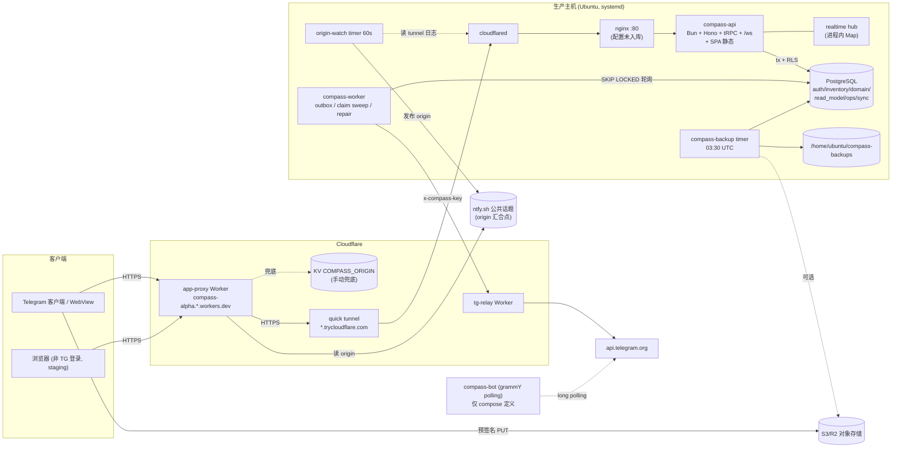
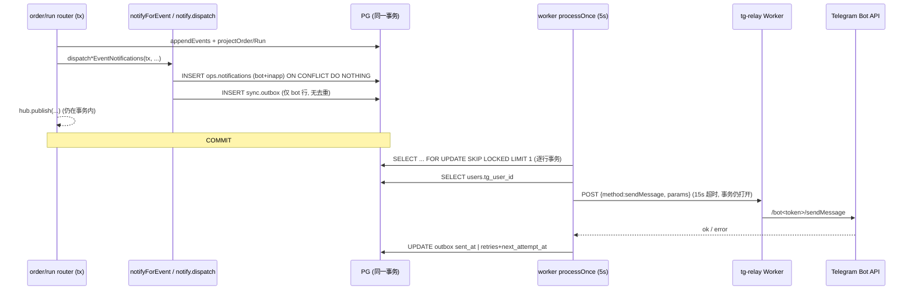

# Track F — 平台基础设施与横切关注点审计（CompassAlpha @ c49ba3e）

> 只读审计。未修改仓库文件，未访问生产服务器、数据库或网络，未运行 deploy/migrate/seed。
> 证据等级：**已确认事实**（代码/配置原文可见）、**高可信度推断**（由多处代码推出，但未运行验证）、**待验证**（缺运行时/生产信息，注明缺什么）。
> "未找到引用" 只表示静态 grep 无结果，不等同于"从未使用"。

---

## 1 范围与已读文件清单

**完整阅读**
- `apps/api/src/main.ts`, `app.ts`, `env.ts`, `infra/jwt.ts`, `infra/log.ts`, `realtime/hub.ts`
- `apps/api/src/services/eventStore.ts`, `notify.ts`, `notifyForEvent.ts`, `rateLimit.ts`, `s3.ts`, `telegramAuth.ts`（verify 部分）
- `apps/api/src/trpc/trpc.ts`, `context.ts`, `router.ts`, `routers/system.ts`, `routers/upload.ts`
- `apps/worker/src/main.ts`, `relay.ts`, `relay.test.ts`, `package.json`
- `apps/bot/src/main.ts`, `package.json`
- `packages/telemetry/src/*`, `package.json`；`packages/cli/src/index.ts` 及 `commands/*.ts`
- `packages/db/src/client.ts`, `rls.ts`, `migrate.ts`, `drain-outbox.ts`；`schema/ops.ts`, `sync.ts`, `domain.ts`, `readModel.ts`, `_helpers.ts`, `index.ts`；`schema/auth.ts`（主体）；`schema/inventory.ts`（外键部分）
- `packages/db/migrations/sql/001_*.sql`(仅列表)、`900_rls_policies.sql`, `950_rls_fail_closed.sql`, `0016_dishes_and_recipes.sql`（RLS 段）, `0046_rename_default_org_to_eden.sql`, `meta/_journal.json`（条目数）
- `scripts/deploy.ts`, `scripts/refresh-app-proxy-origin.sh`, `scripts/smoke.ts`（头部及 WS/缓存检查段）
- `infra/systemd/*`, `infra/compose/*.yml`, `infra/docker/Dockerfile`, `infra/caddy/Caddyfile`, `infra/tunnel/compass-origin-watch.sh`, `infra/cloudflare/tg-relay.js`, `infra/cloudflare/app-proxy/{worker.js,wrangler.toml,README.md}`, `infra/backup/compass-backup.sh`, `restore.sh`（头部）, `compass-backup.timer`
- `.github/workflows/ci.yml`, `turbo.json`, `package.json`, `pnpm-workspace.yaml`, `.env.example`, `.bun-version`, `.gitignore`
- `apps/web/src/hooks/useRealtime.ts`；`apps/web/src/app/App.tsx`（QueryClient 段）、`Shell.tsx`（tab 选择段）
- `apps/api/scripts/reproject.ts`（主体）, `repair-duplicate-purchases.ts`（事务段）
- `docs/RUNBOOK.md`（运维段 40-75 行）

**部分阅读/grep 定位**：`trpc/routers/order.ts`(1220-1330)、`run.ts`(855-895, 3440-3475)、`admin.ts`(205-225, 3995-4010, 4158-4225, 4365-4375)、`auth.ts`(60-100)、`orderProjection.ts`(255-281)、`refreshTokens.ts`(225-241)、所有测试文件头部与用例名、`tests/e2e/{global-setup.ts,env.ts,playwright.config.ts}` 片段。

**未读**：业务路由的完整逻辑（admin/run/order/settlement 等由其他 track 覆盖）、`apps/web` 大部分页面、`packages/domain`、`browser-smoke*.ts` 全文。

---

## 2 架构与运行时组件

### 2.1 组件与进程（已确认事实，除特别注明）

| 组件 | 入口 | 运行方式 | 职责 |
|---|---|---|---|
| API | `apps/api/src/main.ts` | systemd `compass-api.service`：`bun run src/main.ts`（直接跑 TS 源码，非 dist）`infra/systemd/compass-api.service:19` | Hono + tRPC(`/trpc/*`)、WebSocket(`/ws`)、健康检查(`/health/*`)、同进程托管 SPA 静态文件 (`app.ts:297-316`) |
| Worker | `apps/worker/src/main.ts` | systemd `compass-worker.service:13` | outbox 投递 Telegram、claim 超时释放、孤儿 session 修复、idempotency 清理 |
| Bot | `apps/bot/src/main.ts` | **仅在** `docker-compose.prod.yml:31-36` 中定义；`infra/systemd/` 下无 bot 单元，`deploy.ts:375-386` 也不安装 bot | grammY long polling：`/start inv_*` 邀请兜底按钮、`/id` |
| Web SPA | `apps/web` | 在生产服务器上 `vite build`（`deploy.ts:475-484`），由 API `serveStatic` 提供 | Telegram Mini App 前端 |
| PostgreSQL 16 | — | 生产为宿主机 PostgreSQL（systemd 单元 `After=postgresql.service`）；compose 中为容器 | 唯一数据存储（事件存储 + 读模型 + 运维表 + outbox） |
| Cloudflare quick tunnel | `compass-app-tunnel.service:10` | `cloudflared tunnel --url http://localhost:80` | 把本机 :80（nginx，见下）暴露为随机 `*.trycloudflare.com` |
| Origin watchdog | `compass-origin-watch.{service,timer}` + `infra/tunnel/compass-origin-watch.sh` | 每 60s | 从 tunnel 日志抓当前 hostname，发布到 **ntfy.sh 公共话题** |
| CF Worker app-proxy | `infra/cloudflare/app-proxy/worker.js` | `compass-alpha.sphinxr.workers.dev` | 稳定 HTTPS 入口；从 ntfy 话题/KV 读当前 tunnel origin 并反代 |
| CF Worker tg-relay | `infra/cloudflare/tg-relay.js` | workers.dev | 因服务器出口无法访问 api.telegram.org，Worker 代发 Bot API |
| Backup | `infra/backup/compass-backup.{sh,service,timer}` | 每日 03:30 UTC（`compass-backup.timer:13`） | `pg_dump -Fc` 到本机目录，可选上传 S3 |
| 对象存储 | S3/R2/MinIO | API 只生成预签名 PUT URL（`services/s3.ts`） | 收据/照片 |
| nginx :80 | **仓库中无配置** | README 与 worker.js 注释提到（`app-proxy/README.md` 流量图，`worker.js:10,137`） | 位于 tunnel 与 API:3000 之间（**待验证**：配置未入库） |
| Redis | compose 中存在；systemd `Wants=redis-server.service` | **代码中无任何客户端**（`ioredis` 依赖 0 处 import；`system.ts:91-97` 注释承认） | 未使用 |

### 2.2 通信关系
- 浏览器/Telegram WebView → workers.dev(app-proxy) → trycloudflare tunnel → nginx:80 → API:3000（README 流量图，**已确认文档**；nginx 行为**待验证**）。
- 前端 → API：HTTP tRPC（Bearer JWT，`context.ts:62-73`），WebSocket `/ws?token=<access JWT>`（`useRealtime.ts:47-57`，`main.ts:49-73`）。
- API → PG：`postgres-js` 池 max 20（`client.ts:31-39`），每请求 `withOrgContext` 事务内 `set_config('app.current_org_id')`（`rls.ts:29-48`）。
- API 写 `ops.notifications` + `sync.outbox`（同事务，`notify.ts:195-218`）；Worker 轮询 outbox（5s）→ tg-relay → Telegram Bot API。
- Worker 与 API 之间**没有**进程间通道：Worker 直接写事件与读模型（claim 释放/孤儿修复），但无法调用 API 进程内的 `hub.publish`。
- 服务器 → ntfy.sh（发布 origin）；app-proxy Worker → ntfy.sh（读取 origin）。

### 2.3 Mermaid 系统架构图

---

## 3 数据模型与实体关系

### 3.1 Schema 概览（已确认事实，`packages/db/src/schema/*.ts`）
共 6 个 PG schema、约 49 张表：

- **auth**：`organizations`, `billing_plans`, `organization_subscriptions`, `users`, `platform_admins`, `members`, `member_invites`, `member_store_assignments`, `roles`, `permissions`, `role_permissions`, `member_role_bindings`, `member_permission_overrides`, `policy_rules`, `refresh_tokens`
- **inventory**：`stores`, `store_daily_settlements`, `store_daily_settlement_revisions`, `suppliers`, `store_supplier_prefs`, `categories`, `skus`, `expense_templates`, `sku_supplier_links`, `dishes`, `dish_ingredients`, `sales`, `movements`, `price_history`
- **domain**：`events`（事件存储，`(stream_id, seq)` 唯一 `domain.ts:47`）, `snapshots`(deprecated), `policy_decisions`（实际承担审计日志）, `projector_cursors`
- **read_model**：`order_sessions_v`, `order_items_v`, `market_runs_v`, `run_items_v`, `run_item_stores_v`, `run_expenses_v`
- **ops**：`notifications`, `audit_log`(deprecated), `client_logs`, `log_review_cursor`, `feature_flags`, `web_push_subscriptions`, `daily_metrics`
- **sync**：`outbox`, `idempotency_keys`

迁移：drizzle 迁移 `0000`–`0046` 共 **47** 个（`_journal.json` 47 条，最后 `0046_rename_default_org_to_eden`），另有 3 个原始 SQL（`sql/001_extensions_and_schemas.sql` 前置；`900_rls_policies.sql`、`950_rls_fail_closed.sql` 后置，每次 migrate 重跑，`migrate.ts:141-151`）。

### 3.2 Mermaid erDiagram（核心实体）

```mermaid
erDiagram
  organizations ||--o{ members : has
  users ||--o{ members : "belongs via"
  organizations ||--|| organization_subscriptions : "plan/status"
  billing_plans ||--o{ organization_subscriptions : plan_code
  organizations ||--o{ roles : defines
  roles ||--o{ role_permissions : grants
  permissions ||--o{ role_permissions : key
  members ||--o{ member_role_bindings : "scope global|store"
  roles ||--o{ member_role_bindings : role
  members ||--o{ member_permission_overrides : "allow|deny"
  members ||--o{ member_store_assignments : "store binding (无FK)"
  organizations ||--o{ member_invites : issues
  users ||--o{ refresh_tokens : rotates
  users ||--o| platform_admins : "cross-tenant"

  organizations ||--o{ stores : owns
  organizations ||--o{ skus : catalog
  categories ||--o{ skus : groups
  organizations ||--o{ suppliers : has
  skus ||--o{ sku_supplier_links : ""
  suppliers ||--o{ sku_supplier_links : ""
  organizations ||--o{ dishes : menu
  dishes ||--o{ dish_ingredients : BOM
  skus ||--o{ dish_ingredients : ""
  stores ||--o{ sales : records
  stores ||--o{ movements : ledger
  skus ||--o{ movements : ""
  skus ||--o{ price_history : ""
  stores ||--o{ store_daily_settlements : "daily close"
  store_daily_settlements ||--o{ store_daily_settlement_revisions : "append-only"

  organizations ||--o{ events : "event store"
  events }o--|| order_sessions_v : "stream_type=order (投影)"
  events }o--|| market_runs_v : "stream_type=run (投影)"
  stores ||--o{ order_sessions_v : store_id
  order_sessions_v ||--o{ order_items_v : "per contributor line"
  market_runs_v ||--o{ run_items_v : sku
  market_runs_v ||--o{ run_item_stores_v : "sku x store split"
  market_runs_v ||--o{ run_expenses_v : expenses
  market_runs_v ||--o{ order_sessions_v : "run_id (无FK)"

  organizations ||--o{ notifications : inbox
  users ||--o{ notifications : recipient
  notifications ||..o{ outbox : "同事务写入(无FK, event_id=orgId)"
```

### 3.3 核心数据对象生命周期
- **Order session**（`read_model.order_sessions_v`，状态注释 `readModel.ts` `status: draft|submitted|approved|rejected|in_run|archived`）：
  draft →(Submit)→ submitted →(Claim/ClaimReleased，含 worker 30 分钟超时释放 `worker/main.ts:416-514`)→ approved / rejected；approved ⇄ submitted(Unapprove)；approved →(AttachedToRun)→ in_run →(EjectedFromRun，含 worker 修复 `629-722`)→ approved；→ archived。全部来自 `domain.events` 投影（**已确认**），worker 路径绕过 domain `decide()` 直接写事件与读模型（**已确认** `worker/main.ts:472-498, 682-708`）。
- **Market run**（`market_runs_v`）：planned → purchasing → delivering → finished / cancelled；另有 `amending`（重开已完成 run，`run.ts:3440`、`deploy.ts:235`）。每 org 同时仅一个活跃 run（部分唯一索引 `mrv_one_active_per_org_unique`，`readModel.ts`）。
- **Notification**（`ops.notifications`）：插入（`dedup_key` 部分唯一）→ **此后不再变化**：`sent_at`、`read_at` 全仓库无写入方（**已确认**，grep `sentAt|sent_at` 仅命中 outbox）。
- **Outbox 行**：created(`next_attempt_at=now`) → sent（成功/永久错误/投递关闭/无 tgUserId/未知 channel/webpush）或 deferred（重试 1..7，退避 5s→3h）→ 第 8 次 "gave up" 也标 `sent_at`（`worker/main.ts:330-347`）。**无删除/归档**。
- **Idempotency key**：成功 mutation 后写入，24h TTL（`trpc.ts:186, 257-269`），worker 每小时删除过期（`worker/main.ts:724-736`）。
- **Refresh token**：轮换族；`purgeExpiredRefreshTokens` 注释 "Not wired today"（`refreshTokens.ts:229-240`）→ 永不清理。
- **client_logs**：匿名可写（`system.ts:124-193`），除 org 级 purge 外无保留策略（**已确认** grep 无其他 DELETE）。

---

## 4 构建 / 运行 / 测试 / 部署

### 4.1 工具链（已确认）
- 根 `package.json:5` `packageManager: pnpm@9.12.0`，`engines.node >=20`；所有根脚本走 `turbo` / `pnpm --filter`；各工作区脚本使用 `bun`（如 `apps/api` `dev/build/test`）。`.bun-version` = `1.1.38`；Dockerfile 同版本；根 devDep `@types/bun ^1.3.13`，worker/bot `@types/bun: latest`（类型与运行时版本可能不一致，**待验证**）。
- 本审计环境：`pnpm`、`bun` 均不在 PATH（`which` 结果），`node_modules/.bin/turbo` 存在。
- 只有 `apps/api`、`packages/domain` 声明 `test` 脚本；`apps/web`（lint 唯一）/worker/i18n/ui 的测试只能靠 CI 里直接 `bun test <dir>`。

### 4.2 本地运行
- `.env.example` 的 `DATABASE_URL=...localhost:5432`、`REDIS_URL=...:6379`，而 `docker-compose.dev.yml` 把 PG 映射到 **5433**、Redis 到 **6380** → 按示例直接起会连不上（**已确认**配置不一致，影响开发体验）。

### 4.3 部署（`scripts/deploy.ts`，已确认）
流程：provenance 门禁（干净、在 main、已推送，否则需 `--force` 并加 `-unverified` 后缀，`160-200`）→ 活跃 run 预检（psql，**失败只告警**，`227-259`）→ 本地非 PG 单测（`265-283`）→ tar 工作目录（排除 node_modules/dist/.env/.git/.claude，`286-326`）→ scp → **原地解压且不删除旧文件**（`331-334`）→ `pnpm install --frozen-lockfile` → `pnpm --filter @compass/db migrate`（失败中止，`355-369`）→ 安装 systemd 单元（api/worker/tunnel/watch，不含 bot）→ 检查 `VITE_DEV_MOCK_INIT_DATA` → 检查角色 BYPASSRLS（psql 失败只告警；superuser 只告警，`411-446`）→ **重启 api+worker** → 检查 worker 启动 banner（告警级）→ **之后才在服务器 vite build web**（`475-484`）→ smoke.ts → browser-smoke(浅/深)。
- SSH 使用 `-o StrictHostKeyChecking=no`（`deploy.ts:129, 329`）。
- 迁移：仅前向，无 down；部署前**不做**数据库备份。
- 回滚：`docs/RUNBOOK.md:50-55` 写的是 `docker tag compass:previous` + `docker compose ... up`，但实际生产走 tarball+systemd，不构建镜像 → **Runbook 回滚方案与真实拓扑不符**（已确认）。按 deploy.ts 回滚旧 commit 需 detached HEAD → 触发 provenance 失败 → 必须 `--force`，且旧版本不会删除新版本新增的文件、数据库仍是新 schema（**高可信度推断**）。
- 备份：每日本机 `pg_dump`，保留 14 天；S3 异地上传可选（`compass-backup.sh:122-143`）；脚本注释自述"此前从未产出过一个备份文件"（`compass-backup.sh:55-56`），生产是否已设置 `BACKUP_DATABASE_URL`、是否有成功 dump **待验证**（需看服务器）。备份失败无告警（仅 systemd 状态）。

### 4.4 CI（`.github/workflows/ci.yml`，已确认）
- `unit`：journal 一致性、i18n 键数一致、ICU plural、未翻译字面量、typography、`pnpm type-check`、`pnpm lint`（仅 web）、禁止 console.log（web/api）、`bun test packages/domain packages/i18n packages/ui apps/api apps/worker apps/web/src/{lib,hooks,pages}`（`SKIP_PG_TESTS=1`）。
- `integration`：PG16 服务、migrate、创建 NOSUPERUSER NOBYPASSRLS 角色，显式列出 **10** 个测试文件（`369-379`）。
- `e2e`：Playwright，启动 API + Vite（`playwright.config.ts:33-59`），**不启动 worker**。

---

## 5 通知 / 实时 / 后台任务链路

### 5.1 通知端到端（已确认，除注明）

1. **触发点**（`notifyForEvent.ts`）：Order：Submitted(按门店 scope 通知 `order.approve`)、Approved、Rejected、Unapproved、Withdrawn、AttachedToRun；Run：RunPlanned（全 org `run.purchase`）、StoreDelivered（门店 `delivery.confirm`）、RunFinished（采购员 + 涉及门店员工）、RunCancelled。`run.create` 故意不发（`run.ts:874-877`）。
2. **写入**（`notify.ts:169-219`）：每 recipient × channel(`['bot','inapp']`) 生成 `dedupKey = ${envelope.dedupKey}:${userId}:${channel}`；notifications `onConflictDoNothing`；**outbox 对所有 bot 行无条件插入**（`199-218`）。`aggregateId` 与 `eventId` 都写成 `orgId`（`204-205`）。
3. **投递**（`worker/main.ts`）：传输选择 relay（`TG_RELAY_URL`+`COMPASS_RELAY_KEY`）或直连 grammY（`89-115`）；`BOT_DELIVERY_ENABLED=false` 时直接标 sent（`182-190`）。消息为 MarkdownV2 + 一个 `web_app` 按钮。
4. **重试**：最多 8 次，退避 `[5,10,30,60,300,900,3600,10800]` 秒（`57-59`）；Bot API 400/403 视为永久错误标 sent；relay 自身错误/429/5xx 视为暂时（`relay.ts:22-46`）。
5. **去重**：只对 `ops.notifications` 生效；outbox 无去重 → 同一 dedupKey 重复触发会**重复发 Telegram**（见 BUG F-04）。崩溃于 "发送成功→提交前" 会重复投递（作者在 `worker/main.ts:144-149` 承认 at-least-once）。
6. **失败处理**：无死信表、无告警；放弃后与成功行同样 `sent_at IS NOT NULL`，只能靠 `last_error` 区分；`system.health` 仅统计 pending 与最老 pending 年龄（`system.ts:63-106`）。
7. **Deep link 格式**：`deepLink` 取值 `/approve`、`/order`、`/run`、`/confirm`（`notifyForEvent.ts:52,64,147,160,177,192,209`），worker 拼接为 `${FRONTEND_URL去尾斜杠}${path}`（`worker/main.ts:355-360`），作为 `reply_markup.inline_keyboard[[{text:'Open Compass', web_app:{url}}]]`。前端**没有基于 URL 路径的路由**：tab 来自持久化的 navStore（`Shell.tsx:185-189`），全 web 源码无读取 `location.pathname` 的代码（grep 仅命中 `AuthGate.tsx` 的 `?invite`/`search`）→ deep link 路径被忽略（BUG F-06，高可信度推断）。邀请链接另有两种格式：`t.me/<bot>?startapp=<token>`（`telegramLinks.ts:26`）与 bot 兜底 `${FRONTEND_URL}/?invite=<token>`（`bot/main.ts:35`）。
8. **In-app 通知**：无任何读取 API/UI（见 §11 #1）；hub 定义了 `notification` 消息类型但无发布者（`hub.ts:33`；`hub.publish` 调用点全部为 order/run/catalog/people）。前端监听后失效 `['notifications']` 查询键，但不存在该查询（`useRealtime.ts:142-143`）。
9. **Web Push**：`web_push_subscriptions` 表无读写者；`dispatch` 默认 channel 不含 webpush 且无调用者传入；worker 遇到 webpush 行直接标 sent + `'webpush not implemented (M2)'`（`worker/main.ts:199-205`）。

### 5.2 实时链路与降级（已确认）
- 认证：`/ws?token=<access JWT>`，仅做 `jwtVerify`（`main.ts:51-60`）；**不检查** member 状态、订阅状态，也不在 token 过期后断开；连接按 `claims.org` 订阅整个 org（`main.ts:77`）。
- Hub：进程内 `Map<orgId, Set<send>>`，每 org 上限 1000，超限驱逐最老连接并发送 `{type:'evicted'}`，**但不关闭 socket**（`hub.ts:71-80`）；前端不处理 `evicted`（`useRealtime.ts:121-148`）→ 被驱逐连接成为"在线但永远收不到事件"的僵尸（高可信度推断，触发概率低）。
- 发布时机：order/run 命令在 `ctx.withOrg` 事务回调**内部**调用 `hub.publish`（`order.ts:1293`、`run.ts:3462`），即提交前广播；客户端有 400ms 去抖（`useRealtime.ts:24`），通常掩盖了窗口，但事务随后失败时会产生空刷新。
- 广播范围：整个 org，不按门店过滤（消息只含 sessionId/runId/lastSeq）。
- 心跳：服务端 25s `pingAll`（`main.ts:117-127`）。
- 前端：指数退避重连 1s→30s（`useRealtime.ts:17-18,160-165`）；重连后**不做补偿性全量失效**；`refetchOnWindowFocus: false`（`App.tsx:83`）；唯一轮询兜底是 RunPage 活跃 run 6s（`RunPage.tsx:657`）。Order/Approval/Admin 页面在 WS 断开时仅靠 30s staleTime + 用户操作触发的刷新。
- Worker 发起的状态变化（claim 超时释放、孤儿修复）**不会产生任何实时消息**：worker 无 hub，outbox 的 `realtime` channel 在 schema 注释中出现（`sync.ts:24`）但 worker 不处理（会被当 unknown channel 标 failed，`worker/main.ts:206-210`）。
- app-proxy 对 WebSocket 的支持：worker.js 用 `fetch(target, init)` 后 `new Response(response.body, {status: response.status, ...})` 重建响应（`worker.js:134-158`），未处理 `101 Switching Protocols`/`webSocket` 字段。Cloudflare Workers 的 `Response` 构造器通常拒绝 101 以外不带 webSocket 的状态，因此**经 workers.dev 入口的 WS 很可能无法建立**（**待验证**：需在线验证；smoke 仅检查 `/ws` 无 token 返回 4xx，`smoke.ts:204-210`，browser-smoke 主动 abort `/ws`，`browser-smoke.ts:600`，所以即使 WS 全挂也不会被发现）。

### 5.3 后台任务清单（已确认）

| 任务 | 进程 | 频率 | 位置 |
|---|---|---|---|
| outbox flush（≤50 行/轮，逐行事务） | worker | 每轮结束后 sleep 5s | `worker/main.ts:151-219, 808` |
| heartbeat 日志 | worker | 60s | `367, 747-750` |
| idempotency_keys 过期删除 | worker | 1h | `378, 754-764` |
| order claim 超时释放 | worker | 默认每 5 分钟扫，闲置 30 分钟 | `393-394, 416-514` |
| run claim 超时释放 | worker | 同上 | `525-612` |
| 孤儿 session（in_run 但 run 已结束/取消）修复 | worker | 同上 | `629-722` |
| WS pingAll | api | 25s | `api/main.ts:117-127` |
| origin 发布 | systemd timer | 60s，6h 强制重发 | `compass-origin-watch.timer`，`compass-origin-watch.sh:14,29` |
| DB 备份 | systemd timer | 每日 03:30 UTC | `compass-backup.timer:13` |
| **缺失**：refresh_tokens 清理、outbox/notifications/client_logs 保留清理、snapshotter、daily_metrics、eod.archive/reports（worker 头注释列为 Future，`worker/main.ts:9-13`） | — | — | — |

Worker 循环是单线程顺序执行：一轮 50 行若每行 relay 超时 15s，最长约 12.5 分钟内 claim 清扫与 idempotency 清理都不会运行（高可信度推断）。直连 grammY 路径未设置超时（`worker/main.ts:259`）。

---

## 6 一致性与可观测性

### 6.1 事务 / 事件 / outbox / 缓存 / 异步任务 一致性风险
1. **事件 + 投影 + 通知同事务**（`order.ts:1280-1291`），一致性好（已确认）。并发靠 `(stream_id, seq)` 唯一约束 → CONFLICT（`eventStore.ts:70-72`）。
2. **广播在提交前**（见 5.2，已确认）。
3. **Worker 绕过 domain 层**：worker 手写 `ClaimReleased`/`RunClaimReleased`/`EjectedFromRun` 事件并手工镜像投影更新（`worker/main.ts:472-498, 575-598, 682-708`）。投影逻辑在 `orderProjection.ts`/`runProjection.ts` 与 worker 中各一份，未来改投影时容易漂移（高可信度推断）。`reproject` 时以事件为准，可自愈读模型，但若 domain `apply` 对 `byMemberId:null`/`reason:'repair'` 处理不同则会不一致（**待验证**，未读 domain）。
4. **outbox 去重缺失**导致"在 app 内已去重、Telegram 重复发送"的不一致（F-04）。
5. **幂等中间件非原子**：先查（独立事务）→ 执行 handler（另一事务）→ 再写缓存（第三个事务）（`trpc.ts:213-269`）。并发双击同 key 两个请求都未命中都会执行；handler 提交后、缓存写入前崩溃也会被重放（高可信度推断）。`idempotency_keys.key` 单列主键（`sync.ts:49`），与注释"不同用户可用相同 key"不符：第二个用户的缓存行会被 `onConflictDoNothing` 静默丢弃（已确认代码；实际碰撞概率极低）。
6. **Admin purge 无法清 outbox**：purge 用 `WHERE event_id IN (SELECT id FROM domain.events ...)`（`admin.ts:4166-4169, 4220-4222, 4370-4375`），而 outbox 的 `event_id` 实际写的是 `orgId`（`notify.ts:205`）→ 永远匹配 0 行，被清除业务数据的待发 Telegram 仍会发出（已确认）。
7. **运维脚本在 RLS fail-closed 下失效**：`apps/api/scripts/reproject.ts:105`、`repair-duplicate-purchases.ts:209`、`diagnose-duplicate-purchases.ts:36` 用普通 `getDb()` 并直接 `db.execute/transaction`，没有 `withSystemContext`/`system:'maintenance'`。在 900/950 策略下（`org_id = app_current_org() OR app_is_system()`），非 BYPASSRLS 角色读 `domain.events` 得到 0 行：reproject 会以 "domain.events is empty" 退出（`reproject.ts:110-120`），diagnose/repair 会误报"Nothing to repair"（高可信度推断；若用超级用户连库则正常——生产角色**待验证**）。RUNBOOK 推荐的 `compass project rebuild` 是桩代码（`cli/commands/project.ts:6-12`），`compass logs tail`（`RUNBOOK.md:41`）在 CLI 中不存在。
8. **RLS 覆盖缺口**：`read_model.run_expenses_v` 有 `org_id` 但 900 列表（`900_rls_policies.sql:26-49`）与 0030 迁移都未启用 RLS（已确认 grep）；`inventory.dishes`/`dish_ingredients` 只有 `ENABLE` 无 `FORCE`，且策略无 system 分支（`0016:60-94`），若应用角色是表 owner 则 RLS 对其不生效（owner 身份**待验证**）。rls-isolation 测试未覆盖 run_expenses_v（grep 无结果）。
9. **部署窗口不一致**：API 先重启（新代码）再在同一 dist 目录 `vite build`（`deploy.ts:448-484`）：重启后到构建完成前，新 API 服务旧前端；构建期间 dist 被清空重写，旧客户端懒加载 chunk 404（高可信度推断）。
10. **Outbox 表无限增长 + 索引不匹配**：仅 `next_attempt_at` 索引（`sync.ts:37`），轮询条件为 `sent_at IS NULL AND next_attempt_at<=now() ORDER BY created_at`（`worker/main.ts:163-170`）；已发送行永不删除，随时间每 5 秒扫描成本线性上升（高可信度推断）。

### 6.2 可观测性 / 告警缺口
- 日志：API 用 pino → journald（`infra/log.ts`）；worker/bot 用 `console.*`，非结构化（已确认）。
- **无指标、无追踪、无告警**：`OTEL_EXPORTER_OTLP_ENDPOINT` 只在 env 声明（`env.ts:59`），无任何 OTel 代码；`@compass/telemetry` 声明的 `./server` 导出指向不存在的 `src/server.ts`（`telemetry/package.json:9`，目录只有 client/common/index）。
- `/health/ready` 的 `projectorLagMs` 读取 `domain.projector_cursors`，该表无写入者 → 恒为 `null`（`app.ts:237-249`）；`system.health.projectorLag` 硬编码 `0`，`version` 读 API 进程环境的 `VITE_BUILD_SHA`（systemd 未设置）→ 恒为 `'dev'`（`system.ts:101,104`）。
- Outbox "gave up"、永久错误、无 tgUserId、`FRONTEND_URL` 非 https 导致按钮被拒等，都只写 `last_error` 或 console.warn，无聚合与告警。
- 备份失败、origin-watch 失败只在 systemd 状态里。
- Worker 健康只靠 deploy 时 grep journal（告警级），运行期无存活探针。
- `client_logs` 是唯一的前端错误数据源，但无保留策略且匿名可写。

---

## 7 安全检查

| # | 项目 | 结论 | 证据 |
|---|---|---|---|
| S1 | **origin 汇合点使用 ntfy.sh 公共话题** | app-proxy 从 `https://ntfy.sh/<ORIGIN_TOPIC>` 读取**最新**一条合法 `https://*.trycloudflare.com/` 消息作为反代目标（`worker.js:36-66`）；服务器用无鉴权 `curl --data` 发布（`compass-origin-watch.sh:39-44`）。ntfy 公共话题无鉴权，任何知道话题名的人都能发布自己的 quick tunnel URL，30s 缓存后（`worker.js:15`）全部流量（含 Telegram initData、JWT、refresh token）会被反代到攻击者源站。安全性完全依赖话题名保密（已确认机制；话题名强度/是否泄露**待验证**） | 见左 |
| S2 | WebSocket 认证 | 仅验签，不查 member 状态/订阅；过期 token 建立的连接永不断开；token 在 URL query（可能进入代理访问日志） | `main.ts:51-73` |
| S3 | Bot webhook 校验 | 不适用：bot 使用 long polling（`bot/main.ts:54`），无 webhook 端点。tg-relay 允许 `setWebhook/deleteWebhook`（`tg-relay.js:38-47`），持有 relay key 者可劫持 bot 更新；worker 只需要 `sendMessage`，属最小权限问题 | 见左 |
| S4 | CORS | 生产只允许 `FRONTEND_URL`、`*.telegram.org`、`t.me`；trycloudflare 与 localhost 仅非生产（`app.ts:167-202`）。无 cookie，合理 | 已确认 |
| S5 | 限流 | 全部进程内 Map（`rateLimit.ts:28`），无过期清扫（仅命中时重置），key 可无限增长；IP 来自 `cf-connecting-ip` → `x-forwarded-for`（`context.ts:54`），在 API 监听 `0.0.0.0:3000`（`env.ts:35`）且端口可被直连时可伪造；IP 为空则不限流（`auth.ts:83`，`system.ts:125`）。经 workers.dev → 另一 zone 的 tunnel，源站看到的可能是同一个 Cloudflare 出口 IP，导致登录 5 次/分钟变成**全体共享**（**待验证**：需查看生产日志中的 IP） | 见左 |
| S6 | 公开端点 | `system.log` 匿名、每批 200 条、`data` 为任意 JSON 且不限大小（`system.ts:36-38,156-157`），Bun 默认请求体上限很大 → 可写爆 `ops.client_logs`；`/health/ready` 把 DB 错误消息原样返回（`app.ts:230`）；`system.health` 公开 outbox 积压数 | 已确认 |
| S7 | Secrets | `.env.example` 中 JWT 占位值 ≥32 字符，可通过 `z.string().min(32)` 校验（`env.ts:38-39`），生产无"禁止默认值"检查；生产服务器 IP 写在 `app-proxy/README.md:38`（`deploy.ts` 注释称已从代码移除）；`wrangler.toml:7` 暴露历史 tunnel 主机名与 KV id（低敏）；deploy 用 `StrictHostKeyChecking=no` | 已确认 |
| S8 | S3 预签名 | 只签 `content-type;host`（`s3.ts:104`），`contentLength` 校验（`upload.ts:38`）不进入签名 → 8MB 上限可被绕过；扩展名取自用户 `filename`（`upload.ts:60, pickExtension`）；`publicUrl` 暗示桶公开读（收据照片凭 URL 可公开访问，**待验证**桶策略） | 已确认代码 |
| S9 | 共享密钥比较 | tg-relay 与 app-proxy 的 key 比较使用 `!==`（`tg-relay.js:55`，`worker.js:87`），非常量时间（低风险） | 已确认 |
| S10 | 通知收件人 | `findRecipientsByPermission*`/`findStoreStaff` 不过滤 `members.status`、不过滤 binding `expiresAt`、不考虑 `member_permission_overrides` 的 deny（`notify.ts:60-162`），而会话加载会过滤这些（`context.ts:115,125`）→ 被停用/过期成员仍收到含门店活动的 Telegram 通知（已确认代码差异） | 见左 |
| S11 | RLS 缺口 | `run_expenses_v` 无 RLS；dishes 无 FORCE（见 6.1 #8）；compose prod 以 `POSTGRES_USER`（超级用户）运行（`docker-compose.prod.yml:51`），deploy 仅告警不阻止（`deploy.ts:424-433`） | 已确认 |
| S12 | initData 有效期 | 24h + 600s 偏差容忍（`telegramAuth.ts` `maxAgeSec=86400`），截获的 initData 可在 24h 内重放（属 auth track，仅记录） | 已确认 |

---

## 8 疑似无效 / 重复的基础设施与代码

| 对象 | 现状 | 证据等级 |
|---|---|---|
| `ops.audit_log` | 注释 `@deprecated`、从未写入（`ops.ts:47-58`）；仅 schema/迁移/RLS/`reproject.ts` 注释引用 | 已确认 |
| `inventory.store_supplier_prefs` | 仅 schema、0000 迁移、900 RLS 引用，无读写 | 已确认（静态） |
| `ops.daily_metrics` | 无写入、无读取 | 已确认（静态） |
| `auth.policy_rules` | 无评估器；只在 `admin.ts:9` 注释（"defer"）与 purge 列表中出现 | 已确认（静态） |
| `ops.web_push_subscriptions` | 无读写；worker 对 webpush 只标 "not implemented" | 已确认 |
| `ops.log_review_cursor` | 仅 schema/迁移/RLS；但 RUNBOOK 提到 "Mark all reviewed"（`RUNBOOK.md:40`），可能有前端/路由用到其他字段名（**待验证**） | 静态无引用 |
| `domain.snapshots` | `@deprecated`，无写入（`domain.ts:59-67`） | 已确认 |
| `domain.projector_cursors` | 无写入者，仅 `/health/ready` 读、purge 删 | 已确认（静态） |
| `ops.feature_flags`、`organizations.feature_flags/workflow` | provision/seed 写入，运行期无读取（grep `featureFlags` 仅 seed/provision/测试） | 已确认（静态） |
| `ops.notifications` 的 `sent_at/read_at` | 无写入 | 已确认 |
| hub `notification` 消息类型 | 无发布者 | 已确认 |
| Redis（compose、systemd Wants、`REDIS_URL`、`ioredis`） | 无客户端代码 | 已确认 |
| `@hono/node-server` 依赖 | 只在注释中提及（`main.ts:6`） | 已确认 |
| `@compass/db` 依赖于 bot | bot 源码未 import | 已确认 |
| `@compass/telemetry/server` 导出 | 文件不存在 | 已确认 |
| `OTEL_EXPORTER_OTLP_ENDPOINT` | 无实现 | 已确认 |
| CLI `project rebuild`、`test purge` | 桩代码（`cli/commands/project.ts`, `test.ts`） | 已确认 |
| `purgeExpiredRefreshTokens` | 未接线（`refreshTokens.ts:229-240`） | 已确认 |
| `deliverBot` 中 `if (!botDeliveryEnabled) return false` | 调用方已判断，不可达（`worker/main.ts:183, 222`） | 已确认 |

**重复基础设施**
- **两套边缘/部署拓扑**：(A) Docker 镜像 + compose + Caddy 自动 TLS（`Dockerfile`, `docker-compose.prod.yml`, `Caddyfile`）；(B) tarball + systemd + nginx(未入库) + cloudflared quick tunnel + workers.dev 反代（deploy.ts 实际使用）。RUNBOOK 回滚按 (A) 写，生产按 (B) 跑（已确认）。smoke 断言 HTML `Cache-Control: no-store`（`smoke.ts:73-77`），API 代码不设置该头（grep 无），说明依赖未入库的 nginx 配置；Caddy 拓扑下该 smoke 会失败（高可信度推断）。
- **两套 Cloudflare Worker**（app-proxy、tg-relay）各自部署说明，一个用 wrangler、一个手工粘贴到 Dashboard（`tg-relay.js:9-11`）。
- **origin 汇合两条路径**：ntfy（自动）与 KV（手动 `refresh-app-proxy-origin.sh`）。
- **`loadRootEnv` IIFE 复制 5 份以上**：`api/env.ts:7-28`、`worker/main.ts:33-54`、`db/migrate.ts:26-47`、`cli/commands/user.ts:9-30`、`db/drain-outbox.ts`；worker 不经 t3-env 校验，直接读 `process.env`。
- **投影逻辑双份**：projector 与 worker 手写镜像（6.1 #3）。

---

## 9 测试覆盖地图与缺口

### 9.1 测试文件清单（已确认：43 个 `*.test.ts` + 3 个 Playwright `*.spec.ts` = 46）

| 文件 | 覆盖内容 | PG 依赖 | CI 是否运行 |
|---|---|---|---|
| api `approver-self-edit.test.ts` | 审批人编辑自己提交的订单回归 | 是 | integration |
| api `cancel-run-cascade.test.ts` | 取消 run 级联 eject | 是 | integration |
| api `duplicate-purchases.test.ts` | maintenance 纯函数 analyseRun | 否 | unit |
| api `full-lifecycle.test.ts` | order→claim→approve→run→purchase→deliver→confirm→finish（绕过 tRPC） | 是 | integration |
| api `idempotency-middleware.test.ts` | tRPC 中间件结果形状契约 | 否 | unit |
| api `invite-acceptance.test.ts` | 邀请接受、门店经理只能邀请本店 | 是(+bot token) | **否**（未在 integration 列表） |
| api `login-enrolment.test.ts` | 陌生人不能注册；停用成员不能登录 | 是 | integration |
| api `multi-tenant.test.ts` | 多租户切换、建 workspace | 是 | **否** |
| api `permission-gates.test.ts` | `system.recentLogs` 权限 | 否 | unit |
| api `pgErrors.test.ts` | 唯一冲突识别 | 是 | integration |
| api `refresh-token-contract.test.ts` | refresh 输入长度契约 | 否 | unit |
| api `refreshTokens.test.ts` | JWT 纯函数 + 轮换/重放（PG 部分） | 部分 | 两者 |
| api `rls-isolation.test.ts` | 跨 org RLS 隔离（20 例） | 是 | integration |
| api `run-input-schemas.test.ts` | run 命令输入 schema | 否 | unit |
| api `s3.test.ts` | SigV4 预签名向量 | 否 | unit |
| api `settlement.test.ts` | 日结金额规范化 + PG 用例 | 部分 | 两者 |
| api `store-scoped-admin.test.ts` | 门店级权限（48 例），含通知收件人按门店过滤（`1294-1390`） | 是 | integration |
| api `subscription.test.ts` | 试用、套餐限制、只读、平台管理员改套餐 | 是 | **否** |
| api `telegramAuth.test.ts` | initData HMAC/时效 | 否 | unit |
| api `tenantProbe.test.ts` | 无租户查询探针 | 是 | integration |
| api `services/__tests__/priceStats.test.ts` | 价格估算 | 否 | unit |
| web `hooks/__tests__/useOfflineQueue`, `useTapGuard` | 离线队列分类、点按保护 | 否 | unit |
| web `lib/__tests__/format, networkError, reload, searchMatch` | 工具函数 | 否 | unit |
| web `pages/runs/lib/__tests__/*`（11 个） | run 页面纯逻辑（价格、分摊、进度、分享文本等） | 否 | unit |
| worker `relay.test.ts` | relay 响应判定 | 否 | unit |
| domain `order.test.ts`(30), `run.test.ts`(63) | 领域决策 | 否 | unit |
| i18n `plural.test.ts` | 复数规则 | 否 | unit |
| ui `tokens.test.ts` | 设计 token | 否 | unit |
| e2e `kit.spec.ts`, `main-flow.spec.ts`, `session.spec.ts` | 组件库、主流程、会话 | 自建 PG + NOBYPASSRLS 角色 | e2e |

PG 门控文件共 13 个（grep `SKIP_PG_TESTS`）；CI integration 显式列出其中 10 个（`ci.yml:369-379`），**`invite-acceptance`、`multi-tenant`、`subscription` 三个从未在 CI 中运行**（unit job 因 `SKIP_PG_TESTS=1` 跳过）。最近提交 `e9a7f3e`（plans/limits/subscription）与 `0aca1f4`（backfill subscriptions）对应的测试因此不在门禁内（已确认）。

### 9.2 关键流程缺测
- **Worker 全部任务**：outbox 领取/重试/放弃、claim 超时释放、孤儿修复、idempotency 清理均无测试（只有 relay 判定纯函数）；e2e 不启动 worker。
- **通知分发**：`notifyForEvent.ts` 的事件→收件人映射、去重、outbox 写入无测试（仅 store-scoped 收件人函数被测）。
- **实时**：hub、WS 认证、驱逐、前端 useRealtime 无测试；smoke 不验证 WS 握手成功。
- **幂等中间件**的真实 DB 行为（并发、缓存写入）无 PG 测试，只有形状契约测试。
- **部署/运维脚本**：deploy.ts、reproject、repair、backup/restore 无测试或演练记录。
- **RLS**：run_expenses_v、dishes 未纳入隔离测试。
- **邀请、多租户、订阅**：有测试但未在 CI 运行（见上）。
- **系统端点** `system.log` 输入边界、限流无测试。

---

## 10 缺陷与风险

| ID | 建议级别 | 标题 | 证据 | 影响 | 修复建议 | 等级 |
|---|---|---|---|---|---|---|
| F-01 | P1 | ntfy 公共话题决定全站反代目标 | `app-proxy/worker.js:36-66,116-134`；`compass-origin-watch.sh:39-44` | 话题名泄露即可把全部用户流量（JWT、initData）劫持到攻击者 tunnel | 改为仅从鉴权 KV（`/__origin` + 密钥）读取；或对 ntfy 消息做 HMAC 签名并在 Worker 验签；长期改用命名 tunnel/固定域名 | 机制已确认；可利用性待验证（话题名强度） |
| F-02 | P1 | 3 个 PG 集成测试（邀请、多租户、订阅）从不在 CI 运行 | `ci.yml:369-379` vs 13 个 SKIP_PG_TESTS 文件 | 新近的订阅/限额/多租户功能无门禁，回归不可见 | 改为 `bun test apps/api/src/__tests__`（全目录）或补全列表 | 已确认 |
| F-03 | P1 | 运维/灾备脚本在 fail-closed RLS 下读不到数据 | `apps/api/scripts/reproject.ts:105-120`；`repair-duplicate-purchases.ts:209-221`；`diagnose-duplicate-purchases.ts:36-37`；RLS `900:60-63` | 灾备 reproject 无法执行；diagnose/repair 误报"无需修复"；RUNBOOK 指向桩命令 `compass project rebuild` | 改用 `getDb(url,{system:'maintenance'})` 或 `withSystemContext(db,'maintenance',...)`；修正 RUNBOOK | 代码已确认；实际表现取决于连库角色（待验证） |
| F-04 | P2 | outbox 无去重，Telegram 重复发送 | `notify.ts:195-218`（notifications 去重、outbox 无条件插入）；`notifyForEvent.ts:50,63`（dedupKey 不含 seq） | 驳回后重提交、反复批准/撤销等场景重复推送；与"in-app 已去重"不一致 | 用 `INSERT ... RETURNING` 只为实际插入的 notification 生成 outbox 行；或 outbox 加 `dedup_key` 唯一约束 | 已确认 |
| F-05 | P2 | Admin purge 清不掉 outbox | `notify.ts:204-205` 写 `event_id=orgId`；`admin.ts:4166-4169,4220-4222` 按 events.id 匹配 | 清除测试数据后旧通知仍发出；purge 统计恒 0 | outbox 按 `payload->>'orgId'` 或增加 `org_id` 列删除；或 event_id 存真实事件 id | 已确认 |
| F-06 | P2 | 通知 deep link 路径被前端忽略 | `notifyForEvent.ts` deepLink=`/approve` 等；`worker/main.ts:355-360`；`Shell.tsx:185-189`（tab 来自 navStore）；web 无 `location.pathname` 读取 | 点"Open Compass"不会跳到审批/确认页，通知价值打折 | 在 Shell 启动时解析 pathname/`start_param` 映射到 tab，或改用 `?tab=` | 高可信度推断 |
| F-07 | P2 | 停用/过期成员仍收到通知 | `notify.ts:60-162` 无 status/expiresAt/override 过滤；对比 `context.ts:115,125` | 已离职人员持续收到门店活动 Telegram，信息泄露 | 收件人查询加 `members.status='active'`、binding 未过期、应用 deny override | 已确认代码 |
| F-08 | P2 | WS 仅验签不验成员状态，连接不随 token 过期 | `api/main.ts:51-73` | 被移除成员在 token 有效期内可建连并无限期接收 org 级事件 ID；跨门店可见 sessionId/runId | upgrade 时调用 `loadSession`；定期或在 people.changed 时断开；按门店过滤广播 | 已确认 |
| F-09 | P2 | `run_expenses_v` 无 RLS；dishes 无 FORCE | `900_rls_policies.sql:26-49`；`0030_run_expenses.sql`（无 POLICY）；`0016:60-94` | 租户隔离只靠应用 WHERE；若应用角色为 owner，dishes RLS 失效 | 把 `read_model.run_expenses_v`、`inventory.dishes`、`dish_ingredients` 纳入 900 统一策略（FORCE + system 分支），补 rls-isolation 用例 | 已确认（owner 情况待验证） |
| F-10 | P2 | 部署顺序导致前后端版本错配与资产 404 | `deploy.ts:448-484`；`app.ts:297-310` | 每次部署有分钟级窗口：新 API + 旧/空 dist，旧客户端 chunk 加载失败 | 先在临时目录构建 web 再原子切换（rename），之后重启 API；或在 CI 构建产物 | 高可信度推断 |
| F-11 | P2 | 无可用回滚；RUNBOOK 与真实拓扑不符 | `RUNBOOK.md:50-55`；`deploy.ts:331-334`（原地解压不删除） | 事故时缺乏可执行回滚路径；文件残留 | 采用 release 目录 + 软链切换；迁移前自动 `pg_dump`；更新 RUNBOOK | 已确认 |
| F-12 | P2 | 匿名 `system.log` 可写入任意大小 JSON | `system.ts:36-38,124-171` | 磁盘/表膨胀、日志淹没；无保留策略 | 限制 `data` 序列化大小与请求体；加 `client_logs` TTL 清理任务 | 已确认 |
| F-13 | P2 | 限流进程内、IP 可伪造或被代理合并 | `rateLimit.ts:28-55`；`context.ts:54`；`env.ts:35` HOST=0.0.0.0 | 直连 :3000 可绕过；经代理可能全员共享 5 次/分钟登录额度 | 绑定 127.0.0.1 或防火墙；只信任可信代理头；定期清扫 Map | 代码已确认；共享 IP 待验证 |
| F-14 | P2 | outbox / notifications / client_logs / refresh_tokens 无保留清理 | `worker/main.ts` 任务列表；`refreshTokens.ts:229-240` | 表与扫描成本线性增长；outbox 轮询索引不覆盖 `sent_at IS NULL` | 增加清理任务；建部分索引 `(created_at) WHERE sent_at IS NULL` | 已确认（性能影响为推断） |
| F-15 | P2 | Worker 状态变化不推送实时消息 | worker 无 hub；`sync.ts:24` 的 realtime channel 未实现 | claim 超时释放/孤儿修复后，其他客户端界面不刷新 | worker 写 outbox `realtime` 行由 API 消费，或 API 侧 LISTEN/NOTIFY | 已确认 |
| F-16 | P2 | 可能的 WS 经 app-proxy 失效且无监控 | `worker.js:134-158`；`smoke.ts:204-210`；`browser-smoke.ts:600` | 实时功能可能在生产完全不可用而无人发现；大部分页面无轮询兜底 | Worker 中对 `Upgrade: websocket` 直接 `return fetch(request)` 透传；smoke 增加真实握手 | 待验证（需线上验证） |
| F-17 | P3 | 广播在事务提交前 | `order.ts:1293`；`run.ts:3462` | 罕见的空刷新/读到旧值 | 收集消息，提交后发布 | 已确认 |
| F-18 | P3 | 幂等中间件非原子、key 单列主键 | `trpc.ts:213-269`；`sync.ts:49` | 双击并发仍可能重复执行；注释描述与约束不符 | 先插入"进行中"占位行（唯一约束抢占），复合主键 `(user_id, route, key)` | 已确认代码 |
| F-19 | P3 | 健康指标失真 | `app.ts:237-249`（projector_cursors 无写入）；`system.ts:101,104` | 监控看到 lag=null/0、version='dev' 的假信号 | 删除或实现；version 改读 build-id.txt | 已确认 |
| F-20 | P3 | Bot 在生产 systemd 拓扑中未部署 | `infra/systemd/` 无 bot 单元；`deploy.ts:375-386` | `/start inv_*` 邀请兜底与 `/id` 不可用 | 增加 compass-bot.service（若出口受限需改 webhook 经 Worker） | 高可信度推断 |
| F-21 | P3 | 预签名不约束大小 | `s3.ts:104`；`upload.ts:38,69` | 绕过 8MB 限制，存储滥用 | 改用 POST policy `content-length-range` 或签名 `content-length` | 已确认 |
| F-22 | P3 | relay 允许 setWebhook/deleteWebhook | `tg-relay.js:38-47` | relay key 泄露可劫持 bot | 只放行 `sendMessage` 等 worker 实际所需方法 | 已确认 |
| F-23 | P3 | hub 驱逐不关闭连接 | `hub.ts:71-80`；`useRealtime.ts:121-148` | 被驱逐客户端静默失去实时 | 驱逐时 `ws.close(4000)`，前端据此重连 | 高可信度推断 |
| F-24 | P3 | 开发配置不一致 / 工具链 | `.env.example` 5432/6379 vs `docker-compose.dev.yml` 5433/6380；`package.json:7` node>=20 vs `deploy.ts:507` `--experimental-strip-types`（需 Node≥22.6） | 新人起步失败；Node 20 上 deploy 第 7/8 步失败 | 统一端口；提升 engines 或改用 bun 跑 smoke | 已确认 |
| F-25 | P3 | `@compass/telemetry` `./server` 导出指向不存在文件 | `telemetry/package.json:9` | 任何导入即解析失败 | 删除导出或补实现 | 已确认 |
| F-26 | P3 | 部署预检失败即放行 | `deploy.ts:251-258, 442-446` | psql 异常时活跃 run 保护与 BYPASSRLS 检查形同虚设（作者已在注释承认） | 关键检查失败应默认阻断，提供显式跳过参数 | 已确认 |
| F-27 | P3 | 生产服务器 IP 与 SSH 免校验 | `app-proxy/README.md:38`；`deploy.ts:129` | 信息暴露；MITM | 移除 IP；使用 known_hosts | 已确认 |

---

## 11 旧报告声明核验

1. **"In-app notifications are written but there is no notification query router or inbox UI"** — **CONFIRMED**。写入：`notify.ts:195`。tRPC 路由 13 个子路由（`router.ts:16-42`）中无 notification 路由；`apps/api/src` 中 `s.notifications` 仅出现在写入与 admin purge/统计（`admin.ts:4071-4072, 4234, 4380-4424, 5026-5123`）；web 中 "notification" 仅出现在 `useRealtime.ts`（失效不存在的 `['notifications']` 键）与类型声明；`read_at` 无写入。补充：hub 的 `notification` 消息也无发布者。
2. **"Web Push is marked not implemented in worker"** — **CONFIRMED**。`worker/main.ts:199-205` 将 webpush 行标 sent，`lastError: 'webpush not implemented (M2)'`。补充：实际上不会产生 webpush 行（`notify.ts:174` 默认 `['bot','inapp']`，无调用方传入 channels），`web_push_subscriptions` 表无读写。
3. **"ops.audit_log deprecated per schema comment; store_supplier_prefs has no reader/writer; daily_metrics has no writer; policy_rules has no evaluator"** — **CONFIRMED（静态）**。`ops.ts:47-58` @deprecated；`store_supplier_prefs`/`storeSupplierPrefs` 仅在 schema、`0000` 迁移、`900` RLS 中出现；`daily_metrics`/`dailyMetrics` 同样无读写（不仅无 writer，也无 reader）；`policy_rules` 仅 schema、迁移、RLS、`admin.ts:9` 注释（"defer"）与 `purge-fake-data.ts:37,237`。补充：同类未用表还有 `web_push_subscriptions`、`snapshots`、`projector_cursors`（只读不写）、`feature_flags`（只写不读）、`log_review_cursor`（静态无引用）。
4. **"WebSocket realtime has no fallback"** — **PARTLY**。有自动重连（`useRealtime.ts:160-165`），RunPage 活跃 run 有 6s 轮询（`RunPage.tsx:657`）；但其余页面无轮询、`refetchOnWindowFocus:false`（`App.tsx:83`）、重连后无补偿失效，因此对 Order/Approval/Admin 来说声明基本成立。
5. **"Turbo wrapper fails in current environment because package-manager binary is missing"** — **CONFIRMED（配置与环境层面）/ 运行未验证**。`package.json:5` `packageManager: pnpm@9.12.0`，根脚本经 turbo/pnpm 调度，各包脚本又依赖 `bun`；本审计环境 `which pnpm bun` 均 not found，仅 `node_modules/.bin/turbo` 存在。turbo 执行任务需调用包管理器运行 workspace 脚本，因此在该环境会失败；为遵守只读规则未实际运行 turbo。
6. **"47 migrations, ~154 tRPC procedures, 42 test files"** —
   - 47 migrations：**CONFIRMED**（`0000`–`0046`，journal 47 条；另有 3 个原始 SQL 不计入）。
   - ~154 procedures：**CONFIRMED**。`routers/*.ts` 中 `.query(` 53 个 + `.mutation(` 101 个 = 154；按 `name: xxxProcedure|idempotentMutation` 统计同为 154（authed 143 处引用含非定义处，分布见下）。每路由：admin 17q/37m、auth 4/12、catalog 5/0、dishes 1/5、inventory 2/2、order 5/12、platform 2/1、report 2/0、run 6/28、sales 1/1、settlement 4/1、system 3/1、upload 1/1。
   - 42 test files：**REFUTED（数量已过时）**。当前为 43 个 `*.test.ts` + 3 个 Playwright `*.spec.ts` = **46**。

---

## 12 未覆盖范围
- 生产实况：nginx 配置、表 owner 与连库角色（BYPASSRLS/superuser）、ntfy 话题名、`BACKUP_DATABASE_URL` 是否设置及备份是否成功、源站看到的客户端 IP、WS 是否能经 workers.dev 建立 —— 均需服务器/线上访问，按规则未做。
- 未运行任何测试、类型检查、turbo 或构建；Bun 1.1.38 与 `@types/bun` 1.3 的 API 差异未验证。
- 未深入审读业务路由（admin/run/order/settlement/auth）、`packages/domain`、web 页面与 `browser-smoke*.ts` 全文；domain `apply` 对 worker 写入的 `byMemberId:null` / `reason:'repair'|'timeout'` 的兼容性未核对。
- `apps/web/vite.config.ts`（buildShaPlugin、dev mock 守卫）、`packages/db/src/subscription.ts`、seed/provision 细节未读。
- Cloudflare Workers 运行时对 101 响应构造的确切行为未在本地验证。
