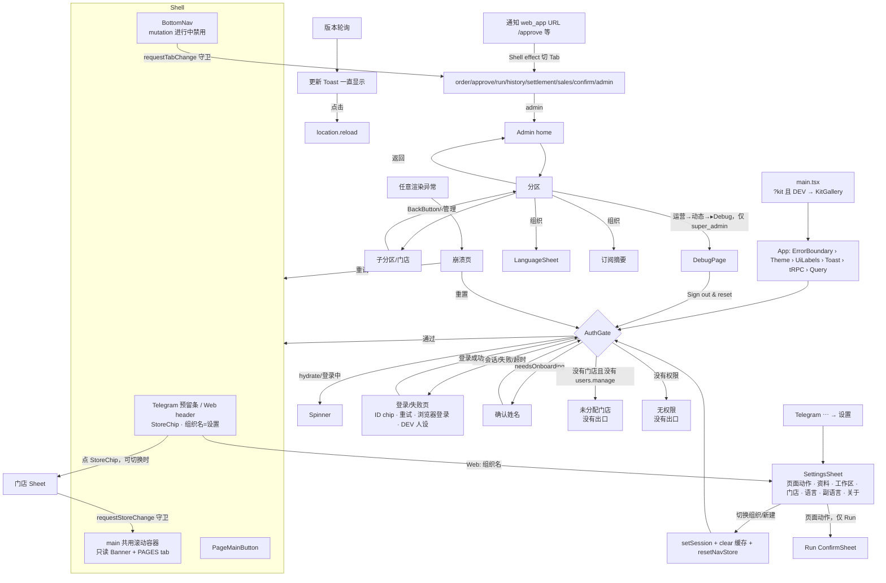

# F1 前端交互审计：App 外壳、导航与全局 UI

- 审计对象：`/Users/sphinx/Desktop/Fine/CompassAlpha`，HEAD `c243771`（main）
- 方式：只读代码审计。没有运行应用，没有截图，也没有任何使用数据。
- 结论标签：**已确认（代码）**＝按代码路径能直接推出；**高可信度推断**＝依赖浏览器、Telegram 客户端或布局的常规行为；**待运行验证**＝必须在真机或浏览器里看。
- 点击次数只在能从代码推出时给出，并写明怎么数的。Telegram 自带界面（⋯ 菜单里有没有“设置”）的那部分点击属于“高可信度推断”。
- 旧报告 `docs/audit-2026-10-21/E-navigation-admin-catalog.md` 只用来对照。下面每条结论都按当前代码重新核对过。旧报告里已经修掉的问题（深链、BackButton 栈、多店切换、staff 的 Sales Tab、`resetNavStore` 等）不再列为问题，只在第 3 节说明现在是怎么工作的。

---

## 1 范围与已读文件

**全文读过**
- `apps/web/src/main.tsx`
- `apps/web/src/app/`：`App.tsx`、`AuthGate.tsx`（824 行）、`Shell.tsx`（693 行）、`ErrorBoundary.tsx`、`PageMenuContext.tsx`、`UiLabelsBridge.tsx`（前 60 行）
- `apps/web/src/stores/`：`navStore.ts`、`authStore.ts`
- `apps/web/src/components/`：`SettingsSheet.tsx`、`StoreSwitcher.tsx`、`LanguageSheet.tsx`、`CreateWorkspace.tsx`、`SubscriptionSummary.tsx`（`PaymentMethodChips.tsx` 只核对了引用方）
- `apps/web/src/hooks/`：`useTelegram.ts`、`useRealtime.ts`、`useOfflineQueue.ts`、`useAppMutating.ts`、`useVersionCheck.ts`、`useI18n.ts`（前 120 行）、`useTapGuard.ts`（前 60 行）
- `apps/web/src/lib/`：`deepLink.ts`、`ownerStack.ts`、`confirm.ts`、`errToast.ts`、`networkError.ts`、`reload.ts`、`trpc.ts`、`telegramLinks.ts`
- `apps/web/src/pages/DebugPage.tsx`，`pages/KitGallery.tsx`（前 40 行）
- `packages/ui/src/`：`index.ts`、`telegramBackStack.ts`、`components/Sheet.tsx`、`components/ConfirmSheet.tsx`、`components/Toast.tsx`、`components/DataState.tsx`、`components/EmptyState.tsx`、`kit/index.ts`、`kit/Sheet.tsx`、`kit/States.tsx`、`kit/Nav.tsx`（前 30 行）；`components/Button.tsx` 与 `kit/Button.tsx` 只读了变体定义
- `packages/db/src/seed-data.ts`（内置角色和权限）

**为核对跨页面模式而局部读过或 grep 过**
- `pages/RunPage.tsx` 的 1185–1270、1625–1720、2495–2580 行
- `pages/runs/sheets/RunSheets.tsx` 的 1270–1370 行
- `pages/OrderPage.tsx` 的 145–185、238–256、588–600、836–850、1262–1300 行
- `pages/SettlementPage.tsx` 的 515–560、615–640、680–692 行
- `pages/ConfirmPage.tsx`（与店铺上下文、离线相关的行）
- `pages/ApprovalPage.tsx` 的 35–75、395–410 行
- `pages/AdminPage.tsx` 的 140–300、340–360、380–530 行
- `pages/admin/shared.ts`
- `pages/admin/operations/OperationsSections.tsx` 的 120–180 行
- `pages/SalesPage.tsx`
- `apps/api/src/services/notifyForEvent.ts`、`apps/worker/src/main.ts` 的 240–260、362–367 行（深链按钮）、`apps/api/src/trpc/trpc.ts:142-150`（只读订阅的报错）
- i18n 目录：`packages/i18n/src/catalogs/zh.ts`（nav / auth / storeSwitcher 等键）
- 全仓库 grep：`@compass/ui` 每个导出的引用方、`usePageMainButton`、`useTelegramBackButton`、`registerTabChangeGuard` / `registerStoreChangeGuard`、`confirmNative` / `confirmThen` / `nativeConfirm`、`ConfirmSheet`、`toast.*`、`errToast`、`DataState` / `EmptyState`、`writeAccess`、`scrollTo` / `scrollTop`、`localStorage`

`components/sales/**` 和各业务页内部由其他 track 负责，这里只看它们和外壳之间的接口。

---

## 2 页面 / 界面清单

可达性分类：A＝已确认不可达；B＝没找到入口，但可能可达；C＝可达，价值待确认；D＝可达，但没有使用数据（下表大多数是这一类）；E＝已被替代。

| ID | 名称 | 源码 | 入口（全部） | 条件 | 模式 / 状态 | 用途 | 下一步可去 | 可达性 |
|---|---|---|---|---|---|---|---|---|
| F1-P01 | 认证加载 Spinner | `AuthGate.tsx:392-407` | 冷启动；`clear()` 之后重新登录 | 尚未 hydrate，或 login / acceptInvite / me 进行中，且未满 10s | 只有一个 32px Spinner，没有文字 | 等待登录 | P02 / P03–P05 / Shell | D |
| F1-P02 | 登录 / 登录失败页 | `AuthGate.tsx:409-548` | 没有会话，且（不在 Telegram，或登录失败，或等待超时） | — | 子块：Telegram ID 复制 chip（`:422`，只在 Telegram 内）；超时 Banner（`:427-433`，生产环境显示翻译文案，DEV 显示中文诊断）；错误 Banner（`:434-438`）；DEV 人设选择器（`:439-455`，`:632-708`，全中文）；“重试邀请”（`:456-468`）；“登录”按钮（`:469-488`）；浏览器访问码表单（`:489-545`，硬编码中文，只在服务端 `loginModes.nonTelegram.available` 时出现） | 登录 / 排障 | 登录成功后进 P03–P05 或 Shell | D（生产 Telegram 中只在失败时出现） |
| F1-P03 | 首次确认姓名 | `AuthGate.tsx:555-557`、`:714-782` | `session.needsOnboarding` | — | 输入框 + 主按钮；错误显示在 Banner 里（`:765-769`） | 锁定显示名 | 成功后进 P04 / P05 / Shell | D |
| F1-P04 | 未分配门店 | `AuthGate.tsx:561-564`、`:785-792` | 没有 `users.manage`，且 `stores.length===0` | 判断顺序在 P05 之前 | 只有 EmptyState，没有按钮，也没有 Telegram ID | 等管理员分配门店 | **没有出口**（见 F1-03） | D |
| F1-P05 | 无权限 | `AuthGate.tsx:566-568`、`:794-804` | `permissions.length===0` | — | 文案 + Telegram ID chip | 等管理员授权 | **没有出口** | D |
| F1-P06 | 崩溃页 | `ErrorBoundary.tsx:85-177` | 任意渲染异常（它是最外层的边界，`App.tsx:97`） | — | 显示错误 message 和堆栈前 8 行（`:116-131`）；“重试”（`:133-150`）；“重置并重载”（`:151-175`，会清掉 auth 和 nav） | 恢复 | 重试后回到原页；重置后重新登录，回到默认 Tab | D |
| F1-P07 | Shell 顶部 | `Shell.tsx:440-519` | 登录后一直显示 | Telegram 内是 chrome 预留条，中间放 StoreChip（`:474-487`）；Telegram 外是 `<header>`，含“Compass” + StoreChip + 显示组织名的设置按钮（`:495-518`） | — | 显示当前门店；Telegram 外从这里进设置 | P11、P13 | D |
| F1-P08 | 只读订阅横幅 | `Shell.tsx:535-541` | `subscription.writeAccess===false` | 每个 Tab 的顶部都有 | 只是 Banner，不禁用任何控件 | 告知只读 | — | D |
| F1-P09 | 底部导航 BottomNav | `Shell.tsx:572-631` | 一直显示 | Tab 集合见 §3.6；任何 mutation 进行中都会变灰并禁用（`:583-599`） | — | 切换主分区 | 8 个 Tab 页 | D |
| F1-P10 | 页面主按钮 PageMainButton | `Shell.tsx:643-693` | Order / Settlement / Confirm / Run 通过 `usePageMainButton` 注册（`OrderPage.tsx:840`、`SettlementPage.tsx:686`、`ConfirmPage.tsx:374`、`RunPage.tsx:1661`） | 有 mutation 进行中时禁用（`:650,661`） | 一直在导航上方；打开 Sheet 后被遮罩挡住 | 页面主操作 | 由页面决定 | D |
| F1-P11 | 懒加载占位 | `Shell.tsx:123-129` | Run / History / Settlement / Sales / Admin 第一次打开时 | — | Spinner | — | — | D |
| F1-P12 | 设置抽屉 SettingsSheet | `components/SettingsSheet.tsx:64-355` | Telegram：⋯ 菜单里的 SettingsButton（`Shell.tsx:276-277` → `useTelegram.ts:237-253`）；Telegram 外：header 右侧的组织名（`Shell.tsx:509-517`） | 只在 Shell 内挂载（拦截页上没有） | 分区：页面动作（`:139-166`，只有 RunPage 注册）、个人资料改名（`:169-210`）、工作区切换 / 新建（`:213-245`）、门店选择（`:248`）、主语言（`:251-272`）、商品副语言（`:281-321`）、关于（`:324-348`） | 个人偏好 + 页面低频动作 | P13、P14、P20 | D |
| F1-P13 | 新建工作区表单 | `components/CreateWorkspace.tsx:14-72` | Settings → 工作区 →“新建”（`SettingsSheet.tsx:238-242`） | `session.isPlatformAdmin` | 嵌在 Settings 内部 | 自助创建租户 | 创建成功后切到新组织 | C（只有平台管理员能用。文件头注释说“登录页也用”，但 AuthGate 里没有引用） |
| F1-P14 | 门店选择抽屉 StoreChip | `components/StoreSwitcher.tsx:197-267` | 点 Shell 顶部的 StoreChip | `canSwitchStore`：`org.admin`，或分配了 ≥2 家门店（`:101-104`）。其他人看到的只是不可点的标签 | “全部门店”行只给 `org.admin` | 切换当前门店 | 关闭，或被页面的守卫拦下（`:143-153`） | D |
| F1-P15 | 门店选择（Settings 内） | `StoreSwitcher.tsx:120-183` 嵌在 `SettingsSheet.tsx:248` | Settings | 同上 | 与 P14 是同一个组件 | 同上 | — | C（和 P14 重复） |
| F1-P16 | 语言抽屉 LanguageSheet | `components/LanguageSheet.tsx:50-114` | Admin → 组织 → 语言行（`AdminPage.tsx:523`） | 能进 Admin 的人 | 选中后自动关闭；有“取消”按钮 | 改界面语言 | — | E（当初加它是因为“网页预览里没有齿轮”，现在 Telegram 外有 header 设置入口 `Shell.tsx:506-517`，它已经被 Settings 取代） |
| F1-P17 | 订阅摘要 | `components/SubscriptionSummary.tsx` | Admin → 组织（`AdminPage.tsx:525`） | 有 `subscription` 时 | 只读时这里还会再出一条横幅（`:18-22`） | 套餐和用量 | — | D |
| F1-P18 | 新版本提示 Toast | `hooks/useVersionCheck.ts:80-84` | 每 30s 轮询一次，窗口获得焦点时也查 | 服务端 commit 与本地不一致 | `ttlMs:0`，一直显示；**点击会直接重载**，没有“稍后”选项 | 升级 | 重载 | D |
| F1-P19 | 全局 Toast 层 | `packages/ui/src/components/Toast.tsx:131-177` | 任何 `useToast` 调用 | 最多同时 4 条，默认 4s | 贴底显示，在导航上方 12px | 反馈 | — | D |
| F1-P20 | 调试控制台 DebugPage | `pages/DebugPage.tsx` | Admin → 运营 → 动态 → 页面最底部“▸ Debug console”（`OperationsSections.tsx:155-169`） | 显示开关要求**角色 slug** `super_admin`（`:57`）；页面本身还要求 `system.logs.view`（`DebugPage.tsx:94-103`） | Live / Server / Health 三栏 + 动作区（含唯一的“Sign out & reset”，`:224-250`） | 运维排障 | 重载 / 登出 | C（`admin` 角色有 `system.logs.view` 但看不到开关；`Shell.tsx:72-75` 的注释“Admin → Debug 子 Tab”已经过时） |
| F1-P21 | 组件陈列页 KitGallery | `pages/KitGallery.tsx` | `/?kit`，并且 `import.meta.env.DEV`（`main.tsx:33-40`） | 仅开发环境 | — | 新设计系统的展示页 | — | A（生产构建会把这个分支剔除） |
| F1-P22 | Telegram 原生确认框 / `window.confirm` | `lib/confirm.ts:14-27` | Approval、Admin 的 `nativeConfirm`、Settlement | Telegram 内用 `showConfirm`，Telegram 外用 `window.confirm` | 文本会被压成一行（`:19`） | 二次确认 | — | D |
| F1-P23 | 深链落地 | `Shell.tsx:243-261` + `lib/deepLink.ts` | 通知里的 `web_app` 按钮，URL 为 `FRONTEND_URL + /approve|/order|/run|/confirm`（`worker/main.ts:253`，`notifyForEvent.ts:63` 等） | 只有可见的 Tab 才会生效 | 没有 UI，只是切 Tab | 从通知直达 | 目标 Tab | D |
| F1-P24 | 门店相关空态（Order / Confirm / Sales 共用文案） | `SalesPage.tsx:27-45`、`OrderPage.tsx:876`、`ConfirmPage.tsx:398` | `storeCtx` 为 `none` 或 `all` | — | EmptyState，**没有 action 按钮**，只在文案里提示“点顶部门店标签” | 提示先选门店 | 需要用户自己去点 P14 | D |

---

## 3 导航模型

### 3.1 没有 URL 路由：Tab 和 Admin 下钻都放在持久化的 Zustand 里（已确认（代码））
- `navStore`（`stores/navStore.ts:135-278`）持久化到 `localStorage['compass.nav.v1']`，内容是 `tab`、`adminSection`、`catalogSub`、`opsSub`、`storeFocus`、`storeSub`。
- `merge`（`:187-275`）会清洗非法值：不认识的值回到默认；某个子选择如果它的父分区不是当前分区，就丢弃。
- Shell 每次渲染都调用 `resolveVisibleTab(persistedTab, visibleKeys)`（`Shell.tsx:228`、`navStore.ts:285-295`）：
  - 持久化的 Tab 不可见时，先试互斥的另一个（sales↔settlement），再回到第一个可见 Tab；
  - **一个可见 Tab 都没有时返回 `'order'`**（见 F1-12）。
- **不持久化的内容**：Sheet 开关、表单草稿、页面内部状态（Approval 的子 Tab、Run 选中的那一趟、History 的筛选等）。换 Tab 时页面直接卸载（`Shell.tsx:542` 只渲染 `PAGES[tab]()`），这些状态全部丢失。

### 3.2 切换 Tab 的调用链
```
BottomNav 按钮 onClick (Shell.tsx:608)
  → requestSetTab(next) (Shell.tsx:230-235)
     → requestTabChange(next) (navStore.ts:64-73)  依次询问已注册的守卫；守卫抛错按“拒绝”处理
        → 目前只有 SettlementPage 注册了守卫 (SettlementPage.tsx:538-545)，有改动时弹 confirmNative
     → 允许 → setTab(next) → 持久化 → 旧页卸载，新页挂载
```
- 任意 mutation 进行中时，导航整体 `pointer-events:none` + 半透明，并且每个按钮 `disabled`（`Shell.tsx:583-610`）。
- 点当前所在的 Tab 没有任何反应（`Shell.tsx:231`），不会“回到该 Tab 的根”。在 Admin 里下钻得很深时，只能逐级返回。
- 切 Tab **不重置滚动**：`<main>` 是所有 Tab 共用的滚动容器（`Shell.tsx:521-534`），全仓库没有任何 `scrollTo` / `scrollTop` 复位（grep 只在 Run 内部有命中）。见 F1-05。

### 3.3 Admin 下钻
- 分区和子分区都读写 navStore（`AdminPage.tsx:140-143`）。返回逻辑在 `SectionFrame.onBack`（`:176-192`），每次上一级：门店详情 → 门店列表 → home；目录子页 → 目录 → home；运营子页 → 运营 → home。
- 返回入口：
  - Telegram 内：`useTelegramBackButton(onBack)`（`AdminPage.tsx:423`），左上角原生返回键；
  - Telegram 外：页内“‹ 管理”（`:432-447`）。这个文字在每一层都是“管理”，不管实际会退到哪一层。
- 深度和点击数（按 `onBack` 的分支数）：home →（1 次点击）分区 →（1 次）子分区 / 门店 → 门店子 Tab 不算层级（`storeSub` 用页内 Tab 切换）。最深是 2 层，退回 home 需要 2 次返回。

### 3.4 Sheet 与 Telegram BackButton / MainButton / SettingsButton
- **BackButton**：全局只有一个“拥有者栈”（`packages/ui/src/telegramBackStack.ts:34-80`）。SDK 按钮上只挂一个监听 `dispatch`，它只调用栈顶的处理器；栈非空就显示返回键，栈空就隐藏（这时 Telegram 显示“关闭”）。
  - 每个 Sheet（新旧两套）在打开时通过 `useSheetPresence` 入栈（`Sheet.tsx:64-82`）；
  - Admin 的 SectionFrame 也入栈（`useTelegram.ts:208-219`）；
  - Sheet 叠在 Section 上面时，返回键先关 Sheet，再退 Section。已确认（代码），单测在 `packages/ui/src/__tests__/telegramBackStack.test.ts`。
- **MainButton**：Telegram 原生 MainButton 一直隐藏（`Shell.tsx:654-658`），换成页内的 `PageMainButton`。页面通过 `usePageMainButton` 把状态压入 `createOwnerStack`（`useTelegram.ts:291-355`），后注册的生效，卸载后恢复下一个。
  - **PageMainButton 是普通文档流元素，没有 z-index**。Sheet 的遮罩是 `fixed inset-0 z-50`（`Sheet.tsx:173-179`），所以打开任何 Sheet 时主按钮都被盖住。RunSheets（`RunSheets.tsx:1341-1345`）和 OrderPage（`OrderPage.tsx:1276-1278`）的注释都承认这一点，所以都在 Sheet 内放了自己的主按钮。RunPage 仍然把 Sheet 的主操作同步给 PageMainButton（`RunPage.tsx:1645-1664`），这段是看不见的死代码（F1-18）。
- **SettingsButton**：Shell 挂载时 `show()` 并绑定点击，卸载时 `hide()`（`useTelegram.ts:237-253`）。所以拦截页（P02–P05）上没有设置入口（F1-03）。

### 3.5 深链、刷新与重新进入、切换组织、登出
- **通知深链**：后端写死 `deepLink: '/approve'|'/order'|'/run'|'/confirm'`（`notifyForEvent.ts:63,75,85,100,115,127,157,171,224,260,275,292`）；worker 把它拼成 `web_app.url`（`worker/main.ts:253,362-367`）。前端处理链：
  ```
  Shell 挂载 → effect (Shell.tsx:243-261)
    → tabFromDeepLinkPath(pathname)：只看最后一段路径；允许值 order|approve|run|history|settlement|confirm|admin（deepLink.ts:14-22，不含 sales）
    → history.replaceState 去掉这一段（防止刷新时重复生效）
    → resolveDeepLinkTab：只有可见的 Tab 才切过去 → requestTabChange 守卫 → setPersistedTab
  ```
  - 通知 payload 里的 `sessionId` / `storeId`（例如 `notifyForEvent.ts:62`）**前端没有用到**：不会切到那家门店，也不会定位到那张单（F1-02）。
  - 目标 Tab 不可见时直接忽略，没有任何提示。
- **邀请链接**：`?startapp=inv_*`（`initDataUnsafe.start_param`）或 `?invite=`（`AuthGate.tsx:73-79`）→ `acceptInvite`（`:361-366`）→ 成功后去掉 `?invite`（`:236-244`）。
- **刷新 / 重新进入**：authStore（`compass.auth`）和 navStore 都持久化，所以会回到原来的 Tab 和 Admin 下钻位置；Sheet 和页内状态丢失。
  - 例外：token 被拒时，`clear()` 会连带调用 `resetNavStore()`（`authStore.ts:178-183`）。这时即使 Telegram 内静默重新登录成功，也回到默认 Tab。触发点有两个：refresh token 被服务端拒绝（`trpc.ts:81-84`），或 `auth.me` 返回 UNAUTHORIZED / FORBIDDEN（`AuthGate.tsx:146-158`）。
- **切换组织**：Settings → 工作区里点某个组织（`SettingsSheet.tsx:224-235`）→ `auth.switchOrganization` → `setSession` + `queryClient.clear()` + `resetNavStore()` + Toast “已切换”+ 关闭抽屉（`:97-112`）。**没有确认，也不经过 Tab / 门店守卫**（F1-11）。新组织里没有门店时会落到 P04，而且出不来（F1-03）。
- **新建组织**：`CreateWorkspace.tsx:22-39`，后续流程同上。
- **登出**：普通用户没有登出入口。唯一的入口是 DebugPage 的“Sign out & reset”（`DebugPage.tsx:224-250`），只有 `super_admin` 角色能到（F1-21）。
- **会话刷新**：access token 过期后，`authFetch` 走单飞刷新，新会话（权限、门店、订阅）通过 refresh 的返回值写回（`trpc.ts:61-114`）。realtime 的 `people.changed` 只失效 `['admin']` 查询（`useRealtime.ts:167-172`），**不刷新会话**（F1-04）。

### 3.6 各角色的 Tab 集合（从 `Shell.tsx:87-117` + `isTabVisible` + `seed-data.ts` 推出）

| 角色（单一内置角色） | 关键权限 | 可见 Tab（按 TABS 顺序） | 数量 | 默认落点 |
|---|---|---|---|---|
| super_admin | 全部 | 下单、审核、采购、历史、结算、验收、管理（sales 因为有 `settlement.record` 被隐藏） | 7 | 下单 |
| admin | 全部，但没有 impersonate / purge / run.amend | 同上 | 7 | 下单 |
| manager | order.draft/approve、prices.view、settlement.record、users.manage、sales.record（**没有** delivery.confirm、run.purchase） | 下单、审核、历史、结算、管理 | 5 | 下单 |
| purchaser | run.purchase、prices.view | 采购、历史 | 2 | 采购 |
| cashier | sales.record、settlement.record | 结算 | **1** | 结算 |
| staff | order.draft、delivery.confirm、sales.record | 下单、销售、验收 | 3 | 下单 |
| 平台管理员（没有 users.manage） | — | 原有 Tab + 管理（`Shell.tsx:183-185`），Admin 里只列 Platform（`AdminPage.tsx:273-280`） | — | — |
| 只有自定义权限、且不对应任何 Tab | 例如只有 `reports.view` | **0 个**，但正文仍渲染 OrderPage（`navStore.ts:294`） | 0 | 下单（F1-12） |

已确认（代码）。多角色时取权限并集，例如 staff+cashier 看到的是“下单、结算、验收”。

### 3.7 全局导航图



---

## 4 交互链

格式：控件 → 处理函数（文件:行）→ 状态变化 → 接口 → 反馈 → 跳转。

| # | 控件 | 处理函数 | 状态变化 | 接口 | 反馈 | 跳转 / 备注 |
|---|---|---|---|---|---|---|
| 1 | 底部 Tab | `Shell.tsx:608` → `requestSetTab` `:230` | navStore.tab | 无 | 选中项变色，`aria-current`；守卫拒绝时什么都不发生 | 新页挂载；滚动位置保留（F1-05） |
| 2 | StoreChip（可切换时） | `StoreSwitcher.tsx:244-254` | `open=true` | 无 | 弹出 Sheet | P14 |
| 3 | 门店行 | `StoreSwitcher.tsx:143-153` → `requestStoreChange` → `setCurrentStore` | authStore.currentStoreId（持久化） | 无，页面查询的 key 随之变化 | 关闭 Sheet，没有 Toast | 当前页按新门店重新取数；Settlement 的守卫可能弹出确认 |
| 4 | Telegram ⋯ → 设置 | `useTelegram.ts:245-247` → `Shell.tsx:277` | settingsOpen | 无 | Sheet | P12 |
| 5 | Web header 组织名 | `Shell.tsx:509-517` | 同上 | 无 | 同上 | 可见文字是组织名，`aria-label` 却是“设置”（a11y 不一致） |
| 6 | Settings 页面动作 | `SettingsSheet.tsx:146-163` | 先关闭 Settings，再调用 `a.onClick`（例如 `setConfirmAction('cancel')`，`RunPage.tsx:1672-1704`） | 无（确认之后才有） | 打开 Run 的 ConfirmSheet | 处理函数来自注册当时的快照（F1-22） |
| 7 | 改名“保存” | `SettingsSheet.tsx:191-198` | — | `auth.completeOnboarding` | 成功：Toast“已保存” + patchSession；失败：errToast | 名字锁定后只显示，不能改 |
| 8 | 组织行 | `SettingsSheet.tsx:230-234` | — | `auth.switchOrganization` | 进行中所有行禁用；成功：Toast“已切换”+关闭；失败：errToast | 没有确认，也不过守卫（F1-11）；导航回默认 Tab |
| 9 | “新建工作区” | `SettingsSheet.tsx:239` | creatingWorkspace=true | 无 | 表单替换掉组织列表 | **没有取消**；关掉 Settings 再打开仍是表单（F1-15） |
| 10 | 创建提交 | `CreateWorkspace.tsx:60-66` | — | `auth.createOrganization` | 成功：Toast + 切换；失败：errToast(`workspace.create.failed`) | 同第 8 行 |
| 11 | 主语言行 | `SettingsSheet.tsx:265-267` | — | `auth.setLocale` | 进行中禁用；成功：patchSession，界面立即换语言，**没有 Toast**，抽屉不关 | 和 LanguageSheet 的行为不一样（F1-16） |
| 12 | 副语言行 / “关闭” | `SettingsSheet.tsx:299-316` | — | `auth.setSecondaryLocale` | 同上 | 副语言等于主语言时，列表里没有任何一行是选中状态（`:292,305`） |
| 13 | LanguageSheet 行 / 取消 | `LanguageSheet.tsx:92-109` | — | `auth.setLocale` | 成功后关闭 | 只在 Admin → 组织 |
| 14 | PageMainButton | `Shell.tsx:676-690` → 页面传入的 onClick | 由页面决定 | 由页面决定 | 任何 mutation 进行中都变灰（不只是自己发起的那个） | 被 Sheet 盖住；被 Toast 盖住（F1-01） |
| 15 | Telegram BackButton | `telegramBackStack.ts:39-41` | 栈顶处理器：关 Sheet，或 Admin 上一级 | 无 | 原生动画 | 栈空时 Telegram 显示“关闭” |
| 16 | 通知“Open Compass” | `Shell.tsx:243-261` | navStore.tab | 无 | 无 | 不切门店、不定位单据（F1-02） |
| 17 | 更新 Toast | `useVersionCheck.ts:80-84` → `reloadApp` | — | — | 一直显示到被点 | 点击 = 立即重载；离开页面超过 5 分钟、且没有 Sheet、没有在途写、没有离线队列时会自动重载（`reload.ts:106-115`） |
| 18 | 崩溃页“重试” | `ErrorBoundary.tsx:135-137` | error=null | — | 重新渲染同一个持久化 Tab | 很可能再次崩溃（F1-10） |
| 19 | 崩溃页“重置并重载” | `ErrorBoundary.tsx:153-163` | 删除 `compass.auth` 和 nav | — | 重载 | Telegram 内静默重新登录，回到默认 Tab |
| 20 | 登录页“登录” | `AuthGate.tsx:471-484` | loginAttempted | `auth.telegramLogin` | 没有 initData 时显示错误 Banner | — |
| 21 | “重试邀请” | `AuthGate.tsx:458-464` | — | `auth.acceptInvite` | 全屏 Spinner | — |
| 22 | 浏览器访问码登录 | `AuthGate.tsx:492-500` | — | `auth.nonTelegramLogin` | 按钮 loading；错误用中文 Banner（`:572-597`） | 仅测试环境 |
| 23 | 确认姓名“继续” | `AuthGate.tsx:771-779` | — | `auth.completeOnboarding` | haptic；错误显示在 Banner | 进入下一道检查 |
| 24 | Telegram ID chip | `AuthGate.tsx:813-818` | — | clipboard | **只有成功时 haptic**，没有 Toast；失败没有任何反馈 | — |
| 25 | Debug “Sign out & reset” | `DebugPage.tsx:228-247` | clear + 清 storage | `auth.signOut`（最多等 4s） | 按钮 loading | **没有二次确认**；重载 |
| 26 | Debug “Copy live as JSON” | `DebugPage.tsx:214-217` | — | clipboard | **没有任何反馈** | — |

### 4.1 全局状态是怎么呈现的
- **加载**：
  - 认证阶段：一个 Spinner，没有文字，10s 后出现超时 Banner；
  - 懒加载页：居中 Spinner（`Shell.tsx:123-129`）；
  - 查询：`DataState` 的 Spinner（`DataState.tsx:37-43`），或者页面自己写的 Spinner（Settlement 7 处、People 6 处等）。
- **空态**：两套 EmptyState。旧版 `components/EmptyState.tsx` 的 action 是可选的；新版 `kit/States.tsx:5-27` 强制要求 action，但没有任何业务页在用。门店相关空态没有放按钮（P24）。
- **错误**：
  - mutation：`errToast`（`lib/errToast.ts:49-63`）只翻译符合 `/^[a-z]+\.errors?\./` 的 key，其他一律显示默认文案，网络错误也不单独说明；
  - 查询：`DataState` 直接显示 `error.message`，没有重试按钮（`DataState.tsx:44-49`）（F1-08）；
  - Settlement 保存失败固定显示 `settlement.errors.save`（`SettlementPage.tsx:623-631`），不显示服务端给的原因。
- **权限**：
  - Tab 级别按 TABS 过滤；
  - 页面级别的空态：Admin（`AdminPage.tsx:164-173`）、Debug（`DebugPage.tsx:94-103`，英文硬编码）；
  - 查询的 FORBIDDEN 不重试（`App.tsx:67-70`）。
- **离线**：
  - Order / Run / Confirm 挂了 `useOfflineQueue`；
  - Run / Confirm 入队时弹 Toast“已离线保存”（`RunPage.tsx:363-364`、`ConfirmPage.tsx:217` 等）；
  - **Order 改数量时静默入队**（`OrderPage.tsx:243-253`）；
  - 队列丢弃时弹 Toast“同步失败”（`OrderPage.tsx:169-176`、`RunPage.tsx:257`、`ConfirmPage.tsx:104`）；
  - **没有任何地方显示 `pendingCount` 或 `online`**（hook 返回了这两个值，`useOfflineQueue.ts:373`，但 grep 没有任何页面读它们）（F1-07）。
- **只读订阅**：只有 `Shell.tsx:535-541` 的 Banner。前端没有任何地方根据 `writeAccess` 禁用控件（grep 只命中 Shell、SubscriptionSummary、PlatformSections）。点了之后服务端返回 `subscription.errors.readOnly`（`trpc.ts:142-150`），errToast 能翻译它（各 locale 都有这个 key），但 Settlement 显示的是通用文案（F1-09）。

---

## 5 跨页面一致性

| 维度 | 实现方式与位置 | 不一致之处 |
|---|---|---|
| 二次确认 | ① 原生确认框 `confirmThen` / `confirmNative`：ApprovalPage（`:35,42,401`）、Admin `nativeConfirm`（`admin/shared.ts:6-8`；Catalog 5 处、People 6 处、Stores 1 处）、Settlement（`:343-347,517,531,542,876,934`）；② 底部 Sheet：RunSheets 的自定义 `ConfirmSheet`（`RunSheets.tsx:1279`，`RunPage.tsx:2564`）、`@compass/ui` 的 `ConfirmSheet`（只在 `RunPage.tsx:2501` 改名为 PriceCheckSheet 使用一次）、Sales 作废用页内 Sheet（`StoreSalesPanel.tsx:328-351`）；③ 没有确认：切换组织（`SettingsSheet.tsx:230`）、Debug 登出（`DebugPage.tsx:228`）、换门店（不会丢数据，可以接受） | 同为“危险操作”，有的用 Telegram 原生确认框（不能写理由、文字被压成一行），有的用 Sheet（可以写理由）。Approval 的“接管”用原生框，Run 的“取消”用 Sheet。切换组织会清空缓存和导航，却没有确认 |
| Toast / 错误 | `useToast` 有 19 个文件在用；`errToast` 在 Run 21、People 17、Catalog 17、Ops 8、Stores 7、Approval 6、Order 4、Settings 4、Confirm 3 处；Settlement 一次都没用，改成直接 `toast.error`（5 处） | 同一种服务端拒绝，各页提示不同。网络错误：Order、Run、Confirm 单独处理（`isLikelyNetworkError`，共 15 处），其他页面只显示通用错误 |
| 加载 / 空 / 错 | `<DataState>` 20 处（Ops 6、Catalog 4、Order 2、People 2、Run / Debug / Confirm / Approval / Stores / Platform 各 1）；页面自己写 `isError` 分支 12 处；自带“重试”按钮的只有 HistoryPage `:155`、SettlementPage `:743,787,1561`、RunPanels `:1990` | DataState 不提供重试，错误文本是原始 message；有的页面有重试，有的没有 |
| 主操作位置 | PageMainButton：Order、Settlement、Confirm、Run。在页内或 Sheet 内放按钮：Approval、History、Sales、Admin 全部 Sheet | 有 Sheet 打开时，主操作只能放在 Sheet 的 footer 里（Order 的 review、Run 的确认等都单独渲染了按钮），RunPage 还保留着同步给 PageMainButton 的死代码（F1-18）。四个页面的主按钮位置固定在导航上方，其他页面的主操作散落在页面里 |
| 返回 | Telegram BackButton 栈只有两类拥有者：Sheet 和 Admin SectionFrame。Telegram 外：Admin 有“‹ 管理”，Sheet 靠点遮罩或下滑关闭 | Run、History 等页面内部的二级视图（例如多趟切换、历史详情）走 Sheet，所以有返回；页内展开或折叠的视图没有返回语义（由其他 track 确认） |
| 未保存守卫 | `registerTabChangeGuard` 和 `registerStoreChangeGuard` 只有 Settlement 注册（`SettlementPage.tsx:528-545`），外加 `beforeunload`（`:549-558`）。Run 的 ConfirmSheet 在 mutation 进行中禁止关闭（`RunSheets.tsx:1355-1364`）；Order 的 review Sheet 同理（`OrderPage.tsx:1270`） | 切换组织、更新 Toast 引发的重载、崩溃重置都不经过守卫。Admin 的编辑 Sheet、Sales 草稿都没有守卫（草稿很小，影响有限） |
| 页面标题 | `StickyPageBar`（Order / Approval / Confirm）、`PageHeader`（只有 Sales，`SalesPage.tsx:49`，副标题和 StoreChip 重复显示门店名）、自己写 `<h1>`（Admin SectionFrame、Settlement、RunHistory、Debug） | 三种写法 |
| 分段 / Tab 控件 | `Tabs`（只有 Approval）、`Segmented`（Admin 的 Ops / People / Stores）、`ChipBar + Chip`（Order / Confirm / Run / RunPanels / Debug） | 三种视觉，功能相同 |
| 剪贴板反馈 | People 有成功和失败两种 Toast（`PeopleSections.tsx:215-230`）；Telegram ID chip 只有成功时 haptic；Debug 复制没有任何反馈 | 不一致 |
| 文案国际化 | DebugPage 全英文；AuthGate 的浏览器登录和 DEV 人设全中文；`ConfirmSheet` 默认 `'Cancel'` / `'Reason'`（`ConfirmSheet.tsx:66,122`），目前唯一调用方传了 `cancelLabel`；Settings“关于”里的角色直接显示 slug（`SettingsSheet.tsx:335-341`） | — |

---

## 6 重复实现

1. **两套设计系统并存**：`@compass/ui` 的根导出（旧）和 `@compass/ui/kit`（新，`kit/index.ts:1-7` 写着“重做的页面只能从这里导入”）。kit 一共 11 个文件，约 670 行，除了只在开发环境存在的 `KitGallery.tsx` 外，**没有任何业务文件引用**（grep `@compass/ui/kit` 只命中 KitGallery）。kit 自己有 `BottomNav`（支持计数徽章，`kit/Nav.tsx:3-8`）、`Sheet`、`EmptyState`/`ErrorState`（自带重试）、`Button`（`busy` 属性），和旧版同名但 API 不同。已确认（代码）。
2. **ConfirmSheet 有两个**：`packages/ui/src/components/ConfirmSheet.tsx`（props 平铺）和 `pages/runs/sheets/RunSheets.tsx:1279`（`config` 对象，支持“可选理由”，进行中禁止关闭）。RunPage 两个都在用，其中一个改名为 `PriceCheckSheet`（`RunPage.tsx:35,70`）。
3. **Sheet 有两个**：`components/Sheet.tsx`（`title` 可选、带 `description` / `footer` / 延迟聚焦）和 `kit/Sheet.tsx`（`title` 必填、`actions`）。两者共用 `useSheetPresence`。
4. **EmptyState 有两个**：见 §4.1。
5. **语言选择有两处**：`SettingsSheet.tsx:44-49` 和 `LanguageSheet.tsx:38-43` 各自定义了一份 `LANGS`，交互也不同（一个选完不关，一个选完就关、还有取消按钮）。
6. **门店选择入口有两处**：StoreChip 的 Sheet 和 Settings 里的同一个组件（`SettingsSheet.tsx:248`）。功能相同。
7. **只读 Banner 出现两次**：在 Admin → 组织里，Shell 的横幅（`Shell.tsx:535-541`）加上 `SubscriptionSummary.tsx:18-22`，会同时显示两条。
8. **类型重复定义**：`AdminSection`、`CatalogSub`、`OperationsSub`、`StoreFocus`、`StoreSub` 在 `navStore.ts:77-102` 和 `pages/admin/shared.ts:9-48` 各写了一份。navStore 的注释说这是为了避免依赖懒加载的 chunk。现在两份一致，但以后容易改漏一处。
9. **`@compass/ui` 中业务从未引用的导出**（按 import 统计，见 §1 的 grep）：`CardFooter`、`surfaceClass`、`pillButtonClass`、`SheetHeader`/`SheetBody`/`SheetFooter`（只在内部用）、`useSheetCount`、`subscribeSheetCount`、`telegramBackStack`、`createBackHandlerStack`（只有测试用）、`Stepper`（旧版）、`FieldLabel`、`IconDebug`、`useTheme`、`DEFAULT_UI_LABELS`。`Sheet.tsx:11-17,45-49` 里关于“SectionFrame 用 useSheetCount”的注释已经过时（`AdminPage.tsx:414-418` 已经改成用栈）。
10. **i18n 里没人用的导航 key**：`nav.deliver`、`nav.reports`、`nav.debug`（`zh.ts:8,13,14`）。TABS 不用它们。
11. **过时注释**：
    - `Shell.tsx:72-75`：说 Debug 是 Admin 子 Tab，“5 个 Tab”；
    - `CreateWorkspace.tsx:10-13`：说登录页也在用它；
    - `useTelegram.ts:232-235`：说“Admin → Organization 的语言行用于网页预览”；
    - `RunPage.tsx:2524-2525`：说主操作由 MainButton 处理；
    - `ConfirmSheet.tsx:31-34`：`showPrimaryInSheet` 已经没有调用方传 false。

---

## 7 问题清单

| ID | 级别建议 | 标题 | 证据 | 用户影响 | 修复方向 | 验证方法 |
|---|---|---|---|---|---|---|
| **F1-01** | **P1** | Toast 层盖住 PageMainButton；“新版本”Toast 一直显示，点到就重载 | Toast 容器 `bottom: safe + --app-nav-h(64px) + 12px`，`zIndex:100`，每条 Toast 都是 `pointerEvents:auto` 的按钮，`min-w-[200px]` 并居中（`Toast.tsx:142-169`；`tokens.css:106`）。PageMainButton 正好在导航上方，高 48+8+8=64px（`Shell.tsx:663-690`）。更新 Toast 是 `ttlMs:0`，点击就 `reloadApp`（`useVersionCheck.ts:80-84`） | 高可信度推断：Toast 的位置是导航上方 76px 起、约 50px 高，几乎完全落在主按钮里面，并且盖住主按钮中间那一段。① 普通 Toast（例如提交失败的 error Toast）显示的 4s 内，用户点主按钮重试，实际点到的是 Toast（只会关掉它）；② 部署之后，所有在线用户的主按钮上会一直压着“新版本”Toast，想点“提交 / 保存”的人会点到 Toast，**页面直接重载**。Settlement 有 `beforeunload`，但 Telegram WebView 是否会弹提示未知；Order 的草稿在服务端，丢失有限，但用户的操作被打断 | Toast 层的 bottom 要把 PageMainButton 的高度算进去（例如 Shell 发布一个 `--app-main-btn-h` CSS 变量）；更新 Toast 改成不挡操作的位置（顶部或页内 Banner），并给出“稍后”选项 | 真机：在 Order 页触发提交失败的 Toast，以及模拟服务端版本不一致，观察遮挡和误触 |
| **F1-02** | P2 | 通知深链只切 Tab，不切门店、不定位单据 | `deepLink.ts:31-53` 只解析路径；`notifyForEvent.ts:62` 的 payload 里有 `storeId` / `sessionId`，但前端没读；ApprovalPage 按当前门店过滤（`ApprovalPage.tsx:60-74`）；Confirm 只看当前门店（`ConfirmPage.tsx:57-58`） | 高可信度推断：管理多家门店的店长收到 B 店“待审核”通知，点开后看到的是 A 店的队列（可能是空的），会以为通知错了；验收通知同理 | 深链带上 `?store=<id>`（或 startapp），前端经过 `requestStoreChange` 切门店，再定位或高亮那张单 | e2e：两店店长 + B 店提交 → 用 `/approve` 打开，断言可见 |
| **F1-03** | P2 | 拦截页没有任何出口：不能换语言、不能切组织、不能刷新 | Shell 才挂载 SettingsButton（`Shell.tsx:277`）；P04 / P05 / P03 / P02 都在 Shell 之外（`AuthGate.tsx:555-568`）；P04 只有 EmptyState（`:785-792`）；切换组织后如果新组织没有门店，就落到 P04（`SettingsSheet.tsx:98-104` + `AuthGate.tsx:562`）；登录按最后一次组织 `lastOrgId` 选择（`auth.ts:756`） | 已确认（代码）：属于多个组织的用户，进入或被邀请进一个还没分配门店的组织后，回不到原来的组织，只能等管理员处理。拦截页的语言只能跟着 Telegram 或会话；管理员分配门店之后，用户必须完全退出 Mini App 再进来（F1-04） | 拦截页放一个精简版设置（语言、组织列表、“重新检查”按钮去调 `auth.me` 的 refetch）；P04 也显示 Telegram ID chip | 用双组织账号实测 |
| **F1-04** | P2 | 权限、门店、订阅变化不会实时生效 | `useRealtime.ts:167-172`：`people.changed` 只失效 `['admin']`；`AuthGate` 的 `me` 只在挂载时查（`:119-125`，全局 `refetchOnWindowFocus:false`，`App.tsx:83`）；会话只在 refresh 时更新（`trpc.ts:97-104`） | 高可信度推断：管理员给成员分配门店或角色、或者订阅恢复之后，对方的 Tab、门店、只读横幅要等 access token 过期（注释说 TTL 15 分钟，`trpc.ts:127`）或者重新打开才会更新；停在 P04 的用户（页面上没有任何查询）更新不了 | `people.changed`（只针对本人）或 Telegram 回到前台时调用 `auth.me` 的 refetch | 两台设备：A 给 B 分配门店，观察 B 多久后变化 |
| **F1-05** | P2 | 切 Tab 和 Admin 下钻时滚动位置不复位 | 所有 Tab 共用一个 `<main overflow-y-auto>`（`Shell.tsx:521-543`）；没有任何 `scrollTo` 复位（grep） | 高可信度推断：在 Order 长列表滚到很下面，再切到“验收”或“审核”，新页面一打开就是中间位置（新内容足够长的时候），顶部的 StickyPageBar 和关键信息不在视野内。Admin 的列表进详情同理 | 在 tab 或 adminSection 变化时重置 `main.scrollTop`，或者每个 Tab 记住自己的滚动位置 | 浏览器实测 |
| **F1-06** | P2 | 任何 mutation 都会冻结导航和主按钮，包括 Order 的 +/- | `useAppMutating` = `useIsMutating()>0`（`useAppMutating.ts:25-27`）；导航（`Shell.tsx:583-599`）和主按钮（`:650-661`）都用它；Order 的 `adjust` 是普通的 `useMutation`（`OrderPage.tsx:229`） | 高可信度推断：员工连续点数量 +/- 时，底部导航会不停在半透明和正常之间闪，“下一步”主按钮也会闪成灰色；网络慢时，每次点击后的整个请求期间都切不了 Tab | 只统计“关键” mutation（给 `mutationKey` 或 meta 打标记再过滤），乐观更新的高频写不计入 | 3G 限速下实测 Order |
| **F1-07** | P2 | 离线写队列对用户不可见 | hook 返回 `pendingCount` / `online`（`useOfflineQueue.ts:373`），但没有任何页面读它们（grep `offline.` 只有 `enqueue`）；Order 改数量静默入队（`OrderPage.tsx:243-253`）；重放成功没有通知（`onDrop` 只在失败时触发，`:204-222`）；只有挂了这个 hook 的页面（Order / Run / Confirm）才会在 `online` 时 flush（`:356-371`） | 已确认（代码）：员工离线时改的数量看起来已经生效，实际上在排队；切到“审核”等页面后，网络恢复也不会立即重放；用户无从知道还有几条没同步 | Shell 级别放一个“离线 / 待同步 N 条”指示，把 flush 监听提升到 App 级别 | 断网操作后切换 Tab，再恢复网络 |
| **F1-08** | P2 | `DataState` 的错误态显示原始 message，而且没有重试 | `DataState.tsx:44-49`（`query.error?.message`；声明了 `refetch` 但没用）；20 处使用 | 已确认（代码）：查询失败时用户看到的是 `order.errors.xxx` 这样的 key，或者 “Failed to fetch”，只能切 Tab 再回来 | 走 `useTranslateError`（通过 UiLabels 注入），加一个“重试”按钮调用 `query.refetch` | 断开 API 后打开 Admin → 运营 |
| **F1-09** | P2 | 只读订阅时只有横幅，所有写操作照样可以点 | `writeAccess` 只在 `Shell.tsx:535`、`SubscriptionSummary.tsx:18`、`PlatformSections.tsx:81` 用到；Settlement 的错误文案是固定的（`SettlementPage.tsx:630`） | 已确认（代码）：用户填完整张结算单才在保存时被拒绝，Settlement 还看不到拒绝原因 | 全局提供 `useWriteAccess()`，用来禁用 PageMainButton 和写操作按钮，并说明原因；Settlement 改用 errToast | 把租户设成 `suspended` 后走一遍 |
| **F1-10** | P2 | 只有一个全局 ErrorBoundary：某一页崩溃就连导航一起没了 | `App.tsx:97` 是唯一的边界；“重试”只是 `setState({error:null})`（`ErrorBoundary.tsx:135-137`），而崩溃所在的 Tab 是持久化的；“重置”会删掉 auth（`:155`）；向终端用户展示堆栈（`:116-131`） | 高可信度推断：某个 Tab 有稳定会复现的渲染错误时，“重试”会一直回到同一个崩溃，用户只能“重置”（等于登出），而且没法先切到别的 Tab 继续工作 | 在每个 `PAGES[tab]` 外面包一层页级边界，保留导航；生产环境把堆栈折叠起来 | 注入一个渲染错误 |
| **F1-11** | P2 | 切换组织没有确认，也不经过未保存守卫 | `SettingsSheet.tsx:230-234` 直接 mutate；成功后 `queryClient.clear()` + `resetNavStore()`（`:104-107`）；不调用 `requestTabChange` / `requestStoreChange` | 已确认（代码）：结算员在 Settlement 填到一半，打开设置时误点了另一个组织，草稿直接丢掉，也没有提示 | 切换前先走两个守卫，再加一次确认 | 在 Settlement 改动之后切换组织 |
| **F1-12** | P2（取决于是否有自定义角色） | 用户的权限不对应任何 Tab 时，会渲染 OrderPage，导航为空 | `resolveVisibleTab` 返回 `visibleKeys[0] ?? 'order'`（`navStore.ts:294`）；`PAGES[tab]()` 不检查可见性（`Shell.tsx:542`）；BottomNav 是 `repeat(0, …)`（`:589`） | 已确认（代码）：例如只有 `reports.view` / `inventory.adjust` 的自定义角色，会看到一个下单页，接着收到一堆 FORBIDDEN，没有导航。是否存在这种角色：待验证 | `visible` 为空时显示 NoAccess 类的页面 | 造一个只有 `reports.view` 的角色登录 |
| F1-13 | P3 | Tab 数量两极分化，也没有待办徽章 | 7 个 Tab（admin / super_admin）、1 个 Tab（cashier）（§3.6）；旧 BottomNav 没有计数，kit 的 BottomNav 有 `count` 但没人用（`kit/Nav.tsx:3-8`） | 高可信度推断：375px 宽、7 个 Tab 时每个约 53px，俄语和乌兹别克语的标签会被截断（`truncate`，`Shell.tsx:620`）；cashier 只有一个 Tab，却多占了 64px；审核人要打开“审核”才知道有没有单子在等 | 管理员把低频 Tab 收进“更多”；只有 1 个 Tab 时隐藏导航；审核和验收显示待办数 | 各语言截图 |
| F1-14 | P3 | 页面低频动作藏在 Telegram ⋯ → 设置里 | 只有 Run 注册（`RunPage.tsx:1672-1704`），渲染在 Settings 顶部（`SettingsSheet.tsx:139-166`）；Telegram 外的入口是 header 的组织名 | 高可信度推断：“撤销开始采购”“取消采购”的路径是 ⋯ → 设置 → 动作 → 确认 = 4 次点击（数法：⋯ 菜单 1、设置项 1、动作按钮 1、ConfirmSheet 主按钮 1）；用户很难发现这些动作在“设置”里 | Run 页内放一个可见的“更多”按钮，打开同一组动作 | 可用性测试 |
| F1-15 | P3 | SettingsSheet 的局部状态会过期或卡住 | Settings 一直挂载（`Shell.tsx:439`）；`creatingWorkspace` 只在创建成功时复位（`SettingsSheet.tsx:127,218`），没有取消按钮；`draftName` 只初始化一次（`:126`）；副语言等于主语言时没有任何一行选中（`:292,305`） | 已确认（代码）：平台管理员点了“新建”以后，再也看不到组织列表，只能真的创建一个或者重载；改名草稿可能是旧值 | 加“取消”；抽屉打开时重新同步草稿；副语言列表处理“与主语言相同”的情况 | 手动操作 |
| F1-16 | P3 | 两个语言入口的行为不一致 | 见 §6 第 5 条；`LanguageSheet.tsx:57-66`（成功后关闭） vs `SettingsSheet.tsx:82-87`（不关） | 已确认（代码） | 删掉 Admin 的 LanguageSheet，那一行改成打开 Settings | — |
| F1-17 | P3 | 设计系统重复，有死代码 | §6 第 1–4、9 条 | 已确认（代码）：维护成本高，新旧组件视觉会慢慢分开 | 定出迁移路线；在那之前删掉 kit 或冻结它 | — |
| F1-18 | P3 | RunPage 把 Sheet 的主操作同步给 PageMainButton，这部分是死代码 | `RunPage.tsx:1192-1255,1645-1664`；遮罩挡住主按钮（`Sheet.tsx:173-179`，`RunSheets.tsx:1341-1345` 自己也承认）；Sheet 都有自己的 footer（`RunPage.tsx:2531-2548`） | 已确认（代码）：用户看不到，但会误导后来的维护者；`ConfirmSheet.showPrimaryInSheet` 也已经没用了 | 删掉相应分支和 prop | — |
| F1-19 | P3 | 二次确认的形式不统一 | §5 第一行 | 已确认（代码）：Telegram 原生确认框不能写理由，长文案会被压成一行（`confirm.ts:19`）；同一类危险操作，在不同页面体验不同 | 定一个规则：要理由的、或者涉及金额和库存的用 Sheet，轻量操作用原生框 | — |
| F1-20 | P3 | 登录失败页总是说“把 ID 发给管理员” | `AuthGate.tsx:419,422` 在 `!activeSession` 分支里无条件显示 | 已确认（代码）：网络超时或服务端出错时，也提示用户去找管理员，会误导 | 只在 `auth.errors.noMembership` 一类的错误下显示这句 | — |
| F1-21 | P3 | 没有常规登出；Debug 入口按角色 slug 而不是权限判断 | `DebugPage.tsx:224-250` 是唯一的登出；`OperationsSections.tsx:57,155` 判断 `roleSlugs.includes('super_admin')`，而 DebugPage 自己判断 `system.logs.view`（`:94`） | 已确认（代码）：`admin` 角色有 `system.logs.view` 却看不到 Debug；共用的浏览器设备（测试环境）没法登出。在 Telegram 内影响很小 | 入口改成按 `system.logs.view` 判断；Settings → 关于里放“登出”（Telegram 外） | — |
| F1-22 | P3 | `usePageMenu` 注册的是快照，点击处理函数可能过期 | `PageMenuContext.tsx:84-102`：effect 只在 `key`（由文案拼成）变化时 `setRegistration(ref.current)`；注释说“处理函数通过 ref 保持最新”，但 context 里存的是旧对象 | 已确认（代码）：目前唯一的使用方（`RunPage.tsx:1672-1704`）的 onClick 只调用 `setConfirmAction`（setState 引用稳定），所以**暂时没有实际 bug**，以后新加的使用方会踩坑 | 存一个代理对象，点击时再读 `ref.current` | 单测 |
| F1-23 | P3 | 原始 slug 和 a11y 标签 | `SettingsSheet.tsx:335-341` 直接显示 `super_admin, manager`；Web header 的设置按钮可见文字是组织名，`aria-label` 是“设置”（`Shell.tsx:511-516`） | 已确认（代码） | 角色名走 i18n；可访问名称要包含组织名 | — |
| F1-24 | P3 | 邀请 token 在整个 App 生命周期内都在：`me` 一直被禁用，重载时还会重复接受邀请 | `AuthGate.tsx:108` 的 `useState(inviteTokenFromLaunch)`；`me` 的 `enabled: … && !inviteToken`（`:123`）；接受邀请的分支在 `if (activeSession) return` **之前**（`:361-366`） | 高可信度推断：通过邀请链接进入的那一次启动，之后每次重载（例如更新 Toast）都会再调一次 `acceptInvite`，期间显示全屏 Spinner；如果服务端认为 token 已经用过而报错，错误被 activeSession 盖住，看不到；这一次启动里会话也不会被 `me` 校准。服务端对重复接受怎么处理：待验证 | 接受成功后记下“已消费”（sessionStorage）；有会话时跳过 | 用邀请链接进入后触发重载 |
| F1-25 | P3 | 深链目标不可见时静默忽略；`sales` 不在白名单里 | `Shell.tsx:257`；`deepLink.ts:14-22` | 已确认（代码）：权限变化后点通知，没有任何提示 | 给一条 Toast“你没有权限查看…” | — |
| F1-26 | P3 | realtime 的 `notification` 事件在应用内没有任何呈现；重连后的补拉不包括结算、销售、库存 | `useRealtime.ts:173-175` 失效了一个并不存在的 `notifications` 查询（前端 grep 不到）；`REOPEN_INVALIDATE_KEYS`（`:32`） | 已确认（代码）：服务端推过来的 title / body 被丢掉；两人同时看同一张结算单时，看不到对方的保存 | 要么做应用内通知，要么不推这个事件；补拉范围加上 settlement / sales / inventory | — |
| F1-27 | P3 | DebugPage 的细节 | 全英文；“Sign out & reset”没有确认（`:228`）；复制没有反馈（`:214-217`） | 已确认（代码）：只影响运维人员 | 加确认和 Toast | — |
| F1-28 | P3 | Telegram 外 Admin 的返回按钮固定写“管理” | `AdminPage.tsx:443-444` | 已确认（代码）：在子分区里点“‹ 管理”只会回到上一级分区，不是 Admin 首页 | 文字改成上一级的名称 | — |
| F1-29 | P3 | 门店相关空态没有操作按钮 | `SalesPage.tsx:38-41`、`OrderPage.tsx:876`、`ConfirmPage.tsx:398`；文案让用户“点顶部门店标签”（`zh.ts:324`） | 已确认（代码）：org.admin 选了“全部门店”以后，进 Order / Confirm / Sales 还要自己去找顶部标签 | EmptyState 的 `action` 里放一个按钮，直接打开门店 Sheet | — |

---

## 8 待运行验证项
1. F1-01：真机（iOS / Android Telegram）上 Toast 与 PageMainButton 的实际重叠区域；更新 Toast 被误触时，Settlement 在 Telegram WebView 里会不会弹 `beforeunload` 提示。
2. F1-05：切 Tab 以后 `<main>` 的滚动位置（尤其是 Order → Approval、Admin 列表 → 详情）。
3. F1-06：网络慢时连点 +/-，底部导航的闪烁和不可用时长。
4. F1-02：两店店长点通知深链后看到的是哪家门店的列表；nginx 对 `/approve` 等路径是否回退到 index.html。
5. F1-04：access token 的实际 TTL，以及权限变更后多久生效。
6. F1-13：7 个 Tab 在 ru / uz 下的截断情况。
7. F1-24：服务端对已接受邀请 token 的重复 `acceptInvite` 返回什么。
8. Telegram ⋯ 菜单里“设置”项的实际位置（影响 F1-14 和 §3.5 的点击数）。
9. BackButton 栈在 Android 硬件返回键上的表现（单测只覆盖了栈逻辑本身，`telegramBackStack.test.ts`）。
10. F1-12：生产环境是否存在不对应任何 Tab 的自定义角色。

## 9 未覆盖范围
- 各业务页内部（Order / Approval / Run / Confirm / History / Settlement / Sales / Admin 各分区）的交互细节：由其他 track 负责。这里只引用了它们与外壳相关的行。
- `components/sales/**`（其他 track）。
- `index.html` 启动画面和 `boot-guard.js`、`styles/`、`tokens.css`（只查了导航高度）、`theme.tsx`（只看了 Telegram 主题同步）。
- `packages/ui` 中 `QtyControl`、`PhotoCapture`、`Rows`、`Tabs`、`Segmented`、`Chip` 的内部实现：只统计了在哪里被引用，没有逐行审查。
- 服务端行为（除了深链、只读错误、`lastOrgId` 选组织）。
- 没有运行任何构建、测试或 e2e，也没有任何使用数据，所以所有“价值”判断都没有数据支撑（可达性 D）。
