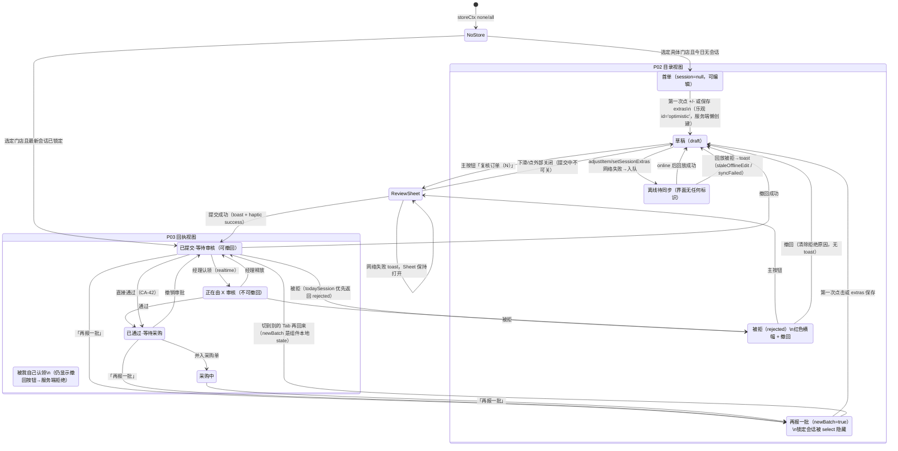
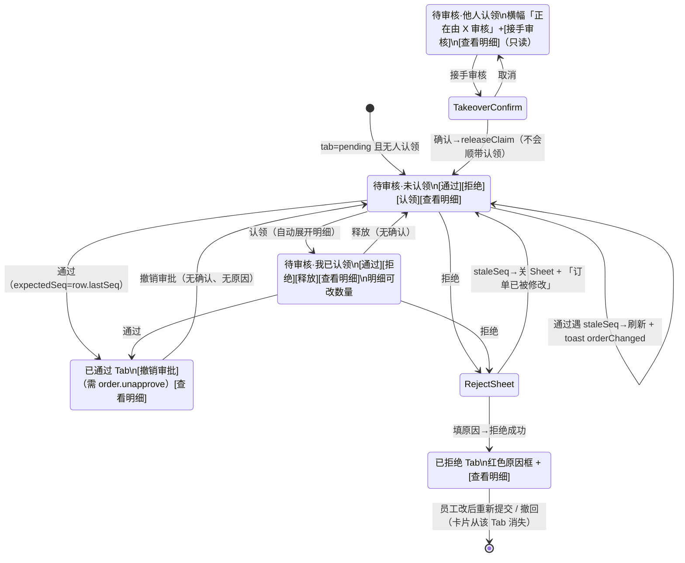

# F2 前端交互审计：订货页（OrderPage）与审批页（ApprovalPage）

- 基线：`main` @ `c243771`（2026-10-21）。只读审计，未运行应用、未接触数据库或生产环境。
- 结论标注：**已确认（代码）**＝逐行读过代码，能推出该行为；**高可信度推断**＝从代码推出，但涉及运行时时序或浏览器行为；**待运行验证**＝需要真机或 e2e 才能定论（每条都写明需要什么）。
- 点击数只在能从代码推出时给出，并说明计法。全文没有任何使用数据，所以可达性分类里的“D”只表示“没有数据”，不代表“没人用”。
- 旧审计 `docs/audit-2026-10-21/B-order-approval.md` 已按当前代码逐条复核，复核结果见 §7 末尾的“与旧审计的对照”。

---

## 1 范围与已读文件

| 文件 | 读取范围 | 用途 |
|---|---|---|
| `apps/web/src/pages/OrderPage.tsx` | 全文 1–2090 | 主体 |
| `apps/web/src/pages/ApprovalPage.tsx` | 全文 1–921 | 主体 |
| `apps/web/src/hooks/useOfflineQueue.ts` | 全文 | 离线队列，OrderPage 用到 |
| `packages/ui/src/components/QtyControl.tsx` | 全文 1–458 | +/-、长按连加、快选 Sheet |
| `apps/web/src/lib/confirm.ts` | 全文 | 原生确认框 |
| `apps/web/src/hooks/useTelegram.ts` | 300–355（`usePageMainButton`） | 主按钮 |
| `apps/web/src/app/Shell.tsx` | 60–200 | Tab 定义、权限门控 |
| `apps/web/src/lib/deepLink.ts` | 全文 | 通知深链 `/order`、`/approve` |
| `apps/web/src/stores/navStore.ts` | 120–135 | 默认 Tab 为 `order` |
| `apps/web/src/hooks/useRealtime.ts` | 1–35 | `order.changed` 防抖失效刷新 |
| `apps/api/src/trpc/routers/order.ts` | 108–260, 345–400, 535–760, 761–1024, 1385–1520 | todaySession / todayBatches / pendingList / adjustItem / 各审批命令 |
| `packages/domain/src/order/commands.ts` | 325–512, 600–660 | Submit / Claim / Release / Approve / Reject / Withdraw / Unapprove，编辑权限 |
| `packages/domain/src/order/state.ts` | 220–290 | 状态迁移（Approved/Rejected 清除认领，Withdrawn 清除拒绝原因） |
| `apps/api/src/services/orderProjection.ts` | Approved/Rejected 分支 | 投影同样清除认领 |
| `apps/api/src/services/priceStats.ts` | 242–272 | 预估金额规则（上次买入价） |
| `packages/contracts/src/schemas/order.ts` | 185–210 | `expectedSeq`、Reject/Unapprove 入参 |
| `packages/i18n/src/catalogs/zh.ts` | 323–324, 603–750, 1011, 1550–1551 | 界面实际中文文案 |
| `tests/e2e/tests/main-flow.spec.ts` | grep | 现有 e2e 覆盖到的审批点 |

---

## 2 页面/界面清单

可达性分类：A 已确认不可达 / B 未发现入口但可能可达 / C 可达但价值待确认 / D 无使用数据 / E 已被替代。下表 D 列对所有页面都成立（没有埋点数据），只在有其它判断时另列。

| ID | 名称 | 位置 | 入口 | 条件（角色/权限/会话状态） | 模式 | 用途 | 后续去向 | 可达性 |
|---|---|---|---|---|---|---|---|---|
| F2-P01 | 订货页·无门店/未选门店空态 | `OrderPage.tsx:858-882` | 底部导航「订货」（`Shell.tsx:88`，需 `order.draft`）；深链 `/order`（`deepLink.ts:14-22`） | `storeCtx.kind` 为 `none` 或 `all` | `none`→`auth.noStore`；`all`→“请先选择门店”（`zh.ts:323-324`） | 拒绝在“所有门店”下单 | 点 Shell 顶部 StoreChip 选门店后进入 P02/P03 | D |
| F2-P02 | 订货页·目录（编辑）视图 | `OrderPage.tsx:1007-1317` | 同上；默认落地 Tab（`navStore.ts:127`） | 指定门店；会话为 `null` / `draft` / `rejected`，或处于“再报一批”模式 | ① 今日首单（无会话）② 草稿 ③ 被拒（红色横幅 + 撤回）④ 再报一批（`newBatch=true`） | 选 SKU 和数量、填其他物品 | 主按钮→P04；「今日 N 批」→P05；数量值→P08 | D |
| F2-P02a | 目录视图里的“已提交/已认领/已通过/采购中”横幅 | `OrderPage.tsx:1102-1119, 1136-1161` | — | 要求目录视图下 `sessionStatus` ∈ {submitted, approved, in_run} | — | — | — | **A**（见 F2-13：锁定状态一律先进入 P03 回执，再报一批模式又会用 `select` 把锁定会话过滤掉，`OrderPage.tsx:130-134, 907`） |
| F2-P03 | 订货页·已提交回执视图 | `OrderPage.tsx:907-1005` | 提交成功后自动进入；之后再打开订货页也是它 | `isReadOnly && data`：`submitted` / `approved` / `in_run` 且不在再报一批模式 | 横幅分支：被他人认领（warn）/ 已提交（info + 撤回）/ 已通过（success）/ 采购中（info）/ 已归档（info） | 回看已提交内容和所处环节 | 撤回→P02（草稿）；「再报一批」→P02④ | D；其中 `archived` 分支为 **A**（`todaySession` 只返回 draft/rejected/submitted/approved/in_run，`order.ts:212-252`） |
| F2-P04 | 复核订单 Sheet | `OrderPage.tsx:1268-1315` | 主按钮“复核订单（N）”（`OrderPage.tsx:840-855`） | `canSubmit`（draft/rejected）且 `selectedCount>0` | SKU 列表 + 预估金额；仅有 extras 时只显示 extras（`:1296-1314`） | 提交前预览 | 底部「提交订单」→成功后关闭，进入 P03 | D |
| F2-P05 | 今日批次 Sheet | `OrderPage.tsx:1252-1266` | 搜索框右侧「今日 N 批」（`:1053-1061`） | 只在今日批次 > 1 时有入口 | 只读列表 | 看今天还有哪些批次 | 只能关闭，行不可点 | **C**（只读、不能点进批次，见 F2-10） |
| F2-P06 | 其他物品编辑器 | `OrderPage.tsx:1703-1937` | 嵌在 P02 底部（`:1212-1231`）、P03（`:981-996`）、P04（`:1299-1314`） | P02：`showExtrasEditor`（`:692-693`）；P03/P04 只读，且没有内容时不渲染 | 可编辑 / 只读 | 录入不在目录里的物品 | 自动保存（700 ms 防抖） | D |
| F2-P07 | 其他物品名称联想下拉 | `OrderPage.tsx:2004-2030` | 名称输入框获得焦点 | 门店近 30 天用过的名称（`extrasSuggestions`） | — | 少打字 | 选中后回填名称 | D |
| F2-P08 | 数量快选 Sheet | `QtyControl.tsx:293-425` | 点 QtyControl 中间的数值（`:201-229`） | 控件未禁用 | 预设档位一点即完成，或自定义输入后点“设为 N” | 一步输入大数量 | 关闭，回到所在行 | D |
| F2-P09 | 审批页·队列列表 | `ApprovalPage.tsx:182-553` | 底部导航「审批」（`Shell.tsx:89`，需 `order.approve`）；深链 `/approve` | 有门店或有 `users.manage` | Tab：待审核 / 已通过 / 已拒绝（`:196-204`）；卡片状态见 §3 | 处理待审订单 | 展开 P11；拒绝→P12；接手→P13 | D |
| F2-P10 | 审批页·无门店空态 | `ApprovalPage.tsx:207-217` | 同上 | `myStores.length===0` 且没有 `users.manage` | — | — | — | D |
| F2-P11 | 订单明细展开区（SessionItems） | `ApprovalPage.tsx:537-545, 621-909` | 卡片上的「查看明细」，或「认领」后自动展开（`:471-474`） | 任何 Tab | 只读；`isClaimedByMe` 时每行出现 QtyControl（sm） | 看明细、预估金额，并在原地改数量 | 改数量→`adjustItem`（带 `targetMemberId`） | D |
| F2-P12 | 拒绝原因 Sheet | `ApprovalPage.tsx:555-608` | 卡片上的「拒绝」 | 待审核 Tab，未被认领或被我认领 | 必须填原因 | 拒绝并告知原因 | 成功后关闭并刷新列表 | D |
| F2-P13 | 接手审核确认（原生） | `ApprovalPage.tsx:400-406` → `confirm.ts:14-27` | “正在由 X 审核”横幅上的「接手审核」 | 被他人认领，且有 `order.approve`（审批 Tab 本身就要求这个权限，所以实际恒为真） | Telegram `showConfirm` / 浏览器 `confirm` | 防误触 | 确认→`releaseClaim` | D |

---

## 3 页面状态机

### 3.1 OrderPage 视图（按 UI 实际渲染）

判定顺序（`OrderPage.tsx:857-1007`）：没有 session 就什么都不渲染 → 没有 `currentStoreId` 显示 P01 → `isReadOnly && sessionQuery.data` 显示 P03 → 其余显示 P02。服务端 `todaySession` 的返回优先级是 **draft > 最近一次 rejected > 最近一次 submitted/approved/in_run**（`order.ts:212-252`）。

说明：
- `Receipt_ClaimedMe` 出现在“审批人＝提交人”的情况下。`claimedByOther` 为 false，所以 `canWithdraw` 为 true（`OrderPage.tsx:909-913`），但领域层只要有认领就拒绝撤回（`commands.ts:482-484`）。见 F2-20。
- 回执里的 `archived` 分支（`OrderPage.tsx:963-964`）和目录视图里的 submitted/approved/in_run/claimed 横幅都到不了（P02a、P03 的 A 类）。

### 3.2 ApprovalPage 卡片状态（按 UI 实际渲染）

卡片上有哪些按钮，由 `tab` 和 `row.claimedByMemberId` 决定（`ApprovalPage.tsx:441-534`）。

---

## 4 交互链

格式：**控件 → handler（file:line）→ 状态变化 → 接口 → 反馈 → 跳转/界面更新**。下文“toast”指 `useToast`，“haptic”指 `haptic()`。

### 4.1 OrderPage

| # | 控件 | handler | 状态变化 | 接口 | 反馈 | 跳转/更新与分支 |
|---|---|---|---|---|---|---|
| O1 | 搜索框 | `OrderPage.tsx:1040-1048` | `searchQuery` | 无（本地过滤 `:618-639`） | — | 列表过滤；没有匹配时显示 noMatches 空态（`:1172-1179`）。加完一项后搜索词不会自动清空 |
| O2 | 分类「全部」 | `:1064-1080` | 清空分类和搜索词 | — | — | 列表复位 |
| O3 | 分类 Chip | `:1084-1090` | `activeCategory` | `catalog.categories`（DataState：加载中/出错） | — | 过滤 |
| O4 | SKU 行 +/−（点按） | `QtyControl.tsx:128-138` → `SkuRow :1424` → `handleQtyChange :411-497` | 立即乐观写入 `todaySession` 缓存（无会话时生成 `id:'optimistic'` 草稿 `:424-457`） | 按 `(store,sku)` 200 ms 防抖，按门店串行（`:307-338, 483-494`）→ `order.adjustItem` | 每次点按 `haptic('light')`（`:418`） | **成功**：用真实 id 替换 optimistic（`:231-241`）。**网络失败**：入离线队列并冻结日期（`:244-254`），**界面无任何提示**。**CONFLICT**：静默失效刷新（`:263-266`）。**其它错误**：errToast“保存失败 — 请重试”+刷新（`:272-273`）。**连点**：防抖合并成一次请求。**卸载或 pagehide**：立即发出（`:378-387`） |
| O5 | SKU 行 +/−（长按） | `QtyControl.tsx:113-124` | 350 ms 后按 90 ms 间隔连发 | 同 O4 | 同 O4 | **高可信度推断**：定时器闭包拿的是按下那一刻的 `adjust`（`value` 是旧值），每次都算出 `value+step`，所以长按实际只加一步。见 F2-03 |
| O6 | SKU 行数值 | `QtyControl.tsx:165-172` | `pickOpen=true` | — | — | 打开 P08 |
| O7 | P08 预设档位 | `QtyControl.tsx:389` → `onPick :260-263` | 关闭 Sheet | 同 O4 | 同 O4 | 档位等于当前值时仍会调用 `onChange`，触发一次 haptic 和一次无变化的请求（服务端返回 no-op，`order.ts:952-955`） |
| O8 | P08 自定义输入 +「设为 N」 | `QtyControl.tsx:366-374, 412-420` | 输入值按 step 四舍五入（`roundToStep :324-329`） | 同 O4 | 按钮文字显示取整后的值 | 值没变时按钮禁用。取消方式：下滑关闭 Sheet |
| O9 | 「今日 N 批」 | `:1054-1060` | `batchesOpen` | `order.todayBatches` | — | 打开 P05（只读） |
| O10 | 主按钮“复核订单（N）” | `usePageMainButton :840-855` | `reviewOpen=true` | `catalog.skuPriceStats`（Sheet 内） | — | 只在 `canSubmit && selectedCount>0` 时可见（`:852`）。`N` = SKU 数 + extras 行数（`:677-678`） |
| O11 | P04「提交订单」 | `:1279-1292` → `handleSubmit :783-838` | `submittingRef` 锁住整个提交过程 | 先把所有待发的 adjust 发出去（`:793`）→ 解析真实 sid，不行就 refetch（`:798-809`）→ `order.submit`（每个 sid 一个稳定幂等键 `:815-818`） | **成功**：haptic success + toast“订单已提交 ✓”（`:528-529`）。**网络失败**：haptic error + toast“网络抖动 — 请再点一次”，Sheet 保持打开（`:532-535`）。**其它错误**：errToast。**sid 拿不到**：toast“正在同步 — 稍等再点”（`:811-813`） | **成功**：关闭 Sheet，刷新后进入 P03。**连点**：被 ref 锁吞掉（`:789`）。**取消**：提交中不能关 Sheet（`:1270`） |
| O12 | 被拒横幅「撤回」 | `:1125-1133` | — | `order.withdraw` | 成功**没有 toast/haptic**（`:548-554`）；失败 errToast + 刷新（`:558-561`） | 被拒→草稿：横幅连同拒绝原因一起消失（`state.ts:256-266` 把 `rejectReason` 设为 null）。没有确认 |
| O13 | 回执横幅「撤回」 | `:943-951` | — | 同上 | 同上 | 回执→目录草稿视图。被他人认领时按钮隐藏（`:913`），被自己认领时仍显示，见 F2-20 |
| O14 | 回执「再报一批」 | `:998-1002` → `startNewBatch :570-575` | `newBatch=true`，缓存置 null | 无（第一次点击时才懒创建） | 无 | 进入空目录。在第一次点击前，界面上没有任何“第 N 批”的提示（「今日 N 批」需 >1，而新批要到第一次点击才存在），也没有返回回执的入口。切 Tab 会丢掉 `newBatch`（本地 state） |
| O15 | 其他物品「+ 新增条目」 | `:1924-1932` → `addRow :1873-1881` | 本地加一行 `{name:'',qty:'1',unit:'kg'}` | 不立即保存 | — | 最多 50 行 |
| O16 | 其他物品 名称/数量/单位 | `ExtraRowEditor :1994-2062` → `updateRow :1859-1865` → `scheduleSave :1792-1833` | 本地行 | 700 ms 后 `saveExtras :694-741` → `order.setSessionExtras`（无会话时按 `{storeId,date}` 懒创建） | 右上角“保存中… / 已保存 ✓”（`:1889-1895`）。数量无效的行标红并显示“数量无效”（`:2083-2087`） | **网络失败**：入队（`:594-604`），但 `saveExtras` 吞掉了网络错误（`:723-726`），`onSave` 正常返回，所以**仍然显示“已保存 ✓”**，见 F2-07。**CONFLICT**：静默刷新 |
| O17 | 其他物品 删除 | `:2063-2081` → `removeRow :1866-1872` | 本地删除 | 立即保存 | 同上 | 没有确认，也没有撤销 |
| O18 | 联想项 | `:2013-2019`（onMouseDown） | 回填名称 | 随后进入保存流程 | — | — |

加载、空、出错状态：SKU 列表用 `DataState`（`:1165-1169`），目录为空时显示 `order.empty`。`todaySession` 加载中时，目录照常显示（数量为 0），extras 编辑器要等 `sessionQuery.isSuccess` 才出现（`:692-693`）。`todaySession` 查询出错时页面没有任何错误提示：`sessionQuery.isError` 在全文件没有被引用（**已确认（代码）**，grep 无结果）。

### 4.2 ApprovalPage

| # | 控件 | handler | 状态变化 | 接口 | 反馈 | 跳转/更新与分支 |
|---|---|---|---|---|---|---|
| A1 | Tabs 待审核/已通过/已拒绝 | `ApprovalPage.tsx:196-204` | `tab`（本地 useState `:48`） | `order.pendingList({status, storeId?})`（`:69-75`） | DataState：加载中/出错；空时三个 Tab 都显示“收件箱为空 / 新提交的订单会出现在这里”（`:223-228`） | 切到别的页面再回来，Tab 回到“待审核”，展开的卡片也会收起 |
| A2 | 通过（未认领卡片） | `:443-451` | — | `order.approve({sessionId, expectedSeq: row.lastSeq})` | 成功：haptic success + toast“已通过 ✓”（`:113-115`）。staleSeq：haptic warning + toast“订单在你打开后已被修改”+ 刷新（`:105-110`）。其它：errToast“审批失败” | 卡片从待审核列表消失（刷新后）。连点：`loading` 让按钮禁用（`Button.tsx:82`）。认领请求进行中时禁用（`:447`）。**没有确认** |
| A3 | 拒绝（未认领/我认领） | `:452-465`, `:490-499` | `rejectFor=row.id`，`rejectSeq=row.lastSeq` | — | — | 打开 P12 |
| A4 | 认领 | `:466-477` | `activeSessionId=row.id`（自动展开） | `order.claim` | 成功：toast“已认领”（`:91`），没有 haptic。失败（例如已被别人认领）：errToast | 展开区随认领结果变为可编辑或保持只读 |
| A5 | 通过（我认领） | `:482-489` | — | 同 A2 | 同 A2 | **不会等待明细区里正在进行的 adjust**（adjust 的 mutation 在子组件 `:645-651`），见 F2-02 |
| A6 | 释放（我认领） | `:500-506` | — | `order.releaseClaim` | toast“已释放” | 没有 loading 态，没有确认 |
| A7 | 接手审核 | `:393-410` | — | 原生确认（`confirm.ts:23-27`）→ `order.releaseClaim` | 成功提示“已释放”（不是“已接手”） | 卡片变回“未认领”，**不会自动认领给自己**，见 F2-05。取消：什么都不发生 |
| A8 | 撤销审批 | `:515-527` | — | `order.unapprove({sessionId})`（不传 reason） | toast“审批已撤销” | **没有确认**（`approval.confirm.unapprove.*` 文案已定义 `zh.ts:700-701`，但 `apps/web/src` 里没有任何引用）。卡片从“已通过”移到“待审核”Tab，见 F2-06 |
| A9 | 查看明细 / 收起 | `:528-534` | `activeSessionId` 切换 | `order.sessionDetail`、`catalog.skuPriceStats` | 加载中显示 Spinner + “加载明细中…”（`:678-684`），出错显示“明细加载失败”（`:685-691`） | **只有 extras 的订单展开后显示“空”，extras 不显示**（`:714-720` 提前 return，extras 渲染在 `:742`），见 F2-01 |
| A10 | 明细 QtyControl（sm） | `:810-829`, `:878-893` | 没有乐观更新 | `order.adjustItem({…, date: orderDate, targetMemberId})` | 成功：失效刷新 detail 和 list。失败：errToast“保存失败 — 请重试” | 请求进行中整个明细区的 QtyControl 都禁用（`disabled={adjust.isPending}`），数值要等 refetch 回来才变。长按同 O5 |
| A11 | P12 原因输入 + 拒绝 | `:582-607` | `rejectReason` | `order.reject({sessionId, reason, expectedSeq})` | 成功：haptic warning + toast“已拒绝”并关闭。staleSeq：关闭 Sheet、清空原因、toast“订单已被修改”。其它错误：errToast，Sheet 保持打开，原因保留 | 没填原因时按钮禁用（`:585`）。请求进行中不能关闭 Sheet（`:566`） |

实时更新：`useRealtime` 收到 `order.changed` 后，按 400 ms 防抖失效整个 `['order']` 键（`useRealtime.ts:20-25`），所以别的审批人通过/认领后，卡片会自行变化或消失。

---

## 5 用户任务流程

计法：一次“点”＝一次触摸确认（tap）；键盘输入单独记为“输入”；滚动不计入点击，但会注明。目录约 190–244 行（依据代码注释 `OrderPage.tsx:893, 1326`，是**高可信度推断**，实际数量取决于租户数据）。

### T1 员工下 15 项订单

**现有路径**：
1. 打开订货 Tab（默认落地页 `navStore.ts:127`；如果持久化的 Tab 是别的，需要点 1 下）。如果门店上下文是“所有门店”，先到 P01，点 StoreChip 选门店（≥2 下）。
2. 每一项：定位（点搜索框 + 输入 + 下一项前点清除，或者点分类 Chip 再滚动）→ 填数量：点 `+` k 次（k＝数量/step），或者点数值 1 下 + 预设 1 下（预设命中时），或者点数值 + 点输入框 + 输入 + 点“设为”（3 下 + 输入）。
3. 主按钮“复核订单（15）”1 下 → Sheet 里「提交订单」1 下。
4. 结束于 P03 回执，有 toast“订单已提交 ✓”。

**下限**：15 ×（定位 ≥1 + 数量 ≥2）+ 2 ≈ **47 下**，外加输入。数量是 step 的小倍数时用 `+` 更少。**已确认（代码）**，只是下限。

| 问题步骤 | 原因 | 建议路径 | 预期改进 | 风险 |
|---|---|---|---|---|
| 复核时发现某项数量不对，只能关掉 Sheet 回目录重新搜 | P04 的 `ReviewList` 只读（`:1526-1670`），目录也没有“只看已选”筛选 | 复核 Sheet 每行内嵌 QtyControl（复用 SkuRow 的 `onQtyChange`），或者在 ChipBar 前加一个“已选（N）”Chip | 改一项从“关 Sheet + 搜索 + 改 + 重开”约 4 下以上降到 1–2 下 | Sheet 内改数量要保证 `flushAllPendingAdjusts` 仍在提交前执行（已经是） |
| 长按 `+` 本应连加，实际只加一步 | F2-03 | 修好闭包（用 ref 保存最新 value） | 大数量 SKU 可以直接长按 | 需要真机验证连加的手感 |
| 定位下一项要先清除上一个搜索词 | 搜索词不会自动清除（O1） | 保持现状，或者在点 +/- 后选中搜索框里的文字以便直接覆盖输入 | 每项省 1 下 | 有人习惯在同一搜索结果里连续加多项 |

### T2 员工修改被拒的订单

**现有路径**：收到通知 → 深链 `/order` 或手动打开订货 Tab → 如果当天**没有打开的草稿**，`todaySession` 返回被拒批次，目录可编辑，红色横幅“已拒绝 — {原因}”（`OrderPage.tsx:1120-1135`）→ 搜索、修改各项 → 主按钮“复核”→「提交订单」。最少 2 下 + 修改。结束于 P03。

| 问题步骤 | 原因 | 建议路径 | 预期改进 | 风险 |
|---|---|---|---|---|
| 当天已经开了新草稿时，被拒批次在订货页看不到（只在「今日 N 批」里显示为“已拒绝 — ”），点不进去 | 服务端优先返回 draft（`order.ts:212-233`），BatchStrip 不可点（`:1478-1514`） | BatchStrip 行可点，切到该批次（需要 `todaySession` 支持传 sessionId，或新增 `sessionDetail` 的自有视图） | 被拒订单不会被新草稿“挡住” | 同时编辑两个批次的缓存键要分开 |
| 横幅上的“撤回”含义不清，一点原因就没了 | `Withdrawn` 把 `rejectReason` 清为 null（`state.ts:256-266`）；被拒状态本来就可以直接编辑和重提（`commands.ts:345, 638-646`） | 被拒横幅去掉“撤回”，或改名为“放弃此单”并加确认；原因在客户端保留到重新提交为止 | 减少误触和信息丢失 | 业务上可能需要“撤回”把单子移出经理的“已拒绝”Tab，需要确认 |
| 不知道被拒的是哪几项 | 拒绝原因是整单级别的自由文本 | 保持现状（属于业务设计范围） | — | — |

### T3 员工只报目录外物品

**现有路径**：订货 Tab → **滚到目录最底部**（越过约 190 行），或者先点一个分类缩短列表 → 「+ 新增条目」1 下 → 点名称输入并输入 → （可选）改数量和单位 → 等 700 ms 自动保存，再等懒创建会话后的 refetch（`:734-737`）→ 主按钮“复核订单（1）”出现 → 点 1 下 → 「提交订单」1 下。最少 **4 下 + 输入 + 一段长距离滚动**。

| 问题步骤 | 原因 | 建议路径 | 预期改进 | 风险 |
|---|---|---|---|---|
| 入口埋在目录最底部 | 编辑器渲染在 SKU 列表之后（`:1212`） | 在 StickyPageBar 或 noMatches 空态里加“+ 其他物品”入口，点后打开一个 Sheet 版编辑器；搜不到时把搜索词预填为物品名 | 省掉滚动；“搜不到→直接加”是很自然的流程 | 两处编辑器要共用状态 |
| 经理端看不到这些物品 | F2-01 | 修 SessionItems 的提前 return | 经理能看到在审的内容 | — |
| 离线时显示“已保存 ✓”，实际只是在排队 | F2-07 | 排队时显示“待同步”| 状态如实 | — |

### T4 员工报第二批

**现有路径**：P03 回执 → 「再报一批」1 下 → 空目录（第一次点击前没有任何“第 2 批”的标识）→ 加项（同 T1）→ 复核 → 提交。额外开销 **1 下**。

| 问题步骤 | 原因 | 建议路径 | 预期改进 | 风险 |
|---|---|---|---|---|
| 进入新批后没有“正在报第 N 批”的提示，也不能返回回执 | `newBatch` 时「今日 N 批」需 >1 才显示；没有退出入口（O14） | 在 StickyPageBar 显示“第 N+1 批 · 返回回执”；接入 Telegram BackButton 退出 newBatch | 清楚自己在哪，误进后可以退出 | 回退时要清理乐观缓存 |
| 想对照第一批的内容只能退出 | BatchStrip 不可点 | 同 T2 | — | — |

### T5 经理审核并通过 5 张订单

**现有路径**：点审批 Tab 1 下（待审核是默认 Tab）→ 每张：「查看明细」1 下（可选）→「通过」1 下。**不看明细 5 下；看明细 10 下**，外加切 Tab 1 下。**已确认（代码）**。

| 问题步骤 | 原因 | 建议路径 | 预期改进 | 风险 |
|---|---|---|---|---|
| 通过后列表重排，下一张卡片顶上来，手指位置下可能是下一张的“通过” | 成功后整个列表 invalidate（`:113`）；通过没有确认 | 通过后保留卡片，原位显示“已通过 · 撤销”约 3 秒，然后再移除 | 防止连点误批 | **待运行验证**实际误触概率 |
| 没有待审数量提示 | Tabs 和底部导航都没有计数（`Shell.tsx` 中没有 badge） | 待审核 Tab 显示数量；导航显示角标 | 不用点进来就知道有没有活 | 会增加查询次数 |
| 卡片上的预估金额没有币种，展开后有 | `:318` 和 `:782` 不一致 | 统一使用 `formatMoney + currency` | 一致 | — |

### T6 经理先改数量再通过

**现有路径**：「认领」1 下（自动展开）→ 等认领成功 → 每一行点 `+/-`（每点一下发一次请求，等待期间整个明细区禁用，数值要等 refetch 回来才变）或者用快选 → 「通过」1 下。最少 **2 下 + 修改次数**。

| 问题步骤 | 原因 | 建议路径 | 预期改进 | 风险 |
|---|---|---|---|---|
| 不认领时明细只读，界面上也没有说“认领后可修改” | `isClaimedByMe` 门控（`:809, 877`） | 只读明细顶部加一句提示，或者在明细里点数量时自动认领 | 发现可改 | 自动认领会和别人抢 |
| 每点一下都要等一个来回，而且全部控件闪灰 | 没有乐观更新、没有防抖（`:645-651, 815`） | 复用 OrderPage 的“乐观更新 + 防抖 + 按门店串行”模式 | 编辑速度和员工端一致 | 需要处理 CONFLICT |
| 修改请求还没回来就点了“通过”，最后一次修改可能丢失 | F2-02 | 父组件知道有 pending adjust 时，禁用“通过”或先等待 | 所见即所批 | — |

### T7 经理拒绝并填写原因

**现有路径**：「拒绝」1 下 → Sheet 打开，280 ms 后自动聚焦（`:580`）→ 输入原因 → 「拒绝」1 下。**2 下 + 输入**。结束：toast“已拒绝”，卡片移到“已拒绝”Tab。

| 问题步骤 | 原因 | 建议路径 | 预期改进 | 风险 |
|---|---|---|---|---|
| 常见原因每次都要手打 | 只有一个单行 Input（`:601-606`） | 加几个常用原因 Chip（“重复下单 / 数量过多 / 请合并到下一批”），点了填入输入框 | 少打字 | 文案需要本地化 |
| 拒绝后不能直接查看或撤销 | 没有撤销拒绝的命令 | 保持现状；员工可以改后重提 | — | — |

### T8 经理接手别人的认领

**现有路径**：「接手审核」1 下 → 原生确认 1 下 → toast“已释放”，卡片变回未认领 → 「通过」1 下（或「认领」1 下再改）。**直接通过需要 3 下；要改数量需要 4 下以上**。

| 问题步骤 | 原因 | 建议路径 | 预期改进 | 风险 |
|---|---|---|---|---|
| 接手只是“释放”，释放后谁都可以抢 | 只调用了 `releaseClaim`（`:405`） | 确认后串行执行 `releaseClaim → claim`（或者新增一个原子的 `takeOver` 命令），toast 改为“已接手” | 少 1 下，避免第三人抢走 | 两步之间有竞态，原子命令更好 |

### T9 经理撤销审批

**现有路径**：「已通过」Tab 1 下 → 找到卡片 → 「撤销审批」1 下（**没有确认**）→ toast“审批已撤销”，卡片消失 → 要重新审就切到「待审核」Tab 1 下再找到它。**2 下（撤销）+ 1 下（回到待审核）**。

| 问题步骤 | 原因 | 建议路径 | 预期改进 | 风险 |
|---|---|---|---|---|
| 一下就撤销，没有确认也没有原因 | `:523` 直接 mutate；接口支持 `reason`（`order.ts` contracts `:203-205`） | 用已有文案 `approval.confirm.unapprove.*` 加确认 Sheet，并带可选原因 | 防误触；员工能看到原因 | — |
| 撤销后卡片不见了，不知道去了哪 | 列表按状态过滤 | toast 加一个“去待审核”按钮，或者自动切到待审核并展开这张 | 少找一次 | — |

---

## 6 一致性与重复

| 主题 | OrderPage | ApprovalPage | 其它页面 / 组件 | 判断 |
|---|---|---|---|---|
| QtyControl 编辑模型 | 乐观更新 + 200 ms 防抖 + 按门店串行 + 离线入队（`OrderPage.tsx:229-497`） | 每点一下发一次请求，不乐观，pending 时全部禁用（`ApprovalPage.tsx:645-651, 815`） | — | **不一致**：同一个控件在两页的手感差别很大（F2-04） |
| QtyControl 尺寸 | md：36 px（`QtyControl.tsx:151`） | sm：28 px | 注释称“行本身可点击”（`:145-146`），但 `SkuRow` 的 `<li>` 没有点击处理（`OrderPage.tsx:1396`） | 都小于 iOS 建议的 44pt，F2-18 |
| 数量取整 | `+/-` 不取整（`QtyControl.tsx:105-107`） | 同左 | 快选里的自定义输入按 step 四舍五入（`:327`） | 同一个控件里两套规则；领域层会拒绝非 step 倍数的值（`commands.ts:167-169`），所以 `+/-` 对不在 step 上的值是“如实保留，但提交时报错”，**高可信度推断** |
| 预估金额 | 复核 Sheet：`~X UZS` + 有价/无价说明（`:1619-1642`） | 卡片：`~X` **没有币种**（`:318`）；明细：`~X UZS`（`:782`）；单价行没有币种 | 服务端规则：上次买入价（`priceStats.ts:259`），前端两处一致 | 规则一致，但显示不一致（F2-16）。`ApprovalPage.tsx:772-775` 的注释还写着“last 7 days”，已过时 |
| “其他物品”徽章 | — | 徽章文字是“备注 · N”（`:345-350`，`order.notes.badge`） | 编辑器标题是“其他物品”（`order.extras.label`） | 叫法不一致（F2-17） |
| 横幅 | 被拒（danger + 撤回）、已提交（info + 撤回）、他人认领（warn）、已通过（success）、采购中（info） | 他人认领（warn + 接手）、被拒原因（danger） | — | “正在由 X 审核”两页共用同一个 key，一致。OrderPage 目录视图里有一整套和回执重复、且到不了的横幅（F2-13） |
| 确认框 | 撤回（两处）、删除 extras 都没有确认 | 接手：原生确认；通过、撤销审批、释放：都没有确认 | `confirm.ts` 是统一入口 | 撤销审批是对已生效状态的回滚，却没有确认，比接手风险更大，F2-06 |
| 空态文案 | 目录空 / 搜索无匹配，分得很清楚 | 三个 Tab 共用“收件箱为空 / 新提交的订单会出现在这里” | `approval.empty.tab` 已定义但没用 | F2-15 |
| 成功反馈 | 提交：haptic + toast；撤回：**无** | 通过：haptic + toast；认领、释放、撤销：只有 toast | — | 撤回没有反馈（F2-25） |
| 离线 | 有离线队列，但没有任何可见状态 | 没有离线队列 | RunPage 有 `pendingCount`（`RunPage.tsx:788`） | 订货页离线时用户不知情（F2-07） |
| 重复代码 | `ReviewList` 的估价计算（`:1561-1579`） | `SessionItems` 的估价计算（`:698-713`） | — | 两份几乎相同的实现，可以抽成 `estimateFromStats` |
| 状态持久化 | `newBatch`、`reviewOpen` 是本地 state | `tab`、`activeSessionId` 是本地 state | 导航用的是持久化的 `navStore` | 切换 Tab 后审批筛选会丢（F2-19） |

---

## 7 问题清单

严重度定义：P0 数据错误或资金风险、无法完成核心任务；P1 核心任务结果错误、信息缺失，或经常导致误操作；P2 明显增加步骤、误解或偶发错误；P3 体验瑕疵、死代码、文案。

### F2-01 只含其他物品（extras）的订单，经理展开明细看到的是“空” — **P1**
- **结论**：已确认（代码）
- **证据**：`ApprovalPage.tsx:692` 把 `totals` 过滤为 qty>0 的项；`:714-720` 在 `totals.length === 0` 时直接 `return` 一个 `common.empty` 块。extras（`:742-761`）和旧版 notes（`:762-771`）的渲染都在这个 return 之后。领域层允许只含 extras 的订单提交（`commands.ts:351-358`），订货页也专门支持这种提交（`OrderPage.tsx:673-678, 1295-1314`）。
- **用户影响**：卡片上显示“0 项”和“备注 · N”徽章，展开后却是“空”。经理看不到要买什么就得做决定，只能盲批或者拒绝。
- **严重度理由**：核心审批任务的信息完全缺失，而这条路径是这次专门放开的。
- **修复方向**：把 `totals.length===0` 的空态挪到 SKU 列表那一段，extras 和 notes 照常渲染；只有 totals、extras、notes 都为空时才显示“空”。
- **验证**：用组件测试渲染只含 extras 的 `sessionDetail`；或在 e2e 里补一条“只含 extras 的订单 → 审批展开”的用例（`main-flow.spec.ts` 目前没有覆盖）。

### F2-02 认领后改数量，请求还在路上就点了“通过”，最后一次修改可能丢失 — **P2**
- **结论**：高可信度推断（需要运行时时序）
- **证据**：`adjust` mutation 属于子组件 `SessionItems`（`ApprovalPage.tsx:645-651`），父组件的“通过”按钮（`:482-489`）不知道它是否在进行中，所以不会禁用。服务端：Approve 只排除**本人**的改动来检查 staleSeq（`order.ts:167-176`），如果 approve 先落地，后到的 AdjustItem 会因为 `lockedByStatus` 被拒（`commands.ts:634-636`）。
- **用户影响**：经理看到的是改之前（或改到一半）的数，订单却按旧数量通过了，随后弹出“保存失败 — 请重试”，而这时已经没法改了。
- **修复方向**：把 adjust 的 pending 状态提升到父组件（或用 `useIsMutating({mutationKey})`），pending 时禁用“通过/拒绝”；或者先 `await` 完 adjust 再 approve。
- **验证**：在弱网（DevTools 3G）下点 +，立刻点“通过”，然后查看事件流顺序。

### F2-03 QtyControl 长按连加实际只加一步 — **P2**
- **结论**：高可信度推断，**待运行验证**（需要真机长按或组件测试）
- **证据**：`QtyControl.tsx:113-124`：`armHold` 在 pointerdown 那次渲染里创建了 `setTimeout` 和 `setInterval`，回调里引用的 `adjust` 闭包的是当时的 `value`（`:93-110`，`useCallback` 依赖 `value`）。之后每一跳都算 `value + step`，结果相同。在 OrderPage，`handleQtyChange` 会反复写入同一个数（`OrderPage.tsx:411-497`）。
- **用户影响**：注释和组件说明里宣传的“按住连加”不生效，需要大数量时只能连点或用快选。
- **修复方向**：用 `valueRef` 保存最新值，interval 回调读 ref；或者改成函数式 `onChange(prev => …)`。
- **验证**：加一个 `@testing-library` 测试：pointerDown 后推进 1 秒定时器，断言 `onChange` 最后一次收到的值大于 step。

### F2-04 审批端改数量没有乐观更新，每次点击都要等完整来回，并且整块控件禁用 — **P2**
- **结论**：已确认（代码）
- **证据**：`ApprovalPage.tsx:645-651`（成功后才 invalidate），`:815`、`:883`（`disabled={adjust.isPending}`），显示值取自 `detail.data`（`:812`）。
- **用户影响**：改 5 行数量，每次都要等一个来回再等一次 refetch，控件反复变灰闪烁，期间的点击全部被吞（`QtyControl.tsx:114, 136`）。
- **修复方向**：复用 OrderPage 的“乐观写入 + 防抖 + 串行”逻辑（抽成 `useOrderLineEditor`）。
- **验证**：弱网下连点 3 次 +，看最后显示的数量和服务端是否一致，以及中间有多少次点击被吞。

### F2-05 “接手审核”只释放，不认领 — **P2**
- **结论**：已确认（代码）
- **证据**：`ApprovalPage.tsx:400-406` 只调用 `releaseClaim`；成功提示是 `approval.toast.released`“已释放”（`:144`）；领域层的 override 释放只是清空认领（`commands.ts:391-413`）。
- **用户影响**：接手后还要再点“认领”或“通过”；在这段时间里，第三个审批人（或原认领人）可以再次认领。文案“接手”和实际结果对不上。
- **修复方向**：确认后执行 release → claim（最好做成服务端一个原子的 `TakeOver` 命令），toast 改为“已接手”，并自动展开明细。
- **验证**：e2e：A 认领，B 接手，断言 B 的卡片直接是“我已认领”状态。

### F2-06 撤销审批没有确认，也没有原因 — **P2**
- **结论**：已确认（代码）
- **证据**：`ApprovalPage.tsx:515-527` 直接 `unapprove.mutate({sessionId})`。`approval.confirm.unapprove.title/body` 已定义（`zh.ts:700-701`），但在 `apps/web/src` 里没有引用。接口支持 `reason`（`contracts/src/schemas/order.ts:203-205`）。旧审计 B-15 只修了一半。
- **用户影响**：在“已通过”Tab 里误触一下，订单就回到待审核，采购员规划时会漏掉它；员工端回执从“已通过”变回“已提交”，看不到原因。
- **修复方向**：用 `confirmThen` 或一个带可选原因输入的 Sheet；toast 带“去待审核”按钮。
- **验证**：组件测试：点撤销后，在确认之前不应发出请求。

### F2-07 订货页离线没有任何可见状态，extras 只是在排队却显示“已保存 ✓” — **P2**
- **结论**：已确认（代码）
- **证据**：`useOfflineQueue` 返回了 `pendingCount` 和 `online`（`useOfflineQueue.ts:226-231`），但 OrderPage 一个都没用（grep `pendingCount|offline.online` 无结果）。`saveExtras` 在网络错误时吞掉异常（`OrderPage.tsx:723-726`），所以 `scheduleSave` 走进成功分支并显示 `order.notes.saved`（`:1809-1813`）。SKU 点击离线时同样静默入队（`:244-254`）。
- **用户影响**：员工以为已经保存，其实还在本地排队；关掉 App 后数据只留在 IndexedDB 里。之后点提交会弹“正在同步”或“网络抖动”，但用户不知道是因为前面的改动都还没发出去。
- **修复方向**：在 StickyPageBar 显示“离线 · N 项待同步”；`saveExtras` 区分“已入队”和“已保存”，入队时显示“待同步”。
- **验证**：DevTools 切到 offline，改数量、加 extras，观察界面；恢复网络后看队列是否回放、提示是否消失。

### F2-08 被拒横幅上的“撤回”含义不清，会清掉拒绝原因，成功后也没有反馈 — **P2**
- **结论**：已确认（代码）
- **证据**：`OrderPage.tsx:1120-1135`；`Withdrawn` 把状态改为 draft 并清空 `rejectReason`（`state.ts:256-266`）；`withdraw.onSuccess` 没有 toast（`OrderPage.tsx:548-554`）。被拒状态本身就允许直接编辑和重提（`commands.ts:345, 638-646`）。
- **用户影响**：员工想“撤回这次拒绝”或“撤回订单”，点下去后横幅和原因一起消失，剩下一个看起来像新草稿的目录，原因再也找不回来。
- **修复方向**：被拒状态下去掉这个按钮，或改成“放弃此单”并加确认；改完重提前一直保留原因；撤回成功给一个 toast。
- **验证**：和产品确认被拒后的预期操作；做一次可用性测试。

### F2-09 复核 Sheet 只读，目录也没有“只看已选” — **P2**
- **结论**：已确认（代码）
- **证据**：`ReviewList`（`OrderPage.tsx:1526-1670`）只渲染文本；筛选只有分类和搜索（`:618-639`）。
- **用户影响**：订单有 15 项以上时，复核发现问题需要“关 Sheet → 搜索 → 改 → 再开 Sheet”。
- **修复方向**：复核行内嵌 QtyControl；或者在 ChipBar 加“已选（N）”。
- **验证**：可用性测试，比较修改一项所需的步骤数。

### F2-10 今日批次列表不可点击；被拒批次可能被新草稿挡住 — **P2**
- **结论**：已确认（代码）
- **证据**：`BatchStrip`（`OrderPage.tsx:1448-1519`）的 `<li>` 没有交互；`todaySession` 优先返回 draft（`order.ts:212-233`）。
- **用户影响**：员工开了第 3 批的草稿后，经理拒绝了第 1 批，订货页只会显示第 3 批，批次列表里写着“第 1 批 已拒绝 —”，但没法打开去改，只能先把第 3 批提交掉。
- **修复方向**：批次行可点，打开该批的回执或编辑视图（需要按 sessionId 取数据）。
- **验证**：e2e：提交第 1 批 → 开第 2 批草稿 → 经理拒绝第 1 批 → 看员工端。

### F2-11 “再报一批”模式没有标识和退出方式，状态是隐式的 — **P2**
- **结论**：已确认（代码）
- **证据**：`startNewBatch`（`:570-575`）；「今日 N 批」只在 >1 时显示（`:1053`）；没有 BackButton 或返回入口；`newBatch` 是本地 `useState`（`:111`），切 Tab 时组件卸载，这个状态就丢了。
- **用户影响**：误点之后只能靠切 Tab 退出；进入后的空目录和“今天第一单”长得一样。
- **修复方向**：顶部显示“第 N 批（新）· 返回”，并接入 Telegram BackButton。
- **验证**：可用性测试。

### F2-12 其他物品入口在目录最底部 — **P2**
- **结论**：已确认（代码）；滚动距离是高可信度推断（取决于 SKU 数量）
- **证据**：`OrderPage.tsx:1212-1231` 渲染在 `DataState` 列表之后。
- **用户影响**：只想报一件目录外物品，需要滚过整个目录；搜索无结果时也没有引导去“其他物品”。
- **修复方向**：在 noMatches 空态里加“作为其他物品添加「{搜索词}」”；顶部放一个入口。
- **验证**：可用性测试，统计滚动距离和完成时间。

### F2-13 目录视图里有一整套到不了的状态横幅；回执里的 archived 分支也到不了 — **P3**
- **结论**：已确认（代码）
- **证据**：`isReadOnly && data` 时会先 return 回执（`:907`）；`newBatch` 时 `select` 把锁定会话过滤成 null（`:130-138`）。所以 `:1102-1119, 1136-1161` 的 submitted/approved/in_run/claimed 横幅永远不会在目录视图出现。`todaySession` 不返回 archived（`order.ts:239-252`），`:963-964` 也到不了。
- **用户影响**：没有直接影响；但维护者会误以为这些状态在目录里有处理。
- **修复方向**：删掉，只保留 rejected 横幅。
- **验证**：删除后跑现有 e2e。

### F2-14 批次列表里被拒状态显示为“已拒绝 — ”（尾部多一个破折号） — **P3**
- **结论**：已确认（代码）
- **证据**：`OrderPage.tsx:1495-1498` 传 `{reason:''}`；`zh.ts:607` 是 `'已拒绝 — {reason}'`。
- **修复方向**：BatchStrip 改用 `order.status.rejectedTitle`（`zh.ts:608`）。

### F2-15 审批页三个 Tab 用同一句空态文案 — **P3**
- **结论**：已确认（代码）
- **证据**：`ApprovalPage.tsx:223-228`；`approval.empty.tab`（`zh.ts:670`）没有被引用。
- **用户影响**：“已拒绝”Tab 为空时显示“新提交的订单会出现在这里”，让人困惑。
- **修复方向**：非待审核 Tab 使用 `approval.empty.tab`。

### F2-16 审批卡片：日期是原始 ISO、金额没有币种 — **P3**
- **结论**：已确认（代码）
- **证据**：`ApprovalPage.tsx:282` 直接输出 `row.orderDate`；`:318` 金额没有带 currency。同一页的明细里（`:782`）带了币种。
- **修复方向**：用 `useDateFormat`；统一金额格式。

### F2-17 “其他物品”在审批卡片上被叫作“备注” — **P3**
- **结论**：已确认（代码）
- **证据**：`ApprovalPage.tsx:345-350` 使用 `order.notes.badge`“备注”；员工端标题是“其他物品”（`zh.ts:653`）。
- **修复方向**：有 extras 时徽章显示“其他物品 · N”。

### F2-18 QtyControl 的触控区小于 44pt，注释里的理由不成立 — **P3**
- **结论**：已确认（代码）；实际误触率待运行验证
- **证据**：`QtyControl.tsx:141-151`（36 px / 28 px），注释说“行本身可点击”，但 `SkuRow` 的 `<li>`（`OrderPage.tsx:1396`）没有点击处理。
- **修复方向**：用透明扩展点击区（伪元素或 padding）把热区扩到 44px，视觉尺寸不变。

### F2-19 审批页的 Tab 和展开状态不持久 — **P3**
- **结论**：已确认（代码）
- **证据**：`ApprovalPage.tsx:48-49` 用的是 `useState`；页面在 Shell 中按 Tab 卸载和挂载（`Shell.tsx:131-133`）。
- **修复方向**：放进 `navStore`。

### F2-20 审批人就是提交人并且已自己认领时，回执上仍显示“撤回” — **P3**
- **结论**：已确认（代码）
- **证据**：`OrderPage.tsx:909-913` 只排除“被他人认领”；领域层只要有认领就拒绝撤回（`commands.ts:482-484`）。会弹 errToast“审核中无法撤回”（`zh.ts:737`）。
- **修复方向**：`canWithdraw = status==='submitted' && !locked.claimedByMemberId`。

### F2-21 明细里多贡献人时可能显示成员 ID 片段 — **P3**
- **结论**：已确认（代码）；发生频率是高可信度推断（0005 之后一个会话只有一个 owner，多贡献人行比较少见）
- **证据**：`membersQuery` 只在 `isClaimedByMe` 时启用，并且要求 `users.manage`（`ApprovalPage.tsx:653-658`），否则回退为 `contributorMemberId.slice(0,6)`（`:874-875`）。
- **修复方向**：`sessionDetail` 直接返回 displayName。

### F2-22 通过之后列表重排，存在误批相邻卡片的风险 — **P3**
- **结论**：**待运行验证**（需要真机，在列表刷新时观察）
- **证据**：通过没有确认（`:443-451`）；成功后 invalidate 移除卡片（`:113`）。
- **修复方向**：同 T5 的建议（原位显示“已通过 · 撤销”）。

### F2-23 审批页和底部导航都没有待审数量 — **P3**
- **结论**：已确认（代码）
- **证据**：`Shell.tsx` 的 TABS 定义没有 badge；`Tabs` 也没有计数。
- **修复方向**：轻量的计数查询，或者复用 notifications。

### F2-24 `todaySession` 查询出错时订货页没有提示 — **P3**
- **结论**：已确认（代码）
- **证据**：OrderPage 没有引用 `sessionQuery.isError`；出错时 `data` 为 undefined，页面按“今日无会话”渲染出一个可编辑的空目录。
- **用户影响**：已提交过的员工在出错时看到的是空目录，可能重复下单（第一次点击会懒创建一个新草稿）。
- **修复方向**：出错时显示 Banner 和重试按钮，并禁用编辑。
- **验证**：Mock `todaySession` 返回 500，观察页面。

### F2-25 撤回成功没有反馈 — **P3**
- **结论**：已确认（代码）
- **证据**：`OrderPage.tsx:548-554`。
- **修复方向**：toast + haptic。

### F2-26 撤回后批次编号可能变化 — **P3**
- **结论**：高可信度推断
- **证据**：`todayBatches` 按 `submittedAt asc nulls last` 排序并用下标编号（`order.ts:378, 417`）；`Withdrawn` 会把 `submittedAt` 清空（`state.ts:261`）。
- **用户影响**：第 1 批撤回后变成“第 N 批”，原来的第 2 批变成“第 1 批”。
- **修复方向**：用不可变的创建序号。
- **验证**：提交两批 → 撤回第 1 批 → 查看批次列表。

### 与旧审计（B-order-approval.md）的对照

| 旧编号 | 当前代码状态 |
|---|---|
| B-01 被拒订单消失 | 已修复（`order.ts:222-235`，`OrderPage.tsx:1120`）。新问题见 F2-08、F2-10 |
| B-02 被认领期间回执消失 | 已修复（`order.ts:236-252`，`OrderPage.tsx:931-937`） |
| B-03 再报一批带入上一批数量 | 已修复（`OrderPage.tsx:124-138, 424`） |
| B-04 / B-05 提交防重 | 已修复（`:510-546, 783-838`，`commands.ts:336-343, 422-424`） |
| B-06 卸载时丢改动 | 已修复（`:368-387, 1835-1852`） |
| B-08 只含 extras 不能提交 | 订货端已修复；**审批端明细看不到**，见 F2-01 |
| B-09 无效 extras 静默丢弃 | 已修复（`:1799-1816, 2083-2087`） |
| B-11 expectedSeq 未校验 | 已修复（`order.ts:167-176, 1403-1420`，`ApprovalPage.tsx:101-110`），但还有自身改数量的竞态（F2-02） |
| B-14 徽章看不到 extras | 已修复（`ApprovalPage.tsx:344`），文案问题见 F2-17 |
| B-15 撤销审批无确认 | **未修复**（F2-06） |
| B-23 撤回失败无提示 | 已修复（`OrderPage.tsx:558-561`）；撤回**成功**仍无提示（F2-25） |

---

## 8 待运行验证项

| 项 | 需要什么 |
|---|---|
| F2-03 长按连加是否只加一步 | 组件测试（fake timers）或真机长按 |
| F2-02 改数量和通过之间的竞态 | 弱网模拟 + 查看事件流顺序（`order` stream） |
| F2-22 通过后列表重排导致的误触 | 真机录屏，多张待审卡片时连续操作 |
| F2-07 离线入队 / 回放 / 提示 | DevTools offline + IndexedDB 观察 |
| F2-26 撤回后批次编号 | 本地 API + 两批订单 |
| F2-24 todaySession 出错时的表现 | Mock 500 |
| 快选 Sheet 自定义输入：取整后的值是否总能通过领域层 `qtyNotMultipleOfStep` | 用 step=0.5、输入 0.3 走一遍提交 |
| Telegram 内原生 `showConfirm`（接手）的文案换行 | 真机 iOS / Android Telegram |
| 目录实际 SKU 数量对 T1/T3 滚动成本的影响 | 租户数据或埋点（目前**没有使用数据**） |
| 被拒批次是否会被后台作业归档（影响“已拒绝”Tab 是否无限累积） | 查 worker 作业代码或运行库（不在本轨范围） |

---

## 9 未覆盖范围

- 后端只读到理解前端结果所需的程度：没有审计通知分发（`dispatchOrderEventNotifications`）、认领超时 worker、投影的完整性。
- `useRealtime` 只读了防抖相关的头部，没有审计重连和失效刷新的完整逻辑。
- `Sheet` / `telegramBackStack` 的返回键行为、`StoreSwitcher` 选店流程、`SettingsSheet` 只确认了入口存在，没有审计细节。
- 没有运行应用，没有截图，没有任何点击或使用数据；所有点击数都是从代码推出的下限。
- RunPage / ConfirmPage 里的 QtyControl 和离线处理只用于 §6 的对照，没有审计。
- 无障碍只看了触控尺寸和 aria-label，没有做读屏和对比度检查。
