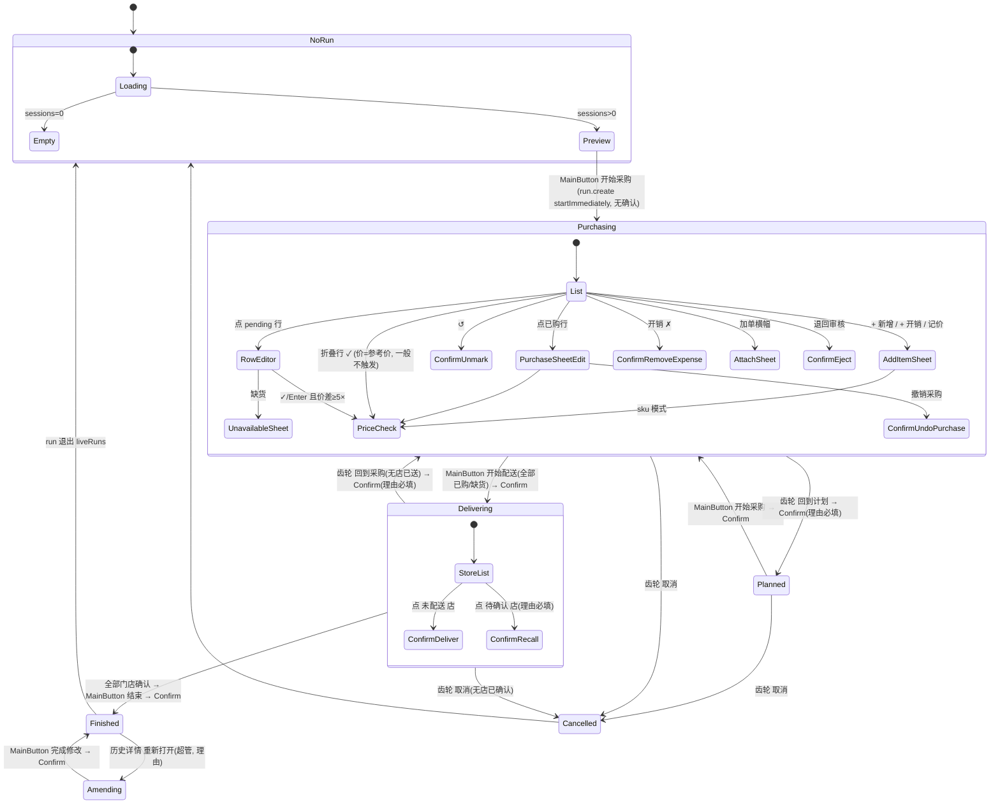
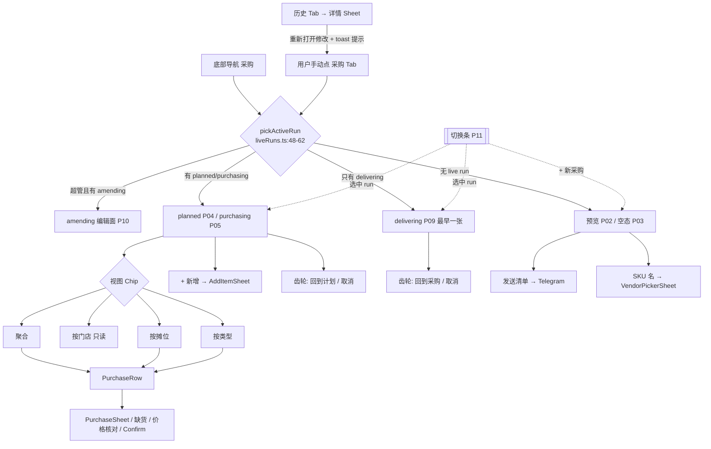

# F3 前端 UX / 交互审计：采购（Run）页

- 基线：`main` @ `c243771`（2026-10-21），只读审计，未运行应用、未访问数据库或生产环境。
- 视角：采购员（purchaser 角色：`run.create / run.purchase / run.eject_session / run.finish / delivery.dispatch / prices.view`，见 `packages/db/src/seed-data.ts:155-167`）；super admin 的 amend 流程单列。
- 结论标签：**已确认（代码）** = 读到的代码直接决定；**高可信度推断** = 由多处代码推得、但依赖运行时时序或数据；**待运行验证** = 需要真机/数据才能下结论（注明需要什么）。
- 点击数计数规则：一次“点按”= 手指离屏一次的离散触控（按钮、行、复选框、Tab、Chip）。键盘输入单列为“输入”，聚焦输入框算 1 次点按（除非有 `autoFocus`）。不计滚动、不计系统键盘“完成”键之外的按键。只在代码能推出时给出数字。
- 与旧报告 `docs/audit-2026-10-21/C-run-delivery-confirm.md` 的关系：本报告按当前代码重新核对；旧条目已修复的（C-05 合并丢需求、C-15 删除开销无确认、C-19 取消入口不按状态隐藏等）不再列为问题；仍存在的（C-12、C-16）在第 7 节重新编号并标注出处。

---

## 1 范围与已读文件

已通读（逐行）：

| 文件 | 行数 | 作用 |
|---|---|---|
| `apps/web/src/pages/RunPage.tsx` | 2584 | 编排：查询、全部 mutation、MainButton 分派、ConfirmSheet 配置、页菜单、各 Sheet 挂载 |
| `apps/web/src/pages/runs/components/RunPanels.tsx` | 2097 | `ActiveRunPanel`、`PreviewSummaryCard`、`VendorPickerSheet`、`RunSessionsCard` |
| `apps/web/src/pages/runs/components/SessionPicker.tsx` | 130 | 按日期勾选订单 + 记账日期 |
| `apps/web/src/pages/runs/components/PriceUnit.tsx` | 70 | `×1000 / UZS` 切换 + 全额读数 |
| `apps/web/src/pages/runs/views/RunViews.tsx` | 2140 | `PerStoreView / PerVendorView / PerCategoryView / RunExtrasCard / ExpensesCard / PurchaseRow` |
| `apps/web/src/pages/runs/sheets/RunSheets.tsx` | 1418 | `PurchaseSheet / AddItemSheet / ConfirmSheet` |
| `apps/web/src/pages/runs/lib/{liveRuns,sessionSelection,runProgress,priceState,priceMath,splitQty,runStores}.ts` | — | 纯函数（选 run、选单、门控、价格状态、拆分） |

部分阅读（定位用）：`runs/history/RunHistory.tsx`（359-460、680-745：重开/改日期）、`apps/web/src/app/Shell.tsx`（PageMainButton 543-553、643-700；设置入口 274-277、495-517）、`apps/web/src/hooks/useTelegram.ts`（usePageMainButton 255-355）、`packages/ui/src/components/{Sheet,ConfirmSheet,Button}.tsx`、`apps/web/src/lib/trpc.ts`（幂等键 176-275）、`apps/web/src/hooks/useOfflineQueue.ts`（头注释与返回值）、`apps/web/src/hooks/useRealtime.ts`（140-175）、`packages/domain/src/run/commands.ts`（PurchaseItem、RemoveRunExpense、DeliverToStore、RevisePurchase、UndoPurchase、UnmarkUnavailable、EjectSession、UndoStart*）、`apps/api/src/trpc/routers/run.ts`（3395-3440 eject 权限）、`packages/i18n/src/catalogs/zh.ts`（相关文案）。

未读：`runs/lib/{itemList,accordion,previewFilter,previewGrouping,previewStats,shareText,settlement}.ts` 的实现细节（仅通过调用点理解其输入/输出），`runs/types.ts`。

---

## 2 页面/界面清单

无 URL 路由；“采购”Tab（`Shell.tsx:90`，需 `run.purchase`）挂载 `RunPage`。下表的“入口”指在 Tab 内如何到达。

| ID | 名称 | 位置 | 入口 | 条件（权限/状态） | 模式 | 用途 | 下一步去向 | 可达性 |
|---|---|---|---|---|---|---|---|---|
| F3-P01 | Run Tab 外壳 + 粘性运行条 | `RunPage.tsx:1766-1849` | 底部导航“采购” | `run.purchase`；粘性条仅 `activeRun` 存在 | — | 显示 `#n · 日期 · 阶段` + 陈旧天数徽标 + `+ 新增` | P18 | C（粘性条与 P11 信息重复） |
| F3-P02 | 无 run：选单预览 | `RunPage.tsx:1959-1993`；`SessionPicker.tsx:26-130`；`RunPanels.tsx:862-1903` | 无活动 run 且有已审批订单 | `previewQuery` 有 sessions | 预览视图 `byStore / bySupplier`（`RunPanels.tsx:830, 914-934`） | 勾选订单（默认今天）、选记账日期、看估价/缺价/无摊位、发送清单 | MainButton“开始采购”→ P05；“发送清单”→ Telegram 分享；SKU 名（仅 bySupplier）→ P23 | D |
| F3-P03 | 无 run 无订单：空态 | `RunPage.tsx:1962-1966` | 同上，sessions=0 | — | — | “暂无审核通过的订单可生成采购单” | 无（无去历史的链接） | D |
| F3-P04 | planned 阶段（已存在的 run） | `RunPage.tsx:1996-2063` | 撤回到计划（P24）后，或他人建了 planned run | `activeRun.status==='planned'` | 预览卡（适配器 2029-2062）+ RunSessionsCard + 加单横幅 | 只读计划；移出/加入订单；改摊位 | MainButton“开始采购”→ 确认 → P05 | C（见 F3-09/F3-15） |
| F3-P05 | purchasing：聚合列表 | `RunPanels.tsx:475-598` | 创建 run（startImmediately）后、或切换到该 run | `status==='purchasing'` | 聚合（默认），可切 P06/P07/P08 | 逐项 ✓/改价/缺货；搜索+过滤（≥8 项，`509`） | P16/P17/P18/P20；MainButton“还有 N 项”/“开始配送” | D |
| F3-P06 | 视图：按门店（只读） | `RunViews.tsx:51-208`；挂载 `RunPanels.tsx:423-431` | 视图 Chip“按门店” | ≥2 门店且 purchasing/amending | 只读 | 看每店要什么 + 状态标记 | 再点 Chip 回聚合 | C（只读，不能记录；文件头称“delivering checklist”但配送阶段不显示，见 F3-01） |
| F3-P07 | 视图：按摊位 | `RunViews.tsx:224-509` | Chip“按摊位” | ≥2 个供应商桶 | 可编辑（PurchaseRow） | 站在摊位前批量记录；唯一会写 `supplierId` 的路径（`474`） | 同 P05 | D |
| F3-P08 | 视图：按类型 | `RunViews.tsx:826-994` | Chip“按类型” | ≥2 个类别 | 可编辑，`
` 可折叠 | 按类别记录 | 同 P05 | D |
| F3-P09 | delivering：门店列表 | `RunPanels.tsx:650-763` | 确认“开始配送” | `status==='delivering'` | 每店一行：未配送/待确认/已确认 + 收货问题行 | 逐店送达 / 撤回 | 行 → P21(deliverStore / recallDelivery)；全部确认后 MainButton“结束” | D |
| F3-P10 | amending（超管修改） | `RunPage.tsx:1884-1890, 1151-1158` | 历史详情“重新打开修改”后回到采购 Tab | `run.amend` 且 run 为 amending；`pickActiveRun` 对超管优先返回它（`liveRuns.ts:57-60`） | 复用 purchasing 编辑面 | 修正记录 | MainButton“完成修改”→ P21(refinalize) | D |
| F3-P11 | 多 run 切换条 | `RunPage.tsx:1855-1879`；`liveRuns.ts:34-62` | 自动出现 | `liveRuns.length>1` 或（无 buying run 且有待采订单且有 live run） | radio ChipBar；可含“+ 新采购” | 在一个采购中 run 与若干配送中 run 之间切换；在只剩配送 run 时开新单 | 选中 run → 对应阶段视图；“+ 新采购”→ P02 | D |
| F3-P12 | RunSessionsCard（来源订单） | `RunPanels.tsx:2029-2096`；挂载 `RunPage.tsx:1996-2017` | planned/purchasing 下自动显示 | sessions>0 | — | 看每份提交 + “退回审核” | P21(ejectSession) | C（单份提交时按钮必失败，见 F3-08） |
| F3-P13 | 加单横幅 + 选单 Sheet | 横幅 `RunPage.tsx:1904-1923`；Sheet `1924-1956` | planned/purchasing 且有新审批订单 | — | SessionPicker `bare` | 把新/旧订单加入当前 run | Sheet 底部“加入 N 个订单” | D |
| F3-P14 | RunExtrasCard（其他物品） | `RunViews.tsx:518-686` | 聚合/按摊位视图底部 | 有 extras/notes；editable=purchasing/amending | — | 点行循环 待买→已买→缺货；“记价”→ 开销 | P18(expense 预填) | D |
| F3-P15 | ExpensesCard（开销） | `RunViews.tsx:704-824`；挂载 `RunPanels.tsx:628-643` | 列表底部 | 编辑阶段或已有开销 | — | 看/删开销，“+ 开销” | P18(expense)、P21(removeExpense) | D |
| F3-P16 | PurchaseRow 四态 | `RunViews.tsx:1126-2140` | P05/P07/P08 列表行 | — | 折叠 pending（1604-1719）/ 展开编辑器（1721-1952）/ 已购（1955-2069）/ 缺货（2072-2139） | 一键 ✓、改价、缺货、改支付方式、恢复 | P17(edit)、P20、P21(unmark)、P19 | D |
| F3-P17 | PurchaseSheet | `RunSheets.tsx:124-477`；挂载 `RunPage.tsx:2293-2326` | 已购行点按（edit）；新购模式仅由 `handleSave` 在无需求拆分时回退打开（`RunViews.tsx:1413-1419`） | edit 需理由 | edit / new | 改数量/价格/支付/分店价/供应商/小票；撤销采购 | P19、P21(undoPurchase) | edit：D；new：**B**（见 F3-03） |
| F3-P18 | AddItemSheet | `RunSheets.tsx:505-1273`；挂载 `RunPage.tsx:2335-2500` | 粘性条“+ 新增”（sku 模式）、开销卡“+ 开销”、extras“记价” | purchasing/amending | `sku`（单店）/ `expense`（共享/单店） | 加计划外 SKU 或开销 | P19（sku 模式） | D |
| F3-P19 | 价格核对 Sheet | `RunPage.tsx:938-956, 2501-2523` | 任何保存时新价与上次差 ≥5× | 有参考价 | — | “没错，保存 / 改价格” | 回到原编辑面 | D |
| F3-P20 | 缺货 Sheet | `RunPage.tsx:2527-2560` | 展开编辑器“缺货”（`RunViews.tsx:1758-1764`） | pending | 原因必填 | 标缺货 | — | D |
| F3-P21 | 通用 ConfirmSheet（14 种） | 组件 `RunSheets.tsx:1279-1418`；配置 `RunPage.tsx:1271-1628` | 见 4 节 | 见下 | 无理由 / 软理由 / 硬理由 | 所有状态迁移 | — | D |
| F3-P22 | VendorPickerSheet | `RunPanels.tsx:1913-2027` | P02/P04 bySupplier 视图点 SKU 名（`1416-1424, 1866`） | 无前端权限判断 | — | 设首选摊位，点即保存 | 关闭 | D |
| F3-P23 | 页菜单（齿轮 ⚙️ / 外部浏览器为顶栏组织名） | `RunPage.tsx:1672-1705`；`Shell.tsx:277, 509-516`；`SettingsSheet.tsx:139` | Telegram SettingsButton | `undoStartPurchase`=purchasing；`undoStartDelivery`=delivering 且无店已送；`cancelRun`=planned/purchasing/delivering 且有 `run.create` 且无店已确认 | — | 回到计划 / 回到采购 / 取消 run | P21 | “回到计划”：C（见 F3-09） |
| F3-P24 | PageMainButton（页面主按钮） | 分派 `RunPage.tsx:1031-1173, 1640-1664`；渲染 `Shell.tsx:643-700` | 常驻底部导航上方 | 见 4.1 | — | 开始采购 / 还有 N 项 / 开始配送 / 结束 / 完成修改 | P21 | Sheet 打开时的“接管”分支：**A**（见 F3-11） |
| F3-P25 | 预览“发送清单 / 全部发送” | `RunPanels.tsx:1294-1356, 1720-1727, 1777-1787, 1832-1839` | P02/P04 | 仅预览存在时 | — | 复制并打开 Telegram 分享 | 外部 | D；purchasing 后不可达（F3-10） |
| F3-P26 | 历史详情：重开 / 改日期（关联） | `RunHistory.tsx:388-436, 696-741` | 历史 Tab → 行 | 服务端返回 `canAmend` | — | 重开为 amending；改记账日期 | 需手动切到采购 Tab | D |
| F3-P27 | ActiveRunPanel 中 `planned` 分支 | `RunPanels.tsx:323-325, 480` | — | RunPage 只在 `status!=='planned'` 时挂载它（`RunPage.tsx:2065`） | — | — | — | **A**（死分支） |

---

## 3 页面状态机与导航

### 3.1 采购员看到的阶段 + Sheet（stateDiagram）

### 3.2 Tab 内导航（flowchart）

要点（已确认（代码））：
- Run 选择状态 `selectedRunKey` 是 `RunPage` 内的 `useState`（`RunPage.tsx:183`），Shell 以 `PAGES[tab]()` 渲染当前 Tab（`Shell.tsx:542`），离开 Tab 再回来会回到默认 run（高可信度推断：切 Tab 即卸载组件，需真机确认无 keep-alive）。
- 历史 Tab 重开后只关 Sheet 并 toast“请到「采购」页继续修改”（`RunHistory.tsx:395-406`；zh `run.amend.reopened`），不自动切 Tab。

---

## 4 交互链

格式：控件 → handler(file:line) → 状态变化 → 接口 → 反馈 → 跳转。

### 4.1 PageMainButton 分派优先级（已确认（代码））

`RunPage.tsx:1640-1664`：`confirmConfig`（任一 ConfirmSheet 打开）> `sheetPrimary`（PurchaseSheet / 缺货 Sheet）> 页面级 `mainButton`。

页面级 `mainButton`（`1031-1173`）：

| 条件 | 文案 | 点按 | active/visible |
|---|---|---|---|
| 无 run，有订单 | 离线：“需要网络才能开始采购”；0 勾选：“请至少勾选一个订单”；否则“开始采购” | `create.mutate({sessionIds, startImmediately:true, date})` | `active = 在线 && 勾选>0 && date<=today && !pending`（`1094`）。日期超今天时文案仍为“开始采购”但灰（无解释）。 |
| 无 run，无订单 | — | — | 隐藏 |
| planned | 开始采购 | 打开 Confirm(startPurchase) | 显示 |
| purchasing 且有未处理 | “还有 N 项待处理” | `document.querySelector('[data-run-item-pending]').scrollIntoView`（`1130-1133`） | `visible = pendingCount>0`（0 项 run 时整个按钮消失） |
| purchasing 全处理 | 开始配送 | Confirm(startDelivery) | 显示 |
| delivering | 结束采购 | Confirm(finish) | **仅全部门店确认后显示**，此前无按钮、无进度文案（`1144-1150`） |
| amending | 完成修改 | Confirm(refinalize) | 显示 |

关键事实：PageMainButton 是 Shell 内的普通 DOM 条（`Shell.tsx:553, 663-699`），而 Sheet 是 Radix `Dialog` portal + `fixed inset-0 z-50` 遮罩（`packages/ui/src/components/Sheet.tsx:171-187`）。**任何 Sheet 打开时主按钮被遮罩盖住且模态阻断点击**；各 Sheet 自己在 footer 渲染主操作（`RunSheets.tsx:200-202, 1342-1347` 的注释也承认这一点）。因此 `sheetPrimary` 与 `confirmConfig` 对主按钮的“接管”只改变一个看不见的按钮——见 F3-11。全局 `useAppMutating()` 仅禁用主按钮与底部导航（`Shell.tsx:583, 650`），**不禁用列表行内的 ✓**。

### 4.2 预览 / 开单

| 控件 | handler | 状态 | 接口 | 反馈 | 跳转 |
|---|---|---|---|---|---|
| 日期组复选框 | `SessionPicker.tsx:71-79` `withGroupSelection` | `sessionOverrides` | — | 预览卡按 `selectPreview` 重算（`RunPage.tsx:178-181`） | — |
| 单份订单复选框 | `SessionPicker.tsx:94-102` | 同上 | — | 同上 | — |
| 记账日期 | `SessionPicker.tsx:113-119`（`max=today`） | `runDateChoice` | — | — | — |
| 视图切换 byStore/bySupplier | `RunPanels.tsx:1561-1577` `chooseView` | localStorage | — | — | — |
| “无摊位 N”胶囊 | `RunPanels.tsx:1615-1630` | 切到 bySupplier | — | — | — |
| 组标题（手风琴） | `RunPanels.tsx:1697-1718, 1800-1826` | 单开；滚动锚定（`966-978`） | — | — | — |
| 发送清单 / 全部发送 | `shareOrCopyText` `1294-1322` | — | 剪贴板 + `openTelegramLink` | 成功/复制/失败 toast + haptic | 离开到 Telegram 分享 |
| SKU 名（仅 bySupplier） | `setVendorPickerFor` `1419` | 打开 P22 | `run.setSkuPreferredSupplier`（`1941-1954`） | 成功 toast，点即保存无确认；仅失效 `previewCreatable`（对已存在 planned run 依赖 6s 轮询） | 关闭 |
| MainButton 开始采购 | `RunPage.tsx:1085-1092` | — | `run.create`（幂等键，`lib/trpc.ts:191`） | 成功 toast“采购单已创建”/复用时 info“已有进行中的采购 — 已为你打开”；选中新 run、清空勾选与日期（`268-306`）；失败 errToast | 进入 purchasing |
| 双击 | `create.isPending` 门控 + 主按钮全局 busy | — | 服务端幂等 + reused | — | — |
| 离线 | 文案切换 + 不可点（`1076, 1094`） | — | — | — | — |

加载/空/错：`DataState query={previewQuery}`（`1960`）覆盖预览；`runsQuery` 加载期间 `activeRun=null`，没有任何门控，预览与“开始采购”可能先于 run 列表出现（F3-18）。

### 4.3 加入订单 / 退回审核

| 控件 | handler | 接口 | 反馈 |
|---|---|---|---|
| 横幅“加入”按钮 | `RunPage.tsx:1912-1919` | — | 打开 P13；横幅标题的 N=全部待采订单（`1910`），Sheet 默认只勾今天的 |
| Sheet“加入 N 个订单” | `1939-1942` | `run.attachSessions`（幂等） | 成功关 Sheet + toast；pending 时禁止关闭（`1926-1928`）；**勾选状态与开单预览共用 `sessionOverrides`，attach 成功后不清空** |
| “退回审核” | `RunPanels.tsx:2078-2086` → `RunPage.tsx:2005-2015` | Confirm(ejectSession, 软理由) → `run.ejectSession` | 任一 eject 进行中时所有行按钮同时 loading（`2081-2082`）；只有 1 份提交或其中有已购/已标缺商品时服务端拒绝（`commands.ts:1143, 1151-1156`），UI 未预判 |

### 4.4 purchasing：行级交互（PurchaseRow）

| 控件 | handler | 状态变化 | 接口 | 反馈 / 分支 |
|---|---|---|---|---|
| 折叠行 ✓（有参考价） | `RunViews.tsx:1705-1714` → `handleSave('collapsed')` `1402-1432` → `onSavePurchaseInline` `RunPage.tsx:2076-2115` | `inlineSavingSkuId=skuId`（单槽） | `withPriceCheck`（参考价=保存价，正常不触发）→ `run.purchaseItem`（稳定幂等键 `423-448`），数量=计划量，按需求比例拆分，**支付方式固定 cash**（`1429`），supplierId 仅按摊位视图传 | 成功：650ms 后静默刷新 + toast + haptic；网络错：入离线队列 + toast“已离线保存”，行仍为 pending 且 ✓ 重新可点（`438-443`）；其他错：errToast |
| 折叠行本体 | `1617` `setPriceEditorOpen(true)` | 展开编辑器 | — | **没有收起/取消控件**，只有保存或标缺货后才收起（`1313-1315`） |
| 编辑器 数量/价格 | `1803-1837` | 本地 state；Enter 链 qty→price→保存 | — | 下方显示单位切换、全额、合计（`1923-1950`） |
| 编辑器 现金/转账 | `1846-1897` | 本地 | — | — |
| 编辑器 ✓ | `1898-1916` → `handleSave('editor')` | 同上 | 价差≥5× → P19 | 同上 |
| 编辑器 缺货 | `1758-1764` → `setUnavailableFor` | 打开 P20 | `run.markUnavailable`（原因必填，`2537`） | 成功 info toast，无 haptic（`487-504`）；网络错入队 |
| 单位切换 ×1000/UZS | `PriceUnit.tsx:19-40` | localStorage `compass.run.priceInThousands`（默认开，`RunPage.tsx:134-143`） | — | 行内展开中的价格按比例换算（`RunViews.tsx:1326-1335`） |
| 已购行本体 | `1959-1966` → `openPurchaseEdit` `RunPage.tsx:737-781` | `purchaseDraft{isEdit:true}` | — | 打开 P17 |
| 已购行 现金/转账 | `2044-2061` → `RunPage.tsx:2119-2178` | `paymentBusySkuId` | `run.revisePurchase`（自动理由 `run.reason.paymentMethodChanged`）；有分店支付覆盖时改为打开 P17 | 成功 toast；忙时按钮灰 |
| 缺货行 ↺ | `2115-2123` → Confirm(unmarkUnavailable, 理由必填) | — | `run.unmarkUnavailable` | toast + haptic |
| “还有 N 项”主按钮 | 见 4.1 | — | — | 在按门店视图（只读行无 `data-run-item-pending`）、过滤“缺货”/搜索无命中、`
` 折叠时为无反应（F3-05） |

双击/并发：行 ✓ 只受本行 `saving` 门控；`inlineSavingSkuId` 是单值，连点 A、B 时 A 的 saving 被清，A 的 ✓ 在刷新前（≥650ms）重新可点，再点会得到服务端 `itemAlreadyPurchased`（`commands.ts:292-294`）错误 toast（F3-14）。冲突：他人已购同一行 → 同上错误；6s 轮询（`RunPage.tsx:698`）+ realtime `run.changed` 失效刷新（`useRealtime.ts:156-158`）。

### 4.5 PurchaseSheet（编辑已购）

字段：数量（autoFocus）、价格、单位切换、支付方式、统一价/分店价切换、供应商 `<select>`（仅当有供应商）、小票照片、分店数量（仅本 run 门店 + 已有门店，`RunPage.tsx:705-711`）、理由（edit 必填）、“撤销采购”（`RunSheets.tsx:464-472`）。
- 保存：footer 按钮 `215-236`（文案随校验变化：“分配不一致 x/y”/“请填写理由”）→ `submitPurchaseDraft` `RunPage.tsx:958-994` → 价格核对 → `revisePurchase`（edit）/`purchaseItem`（new）。成功关 Sheet + toast；失败 errToast，Sheet 保留。
- 撤销采购：关 Sheet → Confirm(undoPurchase, 危险、无理由) → `run.undoPurchase`；任一门店已送达时服务端拒绝（`commands.ts:1013-1028`），UI 未提示。
- 取消：遮罩/下滑/Telegram Back；无“放弃修改”确认。

### 4.6 AddItemSheet

- 入口三处：粘性条“+ 新增”→ sku 模式（`RunPage.tsx:1796-1829`）；开销卡“+ 开销”→ expense 模式共享（`2249-2270`）；extras“记价”→ expense 单店、预填名称数量、理由预填（`2224-2245`）。
- sku 模式：搜索（最多 20 条，`RunSheets.tsx:613`，无“还有更多”提示）→ 选 SKU；若 SKU 已在 run，默认“独立成本”（`852-854`）→ 选单店（原生 select）→ 数量/价格/支付/理由（必填）→ 保存。
- 保存路由（`RunPage.tsx:2368-2493`）：价格核对 →（已在 run 且独立成本或门店冲突）`addExpense`；（已在 run 且 pending）`purchaseItem` 合并需求，**整行按新价标为已购**，并立即关 Sheet（不等结果，`2433-2445`）；（已在 run 且已购）`revisePurchase`，合并 splits 但**丢弃分店价/分店支付覆盖、supplierId 置为草稿的 null、小票置为草稿的 null**（`2447-2459`，`runStores.ts:40-60`）；否则 `addPurchaserItem`。
- 离线：`addPurchaserItem`/`addExpense` 入队并关 Sheet（`359-368, 386-395`）；合并路径中的 `purchaseItem` 走其自身 onError 入队，`revisePurchase` 无离线分支。
- expense 模式：名称（autoFocus）、单位提示、模板 chips、范围 共享/单店（共享默认全部门店平均分摊，`707-728`）、门店 chips、“重新平均”、数量、价格、合计、支付、理由（必填）、小票（可选）。

### 4.7 配送 / 结束 / 修改

| 控件 | handler | 接口 | 反馈 / 分支 |
|---|---|---|---|
| 未配送门店行 | `RunPanels.tsx:743-746` → Confirm(deliverStore) `RunPage.tsx:1508-1521` | `run.deliverToStore`（服务端对已送达幂等 `commands.ts:597-600`） | **成功无 toast/haptic**（`529-532`，旧 C-16 仍在）；网络错入队 + toast，但 Confirm 不关闭（仅 onSuccess 关），再点会再入队一次 |
| 待确认门店行 | `746` → Confirm(recallDelivery, 危险, 理由必填) | `run.undeliverStore` | toast + haptic |
| 已确认门店行 | `752-756` 静态 | — | 显示收货问题行（短缺/错货/质量 + 实收量，`693-734`） |
| MainButton 结束 | Confirm(finish) 正文含 件数/门店/合计、商品/开销/总额（服务端 money）、现金/转账、计划外、开销、沿用旧价计数、分店账单（`1296-1427`） | `run.finish` | toast + haptic；之后 run 退出，页面回到预览/空态，无“查看刚结束的单”入口 |
| MainButton 完成修改 | Confirm(refinalize) `1429-1454` | `run.refinalize` | toast；amending 中无“放弃修改”出口（取消被禁 `commands.ts:810`） |
| 齿轮 回到计划/回到采购/取消 | `RunPage.tsx:1672-1705` | `undoStartPurchase`/`undoStartDelivery`（理由必填）/`cancel`（软理由） | 取消有孤儿会话时 warning toast（`578-585`）；取消后未失效 `previewCreatable`，依赖 realtime（待运行验证） |
| 历史详情 重新打开 | `RunHistory.tsx:733-739` | `run.reopen`（理由必填，内联输入，无 Confirm） | toast + 关 Sheet，不切 Tab |

---

## 5 用户任务流程

### T1 用今天的订单开一张采购单
- 现有路径：点“采购”Tab（导航 1）→ 预览默认勾选今天（`sessionSelection.ts:37-39`）→ 主按钮“开始采购”（1）。**合计 1 次点按，0 输入**。已确认（代码）。
- 问题步骤：开单前必须在预览里把要发给摊位的清单发出去——开单后预览卡消失（F3-10）。
- 建议：保持 1 次点按；把“发送清单”同时放进 purchasing 的按摊位/按门店视图（见 T3）。风险低。

### T2 加入昨天剩下的订单
- 开单前：点昨天日期组复选框（1）→ 视需要改记账日期（1 + 选择）→ 开始采购（1）= 2-3 次。
- 已有 run 在采购：点横幅“加入”（1）→ Sheet 中点昨天日期组（1）→“加入 N 个订单”（1）= 3 次。
- 问题步骤：横幅说“有 3 个新审批订单”，Sheet 默认只勾今天（可能是 0），按钮显示“加入 0 个订单”并禁用——数量不一致（F3-16）；Sheet 行只显示门店名，同店两份提交无法区分（F3-17）。
- 原因：横幅用 `previewSessionCount`（`RunPage.tsx:1910`），按钮用 `chosenSessionIds`（`1944`）。
- 建议路径：横幅文案拆为“今天 a 份 · 更早 b 份”；Sheet 行加提交人与件数（`RunSessionsCard` 已有这些字段的同类展示）。预期：减少一次“为什么是 0”的困惑。风险：需要预览接口返回提交人/件数（待核对 `previewCreatable` 字段）。

### T3 3 家门店共 30 项，全部按参考价买
- 现有路径：每行点折叠 ✓（1）× 30 = **30 次点按，0 输入**；拆分按需求比例自动完成，支付默认现金。主按钮“还有 N 项”可跳到下一项。之后“开始配送”（1）+ 确认（1）。
- 问题步骤：(a) 30 次中任意两次过快 → 前一行 ✓ 重新可点 → 可能报“已采购”错误（F3-14）；(b) 参考价超过 30 天仅以颜色 `~` 标记，一键即可沿用（`RunViews.tsx:1570-1580, 1674-1683`），只在结束确认中计数；(c) 转账付款的行需要买后再点一次行内切换（+1/行，且会写一条 revise 事件）。
- 建议：保留一键；把 `inlineSavingSkuId` 改成 Set（每行独立 saving）；“guess”档参考价首次 ✓ 时要求展开确认一次（与价格核对同一 Sheet）。预期：消除连点误报；把陈旧价从“结束后才知道”提前到“付款时”。风险：对陈旧价多一步，需按数据评估触发比例（待运行验证：统计 `lastPriceObservedAt` >30 天的行占比）。

### T4 以新价格买一项
- 现有路径：点行（1）→ 点价格框（1；编辑器无 autoFocus，且数量框在前）→ 输入新价 → Enter 或 ✓（1）= **3 次点按 + 1 输入**；若与上次差 ≥5× → 价格核对“没错，保存”（+1）；转账 +1。
- 想同时记供应商/小票/分店不同价：新购模式 PurchaseSheet 只在无需求数据时出现（`RunViews.tsx:1413-1419`），常规路径是先 ✓ 保存，再点已购行（1）→ 改字段 → **必须填写修改理由**（输入）→ 保存（1）。≥5 次点按 + 2 次以上输入，并多一条 `PurchaseRevised` 审计事件（F3-03）。
- 建议路径：编辑器加“更多…”打开 new 模式 PurchaseSheet（预填需求拆分），保存走 `purchaseItem` 不需理由；编辑器打开时自动聚焦价格框并全选。预期：新价 2 次点按 + 1 输入；带供应商/小票的新购不再需要伪“修改理由”。风险：`purchaseFormState` 与 Sheet 校验重复（F3-11）需一起清理。

### T5 标缺货再恢复
- 标缺货：点行（1）→ 缺货（1）→ 输入原因（autoFocus）→ 缺货按钮（1）= 3 次 + 1 输入。
- 恢复：↺（1）→ 输入理由（必填，autoFocus）→ 确认（1）= 2 次 + 1 输入。
- 问题步骤：误点行展开后无法收起（F3-04）；恢复要求理由，而“撤销采购”不要求理由（`RunPage.tsx:1550-1567` vs `1536-1549`），两个对称的“撤回”动作规则不一致。
- 建议：编辑器加“收起”；恢复改为软理由（与 cancel 一致）。风险：审计粒度降低——服务端 `UnmarkUnavailable` 目前强制理由（`commands.ts:1050-1051`），需同步改。

### T6 计划外商品 / 开销
- 目录内但不在 run 的 SKU：“+ 新增”（1）→ 输入搜索 → 点结果（1）→ 门店下拉（2）→ 点数量框（1）输入 → 点价格框（1）输入 → 点理由框（1）输入 → 保存（1）= **8 次点按 + 4 输入**。同一 SKU 给 3 家店需重复 3 次，且第 2、3 次默认变成“独立成本”开销（`RunSheets.tsx:852-854, 1012-1014`），除非手动点“合并到原行”，而合并会覆盖已有店的价格/供应商/小票（F3-07）。
- 开销（如搬运费）：“+ 开销”（1；卡片位于长列表底部）→ 名称（autoFocus）输入 → 点数量（默认 1，可跳过）→ 点价格（1）输入 → 点理由（1）输入 → 保存（1）= 4 次 + 3 输入；有模板时点模板（1）可免名称/数量/价格输入。
- 建议：sku 模式支持多店分配（复用 PurchaseSheet 的分店数量表）；理由对开销改为可选（服务端是否强制待核对）；“+ 开销”同时放进粘性条（或把“+ 新增”做成两项菜单）。风险：多店合并要定义价格冲突规则。

### T7 改正一笔错误采购
- 配送开始前：点已购行（1）→ 改价格（1 + 输入）→ 点理由（1）输入 → 保存（1）= 4 次 + 2 输入；只改支付方式：行内切换 1 次。撤销：点行（1）→ 撤销采购（1）→ 确认（1）= 3 次。
- 已进入配送、但任何店还未送达：items 列表在 delivering 不显示（F3-01），须齿轮（1）→ 回到采购（1）→ 理由输入 → 确认（1）→ 改正（4）→ 开始配送（1）→ 确认（1）≈ 9 次 + 2 输入。
- 已有店送达：需逐店撤回（每店 2 次 + 理由）后再走上面路径；**已有店确认收货则前端无路径**，只能结束后由超管重开（服务端 `cannotReviseAfterDelivery`，`commands.ts:952-965`）。UI 不解释这一点（F3-13）。
- 建议：delivering 阶段显示只读按门店清单，并在“已送达”的行上明确“需先撤回 X 店才能修改”。风险低。

### T8 给 3 家门店送货
- 现有路径：开始配送（1）+ 确认（1）→ 每店：点行（1）+ 确认送达（1）× 3 = **8 次点按**。
- 问题步骤：配送阶段看不到每家店该拿哪些货及数量（按门店视图与 items 列表都被 `plannedOrEditing` 门控，`RunPanels.tsx:323-325, 423, 475-480`），确认正文也是通用句（zh `run.confirm.deliver.body`）（F3-01）；送达成功无 toast/haptic（F3-12）；离线时确认 Sheet 不关闭可重复入队。
- 建议路径：门店行可展开为只读拣货单（复用 `PerStoreView` 的行，数量取 `run.splits` 实际分配）；确认 Sheet 正文列出该店件数与合计。预期：不增加点按，消除“凭记忆装袋”。风险低（数据已在 `run.get`）。

### T9 结束采购
- 现有路径：等待所有门店确认 → 主按钮“结束采购”（1）→ 确认（1）= 2 次。
- 问题步骤：等待期间主按钮完全隐藏，没有“还差 N 家店确认”的提示，也无催促/提醒入口（`RunPage.tsx:1144-1150`），与 purchasing 阶段“还有 N 项”的设计理由相悖（F3-19）。结束后页面无入口查看刚结束的单。
- 建议：delivering 时主按钮显示“等待 N 家门店确认”（不可点或点按滚动到未确认行）；结束成功 toast 带“查看”跳历史详情。风险：Toast 组件目前不支持内嵌动作（`RunPage.tsx:289-303` 注释），需另行实现。

### T10 在两张进行中的单之间切换
- 现有路径：切换条点 Chip（1）。已确认（代码）。
- 问题步骤：切换条与粘性条重复显示 `#n · 日期 · 阶段`；切走 Tab 再回来选择丢失（高可信度推断，F3-20）。
- 建议：选择存到 nav store 或 sessionStorage；切换条出现时粘性条只保留操作。风险低。

### T11 重开并修改已结束的单（超管）
- 现有路径：历史 Tab（导航 1）→ 点该 run（1）→ 详情 Sheet 内滚动 → 点理由框（1）输入 → 重新打开修改（1）→ 看 toast → 点“采购”Tab（1）→ 修改（每处：点行 1 + 改值 + 理由输入 + 保存 1）→ 完成修改（1）→ 确认（1）。不含修改本身约 **7 次点按 + 1 输入**。
- 问题步骤：重开没有确认 Sheet（与采购页所有迁移不一致，F3-12）；重开后不自动跳转；amending 中误重开无法放弃，只能 refinalize（会重算冻结金额）（F3-21）；每处修改都要理由（重开时已给过理由）。
- 建议：重开成功后直接 `setTab('run')`；amending 中修改 Sheet 的理由默认带入重开理由；增加“放弃修改”（服务端新命令，恢复 finished 不重算）。风险：后者需要域层支持。

---

## 6 一致性与重复

1. **两个 ConfirmSheet 组件**：`runs/sheets/RunSheets.tsx:1279-1418`（软/硬理由、Cancel 规则）与 `@compass/ui` `ConfirmSheet`（被重命名为 `PriceCheckSheet` 使用，`RunPage.tsx:35, 2501-2523`）。前者理由框 + 取消按钮逻辑、后者 `showCancelInSheet`，规则不同。建议收敛到 UI 包一个实现。
2. **确认策略不一致**：开单 1 点无确认（`1085-1092`）vs planned 阶段开始采购要确认（`1101-1106`）；撤销采购无理由 vs 恢复缺货必须理由；删除开销要确认 vs 摊位改派点即保存（`RunPanels.tsx:1969, 2003`）；历史重开/改日期内联按钮无确认（`RunHistory.tsx:714, 737`）。文件头注释“EVERY forward step now goes through a ConfirmSheet”（`RunPage.tsx:21-27`）已过时。
3. **主按钮 vs Sheet 按钮**：所有 Sheet 自带主按钮（遮罩挡住页面主按钮），`RunPage.tsx:1175-1260, 1630-1659` 的接管分派、`purchaseFormState`（`1001-1023`，与 `RunSheets.tsx:177-198` 重复）及注释（`2525-2526`“footer 仅 Telegram 外显示”）都与现实不符。
4. **支付方式控件 4 种**：`PaymentMethodChips`（Sheet）、编辑器切换按钮（`RunViews.tsx:1846-1897`）、分店分段按钮（`RunSheets.tsx:412-438`）、已购行切换（`RunViews.tsx:2044-2061`）。
5. **分段/切换控件 3 种**：预览视图手写按钮（`RunPanels.tsx:1561-1577`）、AddItem 模式手写按钮（`RunSheets.tsx:765-802`）、运行视图 ChipBar（`RunPanels.tsx:386-420`）；UI 包有 `Segmented.tsx` 未用。
6. **搜索框**：两处原生 `<input type=search>`（`RunPanels.tsx:512-519, 1545-1552`）vs `Input type=search`（`RunSheets.tsx:828-834`）；UI 包有 `SearchInput.tsx`。
7. **金额 K 格式手写 5 处**：`RunViews.tsx:762, 1526, 1584, 1752, 2014`（`formatMoney(n/1000)+'K'`），与 `PriceInFull` 并存。
8. **单位显示**：大多用 `useUnitLabel`，但 `RunSheets.tsx:246`（PurchaseSheet 数量标签）、`813`、`1149`（AddItemSheet）用原始单位码；`PreviewSummaryCard` 自写 `currentUnitLabel/currentSkuName`（`RunPanels.tsx:980-1004`）重复 `useUnitLabel/useProductName`。
9. **阶段文案 switch 两份**：`RunPage.tsx:1740-1754` 与 `1864-1870`。
10. **派生索引重复**：`splitsBySku`、`demandStoreIds/isMultiStoreRun` 在 `ActiveRunPanel`、`PerVendorView`、`PerCategoryView` 各算一遍（`RunPanels.tsx:221-229, 287-294`；`RunViews.tsx:312-333, 889-904`）。
11. **门店选择 3 种**：分店数量表（PurchaseSheet）、原生单选下拉（AddItem sku）、多选 chips（AddItem expense）。
12. **Sheet 密集**：purchasing 阶段可叠出 PurchaseSheet→价格核对、PurchaseSheet→撤销确认（先关前者）、AddItem→价格核对。与其他页相比（Confirm 页逐项核对、Order 页）同属“底部 Sheet + 理由”模式，但理由规则各自定义。
13. **空态文案错用**：开销卡空列表显示的是“在本次采购的所有店铺之间平均分摊。”（`RunViews.tsx:745-749` 用了 `scopeSharedHint`）。

---

## 7 问题清单

严重度：P0 = 数据损坏/资金错误且无察觉；P1 = 核心任务受阻或高概率出错；P2 = 明显多步/易错/误导，有绕行；P3 = 一致性/打磨。

### F3-01（P1）配送阶段看不到“每店拿什么”
- 证据：`showViewToggle` 与聚合列表都要求 `plannedOrEditing`（`RunPanels.tsx:323-325, 380, 423, 475-480`）；delivering 只渲染门店行（`659-763`，仅“N 项 · 未配送”）；确认正文通用（`RunPage.tsx:1508-1521`）。`PerStoreView` 文件头自称“delivering checklist”（`RunViews.tsx:7`）但实际不在配送阶段出现。已确认（代码）。
- 影响：采购员装车/交接时只能凭记忆或回退阶段查看；错拿漏拿后要靠门店收货问题回流。
- 修复方向：门店行可展开只读清单（`run.splits` 按 storeId）；确认 Sheet 正文列出件数与金额。
- 验证：delivering 状态下每店可见 SKU、数量与 `run.splits` 一致；E2E 截图。

### F3-02（P2）run 详情加载/失败无任何状态
- 证据：所有阶段内容都以 `runDetailQuery.data` 为门（`RunPage.tsx:1996-1999, 2028, 2065`），无 `DataState`/骨架/重试；预览则有 `DataState`（`1960`）。已确认（代码）。
- 影响：弱网下只有粘性条 + 空白；失败时无重试入口；主按钮在 purchasing 时因 `pendingCount=0` 隐藏。
- 修复：用 `DataState query={runDetailQuery}` 包裹。验证：断网打开 Tab。

### F3-03（P2）新购时无法记供应商/小票/分店价，只能“保存后再改 + 编造理由”
- 证据：new 模式 PurchaseSheet 仅在 `proportionalSplitQty` 返回 null 时打开（`RunViews.tsx:1413-1419`；`splitQty.ts` 在需求为空时返回 null）；编辑器无“更多”入口；聚合/类别视图 `supplierId` 为 null（`RunPage.tsx:2095-2107`）；edit 必填理由（`RunSheets.tsx:185`）。`RunPage.tsx:2182-2186` 注释“User changed qty from planned … open the full PurchaseSheet”已不成立。已确认（代码）。
- 影响：价格历史缺摊位；审计日志被“补录”式修改理由污染；多 1 条 `PurchaseRevised`。
- 修复：编辑器加“更多…”→ new 模式 Sheet（预填需求拆分）。验证：一次保存产生单个 `ItemPurchased` 且带 supplierId。

### F3-04（P2）展开的价格编辑器无法收起
- 证据：`setPriceEditorOpen(true)` 唯一调用在 `RunViews.tsx:1617`，关闭只发生在状态离开 pending（`1313-1315`）。已确认（代码）。
- 影响：误触后该行常驻 4 行高的编辑器与“缺货”按钮，后续行下移，增加误触面；展开态行无 `data-run-item-pending`，“还有 N 项”会跳过它。
- 修复：编辑器加“收起”，并在打开时聚焦价格框。验证：点行→收起→行恢复折叠且值复位。

### F3-05（P2）“还有 N 项”主按钮在多种视图下点了没反应
- 证据：只查 `[data-run-item-pending]`（`RunPage.tsx:1131`）；该属性只在折叠 pending 行（`RunViews.tsx:1613`）；按门店视图行无此属性（`RunViews.tsx:188-199`）；按类别 `
` 折叠时元素不可见；聚合过滤/搜索会移除行（`RunPanels.tsx:363-366`）。已确认（代码）。
- 影响：唯一常驻的“下一步”引导在部分视图失效且无反馈。
- 修复：找不到目标时切回聚合 + 清过滤 + 选“待处理”过滤。验证：各视图下点按均能定位。

### F3-06（P2）离线写入在列表上不可见，且可重复提交
- 证据：`offline.pendingCount` 在 RunPage 未使用（仅 `enqueue`，`RunPage.tsx:362, 389, 441, 496, 535`）；购买入队后清 saving 使 ✓ 复活（`438`）；送达入队后 Confirm 不关闭（`1516-1520` 仅 onSuccess 关）。`useOfflineQueue.ts` 头注释仍写“replay 仍为每次新键”（与 RunPage 稳定键实现不一致，至少注释过时）。已确认（代码）；重放后重复项的最终表现待运行验证（需模拟丢包 + 重放）。
- 影响：采购员以为没存上而再点，产生重复入队 → 重放时 `itemAlreadyPurchased` 被丢弃并弹“有一笔操作未能同步”，令人困惑；“还有 N 项”在离线期间不减少。
- 修复：行上显示“待同步”态（以 outbox 条目的 skuId 标记）；入队后关闭 Confirm；粘性条显示待同步数。验证：飞行模式下记 3 项、送 1 店，恢复网络后数据与提示正确。

### F3-07（P2）“合并到原行”会覆盖已购行的价格、供应商、小票和分店覆盖
- 证据：已购分支 `revisePurchase` 传 `supplierId: d.supplierId`（AddItem 无供应商控件，草稿默认 null，`RunPage.tsx:1803-1804`）、`receiptPhotoUrl: d.receiptPhotoUrl`、统一 `unitPrice`，splits 来自 `mergeSplitsIntoExistingItem` 只含 storeId/qty（`runStores.ts:40-60`）。提示文案只说“会使用同一个单价重新计算”（zh `run.action.addItem.mergePriceHint`）。已确认（代码）。
- 影响：已有门店的分店价/支付方式与原供应商、小票被静默清掉，金额与价格历史改变。
- 修复：合并时保留原 supplierId/小票与原分店覆盖，只为新店追加；或在 UI 明示将清除的字段。验证：单测 + 一次合并后核对 splits。

### F3-08（P2）“退回审核”按钮在必然失败时仍显示
- 证据：`RunSessionsCard` 每行无条件渲染按钮（`RunPanels.tsx:2078-2086`）；服务端拒绝最后一份（`commands.ts:1142-1144, 1172-1174`）及含已购/已标缺商品的提交（`1151-1156`）；所有行共享 `ejecting` loading（`2081-2082`）。已确认（代码）。
- 影响：点击→确认→报错，三步得到失败。
- 修复：sessions.length===1 时隐藏；按 `perSessionDemand` 与 item 状态预判禁用并说明。

### F3-09（P2）“回到计划”的价值不清，planned 视图文案误导
- 证据：planned 下能做的事（移出/加入订单）在 purchasing 下同样可做（横幅 `RunPage.tsx:1904-1906`、RunSessionsCard `1996-1999`）；planned 不渲染已购记录（只显示计划量，`2028-2062`）；回到采购还需确认（`1101-1106`）；planned 预览卡仍显示“开始后将锁定 N 份已审核订单”（`RunPanels.tsx:1533-1540`），但订单此时早已锁定。唯一独有能力是预览的“发送清单”与摊位改派。高可信度推断（价值判断需访谈/埋点）。
- 修复：在 purchasing 视图提供发送清单（F3-10）后，评估移除“回到计划”；或至少在 planned 隐藏锁定横幅。验证：埋点统计 `undoStartPurchase` 使用率（D 类无数据）。

### F3-10（P2）开单后无法再发送摊位/门店清单
- 证据：`shareOrCopyText` 与“发送清单/全部发送”只在 `PreviewSummaryCard`（`RunPanels.tsx:1294-1356, 1720-1727, 1777-1787, 1832-1839`）；`ActiveRunPanel` 与三个视图无分享入口。开单默认直接进入 purchasing（`startImmediately:true`，`RunPage.tsx:1089`）。已确认（代码）。
- 影响：漏发或需改动（加单后）再发时，只能“回到计划”（理由必填）→ 发送 → 再确认开始采购。
- 修复：按摊位/按门店视图组头加“发送清单”，内容用当前 run 的待处理项。

### F3-11（P3）主按钮“接管 Sheet”的分派代码已不可达，注释误导
- 证据：Sheet 遮罩 `fixed inset-0 z-50` + 模态（`Sheet.tsx:171-187`）覆盖 Shell 内主按钮（`Shell.tsx:553, 663`）；Sheet 自带主按钮（`RunSheets.tsx:200-215, 746-757, 1342-1376`；`RunPage.tsx:1932-1946, 2532-2550`）。仍保留 `sheetPrimary`（`1192-1255`）、`confirmConfig` 接管（`1645-1653`）、`purchaseFormState`（`1001-1023`）及 `1175-1191, 1630-1639, 2525-2526` 的注释。已确认（代码）。
- 影响：维护者会按注释改错地方；校验逻辑两份可能漂移。
- 修复：删除接管分支与重复校验，更新注释。

### F3-12（P3）反馈与确认规则不一致
- 证据：送达成功无 toast/haptic（`RunPage.tsx:529-532`，旧 C-16）；标缺货无 haptic（`487-493`）；extras 循环无 toast（`616-622`）；摊位改派点即保存；历史重开无确认 Sheet（`RunHistory.tsx:733-739`）；开单无确认 vs planned 开始采购有确认。已确认（代码）。
- 修复：统一“迁移=Confirm、记录=toast+haptic”的规则表。

### F3-13（P3）配送后修改被服务端拒绝时 UI 不预告
- 证据：`cannotReviseAfterDelivery`（`commands.ts:952-965, 1013-1028`）；amending 外 delivering 不显示 items（F3-01）。PurchaseSheet“撤销采购”按钮不判断门店是否已送达（`RunSheets.tsx:464-472`）。已确认（代码）。
- 修复：在 run.get 可得的 `deliveredAt` 上预判，并给出“先撤回 X 店”的指引。

### F3-14（P3）行内保存的 saving 状态是单槽，连点会误报
- 证据：`inlineSavingSkuId` 为单值（`RunPage.tsx:119, 2091`）；行 ✓ 仅本行门控（`RunViews.tsx:1378-1384, 1708`）；`useAppMutating` 不覆盖行（`Shell.tsx:650`）；`RunPage.tsx:417-422` 注释称“app 的 in-flight 守卫串行化购买”不成立。重复提交被服务端以 `itemAlreadyPurchased` 拒绝（`commands.ts:292-294`），不会重复记账。已确认（代码）；共享 `purchaseIdemCtx` 在并发下串键的可能性为低（两次点按是不同宏任务），待运行验证（高频连点抓包核对请求头）。
- 修复：改 `Set<string>`；幂等键改为每次 mutate 局部传入。

### F3-15（P3）planned 适配器的数据不完整
- 证据：`sessions` 映射为 `{id, storeId:''}`（`RunPage.tsx:2032-2034`）；锁定横幅误导（见 F3-09）；摊位改派只失效 `previewCreatable`（`RunPanels.tsx:1943`），planned run 依赖 6s 轮询才更新。已确认（代码）。

### F3-16（P3）加单横幅数量与默认勾选不一致
- 证据：`RunPage.tsx:1910` vs `1937-1944`。已确认（代码）。

### F3-17（P3）选单列表信息不足
- 证据：每行只有门店名（`SessionPicker.tsx:101`），无提交人/件数；同店同日多份不可区分。已确认（代码）。

### F3-18（P3）run 列表加载期间可能先出现“开始采购”
- 证据：`activeRun` 由 `runsQuery.data ?? []` 计算（`RunPage.tsx:682-685`），`mainButton` 的无 run 分支不检查 `runsQuery.isLoading`（`1037-1096`）。服务端会返回 reused 并提示。高可信度推断；是否可见取决于两个查询返回顺序——待运行验证（慢网 + 已有 run 时录屏）。

### F3-19（P3）delivering 等待门店确认时没有进度/下一步
- 证据：`RunPage.tsx:1144-1150` visible=allStoresConfirmed；与 `1107-1137` 的设计理由相反。已确认（代码）。

### F3-20（P3）多 run 切换：选择不持久、信息重复
- 证据：`selectedRunKey` 为组件 state（`183`）；切换条与粘性条重复（`1840-1842` vs `1863-1870`），且切换条日期固定截 `slice(5)`（跨年时缺年份）。持久性为高可信度推断（需确认 Tab 切换卸载 RunPage）。

### F3-21（P3）amending 无法放弃；重开后不跳转
- 证据：取消在 amending 被拒（`commands.ts:810`）且菜单不提供（`RunPage.tsx:814-819`）；重开 onSuccess 只关 Sheet（`RunHistory.tsx:395-406`）。已确认（代码）。

### F3-22（P3）比例拆分忽略 SKU 步长（旧 C-12 仍在）
- 证据：`splitQty.ts` `proportionalSplitQty` 统一 3 位小数，不看 `sku.step`。例：3 店按 1/1/1 计划“个”，实买 2 个 → 0.667/0.667/0.666。已确认（代码）。
- 修复：按 step 取整，余数给需求最大的店。

### F3-23（P3）价格安全网覆盖不到“无参考价”的行
- 证据：`withPriceCheck` 在无 last 时直接执行（`RunPage.tsx:946-950`）；×1000 默认开启（`134-143`）。缓解：`PriceInFull` 实时显示全额（`RunViews.tsx:1934-1939`）。已确认（代码）。
- 修复：无参考价时与同类别/同单位的中位数比较，或首次价格 > 阈值时提示。

### F3-24（P3）AddItem 细节
- 搜索最多 20 条无提示（`RunSheets.tsx:613`）；sku 模式只能单店（`RunSheets.tsx:501-503` 注释“v2”）；“+ 开销”仅在长列表底部（`RunViews.tsx:734-744`）；开销空态文案错用（`745-749`）；sku 模式在非独立成本时不显示小票（`1249`）。已确认（代码）。

### F3-25（P3）组件/格式重复
- 见第 6 节 1、4-11 条。修复方向：抽 `PaymentToggle`、`formatPriceK`、统一 `Segmented/SearchInput`。

---

## 8 待运行验证项

1. Sheet 打开时页面主按钮是否确实被遮罩挡住（预期：是；在 Telegram iOS/Android WebView 各截一张）。
2. 切换 Tab 后 `RunPage` 是否卸载（`selectedRunKey`、视图过滤、展开中的编辑器是否丢失）。
3. 慢网下 `run.list` 与 `run.previewCreatable` 返回顺序，是否短暂出现“开始采购”（F3-18）。
4. 离线记 3 项 + 送 1 店 → 重复点按 → 恢复网络后的服务端事件与前端提示（F3-06）。
5. 高频连点两行 ✓ 时请求头幂等键是否各不相同（F3-14）。
6. `order.changed`（审批）是否同时触发 `run.changed`，即新审批订单能否不刷新就出现在预览/加单横幅（`useRealtime.ts:153-158` 只按前缀失效）。
7. 取消 run 后释放的订单多久出现在预览（`cancelRun` onSuccess 未失效 `previewCreatable`，`RunPage.tsx:566-588`）。
8. 生产数据：参考价 >30 天的行占比、`undoStartPurchase` 使用频次、转账付款占比、计划外 SKU 多店添加频次——决定 F3-09、T3、T6 建议的优先级（D 类，当前无使用数据）。
9. 合并到已购行（F3-07）在真实数据上的结果：分店价/供应商是否被清空（建议在测试库跑一次）。
10. 超管若无 `run.purchase` 是否能看到采购 Tab 以完成 amending（`Shell.tsx:90` 的 `isTabVisible` 规则未细读）。

---

## 9 未覆盖范围

- 历史 Tab 本身（列表、筛选、详情分账）只读了重开/改日期部分；属其他轨道。
- 门店收货确认页（ConfirmPage）与库存投影：只在配送门店行引用了其回传的问题行。
- 服务端 `run.get / previewCreatable` 的字段完整性、`settlement.ts`/`shareText.ts`/`itemList.ts` 等纯函数的内部正确性（有单测，未复核）。
- 可访问性（读屏、对比度）只在代码注释层面顺带看到，未系统审查。
- 多语言文案只核对了 zh；ru/uz/en 长度与截断未检查。
- 性能（87 行列表 6s 轮询的重渲染）未测量。
