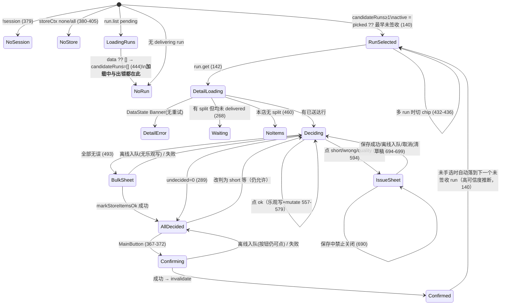
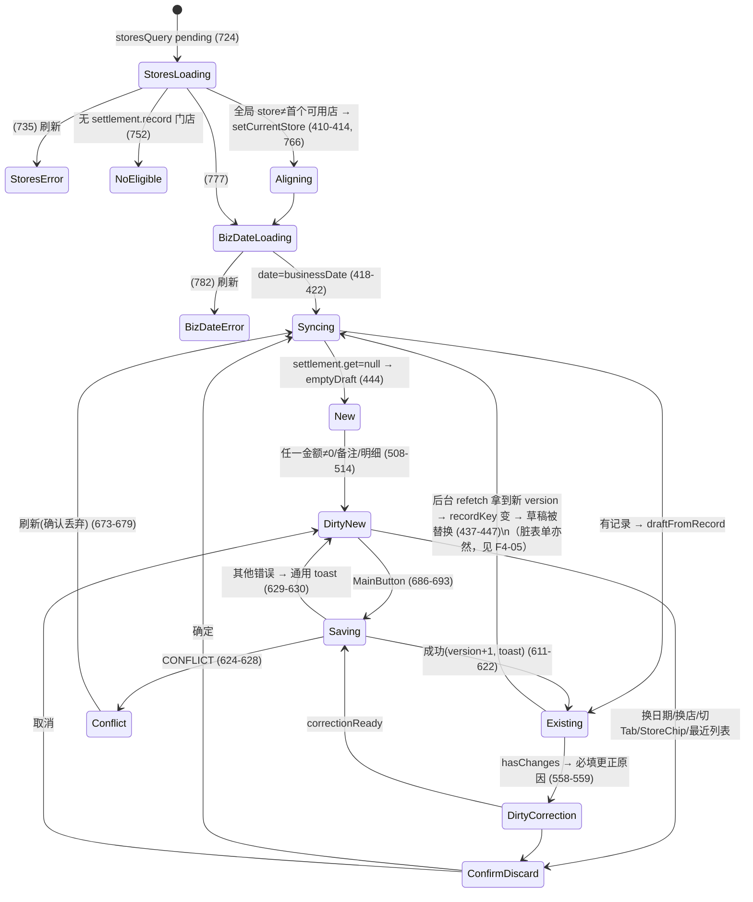
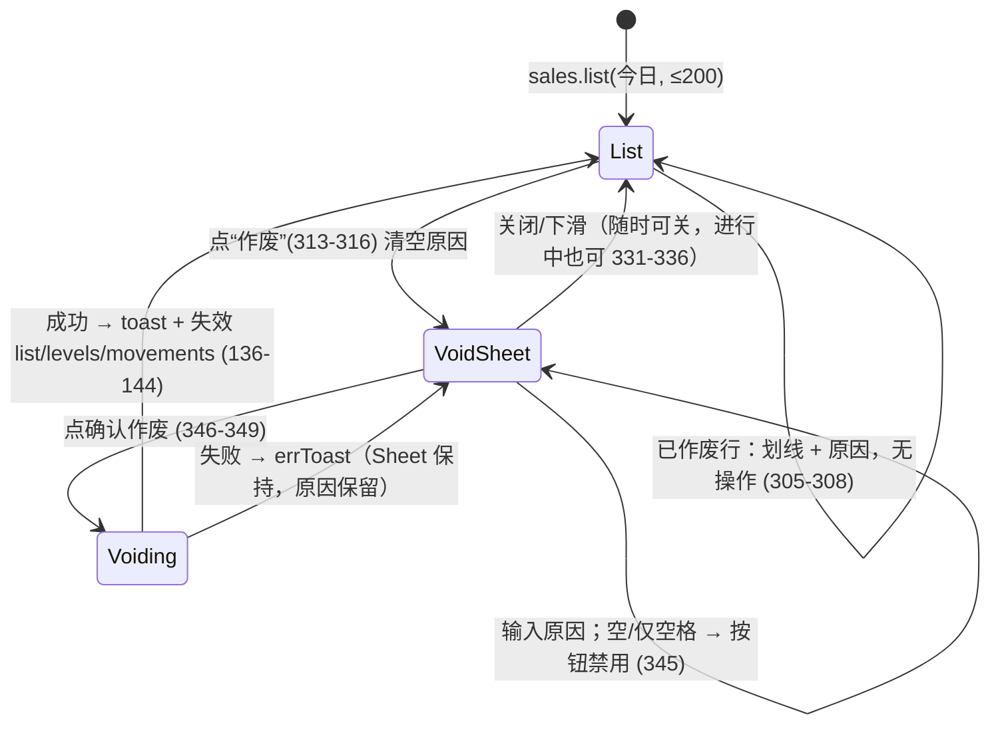

# F4 前端 UX / 交互审计：收货确认 · 日结 · 销售 · 采购历史

- 基线：`main` @ `c243771`（2026-10-21），只读审计；除本文件外未修改任何文件。
- 结论标签：**已确认（代码）** = 逐行读过代码可直接推出；**高可信度推断** = 由代码组合推出但依赖运行时细节；**待运行验证** = 需真机/浏览器确认。
- 点击数只在可由代码推出时给出；计数规则：每次“点按”（tap）计 1，文本/数字输入记为“输入”单独计，不计滚动；系统原生确认框的“确定”计 1。
- 旧审计 `docs/audit-2026-10-21/C-*.md`、`D-*.md` 已部分过时，本文全部按当前代码复核（见 §7 末“旧问题复核”）。

---

## 1 范围与已读文件

| 文件 | 读取范围 | 用途 |
|---|---|---|
| `apps/web/src/pages/ConfirmPage.tsx` | 全文 1-774 | 收货确认页 |
| `apps/web/src/pages/confirm/confirmLogic.ts` | 全文 1-93 | 多 run 选择 / 实收数量校验 |
| `apps/web/src/pages/SettlementPage.tsx` | 全文 1-1614 | 日结页（含销售折叠块、工资选人 Sheet） |
| `apps/web/src/components/sales/StoreSalesPanel.tsx` | 全文 1-372 | 销售录入/列表/作废（3 处共用） |
| `apps/web/src/components/sales/salesSummary.ts` | 全文 1-35 | 销售汇总、作废原因规范化 |
| `apps/web/src/pages/SalesPage.tsx` | 全文 1-54 | staff 的“销售”Tab |
| `apps/web/src/pages/HistoryPage.tsx` | 全文 1-382 | 采购历史（搜索/筛选/分页） |
| `apps/web/src/pages/runs/history/RunHistory.tsx` | 1-420、420-450、625-760 | 历史列表渲染与 `RunHistoryDetailSheet`（仅 History 使用到的部分） |
| 辅助（只读核对）| `app/Shell.tsx:80-161,470-542`；`stores/navStore.ts:1-120`；`components/StoreSwitcher.tsx:71-82,197-303`；`hooks/useOfflineQueue.ts:1-150`；`hooks/useTelegram.ts:300-355`；`lib/confirm.ts`；`lib/format.ts:34-127`；`app/App.tsx:58-90`；`hooks/useRealtime.ts:140-185`；`packages/ui/src/components/DataState.tsx:30-60`；`pages/admin/stores/StoresSections.tsx:360-392`；`packages/db/src/seed-data.ts:114-190`；`apps/api/src/trpc/routers/sales.ts:110-135,329-430`；`apps/api/src/trpc/routers/settlement.ts:740-790`；`packages/i18n/src/catalogs/zh.ts`（若干 key） | 入口、权限、全局行为、文案 |

内置角色与本轨道相关的权限（`packages/db/src/seed-data.ts:116-190`，已确认（代码））：

| 角色 | delivery.confirm | settlement.record | sales.record | prices.view | users.manage |
|---|---|---|---|---|---|
| manager | – | ✓ | ✓ | ✓ | ✓ |
| purchaser | – | – | – | ✓ | – |
| cashier | – | ✓ | ✓ | – | – |
| staff | ✓ | – | ✓ | – | – |

Tab 门控（`app/Shell.tsx:87-118`）：History=`prices.view`；Settlement=`settlement.record`；Sales=`sales.record` 且**没有** `settlement.record`（`hiddenWith`）；Confirm=`delivery.confirm`。Shell 只渲染当前 Tab（`Shell.tsx:542 {PAGES[tab]()}`），切 Tab 即卸载页面、丢弃页面内 `useState`。

---

## 2 页面/界面清单

| ID | 名称 | 文件:行 | 入口 | 条件 | 模式 | 目的 | 下一步去向 | 可达性 |
|---|---|---|---|---|---|---|---|---|
| F4-P01 | 收货确认（Confirm Tab） | `ConfirmPage.tsx:46-774` | 底部 Tab `confirm`（`Shell.tsx:115,154`） | `delivery.confirm`（内置仅 staff） | 见 P02-P08 | 门店逐项核对送达货物并签收 | 无页内跳转；签收后停留本页 | C（可达） |
| F4-P02 | 无门店 / 需选门店空态 | `ConfirmPage.tsx:380-405` | P01 | `storeCtx.kind==='none'` 或 `'all'` | 2 种文案 | 提示无门店或去顶部 StoreChip 选店 | StoreChip Sheet（`StoreSwitcher.tsx:243-256`） | C；`'all'` 仅 org admin 可出现（`StoreSwitcher.tsx:293`） |
| F4-P03 | 无配送中 run 空态 | `ConfirmPage.tsx:444-448` | P01 | `candidateRuns` 为空 | – | “暂无可确认” | 无 | C；**run.list 加载中/出错时也落到此态**（见 F4-02） |
| F4-P04 | 多 run 选择条 | `ConfirmPage.tsx:426-443`；`confirmLogic.ts:29-59` | P01 | 本店有 ≥2 个 `delivering` run | radio chips，已签收的带 ✓ | 选择正在核对哪一趟 | 切换 P05/P06 内容 | C |
| F4-P05 | 待送达（等待）态 | `ConfirmPage.tsx:453-458`（`awaitingDelivery` 268） | P01 | 本店有 split 但均无 `deliveredAt` | – | 采购员未交货前不可勾选 | 无 | C；文案与 P03 相同，无法区分“无单”与“在途” |
| F4-P06 | 本店无商品态 | `ConfirmPage.tsx:459-461` | P01 | 活动 run 中本店 0 split（`deliveringRunsForStore` 回退到首个 delivering run，`confirmLogic.ts:38-42`） | – | “本店没有商品” | 无 | B（需本店无 storeTotals 时出现） |
| F4-P07 | 逐项核对列表 | `ConfirmPage.tsx:463-642` | P01 | 有已送达行 | 未全部决定 / 全部决定 / 已签收 | 每行选 正常/短缺/错误/质量 | P08/P09；MainButton 签收 | C |
| F4-P08 | “全部无误”确认 Sheet | `ConfirmPage.tsx:655-678` | P07 进度行按钮 `489-497` | `!allDecided && !storeConfirmed` | – | 批量把未决定行标为 ok | 回 P07 | C |
| F4-P09 | 问题登记 Sheet | `ConfirmPage.tsx:680-771` | P07 非 ok chip（`580-594`） | 未签收 | short / wrong / quality | 填实收数量 + 备注（必填）+ 照片（可选） | 回 P07 | C |
| F4-P10 | 已签收态 | `ConfirmPage.tsx:294,365,475` | P07 | 本店所有已送达行有 `confirmedAt` | – | 只读；chips 点击静默无效（551） | 无 | C；MainButton 文案 `confirmStoreFinal`（359）因 `visible=false`（365）**永不显示**（A：该文案分支不可达） |
| F4-P11 | 日结页（Settlement Tab） | `SettlementPage.tsx:351-1614` | 底部 Tab `settlement` | `settlement.record`（manager、cashier） | 见 P12-P17 | 记录门店每日结算并保留更正轨迹 | 无跨页跳转 | C |
| F4-P12 | 日结加载/错误/无可用门店 | `SettlementPage.tsx:724-814` | P11 | storesQuery pending/error；无 eligible store；store 与全局不一致；businessDate 加载/错误；draft 未同步 | 6 个前置分支 | 防止错店/错日期表单闪现 | 重试按钮 | C |
| F4-P13 | 页内门店下拉 | `SettlementPage.tsx:703-722` | P11 | eligible store >1 | – | 切换日结门店（带脏表单确认） | P11 新门店 | C；与全局 StoreChip 并存（F4-07） |
| F4-P14 | 销售折叠块（嵌入 StoreSalesPanel） | `SettlementPage.tsx:974-998` | P11 | `sales.record` | 折叠（默认）/展开 | 在日结页内录入今日销售 | P19/P20 | C |
| F4-P15 | 日结表单（新建 / 更正） | `SettlementPage.tsx:1000-1464` | P11 | `existing` 为 null=新建；非 null=更正（需更正原因 1410-1425） | 新建/更正/冲突/只读历史明细 | 收入、经营支出明细、工资明细、采购预留/调整、现金、备注、汇总 | MainButton 保存 | C |
| F4-P16 | 版本冲突横幅 | `SettlementPage.tsx:1036-1048` | P15 保存返回 CONFLICT（624-628） | – | – | 提示刷新后再改 | 刷新（丢弃本地修改，673-679） | C |
| F4-P17 | 最近日结列表 | `SettlementPage.tsx:1466-1516` | P11 底部 | `settlement.recent` limit 7（396） | – | 跳到某日 | P15 该日期 | C |
| F4-P18 | 工资选人 Sheet | `SettlementPage.tsx:1519-1611` | “添加工资”（882-915）或行内员工按钮（1271-1276） | 非历史行 | 角色筛选 + 搜索 | 绑定门店员工 | 回 P15；新行放弃选人则删除该行（954-966） | C |
| F4-P19 | StoreSalesPanel（今日销售 + 录入） | `StoreSalesPanel.tsx:52-372` | P14、P21、Admin→门店→销售（`StoresSections.tsx:388-390`） | 查看：能读门店；录入/作废：`sales.record`（72） | 有/无录入权限 | 今日汇总、录入一笔、列表 | P20 | C |
| F4-P20 | 作废销售 Sheet | `StoreSalesPanel.tsx:329-369` | P19 行内“作废”（309-319） | 未作废 + `sales.record` | – | 填原因作废，食材回库 | 回 P19 | C |
| F4-P21 | 销售页（Sales Tab） | `SalesPage.tsx:18-54` | 底部 Tab `sales` | `sales.record` 且无 `settlement.record`（内置仅 staff） | 需选店空态（27-45）/面板 | staff 录销售 | P19 | C |
| F4-P22 | 采购历史（History Tab） | `HistoryPage.tsx:42-367` + `RunHistory.tsx:97-346` | 底部 Tab `history` | `prices.view`（manager、purchaser、admin） | 加载/空/无匹配/列表/错误 | 已完成 run 的金额与明细 | P23/P24 | C |
| F4-P23 | 历史筛选 Sheet | `HistoryPage.tsx:201-336` | 工具栏“筛选(n)”（138-147） | – | 草稿筛选，Apply 才生效 | 门店/日期(7/30/90 天预设)/支付方式/排序 | 回 P22 | C |
| F4-P24 | Run 历史详情 Sheet | `RunHistory.tsx:359-…`（Sheet 628-） | P22 行（226-233）或门店行（271-278，带 `initialStoreId`） | – | 全部门店 / 单门店 tab；`canAmend` 时含改日期与重开 | 单趟明细、支付拆分、问题行 | 重开后需去 Run Tab（注释 724-） | C；改日期/重开仅 `canAmend`（服务端判定，444）=super_admin 级别（D 无使用数据） |

---

## 3 页面状态机

### 3.1 ConfirmPage（已确认（代码））

### 3.2 SettlementPage（已确认（代码））

### 3.3 销售作废流程（已确认（代码））

注：服务端对已作废的 sale 幂等返回 `alreadyVoided`（`sales.ts:379-381`），UI 照常 toast“已作废”。

---

## 4 交互链

格式：控件 → handler(file:line) → 状态变化 → 接口 → 反馈 → 跳转。

### 4.1 ConfirmPage

| 控件 | handler | 状态变化 | 接口 | 反馈 | 跳转 / 边界 |
|---|---|---|---|---|---|
| 多 run chip | `ConfirmPage.tsx:432-436` | `pickedRunId` | `run.get`（已由 useQueries 预取 118-120） | haptic light | 停留；issue Sheet 打开时忽略（433）；被选 run 不再 delivering 时回退（137-139） |
| “全部无误”（进度行） | `489-497` | `bulkConfirmOpen=true` | – | Sheet | P08 |
| Bulk Sheet 提交 | `markAllOk` 301-311 | – | `run.markStoreItemsOk` | 成功：toast `allMarkedOk`/`nothingToMark`（244-249）；离线：入队 + toast `savedOffline`（252-255）**无乐观写**；失败：errToast | 进行中禁止关闭（658）；`loading` 防双击 |
| ok chip | `551-579` | 乐观写 `confirmStatus='ok'`（165-189） | `run.confirmStoreItem` | toast `markedOk` + haptic | 已签收/同 chip 重复点击直接 return（551,555），**无提示**；失败 invalidate 回滚（219-221） |
| short/wrong/quality chip | `580-594` | `issueOpen`，实收初值（`initialReceivedQty` 87-93） | – | Sheet | P09 |
| 实收数量输入 | `736` | `issueReceived` | – | 行内错误：required / range（746-754）；`invalid` 原因复用 range 文案 | `checkReceivedQty` 71-84 |
| 备注输入 | `759` | `issueNote` | – | **必填但无必填提示**（`issueReasonOk` 318-319 需非空；占位符“哪里不对?”） | – |
| 照片 | `763-769` | `issuePhoto` | 上传（`usePhotoUploader('issue')`） | – | 可选 |
| Sheet 保存 / MainButton 保存 | `submitIssue` 321-342 | 乐观写含 receivedQty | `run.confirmStoreItem` | toast `issueNoted`；离线入队 | 进行中 Sheet 不可关（690）；取消清草稿（694-699，C-20 已修） |
| MainButton 确认收货 | `367-372` | – | `run.confirmStore` | 成功 toast；按钮在 `storeConfirmed` 后隐藏（365）；未决定时文案“还有 n 项待核对”且 inactive（364-366） | 离线：入队但**无乐观写**，按钮仍 active → 可再次入队（F4-04） |
| 加载 run.list | 78 | – | `run.list` | **无加载态/错误态**（直接显示“暂无可确认”） | F4-02 |
| 加载 run.get | 450 | – | – | DataState spinner / Banner（显示原始 `error.message`、无重试，`DataState.tsx:44-49`） | – |

离线：三个写操作都走 `useOfflineQueue`（83-105），重放失败 drop 时 toast `syncFailed`（104）。实时：`run.changed` 失效 `['run']`（`useRealtime.ts:156-157`），采购员交货后本页自动出现可勾选行（高可信度推断）。

### 4.2 SettlementPage

| 控件 | handler | 状态变化 | 接口 | 反馈 | 跳转 / 边界 |
|---|---|---|---|---|---|
| 门店下拉 | `709-713` | 经 `confirmDiscardChanges` 后 `setCurrentStore` | 重新拉 businessDate/get/recent | 原生确认框（`lib/confirm.ts`） | 全局 StoreChip 同样受 `registerStoreChangeGuard` 保护（527-534） |
| 销售折叠头 | `987` | `salesOpen` toggle | 展开后才挂载 Panel（查询才发） | ▸/▾ | 不影响 `draft`/脏检查（974-981 注释） |
| 日期 | `1010-1014` | 确认丢弃后 `setDate` | `settlement.get` | 无效日期 `invalid`（max=营业日） | 受控 input，取消后回原值（已确认） |
| 收入/采购预留/现金 AmountField | `314-341`，`816-818` | `draft[field]` | – | 非法金额红框 + 底部 Banner（1429-1431） | 不限制输入，靠 `canSave` 阻止保存 |
| 采购调整（可负） | `1369-1374` | 同上 | – | 说明 Banner（1375-1380） | – |
| 添加经营支出 | `addOperatingExpense` 820-851 | 新空行 | – | 无权限：按钮 disabled（1100-1103），toast 分支实际不可达（821-830，A） | 仅 manager rank 或 org admin（服务端 `settlement.ts:745-753`） |
| 删除支出/工资行 | 866-880 / 924-938 | 过滤 | – | 已有记录时原生确认（875-879, 933-937） | 新建时直接删除 |
| 添加工资 | 882-915 | 新行 + 打开 P18 | `settlement.wageRoster`（按需 402-405） | – | 放弃选人 → 该行被删（954-961） |
| 选员工 | `selectWageEmployee` 940-952 | 绑定 memberId | – | haptic | 关闭 Sheet |
| 工资状态/金额/原因 | 1291-1346 | – | – | 金额≤0 红框 | – |
| 备注 / 更正原因 | 1405-1407 / 1420-1422 | – | – | 更正原因仅在 `existing && hasChanges` 时出现且必填 | – |
| MainButton 保存 | `save` 634-671 | – | `settlement.save`（带 `expectedVersion`） | 成功：toast + haptic，草稿替换为服务端结果（611-622）；CONFLICT：黄色 Banner（1036-1048）；其他：**通用 toast `settlement.errors.save`，丢失服务端原因**（629-630） | inactive 时**不说明原因**（692） |
| 冲突/加载错误“刷新” | `refreshRecord` 673-679 | 确认丢弃 → refetch | get + recent | – | 本地修改全部丢失，无合并 |
| 最近日结行 | 1480-1486 | 确认丢弃 → `setDate` | get | haptic | 只显示日期/版本/更新人，不显示金额 |
| 脏表单守卫 | 515-557 | – | – | 原生确认 / beforeunload | 覆盖：换店（页内+StoreChip）、换日期、切 Tab、刷新页面 |

双击：`saveMutation.isPending` 早退（635）且按钮 inactive（692）。离线：无离线队列，失败走通用 toast（已确认）。实时：`useRealtime` 不失效 `settlement.*`（`useRealtime.ts:152-185` 无对应事件），他人保存只在本人保存时以 CONFLICT 暴露（已确认），或在后台 refetch 时静默替换（F4-05，高可信度推断）。

### 4.3 StoreSalesPanel

| 控件 | handler | 状态变化 | 接口 | 反馈 | 边界 |
|---|---|---|---|---|---|
| 菜品下拉 | `206` | `draftDishId`；重新生成幂等键（113-115） | – | 无配方菜品 disabled + “(无配方)”（211-214） | dishes 加载中显示“尚无菜品，请在 Catalog→Dishes 创建”（197-200，F4-12） |
| 数量 | `228` | `draftQty` | – | `min=1 step=1` 仅 HTML 提示；0.5 可提交（234, 240 `toFixed(2)`） | – |
| 记录 | `235-242` | – | `sales.record`（稳定幂等键） | 成功 toast，清空表单；失败 errToast | `loading` 防双击；无确认框 |
| 作废 | `313-316` | `voidTarget` | – | Sheet | 仅今日列表可见的 sale |
| 作废确认 | `346-349` | – | `sales.void` | 成功 toast，关闭；失败 errToast | 原因必填（`normalizeVoidReason` 32-35）；进行中 Sheet 可被关闭（不像 Confirm 的 690 固定） |
| 列表加载 | `256-264` | – | `sales.list({storeId})`（默认今日，门店时区 `sales.ts:119-125,172-175`） | spinner；**错误时显示“暂无销售”空态**（F4-03） | 200 行上限警告（167-169） |

### 4.4 HistoryPage / RunHistory

| 控件 | handler | 状态变化 | 接口 | 反馈 | 边界 |
|---|---|---|---|---|---|
| 搜索框 | `HistoryPage.tsx:129-137` | 300ms 防抖（53-56），页码归 1（58-60） | `run.history` | 旧数据半透明（`RunHistory.tsx:188`，placeholderData 73） | – |
| 筛选(n) | 141-144 | 草稿=当前筛选，打开 Sheet | – | 有筛选时按钮变 primary（139） | – |
| 预设 7/30/90 天 | 258-260 | 草稿日期（设备本地日期 35-40） | – | – | 滚动 N 天，非“上周”自然周 |
| 日期起止 | 268-294 | 草稿 | – | 起>止 时红字 + Apply 禁用（114-116, 220, 296-300） | – |
| 重置（Sheet 内） | 213 | 仅重置草稿 | – | – | 需再点 Apply 才生效 |
| 应用 | 221-224 | `filters` | `run.history` | 关闭 Sheet | 关闭 Sheet 不应用（草稿丢弃） |
| 筛选 chip × | 168-190 | 单项清除 | 重新查询 | – | – |
| 全部清除 | `clearAll` 117-123 | 搜索+筛选清空 | – | – | 空结果时也提供（`RunHistory.tsx:214-218`） |
| 上一页/下一页 | `RunHistory.tsx:317-332` | `page±1` | – | fetching 时禁用 | 每页 20（`HistoryPage.tsx:51`） |
| run 行 / 门店行 | `RunHistory.tsx:226-233` / `271-278` | `detailFor` | `run.historyDetail` | Sheet | 门店行直接落到该门店 tab |
| 详情：改采购日期 | `RunHistory.tsx:700-718` | – | `run.changeDate` | toast，关闭 Sheet | `canAmend`；**无二次确认** |
| 详情：重开（amend） | `RunHistory.tsx:724-741` | – | `run.reopen` | toast，关闭 Sheet；需填原因 | **无二次确认**；之后需自行切到 Run Tab（无跳转） |
| 加载错误 | `HistoryPage.tsx:150-160` | – | – | Banner + 重试 | 详情 Sheet 出错显示“无数据”、无重试（`RunHistory.tsx:640-643`，高可信度推断：`breakdown` 为空时） |

筛选/搜索/页码均为页面 `useState`，切 Tab 即丢失（`Shell.tsx:542` 只渲染当前 Tab，已确认）。

---

## 5 用户任务流程

### T1 staff 确认 20 项送货，其中 1 项短缺

- 现有路径（最少点击，已确认（代码））：进入 Confirm Tab（若不在则 1 tap）→ “全部无误”（1）→ Sheet“全部标记”（1）→ 短缺行点“数量不足”（1）→ 输入实收数量（输入 1）→ 输入备注（输入 2，**必填**）→ 保存（1）→ MainButton“确认收货”（1）。合计 **5–6 tap + 2 输入**，3 次写请求。
  - 逐项路径：19×ok（19）+ 短缺流程（2 tap + 2 输入）+ 签收（1）= **22 tap + 2 输入**。
- 问题步骤：①备注必填但界面无必填标识，只有保存按钮灰掉（318-319, 718）；已填实收数量后“哪里不对?”往往与数量重复。②签收后页面无任何“已签收”标识（进度行与 MainButton 都隐藏，475/365），chips 点了没反应（551）。③签收后没有下一步（看库存/看本趟明细）。
- 原因：备注必填是为了让采购员纠正（文案 `confirm.issue.describe`），但 short 的核心信息已在 receivedQty。
- 建议路径：short 时备注改为可选（或预填“实收 x/y”），在备注标签上明确“必填”；签收后显示“已于 hh:mm 签收 n 项（k 项问题）”只读横幅，chips 渲染为 disabled。
- 预期改进：short 场景少 1 次文字输入；签收后状态可见，减少“到底签没签”的重复确认。
- 风险：备注改可选会降低采购员获得的信息量；需与业务确认（待运行验证/产品确认）。

### T2 staff 在有 2 趟配送待签时确认

- 现有路径：Confirm Tab 默认打开**最早未签收**的那趟（`defaultDeliveringRunId` 52-59, 140），顶部 chip 条显示 `#n · 日期`，已签收的带 ✓（438-439）。完成第一趟签收后，若用户未手动点过 chip，`activeRunId` 自动落到下一趟（高可信度推断：`pickedRunId` 为 null 时依赖 `storeConfirmedByRun`，该 map 来自同 key 的 `run.get` 查询，签收成功 invalidate 后刷新）。
- 问题步骤：①chip 只有序号和日期，看不到每趟待核对件数，无法判断哪趟更急；②若用户手动点过某趟，签收后不会自动前进（`pickedRunId` 仍指向已签收 run）；③chip 标签 `#{runIndex+1}` 与 History 的“仅 runIndex>0 才显示 #n”（`RunHistory.tsx:242`）编号规则不一致。
- 建议路径：chip 显示“#2 · 10-20 · 待核 8”；签收成功后若存在其他未签收 run，toast 附“下一趟”动作或自动切换并清空 `pickedRunId`。
- 预期改进：少一次判断/点击；避免停留在已签收的趟次。
- 风险：自动切换可能让用户误以为第一趟没提交；需配合明确的已签收横幅（见 T1）。

### T3 cashier 录入今日销售然后日结

- 现有路径（已确认（代码））：cashier 只有 Settlement 一个 Tab。展开“今日销售”（1）→ 每笔：选菜品（下拉 2 tap）+ 数量（输入）+ 记录（1）→ 向下滚动到表单：在线收入、开票现金收入（2 输入）→（无法加经营支出：cashier 非 manager rank，`settlement.ts:745-753`，按钮 disabled）→ 添加工资（1）→ 选人（1）→ 金额/原因（2 输入）→ 现金（1 输入）→ MainButton 保存（1）。
- 问题步骤：①销售面板汇总的“营收”与日结的“在线收入/开票现金收入”之间**没有任何关联或参考显示**，cashier 需肉眼读数后再手输（`SettlementPage.tsx:5-7` 明确不自动推算，属设计选择）；②销售块固定为“今日销售”，若日期切到昨天，上面仍是今天的销售（F4-06）；③日结汇总只是回显输入（602-608），没有“应有现金 vs 实点现金”差额，日结的核对价值有限；④MainButton 灰掉时不说明原因（692）。
- 建议路径：在收入卡片上方显示“系统记录今日销售额 X（仅参考）”只读行，与所选日期同步；汇总增加“差额”行（需产品定义公式）；MainButton inactive 时改为“还需：更正原因 / 明细不完整”等文案（参照 Confirm 364）。
- 预期改进：减少跨区域来回滚动与抄数错误。
- 风险：销售额与收入口径不同（菜品单价 vs 实收），展示需明确“仅参考”，否则引导错误填写。

### T4 cashier 更正一笔录错的销售

- 现有路径：展开销售块（Settlement）→ 找到该行点“作废”（1）→ 输入原因（输入）→ 确认作废（1）→ 重新选菜品（2）+ 数量（输入）+ 记录（1）。**4–5 tap + 2 输入**。
- 问题步骤：①只能看到**今日**销售（`sales.list` 未传日期，`StoreSalesPanel.tsx:75`），昨天录错的销售在 UI 中无法作废，尽管服务端 `sales.void` 不限日期（`sales.ts:329-430`）；②无法补录过去日期的销售（record 不带 occurredAt，237-241）；③作废后不自动带出原菜品/数量供重录。
- 建议路径：作废 Sheet 增加“作废并重新录入”动作，作废成功后把原 dish 预填到录入表单；销售列表增加日期切换（与日结日期联动）。
- 预期改进：更正少 2 tap，且能处理隔日更正。
- 风险：允许跨日作废会影响已保存日结的口径；需定义“已日结日期的销售能否作废”。

### T5 manager 查看昨天的日结并更正

- 现有路径：Settlement Tab →（门店多于 1 时）确认门店 → 滚动到页面底部“最近每日结算”（整张表单之后，1466）→ 点昨天（1）或用日期控件选日期（1–2）→ 表单载入为“编辑”模式（Banner 1050-1054）→ 修改字段（输入）→ 填更正原因（输入，必填）→ 保存（1）。
- 问题步骤：①最近列表在页面最底部，且只显示日期/版本/更新人，不显示金额，无法在列表层“查看”；②看不到历次修订内容（只显示 version 号，旧审计 D-11 仍成立）；③若期间他人已改，只有在保存时才得知冲突，冲突后“刷新”会丢掉全部本地修改（673-679），需要重输。
- 建议路径：最近列表上移或在日期字段旁提供“昨天”快捷；列表行显示收入合计/现金；冲突时展示“对方版本 vs 我的修改”差异并允许保留本地值重提。
- 预期改进：查看昨天由“滚到底+点”降为 1 tap；冲突不再需要重输。
- 风险：差异合并 UI 复杂度高；可先做“刷新后保留我改过的字段”轻量版。

### T6 staff（无 settlement.record）通过 Sales Tab 录销售

- 现有路径：Sales Tab（1）→ 选菜品（2）→ 数量（输入，默认 1）→ 记录（1）。**4 tap**（数量为 1 时 0 输入）。门店为 `'all'`/none 时显示空态（`SalesPage.tsx:27-45`）。
- 问题步骤：①录入表单在列表上方，无“最近菜品”快捷，高频重复菜品每次都要打开下拉；②列表加载失败显示为“暂无销售”（F4-03），staff 可能重复录入；③staff 底部 Tab 顺序 Order / Sales / Confirm（`Shell.tsx:87-116`），与其主要职责（下单、收货）交错。
- 建议路径：录入区加最近 5 个菜品 chips（1 tap 选中）；列表错误态加重试；数量用步进器。
- 预期改进：常见菜品从 4 tap 降到 2 tap。
- 风险：chips 占用竖向空间。

### T7 purchaser / manager 查找上周某趟 run 的金额

- 现有路径：History Tab（1）→ 筛选（1）→“近 7 天”（1）或手选起止日期（2 次日期选择）→ 应用（1）→ 列表头 meta 显示“条数 · 合计 UZS”（`RunHistory.tsx:189-194`），每行显示该趟合计及门店分项 → 点行查看详情（1）。**4–5 tap**。
- 问题步骤：①没有“上周（自然周）”预设，只有滚动 7/30/90 天，且按设备本地日期计算（`HistoryPage.tsx:35-40`），与门店营业日（Settlement 使用服务端 businessDate）口径不同；②离开 Tab 后筛选全部丢失，再回来需重做；③行内金额无币种、表头有币种，同屏格式不一致；④详情 Sheet 副标题显示原始状态枚举（`description={target?.status}`，634），如 `finished`。
- 建议路径：预设增加“本周/上周/本月”；筛选状态放入 navStore（同 admin 下钻的持久化方式）；统一 `formatMoney(v, currency)`。
- 预期改进：重复查询从 4 tap 降到 1 tap（返回 Tab 即保留）。
- 风险：持久化筛选可能让用户忘记仍在筛选中（已有 chip 提示，风险低）。

---

## 6 一致性与重复

### 6.1 销售录入 3 处入口（已确认（代码））

| 入口 | 文件:行 | 可见人 | 门店来源 | 容器 | 差异 |
|---|---|---|---|---|---|
| Settlement 折叠块 | `SettlementPage.tsx:974-998` | `sales.record` 且在 Settlement（manager、cashier） | 日结页内门店（可与全局不同步时被强制对齐） | 折叠，默认收起 | 标题“今日销售”，与表单所选日期无关 |
| Sales Tab | `SalesPage.tsx:47-53` | `sales.record` 且**无** settlement.record（staff） | 全局 StoreChip | PageHeader“销售”+ 门店名 | 唯一有独立页面标题的入口 |
| Admin → 门店 → 销售 | `StoresSections.tsx:388-390` | `users.manage`（manager、admin） | admin 下钻所选门店 | Segmented 子 Tab | 不受 StoreChip 影响 |

- 组件为同一 `StoreSalesPanel`，行为一致（好）。但 manager 同时拥有 Settlement 块与 Admin 子 Tab 两个入口，且两处门店来源不同（页内下拉/StoreChip vs admin 下钻），可能在 A 店日结页内看 B 店（admin 下钻）销售的认知混淆（高可信度推断）。
- 组件头注释仍写“Cashiers only get the Settlement tab”（`StoreSalesPanel.tsx:4-8`）、“Record sale entry (bottom)”（41-42）而实际表单在列表上方（193 vs 253），注释过时。

### 6.2 金额 / 日期格式

- `formatMoney` 最多 1 位小数（`lib/format.ts:95-105,120-127`），日结金额精度 2 位（`SettlementPage.tsx:129`），汇总与明细合计（1093, 1209-1210, 1443-1462）会把 `12.35` 显示为 `12.4`（旧 D-16 仍成立，已确认）。
- 币种：Settlement 用 `formatMoney(v, currencyOf(session))` 带后缀；StoreSalesPanel 汇总把币种放在数字下方单独一行（`StoreSalesPanel.tsx:184-188`），行内金额不带币种（294-296）；History 表头带币种（`RunHistory.tsx:191`）、行金额不带（246, 294）；详情头带（657）。同类“金额”有 3 种呈现。
- 日期：Confirm（`runOnDate`，418）、History 行（241）、Settlement 最近列表（1490）均直接输出 `YYYY-MM-DD`；Sales 列表时间用 `useDateFormat().time`（271）。
- “今天”的来源：Settlement=服务端门店时区 businessDate（382-387）；Sales=服务端门店时区（`sales.ts:172-175`）；History 预设=设备本地日期（`HistoryPage.tsx:35-40`）。

### 6.3 门店选择差异

- 全局 `StoreChip` 显示于所有页面顶部（`Shell.tsx:486,505`）。Settlement 另有页内下拉（703-722），且只列出有 `settlement.record` 的门店（358-366）。
- 若用户通过 StoreChip 选了一个无 `settlement.record` 的门店（或 org admin 选“全部门店”），Settlement 会**静默把全局门店改回第一个可用门店**（410-414），用户的选择被“弹回”，且离开 Settlement 后其他页面也停留在被改后的门店（已确认（代码））。
- Confirm / Sales 对 `'all'` 显示“请选择门店”空态；Settlement 直接替用户选；History 不受全局门店影响，用筛选 Sheet 内的门店（`HistoryPage.tsx:232-246`）。四种页面三种门店语义。
- `ConfirmPage.tsx:387-388, 408-410` 注释称“门店选择器在 SettingsSheet”，与当前 StoreChip 实现不符（注释过时）。

### 6.4 筛选与列表

- History 是本轨道唯一有搜索/筛选/分页的列表；筛选采用“草稿 + 应用”Sheet + 已生效 chip 行，模式完整。但状态不持久（切 Tab 丢失），而 admin 下钻状态是持久化的（`navStore.ts` 头注释）。
- Settlement 最近列表固定 7 条无分页；Sales 列表仅今日、无日期切换；Confirm 列表无排序/搜索（20+ 项时靠滚动）。

### 6.5 确认框 / toast 模式

| 场景 | 确认方式 | 文件:行 |
|---|---|---|
| Confirm 批量 ok | 自定义 Sheet | `ConfirmPage.tsx:655-678` |
| Confirm 签收（不可逆） | **无确认**，MainButton 直接提交 | 367-372 |
| Settlement 丢弃修改 / 删除明细 | 原生 `confirmNative` | 515-523, 875-879 |
| Sales 作废 | Sheet + 必填原因 | `StoreSalesPanel.tsx:329-369` |
| Sales 记录 | 无确认 | 235-242 |
| History 重开 run / 改日期 | **无确认**（重开需原因） | `RunHistory.tsx:710-740` |

- toast：Confirm/Sales 用 `errToast('common.error')`（携带服务端错误）；Settlement 保存失败统一 `settlement.errors.save`（629-630），丢失具体原因；Settlement 加载失败 Banner 也用 `settlement.errors.save` 文案（1024-1027，“无法保存每日结算”）——加载错误显示成保存错误。
- Sheet 进行中能否关闭：Confirm issue/bulk 固定（658, 690）；Sales 作废可关闭（331-336）；不一致。

---

## 7 问题清单

严重度：P0 数据/资金错误或阻断主流程；P1 主流程显著误导或高频损失；P2 明显体验/一致性问题有变通；P3 打磨。

### F4-01（P2）签收后无“已签收”状态，chips 静默失效
- 证据：`ConfirmPage.tsx:475`（进度行仅未签收显示）、`365`（MainButton `visible` 需 `!storeConfirmed`）、`358-359`（`confirmStoreFinal` 分支因 visible=false 不可达）、`551`（已签收点击 return 无反馈）。已确认（代码）。
- 影响：签收后页面与“未开始”的列表视觉几乎相同，用户无法确认是否已签；点 chip 没反应会被理解为卡死。
- 修复方向：签收后显示只读横幅（时间、问题项数），chips 设 disabled。
- 验证：签收后截图对比；点 chip 有提示或无交互样式。

### F4-02（P2）run.list 加载中/失败显示为“暂无可确认”
- 证据：`ConfirmPage.tsx:78, 114-117`（`runsQuery.data ?? []`），`444-448` 直接渲染空态；无 `isLoading/isError` 分支。已确认（代码）。
- 影响：弱网门店（注释 81-82 明确此场景）打开页面会先看到“暂无可确认”，或在出错时一直误以为无货，可能不签收。
- 修复方向：`runsQuery` 套 DataState 或显式 spinner / 错误+重试。
- 验证：DevTools 节流 / 断网打开 Confirm Tab。

### F4-03（P2）销售列表出错显示为空，可能诱发重复录入
- 证据：`StoreSalesPanel.tsx:149`（`salesQuery.data ?? []`）、`256-264`（只判断 `isLoading`，否则 length=0 → EmptyState），汇总同样为 0（153）。已确认（代码）。
- 影响：列表失败时显示“今日 0 份 / 0 营收 / 暂无销售”，员工可能重新录入已有销售 → 重复扣库存。
- 修复方向：增加 `isError` Banner + 重试；错误时隐藏汇总。
- 验证：模拟 `sales.list` 500。

### F4-04（P2）离线签收无乐观状态，可重复入队并产生误导性“同步失败”
- 证据：`confirmStore.onError` 离线分支只 enqueue + toast（232-235），不写缓存；`mainBtnActive` 仍为真（366）；`storeConfirmed` 由服务端数据推出（294）。批量 ok 同样无乐观写（252-255）。`useOfflineQueue.ts` 头注释：重放终止码会 drop 并 `onDrop` toast（104）。高可信度推断。
- 影响：离线时用户再次点“确认收货”会入队第二条；上线后第二条被服务端以“已签收”拒绝 → 弹 `syncFailed`，用户以为签收失败。
- 修复方向：离线入队时乐观写 `confirmedAt`，或对同 (runId, storeId) 去重入队。
- 验证：断网点两次签收后恢复网络，观察 toast。

### F4-05（P2）日结表单可能被后台 refetch 静默覆盖
- 证据：`recordKey` 含 `existing.version`（437），effect 在 `recordKey` 变化时 `setDraft(draftFromRecord(existing))`（439-447），不检查 `hasUnsavedChanges`；QueryClient `staleTime 30s`、未关闭 `refetchOnReconnect`（`App.tsx:62-84`）。高可信度推断 / 待运行验证。
- 影响：manager 编辑更正期间若他人保存了新版本、且本页因网络恢复等原因 refetch，本地输入被替换，没有任何提示（应为冲突）。
- 修复方向：脏表单时不自动替换，改为设置 `versionConflict` 并提示。
- 验证：两个会话同一门店日期；A 编辑中断网→B 保存→A 恢复网络。

### F4-06（P2）日结页“今日销售”块与所选日期不联动
- 证据：销售块位于日期字段之上（974-998 vs 1000-1016），`StoreSalesPanel` 不接收日期，`sales.list({storeId})` 默认今天（`StoreSalesPanel.tsx:75`；`sales.ts:119-125`）。已确认（代码）。
- 影响：更正昨天日结时，页面同时显示“今日销售”，易把今天数字当作昨天参考。
- 修复方向：给 Panel 传 `date`，标题随日期变化；或日期≠营业日时隐藏/标注该块。
- 验证：切换日期观察块标题与内容。

### F4-07（P2）Settlement 静默改写全局门店上下文
- 证据：`SettlementPage.tsx:363-366`（回退首个 eligible 门店）、`410-414`（`setCurrentStore(currentStoreId)`）、`766-775`（不一致时 spinner）。已确认（代码）。
- 影响：通过 StoreChip 选择的门店（或 org admin 的“全部门店”）进入 Settlement 后被改掉且无提示，回到 Order/History 等页面时门店已变；选择看起来“弹回”。
- 修复方向：所选门店无日结权限时显示说明 + 页内选择器，而不是改写全局；或明确 toast“已切换到 X 店（你在原门店无日结权限）”。
- 验证：org admin 选“全部门店”后进入 Settlement 再返回 Order。

### F4-08（P2）保存失败一律显示“无法保存每日结算，请重试”
- 证据：`SettlementPage.tsx:629-630`；加载失败 Banner 也用同一 key（1024-1027）；zh 文案 `settlement.errors.save` = “无法保存每日结算，请重试。”。已确认（代码）。
- 影响：权限（如 cashier 改动经营支出被拒）、校验、日期越界等错误都提示“重试”，用户反复重试无效；加载失败被说成保存失败。
- 修复方向：沿用 `errToast` 显示服务端 message key；加载失败使用独立文案。
- 验证：以 cashier 身份构造被拒的保存。

### F4-09（P2）历史详情“重开 run”无二次确认
- 证据：`RunHistory.tsx:724-741`，按钮直接 `reopen.mutate`；仅要求原因非空。已确认（代码）。
- 影响：把已完成 run 改为 `amending`（影响 History 列表与库存口径），一次误触即生效；且之后需手动切到 Run Tab 完成修改，无引导。
- 修复方向：`confirmNative` 二次确认；成功后提供“去采购页完成修改”动作。
- 验证：super_admin 账号操作。

### F4-10（P3）问题登记备注必填但无标识；`invalid` 错误显示为范围错误
- 证据：`ConfirmPage.tsx:318-319`（note 非空才可保存），757-762 无 label/required 标识；`746-753` reason 为 `invalid`（格式错误，如 `1.2345`/`abc`）时显示“请输入 0 到 {max} 之间的数字”。已确认（代码）。
- 影响：用户填完数量后保存按钮灰掉不知原因；格式错误提示不准确。
- 修复方向：备注标“必填”或改可选；`invalid` 单独文案（最多 3 位小数）。
- 验证：输入 `1.2345`。

### F4-11（P3）MainButton 灰掉不说明原因（Settlement）
- 证据：`SettlementPage.tsx:686-693` 文案恒为“保存/保存更正”，`active=canSave`（562-572 共 10 个条件）；对比 Confirm 的 `confirmStoreBlocked` 文案（364）。已确认（代码）。
- 影响：长表单中缺更正原因或某明细原因为空时，用户需上下滚动找红框/底部 Banner。
- 修复方向：按首个阻断原因输出按钮文案或点击 inactive 按钮时滚动到首个错误。
- 验证：只改金额不填更正原因。

### F4-12（P3）菜品加载中/给无权限者显示“去 Catalog→Dishes 创建”
- 证据：`StoreSalesPanel.tsx:74, 156-161, 197-200`（`dishOptions.length===0` 不区分加载/错误）；文案 `sales.form.noDishesYet`。已确认（代码）。
- 影响：staff/cashier 看到指向他们无权访问的后台的指令；加载慢时闪现。
- 修复方向：加载态 spinner；无 `dishes.manage` 时改为“请联系管理员添加菜品”。
- 验证：节流网络打开 Sales Tab。

### F4-13（P3）销售数量允许小数与 HTML 约束矛盾
- 证据：`StoreSalesPanel.tsx:223-226`（`step=1 min=1`）vs `234,240`（只校验 >0，`toFixed(2)` 提交）。已确认（代码）。
- 影响：可提交 0.5 份；浏览器可能对 0.5 显示校验气泡但按钮仍可点（待运行验证）。
- 修复方向：明确业务是否允许半份并统一约束。

### F4-14（P3）只能看到/作废今日销售，无法处理隔日更正
- 证据：`StoreSalesPanel.tsx:75`（无日期参数）；服务端支持 `fromDate/toDate`（`sales.ts:119-125`）且 void 不限日期（329-430）。已确认（代码）。
- 影响：营业结束后（跨过门店午夜）发现的错误无法在 UI 更正。
- 修复方向：Panel 支持日期参数（与 F4-06 一起做）。

### F4-15（P3）History 筛选/搜索/页码切 Tab 即丢失；预设用设备日期
- 证据：`HistoryPage.tsx:45-50`（useState）、`Shell.tsx:542`；`35-40` `new Date()` 本地日期。已确认（代码）。
- 影响：查完详情去别的 Tab 再回来需重新筛选；跨时区设备的“近 7 天”与门店营业日不一致。
- 修复方向：筛选入 navStore（不持久化到 localStorage 亦可）；预设由服务端营业日计算。

### F4-16（P3）历史详情副标题显示原始状态枚举；详情错误无重试
- 证据：`RunHistory.tsx:634`（`description={target?.status}`）；`640-643`（无 breakdown 显示“无数据”）。前者已确认（代码），后者高可信度推断（错误时 `breakdown` 为空）。
- 影响：中文界面出现 `finished`；网络错误被说成无数据。
- 修复方向：用 i18n 状态名；加错误态 + 重试。

### F4-17（P3）金额精度与币种呈现不一致
- 证据：见 §6.2（`lib/format.ts:95-127`；`StoreSalesPanel.tsx:184-188,294-296`；`RunHistory.tsx:191,246,294,657`）。已确认（代码）。
- 影响：日结汇总四舍五入到 1 位小数，与输入值（2 位）不一致；同屏币种时有时无。
- 修复方向：金额类统一 2 位小数格式化函数并统一带/不带币种的规则。

### F4-18（P3）日结最近列表位于页底且不显示金额；修订历史不可见
- 证据：`SettlementPage.tsx:1466-1516`（只渲染 date/version/updatedByName）。已确认（代码）。旧 D-11“修订历史不可见”仍成立。
- 影响：管理者复核需逐日打开；无法看出“谁改了什么”。
- 修复方向：行内显示收入/现金；提供修订记录抽屉。

### F4-19（P3）多 run chip 信息不足、编号规则与 History 不一致；手选后不自动前进
- 证据：`ConfirmPage.tsx:438-439`（`#{runIndex+1} · date` + ✓）、`134-140`；`RunHistory.tsx:241-242`（runIndex>0 才显示 #n）。前两点已确认（代码），“不自动前进”高可信度推断。
- 修复方向：chip 加待核件数；签收后清空 `pickedRunId`。

### F4-20（P3）DataState 错误显示原始 message 且无重试（Confirm 详情）
- 证据：`ConfirmPage.tsx:450`；`packages/ui/src/components/DataState.tsx:44-49`。已确认（代码）。
- 影响：服务端 message 为 i18n key 时可能直接显示 key（待运行验证）；用户无法重试只能切 Tab。

### F4-21（P3）过时注释 / 不可达分支
- `ConfirmPage.tsx:8-9`（“photo capture stub is a text URL”，实际已用 PhotoCapture + uploader 763-769）、`387-388,408-410`（门店选择器在 SettingsSheet）、`650-653`（称有 card meta 提示，已删除）；`StoreSalesPanel.tsx:4-8,41-42`；`RunHistory.tsx:39-42`（称用 run.list 最近 50 条，实际为 `run.history` 分页）；`SettlementPage.tsx:821-830` toast 分支在按钮 disabled 时不可达。已确认（代码）。影响：维护者误判行为。

### 旧问题复核（相对 docs/audit-2026-10-21）

| 旧 ID | 当前状态 | 证据 |
|---|---|---|
| C-01 收货短缺不影响库存/无人可见 | 前端已有实收数量输入与展示（CA-06） | `ConfirmPage.tsx:610-628, 730-756` |
| C-08 可绕过逐项核对 | 已修：未决定行不预选，签收需 allDecided；未送达不可勾选 | 287-289, 262-268 |
| C-20 issue 草稿残留 | 已修 | 691-699 |
| D-5 issue 提交双实现 | 已合并为 `submitIssue` | 320-342 |
| D-01 cashier/staff 无销售入口 | 已修（Settlement 块 + Sales Tab） | `SettlementPage.tsx:974-998`；`Shell.tsx:106-112` |
| D-03 销售“今天”用 UTC | 已修（门店时区） | `sales.ts:119-125,172-175` |
| D-10 无销售作废 | 已修（作废 + 原因 + 回库） | `StoreSalesPanel.tsx:133-147, 329-369` |
| D-11 修订历史不可见 | 仍成立 | 见 F4-18 |
| D-16 金额 1 位小数 | 仍成立 | 见 F4-17 |
| D-18 reopen 不刷新 history | 已修 | `RunHistory.tsx:397-401` |
| D-21 200 行截断无提示 | 已修（警告 Banner） | `StoreSalesPanel.tsx:167-169` |

---

## 8 待运行验证项

1. F4-02：节流/断网打开 Confirm Tab，确认首屏是否显示“暂无可确认”。
2. F4-04：离线连续两次“确认收货”后恢复网络，观察是否弹 `syncFailed`。
3. F4-05：双会话并发编辑同一日结 + 断网重连，确认草稿是否被静默替换（`refetchOnReconnect` 实际行为）。
4. T2：签收第一趟后是否自动切换到下一趟（`pickedRunId` 为 null 与非 null 两种情况）。
5. F4-13：`<Input type=number step=1 min=1>` 在 Telegram iOS/Android WebView 中对 0.5 的表现。
6. F4-20：Confirm 详情出错时 Banner 显示的是翻译文本还是 i18n key。
7. 日期 `<input type=date>` 在桌面浏览器逐字输入时是否多次触发丢弃确认（`SettlementPage.tsx:1010-1014`）。
8. 非 Telegram 环境下 `usePageMainButton` 的页内替代按钮位置是否遮挡 Settlement 长表单底部内容（本轨道未读 Shell 中 MainButton 渲染实现）。
9. 所有点击数为代码推导，未经真机计时；实际使用频率无数据（D）。

## 9 未覆盖范围

- RunPage（采购员交货、`deliverToStore`）与 Confirm 的跨页时序，仅从 Confirm 侧审视。
- `RunHistoryDetailSheet` 的分店明细渲染（`RunHistory.tsx:745-980`）只扫描了结构，未逐行审计金额计算（`../lib/settlement`）。
- Admin → 门店 → 库存、Operations → Finance 报表（与日结/销售口径相关，但不在本轨道）。
- `@compass/ui` 组件（Sheet、Chip、NumberInput、PhotoCapture）的可访问性与键盘行为；`usePhotoUploader` 上传失败路径。
- 服务端 `settlement.save` 的完整校验规则与错误码清单（只核对了 `canRecordOperatingExpenses`）。
- i18n 其他语言（ru/uz/en）文案；仅抽查 zh。
- 无运行环境、无截图、无使用数据；所有“频率/影响”判断均为推断。
