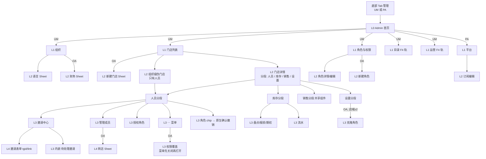

# F5 前端交互审计：Admin 首页 + 组织 + 门店 + 人员/权限 + 平台

- 基线：`main` @ `c243771`（2026-10-21），只读审计，未运行应用、未访问数据库或生产环境。
- 结论标签：**已确认（代码）** = 逐行读到的行为；**高可信度推断** = 由多处代码推出、但未运行验证；**待运行验证** = 需要真机/浏览器确认。
- 点击数的计法：从「已经位于 Admin 底部 Tab 的首页」开始，每一次点按算 1 步（包括打开 Sheet、选择 `<select>` 选项、原生确认框的“确定”）；文本输入单独记为“输入”，不计入点按；底部 Tab 切换本身不计。`<select>` 记为 2 步（打开 + 选中）。
- 旧审计（`docs/audit-2026-10-21/A-*.md`、`E-*.md`）中 A-03（店长停用门店）、A-06（邀请无法列出/撤销）、A-10（全局管理员启发式）、A-18（平台管理员进不去）已在当前代码中修复，本文只以当前代码为准。

---

## 1 范围与已读文件

| 文件 | 行数 | 读取方式 |
|---|---|---|
| `apps/web/src/pages/AdminPage.tsx` | 695 | 全文 |
| `apps/web/src/pages/admin/shared.ts` | 48 | 全文 |
| `apps/web/src/pages/admin/stores/StoresSections.tsx` | 1177 | 全文 |
| `apps/web/src/pages/admin/people/PeopleSections.tsx` | 2667 | 全文 |
| `apps/web/src/pages/admin/platform/PlatformSections.tsx` | 230 | 全文 |
| `apps/web/src/stores/navStore.ts` | 1–320 | 持久化、merge 清洗、resetNavStore |
| `apps/web/src/app/Shell.tsx` | 85–130, 175–235 | Tab 定义与 Admin Tab 门槛 |
| `apps/web/src/app/App.tsx` | 55–80 | QueryClient 默认值（staleTime 30s，refetchOnWindowFocus 关） |
| `apps/web/src/app/AuthGate.tsx` | 110–201 | `auth.me` → session 更新时机 |
| `apps/web/src/hooks/useRealtime.ts` | 150–215 | `people.changed` / `catalog.changed` → 失效 `['admin']` |
| `apps/web/src/lib/errToast.ts`、`lib/confirm.ts`、`lib/trpc.ts`(85–110, 191–265) | — | 错误提示、原生确认、幂等头 |
| `packages/ui/src/components/{Button,DataState,Sheet}.tsx` | 片段 | loading 是否禁用、错误态、BackButton 栈 |
| `packages/i18n/src/catalogs/zh.ts` | 按 key grep | 文案核对 |
| `packages/db/src/seed-data.ts` | 80–200 | 内置角色与权限 |
| `apps/api/src/trpc/routers/admin.ts` | 60–110, 1071–1240, 1378–1400, 1451–1530, 1573–1580, 1800–1815, 1960–2110, 2505–2632, 2866–2985, 3502–3720 | 仅为理解权限与结果 |
| `apps/api/src/trpc/routers/auth.ts` | 1755–1830 | session.stores / adminStoreIds 的计算 |

---

## 2 页面/界面清单

权限缩写：**UM** = `users.manage`；**OA** = `org.admin`（admin / super_admin 持有，`seed-data.ts`）；**SA** = super_admin 角色；**PA** = `session.isPlatformAdmin`；**IA** = `inventory.adjust`；**店域** = `session.adminStoreIds`。

| ID | 名称 | 位置 | 入口 | 条件 | 模式 | 用途 | 下一跳 | 可达性 |
|---|---|---|---|---|---|---|---|---|
| F5-P01 | Admin 首页（分区列表） | `AdminPage.tsx:232-290` | 底部 Tab「管理」(`Shell.tsx:116,184`) | Tab：UM 或 PA；行：UM 才显示 5 个租户分区(`:242`)，PA 才显示平台(`:280`) | 只读导航 | 分区入口 | P03/P04/P20/目录/运营/P24 | C（无数据） |
| F5-P02 | 无权限空态 | `AdminPage.tsx:164-173` | 同上 | 既非 UM 也非 PA | 只读 | 提示 | 无 | A（Tab 本身已被隐藏，`Shell.tsx:184`；只在 session 中途失权时出现） |
| F5-P03 | 分区框架 SectionFrame | `AdminPage.tsx:405-454` | 任何分区 | — | — | 标题 + 返回 | 返回逻辑 `:179-193` | — |
| F5-P04 | 组织（Workspace） | `AdminPage.tsx:462-649` | P01「组织」 | UM | 只读卡 + 两行 | 套餐摘要、组织名、我的角色、TG、币种、税率 | P05、P06 | C |
| F5-P05 | 语言 Sheet | `AdminPage.tsx:523`（`LanguageSheet`） | P04「语言」行 `:559-563` | UM | 编辑 | 改界面语言 | 关闭 | E（与 SettingsSheet 内置语言选择重复，`SettingsSheet.tsx:250`） |
| F5-P06 | 财务设置 Sheet | `AdminPage.tsx:578-646` | P04「财务」行 `:565-574` | OA | 编辑 | 币种/税率/含税 | 关闭 | C |
| F5-P07 | 门店列表 | `StoresSections.tsx:94-327` | P01「门店」 | UM；OA 额外看到暂停/归档店(`:103-106`)与「+新门店」(`:150-161`) | 只读列表 | 门店 + 组织级伪门店 | P08、P09 | C |
| F5-P08 | 新建门店 Sheet | `StoresSections.tsx:255-324` | P07「+ 新门店」 | OA | 创建 | 名称/代码/地址/时区 | 关闭，停留在列表 | C |
| F5-P09 | 门店详情（分段：人员/库存/销售/设置） | `StoresSections.tsx:343-396` | P07 门店卡 | UM（列表已按店域过滤，`admin.ts:3538-3540`） | 容器 | 门店工作台 | P10/P16/P18/P19 | C |
| F5-P10 | 组织级伪门店（只有人员） | `StoresSections.tsx:182-210, 353-354` | P07 顶部「组织级」卡 | 仅当存在 `stores.length===0` 的可见成员(`:182`) | 列表 | 无门店成员 | P11 | C（且混入了非管理员，见 F5-03） |
| F5-P11 | 人员列表（Team） | `PeopleSections.tsx:85-688` | P09「人员」/P10 | UM | 列表 + 搜索 | 成员卡、角色 chip、三个按钮 | P12/P13/P14/P15/P21/P22 | C |
| F5-P11a | 人员“全部门店分组”视图 | `PeopleSections.tsx:479-519` | 无（唯一调用方总传 `lockMode`，`StoresSections.tsx:377-383`） | — | — | 跨店分组目录 | — | **A 已确认不可达** |
| F5-P12 | 邀请中心 Sheet | `PeopleSections.tsx:1332-1426` | P11「邀请」`:261` | UM | 选择 | TG 分享链接 / 复制链接 / 按 TG ID / 待处理邀请 | P12a、P13 | C |
| F5-P12a | 待处理邀请列表（嵌在 P12 内） | `PeopleSections.tsx:1434-1501` | 只能经 P12 | UM；服务端按店域过滤(`admin.ts:1455,1475`)；为空时整块不渲染(`:1455`) | 列表 + 撤销 | 撤销邀请 | 原生确认 | B（入口埋在“邀请”里，见 F5-08） |
| F5-P13 | 邀请表单 Sheet（`mode=tgid` / `mode=link` 复用） | `PeopleSections.tsx:1503-1685`；实例 `:658-685` | P12 三个按钮 | UM；非 OA 隐藏 rank≥80 角色(`:1541`)，门店只列店域(`:1545-1548`) | 创建 | 选角色、选门店、（tgid）输 ID | Telegram 分享 / 剪贴板 / 关闭 | C |
| F5-P14 | 管理成员 Sheet | `PeopleSections.tsx:1694-1902` | 成员卡「管理」`:390-402` | UM；改名 `canRename`(`:1760-1762`)；门店勾选仅店域可改(`:1820`) | 编辑（即时生效） | 改显示名、勾选门店归属 | P14a | C |
| F5-P14a | 转店 Sheet（叠在 P14 上） | `PeopleSections.tsx:1921-2063` | P14 已勾选行的「→ 转移」`:1855-1867` | OA 且该店可编辑 | 创建 | 原子转店 + 镜像角色 | 关闭 | C |
| F5-P15 | 授权角色 Sheet | `PeopleSections.tsx:2416-2667` | 成员卡「授权角色」`:403-419` | UM；“全局”仅 OA(`:2468`) | 点角色即提交 | 授权（全局或多店扇出） | 关闭 | C |
| F5-P16 | 库存分段 | `StoresSections.tsx:418-808` | P09「库存」 | UM 才能进 Admin；按钮需 IA(`:434-436`) | 列表 | 现存量 | P16a/P16b/P16c | C |
| F5-P16a | 盘点 / 报损 Sheet（共用） | `StoresSections.tsx:625-752` | 行内「盘点」「报损」`:596-615` | IA | 编辑 | 设定实盘数 / 扣减并备注 | 关闭 | C |
| F5-P16b | 期初盘点（Sheet 内选 SKU） | `StoresSections.tsx:540-553, 682-697` | 顶部「为其他商品盘点」 | IA 且存在无台账 SKU | 创建 | 新店建立库存 | 关闭 | C |
| F5-P16c | 库存流水 Sheet | `StoresSections.tsx:755-805` | 点库存行 `:578-587` | UM | 只读 | 最近 50 条流水 | 关闭 | C |
| F5-P18 | 销售分段 | `StoresSections.tsx:388-390`（共享 `StoreSalesPanel`） | P09「销售」 | UM | — | 与销售 Tab/结算页相同组件 | — | E（另有 `SalesPage.tsx:51`、`SettlementPage.tsx:995`） |
| F5-P19 | 门店设置分段 | `StoresSections.tsx:819-1034` | P09「设置」 | 可编辑：OA 或店域(`:903`)；启用开关/归档：OA(`:966,1006`)；克隆：OA 且店域≥2(`:998`) | 编辑 / 只读横幅 `:1020-1024` | 名称/代码/地址/时区/默认角色/启用/归档 | P19a、原生确认 | C |
| F5-P19a | 克隆角色 Sheet | `StoresSections.tsx:1049-1176` | P19「克隆角色」 | OA | 创建 | 从来源店复制角色绑定 | 关闭 | C |
| F5-P20 | 角色与权限 | `PeopleSections.tsx:705-803` | P01「权限」 | UM；「+新角色」仅 OA(`:730`) | 列表 | 角色阶梯 | P20a、P20b | C（非 OA 只读，价值待确认） |
| F5-P20a | 角色详情 / 编辑 Sheet | `PeopleSections.tsx:990-1240` | 点角色行 `:776` | 编辑：(SA 或 OA) 且 role.rank < 我的 rank(`:793,1033`)；删除仅非内置(`:1122`) | 只读 ↔ 编辑 | 权限键、持有人分组（只读，不可跳转 `:1247-1248`） | 原生确认 | C |
| F5-P20b | 新建角色 Sheet | `PeopleSections.tsx:816-986` | P20「+ 新角色」 | OA | 创建 | slug/名称/描述/rank/权限勾选 | 关闭 | C |
| F5-P21 | 成员“⋯”菜单 Sheet | `PeopleSections.tsx:531-634` | 成员卡「⋯」`:420-436` | 权限行仅 OA(`:538`)；暂停/恢复非本人(`:555,570`)；移出本店：店模式且属该店(`:586-588`)；移出组织：OA 且非本人(`:616`) | 动作菜单 | 二级动作 | P22、原生确认 | C（非 OA 打开自己卡片时为空菜单，见 F5-10） |
| F5-P22 | 成员权限覆盖 Sheet | `PeopleSections.tsx:2081-2325` | P21「权限」 | OA | 即时编辑 | 全局/按店 allow/deny | 关闭 | C |
| F5-P23 | 角色 chip（点即撤销） | `PeopleSections.tsx:352-379` | 成员卡上的每个角色 chip | UM | 破坏性控件 | 撤销绑定 | 原生确认（英文硬编码） | C |
| F5-P24 | 平台：租户列表 | `PlatformSections.tsx:46-99` | P01「平台」 | 首页行 PA(`AdminPage.tsx:280`)；**渲染本身未校验 PA**(`AdminPage.tsx:227`) | 列表 | 套餐、用量、状态 | P25 | C |
| F5-P25 | 订阅编辑 Sheet | `PlatformSections.tsx:101-230` | P24「管理」 | PA（服务端） | 编辑 | 套餐/状态/日期/备注 | 关闭 | C |

所有条目的“使用频率”均为 **D 无使用数据**；上表“可达性”列只在代码可判定时给出 A/B/E。

---

## 3 导航结构

### 3.1 层级图（深度 = 从 Admin 首页起的层级数）

返回规则（已确认，`AdminPage.tsx:179-193`）：门店详情 → 门店列表（同时把分段重置为人员，`:182-183`）；其余分区 → 首页（`resetAdminDrillDown`，`navStore.ts:145-152`）。分段切换不入返回栈。Sheet 通过 `pushTelegramBackHandler` 位于返回栈顶（`packages/ui/src/components/Sheet.tsx:64-76`），先关 Sheet。整套下钻状态持久化（`navStore.ts:154-165`），重开小程序回到原位置。

### 3.2 各角色看到什么

| 角色 | 首页分区 | 门店列表 | 门店详情 | 人员操作 | 角色与权限 | 平台 |
|---|---|---|---|---|---|---|
| 组织管理员（admin/super_admin：UM+OA） | 组织、门店、权限、目录、运营（+平台若 PA） | 所有门店含暂停/归档、「+新门店」、组织级卡 | 4 个分段；设置全可编辑，含启用开关、归档、克隆 | 管理（含转店）、授权（可全局）、⋯（权限覆盖、暂停、移出本店、移出组织） | 新建；可编辑 rank 低于自己的角色 | 若 PA |
| 单店店长（manager：UM+IA，无 OA） | 同上 5 个（组织页无财务行，`AdminPage.tsx:565`） | 只有自己 1 家店（`admin.ts:3538-3540`）；组织级卡通常不出现 | 4 个分段；设置可改名称/代码/地址/时区/默认角色，无启用/归档/克隆 | 管理（改名仅当对方所有门店都在我店域内，`PeopleSections.tsx:1760-1762`；无转店）、授权（仅门店范围）、⋯（暂停/恢复、移出本店） | 只读；横幅提示可授予的 rank | 否 |
| 多店店长 | 同上 | 店域内多家 | 同上 | 同上；跨店移动只能“勾新店 + 取消旧店”（无转店按钮，`:1855`） | 只读 | 否 |
| 平台管理员（无 UM） | 只有「平台」一行（`AdminPage.tsx:242,280`） | — | — | — | — | 可用 |

单店店长到达自己门店的人员列表需要 **2 次点按**（门店 → 唯一门店卡），其中门店列表这一层对他只有 1 个选项（已确认：列表按店域过滤）。平台管理员（无 UM）到达租户列表需要 **1 次点按**，首页只有一行。

---

## 4 交互链

格式：控件 → handler(file:line) → 状态变化 → 接口 → 反馈 → 跳转。按钮 `loading` 会禁用点击（`packages/ui/src/components/Button.tsx:82`），下文不再逐条说明。

### 4.1 首页 / 框架 / 组织

| 控件 | handler | 状态 | 接口 | 反馈 | 跳转 / 备注 |
|---|---|---|---|---|---|
| 分区行 ×6 | `AdminPage.tsx:248-285` | `setAdminSection` 持久化 | — | — | L1 |
| 返回（TG 原生 / 非 TG 时页内 ‹） | `:179-193`, `:423`, `:432-446` | 逐级回退 | — | — | 已确认：非 TG 环境才渲染页内返回 |
| 语言行 | `:559-563` | `langSheetOpen` | `LanguageSheet` 内部 | — | — |
| 财务行（OA） | `:565-574` | 打开 Sheet，草稿由 `useEffect` 回填 `:495-500` | — | — | — |
| 财务保存 | `:589-595` | — | `admin.orgFinanceUpdate` | 成功：`patchSession` + toast + 关闭 `:503-516`；失败：errToast | 取消 = 下滑/返回，草稿丢弃。税率输入无前端校验（`min/max` 仅 HTML 属性 `:626-627`）——**高可信度推断**：越界值靠服务端拒绝 |
| 只读卡「你的角色」 | `:540-543` | — | — | 显示原始 slug（如 `super_admin, manager`） | 见 F5-19 |

### 4.2 门店列表 / 新建

| 控件 | handler | 状态 | 接口 | 反馈 | 跳转 |
|---|---|---|---|---|---|
| 「+ 新门店」(OA) | `StoresSections.tsx:152-159` | `createDraft` | — | — | Sheet |
| 创建 | `:264-272` | — | `admin.storeCreate` | 成功：失效 `storeList` + toast + 关闭 `:123-128`；失败（重名、套餐上限）：errToast；名称为空时按钮禁用 `:263` | **停留在列表，不进入新店**；session 不刷新（F5-01） |
| 门店卡 | `:225-231` | `setStoreFocus({storeId, storeName})` + 分段=人员（`AdminPage.tsx:198-201`） | — | — | L2；`storeName` 被持久化用作标题（F5-09） |
| 组织级卡 | `:192` | `setStoreFocus({kind:'org-level'})` | — | — | L2 |
| 加载/空/错 | `DataState` `:162-171` | — | `storeList`、`memberList` | 空：`emptyWhen` 同时要求伪门店为 0；错误：`DataState.tsx:44-48` 原样显示 `error.message`，无重试 | F5-16 |

### 4.3 人员列表（P11）与成员卡

| 控件 | handler | 状态 | 接口 | 反馈 | 备注 |
|---|---|---|---|---|---|
| 搜索 | `PeopleSections.tsx:254-260` | `searchQuery` | 本地过滤 `:279-291` | — | 只在当前门店内搜（先搜再按店过滤 `:443-444`）；没有跨店人员搜索（F5-05） |
| 「邀请」 | `:261` | `inviteOpen` | — | — | P12 |
| 「管理」 | `:393-399` | `manageFor` | — | — | P14 |
| 「授权角色」 | `:406-416` | `grantFor`，店模式预选当前店 | — | — | P15 |
| 「⋯」 | `:424-433` | `memberMenuFor` | — | — | P21 |
| 角色 chip | `:362-369` | — | 原生确认后 `admin.revokeRole` | 成功：失效 `memberList` + info toast `:174-180`；取消：无变化；确认文案英文硬编码 `:365-366` | 点 chip 就是撤销，无视觉上的“危险”提示（仅 `×` 字符）F5-06 |
| 空态 | `:445-451` | — | — | 文案「切换页面顶部的门店查看其他门店」，但锁定模式下页面没有门店切换器 | F5-14 |

### 4.4 ⋯ 菜单（P21）

| 控件 | handler | 接口 | 反馈 | 分支 |
|---|---|---|---|---|
| 权限（OA） | `:542-550` | — | 先关菜单再开 P22 | — |
| 暂停 | `:559-565` | 确认 → `memberSetStatus(suspended)` | info toast；失败 errToast（服务端：不能暂停自己、最后一个管理员、rank 门，`admin.ts:1221-1230`） | 取消：无变化 |
| 恢复 | `:574-578` | `memberSetStatus(active)`，**无确认** | info toast；超出套餐席位时失败（`admin.ts:1236-1238`） | — |
| 移出本店 | `:590-610` | 确认 → `memberDetachFromStore` | toast 拼接“撤销了 n 个角色 / n 个覆盖” `:185-196` | 文案明确说明会撤销该店角色（zh `:446-447`） |
| 移出组织（OA） | `:620-627` | 确认 → `memberRemove` | success toast | 不可撤销 |
| 双击 | — | 菜单在动作前就关闭 `setMemberMenuFor(null)`，无法重复点同一按钮 | — | — |

### 4.5 邀请（P12 / P12a / P13）

| 控件 | handler | 接口 | 反馈 | 分支 |
|---|---|---|---|---|
| 「通过 Telegram 分享」/「复制链接」 | `:1359-1398` → `onPickLink` `:647-656` | — | 关闭中心、打开 P13(link)，预选当前店 | 无 bot 用户名时两个按钮禁用 `:1362,1384` |
| P13 提交(link) | `:678-684` | `admin.memberInviteCreate` | 成功：失效 `memberInviteList`；share → `tg.openTelegramLink` / `window.open`；copy → 剪贴板 + toast `:210-245` | 剪贴板不可用/失败 toast，**Sheet 不关闭**（`return` 在 `setLinkDraft(null)` 之前 `:223-231`）——可重试但会再生成一个新邀请（**高可信度推断**：每次提交都新建一条邀请记录） |
| 「按 TG ID」 | `:1404-1420` → `onPickManual` `:638-646` | — | 打开 P13(tgid) | — |
| P13 提交(tgid) | `:662-670` | `admin.memberInviteByTgId` | 新建 success / 已存在 info `:197-206` | ID 必须 4–15 位数字 `:1550`；非管理员角色必须选店 `:1553-1556` |
| P13 角色下拉「— 暂不分配角色(稍后授权)—」 | `:1617` | — | — | 选了它但门店设有默认角色时，服务端会自动授予默认角色（`admin.ts:1387-1400, 1800-1815`）——文案不符（F5-07） |
| P13 关闭 | `:1560` | — | pending 时不可关 | — |
| 待处理邀请「撤销」 | `:1486-1490` | 确认 → `admin.memberInviteRevoke` | 成功/失败都失效列表 `:1444-1453` | `disabled={revoke.isPending}` 全列表共享 |

### 4.6 管理成员 / 转店（P14 / P14a）

| 控件 | handler | 接口 | 反馈 | 备注 |
|---|---|---|---|---|
| 显示名保存 | `:1795-1797` | `memberSetDisplayName` | 失效 `memberList` + toast | Sheet 标题仍是旧名（`target.displayName` 不变）——轻微 |
| 门店勾选 ✓ | `:1833-1839` | `memberAssignStore` | **无 toast**；只失效 `memberStoreAssignments` `:1740-1745` | 人员列表/门店人数靠 WebSocket `people.changed` 失效 `['admin']`（`useRealtime.ts:167-171`）——WS 断开时列表不更新（待运行验证） |
| 门店勾选 ✗ | `:1840-1844` | `memberUnassignStore` | **无 toast**；同上 | 只删分配，不撤该店角色（`admin.ts:2007-2090`）；与 ⋯「移出本店」语义不同（F5-02）；最后一家店被服务端拒绝 |
| 并发 | `:1816,1832` | — | 任一 pending 时全部复选框禁用 | 已确认 |
| 非店域门店 | `:1820-1872` | — | 灰显 + 英文「read-only」 | 让人看到全貌但不可改 |
| 「→ 转移」(OA) | `:1859-1863` | — | 打开 P14a | — |
| 转店提交 | `:1990-1996` | `memberTransferStore` | 失效 `memberList` + 分配 + toast `:1963-1975` | 目的店列表来自 `session.stores ∩ adminStoreIds` `:1958-1961`——新建门店不在其中（F5-01） |

### 4.7 授权角色（P15）

| 控件 | handler | 接口 | 反馈 | 分支 |
|---|---|---|---|---|
| 范围分段（门店/全局） | `:2587-2590` | — | 非 OA 点“全局”被静默忽略 + 说明文字 | — |
| 门店复选 | `:2616` | — | — | 候选 = `session.stores ∩ adminStoreIds` `:2459-2462` |
| 角色行 | `:2650` → `handlePick` `:2509-2559` | `admin.grantRole`，门店模式按店顺序串行 | 全局：granted/already；门店：成功 n / 已有 n；**点角色即提交，无确认** | 中途失败即停止，前面成功的保留，只失效 `memberList` `:2543-2546` |
| 双击 | `disabled={grant.isPending}` `:2649` | — | 串行两次调用之间 `isPending` 有短暂 false（**高可信度推断**，影响极小） | — |
| 组织级伪门店里打开 | `defaultStoreId: null` `:414` | — | 默认“门店”范围且无选中，OA 需先切到“全局” | 多 1 步（F5-21） |

### 4.8 权限覆盖（P22）

| 控件 | handler | 接口 | 反馈 | 备注 |
|---|---|---|---|---|
| 范围 tab | `:2230-2260` | — | 非店域门店 tab 禁用 | — |
| 每个权限键的三态分段 | `:2297-2314` → `handleSet` `:2180-2200` | `memberPermissionSet` / `memberPermissionRevoke` | **无成功提示**，仅失效列表 | 无 pending 锁：快速连点同一键会并发两次写（**高可信度推断**：最终状态取决于服务端完成顺序）；标签「From role / Allow / Deny / from role」英文硬编码 `:2290,2301-2310`；标题英文 `:2206` |

### 4.9 角色与权限（P20 / P20a / P20b）

| 控件 | handler | 接口 | 反馈 |
|---|---|---|---|
| 角色行 | `:776` | `roleDetail` | Sheet；“Loading…”英文 `:1142` |
| 编辑 / 保存 / 取消 | `:1119`, `:1100-1108`, `:1113` | `roleUpdate` | 失效 `roleList` + `roleDetail` + toast；内置角色 rank 锁定 `:1106,1161-1164` |
| 删除角色 | `:1127-1132` | 确认 → `roleDelete` | toast + 关闭 |
| 新建角色 创建 | `:897-905` | `roleCreate` | 失效 `roleList` + toast + 关闭；slug 规则 `/^[a-z0-9-]+$/` 前端校验 `:879-884` |
| 持有人列表 | `RoleAssigneesByStore` `:1250-1322` | — | 只读，**点不动**，无法跳到成员 |

权限矩阵（新建、编辑、覆盖三处）都直接展示原始键名 `font-mono {p.key}`（`:967,1204,2283`），描述来自服务端字典（`seed-data.ts:51,65` 为英文）。

### 4.10 门店设置（P19 / P19a）

| 控件 | handler | 接口 | 反馈 | 分支 |
|---|---|---|---|---|
| 字段输入 | `StoresSections.tsx:907-965` | 本地 `draft` | — | `!canAdmin` 时全部禁用 + 只读横幅 |
| 启用开关(OA) | `:967-971` | 只改草稿 | — | 必须再点保存 |
| 保存 | `:978-991` | `storeUpdate` | 失效 `storeList` + toast；`!dirty` 时禁用 | 重新启用触发套餐席位检查（`admin.ts:3613-3619`） |
| 归档(OA) | `:1009-1014` | 确认 → `storeDelete` | info toast；**按钮无 loading**；归档后仍停留在本店设置页 | 归档 = `isActive=false` + `deletedAt`（`admin.ts:3683-3686`），列表与暂停显示同一个英文「paused」徽标 `:246`（F5-04） |
| 克隆角色(OA, 店域≥2) | `:1001` → P19a | `storeCloneRoles` | 拼接 toast `:1085-1102` | 来源 = `session.stores ∩ adminStoreIds` |
| 加载 | `:886-892` | — | 英文「Loading store…」；**若 store 不在列表里则永远停在加载**（例如非 OA 持久化的 `storeFocus` 指向已失权/暂停的店） | F5-17 |

### 4.11 库存（P16 系列）

| 控件 | handler | 接口 | 反馈 | 备注 |
|---|---|---|---|---|
| 库存行 | `:578-587` | `inventory.recentMovements`（仅打开时启用 `:462-465`） | Sheet：加载/空/列表 `:763-802` | 原因已本地化，未知原因原样显示 `:782` |
| 盘点 | `:599-605` | — | 草稿 = 当前值 `:485-487` | — |
| 报损 | `:612` | — | — | — |
| 期初盘点 | `:546-548` | — | Sheet 内选 SKU `:682-697`，“系统数”固定显示 0 | 选完 SKU 前保存禁用 `:649` |
| 保存（盘点） | `:652-658` | `inventory.stocktake` | 失效 levels + movements + toast | 设定目标值，天然幂等 |
| 保存（报损） | `:660-669` | `inventory.recordWastage`（带稳定幂等键 `:475-478,500`，且在 `IDEMPOTENT_MUTATIONS` 中 `lib/trpc.ts:218`） | 同上；无备注时 errToast（key 能被翻译，`errToast.ts` 正则） | 数量无前端校验（空值直接提交，**高可信度推断**：依赖服务端拒绝） |
| 权限 | `canAdjust` 读扁平 `session.permissions` `:434-436` | — | — | 不区分门店：在 A 店有 IA、在 B 店没有的人在 B 店也看到按钮（服务端按店拒绝）——**高可信度推断** |

### 4.12 平台（P24 / P25）

| 控件 | handler | 接口 | 反馈 | 备注 |
|---|---|---|---|---|
| 「管理」 | `PlatformSections.tsx:86` | — | Sheet，表单由 `useEffect` 回填 `:121-131` | — |
| 保存 | `:154-173` | `platform.updateSubscription`，只发改过的日期/备注 | 失效列表 + toast + 关闭；pending 时不可关 `:145` | 把状态改成 `suspended`/`canceled` **无二次确认**；无租户搜索 |
| 计划下拉 | `:181-187` | `platform.plans`（打开时才请求） | 计划加载完前下拉为空，但 `planCode` 已有值、保存按钮可用 | — |

---

## 5 用户任务流程

以下“现有路径”均从 Admin 首页开始。

### T1 邀请一名新员工进某门店（组织管理员 / 店长）

- **现有路径（链接分享）**：门店(1) → 门店卡(2) → [人员默认] 邀请(3) → 通过 Telegram 分享(4) → 角色下拉(5–6) → 门店已预选 → 生成并分享(7) → 离开小程序进入 Telegram 联系人选择。深度 L4，7 步点按，0 输入。
- **现有路径（TG ID）**：…邀请(3) → 按 TG ID(4) → 输入 ID + 可选姓名（输入） → 角色(5–6) → 提交(7)。前提：对方先给 bot 发 `/id` 并把数字告诉管理员（`admin.invite.tgIdHint`）。
- **冗余**：「邀请中心」是一个只有 3 个选项的中转 Sheet；“分享”与“复制”是同一表单的两个出口。
- **建议**：现有路径 → 问题步骤：步骤 3–4 两层 Sheet → 原因：中心 Sheet 只做路由 → 建议路径：人员页「邀请」直接打开链接表单，表单底部放「分享 / 复制」两个按钮，「按 TG ID」降为表单内的次要链接 → 预期：7 → 6 步，少一层 Sheet → 风险：待处理邀请列表需要新位置（见 T6）。
- 默认角色问题见 F5-07。

### T2 修改成员在某店的角色（如 员工 → 采购）

- **现有路径**：门店(1) → 门店卡(2) → 找到成员卡 → 授权角色(3) → [当前店已预选] 点“采购”(4，立即提交) → Sheet 关闭 → 点旧角色 chip「员工 ×」(5) → 原生确认(6)。L3，6 步。
- **问题步骤**：5–6。没有“更换角色”动作，只能“加新的 + 删旧的”；删旧的靠点 chip，chip 在视觉上像标签，确认文案为英文硬编码（`PeopleSections.tsx:365-366`）。顺序反过来（先撤后加）会在中间留下“无角色”的窗口。
- **建议**：授权 Sheet 在“门店”范围下显示该成员在所选店的现有角色，并提供“替换现有角色”勾选（默认开）→ 一次提交完成 → 预期 6 → 4 步、无中间态 → 风险：需要服务端提供原子“替换”接口或前端串行两次调用并处理部分失败。

### T3 把成员调到另一家店

- **组织管理员**：门店(1) → 原店(2) → 管理(3) → 在门店列表里该店行的「→ 转移」(4) → 目标店下拉(5–6) → 转移(7)。L4，7 步。转移按钮是一个小胶囊，嵌在复选框行的 label 内（`:1855-1867`）。
- **店长（多店）**：门店(1) → 原店(2) → 管理(3) → 勾目标店(4) → 取消原店(5)。L3，5 步，但取消分配不撤原店角色（`admin.ts:2007-2090`），成员因“角色绑定也算在店里”（`admin.ts:1162-1170`）仍出现在原店人员列表里；需再回到原店：⋯(6) → 移出本店(7) → 确认(8)，或逐个点 chip 撤销。成功无 toast。
- **建议**：现有路径 → 问题步骤：店长路径的 5→8 → 原因：两套“移出门店”语义 + 转店向导只给 OA → 建议：(a) 管理 Sheet 里的“取消勾选”改为调用 `memberDetachFromStore`（与 ⋯ 菜单一致）并给 toast；(b) 对“我是两店管理员”的店长也开放转店向导（服务端已对两端做 C1/C2 校验，`PeopleSections.tsx:1918-1919` 注释）→ 预期：店长 8 → 7 步且结果正确 → 风险：需确认 `memberTransferStore` 服务端对非 OA 的门槛（待运行验证）。

### T4 给成员增加第二家店

- **现有路径 A（分配）**：管理(3) → 勾新店(4)（无反馈）→ 关闭 → 授权角色(5) → 勾新店(6) → 选角色(7)。
- **现有路径 B（只授权）**：授权角色(3) → 勾新店(4) → 选角色(5)。因为门店范围的角色绑定本身就让成员“属于”该店（`admin.ts:1162-1170`），路径 B 已足够，路径 A 的分配步骤是冗余的；反过来只分配不授权会得到“在店里但没有权限”的成员。
- **问题**：两种模型（分配 vs 绑定）对用户不可见，界面上也没有说明哪一种才“生效”。`people.storeScopeHint` 只说“员工只能给自己被分配的门店下单”。
- **建议**：管理 Sheet 勾选新店时，同一行内联选择该店角色（默认取门店默认角色），一次完成 → 预期 7 → 4 步 → 风险：需要统一后端“分配 + 绑定”的事务。

### T5 暂停 / 移出成员

- 暂停：门店(1) → 门店(2) → ⋯(3) → 暂停(4) → 确认(5)。L3。恢复：…⋯(3) → 恢复(4)，无确认。
- 移出本店：…⋯(3) → 移出本店(4) → 确认(5)。
- 移出组织（OA）：…⋯(3) → 移出组织(4) → 确认(5)。需要先知道这个人在哪家店（F5-05）；对于只在暂停门店里的人，要去“组织级”卡里找（F5-03）。
- 冗余：无明显冗余；问题在“找人”。

### T6 撤销一个待处理邀请

- **现有路径**：门店(1) → 任一门店(2) → 邀请(3) → 滚动到 Sheet 底部“待处理邀请” → 撤销(4) → 确认(5)。L3，5 步。
- **问题**：入口名叫“邀请”，撤销却在里面；列表是全组织（按店域）的，不按当前店过滤（`admin.ts:1475`），和所在门店无关；无邀请时整块不渲染，用户无从得知“这里会有列表”。
- **建议**：在人员列表顶部（成员卡之前）显示“待处理邀请 n”折叠行，按当前店过滤；组织级伪门店显示全部 → 预期 5 → 4 步，可发现性提升 → 风险：多一次 `memberInviteList` 请求（已有 `retry:false`）。

### T7 新建门店并设置默认角色（OA）

- **现有路径**：门店(1) → +新门店(2) → 输入名称等（输入）→ 创建(3) → Sheet 关闭、停在列表 → 找到新店卡(4) → [人员] → 设置(5) → 默认角色下拉(6–7) → 保存(8)。L2，8 步。创建提示 `admin.store.createHint` 直接告诉用户“创建后再去设置里设”。
- **后续**：此时去新店邀请/授权/分配人员，候选门店来自 `session.stores` / `session.adminStoreIds`（`PeopleSections.tsx:1545-1548, 1820, 2459-2462`），而 session 只在登录、`auth.me` 挂载时或 token 刷新时更新（`AuthGate.tsx:119-201`、`lib/trpc.ts:97-104`），没有任何地方在 `storeCreate` 后刷新 session → 新店在这些选择器里缺失或被标“read-only”（F5-01）。
- **建议**：(a) 新建 Sheet 增加“默认角色”下拉（服务端 `storeUpdate` 已支持，可在创建成功后串行调用）；(b) 创建成功后直接 `setStoreFocus` 进入新店；(c) `storeCreate`/`storeUpdate`/`storeDelete` 成功后失效 `auth.me` 或重新拉取 session → 预期 8 → 4 步，且后续邀请可用 → 风险：session 刷新引起全局重渲染。

### T8 暂停并重新启用门店（OA）

- **现有路径**：门店(1) → 门店卡(2) → 设置(3) → 启用开关(4) → 保存(5)。重新启用同样 5 步（暂停店对 OA 仍在列表中，带「paused」徽标，`StoresSections.tsx:106,246`）。
- **问题**：“归档”按钮在旁边，效果几乎一样（也是 `isActive=false`，额外写 `deletedAt`），重新启用时一并清除 `deletedAt`（`admin.ts:3613-3619`）。两种状态在列表里看起来完全相同；归档确认框只写“归档「X」?”，没有说明可以恢复、也没有说明与暂停的区别。
- **建议**：只保留一个“停用门店”动作（开关即可），或让归档显示独立徽标与独立“恢复”按钮；暂停/启用开关改为即时生效 + 确认，省掉“改开关再保存”的两步 → 预期 5 → 4 步 → 风险：需要产品确认“归档”是否应当可逆。

### T9 盘点 / 报损 / 查看库存为什么是 X

- 盘点：门店(1) → 门店卡(2) → 库存(3) → 找行 → 盘点(4) → 输入数量 → 保存(5)。L3。
- 报损：…库存(3) → 报损(4) → 输入数量 + 备注 → 保存(5)。
- 查原因：…库存(3) → 点行(4) → 流水 Sheet。
- **问题**：库存只存在于 Admin → 门店 → 详情（全仓库内只有 `StoresSections.tsx` 调 `inventory.levels`），因此只有持 UM 的人能进入；一个只有 IA 的自定义角色无路可达（高可信度推断，依 `Shell.tsx:116` 的 Tab 门槛）。流水 Sheet 与盘点 Sheet 互不相通：看完流水要关闭再点“盘点”。
- **建议**：在流水 Sheet 底部放“盘点 / 报损”按钮；长期考虑把库存做成独立 Tab（与销售 Tab 同理，门槛 IA）→ 预期 店长路径不变，非 UM 的库存员可达 → 风险：新增 Tab 挤占底栏。

### T10 创建自定义角色（OA）

- **现有路径**：权限(1) → +新角色(2) → 输入 slug、名称、描述、rank（输入） → 勾选 N 个权限键（N 步）→ 创建(3+N)。
- **问题**：权限以原始键名展示（`order.approve` 等），描述为服务端英文；不能从内置角色复制起步；创建后要去门店 → 成员 → 授权角色才能用（再 ≥4 步）。
- **建议**：“以某角色为模板创建”下拉；权限键加本地化标签；创建成功 toast 附带“去授权”入口 → 预期 N 显著下降 → 风险：本地化 ~40 个权限键的工作量。

### T11 平台管理员修改租户套餐

- **现有路径**：平台(1) → 找到租户卡（滚动，无搜索）→ 管理(2) → 套餐下拉(3–4) → 保存(5)。L2。
- **问题**：同一表单可把状态改为 `suspended` / `canceled`，保存无二次确认；租户多时无搜索。
- **建议**：状态变为限制写入的值时弹确认；列表加搜索 → 预期 防误操作 → 风险：低。

---

## 6 一致性与重复

1. **人员管理的入口分裂**（已确认）：成员只能在「门店 → 某店 → 人员」或「组织级伪门店」里管理；`PeopleSection` 的“全部门店分组”视图（`PeopleSections.tsx:479-519`）已无调用方。「角色与权限」里能看到“谁持有该角色”（`RoleAssigneesByStore`），但不能点进去管理。结果：同一个人出现在多个门店的人员列表里（每店一张卡），却没有一个“这个人的全部情况”页面；找人前必须知道他在哪家店。
2. **“移出门店”两套语义**（已确认）：管理 Sheet 取消勾选 = `memberUnassignStore`（只删分配，`admin.ts:2007-2090`）；⋯ 菜单「移出本店」= `memberDetachFromStore`（分配 + 角色 + 覆盖，`admin.ts:2096+`）。两者在 UI 上都表现为“从这家店移除”。
3. **角色编辑在多处**：角色定义在「权限」分区；角色授予在成员卡「授权角色」；角色撤销在成员卡 chip；默认角色在门店设置；克隆角色在门店设置；邀请时选角色在邀请表单。授予与撤销不在同一个 Sheet 里。
4. **组织信息重复**：组织页的组织名、我的角色、TG 用户名、语言（`AdminPage.tsx:532-563`）与 `SettingsSheet.tsx:202-339` 重复；语言选择器有两个实现（`LanguageSheet` 与 `SettingsSheet` 内联，后者还多了第二语言）。组织分区副标题「组织信息、语言、时区」（zh `:371`）中的“时区”在该页不存在。
5. **库存 / 销售位于 Admin 门店详情内**：销售分段与销售 Tab（`SalesPage.tsx:51`）、结算页（`SettlementPage.tsx:995`）共用 `StoreSalesPanel`，是三处入口的重复；库存则只有这一处入口（无独立 Tab），门槛被 UM 抬高。
6. **Sheet / 确认 / toast 模式不一致**：
   - 确认：破坏性动作大多用原生确认（`confirm.ts`），但「恢复成员」无确认、「点角色即授权」无确认、「平台改状态」无确认。
   - toast：大多数写操作有 toast；门店分配/取消（`PeopleSections.tsx:1740-1751`）和权限覆盖（`:2129-2144`）成功无提示。
   - 保存模式：门店设置是“页内表单 + 保存”；管理成员是“即时生效”；权限覆盖是“即时生效”；角色编辑是“编辑 → 保存/取消”；财务是“Sheet + 保存”。同属“设置类”却有三种提交模型。
   - 下拉占位文案：有的走 i18n（`admin.invite.noRoleYet`），有的英文硬编码（`— pick a source store —` `StoresSections.tsx:1144`、`— pick a destination store —` `PeopleSections.tsx:2023`）。
   - 加载：有 `DataState`（Spinner）、有自写 Spinner + 英文“Loading…”。错误态 `DataState` 直接显示原始 `error.message`、无重试（`DataState.tsx:44-48`），而 mutation 错误走 `errToast` 翻译。

---

## 7 问题清单

严重度定义：P0 = 数据损坏/越权；P1 = 核心任务被阻断或产生错误结果且无明显绕行；P2 = 任务可完成但明显误导、绕路或结果与预期不符；P3 = 体验、文案、一致性问题。

### F5-01 新建门店后，人员相关选择器看不到新店（session 不刷新）— P1
- **结论**：高可信度推断（机制已确认，表现待运行验证）。
- **证据**：`storeCreate` 成功只失效 `storeList`（`StoresSections.tsx:123-128`）；邀请表单门店候选 = `storeList ∩ session.adminStoreIds`（`PeopleSections.tsx:1545-1548`）；管理成员可编辑性 = `adminStoreIds.has`（`:1820`）；授权/转店/克隆候选 = `session.stores ∩ adminStoreIds`（`:2459-2462`, `:1958-1961`, `StoresSections.tsx:1078-1083`）；session.stores/adminStoreIds 在服务端登录时计算（`auth.ts:1795-1812`），前端只在 `auth.me` 首次加载与 token 刷新时写入（`AuthGate.tsx:193-201`、`lib/trpc.ts:97-104`），全 web 代码无 `auth.me` 失效调用。
- **影响**：OA 刚建的门店里，“管理成员”中该店显示为灰色「read-only」，授权角色/转店列表里没有它；从新店人员页打开邀请表单时，门店已被预选（`:644,654`）但复选框列表里看不到它。直到重开小程序或 token 刷新。
- **修复方向**：门店增删改成功后重新拉取 `auth.me` 并 `setSession`；或让这些选择器改用 `storeList`（服务端已按店域过滤）。
- **验证**：新建门店后不刷新，立即在该店“管理成员”里勾选该店。

### F5-02 “移出门店”有两种语义，管理 Sheet 的取消勾选不撤角色 — P2
- **结论**：已确认（代码）；对列表的影响为高可信度推断。
- **证据**：`PeopleSections.tsx:1840-1844` 调 `memberUnassignStore`，服务端只删分配（`admin.ts:2081-2087`）；成员的门店 = 分配 ∪ 门店范围绑定（`admin.ts:1162-1170`）；⋯「移出本店」调 `memberDetachFromStore`（`PeopleSections.tsx:605`），确认文案写明会撤销角色（zh `:446-447`）。
- **影响**：店长“取消勾选”后成员仍出现在该店人员列表、仍有该店角色；无 toast，用户以为没生效或已生效但其实没有。
- **修复方向**：取消勾选改为 detach（带确认），或在行内提示“仍有 n 个角色”。
- **验证**：给成员一个门店角色后，在管理 Sheet 中取消该店，观察人员列表。

### F5-03 只属于暂停/归档门店的成员被归入“组织级”伪门店，角色 chip 丢失门店名 — P2
- **结论**：已确认（代码）。
- **证据**：`memberList` 只用 `isActive=true` 的门店构造 `stores`（`admin.ts:1131-1137, 1187-1189`）；伪门店计数与过滤以 `stores.length===0` 为准（`StoresSections.tsx:137-138`、`PeopleSections.tsx:463`）；伪门店副标题「不属于任何门店的管理员/超级管理员」（zh `:491`）；chip 门店名从 `m.stores` 查找（`PeopleSections.tsx:353-356`），找不到就显示为无范围，撤销确认文案变成“从 X 撤销 Y”（`:366`）。
- **影响**：暂停一家店后，该店员工“消失”到组织级里，被标注成管理员类；店内角色看起来像全局角色。
- **修复方向**：服务端返回门店的 `isActive`，前端按“暂停门店”单独分组或在 chip 上标“(已暂停)”。
- **验证**：暂停一家只有普通员工的门店，查看门店列表顶部的组织级卡。

### F5-04 暂停与归档在界面上无法区分，归档可被启用开关静默恢复 — P2
- **结论**：已确认（代码）。
- **证据**：归档 = `isActive=false` + `deletedAt`（`admin.ts:3683-3686`）；列表只看 `isActive`，徽标统一为英文「paused」（`StoresSections.tsx:246`）；启用时清 `deletedAt`（`admin.ts:3613-3619`）；归档后仍停留在该店设置页，无跳转（`StoresSections.tsx:870-876`）；归档按钮无 loading（`:1007-1017`）。
- **影响**：管理员无法分辨“临时停业”和“已关闭”的店；归档确认框暗示不可逆，实际可逆。
- **修复方向**：合并为一个动作，或区分徽标并提供明确“恢复”；归档成功后返回门店列表。
- **验证**：归档一店后在列表中观察徽标，再打开设置切换启用开关。

### F5-05 没有组织级的人员目录/搜索 — P2
- **结论**：已确认（代码）。
- **证据**：`PeopleSection` 唯一调用方总是传 `lockMode`（`StoresSections.tsx:377-383`），“全部分组”分支（`PeopleSections.tsx:479-519`）不可达；搜索在锁定门店过滤之前运行但结果仍被门店过滤（`:279-291, 443-444`）。
- **影响**：OA 要移出/暂停一个不知道在哪家店的人，必须逐店打开搜索；同一人在多店重复出现、各自一张卡。
- **修复方向**：门店列表顶部加“全部人员”入口，复用现有 `lockMode` 缺省分支；或让门店列表页的搜索跨店。
- **验证**：在 3 家店以上的组织里找一名只在最后一家店的员工。

### F5-06 “修改角色”需要授权 + 点 chip 撤销两步；chip 即撤销按钮 — P2
- **结论**：已确认（代码）。
- **证据**：授权点角色即提交（`PeopleSections.tsx:2645-2651, 2509-2559`）；撤销靠 chip（`:358-377`），确认文案英文硬编码（`:365-366`）；无“替换”接口。
- **影响**：6 步完成一次改角色，中间有双角色或无角色窗口；chip 外观是标签，误触即弹撤销确认。
- **修复方向**：见 T2；chip 改为只读，撤销放进授权 Sheet 的“现有角色”区。
- **验证**：可用性测试：让店长把员工改成采购，记录步骤与误触。

### F5-07 邀请表单“暂不分配角色”与门店默认角色冲突；新建门店不能设默认角色 — P2
- **结论**：已确认（代码）。
- **证据**：选项文案「— 暂不分配角色(稍后授权)—」（zh `:467`，`PeopleSections.tsx:1617`）；未选角色时服务端按门店默认角色授予（`admin.ts:1387-1400, 1800-1815`）；默认角色只能在设置分段改（`StoresSections.tsx:941-965`），新建 Sheet 无此字段（`:278-323`）。
- **影响**：管理员以为“先不给权限”，对方加入即获得默认角色；或反过来以为会有默认角色但新店还没设。
- **修复方向**：当所选门店有默认角色时，把空选项文案改为“使用门店默认角色（X）”，并单列“不分配”；新建门店 Sheet 加默认角色。
- **验证**：给门店设默认角色后用“暂不分配”邀请，检查新成员角色。

### F5-08 待处理邀请埋在“邀请”Sheet 里且不按门店过滤 — P2
- **结论**：已确认（代码）。
- **证据**：`PendingInvitesList` 只在 `InviteHubSheet` 中渲染（`PeopleSections.tsx:1422`），空时返回 null（`:1455`）；服务端按店域而非当前门店过滤（`admin.ts:1475`）。
- **影响**：“撤销邀请”难发现；在 A 店人员页能看到并撤销 B 店的邀请（同店域内）。
- **修复方向**：见 T6。
- **验证**：在 A 店生成链接后，从 B 店人员页打开“邀请”。

### F5-09 门店改名后标题与选择器里仍显示旧名 — P3
- **结论**：已确认（代码）。
- **证据**：标题取持久化的 `storeFocus.storeName`（`AdminPage.tsx:301-303`）；`storeUpdate` 成功不更新 `storeFocus`（`StoresSections.tsx:863-869`）；授权/转店/克隆用 `session.stores` 的名字。
- **修复方向**：标题改从 `storeList` 按 id 取名。
- **验证**：在设置里改名保存，观察页标题。

### F5-10 非组织管理员在自己卡片上点 ⋯ 打开空菜单 — P3
- **结论**：已确认（代码）。
- **证据**：菜单四类按钮条件 `isGlobalAdminPeople` 或 `!isSelf`（`PeopleSections.tsx:538,555,570,586,616`），店长对自己全部为 false；「⋯」按钮无条件渲染（`:420-436`）。
- **修复方向**：无可用动作时隐藏「⋯」。

### F5-11 单店店长要多走一层门店列表；平台管理员首页只有一行 — P3
- **结论**：已确认（代码）。
- **证据**：店长的 `storeList` 只返回店域门店（`admin.ts:3538-3540`），首页 → 门店 → 唯一门店卡（`StoresSections.tsx:211-250`）；平台管理员首页仅一行（`AdminPage.tsx:242,280`）。
- **修复方向**：店域恰好 1 店且无组织级成员时，「门店」直接进入该店；仅有平台分区时直接渲染平台。
- **验证**：店长账号进入 Admin。

### F5-12 库存只能经 Admin 到达，`canAdjust` 不分门店 — P2
- **结论**：入口已确认；对自定义角色的影响为高可信度推断。
- **证据**：`inventory.levels` 仅在 `StoresSections.tsx:427` 使用；Admin Tab 需 UM（`Shell.tsx:116`）；内置角色中 IA 只给 manager（同时有 UM，`seed-data.ts` manager 段）；`canAdjust` 读扁平权限（`StoresSections.tsx:434-436`）。
- **影响**：给库存员建一个“只有 IA”的自定义角色时，他看不到库存；多店成员在无权店也看到盘点按钮，提交后 403。
- **修复方向**：库存做独立入口（门槛 IA）；按钮按 `storeRanks`/店级权限判断。

### F5-13 硬编码英文 — P3
- **结论**：已确认（代码）。
- **证据**：`StoresSections.tsx:239`（`code …`/`no code`）、`:246`（`paused`）、`:297,920`（placeholder）、`:316,937`、`:889`（Loading store…）、`:944`、`:1144`；`PeopleSections.tsx:365-366`（撤销确认）、`:917`、`:948,1177`（Permissions (n)）、`:1142,1810`（Loading…）、`:1296`（Assignees）、`:1789`、`:1828,2255`（title）、`:1870`（read-only）、`:2023`、`:2206`、`:2290,2301-2310`、`:2579`（In specific store(s)）、`:2636`；`AdminPage.tsx:612-615`（币种名称）。
- **修复方向**：补 i18n key；扩充 `check-untranslated` 规则。

### F5-14 文案与当前界面不符 — P3
- **结论**：已确认（代码）。
- **证据**：`admin.empty.noStoresInThisStore.description`「切换页面顶部的门店…」（zh `:557-558`）但锁定模式无切换器；`admin.section.organizationHint`「…时区」（zh `:371`）但组织页无时区；`admin.empty.adminOnly.description` 直接写权限键 `users.manage`（zh `:444`）；`inventory.empty.description` 只提“收货后出现”（zh `:1225`），未提期初盘点按钮；`admin.store.emptyBody`「点上面的按钮创建」（zh `:67`）对非 OA 无按钮；`RolePermissionsSheet` 注释“Read-only for now”（`PeopleSections.tsx:988-989`）已过时。

### F5-15 静默成功与并发写 — P3
- **结论**：静默已确认；并发为高可信度推断。
- **证据**：分配/取消无 toast（`PeopleSections.tsx:1740-1751`）；权限覆盖无 toast、无 pending 锁（`:2129-2144, 2297-2314`）。
- **修复方向**：轻量 toast 或行内勾号；覆盖分段在 pending 时禁用该行。

### F5-16 列表错误态显示原始错误、无重试 — P3
- **结论**：已确认（代码）。
- **证据**：`DataState.tsx:44-48` 直接渲染 `query.error?.message`；门店、人员、角色、平台列表均用它。服务端错误消息是 i18n key（如 `auth.errors.missingPermission`），会以原文显示。
- **修复方向**：DataState 复用 errToast 的 key 翻译逻辑并加“重试”。

### F5-17 门店设置可能永久停在“Loading store…” — P3
- **结论**：已确认（代码），触发条件待运行验证。
- **证据**：`if (storesQuery.isLoading || !draft || !store)` 一律显示加载（`StoresSections.tsx:886-892`）；非 OA 的 `storeList` 不含暂停店/失权店（`admin.ts:3538-3540`）；`storeFocus` 被持久化（`navStore.ts:154-165`）。
- **修复方向**：`!store` 且查询已完成时显示“门店不可用”+ 返回按钮。

### F5-18 平台：改状态无确认、无搜索、渲染未校验 PA — P3
- **结论**：已确认（代码）。
- **证据**：`PlatformSections.tsx:154-173`、`:53-95`；`AdminPage.tsx:227` 仅按 `section==='platform'` 渲染。
- **修复方向**：限制写入的状态加确认；加搜索；渲染前校验 PA（失权后持久化的 `platform` 分区回首页）。

### F5-19 组织页信息重复且显示原始角色 slug — P3
- **结论**：已确认（代码）。
- **证据**：`AdminPage.tsx:532-547` vs `SettingsSheet.tsx:202-339`；`:542` `roleSlugs.join(', ')`。
- **修复方向**：组织页只保留组织级设置（套餐、财务）；个人信息留在设置。

### F5-20 新建门店后不进入新店 — P3
- **结论**：已确认（代码）。
- **证据**：`StoresSections.tsx:123-128` 只关闭 Sheet。
- **修复方向**：成功后 `onPickStore` 进入新店设置分段。

### F5-21 组织级伪门店中的授权默认“门店范围、未选店” — P3
- **结论**：已确认（代码）。
- **证据**：`PeopleSections.tsx:414` 传 `null`；`:2446-2455` 永远默认 `'store'`。
- **修复方向**：在组织级上下文且 OA 时默认“全局”。

### F5-22 门店时区为自由文本 — P3
- **结论**：前端已确认无校验（`StoresSections.tsx:309-317, 932-940`）；服务端只限长度（`admin.ts:660,668`）；输错的后果待运行验证。
- **修复方向**：IANA 时区下拉。

### F5-23 权限矩阵展示原始键名 — P3
- **结论**：已确认（代码）。
- **证据**：`PeopleSections.tsx:967, 1204, 2283`；描述来自 `seed-data.ts` 英文。
- **修复方向**：为权限键加本地化标签与分组说明。

---

## 8 待运行验证项

1. F5-01：新建门店后不重开小程序，能否在该店分配/授权/转店；`auth.me` 是否有其他刷新途径（access token 有效期多长）。
2. WebSocket 断开时，管理 Sheet 的门店勾选后人员列表与门店人数是否更新（`useRealtime.ts:167-171` 是唯一的失效来源）。
3. F5-02：取消勾选后成员是否仍出现在原店人员列表、仍能在原店下单。
4. F5-03：暂停门店后组织级卡的人数与内容。
5. 复制邀请链接失败后重试是否产生多条待处理邀请。
6. 权限覆盖分段快速连点同一键的最终状态。
7. 多店成员在无 IA 的门店点击盘点的错误提示文案。
8. `memberTransferStore` 对非 OA 但同时管理两店的店长是否放行（决定 T3 建议是否只需前端改动）。
9. 平台列表计划下拉在 `platform.plans` 加载前的显示与保存行为。
10. 报损数量为空/0/负数时服务端返回的错误是否能被 `errToast` 翻译。
11. iOS / Android Telegram 中原生确认框对含 emoji 与 `\n\n` 文案（如 `admin.confirm.removeFromStore`）的显示。

## 9 未覆盖范围

- Admin → 目录、运营分区（Catalog / Operations / Finance / Maintenance）属其他轨，只在导航图中标出。
- `StoreSalesPanel` 内部交互（共享组件，归销售轨）。
- `LanguageSheet`、`SubscriptionSummary`、`SettingsSheet` 只核对了与组织页的重复，未审其内部交互。
- 服务端权限门槛只读到理解前端结果所需的部分（未逐条验证 `grantRole`、`memberPermissionSet`、`memberRemove`、`storeCloneRoles` 的全部分支）。
- 未运行应用：无截图、无真实点击计数、无使用数据；所有“步数”均由代码推导。
- 无障碍（焦点顺序、读屏标签）只在发现硬编码 `title`/`aria` 时顺带记录，未系统审查。
