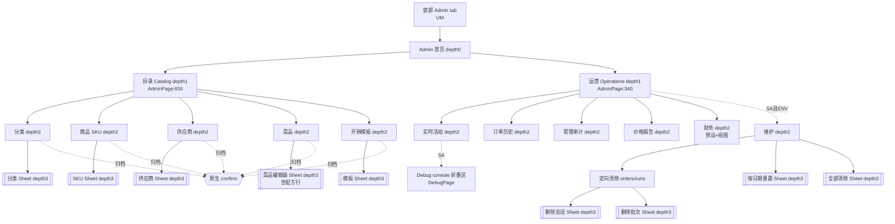

# F6 前端 UX / 交互审计：Admin → Catalog 与 Admin → Operations

- 基线：`main` @ `c243771`（2026-10-21），只读审计，未运行应用、未访问数据库或生产环境。
- 结论标签：**已确认（代码）** = 逐行读过代码可直接得出；**高可信度推断** = 由代码推出但依赖运行时细节；**待运行验证** = 需要真机/浏览器确认。
- 点击数只在能从代码推出时给出。计数规则：每次点按控件、打开原生 select、在原生 select 里选一项、确认原生 confirm 都算 1 次；输入文字不计点击，单独注明"+ 输入"。起点是"已在底部 Admin tab 且 Admin 处于首页"，除非另有说明。注意 navStore 会持久化下钻位置（`navStore.ts:132-160`），所以实际路径可能更短。
- 旧审计 `docs/audit-2026-10-21/E-navigation-admin-catalog.md` 的行号已过时（例如 Categories 现在是 `CatalogSections.tsx:101-338`，不再是 54-302）。下文全部按当前代码重新核对。

---

## 1 范围与已读文件

| 文件 | 读取范围 | 用途 |
|---|---|---|
| `apps/web/src/pages/AdminPage.tsx` | 120-695 全读 | Admin 路由、SectionFrame、CatalogHome、OperationsHome、标题 |
| `apps/web/src/pages/admin/catalog/CatalogSections.tsx` | 1-1705 全读 | 5 个目录 CRUD 区块 |
| `apps/web/src/pages/admin/operations/OperationsSections.tsx` | 1-1831 全读 | 6 个运营区块 + TargetedPurgeBrowser |
| `apps/web/src/pages/admin/operations/financeDates.ts` | 全读 | Finance 预设日期 |
| `apps/web/src/pages/admin/shared.ts` | 全读 | `nativeConfirm`、类型 |
| `apps/web/src/stores/navStore.ts` | 全读 | 持久化下钻状态、merge 清洗 |
| `apps/web/src/lib/errToast.ts`, `lib/confirm.ts` | 头部 | 错误 toast 翻译规则、原生确认框 |
| `apps/web/src/app/Shell.tsx` | 87-117 | 底部 tab 权限（History=`prices.view`，Admin=`users.manage`） |
| `apps/web/src/pages/HistoryPage.tsx` | 1-80, 250-265 | 底部 History tab，用来比较 |
| `apps/web/src/pages/DebugPage.tsx` | 1-40 + grep | 嵌入 Activity 的调试台 |
| `packages/ui/src/components/DataState*`, `Sheet.tsx` | grep | 加载/错误态、Sheet 返回键行为 |
| `apps/api/src/trpc/routers/admin.ts` | 156-200, 640-800, 3841-4100, 4184-4212, 4325-4500, 5215-5240, 5371-5416 + grep | 校验 schema、权限、审计 action key、purge 门槛 |
| `apps/api/src/trpc/routers/dishes.ts` | 200-260 + grep | dishes 权限、list |
| `apps/api/src/trpc/routers/report.ts` | 60-130 + grep | purchaseLines 权限与输入 |
| `apps/api/src/trpc/routers/catalog.ts` | 20-32, 148-175 | skus、skuPriceStats |
| `packages/contracts/src/schemas/{common,catalog}.ts` | 部分 | names / unit / step 枚举 |
| `packages/i18n/src/catalogs/{zh,en}.ts` | grep | 菜单文案与 hint |

---

## 2 页面/界面清单

权限缩写：**UM** = `users.manage`（进入 Admin tab 的门槛，`Shell.tsx:116`、`AdminPage.tsx:145,164`）；**OA** = `org.admin`（目录写入，`CatalogSections.tsx:50-52`）；**DM** = `dishes.manage`（`CatalogSections.tsx:1316`）；**SA** = `super_admin` 角色；**ENV** = `VITE_ENABLE_MAINTENANCE==='1'`。

可达性分类：A 已确认不可达 / B 没找到入口但可能可达 / C 可达但价值待确认 / D 没有使用数据 / E 已被替代。本仓库没有任何使用埋点数据，所以每一项都同时属于 D。下表只标除 D 以外的主分类。

| ID | 名称 | 位置 | 入口 | 条件 | 模式 | 用途 | 下一步 | 可达性 |
|---|---|---|---|---|---|---|---|---|
| F6-P01 | Catalog 首页 | `AdminPage.tsx:655-694`（渲染 208-210） | Admin 首页 → 「目录」`AdminPage.tsx:266-271` | UM | 只读菜单 | 5 个子区块入口 | P02-P06 | 可达 |
| F6-P02 | 分类列表 | `CatalogSections.tsx:101-251` | P01 →「分类」 | UM；写操作需 OA | OA：可编辑；非 OA：只读 + `ReadOnlyHint`（155-157） | 分类 CRUD | P02s | 可达 |
| F6-P02s | 分类新建/编辑 Sheet | `CatalogSections.tsx:253-335` | 「+ 新建分类」139-153 / 「编辑」199-215 | OA | create / edit | slug、4 种语言名、排序 | 关闭回到 P02 | 可达 |
| F6-P02c | 分类归档确认 | `CatalogSections.tsx:220-227` | 「归档」 | OA | 原生 confirm | 软删除 | P02 | 可达 |
| F6-P03 | 商品(SKU)列表 | `CatalogSections.tsx:386-580` | P01 →「商品」 | UM；写操作需 OA | 同 P02 + 搜索 + 「显示已归档」 | SKU CRUD | P03s | 可达 |
| F6-P03s | SKU 新建/编辑 Sheet | `CatalogSections.tsx:582-723` | 「+ 新建商品」437-454 / 「编辑」527-548 | OA | create / edit | 名称、分类、单位、步长、编码、排序 | P03 | 可达 |
| F6-P03c | SKU 归档确认 | `CatalogSections.tsx:553-558` | 「归档」 | OA | 原生 confirm | 软删除 | P03 | 可达 |
| F6-P04 | 供应商列表 | `CatalogSections.tsx:738-876` | P01 →「供应商」 | UM；写操作需 OA | 同上，有归档开关，没有搜索 | 供应商 CRUD | P04s | 可达 |
| F6-P04s | 供应商新建/编辑 Sheet | `CatalogSections.tsx:878-933` | 「+ 新建」/「编辑」 | OA | create / edit | 名称、电话、TG、地址、备注 | P04 | 可达 |
| F6-P04c | 供应商归档确认 | `CatalogSections.tsx:851-857` | 「归档」 | OA | 原生 confirm | | P04 | 可达 |
| F6-P05 | 开销模板列表 | `CatalogSections.tsx:960-1131` | P01 →「开销模板」 | UM；写操作需 OA | 同上 | 运营开销快捷模板 | P05s | 可达 |
| F6-P05s | 开销模板 Sheet | `CatalogSections.tsx:1133-1259` | 「+ 新模板」1003-1018 /「编辑」1076-1094 | OA | create / edit | 标签、单位提示、默认数量/单价/支付方式、排序 | P05 | 可达 |
| F6-P05c | 开销模板归档确认 | `CatalogSections.tsx:1099-1106` | 「归档」 | OA | 原生 confirm | | P05 | 可达 |
| F6-P06 | 菜品列表 | `CatalogSections.tsx:1306-1550` | P01 →「菜品」 | UM 才能进入；写操作需 DM | DM：编辑/归档；**非 DM 也能点行打开编辑器**（见 F6-03） | 菜品 + 配方 | P06s | 可达 |
| F6-P06s | 菜品编辑器 Sheet（含配方行编辑） | `CatalogSections.tsx:1553-1701` | 「+ 新菜品」1466 / 点行 1494-1497 | 保存需 DM（服务端 `dishes.ts:207-224`） | create / edit（前端没有只读模式） | 名称×4、编码、售价、食材行 | P06 | 可达 |
| F6-P06c | 菜品归档确认 | `CatalogSections.tsx:1534-1539` | 「归档」 | DM | 原生 confirm | | P06 | 可达 |
| F6-P07 | 目录只读提示 | `CatalogSections.tsx:55-60` | P02-P05 中非 OA 用户 | UM 且无 OA | 只读 | 解释为什么没有编辑按钮 | — | 可达（P06 没有使用它） |
| F6-P10 | Operations 首页 | `AdminPage.tsx:340-397`（渲染 218-220） | Admin 首页 →「运营」272-277 | UM | 菜单 | 6 个工具入口 | P11-P16 | 可达 |
| F6-P11 | 实时活动 | `OperationsSections.tsx:44-174` | P10 →「实时活动」 | UM（服务端按门店范围过滤，`admin.ts:4331-4343`） | 只读 | 6 个 KPI 卡片 + 最近 50 个领域事件 | P11d | 可达 |
| F6-P11d | 嵌入式 Debug console | `OperationsSections.tsx:156-171` → `DebugPage.tsx` | P11 底部「▸ Debug console」 | SA | 折叠/展开 | 日志、健康检查（health 页每 2s 轮询，`DebugPage.tsx:81`）、重置会话 | — | C |
| F6-P12 | 提交历史（Submission history） | `OperationsSections.tsx:185-316` | P10 →「订单历史」 | UM | 只读，可展开卡片 | 按门店看最近订单会话与结果 | 卡片展开 229-232 | 可达；与底部 History tab 名字冲突（§6） |
| F6-P13 | 管理审计 | `OperationsSections.tsx:727-871` | P10 →「管理审计」 | UM（非 org 管理员只看到本门店范围，`admin.ts:4424-4441`）；inputs JSON 仅 SA 可见 | 只读 | 谁在何时改了什么 | — | 可达；价值见 F6-02 |
| F6-P14 | 价格报告 | `OperationsSections.tsx:892-1011` | P10 →「价格报告」 | UM（`catalog.skuPriceStats` 本身没有权限门槛） | 只读 | 每个 SKU 的最近价、7 天/30 天均价、偏差 | — | 可达 |
| F6-P15 | 财务 | `OperationsSections.tsx:1034-1536` | P10 →「财务」 | UM（服务端 `report.ts:94-99`） | 只读；预设 today/yesterday/thisMonth/lastMonth/custom × 视图 daily/bySupplier/byStore；可复制 TSV | 现金 vs 转账对账 | 行展开 | 可达 |
| F6-P16 | 维护（危险区） | `OperationsSections.tsx:1538-1828` | P10 →「维护」`AdminPage.tsx:386-394` | 入口需 SA **且** ENV；页面本身只检查 SA（1596-1604） | 操作 | 定向清除 / 按日期重置 / 全部清除 | P16a-P16e | B：生产构建是否带 ENV 不可知（待运行验证）；另外持久化的 `opsSub='maintenance'` 可以绕过 ENV（F6-17） |
| F6-P16a | TargetedPurgeBrowser（订单/采购批次两个 tab） | `OperationsSections.tsx:348-588` | P16 第一张卡片 | SA | 操作 | 按日期列出 session/run，逐条删除 | P16b / P16c | 同 P16 |
| F6-P16b | 删除订单会话 Sheet（dry-run 预览） | `OperationsSections.tsx:591-630` | P16a「删除」504-519 | SA | 确认 | 按表列出级联行数后提交 | P16a | 同 P16 |
| F6-P16c | 删除采购批次 Sheet | `OperationsSections.tsx:633-677` | P16a runs tab「删除」568-581 | SA，且 `requireOnlyTestSessions:true` | 确认 | 同上，额外警告级联 | P16a | 同 P16 |
| F6-P16d | 按日期重置 Sheet | `OperationsSections.tsx:1712-1763` | 「重置今天」1635-1642 /「预览」1666-1674 | SA | 确认 | 删除某日全部交易数据 | P16 | 同 P16 |
| F6-P16e | 全部清除 Sheet（输入 slug 确认） | `OperationsSections.tsx:1766-1825` | 「预览全部」1696-1705 | SA | 确认 | 清空组织交易数据 | P16 | 同 P16 |
| F6-P17 | 非 SA 的维护页横幅 | `OperationsSections.tsx:1596-1604` | 只有持久化的 `opsSub='maintenance'` 才会到达（菜单入口已对非 SA 隐藏） | UM 且非 SA | 只读 | 说明仅 SA 可用 | — | B（高可信度推断：只能经陈旧的持久化状态到达） |

**已确认（代码）**：Catalog 和 Operations 的全部子页面都由 `AdminPage.tsx:208-226` 按 navStore 的 `catalogSub`/`opsSub` 渲染，没有 URL。返回只能通过 Telegram BackButton 或非 Telegram 环境下的页内 chevron（`AdminPage.tsx:423-447`）。回退一次上一层（179-193）。

---

## 3 导航结构

最深是 depth3（Sheet）。只有 Sheet 能叠在页面上面。区块之间没有任何互相跳转，例如价格报告不能跳到 SKU 编辑，审计行也不能跳到对象。**已确认（代码）**：全文件没有 `setCatalogSub`/`setOpsSub`/`setTab` 的跨区块调用。

---

## 4 交互链

格式：控件 → handler(file:line) → 状态变化 → 接口 → 反馈 → 跳转。CS = `CatalogSections.tsx`，OS = `OperationsSections.tsx`，AP = `AdminPage.tsx`。

### 4.1 通用（Admin 外框）
- Admin 首页行「目录/运营」→ `setSection` AP:270,276 → navStore.adminSection（持久化）→ 无接口 → 页面切换 → depth1。
- CatalogHome / OperationsHome 行 → `onPick` AP:665-691 / 353-392 → catalogSub/opsSub（持久化）。
- 返回 → `SectionFrame.onBack` AP:179-193 → 逐级清空 sub。Sheet 打开时，Telegram 返回键先关 Sheet（`Sheet.tsx:64-76` 的 `pushTelegramBackHandler`），**草稿直接丢弃，没有脏数据确认**（所有目录 Sheet 的 `onOpenChange={(open)=>!open && setDraft(null)}`，CS:255,584,880,1135,1555）。**已确认（代码）**。
- 底部 tab 切换：目录页没有注册 `registerTabChangeGuard`（全仓只有 SettlementPage 用了），切到别的 tab 会卸载 AdminPage，未保存的 Sheet 草稿丢失。**已确认（代码）**（grep 结果）。

### 4.2 分类 P02
| 控件 | handler | 状态 | 接口 | 反馈 | 备注 |
|---|---|---|---|---|---|
| + 新建分类 | CS:141-150 | draft={slug:'',names 空,sort:100} | — | 打开 Sheet | 仅 OA |
| slug 输入 | CS:288 | 自动转小写 | — | — | **前端不校验** `^[a-z0-9-]+$`（服务端 `admin.ts:768-775`）。输入中文、空格或下划线时按钮可点，服务端返回 zod BAD_REQUEST，message 不是 i18n key，所以只显示通用"出错了"（`errToast.ts:37,57-61`）。**已确认（代码）** |
| 4 个名称输入 | CS:294-325 | | | | 每个标签都带「*」，但服务端只要求至少 1 种（`admin.ts:640-647`，`CS:62-88`）。CS:93、293 的注释"Server enforces all 4"已过时 |
| 排序 | CS:330 | `Number()||0` | | | |
| 创建/保存 | CS:264-277 | — | `admin.categoryCreate/Update` | 成功：toast + invalidate `categoryList` + 关闭（111-126）；失败：errToast；重复 slug →`admin.errors.slugTaken` 有翻译 | disabled 条件：没 slug 或没名称（261-263）；`loading` 防双击 |
| 归档 | CS:220-227 | — | `categoryDelete`（软删） | 原生 confirm → toast.info | 按钮没有 loading，但每次都要先过 confirm |
| 取消归档 | CS:235-242 | — | `categoryUpdate{isArchived:false}` | toast「分类已更新」 | 有 per-row loading（238） |
| 列表 | CS:158-251 | — | `admin.categoryList`（**总是包含已归档**，`admin.ts:3841-3857` 没有过滤参数） | DataState 加载/空/错误 | 没有搜索，没有"显示已归档"开关，已归档项混在正常项里，只靠 Badge 区分 |

### 4.3 SKU P03
| 控件 | handler | 状态 | 接口 | 反馈 | 备注 |
|---|---|---|---|---|---|
| 显示已归档 Switch | CS:457-461 | includeArchived | 重新查询 `admin.skuList` | DataState | |
| 搜索 | CS:465-471, 480-487 | searchQuery → tokens | 无（客户端过滤） | 无匹配时 EmptyState 490-497 | 跨语言 + code（`matchesNameLike`）。只有 SKU 有搜索 |
| + 新建商品 | CS:439-451 | draft，unit 默认 pcs、step 默认 1 | | Sheet，uz 名称 autoFocus（633） | |
| 分类 Select | CS:661-680 | categoryId | | | 隐藏已归档分类，但保留当前值（669-670）。分类查询加载中时只显示「—」。没有"新建分类"捷径 |
| 单位/步长 Select | CS:686-709 | | | | 枚举锁定。显示原始码 `kg/pcs/...`，没有本地化（689-695）；价格报告用了 `unitLabel` |
| 创建/保存 | CS:593-616 | | `skuCreate/skuUpdate` | toast + invalidate `skuList`（401-416）| disabled：无名称（`unit.trim()` 永远非空，是死条件 590-592）；code 重复 →`admin.errors.codeTaken` |
| 归档 | CS:553-558 | | `skuDelete` | confirm → toast.info | |
| 取消归档 | CS:564-570 | | `skuUpdate{isArchived:false}` | 成功 toast「已更新」；**没有 loading，可以双击**（对比分类 238） | 幂等，危害低 |
| 失效刷新 | | 只 invalidate `admin.skuList` | | | `catalog.skus`（下单页、菜品配方、价格报告在用）没有在这里显式失效。服务端会 `broadcastCatalog`（`admin.ts:3880`），其他页面靠实时推送刷新 → 待运行验证 |

### 4.4 供应商 P04
- 列表 CS:801-876：`supplierList({includeArchived})`，按名称排序（`admin.ts:4097`）。**没有搜索**。
- Sheet CS:878-933：只有名称必填（886）；TG 自动去掉 @（923）；编辑时会把 `isArchived` 原样回写（897）。
- 归档/取消归档 CS:847-869：模式同 SKU，取消归档没有 loading。

### 4.5 开销模板 P05
- 「+ 新模板」CS:1003-1018，默认 sortIndex=0（其他区块默认 100）。
- 校验 CS:1145-1151：`Number(x)<=0`。输入 `"1,5"` 或 `"abc"` 时 `Number` 得到 NaN，`NaN<=0` 为 false，按钮可点；服务端正则 `^\d+(\.\d+)?$` 拒绝（`admin.ts:739-750`），用户只看到通用错误。**已确认（代码）**。
- 底部按钮新建和编辑都显示「保存」（1177）；其他区块新建时显示「创建」。
- 文案 key 用的是 `admin.action.edit/archive/unarchive`（1093,1108,1121），其他区块用 `common.*`。显示文字是否一致 → 待运行验证。

### 4.6 菜品 P06 / 配方编辑器 P06s
| 控件 | handler | 状态 | 接口 | 反馈 | 备注 |
|---|---|---|---|---|---|
| 显示/隐藏已归档（Button，不是 Switch） | CS:1456-1464 | | `dishes.list` | | 和其他区块控件类型不同 |
| 列表 | CS:1472-1550 | | `dishes.list` + `catalog.skus` | 只有 isLoading 和 empty 两种状态 | **没有错误态**：查询失败时 `dishes=[]`，显示"还没有菜品"（1476-1480）。**已确认（代码）** |
| 点行 | CS:1494-1497 → `openForEdit` 1384-1400 | draft | | 打开编辑器 | **不检查 canManage**，非 DM 用户也会打开可编辑表单并看到「保存」（1576-1584），保存时服务端 FORBIDDEN `dishes.errors.cannotManage` |
| 名称×4 | CS:1590-1603 | | | | 顺序 en/zh/ru/uz，标签格式「名称 · EN」，没有星号；SKU/分类是 uz/ru/en/zh，标签格式「用 O'zbekcha 的名称 *」。占位文字 'e.g. Beef plov' 是硬编码英文 |
| 售价 | CS:1611-1620 | | | | `type=number`，可以为空 |
| + 添加食材 | CS:1629 → 1439-1445 | 追加空行 | | | |
| 食材 SKU 选择 | CS:1647-1662 | | | | 原生 `<select>` 列出全部未归档 SKU，**不能搜索、不按分类分组**。如果已有配方引用的 SKU 后来被归档，它不在 options 里（1320 `includeArchived:false`），select 显示的选中项和实际值不一致，单位显示「—」。→ 显示效果待运行验证 |
| 数量 | CS:1676-1691 | | | | `step` 跟随 SKU 步长 |
| 删除行 × | CS:1663-1673 | filter | | | 列表 key 用的是 `idx`（1643） |
| 保存 | CS:1402-1436 | | `dishes.save`（原子） | 成功 toast「已保存」+ invalidate + 关闭；失败 errToast | 前端检查：至少 1 个名称（1411-1414）、SKU 不重复（1424-1427）。**没选 SKU 或数量≤0 的行会被静默丢掉**（1415-1417），不提示 |
| 归档 | CS:1534-1539 | | `dishes.archive` | toast「已保存」（不是"已归档"） | |
| 取消归档 | CS:1526 | | `dishes.unarchive` | **没有任何 toast**（1379-1382），也没有 loading | |
| note/description | | 原样带回 | | | 编辑器没有 UI，但保存时会原样回传（1394-1398,1432），不会丢数据 |

### 4.7 实时活动 P11
- 两个查询 OS:47-48，一次性加载，没有轮询或下拉刷新（服务端 SSE 是否触发失效 → 待运行验证）。
- 事件行显示 `streamType.type` 原始码（OS:122），例如 `order.ClaimReleased`，`seq N`。actor 为空时显示硬编码 'system'（141）。标题 "Recent events" 硬编码英文（78）。行不能点。
- Debug 切换按钮 OS:158-164，只对 SA 显示，文字硬编码英文。
- 菜单 hint「KPI + 近期审计事件」（zh.ts:422）不准：这里显示的是领域事件，审计在 P13。

### 4.8 提交历史 P12
- 门店 Select OS:198-205，选项 "All stores" 硬编码英文。数据来自 `admin.storeList`。
- 查询 `submissionHistory({storeId, limit:100})`。服务端默认 30 天（`admin.ts:5237-5240`），前端**不能改日期**，也没有分页。
- 卡片点按展开（229-232），显示贡献者明细和驳回原因。"decided in N min"、"by" 硬编码英文（275,277）。

### 4.9 管理审计 P13
- 门店筛选：pill 按钮 OS:757-783，选项来自 `session.stores`。筛选到某门店时，org 级行（scope NULL，例如分类、SKU、角色）全部不见。空态文字硬编码英文（790-800）。
- 行渲染 OS:809-860：`action.split('.')` 得到 obj 和 verb，直接显示英文原词（825-826）。tone 只认 delete/deny/create/allow；**`grant`/`revoke`/`update` 都显示灰色**。
- 下列服务端 action key 只有两段：`admin.memberAssignStore`、`admin.memberUnassignStore`、`admin.memberDetachFromStore`、`admin.memberTransferStore`、`admin.memberInviteCreate`、`admin.memberInviteRevoke`、`admin.memberInviteByTgId`、`admin.orgFinanceUpdate`（`admin.ts:1064,1434,1554,1844,2001,2071,2216,2429`）。前端显示时 verb 是「?」，obj 是驼峰原词。**已确认（代码）**。
- 对象只显示 `resourceId.slice(0,8)…`（829）。`admin.role.grant` 的 resourceId 是 member.id（`admin.ts:3395`），所以非 SA 看不到"给谁授予了哪个角色"。inputs JSON 只有 SA 能看（851-860），而且里面也是 id。
- 只有 limit 100，没有分页，不能按 action 或 actor 筛选。
- 菜品（dishes.*）和取消归档以外的 dishes 操作没有审计（dishes.ts 不调用 auditAdmin，grep 已确认）。开销模板有审计（`admin.ts:4230-4312`）。

### 4.10 价格报告 P14
- 查询 OS:898-900：`catalog.skus(includeArchived:false)` + `skuPriceStats()`（全部 SKU）。
- 只处理加载中和空（946-955）。**没有错误态**，查询失败会显示"没有数据"。
- 已归档 SKU 如果有价格观测，名称显示为 UUID 前 8 位（919）。
- 按 30 天均价降序（938）。**没有搜索**，没有点进去看的明细或时间序列。服务端返回了 `lastObservedAt`，但 UI 没显示（文件头注释 876 说"with date"）。
- "7d avg / 30d avg / obs" 硬编码英文（988,994,999）。

### 4.11 财务 P15
- 预设 Segmented OS:1231-1243 → `setPreset` → effect 1057-1062 写 start/end（本地日历，`financeDates.ts`，已修 CA-23）。ariaLabel 误用 `finance.range.start`（1242），视图切换的 ariaLabel 误用 `finance.view.daily`（1323）。
- 自定义日期 1244-1259：**不校验 start ≤ end**。清空任一日期时请求不合法（`DateStringSchema`），查询报错，被当成"没有数据"显示（1336-1344 只判断 isLoading 和 length），totals 卡片直接消失（1268）。**已确认（代码）**。
- 视图切换 1318-1321 会重置展开状态。三种视图是三段几乎相同的 JSX（1345-1533）。
- 汇总卡片：现金/转账/合计 + 物品/开销拆分（1297-1303，CA-11 后的新口径）。
- 供应商名：`admin.supplierList()` 不带参数，默认**排除已归档**（OS:1039，`admin.ts:4076`）。已归档供应商的历史支出显示为 UUID 前 8 位。按商品显示的名称用的是 `includeArchived:true`（1038），两边不一致。**已确认（代码）**。
- 复制 TSV 1195-1224：**不管当前是哪个视图，都导出逐行明细**（9 列）；没有"按供应商汇总"的导出。`clipboard.writeText` 没有 await，toast 在写入成功前就显示了（1215-1216），写入被拒绝时也会提示"已复制"。列头是英文 `date run sku…`，开销行在 sku 列里带 🧾 前缀。
- 服务端支持 `storeId` 和 `paymentMethod` 过滤（`report.ts:64-73`），前端没用。
- 状态不持久化：离开再进来会重置为本月 + 按日。

### 4.12 维护 P16
- `todayIso()` OS:339-341 用 `toISOString().slice(0,10)`，也就是 UTC 日期。CA-23 在 Finance 修掉的同类问题，这里还在。在塔什干（UTC+5）00:00–04:59 期间，「重置今天」预览和删除的是**昨天**的数据（1632,1639）；P16a 的默认日期也一样（349）。说明文字里显示了日期，用户有机会发现。**已确认（代码）**。
- 定向清除 P16a：日期 input + 自制 tab 按钮（424-455，不是 Segmented）。两个查询同时请求（351-352），不管当前在哪个 tab。会话行只要不在批次里就显示红色「删除」。**服务端 `purgeSession` 不检查"是否测试数据"**（`admin.ts:5371-5413`，只拒绝 in_run/archived），而批次删除带 `requireOnlyTestSessions:true`。所以一条真实的、已审批但还没进批次的订单也可以从这里删掉。
- 删除流程：点「删除」→ 设置 target 并发起 dry-run（507-516）→ Sheet 显示 "Counting…" → 预览 → 「Delete N rows」→ 提交 → toast + 全局 `utils.invalidate()`。dry-run 失败会关闭 Sheet 并弹 toast（375-378）。提交中不能关闭 Sheet（593）。Sheet 标题和按钮文字硬编码英文（594,610-614,621）。
- 按日期重置：预览成功后自动打开 Sheet（1558-1561）。`total=0` 时按钮禁用。
- 全部清除：必须完整输入 org slug（1577），区分大小写。`total=0` 但 slug 匹配时，「Delete 0 rows」仍然可点（1776）。文字硬编码英文（1782,1790,1814）。

---

## 5 用户任务流程

### T1 新建 SKU（带分类和单位）
- **现有路径**（OA）：Admin 首页 → 目录(1) → 商品(2) → + 新建商品(3) → 输入名称（uz 已自动聚焦，+ 输入）→ 分类 select 打开(4) + 选择(5) → 单位 select(6) + 选择(7) →（步长需要改时 +2）→ 创建(8)。**8 次点击 + 1 段输入**。默认 pcs/1 且不选分类时最少 4 次。
- **问题步骤**：①分类不存在时，需要关 Sheet（草稿丢失）→ 返回 → 分类 → 新建（必须手填 slug + 名称）→ 返回 → 商品 → 重新开 Sheet，额外约 8 次点击 + 重复输入；②4 个名称都带「*」，误导用户填满 4 种语言；③单位显示原始码。
- **原因**：CS:285-325、627-659 的星号；SKU Sheet 里没有内联新建分类（660-681）；分类必须有 slug（261-263）。
- **建议路径**：只有"当前界面语言"的名称是必填，其他语言折叠到「更多语言」；分类 select 末尾加「+ 新建分类…」内联小表单；slug 从名称自动生成（可以手动改）。
- **预期改进**：没有分类时省掉约 8 次点击和一次草稿丢失；减少误以为要填 4 种语言的情况。
- **风险**：slug 自动生成需要处理西里尔/中文转写，以及和已有 slug 冲突。

### T2 改 SKU 名称/修错别字
- **路径**：目录(1) → 商品(2) → 搜索框(3) + 输入 → 编辑(4) → 改字段 → 保存(5)。**5 次点击 + 2 段输入**。
- **问题**：搜索词在离开页面后不会保留；编辑 Sheet 又显示 4 个带星号的字段。
- **建议**：同 T1；可以考虑在下单页长按商品直接跳到编辑（需要跨区块导航，目前不存在）。
- **风险**：低。

### T3 归档与恢复（SKU / 分类 / 供应商）
- **SKU 归档**：目录 → 商品 → (搜索) → 归档 → confirm 确认 = 4 次点击（+ 搜索）。**恢复**：目录 → 商品 → 打开「显示已归档」(3) → 搜索 → 取消归档(4) = 4 次。
- **分类**：已归档项始终在列表里，恢复 = 目录 → 分类 → 取消归档 = 3 次，但已归档项会长期占位，没有开关能隐藏。
- **供应商**：和 SKU 相同，但没有搜索，只能滚动查找。
- **问题**：三处模式不一致（分类没有开关；菜品的开关是 Button；SKU/供应商取消归档没有 loading；菜品取消归档没有 toast）。归档分类对其下 SKU 有什么影响，界面没有说明（服务端 categoryDelete 只改分类本身，`admin.ts:3913-3936`；下单页如何显示 → 待运行验证）。
- **建议**：抽取统一的 `CatalogListSection`：标准「显示已归档」Switch + 搜索 + 统一的归档/恢复按钮（带 loading 和 toast）。
- **风险**：分类列表需要服务端加 `includeArchived` 参数。

### T4 新建菜品并设置 5 种食材的配方
- **前提**：同时有 UM（才能进 Admin）和 DM。
- **路径**：目录(1) → 菜品(2) → + 新菜品(3) → 名称（+ 输入，en 在第一位）→（售价 +1 + 输入）→ 每种食材：添加食材(1) + 打开 SKU select(1) + 在全部 SKU 的长列表里滚动选择(1) + 点数量框(1) + 输入 = 4 次 × 5 = 20 → 保存(1)。**约 24 次点击 + 6 段以上输入**，SKU 越多滚动越久。
- **问题**：原生 select 不能搜索也不分组（CS:1647-1662）；漏选或填 0 的行会被静默丢掉（1415-1417）；非 DM 用户也能打开编辑器，保存才报 FORBIDDEN（1384-1400,1576）；查询失败显示"没有菜品"（1472-1480）。
- **建议路径**：添加食材时打开带搜索的 SKU 选择 Sheet（复用下单页的跨语言搜索 `matchesNameLike`），支持多选，一次加入 5 个 SKU 后再统一填数量；无效行标红而不是静默删除；非 DM 用户打开只读视图。
- **预期改进**：每种食材从 4 次点击降到约 2 次（搜索 + 勾选），合计约 24 → 14；可以避免静默丢行。
- **风险**：多选组件要新写，或者从订单页抽出来。

### T5 新建开销模板
- **路径**：目录(1) → 开销模板(2) → + 新模板(3) → 标签（自动聚焦，+ 输入）→ 单价框(4) + 输入 →（数量默认 1）→ 支付方式(5，可选) → 保存(6)。**5–6 次点击**。
- **问题**：输入 "1,5" 或非数字时按钮可点，服务端拒绝后只显示通用错误（4.5 节）；新建时按钮也显示「保存」。
- **建议**：用 `/^\d+(\.\d+)?$/` 做前端校验（与服务端一致），并把逗号自动转成点。
- **风险**：低。

### T6 查上个月各供应商的支出并复制
- **路径**：运营(1) → 财务(2) → 上月(3) → 按供应商(4) → 复制为 TSV(5)。**5 次点击**。
- **问题步骤**：复制出来的是**全部逐行明细**，不是屏幕上的按供应商汇总（OS:1195-1213）；用户还要在表格软件里自己做透视。已归档供应商显示 UUID 前缀（1039）。toast 可能在复制失败时也显示"已复制"（1214-1216）。
- **建议路径**：导出跟随当前视图（daily → 日汇总，bySupplier → 供应商 × 现金/转账/合计，byStore 同理），另外提供一个「导出明细」二级按钮；`supplierList({includeArchived:true})`；await 剪贴板写入。
- **预期改进**：省掉表外透视；名称完整。
- **风险**：财务人员可能已经习惯逐行格式，保留明细选项即可。

### T7 查看某个 SKU 的价格走势
- **路径**：运营(1) → 价格报告(2) → 滚动查找（不能搜索，按 30 天均价排序）→ 只能看到最近价、7 天/30 天均价、偏差。**看不到走势**，也看不到最近价是哪天的。
- **替代路径**：底部 History tab 有搜索（`HistoryPage.tsx:62-73`，按采购记录服务端搜索），可以逐条看历史价格，但需要自己比较。
- **建议**：价格报告加搜索框，显示 `lastObservedAt`；点行展开 30 天迷你折线（数据源需要新接口或复用 run.history）。
- **风险**：需要新的按 SKU 价格序列接口。

### T8 查谁改了某个成员的角色
- **路径**：运营(1) → 管理审计(2) → 在最近 100 条里人工查找 Badge「grant」/「revoke」+「role」的行 → 能看到操作人和时间，但**看不到目标成员和角色名**（只有 member id 前 8 位）。非 SA 无法展开 inputs。
- **问题**：任务实际上无法完成（**已确认（代码）**，OS:825-845，`admin.ts:3395,3488`）。另外，org 级角色授予的 scope 可能是 NULL，门店级管理员根本看不到（`admin.ts:4436-4439`）→ deriveScopeStoreId 对 role.grant 的具体结果待验证。
- **建议**：服务端在 adminAuditList 里解析 resourceId 和 inputs 中的 memberId/roleId，返回可读名称；前端用 i18n 把 action 渲染成句子（"A 给 B 授予了 店长@X店"）；加 action 类型筛选（角色/目录/成员）；修复两段式 key 显示「?」的问题。
- **风险**：被删成员或角色的名字需要回退显示。

### T9 超级管理员清除一条测试订单会话
- **前提**：SA 且构建时 ENV=1（否则菜单没有入口）。
- **路径**：运营(1) → 维护(2) →（必要时改日期 +1~2）→ 「订单」tab 默认已选中 → 删除(3)（自动 dry-run）→ 等预览 → Delete N rows(4)。**4 次点击**。
- **问题**：①默认日期是 UTC 日期，凌晨时段是"昨天"（OS:339-341,349）；②服务端只阻止已进批次的会话，**不验证是否测试数据**，真实订单也能被删（`admin.ts:5389-5394`）；③多处硬编码英文。
- **建议**：todayIso 改用 `localDateValue(new Date())`；purgeSession 加和 purgeRun 一样的 `requireOnlyTestSessions` 判定，或在行上标出"真实用户"并要求输入确认文字。
- **风险**：判定"测试数据"的规则要和 purgeRun 保持一致。

---

## 6 一致性与重复

### 6.1 5 个目录 CRUD 区块横向对比（已确认（代码））

| 维度 | 分类 | SKU | 供应商 | 开销模板 | 菜品 |
|---|---|---|---|---|---|
| 写权限 | OA | OA | OA | OA | DM |
| 只读提示 | ✔ 155 | ✔ 434 | ✔ 774 | ✔ 1000 | ✘（而且行可点开编辑器） |
| 显示已归档 | ✘（始终显示） | Switch | Switch | Switch | **Button** |
| 搜索 | ✘ | ✔ | ✘ | ✘ | ✘ |
| 列表外观 | Card + 按钮栏 | Card | Card | Card | 自制 li + 整行可点 |
| 编辑入口 | 「编辑」按钮 | 按钮 | 按钮 | 按钮 | 点整行 |
| 名称字段 | 4 种语言，uz 在前，全带 * | 同分类 | 单个 name | 单个 label | 4 种语言，en 在前，无 *，标签格式不同 |
| 新建按钮文案 | `+ {newButton}` | `+ {new}` | `+ {newButton}` | 文案自带 `+` | 文案自带 `+` |
| 底部按钮 | 创建/保存 | 创建/保存 | 创建/保存 | 始终「保存」 | 始终「保存」 |
| 默认排序值 | 100 | 100 | — | 0 | 服务端 |
| 取消归档 loading | ✔ | ✘ | ✘ | ✘ | ✘ |
| 取消归档 toast | 已更新 | 已更新 | 已更新 | 已更新 | **无** |
| 归档 toast | info「已归档」 | 同左 | 同左 | 同左 | success「已保存」 |
| 错误态 | DataState | DataState | DataState | DataState | **无** |
| i18n key 前缀 | catalog./common. | 同左 | 同左 | admin.action./admin.sheet. | dishes. |

文件头 CS:9-11 已承认"ListEditor/NameFieldsML consolidation"尚未做。可以抽出的共享组件：`NameFieldsML`（CS:294-325 与 627-659 逐字重复）、`ArchiveToggleRow`、`ArchiveRestoreButtons`、`CatalogListFrame`（只读提示 + 新建 + 开关 + 搜索 + DataState）。

### 6.2 "History" 命名冲突
- 底部 tab `nav.history` =「历史」/ History（`Shell.tsx:98`，`prices.view`），内容是**采购批次与支出**（`HistoryPage.tsx:1-6`、`run.history`）。
- Admin → 运营 →「订单历史」/ "Submission history"（zh.ts:416，en.ts:517），内容是**订单会话**；navStore 里的 key 也叫 `history`（`navStore.ts:96`）。
- 英文界面里一个叫 History，一个叫 Submission history，中文是「历史」和「订单历史」，容易以为"订单历史"是"历史"的子集。**高可信度推断**：管理员会搞混。建议改名为「订单提交记录」/ "Order submissions"，代码 key 改为 `submissions`。

### 6.3 Finance 与底部 History 的金额视图
- 两边已经共用服务端金额口径（CA-11，`report.ts:116-123` 的注释），日期工具也共用（`HistoryPage.tsx:12-14`）。
- 但交互模型不同：History 是筛选 Sheet + 7/30/90 天预设 + 支付方式/门店筛选 + 服务端分页 + 搜索；Finance 是今天/昨天/本月/上月/自定义的 Segmented + 三种分组视图 + TSV，没有门店或支付方式筛选，也没有分页（一次性拉取全部明细）。
- 同一类"按时间看钱"的任务有两套预设和两套筛选。建议 Finance 复用 History 的筛选组件（再加"本月/上月"预设），History 也加"本月/上月"。

### 6.4 Debug console 嵌在实时活动里
- 运营类页面里嵌了开发工具（OS:156-171），还带 2 秒轮询（`DebugPage.tsx:81`）和"重置会话"这种破坏性操作。只有 SA 可见，但 SA 在生产里也可能就是老板本人（**待运行验证**：生产里谁有 super_admin）。建议移到维护区块，或做成独立的 opsSub `debug`，并受 ENV 控制。

### 6.5 价格报告 vs History / 订单页
- 价格报告和审批卡片用同一个 `loadSkuPriceStats`（`catalog.ts:160-164`），数字一致。但价格报告没有搜索、没有日期、没有走势；History 有搜索，却没有按 SKU 聚合。两者互补但互不链接。建议价格报告的行跳到 History 并预填搜索词（需要跨 tab 传参）。

### 6.6 运营区块内部的重复
- Finance 三种视图是三段 90% 相同的 JSX（OS:1345-1533），可以抽成 `<MoneyGroupList groups getName renderLine>`。
- `CascadePreview`（682-704）已经抽出来了，但按日期重置（1738-1760）和全部清除（1788-1811）又各手写了一遍同样的表格。
- 门店筛选有三种实现：Select（P12 198-205）、pill 按钮（P13 757-783）、没有筛选（P15）。
- Tab/Segmented 也有三种：`Segmented`（P15）、自制按钮（P16a 431-454）、自制 pill（P13）。

---

## 7 问题清单

| ID | 严重度 | 标题 | 证据 | 影响 | 修复方向 | 验证 |
|---|---|---|---|---|---|---|
| F6-01 | P1 | 维护区「重置今天」和定向清除的默认日期用 UTC | OS:339-341,349,1549,1632,1639；Finance 已用 `financeDates.ts` 修过同类问题 | UTC+5 地区 00:00–04:59 点「重置今天」会**不可逆地删除昨天的数据**。说明文字里显示了日期，可能被发现；页面受 SA+ENV 限制。危害不可逆，所以定为 P1 | 改用 `localDateValue(new Date())` | 单测：伪造时间为本地 02:00；E2E 检查预览日期 |
| F6-02 | P1 | 管理审计回答不了"谁改了谁的角色" | OS:809-845；`admin.ts:3395,3488` resourceId 是 member/binding id；两段式 action key 显示「?」（`admin.ts:1064,1434,2001…`） | 审计区块的核心场景（自己的 hint 写着"角色变更"，zh.ts:424）无法完成，非 SA 只能看到 id 前缀 | 服务端返回可读的目标名称和角色名；前端用 i18n 渲染成句子；兼容两段式 key；加按类型筛选 | 授予角色后在审计里能看到"A→B：角色" |
| F6-03 | P2 | 菜品编辑器对没有 `dishes.manage` 的用户也能打开 | CS:1384-1400（不判断 canManage），1576-1584（总是渲染保存按钮）；服务端 `dishes.ts:207-224` | 只有 UM 的店长点进去、改完、保存后才收到 FORBIDDEN，修改白做；也没有只读提示 | 非 DM 用户打开只读视图，或者行不可点 + ReadOnlyHint | 用 manager 账号点菜品行 |
| F6-04 | P2 | 菜品、价格报告、财务的查询错误被显示成"没有数据" | CS:1472-1480；OS:946-955；OS:1336-1344 + 1268 | 网络或权限错误时看起来像"没有菜品/没有支出"；财务对账场景尤其会误导 | 改用 DataState，或者显式处理 `isError` | 断网或模拟 500 |
| F6-05 | P2 | 财务里已归档供应商显示为 UUID | OS:1039 用 `supplierList()`，默认排除已归档（`admin.ts:4076`） | 按供应商视图和 TSV 中出现不可读的 id，对账出错 | 传 `{includeArchived:true}` | 归档一个有历史支出的供应商后打开财务 |
| F6-06 | P2 | 复制 TSV 不跟随当前视图 | OS:1195-1213 | "按供应商复制"实际拿到的是全部逐行明细，还要再做透视 | 按视图导出汇总，明细作为二级选项 | 在 bySupplier 视图复制并检查剪贴板 |
| F6-07 | P2 | 名称字段全部带 * 和过时注释，暗示 4 种语言都必填 | CS:285-325,627-659,93,293,624；服务端 `admin.ts:640-647` 只要求 1 种 | 管理员会被迫或误以为要填 4 种语言，新建和改名都变慢 | 只给当前语言加 *，其他语言折叠 | 只填 1 种语言保存成功 |
| F6-08 | P2 | 分类 slug 不在前端校验，失败只显示通用错误 | CS:288（只转小写）；`admin.ts:768-775` 正则；`errToast.ts:37` 只翻译 i18n key | 输入"овощи"或"my veg"后保存只看到"出错了" | 前端用相同正则提示，或从名称自动生成 slug | 输入非法 slug |
| F6-09 | P2 | 配方食材只能用原生 select 从全部 SKU 中选 | CS:1647-1662 | 5 种食材约 20 次点击 + 长列表滚动（§5 T4） | 带搜索的多选 SKU Sheet | 计数 / 可用性测试 |
| F6-10 | P2 | 配方中无效行被静默丢弃 | CS:1415-1417 | 忘记填数量的食材在保存后消失，库存扣减出错 | 标红并阻止保存 | 留一行数量为空后保存 |
| F6-11 | P2 | 定向清除可以删除任何未进批次的真实订单 | OS:504-519；`admin.ts:5371-5413` 没有测试数据判定（批次删除有 `requireOnlyTestSessions`） | SA 误删真实的已审批订单（受 ENV 门控） | 服务端加测试判定，或要求二次输入确认 | 对一个真实用户的会话做 dry-run |
| F6-12 | P2 | 价格报告不能搜索、没有日期和走势 | OS:892-1011；`lastObservedAt` 没有使用（`catalog.ts:168`） | 查单个 SKU 需要滚动；"最近价"不知道有多旧 | 搜索 + 显示日期 + 展开走势 | — |
| F6-13 | P2 | "History"命名冲突 | zh.ts:10 vs 416；en.ts:37 vs 517；`navStore.ts:96` | 管理员混淆两个不同的数据集 | 改名为「订单提交记录」，key 改为 `submissions` | 文案走查 |
| F6-14 | P3 | 运营区大量硬编码英文 | OS:78,141,164,199,275,277,473,502,541,565,594,610-614,621,686,790-800,841,988,994,999,1731-1742,1782,1790,1814 | 中文/俄文/乌兹别克文界面里夹着英文 | 全部改走 i18n | `check-untranslated` 扩展检查 |
| F6-15 | P3 | 目录 CRUD 五个区块模式不一致 | §6.1 表 | 学习成本高，有零散缺陷（取消归档无 loading/toast，菜品开关是 Button，分类不能隐藏已归档） | 抽 `CatalogListFrame` 等共享组件 | 视觉走查 |
| F6-16 | P3 | Sheet 草稿关闭或切 tab 时不确认就丢弃 | CS:255,584,880,1135,1555；没有 `registerTabChangeGuard` | 长表单（菜品配方）误触返回会丢全部输入 | 草稿有改动时确认 | 填表后按 Telegram 返回 |
| F6-17 | P3 | 维护区可以经持久化导航绕过 ENV 门控 | AP:226 只按 `opsSub` 渲染；`navStore.ts:216-226` 接受 `'maintenance'`；OS:1596 只检查 SA | ENV 只控制菜单入口，SA 带着旧的持久化状态仍能进入（服务端仍要求 SA，所以只是纵深防御的缺口） | AP:226 也检查 ENV，或在 navStore merge 时清洗 | 在 localStorage 写入 `opsSub:'maintenance'` |
| F6-18 | P3 | 菜单 hint 过时或不准 | zh.ts:374（目录 hint 漏了菜品和模板）、375（运营 hint 漏了审计/价格/财务）、422（实时活动写成"审计事件"）；CS:1282-1283 注释说 manager 默认有 DM | 入口信息不完整 | 更新文案和注释 | — |
| F6-19 | P3 | 剪贴板写入成功前就提示"已复制" | OS:1214-1216 | 写入被拒绝时提示错误 | await 后再 toast | WebView 拒绝剪贴板权限时测试 |
| F6-20 | P3 | 开销模板数值前端校验与服务端不一致 | CS:1145-1151 vs `admin.ts:739-750` | 输入"1,5"等后只看到通用错误 | 前端用同一正则，逗号转点 | 输入"1,5" |
| F6-21 | P3 | 财务自定义日期不校验，空值会被显示成"没有数据" | OS:1244-1259,1066-1067 | 用户以为区间里没有支出 | 校验 start≤end 和非空 | 清空日期 |
| F6-22 | P3 | 提交历史不能选日期，最多 100 条，没有分页 | OS:189-192；`admin.ts:5215-5240` 支持 from/to | 超过 30 天或数据量大时看不全 | 加日期范围和分页 | — |
| F6-23 | P3 | 配方引用已归档 SKU 时 select 显示错乱 | CS:1320,1657 只有未归档选项 | 编辑旧菜品时看不出它用了什么食材 | 已归档的当前值仍作为选项显示（参考 CS:669-670 的做法） | 归档一个配方中的 SKU 后打开菜品 |
| F6-24 | P3 | SKU 编辑 Sheet 的单位显示原始码，SKU 列表 meta 也一样 | CS:691-695,516 | 中文界面显示 `pcs/bunch` | 用 `useUnitLabel` | — |
| F6-25 | P3 | Debug console 嵌在业务页面里 | OS:156-171 | 混淆运营工具与开发工具 | 移到维护区或独立入口 | — |
| F6-26 | P3 | 全部清除在 0 行时仍可提交；slug 区分大小写 | OS:1776,1577 | 空操作 / 输入摩擦 | total=0 时禁用 | — |

没有 P0：这两个区块中没有发现会让普通用户丢数据或越权的问题。会删数据的路径都需要 SA，并在服务端校验。

---

## 8 待运行验证项

1. 生产构建是否设置了 `VITE_ENABLE_MAINTENANCE`，以及生产里谁持有 `super_admin`（决定 P16 和 Debug 的可达性）。
2. `broadcastCatalog` / SSE 是否会让下单页和菜品页的 `catalog.skus` 自动失效（4.3 节）。
3. 实时活动页是否有实时刷新（OS:47-48 没有 refetchInterval）。
4. `deriveScopeStoreId` 对 `admin.role.grant` 给出的 scope 是什么，也就是门店级管理员能否在审计里看到角色授予（F6-02 / T8）。
5. 归档分类后，下单页如何显示其下的 SKU（T3）。
6. 原生 select 的 value 不在 options 里时，Telegram iOS/Android WebView 显示什么（F6-23）。
7. `common.edit` 与 `admin.action.edit` 等两套 key 的实际文案是否一致（4.5 节）。
8. Telegram WebView 里 `navigator.clipboard.writeText` 的成功率（F6-19 / T6）。
9. DataState 错误态显示的 `error.message` 是否会出现未翻译的原始 key（`DataState` 第 44-47 行）。
10. 所有点击数都是从代码推算的，需要真机走一遍确认（尤其原生 select 在 Telegram 里是否需要额外点"完成"）。

## 9 未覆盖范围

- Admin 的其他区块（组织、门店、权限、平台）属于其他轨道；这里只读了 AdminPage 中与路由和外框相关的部分。
- `DebugPage.tsx` 只看了头部和轮询，没有逐控件审计。
- 后端只核对了本文引用的过程，没有审计 `deriveScopeStoreId`、`loadSkuPriceStats`、`runMoney.ts` 的计算正确性，也没有看 purge 的级联 SQL。
- 底部 History tab（`HistoryPage.tsx`、`runs/history/RunHistory`）只为比较读了片段。
- 没有做视觉、无障碍或性能测量；没有运行测试（`operations/__tests__/financeDates.test.ts` 存在，但没有运行）。
- 俄文和乌兹别克文文案只确认了 key 存在，没有逐条核对译文。
